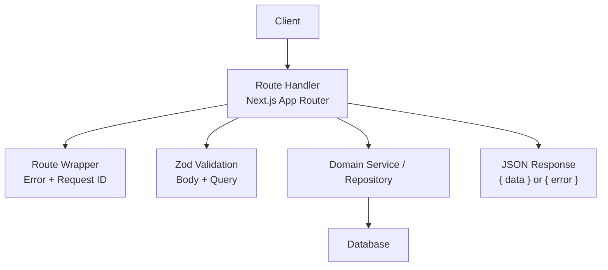
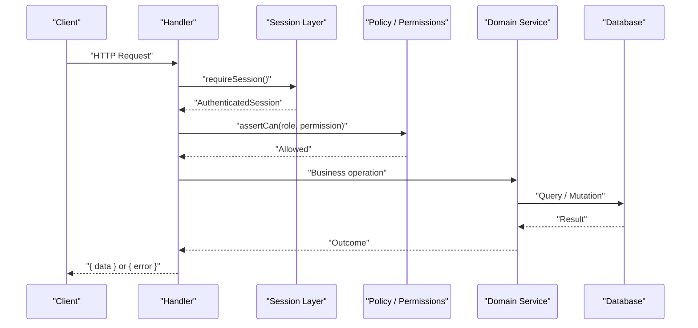
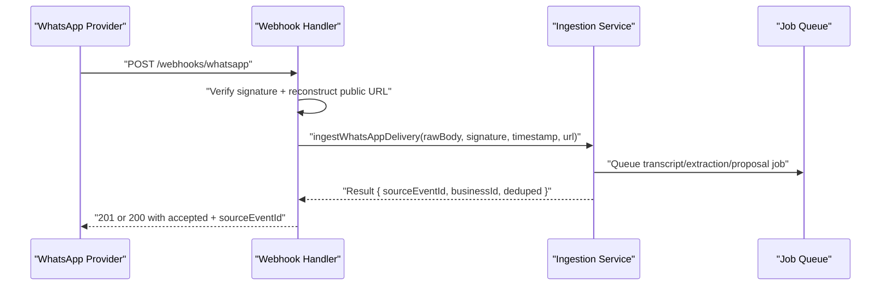
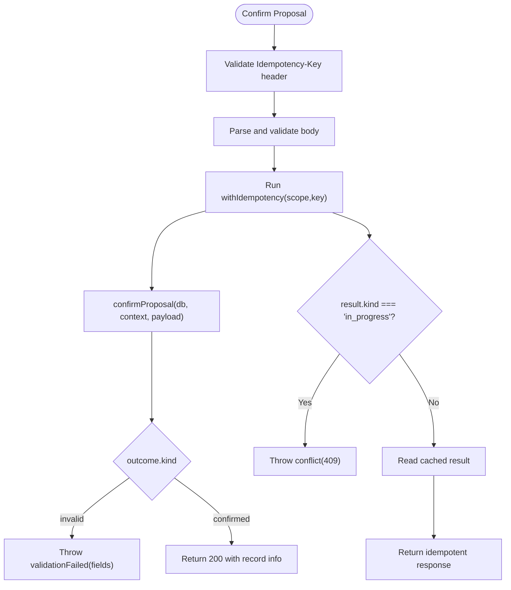
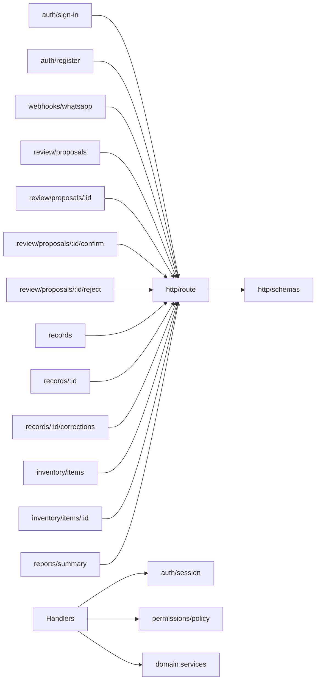

# API Reference

<cite>
**Referenced Files in This Document**
- [route.ts](file://src/server/http/route.ts)
- [schemas.ts](file://src/server/http/schemas.ts)
- [session.ts](file://src/server/auth/session.ts)
- [session-store.ts](file://src/server/auth/session-store.ts)
- [password.ts](file://src/server/auth/password.ts)
- [sign-in route.ts](file://src/app/api/v1/auth/sign-in/route.ts)
- [register route.ts](file://src/app/api/v1/auth/register/route.ts)
- [whatsapp webhook route.ts](file://src/app/api/v1/webhooks/whatsapp/route.ts)
- [proposals list route.ts](file://src/app/api/v1/review/proposals/route.ts)
- [proposal detail route.ts](file://src/app/api/v1/review/proposals/[proposalId]/route.ts)
- [proposal confirm route.ts](file://src/app/api/v1/review/proposals/[proposalId]/confirm/route.ts)
- [proposal reject route.ts](file://src/app/api/v1/review/proposals/[proposalId]/reject/route.ts)
- [records list route.ts](file://src/app/api/v1/records/route.ts)
- [record detail route.ts](file://src/app/api/v1/records/[recordId]/route.ts)
- [record corrections route.ts](file://src/app/api/v1/records/[recordId]/corrections/route.ts)
- [inventory items list route.ts](file://src/app/api/v1/inventory/items/route.ts)
- [inventory item update route.ts](file://src/app/api/v1/inventory/items/[itemId]/route.ts)
- [reports summary route.ts](file://src/app/api/v1/reports/summary/route.ts)
</cite>

## Table of Contents
1. [Introduction](#introduction)
2. [Project Structure](#project-structure)
3. [Core Components](#core-components)
4. [Architecture Overview](#architecture-overview)
5. [Detailed Component Analysis](#detailed-component-analysis)
6. [Dependency Analysis](#dependency-analysis)
7. [Performance Considerations](#performance-considerations)
8. [Troubleshooting Guide](#troubleshooting-guide)
9. [Conclusion](#conclusion)
10. [Appendices](#appendices)

## Introduction
This document describes the public RESTful API for the Daftari application. It covers authentication, WhatsApp webhooks, proposal review, ledger records, inventory management, reporting, and debt tracking integration points. Each endpoint documents HTTP methods, URL patterns, request and response schemas, authentication requirements, error responses, rate limiting, idempotency, and security considerations. The base handler layer provides consistent error formatting, Zod-based validation, pagination helpers, and a uniform JSON envelope.

## Project Structure
The API is implemented as Next.js App Router handlers under `src/app/api/v1`. Shared behavior lives in `src/server/http`, including:
- A route wrapper that normalizes errors, adds request IDs, and formats responses.
- Body parsing and Zod schema validation helpers.
- Query parameter utilities for pagination, filtering, and enums.
- Common input schemas used across endpoints.

**Diagram sources**
- [route.ts:59-95](file://src/server/http/route.ts#L59-L95)
- [route.ts:97-160](file://src/server/http/route.ts#L97-L160)
- [schemas.ts:1-140](file://src/server/http/schemas.ts#L1-L140)

**Section sources**
- [route.ts:1-161](file://src/server/http/route.ts#L1-L161)
- [schemas.ts:1-140](file://src/server/http/schemas.ts#L1-L140)

## Core Components
- Route wrapper: Converts domain and validation errors into documented status codes, attaches `x-request-id`, and returns a uniform `{ error }` body on failure. Success responses use `{ data }`.
- Body parsing: Safely parses JSON, rejects malformed bodies, and validates against Zod schemas.
- Query helpers: Provide safe access to query parameters, integers with caps, comma-separated lists, and enum validation.
- Common schemas: Centralize validation rules for proposals, manual records, inventory items, report ranges, and more.

Key behaviors:
- Unhandled exceptions return 500 with a generic message; no stack traces leak.
- Zod validation failures return 422 with field-level messages.
- Domain errors map to specific codes and statuses.

**Section sources**
- [route.ts:59-160](file://src/server/http/route.ts#L59-L160)
- [schemas.ts:16-140](file://src/server/http/schemas.ts#L16-L140)

## Architecture Overview
Authentication uses an HTTP-only session cookie. Endpoints require a valid session unless explicitly marked public (for example, the WhatsApp webhook). Business context resolution enforces tenant scoping and role-based permissions before business logic runs.

**Diagram sources**
- [session.ts:40-68](file://src/server/auth/session.ts#L40-L68)
- [session-store.ts:67-104](file://src/server/auth/session-store.ts#L67-L104)

## Detailed Component Analysis

### Authentication API

#### POST `/api/v1/auth/sign-in`
- Purpose: Exchange email and password for a session cookie and user context.
- Authentication: None.
- Rate limiting: Per-client and per-email limits over 15 minutes.
- Request body:
  - `email`: string, trimmed, length 3–254.
  - `password`: string, length 1–200.
- Success response:
  - Status: 200
  - Body: `{ data: { user: { id, displayName }, activeBusinessId, businesses, permissions } }`
- Errors:
  - 401: Invalid credentials or inactive account.
  - 422: Malformed body.
  - 429: Too many attempts.
- Security notes:
  - Uniform failure message prevents enumeration.
  - Password policy enforced by shared validator.

**Section sources**
- [sign-in route.ts:1-87](file://src/app/api/v1/auth/sign-in/route.ts#L1-L87)
- [password.ts:128-145](file://src/server/auth/password.ts#L128-L145)
- [session-store.ts:67-104](file://src/server/auth/session-store.ts#L67-L104)

#### POST `/api/v1/auth/register`
- Purpose: Create a new user and business, then issue a session.
- Authentication: None.
- Rate limiting: Per-client limit over 15 minutes.
- Request body:
  - `email`: string, trimmed, length 3–254.
  - `password`: string, length 1–200.
  - `displayName`: string, trimmed, length 1–120.
  - `businessName`: string, trimmed, length 1–120.
- Success response:
  - Status: 201
  - Body: `{ data: { user: { id, displayName }, activeBusinessId, businesses, permissions } }`
- Errors:
  - 409: Email already in use.
  - 422: Malformed body or invalid email shape.
  - 429: Too many registrations from client.
- Security notes:
  - Password policy validated centrally.
  - Duplicate registration guarded inside transaction.

**Section sources**
- [register route.ts:32-126](file://src/app/api/v1/auth/register/route.ts#L32-L126)
- [password.ts:128-145](file://src/server/auth/password.ts#L128-L145)

### WhatsApp Webhooks

#### POST `/api/v1/webhooks/whatsapp`
- Purpose: Accept inbound WhatsApp events, verify signature, and enqueue processing asynchronously.
- Authentication: None (public webhook).
- Signature verification:
  - Supports multiple signature headers depending on provider configuration.
  - Reconstructs the public request URL using forwarded headers when available.
- Request:
  - Raw body and content-type are passed through.
  - Signature and timestamp headers are consumed by ingestion service.
- Success responses:
  - 201: Accepted and not deduplicated.
  - 200: Accepted but deduplicated.
  - Both include `{ accepted, deduped, sourceEventId }`.
- Errors:
  - 404: When WhatsApp ingestion is disabled.
- Security notes:
  - Signature verification occurs before any processing.
  - Processing is offloaded to jobs to avoid slow providers causing retries.

**Diagram sources**
- [whatsapp webhook route.ts:1-69](file://src/app/api/v1/webhooks/whatsapp/route.ts#L1-L69)

**Section sources**
- [whatsapp webhook route.ts:1-69](file://src/app/api/v1/webhooks/whatsapp/route.ts#L1-L69)

### Proposal Management

#### GET `/api/v1/review/proposals`
- Purpose: List proposals in the merchant review queue with cursor pagination.
- Authentication: Required. Permission: `proposals.read`.
- Query parameters:
  - `states`: comma-separated allowed values.
  - `recordType`: allowed record type.
  - `sourceKind`: allowed source kind.
  - `receivedFrom`, `receivedTo`: date filters.
  - `confidenceBand`: low | medium | high.
  - `order`: oldest_first (default) or newest_first.
  - `limit`: integer capped at 100.
  - `cursorCreatedAt`, `cursorId`: pagination cursors.
- Success response:
  - Status: 200
  - Body: `{ data: { proposals[], counts, page: { limit, order, hasMore, nextCursor } } }`
- Errors:
  - 401: Unauthenticated.
  - 403: Insufficient permissions.
  - 422: Invalid query values.

**Section sources**
- [proposals list route.ts:1-110](file://src/app/api/v1/review/proposals/route.ts#L1-L110)

#### GET `/api/v1/review/proposals/{proposalId}`
- Purpose: Retrieve full proposal details, options, and related evidence.
- Authentication: Required. Permission: `proposals.read`.
- Success response:
  - Status: 200
  - Body: `{ data: { proposal, sourceEvent, transcript, options: { customers, items, features, timezone, currency } } }`
- Errors:
  - 404: Proposal not found.
  - 401/403: Authentication/authorization failures.

**Section sources**
- [proposal detail route.ts:1-114](file://src/app/api/v1/review/proposals/[proposalId]/route.ts#L1-L114)

#### PATCH `/api/v1/review/proposals/{proposalId}`
- Purpose: Reclassify a draft proposal’s record type.
- Authentication: Required. Permission: `proposals.review`.
- Request body:
  - `expectedVersion`: positive integer.
  - `recordType`: allowed record type.
- Success response:
  - Status: 200
  - Body: `{ data: ... }` returned by retype service.
- Errors:
  - 401/403: Authentication/authorization failures.
  - 422: Validation failure.

**Section sources**
- [proposal detail route.ts:95-114](file://src/app/api/v1/review/proposals/[proposalId]/route.ts#L95-L114)
- [schemas.ts:58-61](file://src/server/http/schemas.ts#L58-L61)

#### POST `/api/v1/review/proposals/{proposalId}/confirm`
- Purpose: Confirm a reviewed proposal into the ledger. Idempotent and version-checked.
- Authentication: Required. Permission: `proposals.review`.
- Headers:
  - `Idempotency-Key`: required.
- Request body:
  - `expectedVersion`: positive integer.
  - `note`: optional string up to 500 characters.
  - `fields`: partial set of editable fields with strict types.
- Success responses:
  - 200: Confirmed or updated existing record.
  - Body: `{ result, recordId, customerId? }`
- Errors:
  - 409: Conflict if confirmation is still in progress or stale view detected.
  - 422: Missing idempotency key or invalid fields.

**Diagram sources**
- [proposal confirm route.ts:1-74](file://src/app/api/v1/review/proposals/[proposalId]/confirm/route.ts#L1-L74)

**Section sources**
- [proposal confirm route.ts:1-74](file://src/app/api/v1/review/proposals/[proposalId]/confirm/route.ts#L1-L74)
- [schemas.ts:30-56](file://src/server/http/schemas.ts#L30-L56)

#### POST `/api/v1/review/proposals/{proposalId}/reject`
- Purpose: Reject a proposal without touching the ledger.
- Authentication: Required. Permission: `proposals.review`.
- Request body:
  - `expectedVersion`: positive integer.
  - `reasonCode`: string, 1–60 characters.
  - `note`: optional string up to 500 characters.
- Success response:
  - Status: 200
  - Body: `{ data: { id, state, rejectionReasonCode, decidedAt } }`
- Errors:
  - 401/403: Authentication/authorization failures.
  - 422: Validation failure.

**Section sources**
- [proposal reject route.ts:1-36](file://src/app/api/v1/review/proposals/[proposalId]/reject/route.ts#L1-L36)
- [schemas.ts:63-67](file://src/server/http/schemas.ts#L63-L67)

### Record Operations

#### GET `/api/v1/records`
- Purpose: List ledger records with range and cursor pagination.
- Authentication: Required. Permission: `records.read`.
- Query parameters:
  - `types`: comma-separated allowed record types.
  - `statuses`: comma-separated allowed statuses (posted, voided, reversed).
  - `customerId`: filter by customer.
  - `search`: free-text search.
  - `from`, `to`: date range (timezone-aware).
  - `cursorOccurredAt`, `cursorId`: pagination cursors.
  - `limit`: integer capped at 200.
- Success response:
  - Status: 200
  - Body: `{ data: { records[], range, page: { limit, hasMore, nextCursor } } }`
- Errors:
  - 401/403: Authentication/authorization failures.
  - 422: Invalid query values.

**Section sources**
- [records list route.ts:1-151](file://src/app/api/v1/records/route.ts#L1-L151)

#### POST `/api/v1/records`
- Purpose: Create a manual ledger entry. Idempotent.
- Authentication: Required. Permission: `records.create_manual`.
- Headers:
  - `Idempotency-Key`: required.
- Request body:
  - `recordType`: allowed record type.
  - `occurredAt`: ISO datetime.
  - Optional fields: amount, description, customer, payment details, category, payee, due date, items, movement type, note.
- Success response:
  - Status: 201
  - Body: `{ recordId, customerId?, occurredAt, amountMinor }`
- Errors:
  - 409: Conflict if entry is still being recorded.
  - 422: Missing idempotency key or validation failure.

**Section sources**
- [records list route.ts:97-151](file://src/app/api/v1/records/route.ts#L97-L151)
- [schemas.ts:69-89](file://src/server/http/schemas.ts#L69-L89)

#### GET `/api/v1/records/{recordId}`
- Purpose: Get full record detail, provenance, deni position, payments, audit, and history.
- Authentication: Required. Permission: `records.read`.
- Success response:
  - Status: 200
  - Body: `{ data: { record, detail, customer, payeeName, source, deni, payments, audit, history } }`
- Errors:
  - 404: Record not found.
  - 401/403: Authentication/authorization failures.

**Section sources**
- [record detail route.ts:1-116](file://src/app/api/v1/records/[recordId]/route.ts#L1-L116)

#### POST `/api/v1/records/{recordId}/corrections`
- Purpose: Correct or reverse a record. Idempotent and version-checked.
- Authentication: Required. Permission: `records.correct`.
- Headers:
  - `Idempotency-Key`: required.
- Request body:
  - `action`: correct | reverse.
  - `expectedVersion`: positive integer.
  - `reasonCode`: string, 1–60 characters.
  - `reasonNote`: optional string up to 500 characters.
  - `fields`: strict object of allowed correction fields (omitted for reversals).
- Success response:
  - Status: 200
  - Body: `{ action, recordId, status, version, occurredAt, amountMinor, currency }`
- Errors:
  - 409: Conflict if change is still being applied.
  - 422: Missing idempotency key or validation failure.

**Section sources**
- [record corrections route.ts:1-130](file://src/app/api/v1/records/[recordId]/corrections/route.ts#L1-L130)

### Inventory Management

#### GET `/api/v1/inventory/items`
- Purpose: Get inventory overview if enabled.
- Authentication: Required. Permission: `inventory.read`.
- Feature gating: If inventory feature is disabled, returns `{ enabled: false, overview: null }`.
- Success response:
  - Status: 200
  - Body: `{ data: { enabled: true, overview } }`
- Errors:
  - 401/403: Authentication/authorization failures.

**Section sources**
- [inventory items list route.ts:1-68](file://src/app/api/v1/inventory/items/route.ts#L1-L68)

#### POST `/api/v1/inventory/items`
- Purpose: Create an inventory item. Idempotent.
- Authentication: Required. Permission: `inventory.manage`.
- Feature gating: Requires inventory feature enabled.
- Headers:
  - `Idempotency-Key`: required.
- Request body:
  - `name`: string, 1–160 characters.
  - `unit`: string, 1–40 characters.
  - `sku`: optional string up to 80 characters.
  - `lowStockThresholdMilli`: non-negative integer.
- Success response:
  - Status: 201
  - Body: `{ item }`
- Errors:
  - 409: Conflict if creation is still in progress.
  - 422: Missing idempotency key or validation failure.

**Section sources**
- [inventory items list route.ts:29-68](file://src/app/api/v1/inventory/items/route.ts#L29-L68)
- [schemas.ts:110-115](file://src/server/http/schemas.ts#L110-L115)

#### PATCH `/api/v1/inventory/items/{itemId}`
- Purpose: Update inventory item threshold and active state.
- Authentication: Required. Permission: `inventory.manage`.
- Feature gating: Requires inventory feature enabled.
- Request body:
  - `lowStockThresholdMilli`: optional non-negative integer.
  - `active`: optional boolean.
- Success response:
  - Status: 200
  - Body: `{ data: { item } }`
- Errors:
  - 401/403: Authentication/authorization failures.
  - 422: Validation failure.

**Section sources**
- [inventory item update route.ts:1-31](file://src/app/api/v1/inventory/items/[itemId]/route.ts#L1-L31)
- [schemas.ts:117-122](file://src/server/http/schemas.ts#L117-L122)

### Reporting

#### GET `/api/v1/reports/summary`
- Purpose: Cash summary for dashboard and reports screen.
- Authentication: Required. Permission: `reports.read`.
- Query parameters:
  - `from`, `to`: date range (timezone-aware).
  - `granularity`: day | week | month (optional).
- Success response:
  - Status: 200
  - Body: `{ data: { range, timezone, currency, summary, deni?, reviewQueue: { open } } }`
- Errors:
  - 401/403: Authentication/authorization failures.
  - 422: Invalid query values.

**Section sources**
- [reports summary route.ts:1-32](file://src/app/api/v1/reports/summary/route.ts#L1-L32)

### Debt Tracking Integration Notes
Debt tracking is surfaced through:
- Proposal and record detail endpoints that include deni obligations and payments where applicable.
- Reports summary endpoint that optionally includes deni summary when the feature is enabled.
- Manual record creation and proposal confirmation flow integrate with deni effects via services.

There is no dedicated `/api/v1/deni/*` route group exposed in the analyzed codebase; consumers should use the record and report endpoints above to interact with debt-related data.

## Dependency Analysis
The following diagram shows how handlers depend on shared HTTP utilities, authentication, and domain services.

**Diagram sources**
- [route.ts:59-160](file://src/server/http/route.ts#L59-L160)
- [schemas.ts:1-140](file://src/server/http/schemas.ts#L1-L140)
- [session.ts:40-68](file://src/server/auth/session.ts#L40-L68)

**Section sources**
- [route.ts:59-160](file://src/server/http/route.ts#L59-L160)
- [schemas.ts:1-140](file://src/server/http/schemas.ts#L1-L140)
- [session.ts:40-68](file://src/server/auth/session.ts#L40-L68)

## Performance Considerations
- Use cursor pagination for large datasets (proposals, records).
- Keep payloads minimal; list endpoints return compact summaries while detail endpoints load additional context.
- Prefer idempotency keys for mutating endpoints to safely handle retries.
- Avoid unnecessary joins; detail endpoints fetch related data selectively.
- Webhook processing is asynchronous to prevent slow external providers from blocking delivery acknowledgments.

## Troubleshooting Guide
Common issues and resolutions:
- 401 Unauthorized: Ensure the session cookie is present and valid. For server-to-server flows, ensure cookies are sent with requests.
- 403 Forbidden: Verify the authenticated user has the required permission for the endpoint.
- 409 Conflict: Indicates concurrent operations or stale versions. Reload the resource and retry with the latest `expectedVersion` or idempotency key.
- 422 Validation Failed: Check request body structure and field constraints. Review Zod schema definitions for exact requirements.
- 429 Rate Limited: Respect backoff and reduce request frequency. Sign-in and registration endpoints enforce per-client and per-email limits.
- 500 Internal Server Error: Retry once after a short delay. Include the `x-request-id` header in support requests for tracing.

Security considerations:
- All mutating endpoints requiring persistence use idempotency keys to prevent duplicate writes.
- Password handling follows centralized policy and hashing routines.
- Webhook signatures must be verified; do not trust raw payloads without verification.
- Session tokens are stored securely and bound to user agent hashes.

**Section sources**
- [route.ts:59-95](file://src/server/http/route.ts#L59-L95)
- [sign-in route.ts:26-52](file://src/app/api/v1/auth/sign-in/route.ts#L26-L52)
- [register route.ts:32-66](file://src/app/api/v1/auth/register/route.ts#L32-L66)
- [whatsapp webhook route.ts:17-31](file://src/app/api/v1/webhooks/whatsapp/route.ts#L17-L31)

## Conclusion
Daftari’s API provides a secure, consistent, and well-documented surface for authentication, webhook ingestion, proposal review, ledger records, inventory management, and reporting. Consumers should rely on the shared error contract, use idempotency keys for mutations, paginate with cursors, and respect rate limits. For debt tracking, use the record and report endpoints that expose deni-related information.

## Appendices

### Base Response Contract
- Success: `{ data: T }`
- Error: `{ error: { code, message, details?, requestId } }`
- Headers:
  - `x-request-id`: always present for correlation.
  - `cache-control`: no-store on error responses.

**Section sources**
- [route.ts:24-56](file://src/server/http/route.ts#L24-L56)

### Common Schemas Summary
- Dates and timestamps: ISO date and datetime strings.
- IDs: Trimmed strings with max length constraints.
- Enums: Record types, payment statuses/methods, movement types, confidence bands, sort orders.
- Proposal confirm/reject/manual record/inventory/report schemas are defined centrally and reused across endpoints.

**Section sources**
- [schemas.ts:16-140](file://src/server/http/schemas.ts#L16-L140)