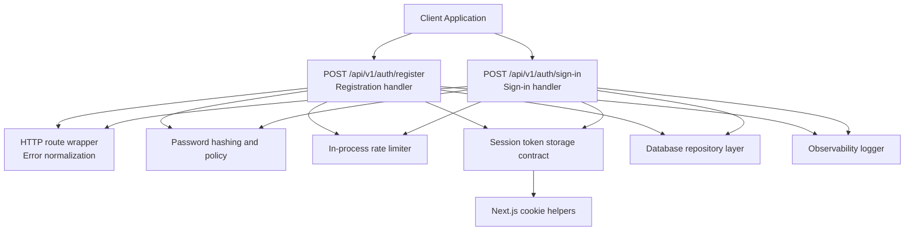
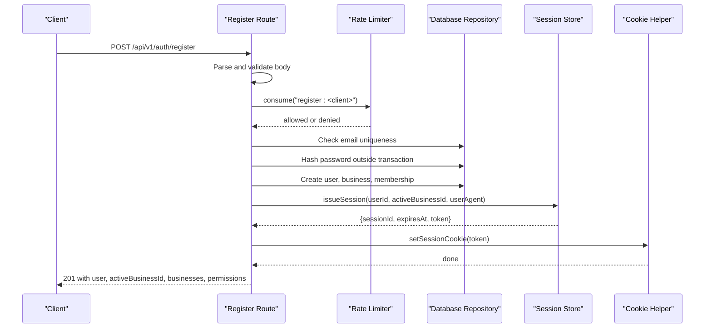
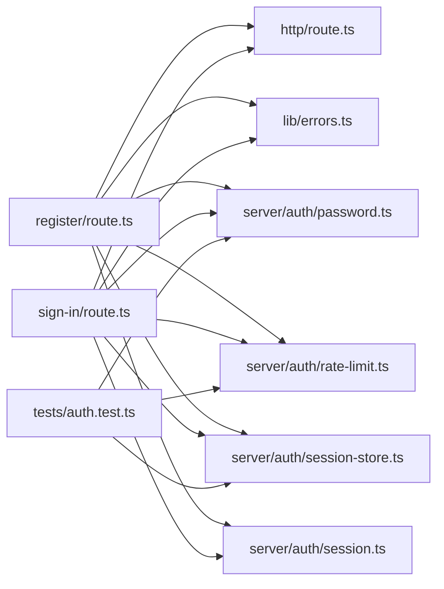

# Authentication API

<cite>
**Referenced Files in This Document**
- [register/route.ts](file://src/app/api/v1/auth/register/route.ts)
- [sign-in/route.ts](file://src/app/api/v1/auth/sign-in/route.ts)
- [password.ts](file://src/server/auth/password.ts)
- [session-store.ts](file://src/server/auth/session-store.ts)
- [session.ts](file://src/server/auth/session.ts)
- [rate-limit.ts](file://src/server/auth/rate-limit.ts)
- [errors.ts](file://src/lib/errors.ts)
- [route.ts](file://src/server/http/route.ts)
- [auth.test.ts](file://tests/auth.test.ts)
</cite>

## Table of Contents
1. [Introduction](#introduction)
2. [Project Structure](#project-structure)
3. [Core Components](#core-components)
4. [Architecture Overview](#architecture-overview)
5. [Detailed Component Analysis](#detailed-component-analysis)
6. [Dependency Analysis](#dependency-analysis)
7. [Performance Considerations](#performance-considerations)
8. [Troubleshooting Guide](#troubleshooting-guide)
9. [Conclusion](#conclusion)

## Introduction
This document describes the authentication API for user registration and sign-in. It covers request schemas, validation rules, response formats, session cookie behavior, password hashing security, rate limiting, error responses, and client implementation patterns for web and mobile applications.

The authentication endpoints are implemented as Next.js App Router handlers under `/api/v1/auth`. Registration creates a user, their first business, an owner membership, and issues a session cookie. Sign-in validates credentials, resets per-email rate limits on success, and also issues a session cookie. Both endpoints use a shared HTTP wrapper that normalizes errors and adds a request identifier to responses.

## Project Structure
The authentication feature is split across route handlers, shared authentication utilities, error contracts, and tests:

**Diagram sources**
- [register/route.ts:14-30](file://src/app/api/v1/auth/register/route.ts#L14-L30)
- [sign-in/route.ts:13-24](file://src/app/api/v1/auth/sign-in/route.ts#L13-L24)
- [route.ts:58-95](file://src/server/http/route.ts#L58-L95)
- [password.ts:1-17](file://src/server/auth/password.ts#L1-L17)
- [rate-limit.ts:1-10](file://src/server/auth/rate-limit.ts#L1-L10)
- [session-store.ts:1-7](file://src/server/auth/session-store.ts#L1-L7)
- [session.ts:1-11](file://src/server/auth/session.ts#L1-L11)

**Section sources**
- [register/route.ts:1-126](file://src/app/api/v1/auth/register/route.ts#L1-L126)
- [sign-in/route.ts:1-87](file://src/app/api/v1/auth/sign-in/route.ts#L1-L87)
- [route.ts:58-95](file://src/server/http/route.ts#L58-L95)

## Core Components
- Registration endpoint: validates input, enforces email uniqueness, hashes the password, creates user/business/membership in a transaction, issues a session, and sets an HTTP-only cookie.
- Sign-in endpoint: validates input, applies per-client and per-email rate limits, verifies credentials with constant-time comparison, resets failed-attempt counters on success, and issues a session cookie.
- Password module: implements scrypt-based hashing, parameterized verification, and a password policy requiring minimum length, mixed case, and digits.
- Session store: generates opaque tokens, stores hashed tokens with expiration, resolves active sessions, and defines cookie options.
- Cookie helper: reads and writes the session cookie using Next.js cookies.
- Rate limiter: in-process sliding window limiter keyed by client identity and email.
- Error contract: standardized error objects with codes, messages, details, and request IDs.

**Section sources**
- [register/route.ts:35-40](file://src/app/api/v1/auth/register/route.ts#L35-L40)
- [sign-in/route.ts:30-33](file://src/app/api/v1/auth/sign-in/route.ts#L30-L33)
- [password.ts:29-35](file://src/server/auth/password.ts#L29-L35)
- [session-store.ts:21-23](file://src/server/auth/session-store.ts#L21-L23)
- [session.ts:40-48](file://src/server/auth/session.ts#L40-L48)
- [rate-limit.ts:29-35](file://src/server/auth/rate-limit.ts#L29-L35)
- [errors.ts:8-28](file://src/lib/errors.ts#L8-L28)

## Architecture Overview
The authentication flow uses a layered design:

- Route handlers parse and validate requests.
- Shared modules enforce security (password hashing), resilience (rate limiting), and state (sessions).
- The HTTP wrapper ensures consistent error responses and logging.
- Sessions are stored server-side; clients only hold opaque tokens via secure cookies.

**Diagram sources**
- [register/route.ts:47-125](file://src/app/api/v1/auth/register/route.ts#L47-L125)
- [rate-limit.ts:43-63](file://src/server/auth/rate-limit.ts#L43-L63)
- [session-store.ts:67-81](file://src/server/auth/session-store.ts#L67-L81)
- [session.ts:45-48](file://src/server/auth/session.ts#L45-L48)

## Detailed Component Analysis

### Registration Endpoint: `POST /api/v1/auth/register`
Purpose:
- Create a new user account.
- Create the user’s first business.
- Grant the user an owner membership.
- Issue a session and set a secure cookie.

Request schema:
- `email`: string, trimmed, between 3 and 254 characters. Must pass a basic email shape check after trimming and lowercasing.
- `password`: string, between 1 and 200 characters. Must satisfy the password policy enforced by the password module.
- `displayName`: string, trimmed, between 1 and 120 characters.
- `businessName`: string, trimmed, between 1 and 120 characters.

Validation rules:
- Zod validates field presence and lengths.
- A stricter email shape check rejects malformed addresses even if Zod accepts them.
- Password policy requires at least the configured minimum length, mixed case letters, and at least one digit.
- Duplicate emails are rejected with a conflict response.

Rate limiting:
- Per-client limit of five registrations per 15-minute window.
- Exceeding the limit returns a rate-limited response.

Response format:
- Success: status 201 with a data object containing:
  - `user.id`
  - `user.displayName`
  - `activeBusinessId`
  - `businesses` list
  - `permissions` derived from the active business role

Error responses:
- Validation failures: status 422 with code `VALIDATION_FAILED`, including field-level details.
- Duplicate email: status 409 with code `VALIDATION_FAILED`.
- Rate limited: status 429 with code `RATE_LIMITED`.
- Internal errors: status 500 with code `INTERNAL`.

Security considerations:
- Password hashing occurs before opening the database transaction to avoid holding pooled connections during slow KDF work.
- Email uniqueness is checked again inside the transaction to handle concurrent registrations safely.
- Provider subject is namespaced to prevent collisions with future managed identity providers.

Example successful flow:
1. Client sends JSON with email, password, displayName, and businessName.
2. Server validates and checks rate limit.
3. Server checks email uniqueness.
4. Server hashes the password.
5. Server creates user, business, and membership in a transaction.
6. Server issues a session and sets the cookie.
7. Server returns 201 with user and workspace information.

Common error scenarios:
- Invalid email format: 422 with field detail indicating invalid address.
- Weak password: 422 with policy message.
- Duplicate email: 409 indicating the address is already in use.
- Too many registrations: 429 advising retry after a short period.

Client implementation patterns:
- Web: send JSON via fetch or axios, read the Set-Cookie header implicitly handled by the browser, then navigate to the dashboard.
- Mobile: send JSON via HTTP client, ensure cookies are enabled, and attach subsequent requests with the same cookie jar.

**Section sources**
- [register/route.ts:35-40](file://src/app/api/v1/auth/register/route.ts#L35-L40)
- [register/route.ts:47-70](file://src/app/api/v1/auth/register/route.ts#L47-L70)
- [register/route.ts:72-103](file://src/app/api/v1/auth/register/route.ts#L72-L103)
- [register/route.ts:105-125](file://src/app/api/v1/auth/register/route.ts#L105-L125)
- [password.ts:134-145](file://src/server/auth/password.ts#L134-L145)
- [errors.ts:68-73](file://src/lib/errors.ts#L68-L73)
- [route.ts:108-118](file://src/server/http/route.ts#L108-L118)

### Sign-In Endpoint: `POST /api/v1/auth/sign-in`
Purpose:
- Authenticate a user with email and password.
- Reset per-email attempt counters on success.
- Issue a session and set a secure cookie.

Request schema:
- `email`: string, trimmed, between 3 and 254 characters.
- `password`: string, between 1 and 200 characters.

Authentication flow:
- Body is parsed and validated once.
- Per-client and per-email rate limits are applied.
- User lookup is performed by email.
- Password verification runs unconditionally to avoid timing leaks.
- If the user is missing, password is invalid, or account is not active, a uniform 401 is returned.
- On success, per-email rate limit bucket is reset.
- Session is issued and cookie is set.

Response format:
- Success: status 200 with a data object containing:
  - `user.id`
  - `user.displayName`
  - `activeBusinessId`
  - `businesses` list
  - `permissions` derived from the active business role

Error responses:
- Validation failures: status 422 with code `VALIDATION_FAILED`.
- Wrong credentials or inactive account: status 401 with code `UNAUTHENTICATED`.
- Rate limited: status 429 with code `RATE_LIMITED`.
- Internal errors: status 500 with code `INTERNAL`.

Security considerations:
- Uniform failure response prevents enumeration of valid accounts.
- Constant-time comparison protects against timing attacks.
- Dummy derivation is used when no hash exists so unknown accounts cost the same as wrong passwords.

Example successful flow:
1. Client sends JSON with email and password.
2. Server validates input and applies rate limits.
3. Server looks up the user and verifies the password.
4. Server resets the per-email rate limit.
5. Server issues a session and sets the cookie.
6. Server returns 200 with user and workspace information.

Common error scenarios:
- Invalid credentials: 401 with a generic message.
- Inactive account: 401 with a generic message.
- Too many attempts: 429 advising retry after a short period.

Client implementation patterns:
- Web: submit credentials via form or fetch, rely on browser cookie handling, and redirect to the application dashboard.
- Mobile: submit credentials via HTTP client, preserve cookies, and include them in authenticated requests.

**Section sources**
- [sign-in/route.ts:30-33](file://src/app/api/v1/auth/sign-in/route.ts#L30-L33)
- [sign-in/route.ts:35-66](file://src/app/api/v1/auth/sign-in/route.ts#L35-L66)
- [sign-in/route.ts:68-86](file://src/app/api/v1/auth/sign-in/route.ts#L68-L86)
- [password.ts:57-86](file://src/server/auth/password.ts#L57-L86)
- [errors.ts:52-54](file://src/lib/errors.ts#L52-L54)
- [route.ts:108-118](file://src/server/http/route.ts#L108-L118)

### Password Hashing and Policy
Implementation:
- Uses scrypt from Node’s crypto module.
- Stores parameters inline with salt and derived key.
- Verification parses stored parameters and performs constant-time comparison.
- Rejects malformed or unsafe stored parameters.
- Enforces a password policy requiring minimum length, uppercase, lowercase, and digit.

Policy summary:
- Minimum length: configured constant.
- Maximum length: 200 characters.
- Complexity: must contain at least one uppercase letter, one lowercase letter, and one number.

Security summary:
- Salting prevents identical hashes for identical passwords.
- Timing-safe comparison avoids leaking password correctness.
- Dummy derivation equalizes response time for missing and wrong passwords.

**Section sources**
- [password.ts:1-17](file://src/server/auth/password.ts#L1-L17)
- [password.ts:29-35](file://src/server/auth/password.ts#L29-L35)
- [password.ts:37-55](file://src/server/auth/password.ts#L37-L55)
- [password.ts:57-86](file://src/server/auth/password.ts#L57-L86)
- [password.ts:96-116](file://src/server/auth/password.ts#L96-L116)
- [password.ts:118-126](file://src/server/auth/password.ts#L118-L126)
- [password.ts:134-145](file://src/server/auth/password.ts#L134-L145)
- [auth.test.ts:35-97](file://tests/auth.test.ts#L35-L97)

### Session Management and Cookies
Token lifecycle:
- An opaque random token is generated for each session.
- Only the hashed token is stored in the database.
- The raw token is sent to the client via a secure, HTTP-only cookie.
- Sessions expire after a fixed TTL.
- Active sessions can be revoked.

Cookie configuration:
- Cookie name: `daftari_session`.
- HTTP-only: true.
- SameSite: lax.
- Secure: true in production.
- Path: root path.
- Max age: session TTL in seconds.

Resolution:
- Clients send the cookie automatically in web browsers.
- Mobile clients must preserve and resend the cookie.
- Server resolves the hashed token to an active session and active user.

**Section sources**
- [session-store.ts:21-23](file://src/server/auth/session-store.ts#L21-L23)
- [session-store.ts:41-48](file://src/server/auth/session-store.ts#L41-L48)
- [session-store.ts:50-58](file://src/server/auth/session-store.ts#L50-L58)
- [session-store.ts:67-81](file://src/server/auth/session-store.ts#L67-L81)
- [session-store.ts:89-96](file://src/server/auth/session-store.ts#L89-L96)
- [session.ts:40-48](file://src/server/auth/session.ts#L40-L48)
- [session.ts:55-62](file://src/server/auth/session.ts#L55-L62)

### Rate Limiting
Scope:
- In-process sliding window limiter.
- Keys by client identity and optionally by email.
- Designed as an abuse speed bump; multi-instance deployments should move to a shared backend for hard quotas.

Limits:
- Registration: five attempts per client per 15 minutes.
- Sign-in: forty attempts per client per 15 minutes and eight attempts per email per 15 minutes.

Behavior:
- Returns remaining attempts and retry-after seconds when rate limited.
- Resets per-email bucket after successful sign-in.

Client identity:
- Prefers `x-forwarded-for` first entry, falls back to `x-real-ip`, then unknown.

**Section sources**
- [rate-limit.ts:1-10](file://src/server/auth/rate-limit.ts#L1-L10)
- [rate-limit.ts:29-35](file://src/server/auth/rate-limit.ts#L29-L35)
- [rate-limit.ts:43-63](file://src/server/auth/rate-limit.ts#L43-L63)
- [rate-limit.ts:73-80](file://src/server/auth/rate-limit.ts#L73-L80)
- [rate-limit.ts:82-85](file://src/server/auth/rate-limit.ts#L82-L85)
- [register/route.ts:32-33](file://src/app/api/v1/auth/register/route.ts#L32-L33)
- [sign-in/route.ts:26-28](file://src/app/api/v1/auth/sign-in/route.ts#L26-L28)
- [auth.test.ts:139-168](file://tests/auth.test.ts#L139-L168)

### Error Handling and Response Contract
Contract:
- All route handlers are wrapped to normalize errors.
- Domain errors become documented status codes with stable codes.
- Unexpected errors never leak stack traces or sensitive values.
- Every response includes a request ID for tracing.

Error types:
- Validation failure: 422 with `VALIDATION_FAILED`.
- Unauthenticated: 401 with `UNAUTHENTICATED`.
- Rate limited: 429 with `RATE_LIMITED`.
- Conflict: 409 with domain-specific code.
- Internal: 500 with `INTERNAL`.

Response body:
- Errors return a structured object with `error.code`, `error.message`, optional `error.details`, and `requestId`.
- Successful responses return a structured object with `data`.

**Section sources**
- [route.ts:58-95](file://src/server/http/route.ts#L58-L95)
- [route.ts:97-118](file://src/server/http/route.ts#L97-L118)
- [errors.ts:8-28](file://src/lib/errors.ts#L8-L28)
- [errors.ts:38-50](file://src/lib/errors.ts#L38-L50)
- [errors.ts:52-73](file://src/lib/errors.ts#L52-L73)
- [errors.ts:96-130](file://src/lib/errors.ts#L96-L130)

## Dependency Analysis
The authentication routes depend on shared modules for validation, security, persistence, and observability.

**Diagram sources**
- [register/route.ts:14-30](file://src/app/api/v1/auth/register/route.ts#L14-L30)
- [sign-in/route.ts:13-24](file://src/app/api/v1/auth/sign-in/route.ts#L13-L24)
- [route.ts:11-14](file://src/server/http/route.ts#L11-L14)
- [errors.ts:1-6](file://src/lib/errors.ts#L1-L6)
- [password.ts:1-17](file://src/server/auth/password.ts#L1-L17)
- [rate-limit.ts:1-10](file://src/server/auth/rate-limit.ts#L1-L10)
- [session-store.ts:1-7](file://src/server/auth/session-store.ts#L1-L7)
- [session.ts:1-11](file://src/server/auth/session.ts#L1-L11)
- [auth.test.ts:13-31](file://tests/auth.test.ts#L13-L31)

**Section sources**
- [register/route.ts:14-30](file://src/app/api/v1/auth/register/route.ts#L14-L30)
- [sign-in/route.ts:13-24](file://src/app/api/v1/auth/sign-in/route.ts#L13-L24)
- [route.ts:11-14](file://src/server/http/route.ts#L11-L14)
- [errors.ts:1-6](file://src/lib/errors.ts#L1-L6)
- [password.ts:1-17](file://src/server/auth/password.ts#L1-L17)
- [rate-limit.ts:1-10](file://src/server/auth/rate-limit.ts#L1-L10)
- [session-store.ts:1-7](file://src/server/auth/session-store.ts#L1-L7)
- [session.ts:1-11](file://src/server/auth/session.ts#L1-L11)
- [auth.test.ts:13-31](file://tests/auth.test.ts#L13-L31)

## Performance Considerations
- Password hashing uses a memory-hard KDF with configurable parameters. Hashing is performed outside database transactions to reduce connection hold time.
- Verification always performs a derivation to avoid timing side channels.
- Rate limiting uses an in-memory sliding window with periodic cleanup to prevent unbounded growth.
- Session tokens are opaque and hashed at rest; only the cookie carries the raw token.
- Multi-instance deployments should replace the in-process rate limiter with a shared backend for accurate global quotas.

[No sources needed since this section provides general guidance]

## Troubleshooting Guide
Common issues and resolutions:

- Validation errors on registration:
  - Cause: malformed email, weak password, or missing fields.
  - Resolution: ensure email passes the stricter shape check, meet password policy, and provide required fields.
  - Status: 422 with `VALIDATION_FAILED`.

- Duplicate email on registration:
  - Cause: email already exists.
  - Resolution: use a different email or sign in.
  - Status: 409 with `VALIDATION_FAILED`.

- Rate limited on registration:
  - Cause: too many registrations from the same client within the window.
  - Resolution: wait for the retry-after period.
  - Status: 429 with `RATE_LIMITED`.

- Invalid credentials on sign-in:
  - Cause: wrong password, inactive account, or unknown email.
  - Resolution: verify credentials and account status.
  - Status: 401 with `UNAUTHENTICATED`.

- Rate limited on sign-in:
  - Cause: too many attempts per client or per email.
  - Resolution: wait for the retry-after period.
  - Status: 429 with `RATE_LIMITED`.

- Session not persisting:
  - Cause: cookies disabled or incorrect environment settings.
  - Resolution: enable cookies in the client and ensure production uses secure cookies.

- Request tracing:
  - Use the `x-request-id` header in both request and response to correlate logs and errors.

**Section sources**
- [register/route.ts:47-70](file://src/app/api/v1/auth/register/route.ts#L47-L70)
- [sign-in/route.ts:35-66](file://src/app/api/v1/auth/sign-in/route.ts#L35-L66)
- [route.ts:58-95](file://src/server/http/route.ts#L58-L95)
- [errors.ts:96-130](file://src/lib/errors.ts#L96-L130)

## Conclusion
The authentication API provides secure registration and sign-in flows with strong password hashing, uniform error responses, and robust session management. Rate limiting protects against abuse while preserving usability. Clients should treat the session cookie as opaque, preserve it across requests, and handle validation, conflict, and rate-limit errors gracefully. For production deployments, consider moving rate limiting to a shared backend and integrating a managed OIDC provider behind the same session contract.

[No sources needed since this section summarizes without analyzing specific files]