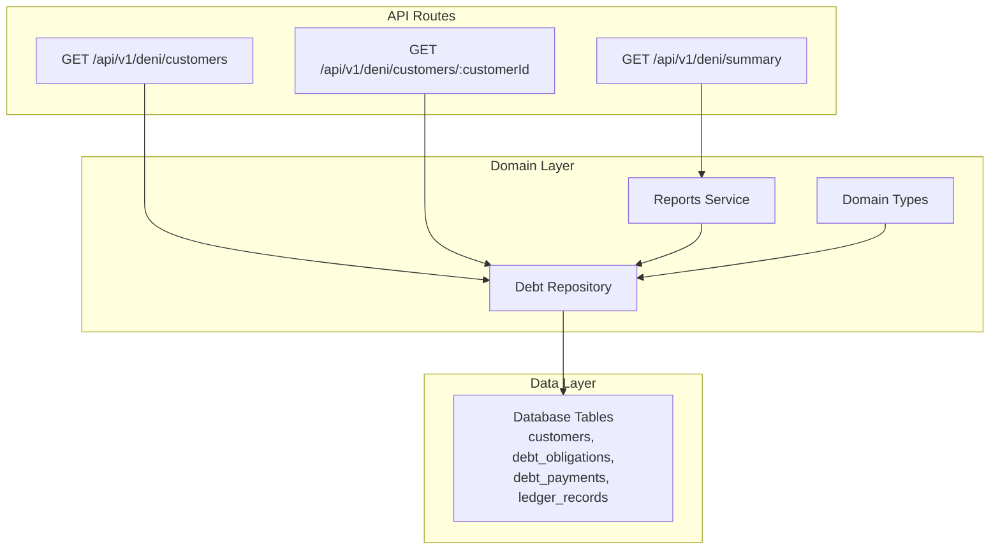
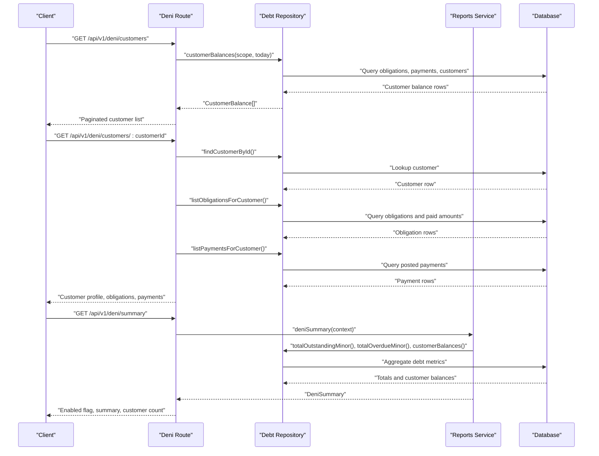
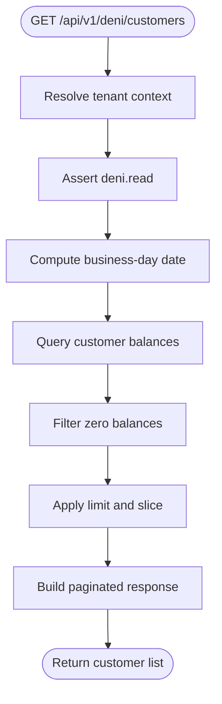
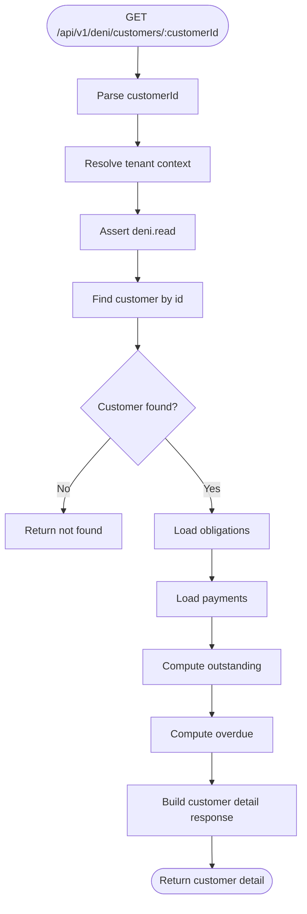
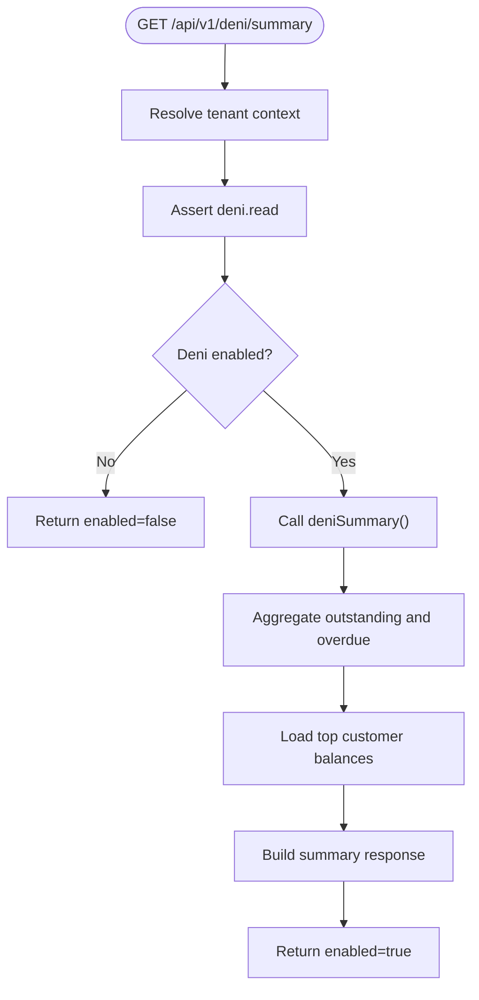
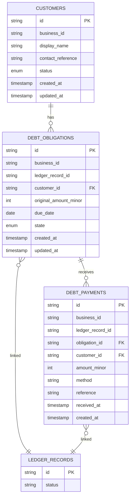
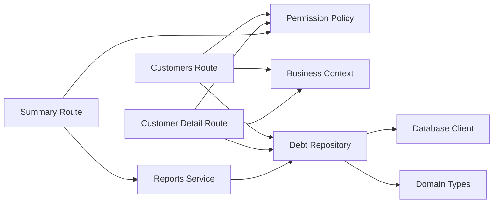

# Debt Tracking API (Deni)

<cite>
**Referenced Files in This Document**
- [customers route](file://src/app/api/v1/deni/customers/route.ts)
- [customer detail route](file://src/app/api/v1/deni/customers/[customerId]/route.ts)
- [summary route](file://src/app/api/v1/deni/summary/route.ts)
- [debt repository](file://src/server/repositories/debt.repository.ts)
- [reports service](file://src/server/services/reports.ts)
- [domain types](file://src/server/domain/types.ts)
- [deni customer list page](file://src/app/(dashboard)/deni/page.tsx)
- [deni customer detail page](file://src/app/(dashboard)/deni/[customerId]/page.tsx)
</cite>

## Table of Contents
1. [Introduction](#introduction)
2. [Project Structure](#project-structure)
3. [Core Components](#core-components)
4. [Architecture Overview](#architecture-overview)
5. [Detailed Component Analysis](#detailed-component-analysis)
6. [Dependency Analysis](#dependency-analysis)
7. [Performance Considerations](#performance-considerations)
8. [Troubleshooting Guide](#troubleshooting-guide)
9. [Conclusion](#conclusion)

## Introduction
This document describes the debt tracking API, called Deni, for recording and reporting customer debts, obligations, payments, and summary analytics. The current implementation exposes read-only endpoints for:

- Listing customers with outstanding debt balances.
- Reading a single customer’s profile, obligations, and payment history.
- Retrieving a tenant-wide debt summary including overdue totals and top customers.

The system derives balances from confirmed ledger records rather than storing mutable running totals. This makes the data model auditable and consistent across reports, dashboards, and future write operations.

Key concepts:

- **Customer**: A business entity that may owe money.
- **Obligation**: A debt created by a posted ledger record, with an original amount, due date, and lifecycle state.
- **Payment**: A recorded receipt against an obligation or customer.
- **Balance**: Calculated as open obligations minus applied payments; not stored as a separate mutable field.
- **Overdue**: An open obligation whose due date is before the current business day.

## Project Structure
The Deni feature spans Next.js App Router routes, a domain-focused repository layer, and a reporting service.

**Diagram sources**
- [customers route:1-39](file://src/app/api/v1/deni/customers/route.ts#L1-L39)
- [customer detail route:1-67](file://src/app/api/v1/deni/customers/[customerId]/route.ts#L1-L67)
- [summary route:1-30](file://src/app/api/v1/deni/summary/route.ts#L1-L30)
- [debt repository:1-386](file://src/server/repositories/debt.repository.ts#L1-L386)
- [reports service:1-155](file://src/server/services/reports.ts#L1-L155)
- [domain types:1-217](file://src/server/domain/types.ts#L1-L217)

**Section sources**
- [customers route:1-39](file://src/app/api/v1/deni/customers/route.ts#L1-L39)
- [customer detail route:1-67](file://src/app/api/v1/deni/customers/[customerId]/route.ts#L1-L67)
- [summary route:1-30](file://src/app/api/v1/deni/summary/route.ts#L1-L30)
- [debt repository:1-386](file://src/server/repositories/debt.repository.ts#L1-L386)
- [reports service:1-155](file://src/server/services/reports.ts#L1-L155)
- [domain types:1-217](file://src/server/domain/types.ts#L1-L217)

## Core Components
The Deni API is built around three main components:

| Component | Responsibility | Key Behavior |
|---|---|---|
| Customer list endpoint | Returns tenants’ customers with non-zero balances | Sorts by highest balance, applies pagination limit, marks overdue status |
| Customer detail endpoint | Returns one customer’s profile, obligations, and payments | Computes outstanding and overdue amounts from posted obligations and payments |
| Summary endpoint | Returns aggregate debt metrics | Uses the reporting service to compute totals and top customers |

Important design rules:

- All monetary values use minor units.
- Only posted ledger records affect debt calculations.
- Balances are derived, not stored as mutable running totals.
- Read endpoints require the `deni.read` permission.
- The summary endpoint respects a feature flag for Deni.

**Section sources**
- [customers route:14-37](file://src/app/api/v1/deni/customers/route.ts#L14-L37)
- [customer detail route:17-66](file://src/app/api/v1/deni/customers/[customerId]/route.ts#L17-L66)
- [summary route:15-29](file://src/app/api/v1/deni/summary/route.ts#L15-L29)
- [debt repository:288-335](file://src/server/repositories/debt.repository.ts#L288-L335)
- [reports service:137-146](file://src/server/services/reports.ts#L137-L146)

## Architecture Overview
The API follows a layered architecture:

1. HTTP route handlers validate access and parse parameters.
2. Repository functions query the database using tenant-scoped queries.
3. Reporting services aggregate metrics across obligations, payments, and customers.
4. Domain types define shared vocabulary such as record types, statuses, and payment methods.

**Diagram sources**
- [customers route:14-37](file://src/app/api/v1/deni/customers/route.ts#L14-L37)
- [customer detail route:17-66](file://src/app/api/v1/deni/customers/[customerId]/route.ts#L17-L66)
- [summary route:15-29](file://src/app/api/v1/deni/summary/route.ts#L15-L29)
- [debt repository:116-133](file://src/server/repositories/debt.repository.ts#L116-L133)
- [debt repository:262-275](file://src/server/repositories/debt.repository.ts#L262-L275)
- [debt repository:288-335](file://src/server/repositories/debt.repository.ts#L288-L335)
- [reports service:137-146](file://src/server/services/reports.ts#L137-L146)

## Detailed Component Analysis

### Customer List Endpoint
`GET /api/v1/deni/customers`

Purpose:
- Return customers with non-zero outstanding balances.
- Sort by highest balance first.
- Provide pagination through a limit parameter.
- Include overdue flags and basic aging indicators.

Authentication and permissions:
- Requires a valid tenant context.
- Requires the `deni.read` role capability.

Request parameters:
- `limit`: Integer query parameter controlling how many customers are returned. Default is 50, maximum is 200.

Response fields:
- `asOf`: Business-day date used for overdue calculation.
- `totalOutstandingMinor`: Sum of displayed customer balances.
- `customers`: Array of customer entries.
- `page.limit`: Applied limit.
- `page.total`: Total number of customers with non-zero balances.

Customer entry fields:
- `customerId`: Customer identifier.
- `customerName`: Display name.
- `balanceMinor`: Outstanding balance in minor units.
- `overdue`: Boolean indicating whether the customer has at least one overdue obligation.
- `oldestDebtDate`: Earliest related occurrence date among obligations.
- `dueDate`: Minimum due date among obligations.
- `obligationCount`: Number of active obligations contributing to the balance.
- `lastPaymentAt`: Most recent posted payment timestamp if available.

Processing logic:
1. Resolve tenant context and enforce `deni.read`.
2. Compute the business-day date.
3. Query customer balances from posted obligations and payments.
4. Filter out zero-balance customers.
5. Slice results by limit.

**Diagram sources**
- [customers route:14-37](file://src/app/api/v1/deni/customers/route.ts#L14-L37)
- [debt repository:288-335](file://src/server/repositories/debt.repository.ts#L288-L335)

**Section sources**
- [customers route:14-37](file://src/app/api/v1/deni/customers/route.ts#L14-L37)
- [debt repository:288-335](file://src/server/repositories/debt.repository.ts#L288-L335)

### Customer Detail Endpoint
`GET /api/v1/deni/customers/:customerId`

Purpose:
- Return a single customer’s profile.
- Show all obligations linked to posted ledger records.
- Show all posted payments for the customer.
- Compute outstanding and overdue amounts.

Authentication and permissions:
- Requires a valid tenant context.
- Requires the `deni.read` role capability.

Path parameters:
- `customerId`: Required customer identifier.

Response fields:
- `customer.id`: Customer identifier.
- `customer.displayName`: Display name.
- `customer.contactReference`: Optional contact reference.
- `customer.status`: Customer status.
- `asOf`: Business-day date used for overdue calculation.
- `outstandingMinor`: Sum of open obligations after applying payments.
- `overdueMinor`: Sum of open obligations past their due date.
- `obligations`: Obligation entries.
- `payments`: Payment entries.

Obligation entry fields:
- `id`: Obligation identifier.
- `ledgerRecordId`: Linked ledger record.
- `originalAmountMinor`: Original debt amount.
- `paidMinor`: Amount already applied to this obligation.
- `state`: Lifecycle state such as open, settled, disputed, or voided.
- `dueDate`: Due date or null.
- `createdAt`: Creation timestamp.

Payment entry fields:
- `id`: Payment identifier.
- `ledgerRecordId`: Linked ledger record.
- `obligationId`: Nullable obligation link.
- `amountMinor`: Payment amount in minor units.
- `method`: Payment method.
- `receivedAt`: Received timestamp.

Processing logic:
1. Parse `customerId`.
2. Resolve tenant context and enforce `deni.read`.
3. Find the customer within the tenant scope.
4. Return 404 if the customer does not exist.
5. Load obligations and payments.
6. Compute outstanding and overdue totals.
7. Return normalized response.

**Diagram sources**
- [customer detail route:17-66](file://src/app/api/v1/deni/customers/[customerId]/route.ts#L17-L66)
- [debt repository:65-70](file://src/server/repositories/debt.repository.ts#L65-L70)
- [debt repository:116-133](file://src/server/repositories/debt.repository.ts#L116-L133)
- [debt repository:262-275](file://src/server/repositories/debt.repository.ts#L262-L275)

**Section sources**
- [customer detail route:17-66](file://src/app/api/v1/deni/customers/[customerId]/route.ts#L17-L66)
- [debt repository:65-70](file://src/server/repositories/debt.repository.ts#L65-L70)
- [debt repository:116-133](file://src/server/repositories/debt.repository.ts#L116-L133)
- [debt repository:262-275](file://src/server/repositories/debt.repository.ts#L262-L275)

### Summary Endpoint
`GET /api/v1/deni/summary`

Purpose:
- Return tenant-wide debt metrics.
- Separate debt reporting from cash reporting.
- Indicate whether the Deni feature is enabled.

Authentication and permissions:
- Requires a valid tenant context.
- Requires the `deni.read` role capability.

Response fields:
- `enabled`: Boolean indicating whether Deni is enabled for the tenant.
- `summary`: Deni summary object when enabled.
- `customersWithBalance`: Count of distinct customers with active obligations.

When Deni is disabled:
- Returns `enabled: false` and `summary: null`.

When Deni is enabled:
- `summary.outstandingMinor`: Total outstanding debt.
- `summary.overdueMinor`: Total overdue debt.
- `summary.customersWithBalance`: Number of customers with balances.
- `summary.customers`: Up to 50 top customers by balance.

**Diagram sources**
- [summary route:15-29](file://src/app/api/v1/deni/summary/route.ts#L15-L29)
- [reports service:137-146](file://src/server/services/reports.ts#L137-L146)
- [debt repository:337-382](file://src/server/repositories/debt.repository.ts#L337-L382)

**Section sources**
- [summary route:15-29](file://src/app/api/v1/deni/summary/route.ts#L15-L29)
- [reports service:137-146](file://src/server/services/reports.ts#L137-L146)
- [debt repository:337-382](file://src/server/repositories/debt.repository.ts#L337-L382)

### Data Model and Domain Types
The debt model centers on customers, obligations, and payments. Balances are derived from posted ledger records.

**Diagram sources**
- [debt repository:13-46](file://src/server/repositories/debt.repository.ts#L13-L46)
- [debt repository:94-114](file://src/server/repositories/debt.repository.ts#L94-L114)
- [debt repository:226-260](file://src/server/repositories/debt.repository.ts#L226-L260)

Domain vocabulary includes:

- Record types: sale, expense, debt_created, debt_payment, stock_movement, note.
- Ledger record statuses: posted, voided, reversed.
- Payment methods: cash, mobile_money, bank, card, credit, unknown.
- Audit actions covering customer creation, obligation lifecycle, and debt payment recording.

**Section sources**
- [debt repository:13-46](file://src/server/repositories/debt.repository.ts#L13-L46)
- [domain types:8-16](file://src/server/domain/types.ts#L8-L16)
- [domain types:18-19](file://src/server/domain/types.ts#L18-L19)
- [domain types:74-82](file://src/server/domain/types.ts#L74-L82)
- [domain types:135-179](file://src/server/domain/types.ts#L135-L179)

## Dependency Analysis
The Deni endpoints depend on shared infrastructure:

- Tenant resolution and business context.
- Permission policy enforcement.
- Date utilities for business-timezone-aware overdue checks.
- Database client helpers for queries.
- Domain types for shared constants.

**Diagram sources**
- [customers route:7-12](file://src/app/api/v1/deni/customers/route.ts#L7-L12)
- [customer detail route:5-15](file://src/app/api/v1/deni/customers/[customerId]/route.ts#L5-L15)
- [summary route:8-13](file://src/app/api/v1/deni/summary/route.ts#L8-L13)
- [reports service:10-29](file://src/server/services/reports.ts#L10-L29)
- [debt repository:8-11](file://src/server/repositories/debt.repository.ts#L8-L11)

**Section sources**
- [customers route:7-12](file://src/app/api/v1/deni/customers/route.ts#L7-L12)
- [customer detail route:5-15](file://src/app/api/v1/deni/customers/[customerId]/route.ts#L5-L15)
- [summary route:8-13](file://src/app/api/v1/deni/summary/route.ts#L8-L13)
- [reports service:10-29](file://src/server/services/reports.ts#L10-L29)
- [debt repository:8-11](file://src/server/repositories/debt.repository.ts#L8-L11)

## Performance Considerations
- Customer balances are computed through SQL aggregation over obligations and payments.
- The customer list filters out zero balances and sorts by descending balance.
- Pagination is implemented via a limit parameter with a bounded maximum.
- The summary endpoint caps the returned customer list to 50 entries.
- Overdue calculations use the business timezone date rather than server time.

Recommendations for future extensions:
- Add explicit cursor-based pagination for large customer lists.
- Cache frequently accessed summary metrics if read volume increases significantly.
- Index customer identifiers, obligation states, due dates, and ledger record statuses where appropriate.
- Avoid returning unbounded arrays of obligations or payments in high-volume scenarios.

[No sources needed since this section provides general guidance]

## Troubleshooting Guide

Common issues and handling:

| Issue | Cause | Expected Behavior | Resolution |
|---|---|---|---|
| Customer not found | Invalid or missing `customerId` | 404-style error from the customer detail endpoint | Verify the customer exists in the tenant scope |
| Empty customer list | No posted obligations with positive balances | Returns empty `customers` array | Confirm obligations are posted and have non-zero balances |
| Zero balance excluded | Balance filter removes zero balances | Customer does not appear in list | Check obligations and payments; balance must be greater than zero |
| Deni disabled | Feature flag disabled | Summary returns `enabled: false` | Enable Deni in tenant features before using summary |
| Insufficient permissions | Missing `deni.read` | Request rejected by permission policy | Grant the required role capability |
| Incorrect overdue result | Wrong timezone or date comparison | Overdue flag may be incorrect | Ensure business timezone is set and due dates are compared against business-day date |

Error handling patterns in the codebase:

- Customer lookup throws a not-found error when the customer does not exist.
- Permission checks enforce `deni.read` for all Deni endpoints.
- The summary endpoint explicitly handles disabled feature behavior.
- Balances are derived only from posted ledger records, so unposted or voided records do not affect debt totals.

**Section sources**
- [customer detail route:23-24](file://src/app/api/v1/deni/customers/[customerId]/route.ts#L23-L24)
- [summary route:19-21](file://src/app/api/v1/deni/summary/route.ts#L19-L21)
- [debt repository:116-133](file://src/server/repositories/debt.repository.ts#L116-L133)
- [debt repository:288-335](file://src/server/repositories/debt.repository.ts#L288-L335)

## Conclusion
The Deni API currently provides read-only access to debt-related data. It models debts as obligations tied to posted ledger records and computes balances, overdue amounts, and summaries from those records. The customer list endpoint supports merchant-driven prioritization by showing the highest balances first. The customer detail endpoint exposes the full ledger view for a single customer. The summary endpoint separates debt metrics from cash metrics and respects a feature flag.

Future work should add write endpoints for creating customers, recording debts, processing payments, adjusting balances, and managing collection workflows. Those operations should follow the existing patterns:

- Enforce tenant scoping and permissions.
- Validate inputs against domain types.
- Persist changes through the repository layer.
- Derive balances from posted records rather than mutating running totals.
- Return clear errors for invalid transactions, insufficient payments, and unauthorized access.

[No sources needed since this section summarizes without analyzing specific files]