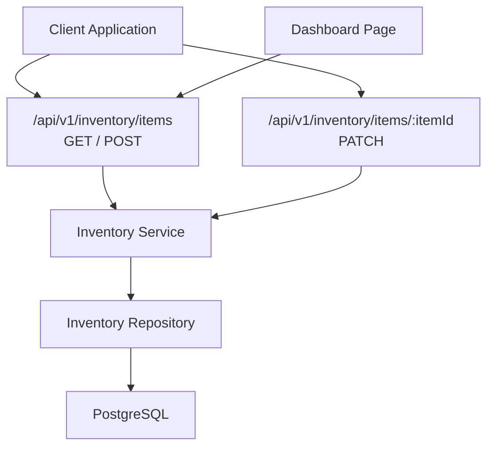
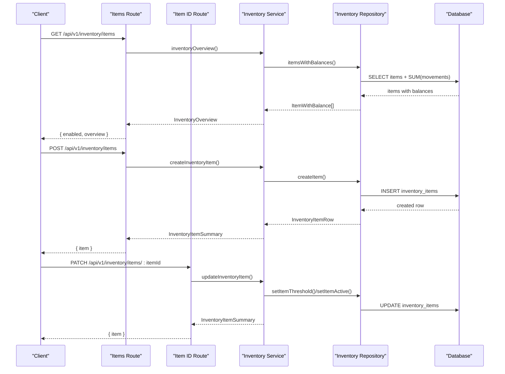
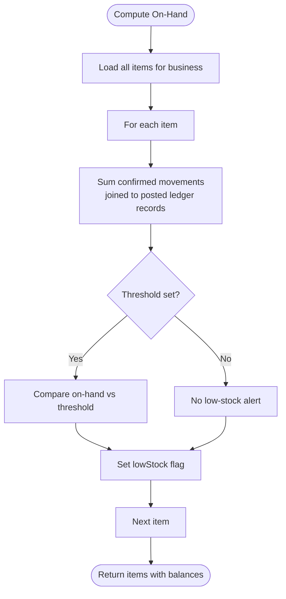
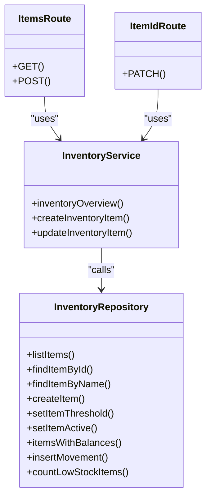

# Inventory API

<cite>
**Referenced Files in This Document**
- [route.ts](file://src/app/api/v1/inventory/items/route.ts)
- [route.ts](file://src/app/api/v1/inventory/items/[itemId]/route.ts)
- [inventory.repository.ts](file://src/server/repositories/inventory.repository.ts)
- [inventory.ts](file://src/server/services/inventory.ts)
- [schemas.ts](file://src/server/http/schemas.ts)
- [page.tsx](file://src/app/(dashboard)/inventory/page.tsx)
- [inventory.test.ts](file://tests/inventory.test.ts)
</cite>

## Table of Contents
1. [Introduction](#introduction)
2. [Project Structure](#project-structure)
3. [Core Components](#core-components)
4. [Architecture Overview](#architecture-overview)
5. [Detailed Component Analysis](#detailed-component-analysis)
6. [Dependency Analysis](#dependency-analysis)
7. [Performance Considerations](#performance-considerations)
8. [Troubleshooting Guide](#troubleshooting-guide)
9. [Conclusion](#conclusion)

## Introduction
This document describes the inventory management API for listing, creating, updating, and querying inventory items. It also explains how stock levels are tracked through movements, how low-stock alerts are derived, and how inventory integrates with sales and expense records through confirmed ledger entries. The current implementation focuses on item catalog operations and overview reporting; deletion is not exposed as a dedicated endpoint.

## Project Structure
The inventory feature is implemented as a Next.js App Router API under `/api/v1/inventory/items`. Business logic lives in a service layer, while persistence is handled by a repository layer. A client dashboard page demonstrates usage of the list and create endpoints.

**Diagram sources**
- [route.ts:18-67](file://src/app/api/v1/inventory/items/route.ts#L18-L67)
- [route.ts:16-30](file://src/app/api/v1/inventory/items/[itemId]/route.ts#L16-L30)
- [inventory.ts:64-174](file://src/server/services/inventory.ts#L64-L174)
- [inventory.repository.ts:45-192](file://src/server/repositories/inventory.repository.ts#L45-L192)
- [page.tsx:40-107](file://src/app/(dashboard)/inventory/page.tsx#L40-L107)

**Section sources**
- [route.ts:1-67](file://src/app/api/v1/inventory/items/route.ts#L1-L67)
- [route.ts:1-30](file://src/app/api/v1/inventory/items/[itemId]/route.ts#L1-L30)
- [inventory.ts:1-174](file://src/server/services/inventory.ts#L1-L174)
- [inventory.repository.ts:1-196](file://src/server/repositories/inventory.repository.ts#L1-L196)
- [page.tsx:1-212](file://src/app/(dashboard)/inventory/page.tsx#L1-L212)

## Core Components
- API routes expose GET and POST for `/api/v1/inventory/items`, and PATCH for `/api/v1/inventory/items/:itemId`.
- The service layer enforces feature gating, permissions, uniqueness, transactions, and audit logging.
- The repository layer performs tenant-scoped queries, movement recording, balance derivation, and low-stock counting.
- Input validation uses shared Zod schemas for item creation and updates.
- The dashboard page demonstrates listing, creating items, and displaying stock summaries.

Key responsibilities:
- Route handlers: authentication, authorization, request parsing, response formatting.
- Service: business rules, idempotent creation, summary transformation, transactional updates.
- Repository: SQL access, movement insertion, balance computation, thresholds, activity flags.

**Section sources**
- [route.ts:18-67](file://src/app/api/v1/inventory/items/route.ts#L18-L67)
- [route.ts:16-30](file://src/app/api/v1/inventory/items/[itemId]/route.ts#L16-L30)
- [inventory.ts:41-174](file://src/server/services/inventory.ts#L41-L174)
- [inventory.repository.ts:45-192](file://src/server/repositories/inventory.repository.ts#L45-L192)
- [schemas.ts:110-122](file://src/server/http/schemas.ts#L110-L122)

## Architecture Overview
The inventory system is feature-gated and tenant-scoped. Stock on hand is never stored directly; it is derived from confirmed movements joined to posted ledger records. Low-stock status is computed per item by comparing on-hand quantity against a configurable threshold.

**Diagram sources**
- [route.ts:18-67](file://src/app/api/v1/inventory/items/route.ts#L18-L67)
- [route.ts:16-30](file://src/app/api/v1/inventory/items/[itemId]/route.ts#L16-L30)
- [inventory.ts:64-174](file://src/server/services/inventory.ts#L64-L174)
- [inventory.repository.ts:110-192](file://src/server/repositories/inventory.repository.ts#L110-L192)

## Detailed Component Analysis

### API Endpoints

#### List and Create Inventory Items
- Endpoint: `GET /api/v1/inventory/items`
  - Purpose: Return whether inventory is enabled and an overview of tracked items, including on-hand quantities and low-stock counts.
  - Authorization: Requires `inventory.read`.
  - Feature gate: If inventory is disabled, returns `{ enabled: false, overview: null }`.
  - Response: `{ data: { enabled: boolean, overview: InventoryOverview | null } }`.

- Endpoint: `POST /api/v1/inventory/items`
  - Purpose: Create a new inventory item. Creation is idempotent using the `Idempotency-Key` header.
  - Authorization: Requires `inventory.manage`.
  - Feature gate: Throws if inventory is disabled.
  - Validation: Uses `inventoryItemBodySchema`.
  - Idempotency: Requires `Idempotency-Key`; concurrent retries return conflict until completion.
  - Response: `{ data: { item: InventoryItemSummary } }` with status 201.

Request body fields (create):
- `name`: string, required, trimmed, max length 160.
- `unit`: string, required, trimmed, max length 40.
- `sku`: optional string, trimmed, max length 80.
- `lowStockThresholdMilli`: optional non-negative integer in milli-units.

Response model fields (item):
- `itemId`: string identifier.
- `name`: string.
- `unit`: string.
- `sku`: nullable string.
- `onHandMilli`: integer milli-units derived from confirmed movements.
- `lowStock`: boolean derived from `onHandMilli <= lowStockThresholdMilli`.
- `lowStockThresholdMilli`: nullable integer milli-units.
- `lastMovementAt`: nullable ISO timestamp of last confirmed movement.

Error behavior:
- Missing or invalid `Idempotency-Key` returns a validation error indicating the header is required.
- Duplicate item name within the same business returns a validation error.
- Feature disabled returns a feature-not-enabled error.

**Section sources**
- [route.ts:18-67](file://src/app/api/v1/inventory/items/route.ts#L18-L67)
- [schemas.ts:110-115](file://src/server/http/schemas.ts#L110-L115)
- [inventory.ts:81-124](file://src/server/services/inventory.ts#L81-L124)
- [inventory.repository.ts:68-92](file://src/server/repositories/inventory.repository.ts#L68-L92)

#### Update Inventory Item
- Endpoint: `PATCH /api/v1/inventory/items/:itemId`
  - Purpose: Update an item’s low-stock threshold and/or active state. The `lowStock` flag itself is never editable; it is always derived.
  - Authorization: Requires `inventory.manage`.
  - Feature gate: Throws if inventory is disabled.
  - Validation: Uses `inventoryItemUpdateBodySchema`.
  - Response: `{ data: { item: InventoryItemSummary } }`.

Request body fields (update):
- `lowStockThresholdMilli`: optional non-negative integer in milli-units.
- `active`: optional boolean.

Behavior:
- Updates are transactional and audited.
- After update, the service recomputes balances and returns the refreshed item summary.

**Section sources**
- [route.ts:16-30](file://src/app/api/v1/inventory/items/[itemId]/route.ts#L16-L30)
- [schemas.ts:117-122](file://src/server/http/schemas.ts#L117-L122)
- [inventory.ts:136-174](file://src/server/services/inventory.ts#L136-L174)
- [inventory.repository.ts:94-108](file://src/server/repositories/inventory.repository.ts#L94-L108)

### Data Models

#### Inventory Item Summary
Used by the API responses and dashboard.

| Field | Type | Description |
|---|---|---|
| `itemId` | string | Unique item identifier scoped to the business. |
| `name` | string | Human-readable item name, unique per business. |
| `unit` | string | Unit of measure for the item. |
| `sku` | string \| null | Optional stock keeping unit. |
| `onHandMilli` | number | Current stock level in milli-units, derived from confirmed movements. |
| `lowStock` | boolean | Derived flag: true when `onHandMilli <= lowStockThresholdMilli`. |
| `lowStockThresholdMilli` | number \| null | Threshold in milli-units; null means no low-stock alerting. |
| `lastMovementAt` | string \| null | Timestamp of the most recent confirmed movement. |

**Section sources**
- [inventory.ts:24-39](file://src/server/services/inventory.ts#L24-L39)
- [inventory.repository.ts:38-43](file://src/server/repositories/inventory.repository.ts#L38-L43)

#### Movement Model
Movements record changes to stock. They are linked to ledger records so only posted entries affect inventory balances.

| Field | Type | Description |
|---|---|---|
| `id` | string | Movement identifier. |
| `business_id` | string | Tenant scope. |
| `item_id` | string | Referenced inventory item. |
| `ledger_record_id` | string \| null | Linked ledger record for auditability. |
| `movement_type` | enum | Direction of change (e.g., inbound or outbound). |
| `quantity_milli` | number | Positive integer quantity in milli-units. |
| `unit_cost_minor` | number \| null | Optional cost per unit in minor currency units. |
| `note` | string \| null | Optional note. |
| `occurred_at` | string | When the movement occurred. |
| `created_at` | string | Record creation time. |

**Section sources**
- [inventory.repository.ts:25-36](file://src/server/repositories/inventory.repository.ts#L25-L36)
- [inventory.repository.ts:148-187](file://src/server/repositories/inventory.repository.ts#L148-L187)

### Stock Movement Tracking and Valuation

#### How Stock Levels Are Computed
- Stock on hand is calculated by summing confirmed movements for an item, joined to posted ledger records.
- The direction of change is determined by `movement_type`, not by sign of `quantity_milli`.
- Only movements associated with posted ledger records contribute to balances.

**Diagram sources**
- [inventory.repository.ts:110-130](file://src/server/repositories/inventory.repository.ts#L110-L130)

#### Low-Stock Alerts
- An item is considered low stock when its `onHandMilli` is less than or equal to `lowStockThresholdMilli`.
- If no threshold is set, the item is never flagged as low stock.
- The dashboard displays the count of low-stock items and per-item status.

**Section sources**
- [inventory.repository.ts:110-130](file://src/server/repositories/inventory.repository.ts#L110-L130)
- [inventory.ts:51-71](file://src/server/services/inventory.ts#L51-L71)
- [page.tsx:158-204](file://src/app/(dashboard)/inventory/page.tsx#L158-L204)

#### Integration With Sales and Expense Records
- Movements are recorded alongside ledger records. Only posted ledger records influence inventory balances.
- The confirmation path for proposals creates movements that tie back to ledger records, ensuring consistency between financial records and inventory.
- Reports for sales and expenses remain separate and are not netted together.

**Section sources**
- [inventory.repository.ts:110-146](file://src/server/repositories/inventory.repository.ts#L110-L146)
- [inventory.test.ts:39-91](file://tests/inventory.test.ts#L39-L91)

### CRUD Operations and Examples

#### Listing Items
- Call `GET /api/v1/inventory/items`.
- Use the returned `overview.items` to render tables and summaries.
- The response includes `enabled` to indicate whether the feature is available.

Example flow:
1. Fetch the endpoint.
2. Check `data.enabled`.
3. Render `data.overview.items` with columns for name, unit, on-hand, low-stock, threshold, and last movement.

**Section sources**
- [route.ts:18-27](file://src/app/api/v1/inventory/items/route.ts#L18-L27)
- [page.tsx:40-45](file://src/app/(dashboard)/inventory/page.tsx#L40-L45)
- [page.tsx:163-208](file://src/app/(dashboard)/inventory/page.tsx#L163-L208)

#### Creating an Item
- Call `POST /api/v1/inventory/items` with `name`, `unit`, and optional `sku` and `lowStockThresholdMilli`.
- Include `Idempotency-Key` header to make creation safe against retries.
- On success, receive the created item summary with zero on-hand and no low-stock flag.

Example pattern:
- Generate a unique idempotency key per request.
- Send JSON body with required fields.
- Handle validation errors for duplicate names or missing headers.

**Section sources**
- [route.ts:29-67](file://src/app/api/v1/inventory/items/route.ts#L29-L67)
- [inventory.ts:81-124](file://src/server/services/inventory.ts#L81-L124)
- [page.tsx:86-107](file://src/app/(dashboard)/inventory/page.tsx#L86-L107)

#### Updating an Item
- Call `PATCH /api/v1/inventory/items/:itemId` with optional `lowStockThresholdMilli` and/or `active`.
- The service validates feature availability and permissions, then updates the item and returns the refreshed summary.

Example pattern:
- Provide only the fields you want to update.
- Re-fetch the overview after updates to reflect new low-stock status.

**Section sources**
- [route.ts:16-30](file://src/app/api/v1/inventory/items/[itemId]/route.ts#L16-L30)
- [inventory.ts:136-174](file://src/server/services/inventory.ts#L136-L174)

#### Deleting an Item
- There is no dedicated delete endpoint in the current implementation.
- To effectively remove an item from active use, set `active` to false via the update endpoint.
- Deletion of historical movements is not supported through this API.

**Section sources**
- [route.ts:16-30](file://src/app/api/v1/inventory/items/[itemId]/route.ts#L16-L30)

#### Stock Level Queries
- Use the overview endpoint to retrieve per-item on-hand quantities and low-stock flags.
- The repository computes balances by aggregating confirmed movements for each item.

**Section sources**
- [inventory.repository.ts:110-130](file://src/server/repositories/inventory.repository.ts#L110-L130)
- [inventory.ts:64-71](file://src/server/services/inventory.ts#L64-L71)

#### Bulk Update Patterns
- The current API supports single-item updates.
- For bulk operations, clients should iterate over multiple PATCH requests, one per item.
- Ensure idempotency at the application level if retrying bulk updates.

**Section sources**
- [route.ts:16-30](file://src/app/api/v1/inventory/items/[itemId]/route.ts#L16-L30)

### Reporting Capabilities
- The overview endpoint provides:
  - Total tracked items.
  - Count of low-stock items.
  - Per-item summaries including on-hand and last movement timestamps.
- Financial reports for sales and expenses are separate and do not mix with inventory valuation.

**Section sources**
- [inventory.ts:64-71](file://src/server/services/inventory.ts#L64-L71)
- [inventory.repository.ts:110-130](file://src/server/repositories/inventory.repository.ts#L110-L130)

## Dependency Analysis

**Diagram sources**
- [route.ts:18-67](file://src/app/api/v1/inventory/items/route.ts#L18-L67)
- [route.ts:16-30](file://src/app/api/v1/inventory/items/[itemId]/route.ts#L16-L30)
- [inventory.ts:64-174](file://src/server/services/inventory.ts#L64-L174)
- [inventory.repository.ts:45-192](file://src/server/repositories/inventory.repository.ts#L45-L192)

**Section sources**
- [route.ts:18-67](file://src/app/api/v1/inventory/items/route.ts#L18-L67)
- [route.ts:16-30](file://src/app/api/v1/inventory/items/[itemId]/route.ts#L16-L30)
- [inventory.ts:64-174](file://src/server/services/inventory.ts#L64-L174)
- [inventory.repository.ts:45-192](file://src/server/repositories/inventory.repository.ts#L45-L192)

## Performance Considerations
- Balance derivation scans confirmed movements per item; large inventories may benefit from indexing on `business_id`, `item_id`, and ledger status filters.
- The overview endpoint aggregates totals per item; consider pagination or filtering if the item catalog grows significantly.
- Movement insertion validates positive integer quantities in milli-units to avoid ambiguous signs and ensure consistent aggregation.

[No sources needed since this section provides general guidance]

## Troubleshooting Guide

Common issues and resolutions:
- Feature disabled:
  - Symptom: GET returns `{ enabled: false, overview: null }`; POST/PATCH throw feature-not-enabled errors.
  - Resolution: Enable the inventory feature for the business context before managing items.

- Missing idempotency key:
  - Symptom: POST returns a validation error requiring `Idempotency-Key`.
  - Resolution: Include a unique `Idempotency-Key` header on every create request.

- Duplicate item name:
  - Symptom: POST fails with validation error due to existing name in the same business.
  - Resolution: Use a different name or check existence before creation.

- Unauthorized operations:
  - Symptom: 403 errors when attempting to manage inventory without proper permissions.
  - Resolution: Ensure the user has `inventory.manage` permission for owner-level actions.

- Cross-tenant access:
  - Symptom: Updating an item from another business returns 404.
  - Resolution: Use the correct business context and item identifiers.

- Low-stock expectations:
  - Symptom: Low-stock flag does not appear as expected.
  - Resolution: Verify that `lowStockThresholdMilli` is set and that confirmed movements have been posted.

**Section sources**
- [route.ts:29-67](file://src/app/api/v1/inventory/items/route.ts#L29-L67)
- [route.ts:16-30](file://src/app/api/v1/inventory/items/[itemId]/route.ts#L16-L30)
- [inventory.test.ts:93-232](file://tests/inventory.test.ts#L93-L232)

## Conclusion
The inventory API provides robust item catalog management with feature gating, tenant isolation, and strong consistency guarantees. Stock levels are derived from confirmed movements, ensuring accurate balances even after reversals. Low-stock alerts are computed dynamically based on configured thresholds. While deletion is not exposed, deactivation is supported. Clients should rely on the overview endpoint for stock queries and integrate with the confirmation path for movements tied to sales and expense records.

[No sources needed since this section summarizes without analyzing specific files]