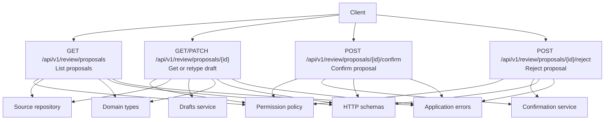
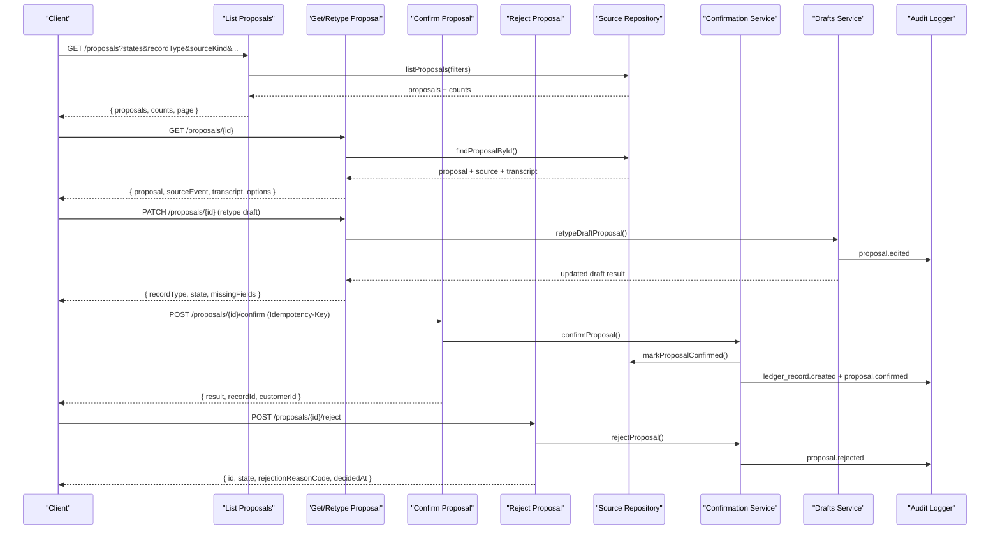
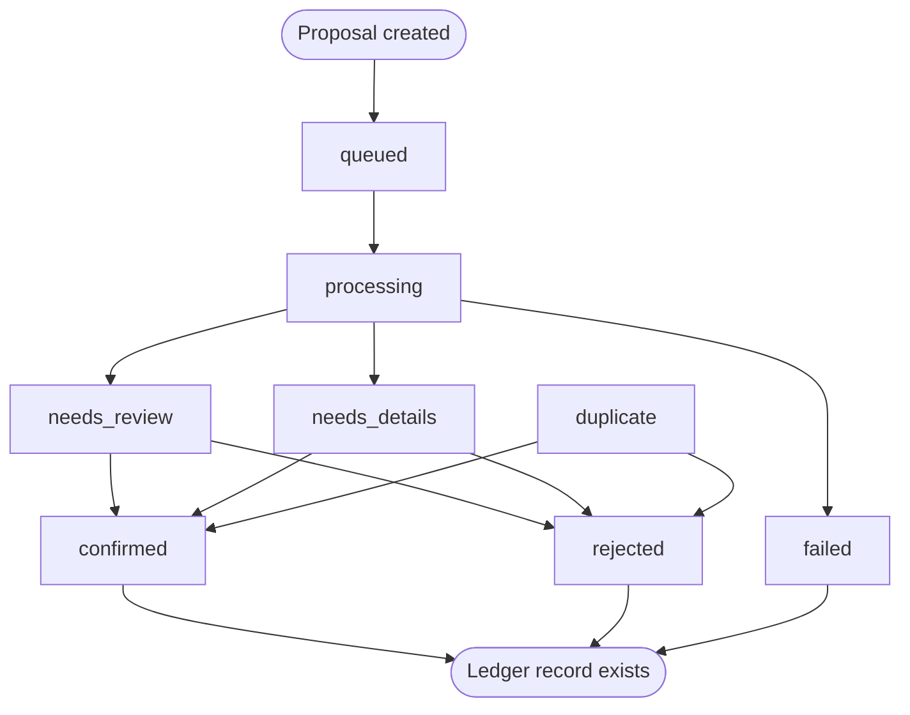
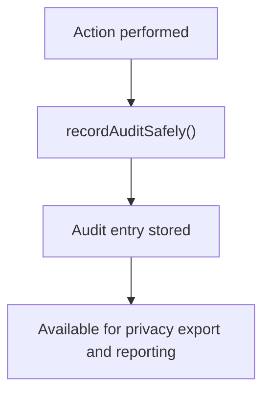
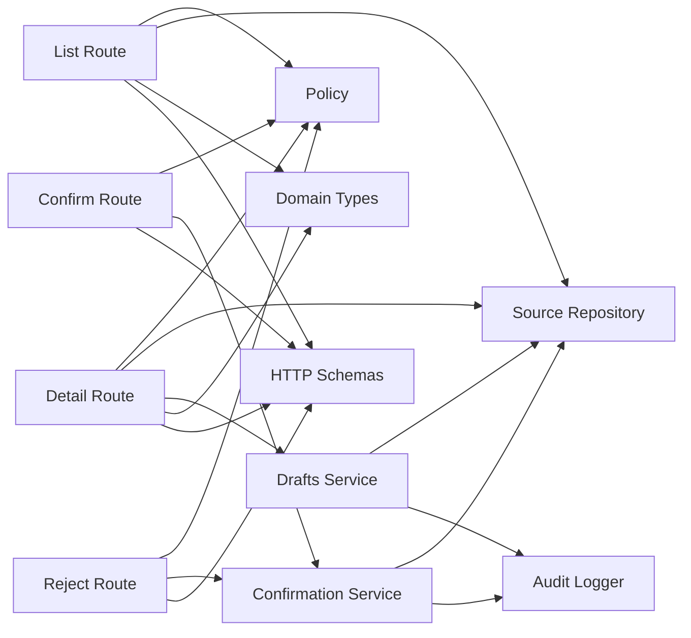

# Proposal Management API

<cite>
**Referenced Files in This Document**
- [route.ts](file://src/app/api/v1/review/proposals/route.ts)
- [proposal route.ts](file://src/app/api/v1/review/proposals/[proposalId]/route.ts)
- [confirm route.ts](file://src/app/api/v1/review/proposals/[proposalId]/confirm/route.ts)
- [reject route.ts](file://src/app/api/v1/review/proposals/[proposalId]/reject/route.ts)
- [domain types](file://src/server/domain/types.ts)
- [source repository](file://src/server/repositories/source.repository.ts)
- [confirmation service](file://src/server/services/confirmation.ts)
- [drafts service](file://src/server/services/drafts.ts)
- [HTTP schemas](file://src/server/http/schemas.ts)
- [permission policy](file://src/server/permissions/policy.ts)
- [application errors](file://src/lib/errors.ts)
</cite>

## Table of Contents
1. [Introduction](#introduction)
2. [Project Structure](#project-structure)
3. [Core Components](#core-components)
4. [Architecture Overview](#architecture-overview)
5. [Detailed Component Analysis](#detailed-component-analysis)
6. [Dependency Analysis](#dependency-analysis)
7. [Performance Considerations](#performance-considerations)
8. [Troubleshooting Guide](#troubleshooting-guide)
9. [Conclusion](#conclusion)

## Introduction
This document describes the proposal management API used by reviewers to inspect, classify, confirm, and reject data extraction proposals before they become ledger records. It covers:

- Listing proposals with filtering, pagination, and status queries.
- Retrieving a single proposal with source evidence and reviewer options.
- Reclassifying manual draft proposals.
- Confirming a proposal into the ledger with idempotency and optimistic concurrency.
- Rejecting a proposal with a required reason code.
- Proposal lifecycle states, correction workflows, audit trail requirements, and permission checks.
- Example request/response shapes and error handling behavior.

The endpoints are implemented as Next.js App Router handlers under `/api/v1/review/proposals`, backed by domain types, repositories, services, and a central permission policy.

## Project Structure
The proposal management feature spans route handlers, shared HTTP helpers, validation schemas, domain constants, repositories, and services:



**Diagram sources**
- [route.ts:52-109](file://src/app/api/v1/review/proposals/route.ts#L52-L109)
- [proposal route.ts:26-113](file://src/app/api/v1/review/proposals/[proposalId]/route.ts#L26-L113)
- [confirm route.ts:18-73](file://src/app/api/v1/review/proposals/[proposalId]/confirm/route.ts#L18-L73)
- [reject route.ts:15-35](file://src/app/api/v1/review/proposals/[proposalId]/reject/route.ts#L15-L35)
- [permission policy:11-34](file://src/server/permissions/policy.ts#L11-L34)
- [domain types:21-47](file://src/server/domain/types.ts#L21-L47)
- [source repository:535-594](file://src/server/repositories/source.repository.ts#L535-L594)
- [confirmation service:318-456](file://src/server/services/confirmation.ts#L318-L456)
- [drafts service:35-73](file://src/server/services/drafts.ts#L35-L73)
- [HTTP schemas:30-67](file://src/server/http/schemas.ts#L30-L67)
- [application errors:8-28](file://src/lib/errors.ts#L8-L28)

**Section sources**
- [route.ts:1-109](file://src/app/api/v1/review/proposals/route.ts#L1-L109)
- [proposal route.ts:1-113](file://src/app/api/v1/review/proposals/[proposalId]/route.ts#L1-L113)
- [confirm route.ts:1-74](file://src/app/api/v1/review/proposals/[proposalId]/confirm/route.ts#L1-L74)
- [reject route.ts:1-36](file://src/app/api/v1/review/proposals/[proposalId]/reject/route.ts#L1-L36)

## Core Components
- **Proposal listing endpoint**: Returns a paginated list of proposals with filters for state, record type, source kind, received date range, confidence band, ordering, and cursor-based pagination. It also returns per-state counts.
- **Single proposal endpoint**: Returns full proposal details, linked source event, transcript, and reviewer options such as customers, items, features, timezone, and currency. It also supports reclassifying manual draft proposals.
- **Confirmation endpoint**: Confirms a proposal into the ledger with idempotency, optimistic version control, field overrides, customer resolution, debt/inventory side effects, and audit logging.
- **Rejection endpoint**: Rejects a proposal without touching the ledger, requiring a reason code and storing the decision metadata.
- **Domain types**: Define allowed values for record types, proposal states, rejection reasons, audit actions, roles, and other shared vocabulary.
- **Repositories**: Provide tenant-scoped persistence for source events, transcripts, and proposals, including listing, counting, and state transitions.
- **Services**: Implement business logic for confirmation and draft reclassification, including validation, transactional updates, and audit recording.
- **HTTP schemas**: Validate request bodies for confirm, retype, and reject operations.
- **Permission policy**: Centralizes role-to-permission mapping; routes assert permissions before executing.
- **Application errors**: Standardized error contract with codes, messages, and JSON-safe details.

**Section sources**
- [domain types:8-179](file://src/server/domain/types.ts#L8-L179)
- [source repository:446-771](file://src/server/repositories/source.repository.ts#L446-L771)
- [confirmation service:56-522](file://src/server/services/confirmation.ts#L56-L522)
- [drafts service:23-74](file://src/server/services/drafts.ts#L23-L74)
- [HTTP schemas:30-67](file://src/server/http/schemas.ts#L30-L67)
- [permission policy:11-34](file://src/server/permissions/policy.ts#L11-L34)
- [application errors:8-130](file://src/lib/errors.ts#L8-L130)

## Architecture Overview
The proposal review flow is designed around safe human decisions:



**Diagram sources**
- [route.ts:52-109](file://src/app/api/v1/review/proposals/route.ts#L52-L109)
- [proposal route.ts:26-113](file://src/app/api/v1/review/proposals/[proposalId]/route.ts#L26-L113)
- [confirm route.ts:18-73](file://src/app/api/v1/review/proposals/[proposalId]/confirm/route.ts#L18-L73)
- [reject route.ts:15-35](file://src/app/api/v1/review/proposals/[proposalId]/reject/route.ts#L15-L35)
- [source repository:535-594](file://src/server/repositories/source.repository.ts#L535-L594)
- [confirmation service:318-456](file://src/server/services/confirmation.ts#L318-L456)
- [drafts service:35-73](file://src/server/services/drafts.ts#L35-L73)

## Detailed Component Analysis

### Proposal Listing Endpoint
- **Method and path**: `GET /api/v1/review/proposals`
- **Permissions**: Requires `proposals.read`.
- **Query parameters**:
  - `states`: Array of proposal states. Default is `needs_review`, `needs_details`, `duplicate`.
  - `recordType`: One of the allowed record types.
  - `sourceKind`: One of the allowed source kinds. Event-backed kinds filter on source event type; non-event kinds filter by provider.
  - `receivedFrom` / `receivedTo`: ISO timestamps to filter by source event received time.
  - `confidenceBand`: `low`, `medium`, or `high`, based on weakest extracted field confidence.
  - `order`: `oldest_first` (default) or `newest_first`.
  - `limit`: Integer between 10 and 100; default is 25.
  - Cursor pagination: `cursorCreatedAt` and `cursorId` together form the cursor.
- **Response shape**:
  - `proposals`: Array of summary objects including id, state, recordType, source identifiers, hints, missing fields, version, and timestamps.
  - `counts`: Per-state counts for the current tenant.
  - `page`: Pagination metadata including limit, order, hasMore, and nextCursor.

Example response structure:
```json
{
  "proposals": [
    {
      "id": "prp_xxx",
      "state": "needs_review",
      "recordType": "sale",
      "sourceEventId": "src_xxx",
      "transcriptId": "trs_xxx",
      "sourceKind": "whatsapp_voice",
      "amountMinor": 15000,
      "currency": "TZS",
      "occurredAtHint": "2026-01-01T10:00:00Z",
      "customerNameHint": "Alice",
      "ambiguityNote": null,
      "missingFields": ["category"],
      "version": 1,
      "createdAt": "2026-01-01T10:00:00Z",
      "updatedAt": "2026-01-01T10:00:00Z"
    }
  ],
  "counts": {
    "needs_review": 3,
    "needs_details": 1,
    "duplicate": 0
  },
  "page": {
    "limit": 25,
    "order": "oldest_first",
    "hasMore": false,
    "nextCursor": null
  }
}
```

Validation and error behavior:
- Unknown proposal states, record types, or source kinds return a validation error with allowed values.
- Invalid cursor usage may cause no results but does not itself raise an error unless combined with invalid filters.

**Section sources**
- [route.ts:21-50](file://src/app/api/v1/review/proposals/route.ts#L21-L50)
- [route.ts:52-109](file://src/app/api/v1/review/proposals/route.ts#L52-L109)
- [source repository:535-594](file://src/server/repositories/source.repository.ts#L535-L594)
- [domain types:8-62](file://src/server/domain/types.ts#L8-L62)

### Single Proposal Retrieval
- **Method and path**: `GET /api/v1/review/proposals/{proposalId}`
- **Permissions**: Requires `proposals.read`.
- **Behavior**:
  - Loads the proposal scoped to the tenant.
  - If present, loads the linked source event and transcript.
  - Returns proposal fields, provenance, missing fields, decision metadata, and options for the reviewer.
  - Options include available customers, inventory items (if enabled), feature flags, timezone, and currency.

Example response shape:
```json
{
  "proposal": {
    "id": "prp_xxx",
    "state": "needs_review",
    "recordType": "sale",
    "version": 1,
    "schemaVersion": "v1",
    "provider": "manual-draft",
    "modelVersion": "v1",
    "ambiguityNote": null,
    "missingFields": ["category"],
    "fields": {
      "amountMinor": 15000,
      "currency": "TZS",
      "occurredAt": "2026-01-01T10:00:00Z",
      "description": "Sale at shop",
      "paymentStatus": "paid",
      "paymentMethod": "cash"
    },
    "provenance": {},
    "confirmedLedgerRecordId": null,
    "rejectionReasonCode": null,
    "decidedAt": null,
    "createdAt": "2026-01-01T10:00:00Z",
    "updatedAt": "2026-01-01T10:00:00Z"
  },
  "sourceEvent": {
    "id": "src_xxx",
    "kind": "whatsapp_voice",
    "senderRef": "+255711111111",
    "receivedAt": "2026-01-01T10:00:00Z",
    "status": "processed"
  },
  "transcript": {
    "id": "trs_xxx",
    "status": "ready",
    "language": "sw",
    "text": "I paid 15,000 TZS for goods.",
    "failureCode": null
  },
  "options": {
    "customers": [],
    "items": [],
    "features": {},
    "timezone": "Africa/Dar_es_Salaam",
    "currency": "TZS"
  }
}
```

Error behavior:
- If the proposal is not found, returns a 404 not found error.

**Section sources**
- [proposal route.ts:26-93](file://src/app/api/v1/review/proposals/[proposalId]/route.ts#L26-L93)
- [source repository:500-509](file://src/server/repositories/source.repository.ts#L500-L509)
- [application errors:63-66](file://src/lib/errors.ts#L63-L66)

### Retype Manual Draft Proposal
- **Method and path**: `PATCH /api/v1/review/proposals/{proposalId}`
- **Permissions**: Requires `proposals.review`.
- **Purpose**: Reclassifies an in-app recording draft that has no guessed record type. It only applies to proposals produced by the manual draft adapter.
- **Request body**:
  - `expectedVersion`: Integer greater than or equal to 1.
  - `recordType`: One of the allowed record types.
- **Response shape**:
  - `recordType`: Updated record type.
  - `state`: New state (`needs_review` if all required fields are present, otherwise `needs_details`).
  - `missingFields`: Required fields still missing after reclassification.

Example request:
```json
{
  "expectedVersion": 1,
  "recordType": "expense"
}
```

Example response:
```json
{
  "recordType": "expense",
  "state": "needs_details",
  "missingFields": ["payee"]
}
```

Error behavior:
- Not found: 404 if the proposal does not exist.
- Already decided: 409 conflict if the proposal is not in a reviewable state.
- Only manual drafts can be reclassified: 422 validation error if the proposal was produced by another provider.
- Version conflict: 409 conflict if the expected version does not match the current version.

**Section sources**
- [proposal route.ts:101-113](file://src/app/api/v1/review/proposals/[proposalId]/route.ts#L101-L113)
- [drafts service:35-73](file://src/server/services/drafts.ts#L35-L73)
- [HTTP schemas:58-61](file://src/server/http/schemas.ts#L58-L61)
- [domain types:33-47](file://src/server/domain/types.ts#L33-L47)

### Confirm Proposal
- **Method and path**: `POST /api/v1/review/proposals/{proposalId}/confirm`
- **Permissions**: Requires `proposals.review`.
- **Idempotency**: Requires the `Idempotency-Key` header. The endpoint uses an idempotency wrapper keyed by scope and key to prevent duplicate postings.
- **Request headers**:
  - `Idempotency-Key`: Required string used to deduplicate retries.
- **Request body**:
  - `expectedVersion`: Integer greater than or equal to 1.
  - `note`: Optional reviewer note up to 500 characters.
  - `fields`: Optional partial override of proposal fields applied inside the confirmation transaction.
- **Response shape**:
  - `result`: Either `confirmed` or `already_confirmed`.
  - `recordId`: Ledger record id when confirmed or already confirmed.
  - `customerId`: Customer id when confirmed and a customer was resolved; null otherwise.

Example request:
```json
{
  "expectedVersion": 1,
  "note": "Confirmed after checking transcript.",
  "fields": {
    "amountMinor": 15000,
    "paymentStatus": "paid",
    "paymentMethod": "cash"
  }
}
```

Example response:
```json
{
  "data": {
    "result": "confirmed",
    "recordId": "rec_xxx",
    "customerId": "cust_xxx"
  }
}
```

Business rules enforced during confirmation:
- A rejected proposal cannot be confirmed.
- A stale view (version mismatch) is rejected as a conflict.
- Field validation runs against the record type schema; issues are returned as validation failures.
- Customer resolution creates or looks up a customer when needed.
- Debt effects create obligations or apply payments.
- Inventory movements are recorded when applicable.
- The proposal state is set to `confirmed` and linked to the ledger record.
- Audit events are recorded for both the ledger record creation and the proposal confirmation.
- An outbox event is enqueued for downstream consumers.

Error behavior:
- Missing `Idempotency-Key`: 422 validation error with a specific error code.
- Idempotent request in progress: 409 conflict indicating the operation is still being processed.
- Cannot read back idempotent result: 409 internal conflict.
- Invalid fields: 422 validation error with field-level issues.
- Version conflict: 409 conflict with expected and current versions.
- Proposal already decided: 409 conflict.

**Section sources**
- [confirm route.ts:18-73](file://src/app/api/v1/review/proposals/[proposalId]/confirm/route.ts#L18-L73)
- [confirmation service:318-456](file://src/server/services/confirmation.ts#L318-L456)
- [HTTP schemas:30-56](file://src/server/http/schemas.ts#L30-L56)
- [application errors:8-28](file://src/lib/errors.ts#L8-L28)

### Reject Proposal
- **Method and path**: `POST /api/v1/review/proposals/{proposalId}/reject`
- **Permissions**: Requires `proposals.review`.
- **Purpose**: Rejects a proposal without posting to the ledger. Always stores a reason code and optional note.
- **Request body**:
  - `expectedVersion`: Integer greater than or equal to 1.
  - `reasonCode`: Required string up to 60 characters.
  - `note`: Optional reviewer note up to 500 characters.
- **Response shape**:
  - `id`: Proposal id.
  - `state`: Now `rejected`.
  - `rejectionReasonCode`: Stored reason code.
  - `decidedAt`: Timestamp when the decision was made.

Example request:
```json
{
  "expectedVersion": 1,
  "reasonCode": "wrong_amount",
  "note": "Amount does not match receipt."
}
```

Example response:
```json
{
  "id": "prp_xxx",
  "state": "rejected",
  "rejectionReasonCode": "wrong_amount",
  "decidedAt": "2026-01-01T10:05:00Z"
}
```

Error behavior:
- Not found: 404 if the proposal does not exist.
- Already confirmed: 409 conflict because a confirmed record cannot be rejected.
- Version conflict: 409 conflict if the expected version does not match the current version.

**Section sources**
- [reject route.ts:15-35](file://src/app/api/v1/review/proposals/[proposalId]/reject/route.ts#L15-L35)
- [confirmation service:486-521](file://src/server/services/confirmation.ts#L486-L521)
- [HTTP schemas:63-67](file://src/server/http/schemas.ts#L63-L67)

### Proposal Lifecycle States
Allowed proposal states:
- `queued`
- `processing`
- `needs_review`
- `needs_details`
- `failed`
- `confirmed`
- `rejected`
- `duplicate`

Reviewable states:
- `needs_review`
- `needs_details`
- `duplicate`

Open states requiring processing:
- `queued`
- `processing`
- `needs_review`
- `needs_details`
- `duplicate`

Key transitions relevant to this API:
- Draft reclassification moves a manual draft from its initial state to either `needs_review` or `needs_details` depending on missing fields.
- Confirmation moves a reviewable proposal to `confirmed` and links it to a ledger record.
- Rejection moves a reviewable proposal to `rejected` and stores the reason code.



**Diagram sources**
- [domain types:21-47](file://src/server/domain/types.ts#L21-L47)
- [drafts service:57-61](file://src/server/services/drafts.ts#L57-L61)
- [confirmation service:327-342](file://src/server/services/confirmation.ts#L327-L342)
- [confirmation service:496-519](file://src/server/services/confirmation.ts#L496-L519)

**Section sources**
- [domain types:21-47](file://src/server/domain/types.ts#L21-L47)
- [drafts service:57-61](file://src/server/services/drafts.ts#L57-L61)
- [confirmation service:327-342](file://src/server/services/confirmation.ts#L327-L342)
- [confirmation service:496-519](file://src/server/services/confirmation.ts#L496-L519)

### Correction Workflows
Correction workflows operate at two levels:

1. **Proposal-level corrections**:
   - Reviewers can override selected fields during confirmation using the `fields` object. These overrides are applied inside the same transaction as the ledger record creation.
   - Validation runs against the target record type schema; any issues are returned as field-level validation errors.

2. **Post-confirmation corrections**:
   - After confirmation, ledger records can be corrected through separate correction endpoints not covered here. The confirmation service shares validation rules with corrections so corrected records are held to the same standards.

Manual draft reclassification is a pre-confirmation correction step:
- Only proposals produced by the manual draft adapter can be reclassified.
- The operation recomputes missing fields and sets the state accordingly.
- It bumps the proposal version to prevent stale overwrites.

**Section sources**
- [HTTP schemas:30-56](file://src/server/http/schemas.ts#L30-L56)
- [confirmation service:72-84](file://src/server/services/confirmation.ts#L72-L84)
- [confirmation service:464-475](file://src/server/services/confirmation.ts#L464-L475)
- [drafts service:35-73](file://src/server/services/drafts.ts#L35-L73)

### Audit Trail Requirements
Every significant action is recorded through a centralized audit mechanism:

- Proposal edited during reclassification: `proposal.edited`.
- Ledger record created during confirmation: `ledger_record.created`.
- Proposal confirmed: `proposal.confirmed`.
- Proposal rejected: `proposal.rejected`.

Audit entries include:
- Business id.
- Action type from the canonical audit actions list.
- Entity type and entity id.
- Actor user id.
- Optional request id.
- Optional reason code and note.
- Before and after snapshots where applicable.



**Diagram sources**
- [domain types:135-179](file://src/server/domain/types.ts#L135-L179)
- [drafts service:62-70](file://src/server/services/drafts.ts#L62-L70)
- [confirmation service:413-437](file://src/server/services/confirmation.ts#L413-L437)
- [confirmation service:508-518](file://src/server/services/confirmation.ts#L508-L518)

**Section sources**
- [domain types:135-179](file://src/server/domain/types.ts#L135-L179)
- [drafts service:62-70](file://src/server/services/drafts.ts#L62-L70)
- [confirmation service:413-437](file://src/server/services/confirmation.ts#L413-L437)
- [confirmation service:508-518](file://src/server/services/confirmation.ts#L508-L518)

### Permission Checks
All proposal endpoints enforce role-based permissions:

- Reading proposals requires `proposals.read`.
- Modifying proposals (retype, confirm, reject) requires `proposals.review`.

Roles map to permissions centrally, and checks run at the route boundary. Deny-by-default is enforced.

**Section sources**
- [permission policy:11-34](file://src/server/permissions/policy.ts#L11-L34)
- [route.ts:52-54](file://src/app/api/v1/review/proposals/route.ts#L52-L54)
- [proposal route.ts:29-29](file://src/app/api/v1/review/proposals/[proposalId]/route.ts#L29-L29)
- [proposal route.ts:104-104](file://src/app/api/v1/review/proposals/[proposalId]/route.ts#L104-L104)
- [confirm route.ts:21-21](file://src/app/api/v1/review/proposals/[proposalId]/confirm/route.ts#L21-L21)
- [reject route.ts:18-18](file://src/app/api/v1/review/proposals/[proposalId]/reject/route.ts#L18-L18)

## Dependency Analysis
The proposal management endpoints depend on several layers:



**Diagram sources**
- [route.ts:9-19](file://src/app/api/v1/review/proposals/route.ts#L9-L19)
- [proposal route.ts:9-24](file://src/app/api/v1/review/proposals/[proposalId]/route.ts#L9-L24)
- [confirm route.ts:10-16](file://src/app/api/v1/review/proposals/[proposalId]/confirm/route.ts#L10-L16)
- [reject route.ts:9-13](file://src/app/api/v1/review/proposals/[proposalId]/reject/route.ts#L9-L13)
- [confirmation service:15-54](file://src/server/services/confirmation.ts#L15-L54)
- [drafts service:10-21](file://src/server/services/drafts.ts#L10-L21)

**Section sources**
- [route.ts:9-19](file://src/app/api/v1/review/proposals/route.ts#L9-L19)
- [proposal route.ts:9-24](file://src/app/api/v1/review/proposals/[proposalId]/route.ts#L9-L24)
- [confirm route.ts:10-16](file://src/app/api/v1/review/proposals/[proposalId]/confirm/route.ts#L10-L16)
- [reject route.ts:9-13](file://src/app/api/v1/review/proposals/[proposalId]/reject/route.ts#L9-L13)
- [confirmation service:15-54](file://src/server/services/confirmation.ts#L15-L54)
- [drafts service:10-21](file://src/server/services/drafts.ts#L10-L21)

## Performance Considerations
- **Pagination**: Use cursor-based pagination with `cursorCreatedAt` and `cursorId` to avoid expensive offset queries. The default order is oldest first to prioritize older work.
- **Filtering**: Prefer narrowing by `states`, `recordType`, and `sourceKind` to reduce query size. Confidence bands are computed from the weakest extracted field confidence and are useful for triage.
- **Limit tuning**: Keep `limit` within the allowed range; the server fetches one extra row to determine `hasMore`.
- **Idempotency**: Always send `Idempotency-Key` on confirm requests to avoid duplicate ledger postings and reduce retry overhead.
- **Optimistic concurrency**: Include `expectedVersion` in modify requests to fail fast on stale views rather than silently overwriting changes.

[No sources needed since this section provides general guidance]

## Troubleshooting Guide
Common issues and how to resolve them:

- **Missing Idempotency-Key on confirm**:
  - Symptom: Validation error indicating the header is required.
  - Resolution: Add the `Idempotency-Key` header to the confirm request.

- **Idempotent request in progress**:
  - Symptom: Conflict error stating the confirmation is still being processed.
  - Resolution: Retry after a short delay; do not reuse the same key until the previous operation completes.

- **Version conflict**:
  - Symptom: Conflict error indicating the proposal changed since you opened it.
  - Resolution: Reload the proposal, update `expectedVersion`, and retry.

- **Invalid fields on confirm**:
  - Symptom: Validation error listing field-level issues.
  - Resolution: Correct the fields according to the record type schema; use the `fields` override carefully.

- **Cannot reclassify a non-manual draft**:
  - Symptom: Validation error stating only in-app recordings can be reclassified.
  - Resolution: Use reclassification only for manual draft proposals; model-generated proposals must be corrected via post-confirmation correction flows.

- **Already decided proposal**:
  - Symptom: Conflict error when trying to retype, confirm, or reject a finalized proposal.
  - Resolution: Do not act on proposals that are already confirmed or rejected.

- **Not found**:
  - Symptom: 404 error for proposal retrieval or modification.
  - Resolution: Verify the proposal id and tenant scoping.

**Section sources**
- [confirm route.ts:24-30](file://src/app/api/v1/review/proposals/[proposalId]/confirm/route.ts#L24-L30)
- [confirm route.ts:62-70](file://src/app/api/v1/review/proposals/[proposalId]/confirm/route.ts#L62-L70)
- [confirmation service:336-342](file://src/server/services/confirmation.ts#L336-L342)
- [confirmation service:464-475](file://src/server/services/confirmation.ts#L464-L475)
- [drafts service:43-55](file://src/server/services/drafts.ts#L43-L55)
- [application errors:8-28](file://src/lib/errors.ts#L8-L28)

## Conclusion
The proposal management API provides a secure, auditable workflow for turning extracted data into reliable ledger records. It emphasizes:

- Clear separation of concerns between route handlers, services, and repositories.
- Strong validation through shared schemas and domain types.
- Safe human decisions via permissions, version checks, and idempotency.
- Comprehensive audit trails for every meaningful change.
- Flexible filtering and pagination for efficient review queues.

Clients should always send valid filters, cursors, and limits for listing; include `expectedVersion` for modifications; and provide `Idempotency-Key` for confirmations. When errors occur, inspect the error code and details to determine whether the issue is authentication, authorization, validation, conflict, or not found.

[No sources needed since this section summarizes without analyzing specific files]