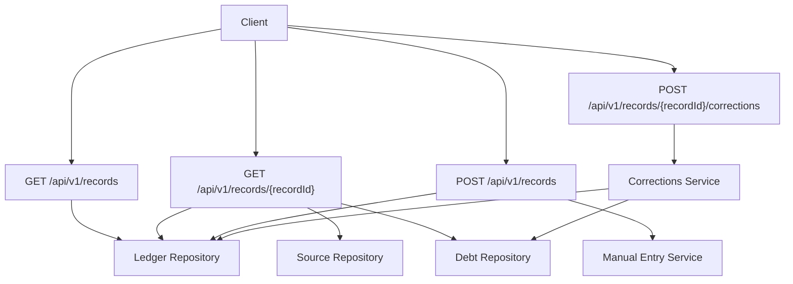
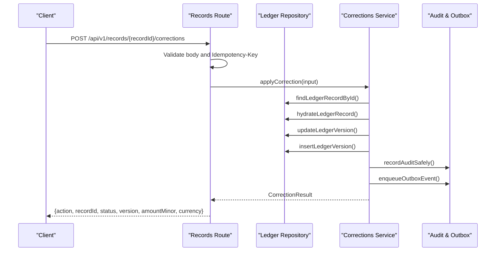
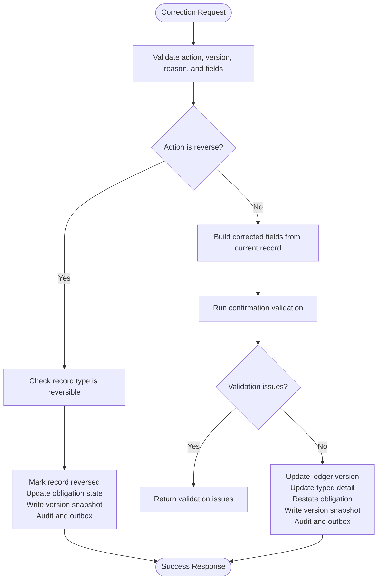
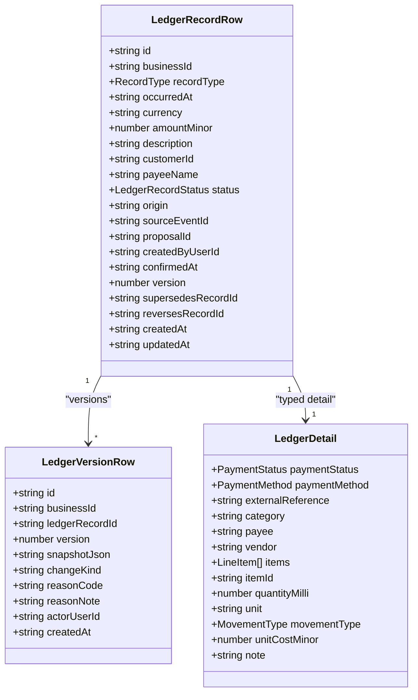
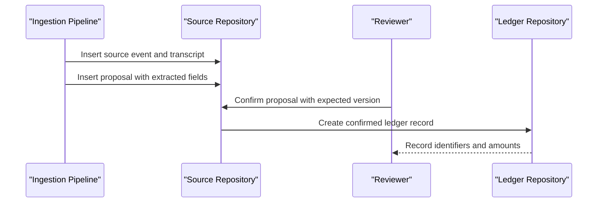
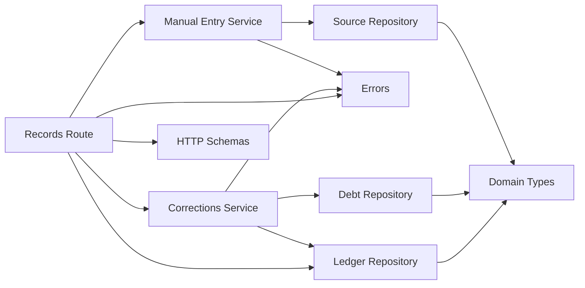

# Records API

<cite>
**Referenced Files in This Document**
- [route.ts](file://src/app/api/v1/records/route.ts)
- [route.ts](file://src/app/api/v1/records/[recordId]/route.ts)
- [route.ts](file://src/app/api/v1/records/[recordId]/corrections/route.ts)
- [ledger.repository.ts](file://src/server/repositories/ledger.repository.ts)
- [corrections.ts](file://src/server/services/corrections.ts)
- [manual-entry.ts](file://src/server/services/manual-entry.ts)
- [source.repository.ts](file://src/server/repositories/source.repository.ts)
- [debt.repository.ts](file://src/server/repositories/debt.repository.ts)
- [schemas.ts](file://src/server/http/schemas.ts)
- [types.ts](file://src/server/domain/types.ts)
- [errors.ts](file://lib/errors.ts)
</cite>

## Table of Contents
1. [Introduction](#introduction)
2. [Project Structure](#project-structure)
3. [Core Components](#core-components)
4. [Architecture Overview](#architecture-overview)
5. [Detailed Component Analysis](#detailed-component-analysis)
6. [Dependency Analysis](#dependency-analysis)
7. [Performance Considerations](#performance-considerations)
8. [Troubleshooting Guide](#troubleshooting-guide)
9. [Conclusion](#conclusion)

## Introduction
This document describes the ledger record operations exposed by the Records API. It covers:
- Listing records with date range, type, status, customer, and search filters.
- Retrieving a single record with its detail, source lineage, proposal context, obligations, payments, audit events, and version history.
- Creating manual records through an idempotent endpoint.
- Correcting or reversing posted records through a controlled workflow.
- Record data models, validation rules, accounting principles, and audit requirements.
- The relationship between records and proposals, correction approval behavior, and financial integrity constraints.

The system treats confirmed ledger records as immutable historical facts. Corrections do not overwrite history; they create new versions and snapshots. Reversals mark records so they stop contributing to derived totals such as cash flow, inventory movement, and debt balances.

## Project Structure
The Records API is implemented as Next.js App Router handlers under `src/app/api/v1/records`. Business logic is delegated to repository and service modules:
- Route handlers validate requests, enforce permissions, and return structured responses.
- Repositories perform tenant-scoped database operations for ledger records, source events, proposals, customers, obligations, and payments.
- Services implement corrections, reversals, manual entry, and history retrieval.

**Diagram sources**
- [route.ts:44-95](file://src/app/api/v1/records/route.ts#L44-L95)
- [route.ts:28-115](file://src/app/api/v1/records/[recordId]/route.ts#L28-L115)
- [route.ts:104-150](file://src/app/api/v1/records/route.ts#L104-L150)
- [route.ts:67-129](file://src/app/api/v1/records/[recordId]/corrections/route.ts#L67-L129)
- [ledger.repository.ts:304-360](file://src/server/repositories/ledger.repository.ts#L304-L360)
- [source.repository.ts:446-498](file://src/server/repositories/source.repository.ts#L446-L498)
- [debt.repository.ts:94-114](file://src/server/repositories/debt.repository.ts#L94-L114)
- [manual-entry.ts:57-115](file://src/server/services/manual-entry.ts#L57-L115)
- [corrections.ts:281-322](file://src/server/services/corrections.ts#L281-L322)

**Section sources**
- [route.ts:1-151](file://src/app/api/v1/records/route.ts#L1-L151)
- [route.ts:1-116](file://src/app/api/v1/records/[recordId]/route.ts#L1-L116)
- [route.ts:1-130](file://src/app/api/v1/records/[recordId]/corrections/route.ts#L1-L130)

## Core Components
- **List endpoint**: Returns paginated ledger records filtered by business timezone date range, record type, status, origin, customer, and search text. It uses cursor pagination based on occurrence time and record ID.
- **Detail endpoint**: Returns the current record, typed detail, customer display name, payee, source event, transcript, proposal state, obligation information, payments linked to the record, audit events, and full version history.
- **Create endpoint**: Accepts a manual record payload, validates it against a shared schema, enforces an idempotency key header, creates a proposal without a source event, and confirms it immediately through the normal confirmation path.
- **Correction endpoint**: Accepts either a correction or reversal, validates fields, checks permissions, applies optimistic concurrency via expected version, updates ledger and related tables, writes version snapshots, emits audit events, and publishes outbox events.

Key domain types include:
- Record types: sale, expense, debt_created, debt_payment, stock_movement, note.
- Record statuses: posted, voided, reversed.
- Payment statuses: paid, unpaid, partial, unknown.
- Payment methods: cash, mobile_money, bank, card, credit, unknown.
- Movement types: in, out, adjustment.

**Section sources**
- [types.ts:8-16](file://src/server/domain/types.ts#L8-L16)
- [types.ts:18-19](file://src/server/domain/types.ts#L18-L19)
- [types.ts:67-85](file://src/server/domain/types.ts#L67-L85)
- [schemas.ts:69-89](file://src/server/http/schemas.ts#L69-L89)

## Architecture Overview
The Records API follows a layered architecture:
- HTTP routes handle request parsing, authorization, and response formatting.
- Services encapsulate business workflows such as manual recording and corrections.
- Repositories encapsulate SQL queries and persistence contracts.
- Domain types define stable enums and shared vocabulary.
- Error utilities provide consistent error codes and response shapes.

**Diagram sources**
- [route.ts:67-129](file://src/app/api/v1/records/[recordId]/corrections/route.ts#L67-L129)
- [corrections.ts:281-322](file://src/server/services/corrections.ts#L281-L322)
- [corrections.ts:324-403](file://src/server/services/corrections.ts#L324-L403)
- [ledger.repository.ts:558-582](file://src/server/repositories/ledger.repository.ts#L558-L582)
- [ledger.repository.ts:604-638](file://src/server/repositories/ledger.repository.ts#L604-L638)

## Detailed Component Analysis

### GET /api/v1/records
Lists ledger records within a business-timezone date range.

**Authentication and authorization**
- Requires a tenant-scoped context.
- Requires the `records.read` permission.

**Query parameters**
| Parameter | Type | Required | Description |
|---|---|---:|---|
| `from` | ISO date string | No | Start of the inclusive calendar date range in the business timezone. Defaults to the current month when using report-range helpers. |
| `to` | ISO date string | No | End of the inclusive calendar date range. |
| `types` | Array of strings | No | Filter by record type. Allowed values are defined by the domain record type enum. |
| `statuses` | Array of strings | No | Filter by record status. Allowed values are `posted`, `voided`, `reversed`. |
| `customerId` | String | No | Filter by customer identifier. |
| `search` | String | No | Search across description, payee name, and customer display name. |
| `limit` | Integer | No | Page size. Default is 50, maximum is 200. |
| `cursorOccurredAt` | ISO datetime string | Conditional | Cursor timestamp for pagination. |
| `cursorId` | String | Conditional | Cursor record ID for pagination. |

**Response shape**
| Field | Type | Description |
|---|---|---|
| `records` | Array | Each item includes record identifiers, type, occurrence time, currency, amount in minor units, status, origin, description, customer reference, customer display name, confirmer display name, and typed detail. |
| `range` | Object | Includes `from`, `to`, and `timezone`. |
| `page.limit` | Integer | Requested page size. |
| `page.hasMore` | Boolean | Whether more records exist beyond the returned page. |
| `page.nextCursor` | Object or null | Contains `occurredAt` and `id` when `hasMore` is true. |

**Filtering behavior**
- Date filtering uses the business timezone and converts query dates to UTC milliseconds before querying.
- Type filtering validates each requested type against the allowed record type list.
- Status filtering validates each requested status against the allowed ledger record status list.
- Search performs substring matching across description, payee name, and customer display name.
- Pagination uses occurrence time descending, then record ID descending, with a composite cursor.

**Error handling**
- Unknown record types return a validation error with the allowed list.
- Unknown record statuses return a validation error with the allowed list.
- Missing or invalid authentication returns an unauthenticated or forbidden error.
- Permission failures return a forbidden error.

**Section sources**
- [route.ts:21-42](file://src/app/api/v1/records/route.ts#L21-L42)
- [route.ts:44-95](file://src/app/api/v1/records/route.ts#L44-L95)
- [ledger.repository.ts:304-360](file://src/server/repositories/ledger.repository.ts#L304-L360)
- [types.ts:8-19](file://src/server/domain/types.ts#L8-L19)
- [errors.ts:52-85](file://lib/errors.ts#L52-L85)

### GET /api/v1/records/[recordId]
Returns the complete view needed by a reviewer to defend a record.

**Authentication and authorization**
- Requires a tenant-scoped context.
- Requires the `records.read` permission.

**Path parameter**
| Parameter | Type | Required | Description |
|---|---|---:|---|
| `recordId` | String | Yes | Identifier of the ledger record. |

**Response sections**
| Section | Fields | Purpose |
|---|---|---|
| `record` | `id`, `recordType`, `occurredAt`, `currency`, `amountMinor`, `description`, `status`, `origin`, `version`, `confirmedAt`, `createdAt`, `updatedAt`, `supersedesRecordId`, `reversesRecordId` | Current persisted record state. |
| `detail` | Typed fields including payment status, payment method, category, payee, items, movement fields, and notes | Record-type-specific data loaded from typed detail tables. |
| `customer` | `id`, `displayName` | Customer attached to the record, if any. |
| `payeeName` | String | Payee associated with the record. |
| `source` | `sourceEventId`, `proposalId`, `proposalState`, `transcript`, `transcriptWasCorrected`, `transcriptStatus`, `proposalVersion`, `ambiguityNote` | Lineage from source event and proposal. |
| `deni` | `obligationId`, `originalAmountMinor`, `paidMinor`, `outstandingMinor`, `state`, `dueDate` | Obligation created by the record, if any. |
| `payments` | Array of payment objects | Payments linked to this record for the customer. |
| `audit` | Array of audit events | Recent audit entries for the record. |
| `history` | Array of version entries | Full version history with snapshots. |

**Data relationships**
- A record may link to a proposal through `proposal_id`.
- A record may link to a source event through `source_event_id`.
- A record may create a debt obligation when money is owed.
- Payments are stored separately and linked to both the customer and the ledger record.

**Error handling**
- If the record does not exist in the tenant scope, a not found error is returned.
- Authentication or permission failures return appropriate errors.

**Section sources**
- [route.ts:28-115](file://src/app/api/v1/records/[recordId]/route.ts#L28-L115)
- [ledger.repository.ts:202-302](file://src/server/repositories/ledger.repository.ts#L202-L302)
- [source.repository.ts:446-498](file://src/server/repositories/source.repository.ts#L446-L498)
- [debt.repository.ts:186-202](file://src/server/repositories/debt.repository.ts#L186-L202)
- [errors.ts:63-85](file://lib/errors.ts#L63-L85)

### POST /api/v1/records
Creates a manual ledger entry.

**Authentication and authorization**
- Requires a tenant-scoped context.
- Requires the `records.create_manual` permission.

**Required headers**
| Header | Required | Description |
|---|---:|---|
| `Idempotency-Key` | Yes | Unique key scoped to the business to prevent duplicate posting. |

**Request body**
| Field | Type | Required | Validation |
|---|---|---:|---|
| `recordType` | Enum | Yes | Must be one of the allowed record types. |
| `occurredAt` | ISO datetime string | Yes | Explicit occurrence timestamp. |
| `amountMinor` | Integer or null | No | Positive integer when present. |
| `description` | String or null | No | Trimmed, maximum length enforced. |
| `customerId` | String or null | No | Trimmed identifier. |
| `customerName` | String or null | No | Trimmed display name. |
| `paymentStatus` | Enum or null | No | Allowed payment status values. |
| `paymentMethod` | Enum or null | No | Allowed payment method values. |
| `amountPaidMinor` | Integer or null | No | Non-negative integer when present. |
| `category` | String or null | No | Trimmed category. |
| `payee` | String or null | No | Trimmed payee. |
| `dueDate` | ISO date string or null | No | Calendar date format. |
| `itemsText` | String or null | No | Trimmed items summary. |
| `itemId` | String or null | No | Trimmed identifier. |
| `itemName` | String or null | No | Trimmed item name. |
| `quantityMilli` | Integer or null | No | Positive integer when present. |
| `unit` | String or null | No | Trimmed unit. |
| `movementType` | Enum or null | No | Allowed movement type. |
| `note` | String or null | No | Trimmed note. |

**Workflow**
1. Parse and validate the body against the manual record schema.
2. Require an idempotency key header.
3. Wrap the operation in idempotency handling scoped to the business.
4. Create a proposal without a source event.
5. Confirm the proposal through the normal confirmation pipeline.
6. Return the created record identifiers and amounts.

**Response**
| Field | Type | Description |
|---|---|---|
| `recordId` | String | Created ledger record identifier. |
| `customerId` | String or null | Attached customer identifier, if any. |
| `occurredAt` | ISO datetime string | Occurrence time of the recorded transaction. |
| `amountMinor` | Integer or null | Recorded amount in minor units. |

**Error handling**
- Missing idempotency key returns a validation error indicating the required header.
- Duplicate idempotency keys return a conflict error indicating the request is already in progress.
- Manual entry disabled for the business returns a feature-not-enabled error.
- Confirmation failure returns a validation error describing why the entry still needs attention.

**Section sources**
- [route.ts:97-150](file://src/app/api/v1/records/route.ts#L97-L150)
- [schemas.ts:69-89](file://src/server/http/schemas.ts#L69-L89)
- [manual-entry.ts:57-115](file://src/server/services/manual-entry.ts#L57-L115)
- [errors.ts:8-28](file://lib/errors.ts#L8-L28)

### POST /api/v1/records/[recordId]/corrections
Creates a correction or reversal for a posted record.

**Authentication and authorization**
- Requires a tenant-scoped context.
- Requires the `records.correct` permission.

**Required headers**
| Header | Required | Description |
|---|---:|--- |
| `Idempotency-Key` | Yes | Unique key scoped to the business and record to prevent duplicate changes. |

**Request body**
| Field | Type | Required | Validation |
|---|---|---:|---|
| `action` | Enum | Yes | Either `correct` or `reverse`. |
| `expectedVersion` | Integer | Yes | Positive integer representing the record version the client last saw. |
| `reasonCode` | String | Yes | Trimmed reason code, maximum length enforced. |
| `reasonNote` | String or null | Conditional | Required when `reasonCode` is `other`; trimmed, maximum length enforced. |
| `fields` | Object or null | Conditional | Present for `correct`, absent for `reverse`. Strict object with allowed correction fields. |

**Allowed correction fields**
| Field | Type | Validation |
|---|---|---|
| `amountMinor` | Integer or null | Non-negative integer when present. |
| `occurredAt` | ISO datetime string or null | Valid datetime when present. |
| `description` | String or null | Trimmed, maximum length enforced. |
| `category` | String or null | Trimmed, maximum length enforced. |
| `payee` | String or null | Trimmed, maximum length enforced. |
| `customerId` | String or null | Trimmed identifier. |
| `customerName` | String or null | Trimmed display name. |
| `paymentStatus` | Enum or null | Allowed payment status values. |
| `paymentMethod` | Enum or null | Allowed payment method values. |
| `amountPaidMinor` | Integer or null | Non-negative integer when present. |
| `dueDate` | ISO date string or null | Calendar date format. |
| `note` | String or null | Trimmed, maximum length enforced. |

**Business rules**
- Only posted records can be corrected or reversed.
- Reversal is only allowed for financial record types: sale, expense, debt_created, debt_payment, stock_movement.
- A reversal must not include changed fields.
- A correction must include at least one changed field.
- When correcting, the server validates the resulting fields through the same confirmation rules used during initial recording.
- If a correction changes the amount owed, the associated debt obligation is restated. If payments have already been applied, the amount cannot be reduced below what was paid.
- Optimistic concurrency is enforced: if another reviewer updated the record since the client’s `expectedVersion`, the request fails with a version conflict.

**Workflow**

**Diagram sources**
- [route.ts:19-65](file://src/app/api/v1/records/[recordId]/corrections/route.ts#L19-L65)
- [corrections.ts:132-159](file://src/server/services/corrections.ts#L132-L159)
- [corrections.ts:169-233](file://src/server/services/corrections.ts#L169-L233)
- [corrections.ts:281-322](file://src/server/services/corrections.ts#L281-L322)
- [corrections.ts:324-403](file://src/server/services/corrections.ts#L324-L403)

**Response**
| Field | Type | Description |
|---|---|---|
| `action` | Enum | `correct` or `reverse`. |
| `recordId` | String | Updated record identifier. |
| `status` | String | New record status. |
| `version` | Integer | New record version. |
| `occurredAt` | ISO datetime string | Occurrence time. |
| `amountMinor` | Integer or null | Amount in minor units. |
| `currency` | String | Currency code. |

**Error handling**
- Missing idempotency key returns a validation error.
- Duplicate idempotency key returns a conflict error.
- Invalid action or fields return a validation error.
- Reversing a non-financial record type returns a validation error.
- Correcting a non-posted record returns a conflict error.
- Version conflict returns a conflict error instructing the client to reload.
- Correction validation failures return a validation error with per-field issues.
- Reducing an obligation below applied payments returns a conflict error.

**Section sources**
- [route.ts:19-129](file://src/app/api/v1/records/[recordId]/corrections/route.ts#L19-L129)
- [corrections.ts:54-94](file://src/server/services/corrections.ts#L54-L94)
- [corrections.ts:132-159](file://src/server/services/corrections.ts#L132-L159)
- [corrections.ts:169-233](file://src/server/services/corrections.ts#L169-L233)
- [corrections.ts:281-403](file://src/server/services/corrections.ts#L281-L403)
- [errors.ts:8-28](file://lib/errors.ts#L8-L28)

### Record Data Models
A ledger record represents a confirmed financial or informational event. Its core attributes include:
- Identifier, business scope, record type, occurrence time, currency, amount, description, customer reference, payee name, status, origin, source event reference, proposal reference, creator user reference, confirmation timestamp, version, supersession reference, and reversal reference.
- Typed detail varies by record type: sales include payment status, payment method, external reference, category, and line items; expenses include category and vendor; notes include privacy-classified note text; stock movements include item, movement type, quantity, unit cost, and note.

Version history is stored separately:
- Each version captures the change kind, reason code, reason note, actor user, and a JSON snapshot of the record state at that version.

**Diagram sources**
- [ledger.repository.ts:20-77](file://src/server/repositories/ledger.repository.ts#L20-L77)
- [ledger.repository.ts:43-54](file://src/server/repositories/ledger.repository.ts#L43-L54)

**Section sources**
- [ledger.repository.ts:20-77](file://src/server/repositories/ledger.repository.ts#L20-L77)
- [ledger.repository.ts:96-137](file://src/server/repositories/ledger.repository.ts#L96-L137)
- [ledger.repository.ts:604-638](file://src/server/repositories/ledger.repository.ts#L604-L638)

### Accounting Principles and Financial Integrity Constraints
- Confirmed records are immutable historical facts. Corrections create new versions; reversals mark records so they no longer contribute to derived totals.
- Derived totals read only records with status `posted`. Reversing a record removes it from cash totals, inventory movement totals, and debt balance calculations.
- Obligations represent money owed by customers. When a correction changes the amount owed, the obligation is restated. If payments have already been applied, the amount cannot be reduced below what was paid.
- Payments are separate records linked to obligations and ledger records. Their inclusion in balances depends on the status of the referenced ledger record.
- Stock movement quantities are evidence and are not restated through corrections; changing quantity requires reversing and re-entering the movement.

**Section sources**
- [corrections.ts:1-14](file://src/server/services/corrections.ts#L1-L14)
- [corrections.ts:74-102](file://src/server/services/corrections.ts#L74-L102)
- [corrections.ts:169-233](file://src/server/services/corrections.ts#L169-L233)
- [debt.repository.ts:154-222](file://src/server/repositories/debt.repository.ts#L154-L222)

### Relationship Between Records and Proposals
- Automated ingestion creates source events, transcripts, and proposals. Reviewers confirm or reject proposals, which then produce confirmed ledger records.
- Manual entries bypass source events but still create proposals and go through the same confirmation path.
- A confirmed proposal links to its ledger record through `confirmed_ledger_record_id`.
- The record detail endpoint surfaces proposal state, transcript evidence, ambiguity notes, and proposal version to support review and correction decisions.

**Diagram sources**
- [source.repository.ts:446-498](file://src/server/repositories/source.repository.ts#L446-L498)
- [source.repository.ts:723-739](file://src/server/repositories/source.repository.ts#L723-L739)
- [ledger.repository.ts:96-137](file://src/server/repositories/ledger.repository.ts#L96-L137)

**Section sources**
- [source.repository.ts:446-498](file://src/server/repositories/source.repository.ts#L446-L498)
- [source.repository.ts:723-739](file://src/server/repositories/source.repository.ts#L723-L739)
- [manual-entry.ts:57-115](file://src/server/services/manual-entry.ts#L57-L115)

### Audit Requirements
Every significant state change is audited:
- Proposal creation, editing, confirmation, rejection, and retry.
- Ledger record creation, correction, reversal, and voiding.
- Customer creation and updates.
- Obligation creation and restatement.
- Debt payment recording.
- Export and media access events.

Audit events include the actor, entity type, entity identifier, reason code, optional reason note, and before/after snapshots where applicable. The audit action vocabulary is centralized in the domain types module.

**Section sources**
- [types.ts:128-194](file://src/server/domain/types.ts#L128-L194)
- [corrections.ts:377-395](file://src/server/services/corrections.ts#L377-L395)
- [corrections.ts:459-477](file://src/server/services/corrections.ts#L459-L477)
- [manual-entry.ts:69-96](file://src/server/services/manual-entry.ts#L69-L96)

### Examples of Usage Patterns

#### Record Creation Pattern
- Send a POST request to `/api/v1/records` with a valid `Idempotency-Key` header.
- Include `recordType`, `occurredAt`, and any relevant fields such as amount, customer, payment status, category, and payee.
- Handle missing idempotency key, duplicate idempotency key, feature not enabled, and confirmation failure responses.

#### Record Modification Pattern
- Retrieve the record detail to obtain the current `version`.
- Send a POST request to `/api/v1/records/{recordId}/corrections` with `action`, `expectedVersion`, `reasonCode`, and optionally `fields`.
- For corrections, include only allowed fields. For reversals, omit `fields`.
- Handle validation failures, version conflicts, and obligation payment constraints.

#### Record Query Pattern
- Use GET `/api/v1/records` with `from`, `to`, `types`, `statuses`, `customerId`, and `search`.
- Paginate using `limit`, `cursorOccurredAt`, and `cursorId`.
- Respect the returned `range.timezone` and use business-timezone-aware date handling.

**Section sources**
- [route.ts:44-95](file://src/app/api/v1/records/route.ts#L44-L95)
- [route.ts:104-150](file://src/app/api/v1/records/route.ts#L104-L150)
- [route.ts:67-129](file://src/app/api/v1/records/[recordId]/corrections/route.ts#L67-L129)

## Dependency Analysis
The Records API has clear layering and minimal circular coupling:
- Routes depend on repositories and services.
- Services depend on repositories and domain types.
- Repositories depend on database clients and domain types.
- Errors and schemas are shared utilities consumed by routes and services.

**Diagram sources**
- [route.ts:44-150](file://src/app/api/v1/records/route.ts#L44-L150)
- [route.ts:67-129](file://src/app/api/v1/records/[recordId]/corrections/route.ts#L67-L129)
- [ledger.repository.ts:1-18](file://src/server/repositories/ledger.repository.ts#L1-L18)
- [debt.repository.ts:1-11](file://src/server/repositories/debt.repository.ts#L1-L11)
- [source.repository.ts:1-24](file://src/server/repositories/source.repository.ts#L1-L24)
- [schemas.ts:1-14](file://src/server/http/schemas.ts#L1-L14)
- [errors.ts:1-28](file://lib/errors.ts#L1-L28)
- [types.ts:1-16](file://src/server/domain/types.ts#L1-L16)

**Section sources**
- [route.ts:1-151](file://src/app/api/v1/records/route.ts#L1-L151)
- [route.ts:1-130](file://src/app/api/v1/records/[recordId]/corrections/route.ts#L1-L130)
- [ledger.repository.ts:1-18](file://src/server/repositories/ledger.repository.ts#L1-L18)
- [debt.repository.ts:1-11](file://src/server/repositories/debt.repository.ts#L1-L11)
- [source.repository.ts:1-24](file://src/server/repositories/source.repository.ts#L1-L24)
- [schemas.ts:1-14](file://src/server/http/schemas.ts#L1-L14)
- [errors.ts:1-28](file://lib/errors.ts#L1-L28)
- [types.ts:1-16](file://src/server/domain/types.ts#L1-L16)

## Performance Considerations
- Use cursor pagination for large result sets. The default limit is 50, with a maximum of 200.
- Narrow date ranges to the business timezone interval you need.
- Avoid overly broad search terms; search matches across multiple columns.
- Prefer filtering by `types` and `statuses` to reduce result set size.
- Correction and creation endpoints are wrapped in idempotency handling to avoid duplicate work and protect against retries.

[No sources needed since this section provides general guidance]

## Troubleshooting Guide
Common errors and their meanings:
- `UNAUTHENTICATED`: The request lacks valid authentication.
- `FORBIDDEN`: The authenticated role lacks permission for the requested action.
- `NOT_FOUND`: The requested resource does not exist in the tenant scope.
- `VALIDATION_FAILED`: Input failed schema or business validation.
- `IDEMPOTENCY_KEY_REQUIRED`: A required idempotency key header is missing.
- `IDEMPOTENT_REQUEST_IN_PROGRESS`: An identical idempotency key is already being processed.
- `RECORD_VERSION_CONFLICT`: Another request changed the record after the client’s expected version.
- `RECORD_NOT_POSTED`: The record is not in a posted state and cannot be corrected or reversed.
- `OBLIGATION_HAS_PAYMENTS`: The correction would reduce an obligation below already applied payments.

Recommended troubleshooting steps:
- Verify authentication and role permissions.
- Ensure all required headers are present, especially `Idempotency-Key`.
- Reload the record detail to obtain the latest `version` before submitting corrections.
- Inspect validation error details for allowed values and field-level messages.
- Check audit events and version history to understand prior changes.

**Section sources**
- [errors.ts:8-28](file://lib/errors.ts#L8-L28)
- [errors.ts:52-85](file://lib/errors.ts#L52-L85)
- [route.ts:104-150](file://src/app/api/v1/records/route.ts#L104-L150)
- [route.ts:67-129](file://src/app/api/v1/records/[recordId]/corrections/route.ts#L67-L129)
- [corrections.ts:132-159](file://src/server/services/corrections.ts#L132-L159)
- [corrections.ts:281-322](file://src/server/services/corrections.ts#L281-L322)

## Conclusion
The Records API provides a secure, auditable, and financially sound interface for listing, retrieving, creating, and correcting ledger records. It enforces strict validation, optimistic concurrency, idempotency, and separation of concerns between routes, services, and repositories. Corrections preserve history through versioned snapshots, while reversals ensure derived financial totals remain accurate by excluding reversed records. The integration with proposals, source events, obligations, and payments ensures end-to-end traceability and integrity for business accounting.

[No sources needed since this section summarizes without analyzing specific files]