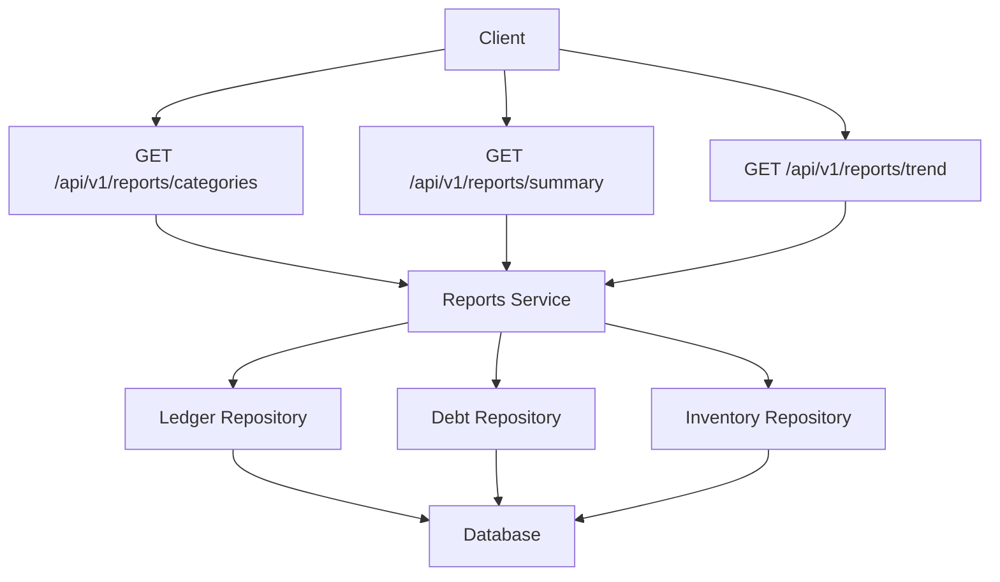
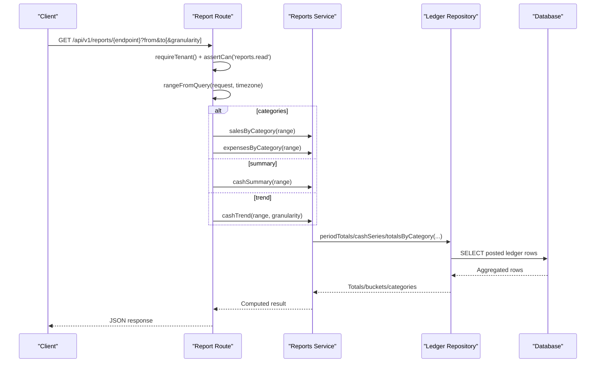
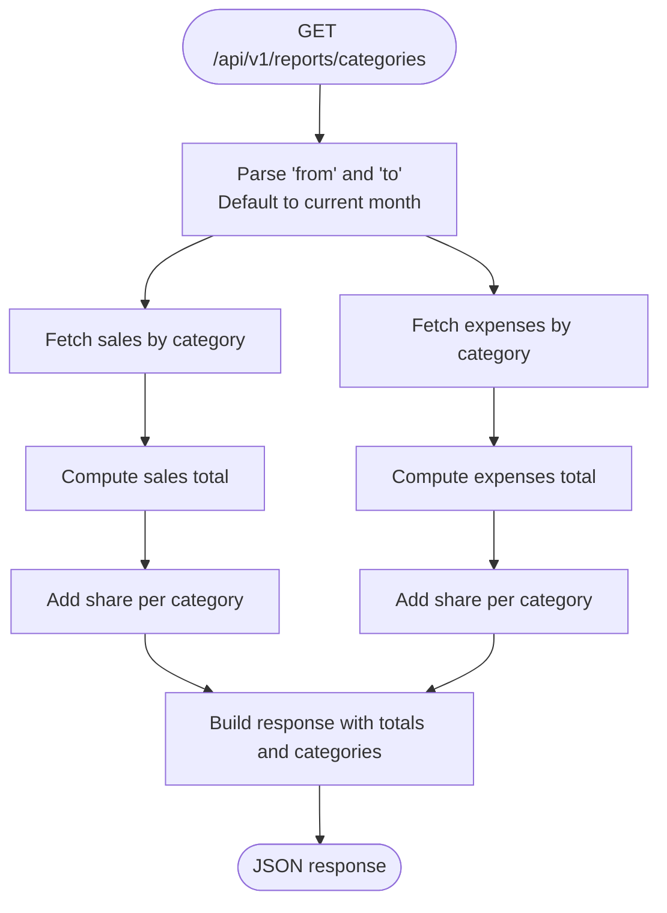
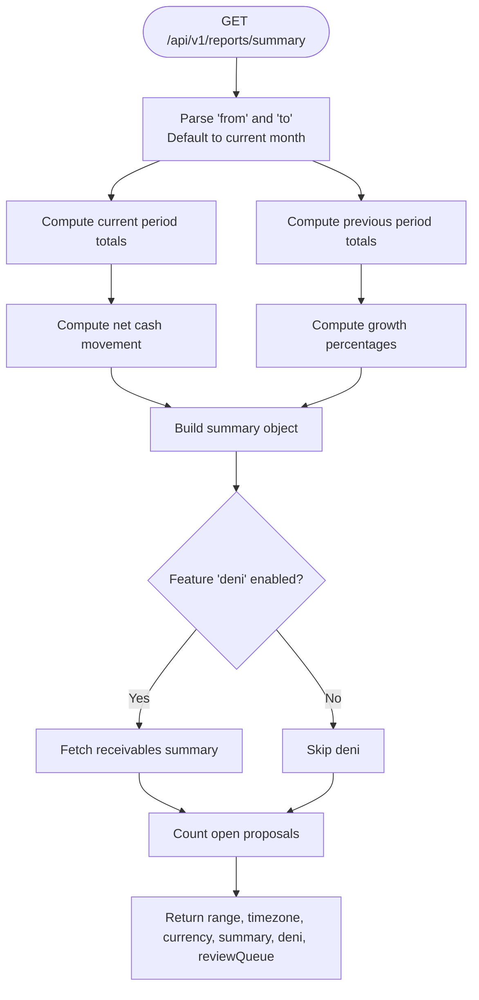
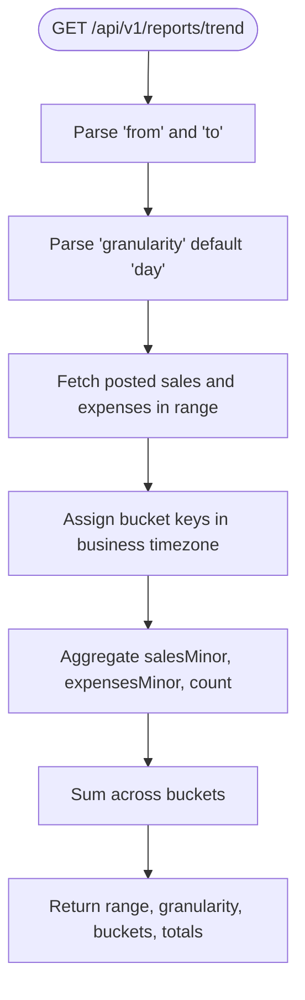
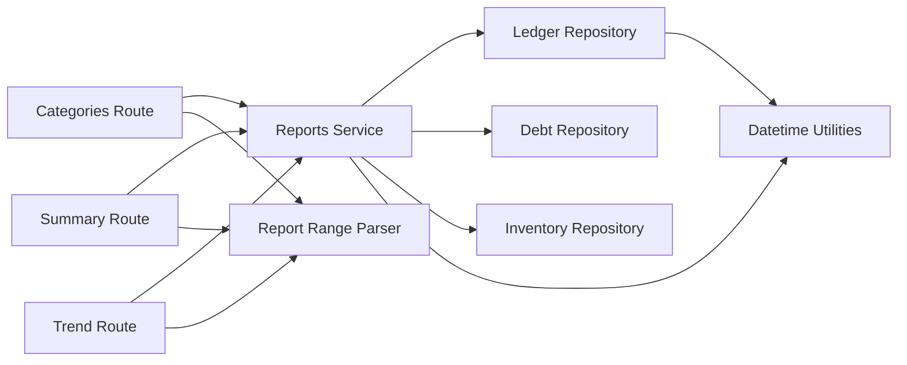

# Reports API

<cite>
**Referenced Files in This Document**
- [route.ts](file://src/app/api/v1/reports/categories/route.ts)
- [route.ts](file://src/app/api/v1/reports/summary/route.ts)
- [route.ts](file://src/app/api/v1/reports/trend/route.ts)
- [reports.ts](file://src/server/services/reports.ts)
- [report-range.ts](file://src/server/http/report-range.ts)
- [schemas.ts](file://src/server/http/schemas.ts)
- [ledger.repository.ts](file://src/server/repositories/ledger.repository.ts)
- [datetime.ts](file://src/lib/formatting/datetime.ts)
- [reports.test.ts](file://tests/reports.test.ts)
</cite>

## Table of Contents
1. [Introduction](#introduction)
2. [Project Structure](#project-structure)
3. [Core Components](#core-components)
4. [Architecture Overview](#architecture-overview)
5. [Detailed Component Analysis](#detailed-component-analysis)
6. [Dependency Analysis](#dependency-analysis)
7. [Performance Considerations](#performance-considerations)
8. [Troubleshooting Guide](#troubleshooting-guide)
9. [Conclusion](#conclusion)

## Introduction
This document describes the financial reporting endpoints exposed under `/api/v1/reports`. The API provides:
- Category reports for sales and expenses.
- Financial summary reports including cash movement, growth comparisons, optional deni receivables, and review queue counts.
- Trend analysis for time-series cash flow with day, week, or month granularity.

All figures are computed from confirmed ledger records in the business timezone. Cash inflows count only money actually received; unpaid sales do not increase cash until they are marked paid.

## Project Structure
The reporting feature is implemented as Next.js App Router routes that delegate to a service layer, which in turn queries typed repositories against the database. Shared helpers parse report ranges and date boundaries.

**Diagram sources**
- [route.ts:14-41](file://src/app/api/v1/reports/categories/route.ts#L14-L41)
- [route.ts:16-31](file://src/app/api/v1/reports/summary/route.ts#L16-L31)
- [route.ts:12-33](file://src/app/api/v1/reports/trend/route.ts#L12-L33)
- [reports.ts:72-146](file://src/server/services/reports.ts#L72-L146)
- [ledger.repository.ts:377-512](file://src/server/repositories/ledger.repository.ts#L377-L512)

**Section sources**
- [route.ts:14-41](file://src/app/api/v1/reports/categories/route.ts#L14-L41)
- [route.ts:16-31](file://src/app/api/v1/reports/summary/route.ts#L16-L31)
- [route.ts:12-33](file://src/app/api/v1/reports/trend/route.ts#L12-L33)
- [reports.ts:1-155](file://src/server/services/reports.ts#L1-L155)

## Core Components
- **Category report**: Returns sales and expenses grouped by category, plus totals and per-category shares.
- **Summary report**: Returns current and previous period totals, net cash movement, growth percentages, currency and timezone context, optional deni receivables, and open proposal count.
- **Trend report**: Returns time-bucketed cash series with sales, expenses, and counts, plus aggregated totals across buckets.

Key shared behavior:
- Date range parsing uses inclusive calendar dates in the business timezone.
- Granularity options are `day`, `week`, and `month`.
- All amounts are in minor units (e.g., cents).
- Only posted ledger records are included.

**Section sources**
- [route.ts:14-41](file://src/app/api/v1/reports/categories/route.ts#L14-L41)
- [route.ts:16-31](file://src/app/api/v1/reports/summary/route.ts#L16-L31)
- [route.ts:12-33](file://src/app/api/v1/reports/trend/route.ts#L12-L33)
- [report-range.ts:17-31](file://src/server/http/report-range.ts#L17-L31)
- [reports.ts:72-146](file://src/server/services/reports.ts#L72-L146)

## Architecture Overview
The reporting stack follows a layered design:
- HTTP routes validate access and parse query parameters.
- Services compute metrics using repository functions.
- Repositories perform SQL aggregation over posted ledger rows.
- Timezone utilities convert between UTC instants and business calendar dates.

**Diagram sources**
- [route.ts:14-41](file://src/app/api/v1/reports/categories/route.ts#L14-L41)
- [route.ts:16-31](file://src/app/api/v1/reports/summary/route.ts#L16-L31)
- [route.ts:12-33](file://src/app/api/v1/reports/trend/route.ts#L12-L33)
- [reports.ts:72-146](file://src/server/services/reports.ts#L72-L146)
- [ledger.repository.ts:377-512](file://src/server/repositories/ledger.repository.ts#L377-L512)

## Detailed Component Analysis

### Category Reports
`GET /api/v1/reports/categories`

Purpose:
- Show where money came from and where it went.
- Sales and expenses are reported separately and never netted into a single misleading number.

Authentication and authorization:
- Requires a tenant context.
- Requires the `reports.read` permission.

Parameters:
- `from`: Inclusive start date in the business timezone.
- `to`: Inclusive end date in the business timezone.
- Default range: Current calendar month in the business timezone.

Response fields:
- `range`: Parsed `{ from, toExclusive, toInclusive }`.
- `sales.totalMinor`: Sum of sale amounts in minor units.
- `sales.categories[]`: Per-category entries with `category`, `amountMinor`, `count`, and `share`.
- `expenses.totalMinor`: Sum of expense amounts in minor units.
- `expenses.categories[]`: Per-category entries with `category`, `amountMinor`, `count`, and `share`.

Calculation methodology:
- Sales and expenses are grouped by their respective detail tables (`sales.category`, `expenses.category`).
- Uncategorized entries are grouped under an uncategorized bucket.
- Shares are calculated as `amountMinor / totalMinor`, rounded to two decimal places.

Data source:
- Posted ledger records within the requested range.
- Sale details include payment status and method but category grouping uses the sale category field.
- Expense details include category and vendor.

Example request:
- `GET /api/v1/reports/categories?from=2026-03-01&to=2026-03-31`

Example interpretation:
- Use `sales.share` to understand revenue composition.
- Use `expenses.share` to understand cost composition.
- Compare totals across months to identify trends.

**Diagram sources**
- [route.ts:14-41](file://src/app/api/v1/reports/categories/route.ts#L14-L41)
- [reports.ts:119-135](file://src/server/services/reports.ts#L119-L135)
- [ledger.repository.ts:483-512](file://src/server/repositories/ledger.repository.ts#L483-L512)

**Section sources**
- [route.ts:14-41](file://src/app/api/v1/reports/categories/route.ts#L14-L41)
- [reports.ts:119-135](file://src/server/services/reports.ts#L119-L135)
- [ledger.repository.ts:483-512](file://src/server/repositories/ledger.repository.ts#L483-L512)

### Financial Summary Reports
`GET /api/v1/reports/summary`

Purpose:
- Provide a cash-focused summary suitable for dashboards and reports screens.
- Include optional receivables data when the `deni` feature is enabled.
- Include the number of open proposals in the review queue.

Authentication and authorization:
- Requires a tenant context.
- Requires the `reports.read` permission.

Parameters:
- `from`: Inclusive start date in the business timezone.
- `to`: Inclusive end date in the business timezone.
- Default range: Current calendar month in the business timezone.

Response fields:
- `range`: Parsed date range.
- `timezone`: Business timezone used for calculations.
- `currency`: Business currency code.
- `summary`:
  - `from`, `toExclusive`: Range boundaries.
  - `current`: Period totals including sales recorded, sales received, expenses, debt payments received, debt created, money in, money out, net cash movement, and counts.
  - `previous`: Same structure for the immediately preceding period of equal length.
  - `netCashMinor`: Money in minus money out for the current period.
  - `growthPercent.moneyIn`, `growthPercent.moneyOut`: Percentage change versus the previous period; null if the previous value was zero.
- `deni`: Optional receivables snapshot when enabled, including outstanding, overdue, customer count, and top customers.
- `reviewQueue.open`: Number of open proposals.

Calculation methodology:
- Money in equals paid sales plus debt payments received.
- Money out equals expenses.
- Net cash movement equals money in minus money out.
- Previous period is computed by shifting the same-length interval backwards.
- Growth percentage is computed as `(current - previous) / previous * 100`, rounded to one decimal place.

Data source:
- Posted ledger records within the requested range.
- Debt repository for receivables and customer balances.
- Source repository for counting open proposals.

Example request:
- `GET /api/v1/reports/summary?from=2026-03-01&to=2026-03-31`

Example interpretation:
- Use `summary.current.moneyInMinor` and `summary.current.moneyOutMinor` to assess cash flow.
- Use `summary.growthPercent` to compare performance against the prior period.
- If `deni` is present, use it to monitor receivables exposure.

**Diagram sources**
- [route.ts:16-31](file://src/app/api/v1/reports/summary/route.ts#L16-L31)
- [reports.ts:72-101](file://src/server/services/reports.ts#L72-L101)
- [reports.ts:137-146](file://src/server/services/reports.ts#L137-L146)
- [ledger.repository.ts:377-431](file://src/server/repositories/ledger.repository.ts#L377-L431)

**Section sources**
- [route.ts:16-31](file://src/app/api/v1/reports/summary/route.ts#L16-L31)
- [reports.ts:72-101](file://src/server/services/reports.ts#L72-L101)
- [reports.ts:137-146](file://src/server/services/reports.ts#L137-L146)
- [ledger.repository.ts:377-431](file://src/server/repositories/ledger.repository.ts#L377-L431)

### Trend Analysis
`GET /api/v1/reports/trend`

Purpose:
- Provide time-series cash movement data bucketed by day, week, or month in the business timezone.

Authentication and authorization:
- Requires a tenant context.
- Requires the `reports.read` permission.

Parameters:
- `from`: Inclusive start date in the business timezone.
- `to`: Inclusive end date in the business timezone.
- `granularity`: One of `day`, `week`, `month`. Defaults to `day`.

Response fields:
- `range`: Parsed date range.
- `granularity`: Selected bucketing unit.
- `buckets[]`: Each entry includes:
  - `bucket`: Bucket key (date string for day, year-month for month, Monday-start date for week).
  - `salesMinor`: Paid sales amount in the bucket.
  - `expensesMinor`: Expenses amount in the bucket.
  - `count`: Number of posted records contributing to the bucket.
- `totals`: Aggregated sums across all buckets for `salesMinor`, `expensesMinor`, and `netMinor`.

Calculation methodology:
- Records are filtered to posted sales and expenses within the range.
- Buckets are assigned using business timezone-aware logic:
  - Day: calendar date.
  - Month: year-month.
  - Week: ISO-like week starting on Monday.
- Only paid sales contribute to `salesMinor`; unpaid sales do not affect cash.
- Totals are computed by summing bucket values.

Data source:
- Posted ledger records within the requested range.
- Timezone utilities for bucket assignment.

Example request:
- `GET /api/v1/reports/trend?from=2026-03-01&to=2026-03-31&granularity=week`

Example interpretation:
- Use `buckets[].salesMinor` and `expensesMinor` to observe weekly cash patterns.
- Use `totals.netMinor` to see overall net cash movement across the selected range.

**Diagram sources**
- [route.ts:12-33](file://src/app/api/v1/reports/trend/route.ts#L12-L33)
- [reports.ts:103-117](file://src/server/services/reports.ts#L103-L117)
- [ledger.repository.ts:439-479](file://src/server/repositories/ledger.repository.ts#L439-L479)
- [datetime.ts:363-377](file://src/lib/formatting/datetime.ts#L363-L377)

**Section sources**
- [route.ts:12-33](file://src/app/api/v1/reports/trend/route.ts#L12-L33)
- [reports.ts:103-117](file://src/server/services/reports.ts#L103-L117)
- [ledger.repository.ts:439-479](file://src/server/repositories/ledger.repository.ts#L439-L479)
- [datetime.ts:363-377](file://src/lib/formatting/datetime.ts#L363-L377)

## Dependency Analysis
The reporting endpoints depend on:
- Business context resolution for tenant isolation.
- Permission policy for read access.
- Report range parsing for consistent date handling.
- Reporting service for metric computation.
- Ledger repository for SQL aggregation.
- Debt and inventory repositories for optional summary features.
- Timezone utilities for boundary and bucket calculations.

**Diagram sources**
- [route.ts:14-41](file://src/app/api/v1/reports/categories/route.ts#L14-L41)
- [route.ts:16-31](file://src/app/api/v1/reports/summary/route.ts#L16-L31)
- [route.ts:12-33](file://src/app/api/v1/reports/trend/route.ts#L12-L33)
- [reports.ts:72-146](file://src/server/services/reports.ts#L72-L146)
- [ledger.repository.ts:377-512](file://src/server/repositories/ledger.repository.ts#L377-L512)
- [report-range.ts:17-31](file://src/server/http/report-range.ts#L17-L31)
- [datetime.ts:237-247](file://src/lib/formatting/datetime.ts#L237-L247)

**Section sources**
- [reports.ts:1-155](file://src/server/services/reports.ts#L1-L155)
- [ledger.repository.ts:377-512](file://src/server/repositories/ledger.repository.ts#L377-L512)
- [report-range.ts:17-31](file://src/server/http/report-range.ts#L17-L31)
- [datetime.ts:237-247](file://src/lib/formatting/datetime.ts#L237-L247)

## Performance Considerations
- Query scope: All reporting queries filter by business ID and posted status, reducing noise and improving index utilization.
- Bounded reads: Trend queries limit returned rows to avoid excessive memory usage during client-side bucketing.
- Timezone handling: Bucketing occurs in application code after fetching bounded rows, avoiding non-portable SQL timezone operations.
- Aggregation strategy: Category totals and period totals aggregate in-memory after minimal SQL projection.
- Large datasets:
  - Prefer narrower date ranges to reduce row counts.
  - Use appropriate granularity to keep bucket counts manageable.
  - Avoid overly broad periods without pagination or pre-aggregation strategies.

[No sources needed since this section provides general guidance]

## Troubleshooting Guide
Common issues and resolutions:
- Invalid date range:
  - Ensure `to` is on or after `from`.
  - The parser enforces inclusive calendar dates and converts to exclusive bounds internally.
- Incorrect timezone assumptions:
  - All ranges and buckets are interpreted in the business timezone, not the client’s browser timezone.
- Unexpected cash numbers:
  - Unpaid sales do not count as cash received.
  - Only posted ledger records are included.
- Missing categories:
  - Uncategorized entries are grouped under an uncategorized bucket rather than dropped.
- Empty previous period:
  - Growth percentages are null when the previous period had zero values.

Validation and error handling:
- Range validation throws a validation error when the end date is before the start date.
- Permission checks enforce `reports.read` for all reporting endpoints.

**Section sources**
- [report-range.ts:17-31](file://src/server/http/report-range.ts#L17-L31)
- [route.ts:14-41](file://src/app/api/v1/reports/categories/route.ts#L14-L41)
- [route.ts:16-31](file://src/app/api/v1/reports/summary/route.ts#L16-L31)
- [route.ts:12-33](file://src/app/api/v1/reports/trend/route.ts#L12-L33)
- [reports.test.ts:173-178](file://tests/reports.test.ts#L173-L178)

## Conclusion
The Reports API delivers reliable, timezone-aware financial insights:
- Category reports clarify revenue and cost composition.
- Summary reports provide actionable cash flow metrics and growth comparisons.
- Trend reports enable time-based analysis with flexible granularity.

For best results:
- Always specify clear date ranges aligned with the business timezone.
- Interpret cash metrics strictly as money received, not merely recorded.
- Use granularities appropriate to the dataset size and analytical needs.

[No sources needed since this section summarizes without analyzing specific files]