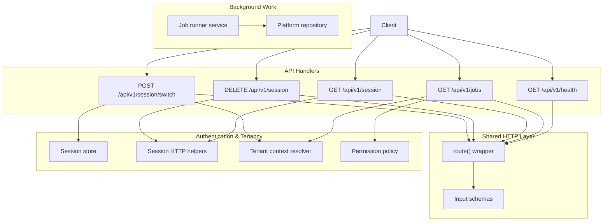
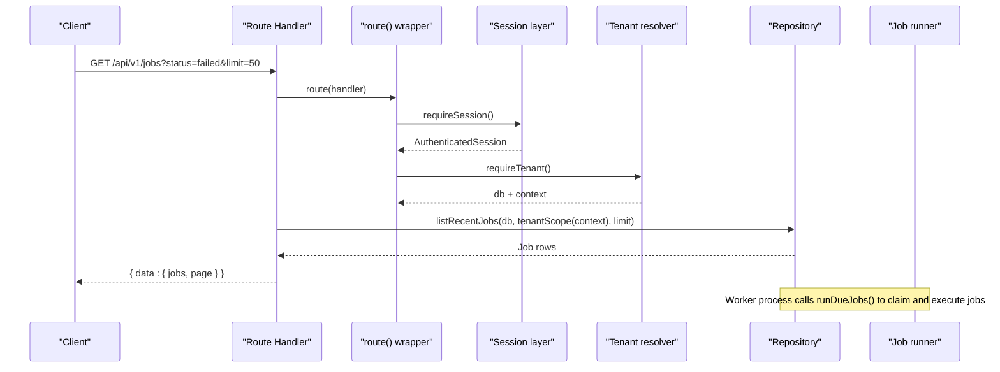
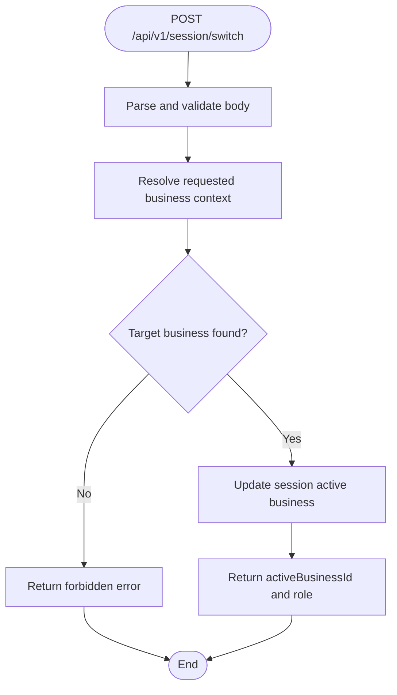
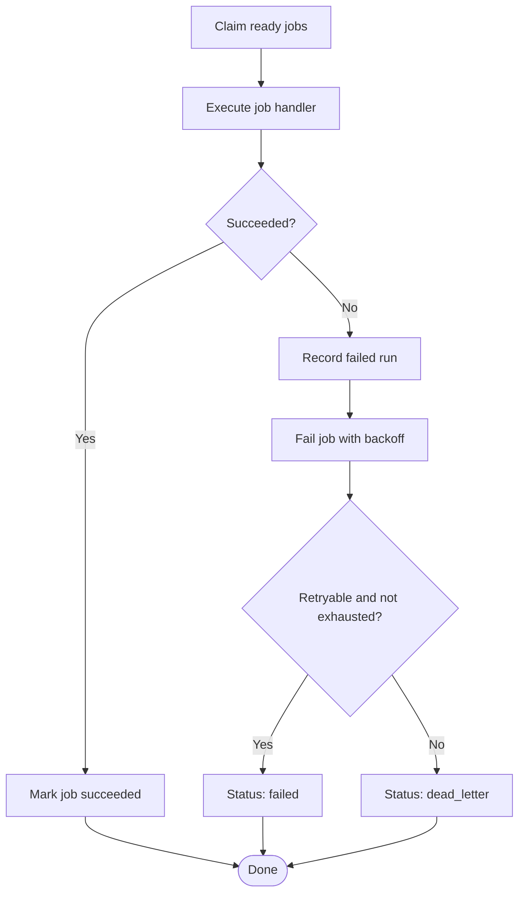
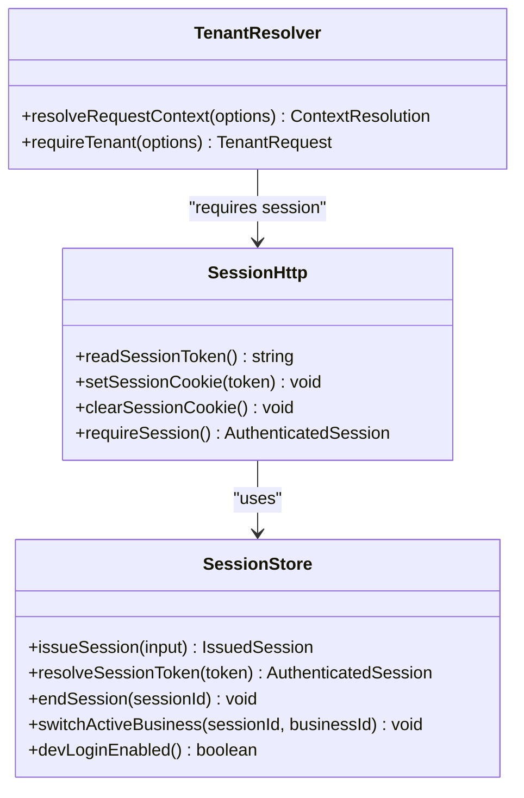
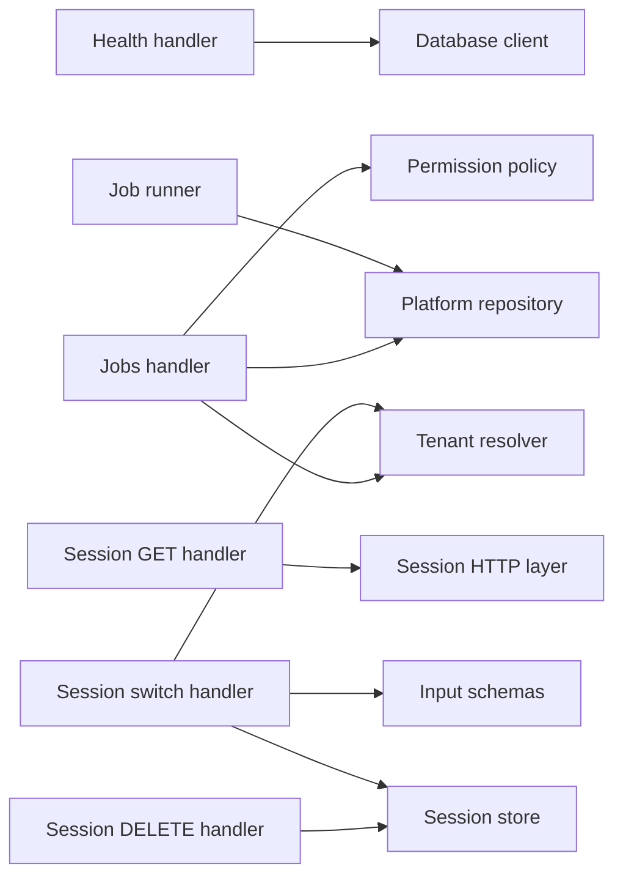

# Utility APIs

<cite>
**Referenced Files in This Document**
- [health route](file://src/app/api/v1/health/route.ts)
- [jobs route](file://src/app/api/v1/jobs/route.ts)
- [session route](file://src/app/api/v1/session/route.ts)
- [session switch route](file://src/app/api/v1/session/switch/route.ts)
- [job runner service](file://src/server/services/jobs.ts)
- [platform repository](file://src/server/repositories/platform.repository.ts)
- [HTTP route wrapper](file://src/server/http/route.ts)
- [input schemas](file://src/server/http/schemas.ts)
- [session store](file://src/server/auth/session-store.ts)
- [session HTTP layer](file://src/server/auth/session.ts)
- [business context model](file://src/server/business-context/context.ts)
- [tenant context resolver](file://src/server/business-context/resolve.ts)
- [permission policy](file://src/server/permissions/policy.ts)
</cite>

## Table of Contents
1. [Introduction](#introduction)
2. [Project Structure](#project-structure)
3. [Core Components](#core-components)
4. [Architecture Overview](#architecture-overview)
5. [Detailed Component Analysis](#detailed-component-analysis)
6. [Dependency Analysis](#dependency-analysis)
7. [Performance Considerations](#performance-considerations)
8. [Troubleshooting Guide](#troubleshooting-guide)
9. [Conclusion](#conclusion)

## Introduction
This document describes the utility and system endpoints that support monitoring, background job management, and session-based multi-tenant operations. It focuses on:

- Health check endpoint for liveness and readiness.
- Job history endpoint for background task status tracking.
- Session lifecycle endpoint for user identity and business selection.
- Multi-tenant session switching endpoint for changing the active business context.

The design emphasizes tenant isolation, explicit permission checks, durable job execution with retry and backoff, and a consistent error contract across all routes.

## Project Structure
The utility APIs are implemented as Next.js App Router handlers under `src/app/api/v1`. Each handler is wrapped by a shared HTTP boundary that normalizes errors, request IDs, validation failures, and response shapes. Business logic and persistence live in server modules such as the job runner, session store, business context resolver, and platform repository.

**Diagram sources**
- [health route:1-20](file://src/app/api/v1/health/route.ts#L1-L20)
- [jobs route:1-42](file://src/app/api/v1/jobs/route.ts#L1-L42)
- [session route:1-39](file://src/app/api/v1/session/route.ts#L1-L39)
- [session switch route:1-31](file://src/app/api/v1/session/switch/route.ts#L1-L31)
- [HTTP route wrapper:58-95](file://src/server/http/route.ts#L58-L95)
- [input schemas:91-93](file://src/server/http/schemas.ts#L91-L93)
- [session store:67-104](file://src/server/auth/session-store.ts#L67-L104)
- [session HTTP layer:40-68](file://src/server/auth/session.ts#L40-L68)
- [tenant context resolver:73-137](file://src/server/business-context/resolve.ts#L73-L137)
- [permission policy:88-92](file://src/server/permissions/policy.ts#L88-L92)
- [job runner service:196-207](file://src/server/services/jobs.ts#L196-L207)
- [platform repository:241-302](file://src/server/repositories/platform.repository.ts#L241-L302)

**Section sources**
- [health route:1-20](file://src/app/api/v1/health/route.ts#L1-L20)
- [jobs route:1-42](file://src/app/api/v1/jobs/route.ts#L1-L42)
- [session route:1-39](file://src/app/api/v1/session/route.ts#L1-L39)
- [session switch route:1-31](file://src/app/api/v1/session/switch/route.ts#L1-L31)

## Core Components
- Health endpoint returns a lightweight status including schema version and current time.
- Jobs endpoint lists recent jobs for the authenticated tenant and supports filtering by status and limit.
- Session endpoint reports the signed-in user, accessible businesses, active business, role, permissions, and development login capability.
- Session switch endpoint validates membership and updates the active business for the current session.
- Job runner service claims, executes, retries, and records durable jobs with exponential backoff.
- Session store manages opaque tokens, hashed storage, expiration, and active business switching.
- Tenant context resolver enforces membership and builds a typed business context per request.
- Permission policy maps roles to capabilities and provides authorization helpers.

**Section sources**
- [health route:12-19](file://src/app/api/v1/health/route.ts#L12-L19)
- [jobs route:17-41](file://src/app/api/v1/jobs/route.ts#L17-L41)
- [session route:17-38](file://src/app/api/v1/session/route.ts#L17-L38)
- [session switch route:15-30](file://src/app/api/v1/session/switch/route.ts#L15-L30)
- [job runner service:51-140](file://src/server/services/jobs.ts#L51-L140)
- [session store:41-104](file://src/server/auth/session-store.ts#L41-L104)
- [tenant context resolver:73-137](file://src/server/business-context/resolve.ts#L73-L137)
- [permission policy:45-92](file://src/server/permissions/policy.ts#L45-L92)

## Architecture Overview
The API layer is thin and declarative. Handlers validate inputs through shared utilities, enforce authentication and tenancy, delegate to services or repositories, and return standardized responses. Background work is decoupled from request handling through a durable job queue.

**Diagram sources**
- [jobs route:17-41](file://src/app/api/v1/jobs/route.ts#L17-L41)
- [HTTP route wrapper:58-95](file://src/server/http/route.ts#L58-L95)
- [session HTTP layer:55-62](file://src/server/auth/session.ts#L55-L62)
- [tenant context resolver:123-137](file://src/server/business-context/resolve.ts#L123-L137)
- [platform repository:241-250](file://src/server/repositories/platform.repository.ts#L241-L250)
- [job runner service:196-207](file://src/server/services/jobs.ts#L196-L207)

## Detailed Component Analysis

### Health Check Endpoint
`GET /api/v1/health`

Purpose:
- Provide a cheap health indicator for deployment probes and monitoring systems.
- Include schema version so operators can detect stale deployments without touching business data.
- Return a stable timestamp for correlation with logs.

Behavior:
- Resolves the database connection.
- Reads the current migration version.
- Returns a success response with status, schema version, and current time.

Response shape:
- Success: `{ data: { status, schemaVersion, now } }`
- Error: Standardized error body with code, message, optional details, and request ID.

Example usage:
- Health probe: `GET /api/v1/health`
- Expected outcome: 200 with `status: "ok"` and a non-null schema version when migrations are applied.

Error behavior:
- Unexpected failures become 500 responses with a generic message.
- Validation or domain errors map to documented codes and status codes.

**Section sources**
- [health route:1-20](file://src/app/api/v1/health/route.ts#L1-L20)
- [HTTP route wrapper:58-95](file://src/server/http/route.ts#L58-L95)

### Job Management Endpoint
`GET /api/v1/jobs`

Purpose:
- Expose operational job history for the current tenant.
- Allow clients to filter recent jobs by status and limit.
- Avoid leaking provider payloads while exposing useful diagnostic fields.

Authorization:
- Requires an authenticated session.
- Requires the `dashboard.read` permission for the current role.

Query parameters:
- `limit`: Integer between 1 and 100; defaults to 25.
- `status`: One of `pending`, `running`, `succeeded`, `failed`, `dead_letter`.

Response shape:
- Success: `{ data: { jobs, page } }`
  - `jobs`: Array of job summaries including id, type, status, attempts, maxAttempts, lastErrorCode, nextAttemptAt, createdAt, completedAt.
  - `page`: Object with `limit` and `total`.

Example workflow:
- Polling failed jobs: `GET /api/v1/jobs?status=failed&limit=20`
- Reviewing recent activity: `GET /api/v1/jobs?limit=50`

Notes:
- The payload field is intentionally excluded from the response.
- Tenant isolation is enforced via the resolved business context.

**Section sources**
- [jobs route:1-42](file://src/app/api/v1/jobs/route.ts#L1-L42)
- [permission policy:88-92](file://src/server/permissions/policy.ts#L88-L92)
- [platform repository:241-250](file://src/server/repositories/platform.repository.ts#L241-L250)

### Session Lifecycle Endpoint
`GET /api/v1/session`

Purpose:
- Report who is signed in.
- List businesses the user can access.
- Determine the active business and associated role and permissions.
- Indicate whether local development login is enabled.

Behavior:
- Requires an authenticated session.
- Loads accessible businesses for the user.
- Selects the active business using the session default or the first available business.
- Computes permissions based on the active role.

Response shape:
- Success: `{ data: { user, businesses, activeBusinessId, role, permissions, devLoginEnabled } }`
  - `user`: Contains user id and display name.
  - `businesses`: List of accessible businesses with metadata.
  - `activeBusinessId`: Selected business id or null.
  - `role`: Role for the active business or null.
  - `permissions`: Derived permissions for the active role.
  - `devLoginEnabled`: Boolean indicating development login availability.

`DELETE /api/v1/session`

Purpose:
- Sign out the current user.
- Revoke the session and clear the session cookie.

Behavior:
- Requires an authenticated session.
- Revokes the session in the store.
- Clears the cookie.
- Returns no content on success.

**Section sources**
- [session route:1-39](file://src/app/api/v1/session/route.ts#L1-L39)
- [session store:98-104](file://src/server/auth/session-store.ts#L98-L104)
- [session HTTP layer:55-62](file://src/server/auth/session.ts#L55-L62)

### Session Switch Endpoint
`POST /api/v1/session/switch`

Purpose:
- Change the active business for the current session.
- Validate that the user has real membership in the target business before updating the session.

Request body:
- `businessId`: Required string identifier for the target business.
- Validated against the shared input schema.

Behavior:
- Requires an authenticated session.
- Parses and validates the request body.
- Resolves the requested business without requiring it to be currently active.
- Verifies membership; if missing, returns a forbidden error.
- Updates the session’s active business.
- Returns the new active business id and role.

Response shape:
- Success: `{ data: { activeBusinessId, role } }`
- Forbidden: When the user does not have access to the requested business.

Example workflow:
- Switch business: `POST /api/v1/session/switch` with `{ businessId: "<target-business-id>" }`
- Verify response contains the updated active business id and role.

**Diagram sources**
- [session switch route:15-30](file://src/app/api/v1/session/switch/route.ts#L15-L30)
- [input schemas:91-93](file://src/server/http/schemas.ts#L91-L93)
- [tenant context resolver:73-108](file://src/server/business-context/resolve.ts#L73-L108)
- [session store:102-104](file://src/server/auth/session-store.ts#L102-L104)

**Section sources**
- [session switch route:1-31](file://src/app/api/v1/session/switch/route.ts#L1-L31)
- [input schemas:91-93](file://src/server/http/schemas.ts#L91-L93)
- [tenant context resolver:73-108](file://src/server/business-context/resolve.ts#L73-L108)
- [session store:102-104](file://src/server/auth/session-store.ts#L102-L104)

### Background Job System
The job system provides durable, at-least-once execution with idempotency keys, attempt tracking, and exponential backoff.

Key concepts:
- Jobs are stored with a tenant scope and idempotency key.
- Workers claim due jobs atomically and mark them running.
- Successful jobs are marked completed; failing jobs record error codes and schedule retries.
- Exhausted or non-retryable jobs move to dead letter state.
- Job runs are recorded for observability.

Supported job types include media acquisition, transcription, expired media deletion, export building, and provider health checks.

**Diagram sources**
- [job runner service:143-193](file://src/server/services/jobs.ts#L143-L193)
- [platform repository:252-302](file://src/server/repositories/platform.repository.ts#L252-L302)

Operational guidance:
- Use the jobs endpoint to inspect recent job history for the current tenant.
- Monitor `lastErrorCode`, `attempts`, `maxAttempts`, and `nextAttemptAt` to diagnose failures.
- Ensure job handlers remain idempotent because delivery is at-least-once.

**Section sources**
- [job runner service:1-241](file://src/server/services/jobs.ts#L1-L241)
- [platform repository:197-302](file://src/server/repositories/platform.repository.ts#L197-L302)

### Session State and Tenant Isolation
Sessions carry an opaque token, hashed value at rest, expiration, and an active business identifier. The session HTTP layer reads and writes cookies, while the store performs persistence and token hashing.

Tenant isolation:
- Every request resolves a verified business context.
- Repository methods receive an explicit tenant scope.
- Cross-tenant access is denied without disclosing existence of the target business.

**Diagram sources**
- [session store:67-104](file://src/server/auth/session-store.ts#L67-L104)
- [session HTTP layer:40-68](file://src/server/auth/session.ts#L40-L68)
- [tenant context resolver:73-137](file://src/server/business-context/resolve.ts#L73-L137)

**Section sources**
- [session store:1-105](file://src/server/auth/session-store.ts#L1-L105)
- [session HTTP layer:1-69](file://src/server/auth/session.ts#L1-L69)
- [business context model:27-50](file://src/server/business-context/context.ts#L27-L50)
- [tenant context resolver:1-152](file://src/server/business-context/resolve.ts#L1-L152)

## Dependency Analysis
The utility endpoints depend on shared infrastructure for routing, validation, authentication, tenancy, permissions, and persistence.

**Diagram sources**
- [health route:8-10](file://src/app/api/v1/health/route.ts#L8-L10)
- [jobs route:8-13](file://src/app/api/v1/jobs/route.ts#L8-L13)
- [session route:10-15](file://src/app/api/v1/session/route.ts#L10-L15)
- [session switch route:8-13](file://src/app/api/v1/session/switch/route.ts#L8-L13)
- [job runner service:10-26](file://src/server/services/jobs.ts#L10-L26)

**Section sources**
- [health route:8-10](file://src/app/api/v1/health/route.ts#L8-L10)
- [jobs route:8-13](file://src/app/api/v1/jobs/route.ts#L8-L13)
- [session route:10-15](file://src/app/api/v1/session/route.ts#L10-L15)
- [session switch route:8-13](file://src/app/api/v1/session/switch/route.ts#L8-L13)
- [job runner service:10-26](file://src/server/services/jobs.ts#L10-L26)

## Performance Considerations
- Health endpoint is intentionally lightweight and avoids business data access.
- Jobs endpoint limits results and filters in memory after fetching recent tenant-scoped jobs.
- Job claiming uses atomic updates to prevent duplicate execution.
- Backoff prevents rapid retry storms for transient failures.
- Session resolution reuses the same database connection established during authentication.

[No sources needed since this section provides general guidance]

## Troubleshooting Guide
Common issues and signals:

- Health probe fails:
  - Check database connectivity and migration status.
  - Inspect logs for unexpected errors; the wrapper logs unhandled exceptions with request ID.

- Jobs endpoint returns empty or filtered results:
  - Confirm the authenticated user has `dashboard.read` permission.
  - Verify tenant context is resolved correctly.
  - Use `status` and `limit` query parameters to narrow results.

- Session switch returns forbidden:
  - Ensure the user has membership in the target business.
  - Confirm the business is active and accessible.

- Session logout does not persist:
  - Verify session revocation and cookie clearing occur.
  - Check that the client removes any cached session references.

- Job repeatedly fails:
  - Inspect `lastErrorCode`, `attempts`, and `maxAttempts`.
  - Determine whether the error is marked retryable.
  - Review job run records for duration and failure timestamps.

**Section sources**
- [HTTP route wrapper:58-95](file://src/server/http/route.ts#L58-L95)
- [jobs route:17-41](file://src/app/api/v1/jobs/route.ts#L17-L41)
- [session switch route:15-30](file://src/app/api/v1/session/switch/route.ts#L15-L30)
- [job runner service:159-193](file://src/server/services/jobs.ts#L159-L193)
- [platform repository:287-302](file://src/server/repositories/platform.repository.ts#L287-L302)

## Conclusion
The utility APIs provide essential operational surfaces:

- Health monitoring with schema version awareness.
- Tenant-scoped job history for background task visibility.
- Session lifecycle management with role-based permissions.
- Secure multi-tenant session switching backed by membership verification.

Together with the durable job runner and strict tenant isolation, these endpoints form a reliable foundation for monitoring, operations, and multi-tenant user workflows.

[No sources needed since this section summarizes without analyzing specific files]