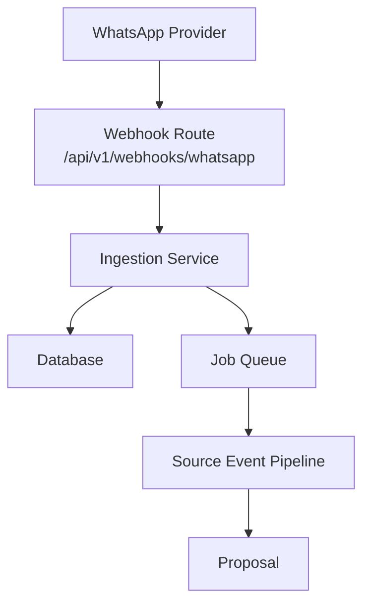
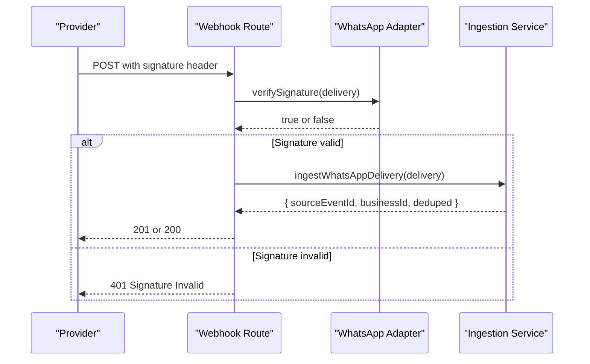
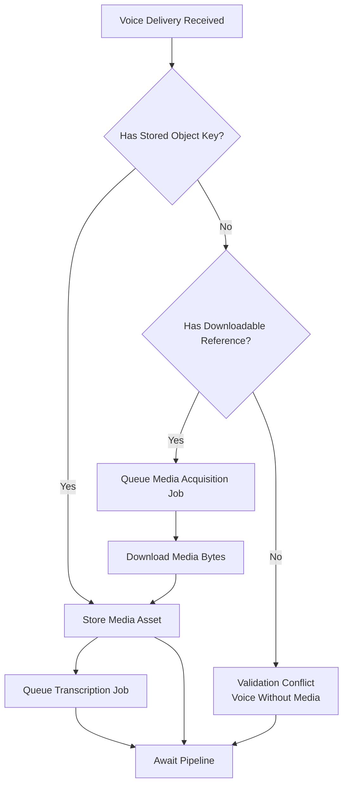
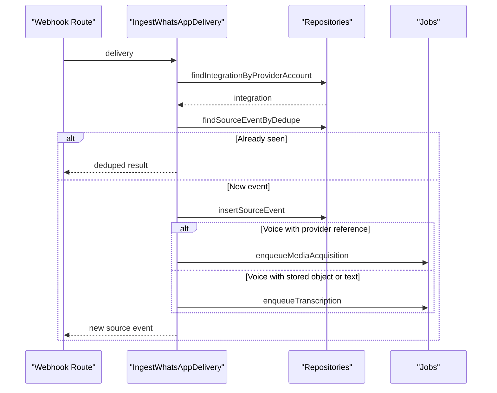
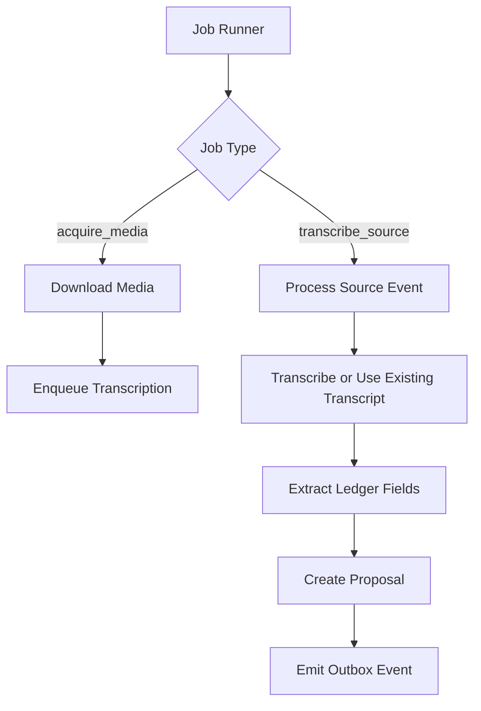
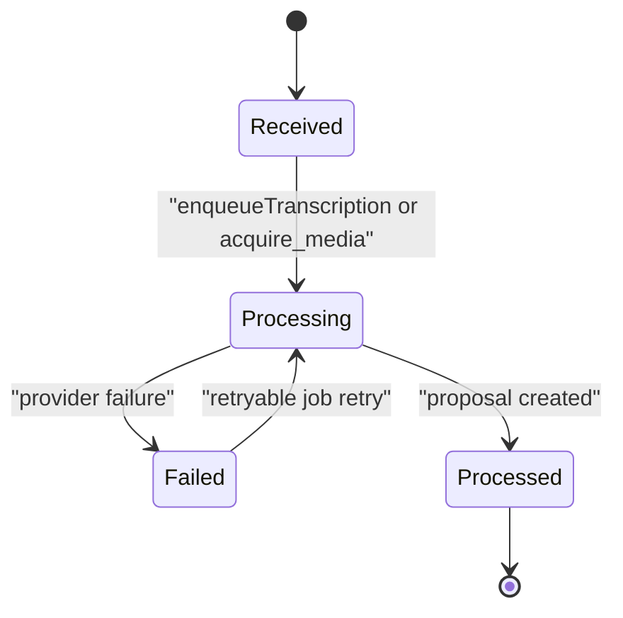
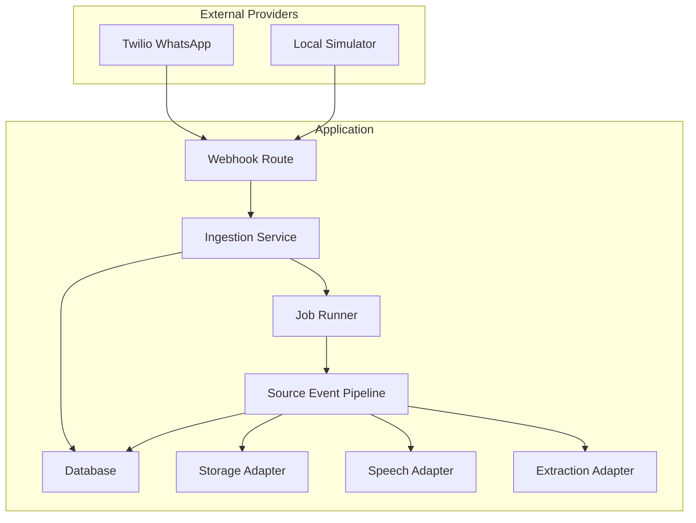
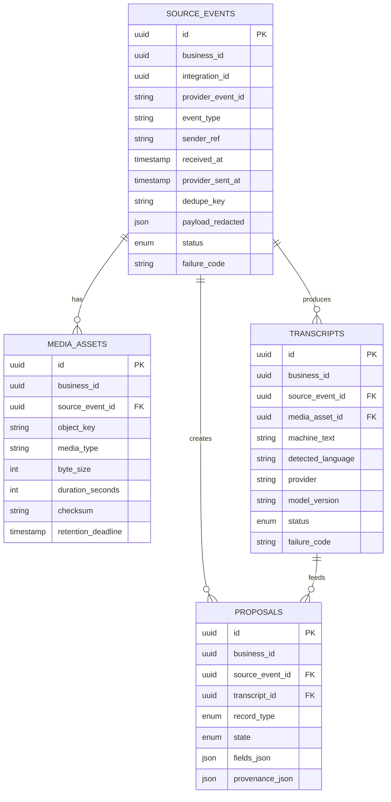

# Webhook API

<cite>
**Referenced Files in This Document**
- [route.ts](file://src/app/api/v1/webhooks/whatsapp/route.ts)
- [port.ts](file://src/server/integrations/whatsapp/port.ts)
- [local-whatsapp-adapter.ts](file://src/server/integrations/whatsapp/local-whatsapp-adapter.ts)
- [twilio-whatsapp-adapter.ts](file://src/server/integrations/whatsapp/twilio-whatsapp-adapter.ts)
- [ingestion.ts](file://src/server/services/ingestion.ts)
- [pipeline.ts](file://src/server/services/pipeline.ts)
- [jobs.ts](file://src/server/services/jobs.ts)
- [env.ts](file://src/server/config/env.ts)
- [index.ts](file://src/server/integrations/index.ts)
- [source.repository.ts](file://src/server/repositories/source.repository.ts)
</cite>

## Table of Contents
1. [Introduction](#introduction)
2. [Endpoint Overview](#endpoint-overview)
3. [Security and Signature Verification](#security-and-signature-verification)
4. [Webhook Payloads](#webhook-payloads)
5. [Message Types](#message-types)
6. [Media Handling](#media-handling)
7. [Ingestion Pipeline](#ingestion-pipeline)
8. [Event Processing and Transcription](#event-processing-and-transcription)
9. [Status Codes and Responses](#status-codes-and-responses)
10. [Retry and Idempotency](#retry-and-idempotency)
11. [Configuration and Environment](#configuration-and-environment)
12. [Debugging and Troubleshooting](#debugging-and-troubleshooting)
13. [Architecture Diagrams](#architecture-diagrams)
14. [Conclusion](#conclusion)

## Introduction
This document describes the WhatsApp webhook integration for the application. It explains how incoming WhatsApp deliveries are received, authenticated, normalized, stored, and processed into source events, transcripts, and proposals. It also covers security, media handling, retry behavior, configuration, and debugging techniques.

The webhook endpoint is designed to be fast and durable: it authenticates the delivery, persists a redacted source event, stores or links private media, and enqueues background jobs. Actual transcription, extraction, and proposal creation happen asynchronously so provider slowness cannot cause duplicate deliveries.

## Endpoint Overview
- Path: `/api/v1/webhooks/whatsapp`
- Method: `POST`
- Purpose: Receive WhatsApp inbound messages from a provider (Twilio or local simulator), verify the signature, normalize the delivery, persist it as a source event, and enqueue processing jobs.
- Public access: The endpoint is public but rejects deliveries when WhatsApp ingestion is disabled or when the signature is invalid.

Key responsibilities of the route handler:
- Check whether WhatsApp ingestion is enabled.
- Read the raw request body and relevant headers.
- Reconstruct the absolute URL used by providers that sign the full request URL.
- Delegate authentication, parsing, persistence, and job queuing to the ingestion service.
- Return an immediate response once the delivery is durably accepted.

**Diagram sources**
- [route.ts:33-67](file://src/app/api/v1/webhooks/whatsapp/route.ts#L33-L67)
- [ingestion.ts:66-207](file://src/server/services/ingestion.ts#L66-L207)
- [jobs.ts:51-94](file://src/server/services/jobs.ts#L51-L94)
- [pipeline.ts:354-503](file://src/server/services/pipeline.ts#L354-L503)

**Section sources**
- [route.ts:1-69](file://src/app/api/v1/webhooks/whatsapp/route.ts#L1-L69)

## Security and Signature Verification
The webhook supports two verification models:

| Provider | Signature Header | Signed Value | Notes |
|---|---|---|---|
| Local simulator | `x-daftari-signature` | HMAC-SHA256 over `timestamp.rawBody` | Uses a webhook secret from environment or a local fallback. |
| Twilio | `x-twilio-signature` | HMAC-SHA1 over the full signed URL plus sorted form parameters | Requires the absolute URL and content type to reconstruct the signed payload. |

The route accepts either header and passes them to the ingestion layer. The selected WhatsApp adapter performs constant-time comparison using `timingSafeEqual`.

Important security behaviors:
- Invalid signatures throw a signature-invalid error before any business logic runs.
- The endpoint returns `404 Not Found` when WhatsApp ingestion is disabled, so probes cannot distinguish between “disabled” and “not configured.”
- For Twilio, the route reconstructs the public URL using forwarded protocol/host headers when present, because proxies terminate TLS before reaching the app.

**Diagram sources**
- [route.ts:24-57](file://src/app/api/v1/webhooks/whatsapp/route.ts#L24-L57)
- [local-whatsapp-adapter.ts:27-34](file://src/server/integrations/whatsapp/local-whatsapp-adapter.ts#L27-L34)
- [twilio-whatsapp-adapter.ts:56-69](file://src/server/integrations/whatsapp/twilio-whatsapp-adapter.ts#L56-L69)
- [ingestion.ts:70-75](file://src/server/services/ingestion.ts#L70-L75)

**Section sources**
- [route.ts:17-57](file://src/app/api/v1/webhooks/whatsapp/route.ts#L17-L57)
- [local-whatsapp-adapter.ts:13-34](file://src/server/integrations/whatsapp/local-whatsapp-adapter.ts#L13-L34)
- [twilio-whatsapp-adapter.ts:34-69](file://src/server/integrations/whatsapp/twilio-whatsapp-adapter.ts#L34-L69)

## Webhook Payloads
The platform normalizes all provider payloads into a single internal shape called `InboundMessage`. The adapter’s parser validates this shape using a schema.

Normalized fields:

| Field | Type | Meaning |
|---|---|---|
| `eventId` | string | Provider-side event identifier used for deduplication. |
| `accountRef` | string | Normalized WhatsApp account reference for the receiving business. |
| `kind` | enum | Either `voice` or `text`. |
| `senderRef` | string | Normalized sender address. |
| `senderName` | string | Optional sender profile name. |
| `providerSentAt` | datetime | Sender timestamp; for Twilio voice, the receipt time is used because the original timestamp is not reliable. |
| `text` | string | Present for text messages. |
| `mediaId` | string | Present for provider-hosted audio when the provider does not expose a directly readable object key. |
| `mediaMimeType` | string | MIME type for audio media. |
| `media` | object | Present when the provider already stored the media under a known object key. Includes object key, media type, byte size, optional duration, and optional checksum. |

For Twilio:
- Text messages use `Body`.
- Voice notes use `MediaUrl0` and `MediaContentType0`.
- Address normalization removes the `whatsapp:` prefix to produce a bare E.164 number.

For the local simulator:
- The same normalized shape is produced without network calls.
- The signature scheme matches the managed provider model so the route has no development-only branch.

**Section sources**
- [port.ts:12-38](file://src/server/integrations/whatsapp/port.ts#L12-L38)
- [port.ts:83-91](file://src/server/integrations/whatsapp/port.ts#L83-L91)
- [twilio-whatsapp-adapter.ts:71-96](file://src/server/integrations/whatsapp/twilio-whatsapp-adapter.ts#L71-L96)
- [local-whatsapp-adapter.ts:24-38](file://src/server/integrations/whatsapp/local-whatsapp-adapter.ts#L24-L38)

## Message Types
There are two supported message kinds:

| Kind | Source Event Type | Transcript Behavior | Media Behavior |
|---|---|---|---|
| `text` | `whatsapp_text` | The message body is stored directly as machine text. | No media. |
| `voice` | `whatsapp_voice` | A transcription job is queued after media is available. | Either a stored object key or a downloadable provider reference. |

Voice messages require media. If a voice delivery arrives without media information, ingestion treats it as a validation conflict.

**Section sources**
- [ingestion.ts:108-178](file://src/server/services/ingestion.ts#L108-L178)

## Media Handling
Media handling depends on how the provider delivers audio:

| Scenario | What Happens |
|---|---|
| Provider already stored media under a readable object key | The object key, type, size, duration, and checksum are persisted as a media asset. Transcription is queued immediately. |
| Provider only provides a downloadable media reference | The source event is created, the media reference is recorded in redacted metadata, and a media acquisition job is queued. After successful download, transcription is queued. |
| Voice message has no media | Ingestion throws a validation conflict because voice requires media. |

For Twilio:
- Audio is downloaded using HTTP Basic authentication with the configured account SID and auth token.
- On success, the bytes are hashed with SHA-256 to compute a checksum.
- Non-2xx responses are wrapped as provider errors, with retryable status for rate limits and server errors.

**Diagram sources**
- [ingestion.ts:108-185](file://src/server/services/ingestion.ts#L108-L185)
- [twilio-whatsapp-adapter.ts:98-119](file://src/server/integrations/whatsapp/twilio-whatsapp-adapter.ts#L98-L119)
- [jobs.ts:53-74](file://src/server/services/jobs.ts#L53-L74)

**Section sources**
- [ingestion.ts:106-185](file://src/server/services/ingestion.ts#L106-L185)
- [twilio-whatsapp-adapter.ts:98-119](file://src/server/integrations/whatsapp/twilio-whatsapp-adapter.ts#L98-L119)

## Ingestion Pipeline
The ingestion pipeline converts a raw webhook delivery into a durable source event and decides which background work must run next.

Processing steps:
1. Select the active WhatsApp adapter through the integrations layer.
2. Verify the provider signature.
3. Parse the normalized inbound message.
4. Resolve the connected WhatsApp integration by provider account.
5. Reject disconnected or inactive integrations.
6. Deduplicate by provider event ID per integration.
7. Validate the associated business is active.
8. Persist a source event with redacted metadata.
9. Handle voice vs text media paths.
10. Record webhook receipt metrics.
11. Enqueue either media acquisition or transcription.
12. Record audit information.

**Diagram sources**
- [ingestion.ts:66-207](file://src/server/services/ingestion.ts#L66-L207)
- [jobs.ts:209-240](file://src/server/services/jobs.ts#L209-L240)

**Section sources**
- [ingestion.ts:38-207](file://src/server/services/ingestion.ts#L38-L207)

## Event Processing and Transcription
After ingestion, a job runner executes one of two main job types:

| Job Type | Responsibility |
|---|---|
| `acquire_media` | Downloads provider-hosted media, stores it, then enqueues transcription. |
| `transcribe_source` | Runs the source event pipeline: transcript, extraction, proposal creation. |

The pipeline:
- Loads the source event and checks idempotency.
- Finds existing media if present.
- Reads or creates a transcript.
- Calls the speech adapter to transcribe audio when needed.
- Calls the extraction adapter to propose ledger fields.
- Computes missing fields, validation issues, and duplicate candidates.
- Creates a proposal and updates the source event status.
- Emits an outbox event for downstream consumers.

Failure handling:
- Provider failures are recorded on the source event and transcript.
- Retryable failures allow the job runner to back off and retry.
- Non-retryable failures mark the event as failed.

**Diagram sources**
- [jobs.ts:51-94](file://src/server/services/jobs.ts#L51-L94)
- [pipeline.ts:287-503](file://src/server/services/pipeline.ts#L287-L503)

**Section sources**
- [jobs.ts:51-94](file://src/server/services/jobs.ts#L51-L94)
- [pipeline.ts:287-503](file://src/server/services/pipeline.ts#L287-L503)

## Status Codes and Responses
The webhook returns immediate responses based on acceptance and deduplication:

| Condition | HTTP Status | Response Body |
|---|---:|---|
| New source event accepted | `201 Created` | Accepted flag, deduped false, source event ID. |
| Duplicate source event accepted | `200 OK` | Accepted flag, deduped true, source event ID. |
| WhatsApp ingestion disabled | `404 Not Found` | Provider sees absence rather than a disabled endpoint. |
| Invalid signature | `401 Unauthorized` | Signature invalid error. |
| No matching connected integration | `404 Not Found` | No connected WhatsApp account matches. |
| Integration exists but is not connected | `409 Conflict` | Integration not connected. |
| Business not active | `404 Not Found` | Business not available. |
| Voice message without media | `409 Conflict` | Validation failure. |

Note: Acceptance means the delivery was durably stored. It does not mean transcription or proposal creation succeeded.

**Section sources**
- [route.ts:33-67](file://src/app/api/v1/webhooks/whatsapp/route.ts#L33-L67)
- [ingestion.ts:70-104](file://src/server/services/ingestion.ts#L70-L104)
- [ingestion.ts:154-163](file://src/server/services/ingestion.ts#L154-L163)

## Retry and Idempotency
The system separates webhook delivery acceptance from downstream processing:

- **Webhook deduplication:** Provider event IDs are checked per integration. Redelivered events return the original source event ID with `deduped: true`.
- **Job idempotency:** Jobs use idempotency keys such as `transcribe:{sourceEventId}` and `acquire:{sourceEventId}`.
- **Pipeline idempotency:** Running the pipeline again for the same source event skips already-processed events or already-transcribed events.
- **Retry policy:** The job runner records attempts, marks failures, and applies exponential backoff for retryable errors. Exhausted retries move jobs to dead-letter state.

**Diagram sources**
- [ingestion.ts:90-99](file://src/server/services/ingestion.ts#L90-L99)
- [jobs.ts:35-49](file://src/server/services/jobs.ts#L35-L49)
- [jobs.ts:142-192](file://src/server/services/jobs.ts#L142-L192)
- [pipeline.ts:354-394](file://src/server/services/pipeline.ts#L354-L394)

**Section sources**
- [ingestion.ts:90-99](file://src/server/services/ingestion.ts#L90-L99)
- [jobs.ts:35-49](file://src/server/services/jobs.ts#L35-L49)
- [jobs.ts:142-192](file://src/server/services/jobs.ts#L142-L192)
- [pipeline.ts:354-394](file://src/server/services/pipeline.ts#L354-L394)

## Configuration and Environment
WhatsApp behavior is controlled by environment variables:

| Variable | Purpose | Default / Behavior |
|---|---|---|
| `DAFTARI_WHATSAPP_ENABLED` | Enables or disables the WhatsApp webhook ingestion path. | Disabled by default. |
| `DAFTARI_WHATSAPP_PROVIDER` | Selects `local` or `twilio`. | Defaults to `local`. |
| `TWILIO_ACCOUNT_SID` | Required for Twilio signature verification and media download. | Required when Twilio is selected. |
| `TWILIO_AUTH_TOKEN` | Required for Twilio signature verification and media download. | Required when Twilio is selected. |
| `TWILIO_WHATSAPP_NUMBER` | Bare E.164 number the business chats with. | Required when Twilio is selected. |
| `DAFTARI_WEBHOOK_SECRET` | Used by the local WhatsApp adapter for HMAC signing. | Falls back to a local secret when unset. |

The integrations layer caches the selected adapters and exposes them through a single factory function. Tests can override integrations to simulate provider failures.

**Section sources**
- [env.ts:46-85](file://src/server/config/env.ts#L46-L85)
- [index.ts:41-78](file://src/server/integrations/index.ts#L41-L78)
- [local-whatsapp-adapter.ts:13-15](file://src/server/integrations/whatsapp/local-whatsapp-adapter.ts#L13-L15)

## Debugging and Troubleshooting
Common webhook issues and how to investigate them:

| Symptom | Likely Cause | Diagnostic Steps |
|---|---|---|
| Immediate `404` when WhatsApp is disabled | `DAFTARI_WHATSAPP_ENABLED` is off | Check environment variable and confirm the endpoint should be active. |
| `401 Signature Invalid` | Wrong secret, wrong algorithm, or malformed signed URL | Compare provider signature method with adapter implementation. For Twilio, verify the signed URL and sorted form parameters. |
| `404 No connected WhatsApp account` | Incoming number does not match a configured integration | Confirm the receiving WhatsApp number and integration status. |
| `409 Integration not connected` | Integration exists but is not active | Review integration status before accepting deliveries. |
| Voice message rejected | Voice delivery lacks media | Ensure the provider sends either a stored object key or a downloadable media reference. |
| Transcription never completes | Media acquisition or transcription job failed | Inspect job runs, failure codes, and retry counts. |
| Duplicate messages appear | Provider redelivery | Expect `deduped: true`; check source event ID stability. |
| Slow provider causes re-deliveries | Long synchronous processing | Rely on the asynchronous design: ingestion returns quickly and jobs run later. |

Useful data to collect:
- Request headers: `x-twilio-signature`, `x-daftari-signature`, `x-forwarded-proto`, `x-forwarded-host`, `host`, `content-type`.
- Raw body length and first few characters for JSON/form inspection.
- Source event ID returned by the webhook.
- Job type, attempt count, failure code, and retryable flag from job logs.
- Source event status: `received`, `processing`, `failed`, `processed`.

**Section sources**
- [route.ts:24-57](file://src/app/api/v1/webhooks/whatsapp/route.ts#L24-L57)
- [ingestion.ts:70-104](file://src/server/services/ingestion.ts#L70-L104)
- [jobs.ts:142-192](file://src/server/services/jobs.ts#L142-L192)
- [source.repository.ts:188-210](file://src/server/repositories/source.repository.ts#L188-L210)

## Architecture Diagrams

### System Architecture

**Diagram sources**
- [route.ts:33-67](file://src/app/api/v1/webhooks/whatsapp/route.ts#L33-L67)
- [ingestion.ts:66-207](file://src/server/services/ingestion.ts#L66-L207)
- [jobs.ts:51-94](file://src/server/services/jobs.ts#L51-L94)
- [pipeline.ts:354-503](file://src/server/services/pipeline.ts#L354-L503)
- [index.ts:41-78](file://src/server/integrations/index.ts#L41-L78)

### Data Model Relationships

**Diagram sources**
- [source.repository.ts:26-106](file://src/server/repositories/source.repository.ts#L26-L106)
- [ingestion.ts:106-185](file://src/server/services/ingestion.ts#L106-L185)
- [pipeline.ts:456-493](file://src/server/services/pipeline.ts#L456-L493)

## Conclusion
The WhatsApp webhook integration follows a clear separation of concerns:
- The route handles transport-level concerns and returns quickly.
- The ingestion service authenticates, normalizes, deduplicates, and persists redacted data.
- Background jobs handle slow or unreliable operations like media downloads and transcription.
- The pipeline turns source events into reviewable proposals while preserving idempotency and auditability.

When integrating with Twilio, ensure the correct credentials, signed URL handling, and media download permissions are configured. When testing locally, use the local adapter and simulator to generate valid signatures and payloads. Always monitor source event status, job runs, and failure codes to diagnose delivery and processing issues.