# Authentication & Authorization

<cite>
**Referenced Files in This Document**
- [session-store.ts](file://src/server/auth/session-store.ts)
- [session.ts](file://src/server/auth/session.ts)
- [password.ts](file://src/server/auth/password.ts)
- [rate-limit.ts](file://src/server/auth/rate-limit.ts)
- [policy.ts](file://src/server/permissions/policy.ts)
- [context.ts](file://src/server/business-context/context.ts)
- [resolve.ts](file://src/server/business-context/resolve.ts)
- [types.ts](file://src/server/domain/types.ts)
- [sign-in route.ts](file://src/app/api/v1/auth/sign-in/route.ts)
- [register route.ts](file://src/app/api/v1/auth/register/route.ts)
- [session route.ts](file://src/app/api/v1/session/route.ts)
- [session switch route.ts](file://src/app/api/v1/session/switch/route.ts)
- [dev login route.ts](file://src/app/api/v1/dev/login/route.ts)
- [voice capture route.ts](file://src/app/api/v1/capture/voice/route.ts)
</cite>

## Table of Contents
1. [Introduction](#introduction)
2. [Project Structure](#project-structure)
3. [Core Components](#core-components)
4. [Architecture Overview](#architecture-overview)
5. [Detailed Component Analysis](#detailed-component-analysis)
6. [Dependency Analysis](#dependency-analysis)
7. [Performance Considerations](#performance-considerations)
8. [Troubleshooting Guide](#troubleshooting-guide)
9. [Conclusion](#conclusion)

## Introduction
This document explains Daftari’s authentication and authorization system. It covers session-based authentication, password hashing and validation, rate limiting, role-based access control, multi-tenant business context resolution, permission policies, secure cookie handling, session lifecycle management, and the relationship between authentication state and tenant isolation. It also documents how API routes and services enforce permissions and how security considerations are applied across the stack.

## Project Structure
The authentication and authorization logic is split into focused layers:
- Session storage and HTTP cookie boundary
- Password hashing and policy
- Rate limiting for credential endpoints
- Permission policy and role definitions
- Business (tenant) context construction and request resolution
- API routes that exercise the above components

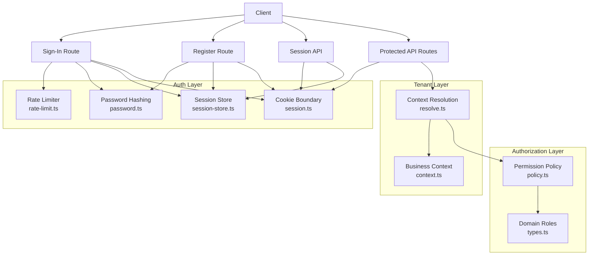

**Diagram sources**
- [session-store.ts:1-105](file://src/server/auth/session-store.ts#L1-L105)
- [session.ts:1-69](file://src/server/auth/session.ts#L1-L69)
- [password.ts:1-145](file://src/server/auth/password.ts#L1-L145)
- [rate-limit.ts:1-91](file://src/server/auth/rate-limit.ts#L1-L91)
- [policy.ts:1-104](file://src/server/permissions/policy.ts#L1-L104)
- [context.ts:1-131](file://src/server/business-context/context.ts#L1-L131)
- [resolve.ts:1-152](file://src/server/business-context/resolve.ts#L1-L152)
- [types.ts:64-65](file://src/server/domain/types.ts#L64-L65)
- [sign-in route.ts:1-87](file://src/app/api/v1/auth/sign-in/route.ts#L1-L87)
- [register route.ts:1-126](file://src/app/api/v1/auth/register/route.ts#L1-L126)
- [session route.ts:1-39](file://src/app/api/v1/session/route.ts#L1-L39)

**Section sources**
- [session-store.ts:1-105](file://src/server/auth/session-store.ts#L1-L105)
- [session.ts:1-69](file://src/server/auth/session.ts#L1-L69)
- [password.ts:1-145](file://src/server/auth/password.ts#L1-L145)
- [rate-limit.ts:1-91](file://src/server/auth/rate-limit.ts#L1-L91)
- [policy.ts:1-104](file://src/server/permissions/policy.ts#L1-L104)
- [context.ts:1-131](file://src/server/business-context/context.ts#L1-L131)
- [resolve.ts:1-152](file://src/server/business-context/resolve.ts#L1-L152)
- [types.ts:64-65](file://src/server/domain/types.ts#L64-L65)

## Core Components
- Session store: issues opaque tokens, hashes them before persistence, resolves sessions to authenticated users, revokes sessions, and switches active business per session.
- Cookie boundary: reads/writes the HTTP-only session cookie and provides helpers to require or optionally read a session.
- Password subsystem: hashes passwords with scrypt, verifies using constant-time comparison, enforces a password policy, and mitigates timing leaks.
- Rate limiter: in-process sliding-window limiter scoped by client IP and email, with reset on successful sign-in.
- Permission policy: maps roles to permissions, exposes assertion helpers, and defines grantable manager permissions.
- Business context: builds a typed tenant-scoped context from verified user and membership data, including locale, timezone, currency, feature flags, and derived permissions.
- Context resolver: authenticates the request, enumerates accessible businesses, selects an active business, validates membership, and returns a validated `BusinessContext`.

**Section sources**
- [session-store.ts:21-105](file://src/server/auth/session-store.ts#L21-L105)
- [session.ts:16-69](file://src/server/auth/session.ts#L16-L69)
- [password.ts:29-145](file://src/server/auth/password.ts#L29-L145)
- [rate-limit.ts:12-91](file://src/server/auth/rate-limit.ts#L12-L91)
- [policy.ts:11-104](file://src/server/permissions/policy.ts#L11-L104)
- [context.ts:20-131](file://src/server/business-context/context.ts#L20-L131)
- [resolve.ts:26-152](file://src/server/business-context/resolve.ts#L26-L152)

## Architecture Overview
The system separates identity concerns from framework-specific HTTP handling. The session store is framework-free; the Next.js cookie layer wraps it. Credential flows issue the same opaque session token used everywhere else, so downstream permission checks and tenant resolution remain uniform.

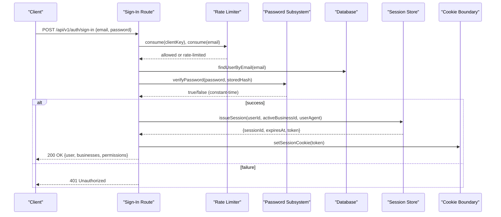

**Diagram sources**
- [sign-in route.ts:35-87](file://src/app/api/v1/auth/sign-in/route.ts#L35-L87)
- [rate-limit.ts:43-63](file://src/server/auth/rate-limit.ts#L43-L63)
- [password.ts:65-86](file://src/server/auth/password.ts#L65-L86)
- [session-store.ts:67-81](file://src/server/auth/session-store.ts#L67-L81)
- [session.ts:45-48](file://src/server/auth/session.ts#L45-L48)

## Detailed Component Analysis

### Session-Based Authentication Flow
- Sign-in validates credentials, applies rate limits, issues an opaque session token, stores its hash, and sets an HTTP-only cookie.
- The session cookie contains only the raw token; only its hash is persisted.
- Subsequent requests read the cookie, resolve the token to a live session and active user, and throw if invalid or expired.
- Logout revokes the session and clears the cookie.
- Active business switching updates the session’s selected business after verifying membership.

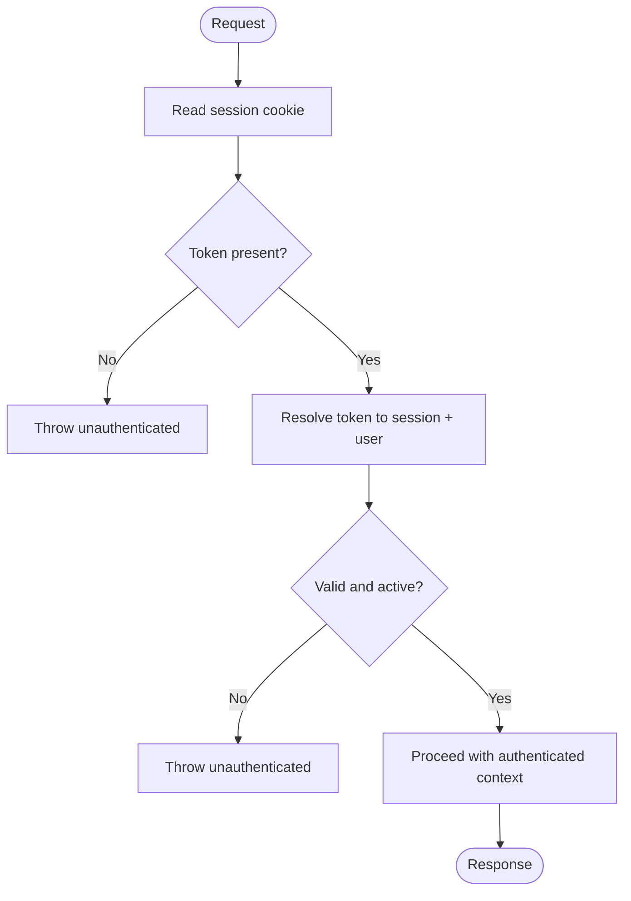

**Diagram sources**
- [session.ts:40-69](file://src/server/auth/session.ts#L40-L69)
- [session-store.ts:89-100](file://src/server/auth/session-store.ts#L89-L100)

**Section sources**
- [sign-in route.ts:35-87](file://src/app/api/v1/auth/sign-in/route.ts#L35-L87)
- [session route.ts:17-39](file://src/app/api/v1/session/route.ts#L17-L39)
- [session-store.ts:41-105](file://src/server/auth/session-store.ts#L41-L105)
- [session.ts:40-69](file://src/server/auth/session.ts#L40-L69)

### Password Hashing and Validation
- Uses scrypt with OWASP-aligned parameters and configurable cost factors embedded in the stored string.
- Stores a self-describing format containing algorithm, parameters, salt, and hash.
- Verification parses stored parameters, derives the key, and compares using constant-time equality.
- Missing or malformed hashes trigger a dummy derivation to avoid timing side channels.
- Password policy enforces minimum length, maximum length, and character class requirements.

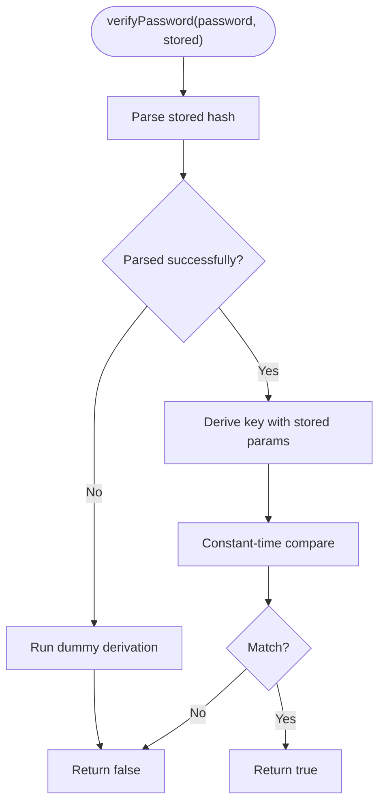

**Diagram sources**
- [password.ts:65-126](file://src/server/auth/password.ts#L65-L126)

**Section sources**
- [password.ts:29-145](file://src/server/auth/password.ts#L29-L145)

### Rate Limiting for Security
- In-process sliding window tracks hits per client IP and per email.
- Limits are intentionally tight to slow credential stuffing while keeping legitimate usage unaffected.
- Successful sign-in resets the email bucket to prevent lockout due to refresh loops.
- Client identity is derived from proxy headers when available; this is not an authorization decision.

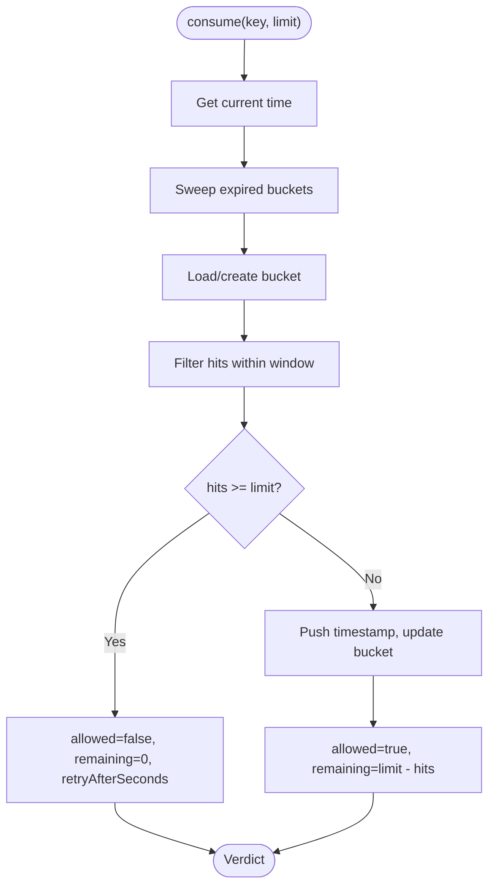

**Diagram sources**
- [rate-limit.ts:20-63](file://src/server/auth/rate-limit.ts#L20-L63)

**Section sources**
- [rate-limit.ts:1-91](file://src/server/auth/rate-limit.ts#L1-L91)
- [sign-in route.ts:42-52](file://src/app/api/v1/auth/sign-in/route.ts#L42-L52)

### Role-Based Access Control and Permission Policy
- Roles are defined centrally and map to explicit permission sets.
- Owner has all permissions; manager has most operational permissions; staff has limited read-focused permissions.
- Some permissions are grantable to managers by owners.
- Assertion helpers throw a forbidden error when a role lacks a required permission.

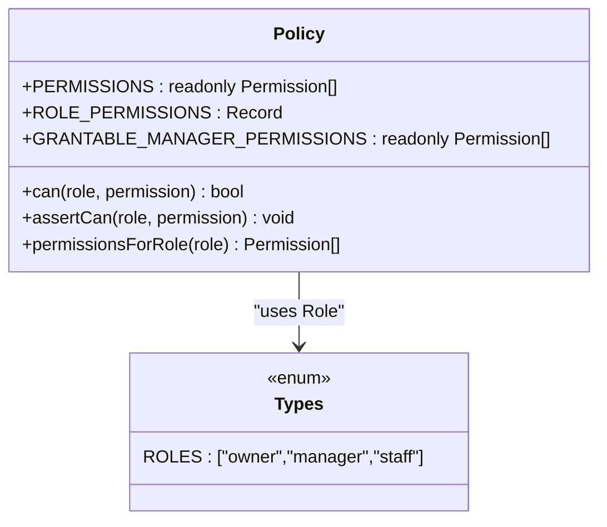

**Diagram sources**
- [policy.ts:11-104](file://src/server/permissions/policy.ts#L11-L104)
- [types.ts:64-65](file://src/server/domain/types.ts#L64-L65)

**Section sources**
- [policy.ts:11-104](file://src/server/permissions/policy.ts#L11-L104)
- [types.ts:64-65](file://src/server/domain/types.ts#L64-L65)

### Multi-Tenant Security Model and Business Context Resolution
- Every request must authenticate via session before resolving a business.
- The client may suggest an active business via a header, but the server verifies membership and business status.
- If no business is selected, the session default or first accessible business is chosen.
- The resolved `BusinessContext` includes user identity, role, derived permissions, locale, timezone, currency, feature flags, and retention settings.
- Repository methods receive a narrow `TenantScope` to enforce tenant filtering at the data layer.

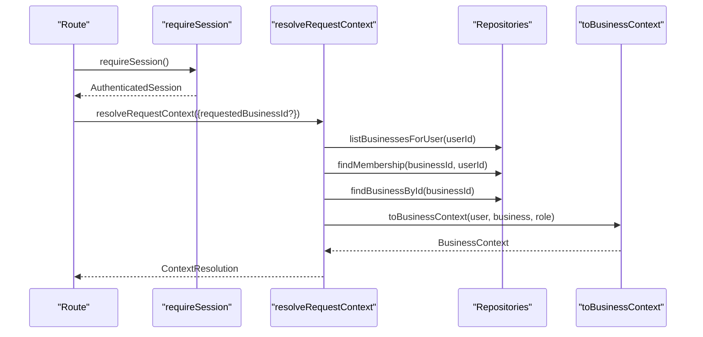

**Diagram sources**
- [resolve.ts:73-108](file://src/server/business-context/resolve.ts#L73-L108)
- [context.ts:66-86](file://src/server/business-context/context.ts#L66-L86)

**Section sources**
- [resolve.ts:1-152](file://src/server/business-context/resolve.ts#L1-L152)
- [context.ts:1-131](file://src/server/business-context/context.ts#L1-L131)

### Secure Cookie Handling and Session Lifecycle
- Cookie name and TTL are centralized.
- Cookie options include httpOnly, sameSite lax, secure flag in production, path `/`, and maxAge.
- Token is generated randomly and never exposed to the database; only its SHA-256 hash is stored.
- User agent is hashed and stored to aid detection of session anomalies.
- Sessions expire based on TTL and can be revoked explicitly.

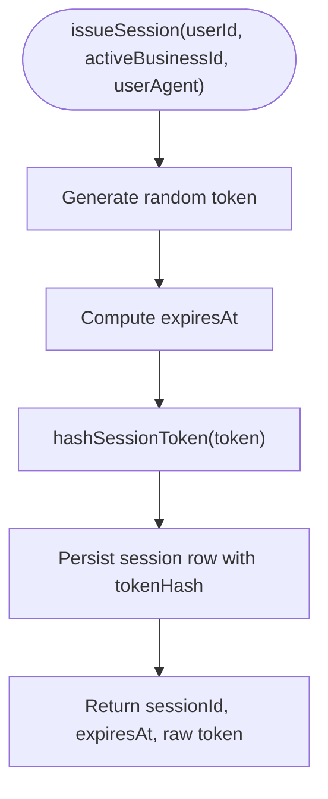

**Diagram sources**
- [session-store.ts:41-81](file://src/server/auth/session-store.ts#L41-L81)

**Section sources**
- [session-store.ts:21-105](file://src/server/auth/session-store.ts#L21-L105)
- [session.ts:45-53](file://src/server/auth/session.ts#L45-L53)

### Authorization Checks in API Routes and Services
- Tenant-aware routes call `requireTenant()` to obtain a validated `BusinessContext` and database handle.
- They then call `assertCan(context.role, <permission>)` to enforce capability checks.
- Example: voice capture requires `records.capture`; exports require `reports.export`.

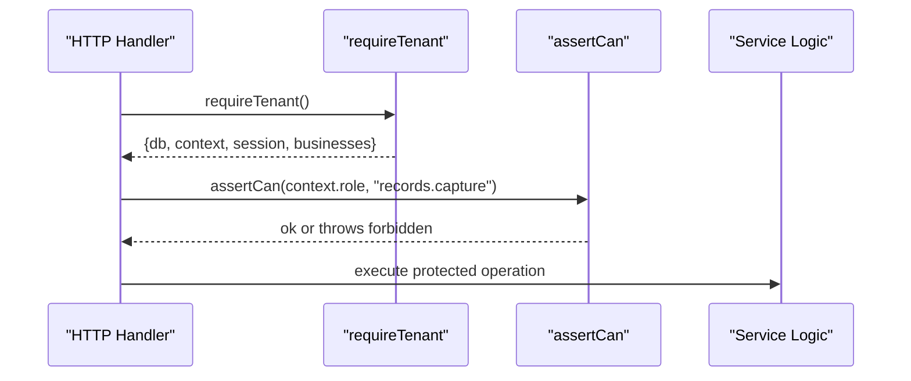

**Diagram sources**
- [voice capture route.ts:34-35](file://src/app/api/v1/capture/voice/route.ts#L34-L35)
- [policy.ts:84-92](file://src/server/permissions/policy.ts#L84-L92)

**Section sources**
- [voice capture route.ts:34-35](file://src/app/api/v1/capture/voice/route.ts#L34-L35)
- [policy.ts:84-92](file://src/server/permissions/policy.ts#L84-L92)

### Relationship Between Authentication State and Business Context
- Authentication yields an `AuthenticatedSession` containing the user, session metadata, and a database connection.
- Context resolution uses the authenticated user to enumerate accessible businesses and validate membership for the requested business.
- The resulting `BusinessContext` carries the effective role and permissions for that tenant, which drive every subsequent authorization check.

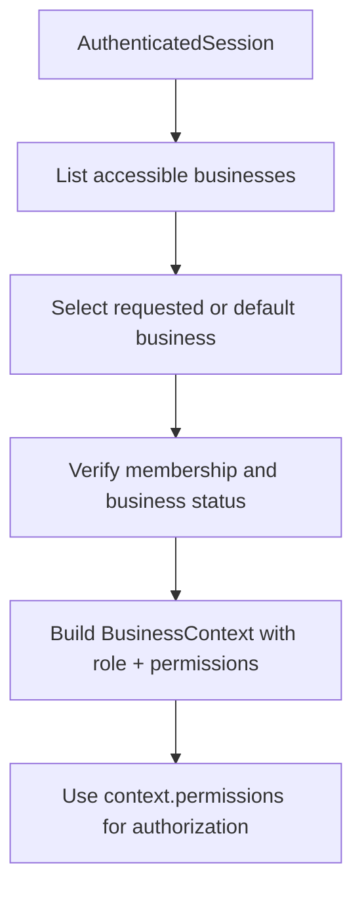

**Diagram sources**
- [resolve.ts:73-108](file://src/server/business-context/resolve.ts#L73-L108)
- [context.ts:66-86](file://src/server/business-context/context.ts#L66-L86)

**Section sources**
- [resolve.ts:73-108](file://src/server/business-context/resolve.ts#L73-L108)
- [context.ts:66-86](file://src/server/business-context/context.ts#L66-L86)

## Dependency Analysis
The following diagram shows how authentication, authorization, and tenant resolution depend on each other across the codebase.

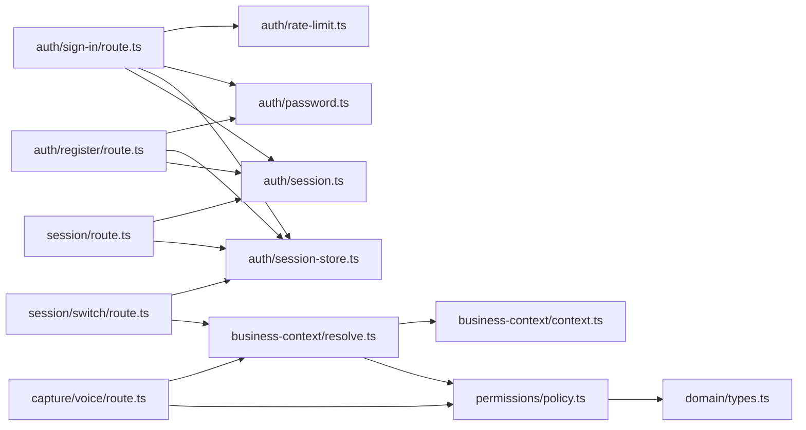

**Diagram sources**
- [sign-in route.ts:1-87](file://src/app/api/v1/auth/sign-in/route.ts#L1-L87)
- [register route.ts:1-126](file://src/app/api/v1/auth/register/route.ts#L1-L126)
- [session route.ts:1-39](file://src/app/api/v1/session/route.ts#L1-L39)
- [session switch route.ts:1-31](file://src/app/api/v1/session/switch/route.ts#L1-L31)
- [voice capture route.ts:34-35](file://src/app/api/v1/capture/voice/route.ts#L34-L35)
- [rate-limit.ts:1-91](file://src/server/auth/rate-limit.ts#L1-L91)
- [password.ts:1-145](file://src/server/auth/password.ts#L1-L145)
- [session-store.ts:1-105](file://src/server/auth/session-store.ts#L1-L105)
- [session.ts:1-69](file://src/server/auth/session.ts#L1-L69)
- [resolve.ts:1-152](file://src/server/business-context/resolve.ts#L1-L152)
- [context.ts:1-131](file://src/server/business-context/context.ts#L1-L131)
- [policy.ts:1-104](file://src/server/permissions/policy.ts#L1-L104)
- [types.ts:64-65](file://src/server/domain/types.ts#L64-L65)

**Section sources**
- [sign-in route.ts:1-87](file://src/app/api/v1/auth/sign-in/route.ts#L1-L87)
- [register route.ts:1-126](file://src/app/api/v1/auth/register/route.ts#L1-L126)
- [session route.ts:1-39](file://src/app/api/v1/session/route.ts#L1-L39)
- [session switch route.ts:1-31](file://src/app/api/v1/session/switch/route.ts#L1-L31)
- [voice capture route.ts:34-35](file://src/app/api/v1/capture/voice/route.ts#L34-L35)
- [rate-limit.ts:1-91](file://src/server/auth/rate-limit.ts#L1-L91)
- [password.ts:1-145](file://src/server/auth/password.ts#L1-L145)
- [session-store.ts:1-105](file://src/server/auth/session-store.ts#L1-L105)
- [session.ts:1-69](file://src/server/auth/session.ts#L1-L69)
- [resolve.ts:1-152](file://src/server/business-context/resolve.ts#L1-L152)
- [context.ts:1-131](file://src/server/business-context/context.ts#L1-L131)
- [policy.ts:1-104](file://src/server/permissions/policy.ts#L1-L104)
- [types.ts:64-65](file://src/server/domain/types.ts#L64-L65)

## Performance Considerations
- Password hashing uses scrypt with memory-hard parameters; hashing occurs outside database transactions to avoid holding connections idle during CPU-intensive work.
- Rate limiting uses an in-process Map with periodic sweeps to bound memory growth; for multi-instance deployments, move to a shared backend such as Redis or Neon.
- Session cookies are short-lived relative to long-running processes and use httpOnly and secure flags in production to reduce exposure.
- Constant-time password comparison and dummy derivations mitigate timing attacks without adding significant overhead beyond normal verification.

[No sources needed since this section provides general guidance]

## Troubleshooting Guide
- Unauthenticated responses:
  - Missing or expired session cookie triggers unauthenticated errors.
  - Expired or revoked sessions return a clear message prompting re-sign-in.
- Rate limiting:
  - Too many attempts from the same client or email result in 429 responses with retry guidance.
  - After successful sign-in, the email bucket is reset to avoid locking out legitimate users.
- Permission denied:
  - Missing role permissions raise a forbidden error; ensure the user’s role in the active business grants the required permission.
- Tenant access issues:
  - Requested business not found or inactive results in a forbidden response.
  - Cross-tenant access attempts are reported as permission failures without disclosing whether the business exists.
- Development login:
  - Local development login is disabled in production unless explicitly enabled; attempting to use it will return a forbidden error.

**Section sources**
- [session.ts:55-69](file://src/server/auth/session.ts#L55-L69)
- [sign-in route.ts:42-66](file://src/app/api/v1/auth/sign-in/route.ts#L42-L66)
- [policy.ts:84-92](file://src/server/permissions/policy.ts#L84-L92)
- [resolve.ts:91-107](file://src/server/business-context/resolve.ts#L91-L107)
- [dev login route.ts:34-37](file://src/app/api/v1/dev/login/route.ts#L34-L37)

## Conclusion
Daftari’s security model centers on a framework-independent session store wrapped by a strict cookie boundary, strong password hashing with policy enforcement, and tight rate limiting. Authorization is enforced through a central permission policy tied to well-defined roles, and every sensitive operation is guarded by assertions against the resolved `BusinessContext`. Multi-tenancy is enforced by requiring membership and business status validation before any tenant-scoped data access, ensuring robust isolation. The design keeps the identity provider swappable while preserving consistent behavior across local development and managed OIDC deployments.