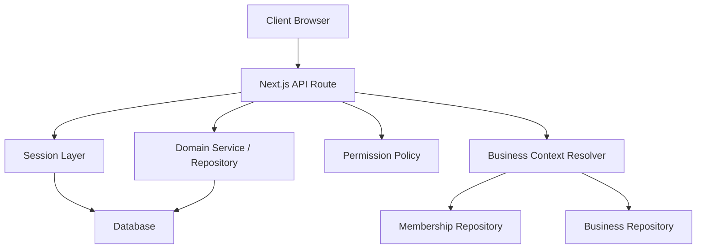
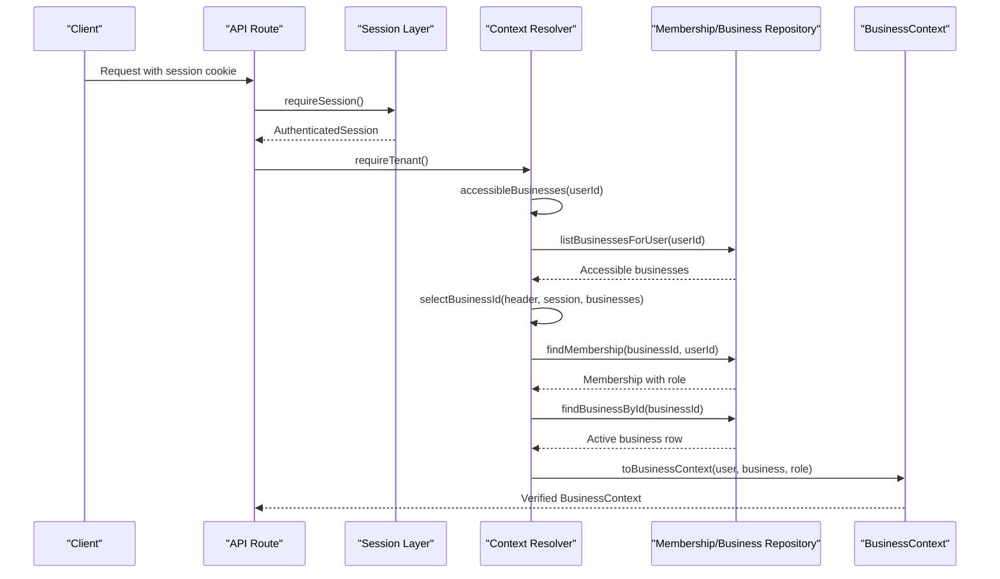
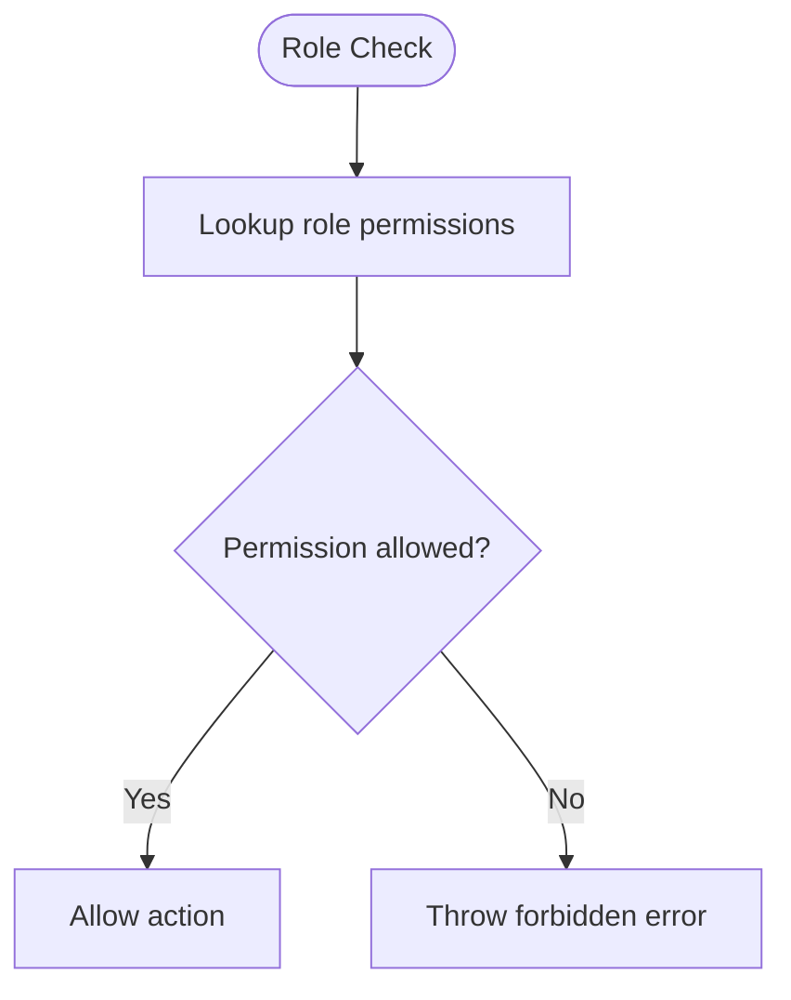
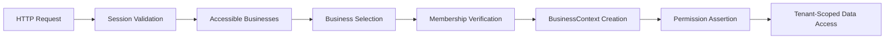
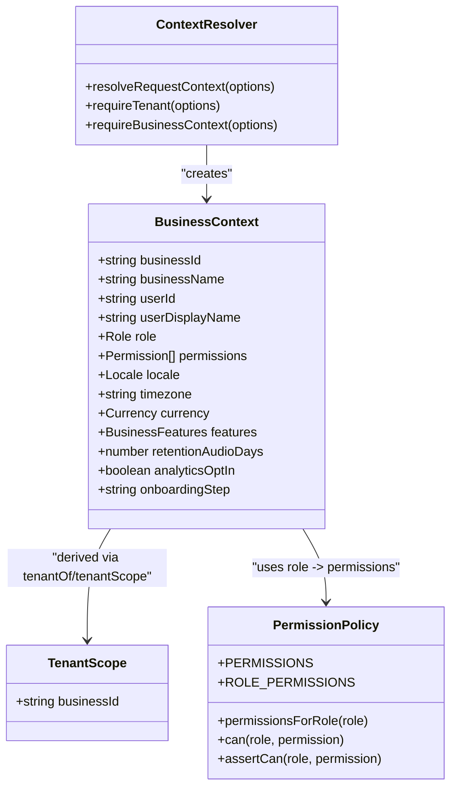
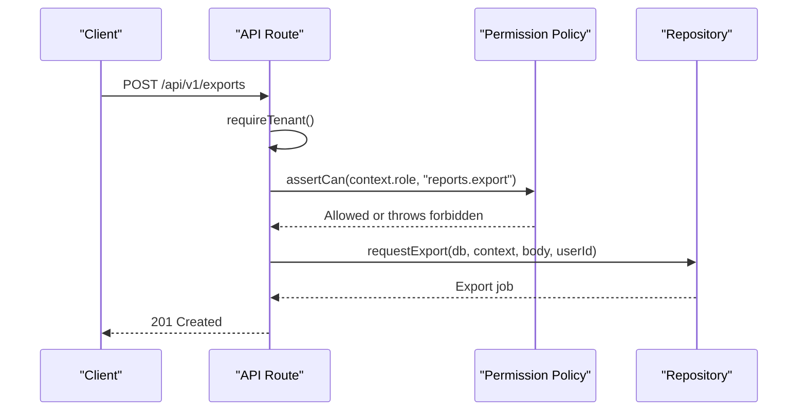
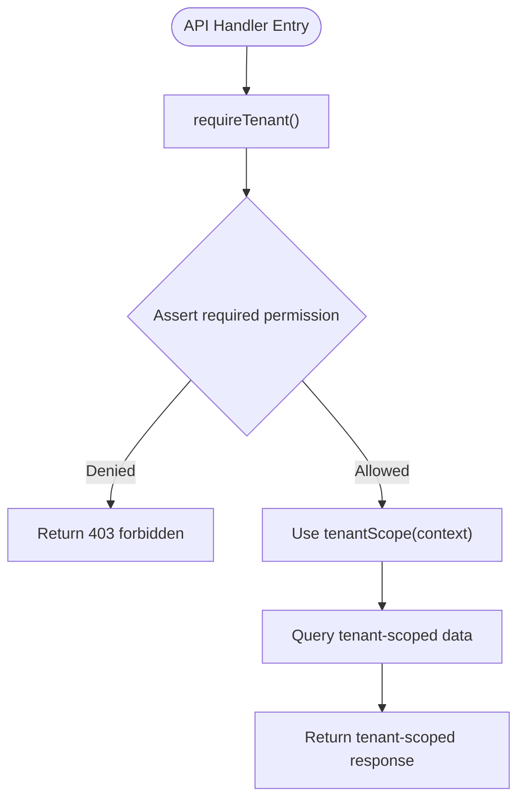
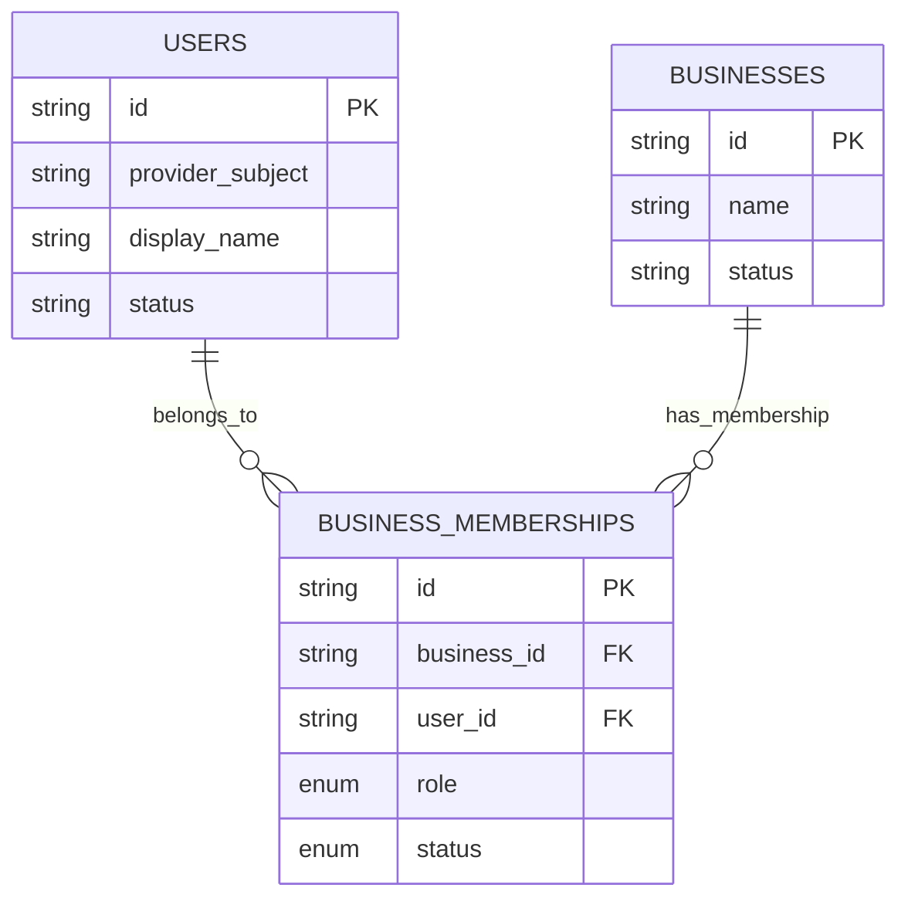
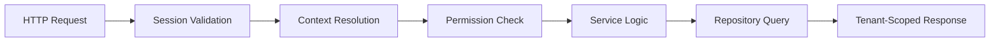
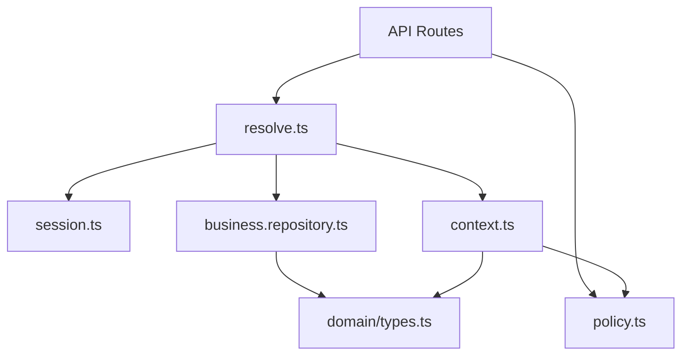

# Business Context & Authorization

<cite>
**Referenced Files in This Document**
- [context.ts](file://src/server/business-context/context.ts)
- [resolve.ts](file://src/server/business-context/resolve.ts)
- [policy.ts](file://src/server/permissions/policy.ts)
- [session.ts](file://src/server/auth/session.ts)
- [business.repository.ts](file://src/server/repositories/business.repository.ts)
- [types.ts](file://src/server/domain/types.ts)
- [route.ts (record detail)](file://src/app/api/v1/records/[recordId]/route.ts)
- [route.ts (deni customers)](file://src/app/api/v1/deni/customers/route.ts)
- [route.ts (inventory items)](file://src/app/api/v1/inventory/items/route.ts)
- [route.ts (exports)](file://src/app/api/v1/exports/route.ts)
- [architecture.md](file://architecture.md)
</cite>

## Table of Contents
1. [Introduction](#introduction)
2. [Project Structure](#project-structure)
3. [Core Components](#core-components)
4. [Architecture Overview](#architecture-overview)
5. [Detailed Component Analysis](#detailed-component-analysis)
6. [Dependency Analysis](#dependency-analysis)
7. [Performance Considerations](#performance-considerations)
8. [Troubleshooting Guide](#troubleshooting-guide)
9. [Conclusion](#conclusion)

## Introduction
This document explains Daftari’s multi-tenant authorization system and how business context resolution enforces tenant isolation, role-based access control, and permission policy evaluation across the application. It focuses on:

- How a request becomes an authenticated user with a verified business context.
- How roles owner, manager/bookkeeper, and staff map to permissions.
- How the permission policy engine evaluates actions against business rules and resource ownership.
- How API routes use the policy system for authorization checks.
- How business context flows through layers and constrains data access patterns.
- Security implications and guidelines for implementing new authorization rules.

The system treats the business as the tenant boundary. Every repository call is scoped by a `BusinessContext` produced only after authentication, membership verification, and permission evaluation.

**Section sources**
- [architecture.md:426-448](file://architecture.md#L426-L448)
- [context.ts:1-10](file://src/server/business-context/context.ts#L1-L10)

## Project Structure
The authorization and multi-tenant system spans several focused modules:

| Area | Responsibility | Key files |
|---|---|---|
| Authentication | Validates session cookies and resolves an active user with a database connection | [session.ts](file://src/server/auth/session.ts) |
| Business context | Builds and validates the tenant-scoped context, feature flags, locale, timezone, currency, and permissions | [context.ts](file://src/server/business-context/context.ts), [resolve.ts](file://src/server/business-context/resolve.ts) |
| Permission policy | Defines permissions, roles, and role-to-permission mapping | [policy.ts](file://src/server/permissions/policy.ts) |
| Domain types | Centralizes roles and domain vocabulary | [types.ts](file://src/server/domain/types.ts) |
| Repositories | Persist and query tenant-scoped data, including memberships and sessions | [business.repository.ts](file://src/server/repositories/business.repository.ts) |
| API routes | Authenticate, resolve business context, enforce permissions, and return tenant-scoped responses | Example routes under `src/app/api/v1/**` |

**Diagram sources**
- [session.ts:55-62](file://src/server/auth/session.ts#L55-L62)
- [resolve.ts:73-108](file://src/server/business-context/resolve.ts#L73-L108)
- [policy.ts:76-92](file://src/server/permissions/policy.ts#L76-L92)
- [business.repository.ts:256-293](file://src/server/repositories/business.repository.ts#L256-L293)

**Section sources**
- [session.ts:1-69](file://src/server/auth/session.ts#L1-L69)
- [context.ts:1-131](file://src/server/business-context/context.ts#L1-L131)
- [resolve.ts:1-152](file://src/server/business-context/resolve.ts#L1-L152)
- [policy.ts:1-104](file://src/server/permissions/policy.ts#L1-L104)
- [types.ts:64-65](file://src/server/domain/types.ts#L64-L65)
- [business.repository.ts:1-12](file://src/server/repositories/business.repository.ts#L1-L12)

## Core Components
This section summarizes the core building blocks used by every authorized request.

### Business Context
A `BusinessContext` carries the verified tenant identity and user capabilities for a single request. It includes:

- Tenant identifier and name.
- Authenticated user identifier and display name.
- Role and derived permissions.
- Locale, timezone, currency, feature flags, retention settings, analytics opt-in, and onboarding step.

It also exposes helpers to extract a minimal `TenantScope` and to check or assert permissions.

**Section sources**
- [context.ts:20-41](file://src/server/business-context/context.ts#L20-L41)
- [context.ts:48-60](file://src/server/business-context/context.ts#L48-L60)
- [context.ts:66-86](file://src/server/business-context/context.ts#L66-L86)

### Context Resolution
Context resolution turns an HTTP request into a verified business context:

1. Require a valid session.
2. List businesses the user can access.
3. Select the requested business ID from header, session default, or first available business.
4. Verify membership for that business.
5. Load the business row and ensure it is active.
6. Build a `BusinessContext` using the resolved role.

**Diagram sources**
- [resolve.ts:37-48](file://src/server/business-context/resolve.ts#L37-L48)
- [resolve.ts:50-59](file://src/server/business-context/resolve.ts#L50-L59)
- [resolve.ts:73-108](file://src/server/business-context/resolve.ts#L73-L108)
- [business.repository.ts:283-293](file://src/server/repositories/business.repository.ts#L283-L293)

**Section sources**
- [resolve.ts:1-152](file://src/server/business-context/resolve.ts#L1-L152)

### Permission Policy Engine
The permission policy defines:

- A central list of permissions.
- The three roles: owner, manager, staff.
- Role-to-permission mapping.
- Helpers to check or assert whether a role allows a permission.

Owner has all permissions. Manager has most operational permissions but not ownership-only controls. Staff has read-focused permissions plus capture and limited write capabilities defined by the policy.

**Diagram sources**
- [policy.ts:11-34](file://src/server/permissions/policy.ts#L11-L34)
- [policy.ts:45-74](file://src/server/permissions/policy.ts#L45-L74)
- [policy.ts:76-92](file://src/server/permissions/policy.ts#L76-L92)

**Section sources**
- [policy.ts:1-104](file://src/server/permissions/policy.ts#L1-L104)
- [types.ts:64-65](file://src/server/domain/types.ts#L64-L65)

### Session and User Identity
Authentication resolves an opaque session token from an HTTP-only cookie, validates it against the database, and returns an authenticated session containing the user and a database handle. This ensures that subsequent tenant resolution and repository calls reuse the same authenticated identity and connection.

**Section sources**
- [session.ts:1-11](file://src/server/auth/session.ts#L1-L11)
- [session.ts:40-62](file://src/server/auth/session.ts#L40-L62)

## Architecture Overview
At runtime, authorization follows a layered flow:

1. **Request ingress:** An API route receives a request.
2. **Authentication:** The session layer validates the cookie and loads the active user.
3. **Tenant selection:** The resolver selects a business based on header, session default, or available memberships.
4. **Membership verification:** The resolver verifies that the user has an active or invited membership for the selected business.
5. **Context construction:** A `BusinessContext` is built with the user’s role and derived permissions.
6. **Policy enforcement:** The route asserts required permissions before reading or mutating data.
7. **Data access:** Repositories execute queries scoped by `business_id`, preventing cross-tenant leakage.

**Diagram sources**
- [session.ts:55-62](file://src/server/auth/session.ts#L55-L62)
- [resolve.ts:73-108](file://src/server/business-context/resolve.ts#L73-L108)
- [context.ts:66-86](file://src/server/business-context/context.ts#L66-L86)
- [policy.ts:76-92](file://src/server/permissions/policy.ts#L76-L92)
- [business.repository.ts:1-12](file://src/server/repositories/business.repository.ts#L1-L12)

**Section sources**
- [architecture.md:426-448](file://architecture.md#L426-L448)
- [resolve.ts:1-152](file://src/server/business-context/resolve.ts#L1-L152)

## Detailed Component Analysis

### Multi-Tenant Isolation Through Business Context
Multi-tenant isolation is enforced at multiple layers:

- **Request layer:** Routes call `requireTenant` or `requireBusinessContext` to obtain a verified context.
- **Context layer:** `toBusinessContext` maps verified user and business rows into a typed context with permissions.
- **Repository layer:** Queries include `business_id` filters; missing tenant scope is treated as a type-level safety requirement.
- **Error behavior:** Cross-tenant access is reported as a permission failure without disclosing whether the target business exists.

**Diagram sources**
- [context.ts:20-41](file://src/server/business-context/context.ts#L20-L41)
- [context.ts:48-60](file://src/server/business-context/context.ts#L48-L60)
- [context.ts:66-86](file://src/server/business-context/context.ts#L66-L86)
- [resolve.ts:73-108](file://src/server/business-context/resolve.ts#L73-L108)
- [policy.ts:45-92](file://src/server/permissions/policy.ts#L45-L92)

**Section sources**
- [context.ts:1-131](file://src/server/business-context/context.ts#L1-L131)
- [resolve.ts:1-152](file://src/server/business-context/resolve.ts#L1-L152)
- [business.repository.ts:1-12](file://src/server/repositories/business.repository.ts#L1-L12)

### Role-Based Access Control
Roles are defined centrally and mapped to permissions:

| Role | Scope | Typical capabilities |
|---|---|---|
| Owner | Full business control | All permissions, including team, integrations, privacy, settings, and audit-related controls. |
| Manager / Bookkeeper | Operational management | Read/write for records, proposals, deni, inventory, reports, and read-only access to team/integrations/settings/privacy. |
| Staff | Limited operational access | Read-focused access with capture and manual entry where permitted by the policy. |

The policy module explicitly documents that owner-only actions such as team, integrations, privacy, and ownership are never granted away. Some manager permissions are grantable separately when product logic supports permission overrides.

**Section sources**
- [policy.ts:40-74](file://src/server/permissions/policy.ts#L40-L74)
- [policy.ts:94-104](file://src/server/permissions/policy.ts#L94-L104)
- [types.ts:64-65](file://src/server/domain/types.ts#L64-L65)

### Permission Policy Evaluation
Authorization checks occur at two important boundaries:

1. **Route/service boundary:** The route asserts the required permission before calling services or repositories.
2. **Sensitive domain operation:** Critical operations re-evaluate permissions inside domain logic.

Examples in this codebase show the pattern:

- Record detail requires `records.read`.
- Deni customer listing requires `deni.read`.
- Inventory item creation requires `inventory.manage`.
- Export creation requires `reports.export`.

**Diagram sources**
- [route.ts (exports):17-40](file://src/app/api/v1/exports/route.ts#L17-L40)
- [policy.ts:84-92](file://src/server/permissions/policy.ts#L84-L92)

**Section sources**
- [policy.ts:1-104](file://src/server/permissions/policy.ts#L1-L104)
- [route.ts (exports):1-64](file://src/app/api/v1/exports/route.ts#L1-L64)

### Implementing Authorization Checks in API Routes
The recommended pattern for new routes is:

1. Call `requireTenant()` to authenticate the user and resolve the business context.
2. Assert the required permission using `assertCan(context.role, '<permission>')`.
3. Use `tenantScope(context)` or `tenantOf(context)` when passing tenant scope to repositories.
4. Return tenant-scoped data or errors.

Example patterns already present:

- Record detail reads a ledger record within the resolved business scope and asserts `records.read`.
- Deni customer listing asserts `deni.read` and passes `tenantScope(context)` to the repository.
- Inventory item listing asserts `inventory.read`; creation asserts `inventory.manage` and checks feature flags.
- Export creation asserts `reports.export`, checks feature flags, and creates an async job.

**Diagram sources**
- [route.ts (record detail):28-35](file://src/app/api/v1/records/[recordId]/route.ts#L28-L35)
- [route.ts (deni customers):14-20](file://src/app/api/v1/deni/customers/route.ts#L14-L20)
- [route.ts (inventory items):18-34](file://src/app/api/v1/inventory/items/route.ts#L18-L34)
- [route.ts (exports):17-23](file://src/app/api/v1/exports/route.ts#L17-L23)

**Section sources**
- [route.ts (record detail):1-116](file://src/app/api/v1/records/[recordId]/route.ts#L1-L116)
- [route.ts (deni customers):1-39](file://src/app/api/v1/deni/customers/route.ts#L1-L39)
- [route.ts (inventory items):1-68](file://src/app/api/v1/inventory/items/route.ts#L1-L68)
- [route.ts (exports):1-64](file://src/app/api/v1/exports/route.ts#L1-L64)

### Relationship Between Users, Roles, and Accessible Business Contexts
A user may belong to multiple businesses. For each business, the membership table stores the role and membership status. Context resolution lists all accessible businesses and then verifies the selected business membership before constructing the context.

Key relationships:

- `users` → `business_memberships` → `businesses`
- Membership provides role and status.
- Session stores an optional active business selector.
- Header `X-Active-Business-Id` can override the selector, but server-side membership verification remains mandatory.

**Diagram sources**
- [business.repository.ts:14-59](file://src/server/repositories/business.repository.ts#L14-L59)
- [business.repository.ts:256-293](file://src/server/repositories/business.repository.ts#L256-L293)

**Section sources**
- [business.repository.ts:256-293](file://src/server/repositories/business.repository.ts#L256-L293)
- [resolve.ts:37-48](file://src/server/business-context/resolve.ts#L37-L48)
- [resolve.ts:50-59](file://src/server/business-context/resolve.ts#L50-L59)

### Business Context Flow Through Application Layers
Business context flows from the request boundary into services and repositories:

| Layer | Input | Output | Security Behavior |
|---|---|---|---|
| API route | HTTP request, session cookie | Authorized handler | Requires session and business context |
| Context resolver | Session, header, session default | `BusinessContext` | Verifies membership and active business |
| Permission policy | Role | Permission set | Denies by default |
| Service/repository | `Db` + `TenantScope` | Tenant-scoped result | Filters by `business_id` |
| Response | Domain data | JSON payload | Never exposes cross-tenant data |

**Diagram sources**
- [session.ts:55-62](file://src/server/auth/session.ts#L55-L62)
- [resolve.ts:73-108](file://src/server/business-context/resolve.ts#L73-L108)
- [policy.ts:76-92](file://src/server/permissions/policy.ts#L76-L92)
- [business.repository.ts:1-12](file://src/server/repositories/business.repository.ts#L1-L12)

**Section sources**
- [architecture.md:426-448](file://architecture.md#L426-L448)

## Dependency Analysis
The authorization subsystem has clear dependencies:

- API routes depend on `requireTenant` and `assertCan`.
- Context resolution depends on session validation, business repository, and membership lookup.
- Context construction depends on permission policy to derive permissions from role.
- Repositories depend on `TenantScope` to enforce tenant filtering.
- Domain types define roles shared across policy and context.

**Diagram sources**
- [route.ts (record detail):10-11](file://src/app/api/v1/records/[recordId]/route.ts#L10-L11)
- [resolve.ts:10-22](file://src/server/business-context/resolve.ts#L10-L22)
- [context.ts:16-18](file://src/server/business-context/context.ts#L16-L18)
- [business.repository.ts:11-12](file://src/server/repositories/business.repository.ts#L11-L12)
- [types.ts:64-65](file://src/server/domain/types.ts#L64-L65)

**Section sources**
- [route.ts (record detail):1-116](file://src/app/api/v1/records/[recordId]/route.ts#L1-L116)
- [resolve.ts:1-152](file://src/server/business-context/resolve.ts#L1-L152)
- [context.ts:1-131](file://src/server/business-context/context.ts#L1-L131)
- [policy.ts:1-104](file://src/server/permissions/policy.ts#L1-L104)
- [business.repository.ts:1-12](file://src/server/repositories/business.repository.ts#L1-L12)
- [types.ts:64-65](file://src/server/domain/types.ts#L64-L65)

## Performance Considerations
- Reusing the database connection from the authenticated session avoids repeated connection setup per request.
- Listing accessible businesses happens once per context resolution; avoid redundant membership lookups in hot paths.
- Permission checks are constant-time array lookups over a small permission set.
- Feature flag checks should be performed early to avoid unnecessary service work.
- Tenant-scoped queries rely on indexes starting with `business_id`; ensure database schema matches common access patterns.

[No sources needed since this section provides general guidance]

## Troubleshooting Guide
Common authorization issues and their likely causes:

| Symptom | Likely Cause | Resolution |
|---|---|---|
| Request fails with unauthenticated | Missing or expired session cookie | Ensure login succeeded and session cookie is present. |
| Request fails with forbidden no membership | No active or invited membership for selected business | Add user to the business or switch to an accessible business. |
| Request fails with forbidden not available | Selected business does not exist or is not active | Verify business status and membership. |
| Permission denied for action | Role lacks required permission | Assign appropriate role or add permission mapping if supported. |
| Cross-tenant data leak suspected | Repository query missing `business_id` filter | Enforce `TenantScope` and verify repository implementation. |
| Feature-gated endpoint unavailable | Business feature flag disabled | Enable feature for the business or adjust client UI gating. |

Security notes:

- Cross-tenant access failures must not disclose whether the target business exists.
- Errors should not expose stack traces, raw provider errors, transcripts, or sensitive values.
- Background jobs must carry and revalidate business ID before execution.

**Section sources**
- [resolve.ts:96-107](file://src/server/business-context/resolve.ts#L96-L107)
- [architecture.md:183-196](file://architecture.md#L183-L196)
- [architecture.md:426-448](file://architecture.md#L426-L448)

## Conclusion
Daftari’s authorization model centers on a verified business context that combines authentication, membership verification, role-based permissions, and tenant-scoped data access. The system prevents cross-tenant data leakage by requiring explicit tenant scope at both the route and repository layers. New authorization rules should follow the established pattern:

1. Define or extend permissions in the central policy module.
2. Map new permissions to roles where appropriate.
3. Require tenant context in routes using `requireTenant`.
4. Assert permissions using `assertCan(context.role, '<permission>')`.
5. Pass `tenantScope(context)` or `tenantOf(context)` to repositories.
6. Test both permission denial and tenant isolation.

This approach keeps security decisions centralized, makes authorization failures predictable, and ensures that business context flows consistently from the API boundary into data access.

[No sources needed since this section summarizes without analyzing specific files]