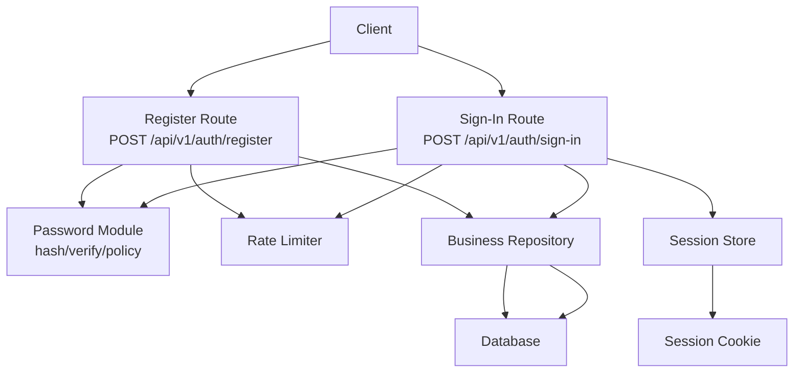
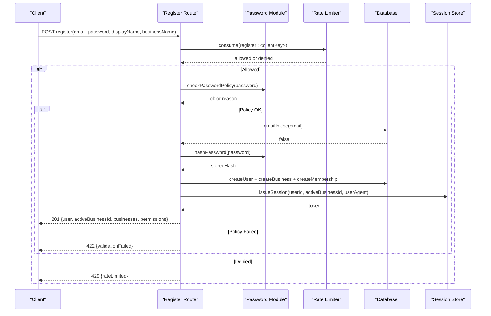
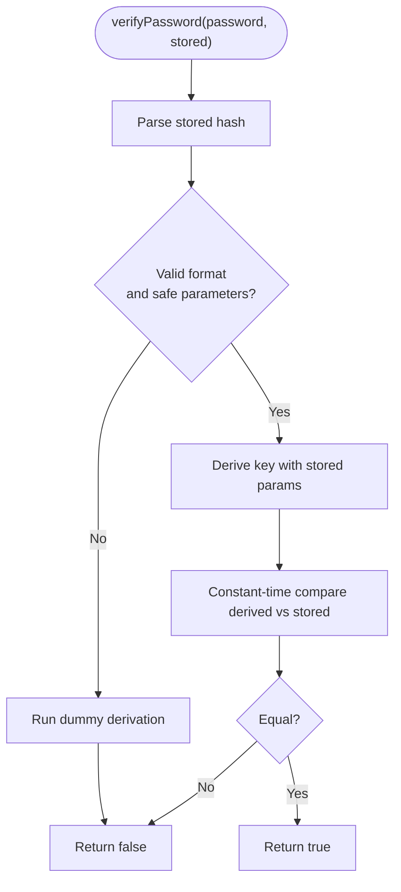
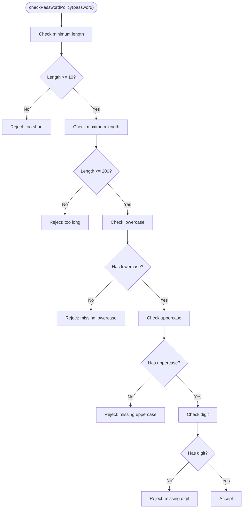
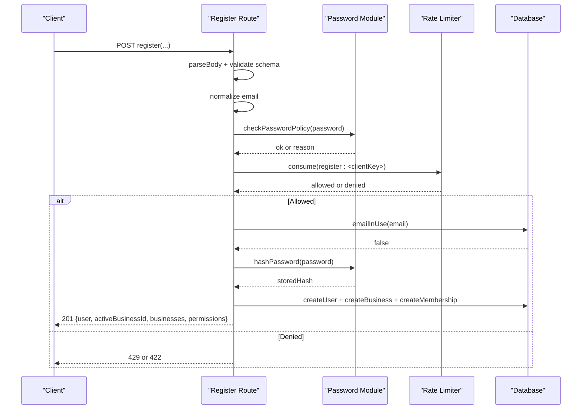
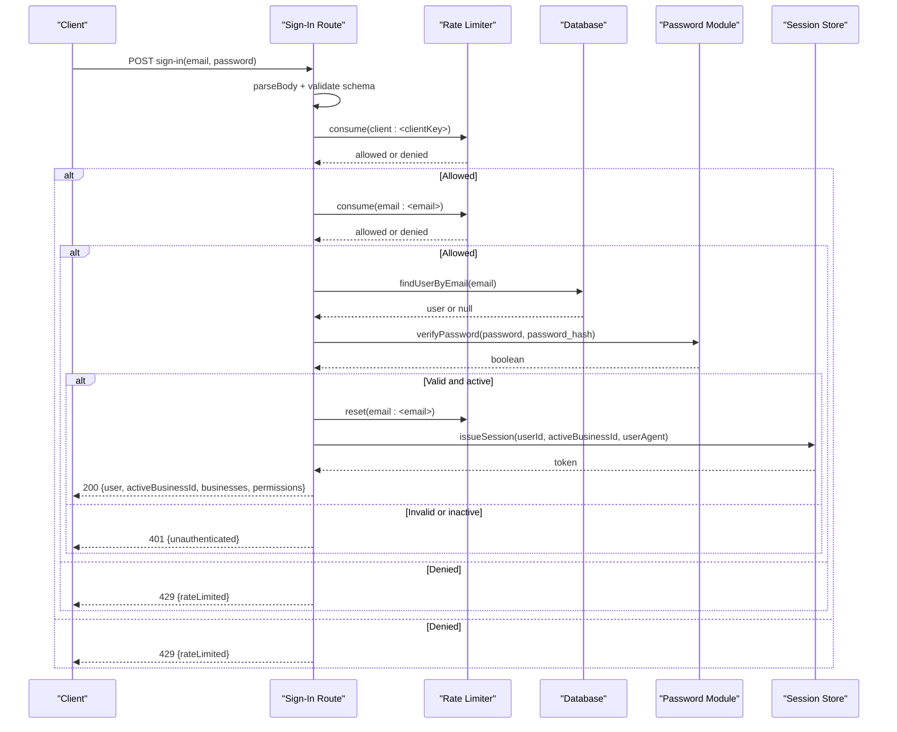
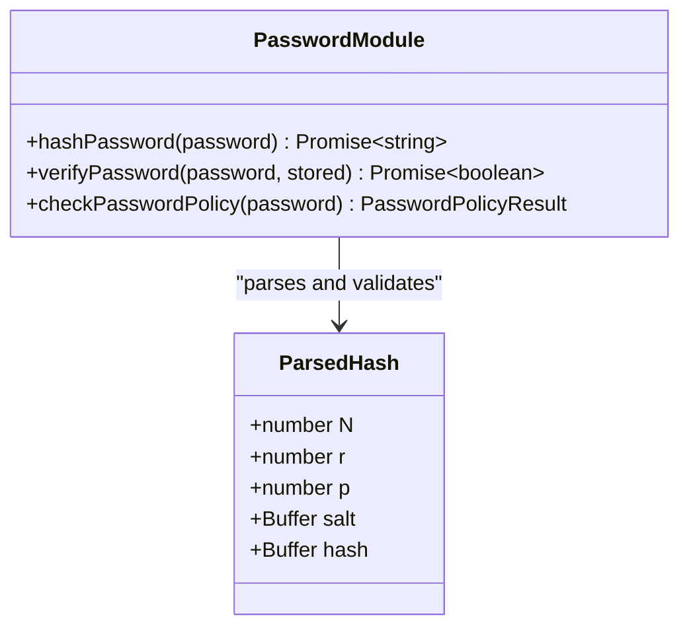
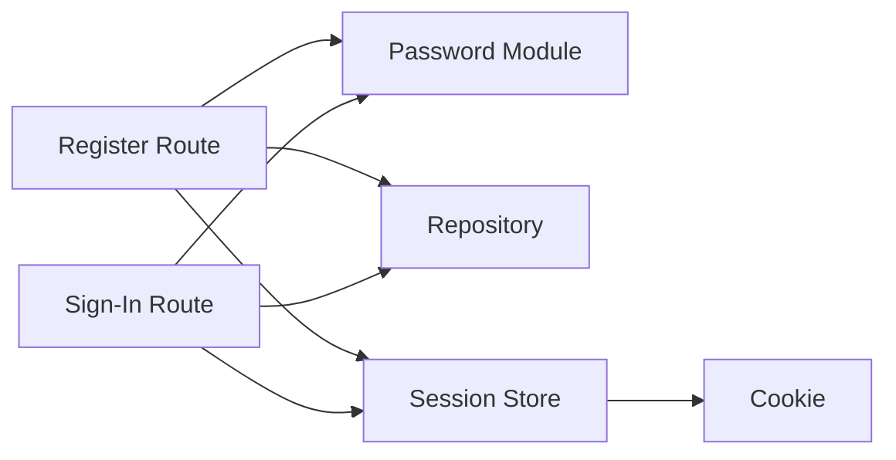
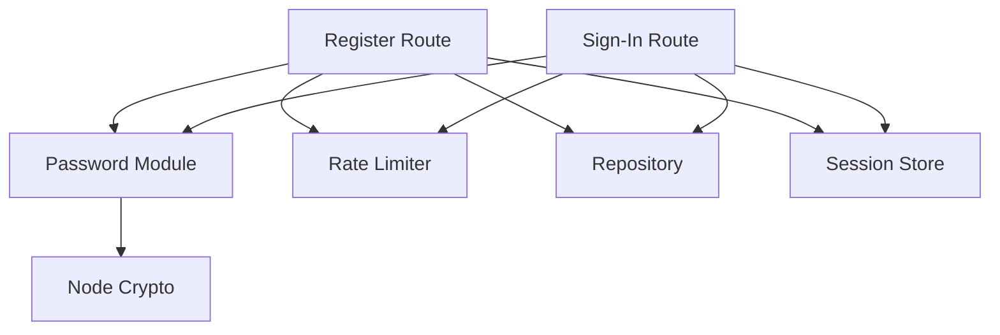

# Password Security

<cite>
**Referenced Files in This Document**
- [password.ts](file://src/server/auth/password.ts)
- [register/route.ts](file://src/app/api/v1/auth/register/route.ts)
- [sign-in/route.ts](file://src/app/api/v1/auth/sign-in/route.ts)
- [rate-limit.ts](file://src/server/auth/rate-limit.ts)
- [session-store.ts](file://src/server/auth/session-store.ts)
- [session.ts](file://src/server/auth/session.ts)
- [auth.test.ts](file://tests/auth.test.ts)
</cite>

## Table of Contents
1. [Introduction](#introduction)
2. [Project Structure](#project-structure)
3. [Core Components](#core-components)
4. [Architecture Overview](#architecture-overview)
5. [Detailed Component Analysis](#detailed-component-analysis)
6. [Dependency Analysis](#dependency-analysis)
7. [Performance Considerations](#performance-considerations)
8. [Troubleshooting Guide](#troubleshooting-guide)
9. [Conclusion](#conclusion)

## Introduction
This document explains how Daftari secures user passwords and integrates password handling into its authentication flow. It covers the hashing algorithm, salt generation, validation rules, storage format, timing attack prevention, brute-force protection, session issuance, and error behavior. It also clarifies what is currently implemented versus what is not present in the codebase.

## Project Structure
Password security touches several focused modules:

- `src/server/auth/password.ts`: Hashing, verification, policy checks, and secure comparison.
- `src/app/api/v1/auth/register/route.ts`: Registration endpoint that validates and hashes new passwords.
- `src/app/api/v1/auth/sign-in/route.ts`: Sign-in endpoint that verifies credentials and issues sessions.
- `src/server/auth/rate-limit.ts`: In-process rate limiting for credential endpoints.
- `src/server/auth/session-store.ts` and `src/server/auth/session.ts`: Session token creation, cookie management, and session resolution.
- `tests/auth.test.ts`: Tests pinning password hashing, policy, rate limiting, and repository integration.

**Diagram sources**
- [register/route.ts:47-126](file://src/app/api/v1/auth/register/route.ts#L47-L126)
- [sign-in/route.ts:35-87](file://src/app/api/v1/auth/sign-in/route.ts#L35-L87)
- [password.ts:37-86](file://src/server/auth/password.ts#L37-L86)
- [rate-limit.ts:43-80](file://src/server/auth/rate-limit.ts#L43-L80)
- [session-store.ts:1-23](file://src/server/auth/session-store.ts#L1-L23)

**Section sources**
- [register/route.ts:1-126](file://src/app/api/v1/auth/register/route.ts#L1-L126)
- [sign-in/route.ts:1-87](file://src/app/api/v1/auth/sign-in/route.ts#L1-L87)
- [password.ts:1-145](file://src/server/auth/password.ts#L1-L145)
- [rate-limit.ts:1-91](file://src/server/auth/rate-limit.ts#L1-L91)
- [session-store.ts:1-23](file://src/server/auth/session-store.ts#L1-L23)
- [session.ts:45-68](file://src/server/auth/session.ts#L45-L68)

## Core Components
- Password hashing and verification module:
  - Uses a memory-hard KDF from Node’s crypto library with configurable parameters.
  - Generates a unique random salt per password.
  - Stores a self-describing string containing algorithm identifier, cost parameters, salt, and derived key.
  - Provides constant-time comparison and uniform failure timing to prevent timing attacks.
- Password policy:
  - Enforces minimum length, maximum length, and required character classes.
- Registration route:
  - Validates input, enforces policy, applies client-side registration rate limits, checks uniqueness, hashes the password, creates user and business context, and issues a session.
- Sign-in route:
  - Applies both per-client and per-email rate limits, performs unconditional verification, returns uniform errors, resets per-email budget on success, and issues a session.
- Rate limiter:
  - Sliding-window in-memory limiter with periodic cleanup; keys by client identity and email.
- Session layer:
  - Issues opaque tokens, sets HTTP-only cookies, and resolves sessions for protected routes.

**Section sources**
- [password.ts:19-86](file://src/server/auth/password.ts#L19-L86)
- [password.ts:128-145](file://src/server/auth/password.ts#L128-L145)
- [register/route.ts:47-126](file://src/app/api/v1/auth/register/route.ts#L47-L126)
- [sign-in/route.ts:35-87](file://src/app/api/v1/auth/sign-in/route.ts#L35-L87)
- [rate-limit.ts:1-91](file://src/server/auth/rate-limit.ts#L1-L91)
- [session-store.ts:1-23](file://src/server/auth/session-store.ts#L1-L23)
- [session.ts:45-68](file://src/server/auth/session.ts#L45-L68)

## Architecture Overview
The password security architecture separates concerns between API routes, cryptographic primitives, persistence, and session management.

**Diagram sources**
- [register/route.ts:47-126](file://src/app/api/v1/auth/register/route.ts#L47-L126)
- [password.ts:37-55](file://src/server/auth/password.ts#L37-L55)
- [password.ts:134-145](file://src/server/auth/password.ts#L134-L145)
- [rate-limit.ts:43-63](file://src/server/auth/rate-limit.ts#L43-L63)

## Detailed Component Analysis

### Password Hashing and Verification
- Algorithm selection:
  - The implementation uses a memory-hard KDF from Node’s crypto module rather than bcrypt. The design intentionally keeps the identity provider swappable behind this seam.
- Salt generation:
  - A cryptographically random 16-byte salt is generated for every password.
- Storage format:
  - A single self-describing string stores the algorithm tag, cost parameters (N, r, p), key length, base64-encoded salt, and base64-encoded derived key.
  - This allows future parameter upgrades without invalidating existing hashes.
- Verification:
  - Parses and validates stored parameters before use.
  - Performs derivation using stored parameters and compares results with constant-time equality.
  - On malformed or missing stored values, it still performs a dummy derivation so response time does not reveal whether an account exists.

**Diagram sources**
- [password.ts:65-86](file://src/server/auth/password.ts#L65-L86)
- [password.ts:96-116](file://src/server/auth/password.ts#L96-L116)
- [password.ts:118-126](file://src/server/auth/password.ts#L118-L126)

**Section sources**
- [password.ts:1-17](file://src/server/auth/password.ts#L1-L17)
- [password.ts:37-86](file://src/server/auth/password.ts#L37-L86)
- [password.ts:96-126](file://src/server/auth/password.ts#L96-L126)

### Password Policy and Strength Requirements
- Minimum length: at least 10 characters.
- Maximum length: up to 200 characters.
- Complexity rules:
  - Must include at least one lowercase letter.
  - Must include at least one uppercase letter.
  - Must include at least one digit.
- The policy function returns a typed result indicating validity and a human-readable reason when rejected.

**Diagram sources**
- [password.ts:134-145](file://src/server/auth/password.ts#L134-L145)

**Section sources**
- [password.ts:35-35](file://src/server/auth/password.ts#L35-L35)
- [password.ts:134-145](file://src/server/auth/password.ts#L134-L145)

### Registration Flow
- Input validation:
  - Email shape and length are validated.
  - Password is validated against the policy.
- Rate limiting:
  - Per-client registration attempts are limited within a sliding window.
- Uniqueness:
  - Duplicate email addresses are rejected.
- Hashing:
  - Password is hashed before opening the database transaction to avoid holding pooled connections during slow KDF work.
- Persistence:
  - Creates user, business, and owner membership inside a transaction.
- Session:
  - Issues a session and sets the session cookie immediately after successful registration.

**Diagram sources**
- [register/route.ts:47-126](file://src/app/api/v1/auth/register/route.ts#L47-L126)
- [password.ts:134-145](file://src/server/auth/password.ts#L134-L145)
- [password.ts:37-55](file://src/server/auth/password.ts#L37-L55)
- [rate-limit.ts:43-63](file://src/server/auth/rate-limit.ts#L43-L63)

**Section sources**
- [register/route.ts:47-126](file://src/app/api/v1/auth/register/route.ts#L47-L126)

### Sign-In Flow
- Input validation:
  - Email and password fields are parsed and validated.
- Rate limiting:
  - Both per-client and per-email attempts are limited within a sliding window.
- Credential verification:
  - User lookup occurs, then verification runs unconditionally even if no user is found.
  - Failure paths return uniform errors and perform a derivation to equalize timing.
- Success path:
  - Resets per-email rate limit.
  - Issues a session and sets the session cookie.

**Diagram sources**
- [sign-in/route.ts:35-87](file://src/app/api/v1/auth/sign-in/route.ts#L35-L87)
- [password.ts:65-86](file://src/server/auth/password.ts#L65-L86)
- [rate-limit.ts:43-80](file://src/server/auth/rate-limit.ts#L43-L80)

**Section sources**
- [sign-in/route.ts:35-87](file://src/app/api/v1/auth/sign-in/route.ts#L35-L87)

### Secure Storage Practices
- Hash format:
  - Self-describing string includes algorithm tag, cost parameters, salt, and derived key.
- Salt:
  - Randomly generated per password.
- Parameter safety:
  - Stored parameters are validated and bounded to prevent excessive memory allocation.
- Comparison:
  - Constant-time comparison prevents timing side channels.
- Uniform failures:
  - Missing or corrupt stored hashes do not throw; they deny access safely.

**Diagram sources**
- [password.ts:37-86](file://src/server/auth/password.ts#L37-L86)
- [password.ts:88-116](file://src/server/auth/password.ts#L88-L116)

**Section sources**
- [password.ts:1-17](file://src/server/auth/password.ts#L1-L17)
- [password.ts:37-86](file://src/server/auth/password.ts#L37-L86)
- [password.ts:96-126](file://src/server/auth/password.ts#L96-L126)

### Integration with Authentication Flow
- Registration:
  - Validates policy, hashes password, persists user/business/membership, and issues a session.
- Sign-in:
  - Applies rate limits, verifies credentials uniformly, and issues a session.
- Sessions:
  - Opaque tokens are issued and set as cookies; subsequent requests resolve sessions through the session store.

**Diagram sources**
- [register/route.ts:47-126](file://src/app/api/v1/auth/register/route.ts#L47-L126)
- [sign-in/route.ts:35-87](file://src/app/api/v1/auth/sign-in/route.ts#L35-L87)
- [session-store.ts:1-23](file://src/server/auth/session-store.ts#L1-L23)
- [session.ts:45-68](file://src/server/auth/session.ts#L45-L68)

**Section sources**
- [register/route.ts:47-126](file://src/app/api/v1/auth/register/route.ts#L47-L126)
- [sign-in/route.ts:35-87](file://src/app/api/v1/auth/sign-in/route.ts#L35-L87)
- [session-store.ts:1-23](file://src/server/auth/session-store.ts#L1-L23)
- [session.ts:45-68](file://src/server/auth/session.ts#L45-L68)

## Dependency Analysis
- API routes depend on:
  - Password module for hashing, verification, and policy checks.
  - Rate limiter for abuse mitigation.
  - Repository for user/business operations.
  - Session store for issuing and managing sessions.
- Password module depends on:
  - Node’s crypto module for randomness, KDF, and constant-time comparison.
- Rate limiter depends on:
  - Request headers for client identity and provides in-memory sliding windows.

**Diagram sources**
- [register/route.ts:47-126](file://src/app/api/v1/auth/register/route.ts#L47-L126)
- [sign-in/route.ts:35-87](file://src/app/api/v1/auth/sign-in/route.ts#L35-L87)
- [password.ts:19-27](file://src/server/auth/password.ts#L19-L27)
- [rate-limit.ts:73-80](file://src/server/auth/rate-limit.ts#L73-L80)

**Section sources**
- [register/route.ts:47-126](file://src/app/api/v1/auth/register/route.ts#L47-L126)
- [sign-in/route.ts:35-87](file://src/app/api/v1/auth/sign-in/route.ts#L35-L87)
- [password.ts:19-27](file://src/server/auth/password.ts#L19-L27)
- [rate-limit.ts:73-80](file://src/server/auth/rate-limit.ts#L73-L80)

## Performance Considerations
- KDF cost:
  - Memory-hard parameters are chosen to resist GPU/ASIC attacks while remaining practical for server resources.
- Transaction boundaries:
  - Password hashing occurs before opening database transactions to avoid holding pooled connections during slow derivations.
- Rate limiting:
  - Sliding windows protect against rapid brute-force attempts; buckets are periodically swept to free memory.
- Timing uniformity:
  - Verification always performs a derivation or dummy derivation to keep response times consistent across success and failure paths.

[No sources needed since this section provides general guidance]

## Troubleshooting Guide
Common issues and their likely causes:

- Registration fails with validation error:
  - Password does not meet policy (length or character classes).
  - Email already exists.
- Registration blocked with rate limit:
  - Too many registration attempts from the same client within the time window.
- Sign-in fails with authentication error:
  - Wrong password, unknown account, or disabled account all return the same error message.
  - Rate-limited due to too many attempts per client or per email.
- Corrupt stored hash:
  - Verification denies access safely without throwing; ensure stored hashes match the expected format and parameter bounds.

Recommended diagnostics:
- Verify password policy compliance before submission.
- Check rate limit counters for the client and email keys.
- Confirm that stored hashes are well-formed and contain valid parameters.
- Review logs for sign-in failure reasons where available.

**Section sources**
- [register/route.ts:58-70](file://src/app/api/v1/auth/register/route.ts#L58-L70)
- [register/route.ts:63-66](file://src/app/api/v1/auth/register/route.ts#L63-L66)
- [sign-in/route.ts:44-66](file://src/app/api/v1/auth/sign-in/route.ts#L44-L66)
- [password.ts:65-86](file://src/server/auth/password.ts#L65-L86)
- [password.ts:96-116](file://src/server/auth/password.ts#L96-L116)

## Conclusion
Daftari’s password security centers on a memory-hard KDF with strong parameter controls, unique salts, self-describing stored hashes, constant-time comparisons, and uniform failure behavior to mitigate timing attacks. Registration and sign-in enforce strict input validation, password policies, and rate limiting. Successful authentication issues an opaque session token stored in a cookie. There is no password change or password reset workflow implemented in the current codebase; any such features would need to be added following the same security principles demonstrated here.

[No sources needed since this section summarizes without analyzing specific files]