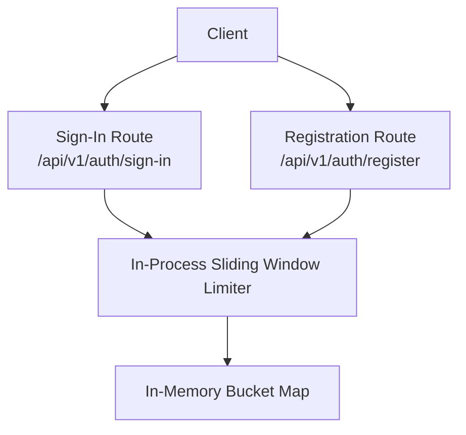
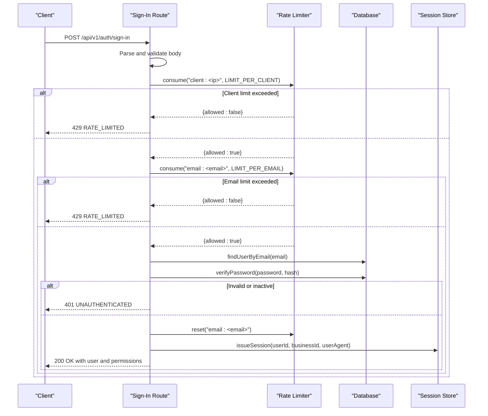
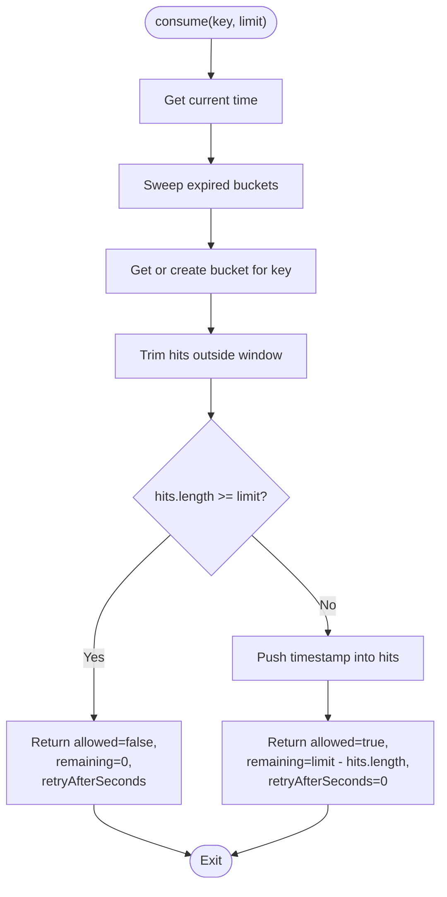
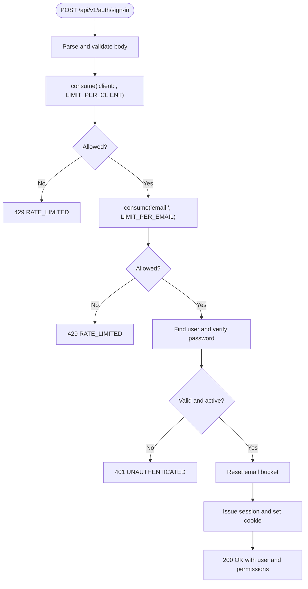
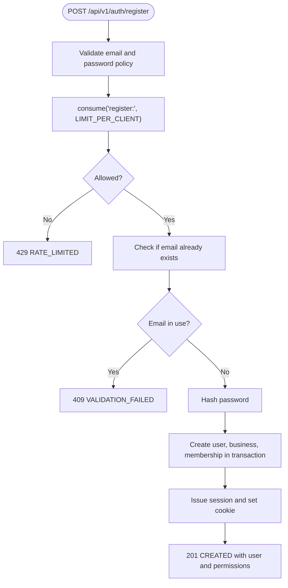
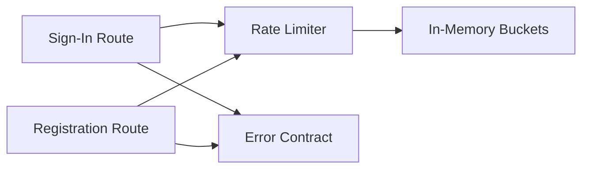

# Rate Limiting & Security

<cite>
**Referenced Files in This Document**
- [rate-limit.ts](file://src/server/auth/rate-limit.ts)
- [sign-in route.ts](file://src/app/api/v1/auth/sign-in/route.ts)
- [register route.ts](file://src/app/api/v1/auth/register/route.ts)
- [errors.ts](file://src/lib/errors.ts)
- [auth.test.ts](file://tests/auth.test.ts)
</cite>

## Table of Contents
1. [Introduction](#introduction)
2. [Project Structure](#project-structure)
3. [Core Components](#core-components)
4. [Architecture Overview](#architecture-overview)
5. [Detailed Component Analysis](#detailed-component-analysis)
6. [Dependency Analysis](#dependency-analysis)
7. [Performance Considerations](#performance-considerations)
8. [Troubleshooting Guide](#troubleshooting-guide)
9. [Conclusion](#conclusion)

## Introduction
This document explains the rate limiting and security measures used by Daftari’s authentication system to prevent brute force attacks, credential stuffing, and API abuse. It covers the sliding-window algorithm, per-client and per-email throttling, error handling for rate limit exceeded responses, and guidance for extending rate limiting to other sensitive endpoints. It also documents current limitations around distributed deployments and provides recommendations for monitoring and bypass prevention.

## Project Structure
The authentication rate limiting implementation is split between a shared in-process limiter and the specific API routes that protect sign-in and registration:

- Shared limiter: `src/server/auth/rate-limit.ts`
- Sign-in endpoint: `src/app/api/v1/auth/sign-in/route.ts`
- Registration endpoint: `src/app/api/v1/auth/register/route.ts`
- Error contract and response formatting: `src/lib/errors.ts`
- Tests validating limiter behavior: `tests/auth.test.ts`

**Diagram sources**
- [sign-in route.ts:35-87](file://src/app/api/v1/auth/sign-in/route.ts#L35-L87)
- [register route.ts:47-126](file://src/app/api/v1/auth/register/route.ts#L47-L126)
- [rate-limit.ts:43-63](file://src/server/auth/rate-limit.ts#L43-L63)

**Section sources**
- [rate-limit.ts:1-91](file://src/server/auth/rate-limit.ts#L1-L91)
- [sign-in route.ts:1-87](file://src/app/api/v1/auth/sign-in/route.ts#L1-L87)
- [register route.ts:1-126](file://src/app/api/v1/auth/register/route.ts#L1-L126)
- [errors.ts:1-130](file://src/lib/errors.ts#L1-L130)
- [auth.test.ts:139-168](file://tests/auth.test.ts#L139-L168)

## Core Components
- In-process sliding-window rate limiter: tracks request timestamps per key within a fixed window and enforces limits.
- Client identity extraction: derives a best-effort client identifier from proxy headers.
- Endpoint-specific limits: sign-in applies both per-client and per-email limits; registration applies a per-client limit.
- Uniform error handling: rate-limited requests return a consistent 429 response with a stable error code.

Key responsibilities:
- `consume(key, limit)` records an attempt and returns whether it is allowed, remaining budget, and retry-after seconds.
- `clientKeyFrom(request)` extracts a client IP-like key from trusted proxy headers.
- `reset(key)` clears a bucket after successful sign-in so legitimate users are not permanently penalized.

**Section sources**
- [rate-limit.ts:12-91](file://src/server/auth/rate-limit.ts#L12-L91)
- [sign-in route.ts:26-52](file://src/app/api/v1/auth/sign-in/route.ts#L26-L52)
- [register route.ts:32-66](file://src/app/api/v1/auth/register/route.ts#L32-L66)
- [errors.ts:8-28](file://src/lib/errors.ts#L8-L28)

## Architecture Overview
The authentication flow integrates rate limiting before expensive operations such as database lookups and password verification. The design ensures uniform failure messages to avoid leaking account existence or which factor triggered the limit.

**Diagram sources**
- [sign-in route.ts:35-87](file://src/app/api/v1/auth/sign-in/route.ts#L35-L87)
- [rate-limit.ts:43-63](file://src/server/auth/rate-limit.ts#L43-L63)

## Detailed Component Analysis

### Sliding Window Rate Limiter
The limiter uses an in-memory map of buckets, where each bucket stores timestamps of recent hits. A background sweep periodically removes expired entries to prevent unbounded growth.

Algorithm highlights:
- Fixed time window: 15 minutes.
- Per-key tracking: each key (for example, `client:<ip>` or `email:<email>`) has its own bucket.
- Consumption semantics: only actual attempts consume a slot; page views do not.
- Retry guidance: when denied, the response includes a calculated retry-after value based on the oldest hit in the window.

**Diagram sources**
- [rate-limit.ts:20-63](file://src/server/auth/rate-limit.ts#L20-L63)

Security considerations:
- Single-instance scope: this limiter protects one process. For multi-instance deployments, move the store to a shared backend such as Redis or Neon.
- Best-effort client identity: client keys come from proxy headers and can be forged outside a trusted proxy; they should not influence authorization decisions.
- Uniform rejections: rate-limited responses do not reveal which factor failed.

Operational notes:
- Sweep interval: every 5 minutes, expired buckets are pruned.
- Test seams: `resetAll()` clears all state for tests.

**Section sources**
- [rate-limit.ts:1-91](file://src/server/auth/rate-limit.ts#L1-L91)
- [auth.test.ts:139-168](file://tests/auth.test.ts#L139-L168)

### Sign-In Endpoint Rate Limiting
The sign-in endpoint enforces two layers of protection:
- Per-client limit: prevents a single source from overwhelming the endpoint.
- Per-email limit: prevents rapid guessing against a specific account.

Behavior:
- Body parsing and validation occur before any rate-limit checks.
- If either limit is exceeded, the endpoint returns a 429 with a stable message and error code.
- On success, the email-based bucket is reset so legitimate users start fresh.
- Failure paths are uniform across unknown accounts, wrong passwords, and disabled accounts to avoid enumeration.

**Diagram sources**
- [sign-in route.ts:35-87](file://src/app/api/v1/auth/sign-in/route.ts#L35-L87)
- [errors.ts:8-28](file://src/lib/errors.ts#L8-L28)

Configurable limits:
- Per-client limit: configured locally in the route file.
- Per-email limit: configured locally in the route file.

Error handling:
- Rate-limited responses use a dedicated error code and a generic message.
- Authentication failures return a uniform 401 without revealing why.

**Section sources**
- [sign-in route.ts:26-87](file://src/app/api/v1/auth/sign-in/route.ts#L26-L87)
- [errors.ts:8-28](file://src/lib/errors.ts#L8-L28)

### Registration Endpoint Rate Limiting
Registration is protected by a per-client limit to prevent bulk account creation.

Behavior:
- Validates email shape and password policy before checking rate limits.
- Applies a per-client rate limit using the same sliding-window limiter.
- Checks for duplicate emails both before and inside the transaction to ensure consistency under concurrency.
- Returns a 429 when the client exceeds the registration limit.

**Diagram sources**
- [register route.ts:47-126](file://src/app/api/v1/auth/register/route.ts#L47-L126)

Configurable limits:
- Per-client registration limit: configured locally in the route file.

Security considerations:
- Password hashing occurs before opening the database transaction to avoid holding pooled connections during slow cryptographic work.
- Duplicate email checks are performed twice to handle concurrent registrations safely.

**Section sources**
- [register route.ts:32-126](file://src/app/api/v1/auth/register/route.ts#L32-L126)

### Error Handling and Responses
Rate-limited requests are represented through a structured error type:
- Status code: 429
- Error code: `RATE_LIMITED`
- Message: a stable, non-revealing message
- Optional details: included when present

This approach ensures clients receive consistent responses and avoids leaking internal state.

**Section sources**
- [errors.ts:8-28](file://src/lib/errors.ts#L8-L28)
- [errors.ts:96-130](file://src/lib/errors.ts#L96-L130)

## Dependency Analysis
The authentication endpoints depend on the shared rate limiter and the application error contract.

**Diagram sources**
- [sign-in route.ts:13-24](file://src/app/api/v1/auth/sign-in/route.ts#L13-L24)
- [register route.ts:14-30](file://src/app/api/v1/auth/register/route.ts#L14-L30)
- [rate-limit.ts:12-14](file://src/server/auth/rate-limit.ts#L12-L14)
- [errors.ts:8-28](file://src/lib/errors.ts#L8-L28)

Coupling and cohesion:
- The limiter is cohesive and reusable across credential endpoints.
- Routes encapsulate endpoint-specific limits and orchestrate limiter calls.
- Error types centralize response structure and codes.

Potential circular dependencies:
- None observed among these modules; imports are directional from routes to limiter and errors.

External integration points:
- Database accessors for user lookup and session issuance.
- Proxy headers for client identity derivation.

**Section sources**
- [sign-in route.ts:13-24](file://src/app/api/v1/auth/sign-in/route.ts#L13-L24)
- [register route.ts:14-30](file://src/app/api/v1/auth/register/route.ts#L14-L30)
- [rate-limit.ts:65-80](file://src/server/auth/rate-limit.ts#L65-L80)

## Performance Considerations
- Sliding window with timestamp arrays: simple and effective for moderate traffic; memory usage grows with the number of active keys and their hit counts.
- Periodic sweep: reduces memory pressure by removing expired buckets at intervals.
- Avoid counting benign requests: only actual attempts consume a slot to prevent refresh loops from locking out users.
- Password hashing cost: registration hashes before opening transactions to minimize connection hold times.

Optimization opportunities:
- Replace in-memory storage with a shared backend for multi-instance deployments.
- Consider token bucket algorithms for smoother throttling if burst patterns require finer control.
- Add metrics and counters for rate limit hits to support observability and tuning.

[No sources needed since this section provides general guidance]

## Troubleshooting Guide
Common issues and resolutions:
- Clients repeatedly receiving 429:
  - Verify whether the per-client or per-email limit was exceeded.
  - Inspect retry-after values returned by the limiter.
  - Ensure legitimate users are not being blocked by aggressive limits.
- Multi-instance deployments still seeing bursts:
  - The current limiter is process-local; distribute state to a shared store.
- Suspicious activity detection:
  - Monitor spikes in 429 responses and correlate with client IPs and targeted emails.
  - Alert on repeated failures across many emails from the same client.

Validation references:
- Tests assert that limits allow up to the configured count and refuse subsequent attempts.
- Tests confirm independent budgets per identity and reset behavior after successful sign-in.

**Section sources**
- [auth.test.ts:139-168](file://tests/auth.test.ts#L139-L168)

## Conclusion
Daftari’s authentication system implements a focused, secure rate limiting strategy for sign-in and registration:
- A sliding-window limiter protects against brute force and credential stuffing.
- Per-client and per-email controls provide layered defense.
- Uniform error responses reduce information leakage.
- The current implementation is process-local and should be extended to a shared backend for distributed environments.

For production hardening:
- Move limiter state to a distributed store.
- Centralize configurable limits and expose them through configuration.
- Enhance observability with metrics and alerts for suspicious patterns.
- Extend rate limiting to other sensitive endpoints following the established patterns.

[No sources needed since this section summarizes without analyzing specific files]