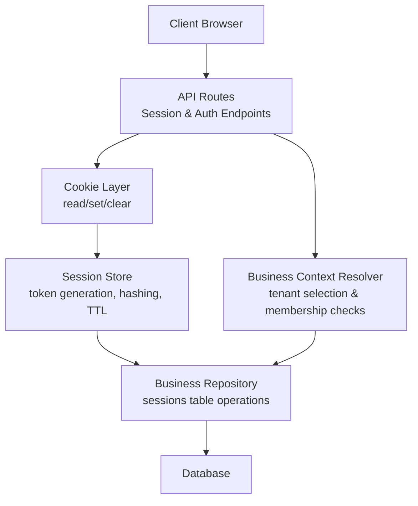
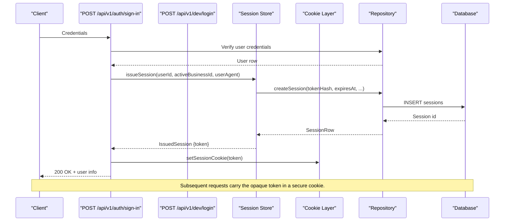
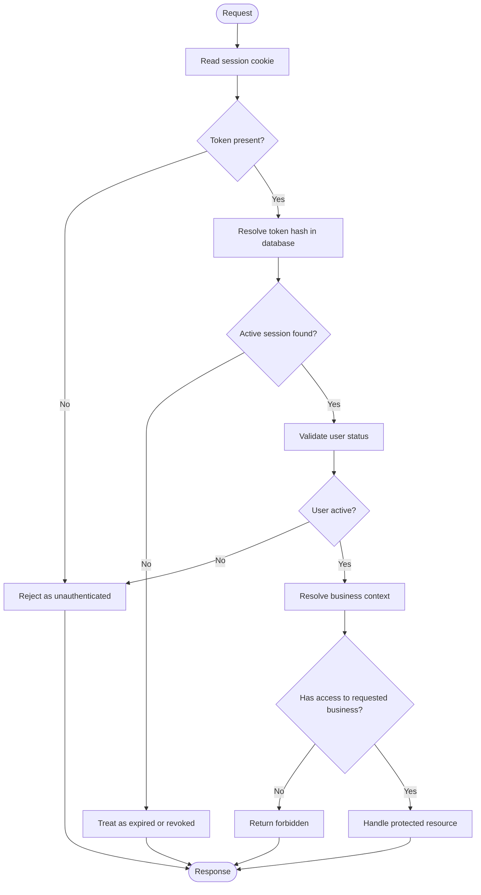
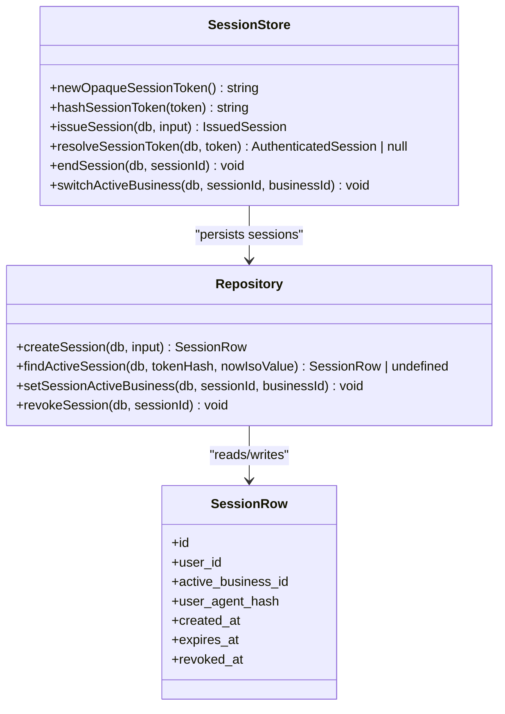
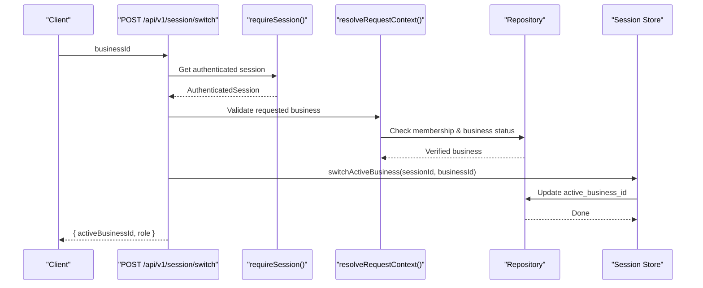
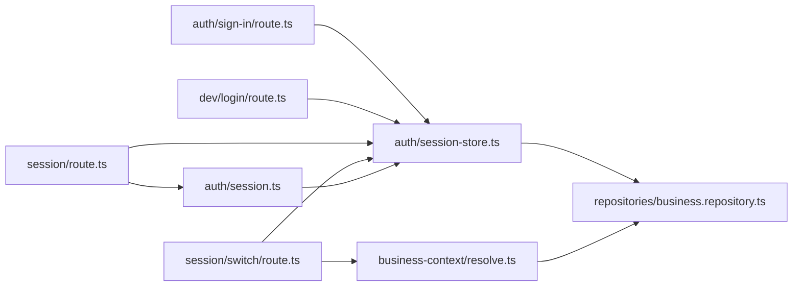

# Session Management

<cite>
**Referenced Files in This Document**
- [session-store.ts](file://src/server/auth/session-store.ts)
- [session.ts](file://src/server/auth/session.ts)
- [route.ts](file://src/app/api/v1/session/route.ts)
- [switch/route.ts](file://src/app/api/v1/session/switch/route.ts)
- [sign-in/route.ts](file://src/app/api/v1/auth/sign-in/route.ts)
- [dev/login/route.ts](file://src/app/api/v1/dev/login/route.ts)
- [resolve.ts](file://src/server/business-context/resolve.ts)
- [business.repository.ts](file://src/server/repositories/business.repository.ts)
- [env.ts](file://src/server/config/env.ts)
- [session.test.ts](file://tests/session.test.ts)
</cite>

## Table of Contents
1. [Introduction](#introduction)
2. [Project Structure](#project-structure)
3. [Core Components](#core-components)
4. [Architecture Overview](#architecture-overview)
5. [Detailed Component Analysis](#detailed-component-analysis)
6. [Dependency Analysis](#dependency-analysis)
7. [Performance Considerations](#performance-considerations)
8. [Troubleshooting Guide](#troubleshooting-guide)
9. [Conclusion](#conclusion)

## Introduction
This document explains Daftari’s session management system. It covers the complete session lifecycle from creation through validation to expiration, the secure storage model, cookie handling, authentication flows, and how sessions integrate with multi-tenant business context resolution. It also documents configuration options, security considerations such as session fixation prevention and safe logout behavior, and provides examples for API routes and middleware-style usage.

## Project Structure
The session system is split into three layers:
- HTTP boundary: Next.js route handlers that read or write cookies and expose session endpoints.
- Session contract: A framework-free store that generates tokens, hashes them, persists sessions, and resolves active sessions.
- Persistence layer: Database repository functions that create, find, update, and revoke sessions.

**Diagram sources**
- [route.ts:17-38](file://src/app/api/v1/session/route.ts#L17-L38)
- [switch/route.ts:15-29](file://src/app/api/v1/session/switch/route.ts#L15-L29)
- [sign-in/route.ts:35-86](file://src/app/api/v1/auth/sign-in/route.ts#L35-L86)
- [dev/login/route.ts:34-76](file://src/app/api/v1/dev/login/route.ts#L34-L76)
- [session.ts:40-68](file://src/server/auth/session.ts#L40-L68)
- [session-store.ts:41-104](file://src/server/auth/session-store.ts#L41-L104)
- [business.repository.ts:361-412](file://src/server/repositories/business.repository.ts#L361-L412)
- [resolve.ts:73-108](file://src/server/business-context/resolve.ts#L73-L108)

**Section sources**
- [session-store.ts:1-104](file://src/server/auth/session-store.ts#L1-L104)
- [session.ts:1-68](file://src/server/auth/session.ts#L1-L68)
- [route.ts:1-39](file://src/app/api/v1/session/route.ts#L1-L39)
- [switch/route.ts:1-31](file://src/app/api/v1/session/switch/route.ts#L1-L31)
- [sign-in/route.ts:1-87](file://src/app/api/v1/auth/sign-in/route.ts#L1-L87)
- [dev/login/route.ts:1-77](file://src/app/api/v1/dev/login/route.ts#L1-L77)
- [resolve.ts:1-152](file://src/server/business-context/resolve.ts#L1-L152)
- [business.repository.ts:361-412](file://src/server/repositories/business.repository.ts#L361-L412)

## Core Components
- Session store: Generates opaque random tokens, hashes them before persistence, sets expiry, and supports revocation and active-business switching.
- Cookie layer: Reads, writes, and clears the session cookie using Next.js headers utilities.
- Authentication routes: Create sessions after successful credential verification or development login.
- Session endpoints: Provide current session info and sign-out.
- Business context resolver: Validates tenant access and selects an active business per request.
- Repository: Persists sessions and enforces active/expired/revoked state at query time.

Key responsibilities:
- Token generation and hashing: Prevents storing raw secrets in the database.
- Secure cookie settings: HTTP-only, SameSite lax, production secure flag.
- Expiration enforcement: Database queries reject expired rows.
- Revocation support: Immediate invalidation on logout.
- Multi-tenant integration: Active business stored in session and validated on every request.

**Section sources**
- [session-store.ts:21-104](file://src/server/auth/session-store.ts#L21-L104)
- [session.ts:40-68](file://src/server/auth/session.ts#L40-L68)
- [business.repository.ts:361-412](file://src/server/repositories/business.repository.ts#L361-L412)

## Architecture Overview
The session architecture separates concerns between HTTP boundaries, token policy, and persistence. The cookie holds a short-lived opaque bearer token; only its hash is persisted. Each request validates the token against the database and resolves the authenticated user and their accessible businesses.

**Diagram sources**
- [sign-in/route.ts:35-86](file://src/app/api/v1/auth/sign-in/route.ts#L35-L86)
- [dev/login/route.ts:34-76](file://src/app/api/v1/dev/login/route.ts#L34-L76)
- [session-store.ts:67-81](file://src/server/auth/session-store.ts#L67-L81)
- [business.repository.ts:361-388](file://src/server/repositories/business.repository.ts#L361-L388)
- [session.ts:45-48](file://src/server/auth/session.ts#L45-L48)

## Detailed Component Analysis

### Session Lifecycle
The lifecycle consists of creation, validation, optional switching, and termination.

**Diagram sources**
- [session.ts:55-68](file://src/server/auth/session.ts#L55-L68)
- [session-store.ts:89-96](file://src/server/auth/session-store.ts#L89-L96)
- [resolve.ts:73-108](file://src/server/business-context/resolve.ts#L73-L108)

#### Creation
- Credential sign-in:
  - Validates email/password with rate limiting.
  - Resolves accessible businesses and picks a default active business.
  - Issues a session with an opaque token and stores it in a secure cookie.
- Development login:
  - Creates or reuses a local developer account and optionally creates a business.
  - Issues a session and sets the cookie.

**Section sources**
- [sign-in/route.ts:35-86](file://src/app/api/v1/auth/sign-in/route.ts#L35-L86)
- [dev/login/route.ts:34-76](file://src/app/api/v1/dev/login/route.ts#L34-L76)
- [session-store.ts:67-81](file://src/server/auth/session-store.ts#L67-L81)

#### Validation
- On each request:
  - Read the session cookie.
  - Hash the token and look up an active, non-expired session.
  - Ensure the associated user is active.
  - Optionally resolve business context and verify membership.

**Section sources**
- [session.ts:55-68](file://src/server/auth/session.ts#L55-L68)
- [session-store.ts:89-96](file://src/server/auth/session-store.ts#L89-L96)
- [resolve.ts:73-108](file://src/server/business-context/resolve.ts#L73-L108)

#### Switching Active Business
- Endpoint verifies the user has access to the target business before updating the session’s active business.
- Returns updated role and active business identifier.

**Section sources**
- [switch/route.ts:15-29](file://src/app/api/v1/session/switch/route.ts#L15-L29)
- [business.repository.ts:403-405](file://src/server/repositories/business.repository.ts#L403-L405)

#### Termination
- Sign-out revokes the session in the database and clears the cookie.
- After revocation, the session cannot be resolved again.

**Section sources**
- [route.ts:33-38](file://src/app/api/v1/session/route.ts#L33-L38)
- [session-store.ts:98-100](file://src/server/auth/session-store.ts#L98-L100)
- [business.repository.ts:407-412](file://src/server/repositories/business.repository.ts#L407-L412)

### Session Storage Mechanism
- Tokens are generated as cryptographically random base64url strings.
- Only the SHA-256 hash of the token is stored in the database.
- Sessions include:
  - User identifier.
  - Active business identifier (nullable).
  - Optional hashed user agent.
  - Expiration timestamp.
  - Revocation timestamp.
- Lookup rejects revoked or expired sessions.

**Diagram sources**
- [session-store.ts:41-104](file://src/server/auth/session-store.ts#L41-L104)
- [business.repository.ts:361-412](file://src/server/repositories/business.repository.ts#L361-L412)

**Section sources**
- [session-store.ts:41-104](file://src/server/auth/session-store.ts#L41-L104)
- [business.repository.ts:361-412](file://src/server/repositories/business.repository.ts#L361-L412)

### Cookie Handling
- Cookie name: `daftari_session`.
- Options:
  - HTTP-only enabled.
  - SameSite lax.
  - Secure flag enabled in production.
  - Path set to root.
  - MaxAge derived from session TTL.
- Functions:
  - Read token from cookie.
  - Set token with TTL.
  - Clear token by setting empty value and zero max age.

**Section sources**
- [session-store.ts:21-58](file://src/server/auth/session-store.ts#L21-L58)
- [session.ts:40-53](file://src/server/auth/session.ts#L40-L53)

### Configuration Options
- Session TTL:
  - Default lifetime is 14 days in milliseconds and seconds constants.
  - Used when setting the cookie max age.
- Development login:
  - Disabled in production regardless of environment variables.
  - Local development can enable via environment variable unless explicitly disabled.
- Cookie security:
  - Production secure flag toggled based on environment.
- Other runtime configuration:
  - Provider selection and other integrations are configured via environment variables, but session-specific behavior is primarily controlled by the constants and flags above.

**Section sources**
- [session-store.ts:21-39](file://src/server/auth/session-store.ts#L21-L39)
- [env.ts:1-184](file://src/server/config/env.ts#L1-L184)

### Examples of Session Manipulation

#### Reading the Current Session
- Use the required-session helper to enforce authentication and receive the authenticated session object including the database handle, user, and session metadata.

**Section sources**
- [session.ts:55-62](file://src/server/auth/session.ts#L55-L62)
- [route.ts:17-31](file://src/app/api/v1/session/route.ts#L17-L31)

#### Signing Out
- Call the session delete endpoint to revoke the session and clear the cookie.

**Section sources**
- [route.ts:33-38](file://src/app/api/v1/session/route.ts#L33-L38)

#### Switching Active Business
- POST to the switch endpoint with a validated business ID; the server verifies membership before updating the session.

**Section sources**
- [switch/route.ts:15-29](file://src/app/api/v1/session/switch/route.ts#L15-L29)

#### Creating a Session During Authentication
- Credential sign-in flow issues a session and sets the cookie after verifying credentials and resolving accessible businesses.

**Section sources**
- [sign-in/route.ts:35-86](file://src/app/api/v1/auth/sign-in/route.ts#L35-L86)

### Security Considerations

- Session fixation prevention:
  - New opaque tokens are generated on each successful authentication.
  - The cookie contains only the opaque token; the database stores only its hash.
  - Tests assert that the issued token differs from the session row ID and that the raw token is never stored.

- CSRF protection:
  - Cookies are HTTP-only and SameSite lax, reducing exposure to client scripts and cross-site requests.
  - For sensitive mutations, consider adding CSRF defenses appropriate to your deployment (e.g., double-submit cookies or origin checks), especially if you change SameSite to strict or allow cross-site scenarios.

- Proper session cleanup:
  - Logout revokes the session immediately and clears the cookie.
  - Expired sessions are rejected by database queries.
  - Rejected or expired sessions cannot be resolved again.

- Rate limiting on authentication:
  - Sign-in endpoint applies per-client and per-email limits to mitigate brute-force attempts.

- Uniform failure responses:
  - Authentication failures return consistent errors without revealing whether an account exists.

**Section sources**
- [session-store.ts:41-48](file://src/server/auth/session-store.ts#L41-L48)
- [session-store.ts:98-104](file://src/server/auth/session-store.ts#L98-L104)
- [session.test.ts:17-84](file://tests/session.test.ts#L17-L84)
- [sign-in/route.ts:26-52](file://src/app/api/v1/auth/sign-in/route.ts#L26-L52)
- [sign-in/route.ts:54-66](file://src/app/api/v1/auth/sign-in/route.ts#L54-L66)

### Relationship Between Sessions and Multi-Tenant Business Context
- Sessions store an active business identifier, which can be null initially.
- Business context resolution:
  - Accepts a requested business ID from headers or explicit parameters.
  - Falls back to the session’s active business.
  - Falls back to the first accessible business.
  - Verifies membership and business status on every request.
- Switching active business updates the session record after verifying access.

**Diagram sources**
- [switch/route.ts:15-29](file://src/app/api/v1/session/switch/route.ts#L15-L29)
- [resolve.ts:73-108](file://src/server/business-context/resolve.ts#L73-L108)
- [business.repository.ts:403-405](file://src/server/repositories/business.repository.ts#L403-L405)

**Section sources**
- [resolve.ts:37-108](file://src/server/business-context/resolve.ts#L37-L108)
- [switch/route.ts:15-29](file://src/app/api/v1/session/switch/route.ts#L15-L29)
- [business.repository.ts:403-405](file://src/server/repositories/business.repository.ts#L403-L405)

## Dependency Analysis
The following diagram shows key dependencies among modules involved in session management.

**Diagram sources**
- [sign-in/route.ts:13-24](file://src/app/api/v1/auth/sign-in/route.ts#L13-L24)
- [dev/login/route.ts:10-24](file://src/app/api/v1/dev/login/route.ts#L10-L24)
- [route.ts:10-15](file://src/app/api/v1/session/route.ts#L10-L15)
- [switch/route.ts:8-13](file://src/app/api/v1/session/switch/route.ts#L8-L13)
- [session.ts:13-38](file://src/server/auth/session.ts#L13-L38)
- [session-store.ts:9-19](file://src/server/auth/session-store.ts#L9-L19)
- [resolve.ts:9-22](file://src/server/business-context/resolve.ts#L9-L22)
- [business.repository.ts:9-12](file://src/server/repositories/business.repository.ts#L9-L12)

**Section sources**
- [sign-in/route.ts:13-24](file://src/app/api/v1/auth/sign-in/route.ts#L13-L24)
- [dev/login/route.ts:10-24](file://src/app/api/v1/dev/login/route.ts#L10-L24)
- [route.ts:10-15](file://src/app/api/v1/session/route.ts#L10-L15)
- [switch/route.ts:8-13](file://src/app/api/v1/session/switch/route.ts#L8-L13)
- [session.ts:13-38](file://src/server/auth/session.ts#L13-L38)
- [session-store.ts:9-19](file://src/server/auth/session-store.ts#L9-L19)
- [resolve.ts:9-22](file://src/server/business-context/resolve.ts#L9-L22)
- [business.repository.ts:9-12](file://src/server/repositories/business.repository.ts#L9-L12)

## Performance Considerations
- Token hashing uses efficient cryptographic primitives; overhead is minimal compared to database I/O.
- Session lookup includes expiration checks at the database level, avoiding unnecessary application-side filtering.
- Using the same database connection from the resolved session reduces connection churn within a request.
- Rate limiting on sign-in prevents excessive password derivation work during attacks.

[No sources needed since this section provides general guidance]

## Troubleshooting Guide
Common issues and resolutions:
- Session not resolving:
  - Verify the cookie contains the opaque token and not the session row ID.
  - Confirm the token hash matches a non-revoked, non-expired session.
- Unexpected logout:
  - Check if the session was revoked or expired.
  - Ensure the user remains active.
- Cannot switch business:
  - Confirm the user has an active membership in the target business.
  - Verify the business itself is active.
- Development login disabled:
  - In production, dev login is always disabled.
  - In development, ensure the environment variable allows it.

**Section sources**
- [session.test.ts:17-84](file://tests/session.test.ts#L17-L84)
- [session-store.ts:36-39](file://src/server/auth/session-store.ts#L36-L39)
- [resolve.ts:91-106](file://src/server/business-context/resolve.ts#L91-L106)

## Conclusion
Daftari’s session management system emphasizes security and clarity:
- Opaque tokens with server-side hashing prevent secret leakage.
- Secure cookie defaults protect against client-side theft and cross-site misuse.
- Immediate revocation and strict expiration ensure sessions do not linger.
- Multi-tenant integrity is enforced on every request through membership and business status checks.
- The design cleanly separates HTTP boundaries, token policy, and persistence, making it straightforward to adapt to managed identity providers while preserving the same session contract.

[No sources needed since this section summarizes without analyzing specific files]