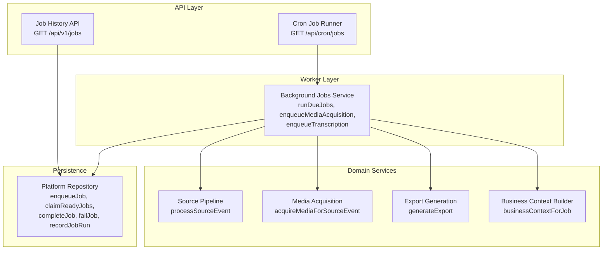
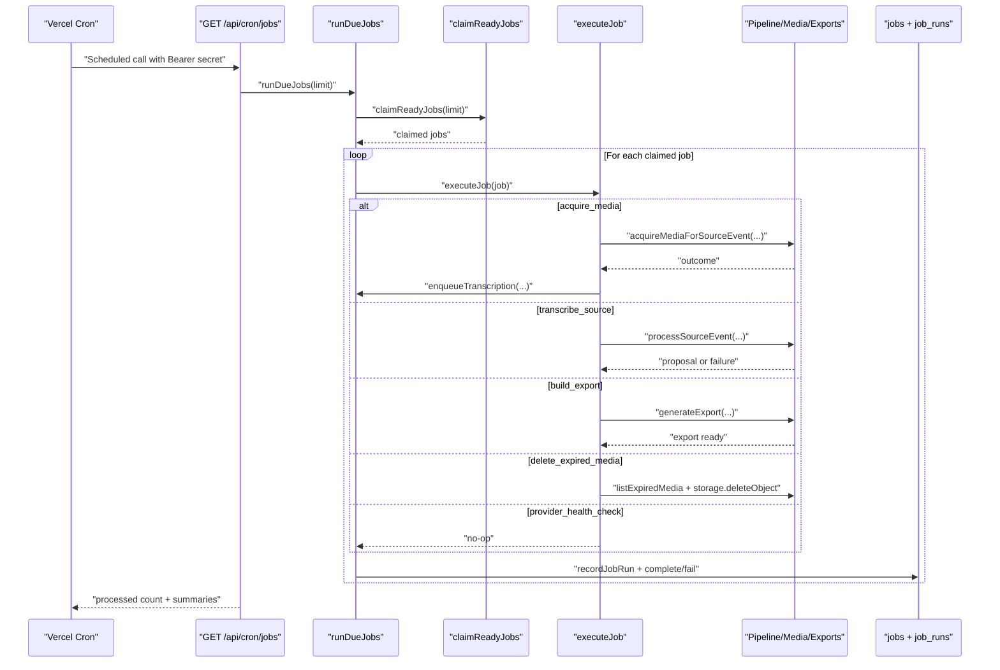
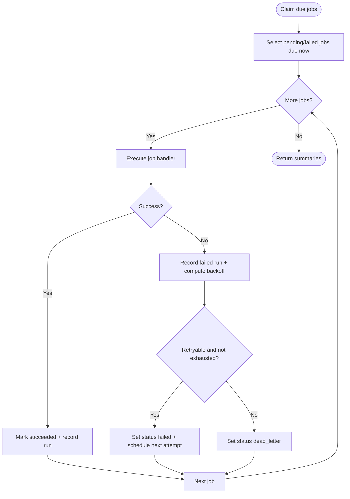
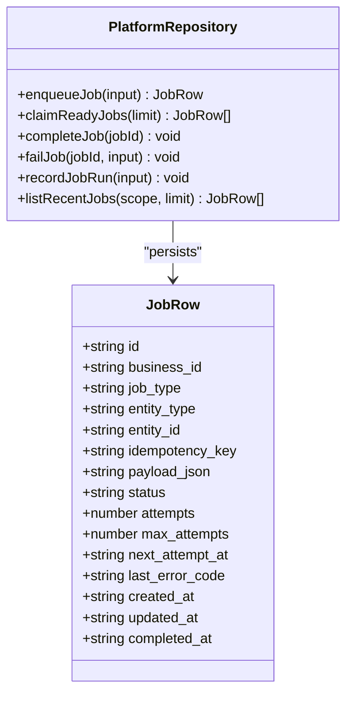
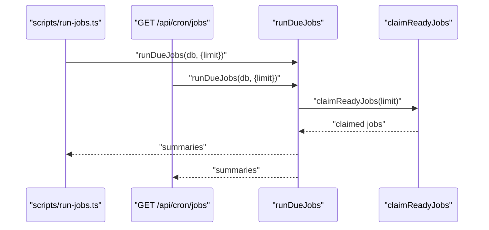
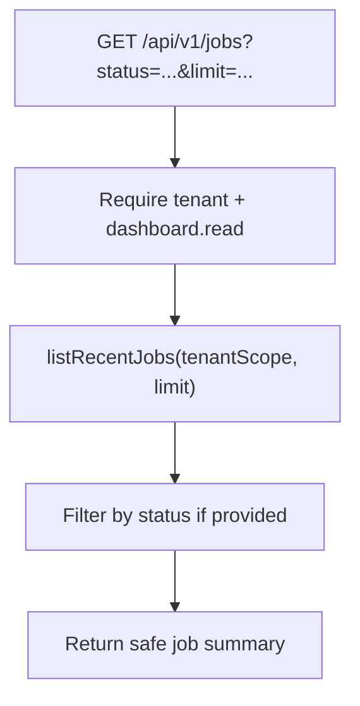
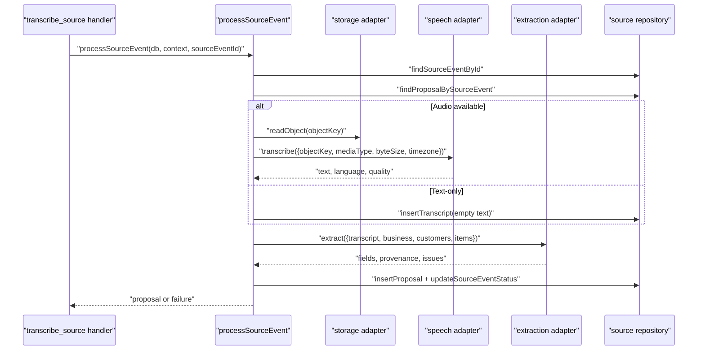
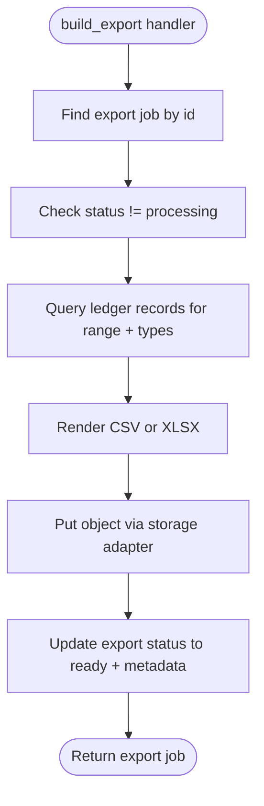
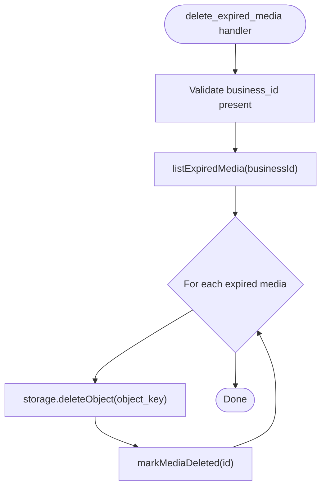
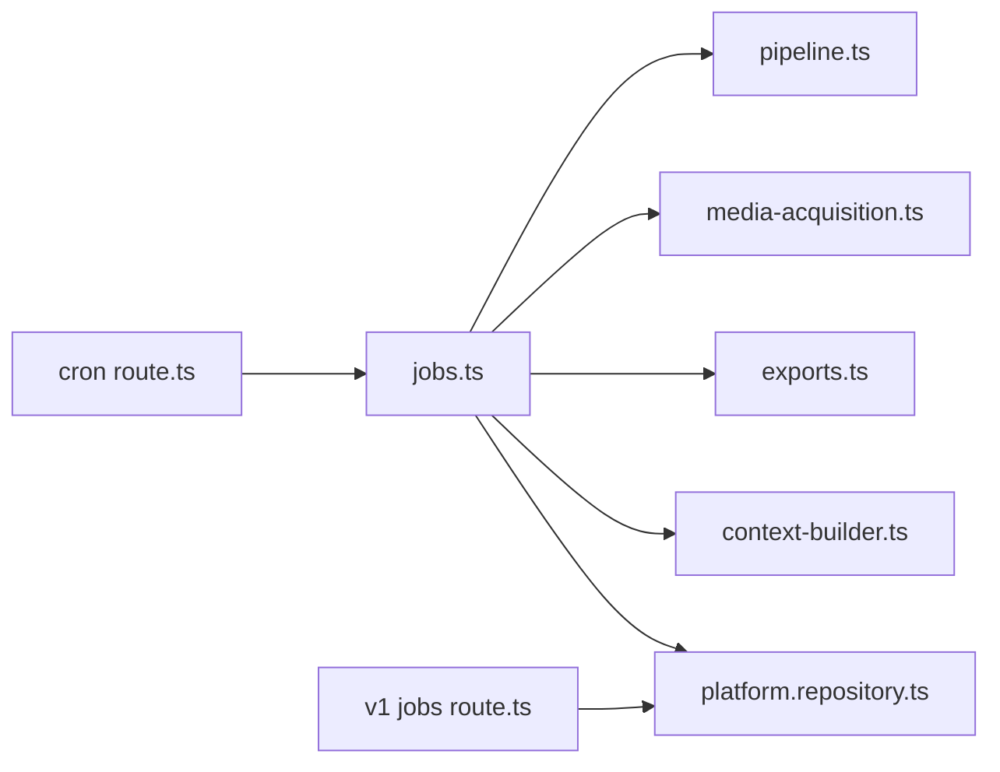

# Background Jobs Service

<cite>
**Referenced Files in This Document**
- [jobs.ts](file://src/server/services/jobs.ts)
- [platform.repository.ts](file://src/server/repositories/platform.repository.ts)
- [route.ts (cron jobs)](file://src/app/api/cron/jobs/route.ts)
- [route.ts (v1 jobs history)](file://src/app/api/v1/jobs/route.ts)
- [run-jobs.ts](file://scripts/run-jobs.ts)
- [pipeline.ts](file://src/server/services/pipeline.ts)
- [media-acquisition.ts](file://src/server/services/media-acquisition.ts)
- [exports.ts](file://src/server/services/exports.ts)
- [context-builder.ts](file://src/server/services/context-builder.ts)
- [types.ts](file://src/server/domain/types.ts)
- [logger.ts](file://src/server/observability/logger.ts)
</cite>

## Table of Contents
1. [Introduction](#introduction)
2. [Project Structure](#project-structure)
3. [Core Components](#core-components)
4. [Architecture Overview](#architecture-overview)
5. [Detailed Component Analysis](#detailed-component-analysis)
6. [Dependency Analysis](#dependency-analysis)
7. [Performance Considerations](#performance-considerations)
8. [Troubleshooting Guide](#troubleshooting-guide)
9. [Conclusion](#conclusion)

## Introduction
The background jobs service provides durable, asynchronous processing for the application. It turns business actions into queued work items, executes them through a retry-aware worker, and records outcomes for monitoring and debugging. The system supports media acquisition, transcription, export generation, retention cleanup, and provider health checks. It is designed to be idempotent, tenant-scoped, and observable, with exponential backoff for transient failures and dead-letter handling for unrecoverable tasks.

## Project Structure
The job system spans several layers:
- API routes expose scheduling and monitoring endpoints.
- A service layer implements job execution, retries, and orchestration.
- A repository layer persists jobs, runs, and related metadata.
- Domain types define supported job kinds and statuses.
- Supporting services handle transcription, media acquisition, exports, and context building.
- A development script drains the queue locally.

**Diagram sources**
- [route.ts (cron jobs):1-48](file://src/app/api/cron/jobs/route.ts#L1-L48)
- [route.ts (v1 jobs history):1-42](file://src/app/api/v1/jobs/route.ts#L1-L42)
- [jobs.ts:1-241](file://src/server/services/jobs.ts#L1-L241)
- [pipeline.ts:1-506](file://src/server/services/pipeline.ts#L1-L506)
- [media-acquisition.ts:1-102](file://src/server/services/media-acquisition.ts#L1-L102)
- [exports.ts:1-242](file://src/server/services/exports.ts#L1-L242)
- [context-builder.ts:1-44](file://src/server/services/context-builder.ts#L1-L44)
- [platform.repository.ts:1-491](file://src/server/repositories/platform.repository.ts#L1-L491)

**Section sources**
- [route.ts (cron jobs):1-48](file://src/app/api/cron/jobs/route.ts#L1-L48)
- [route.ts (v1 jobs history):1-42](file://src/app/api/v1/jobs/route.ts#L1-L42)
- [jobs.ts:1-241](file://src/server/services/jobs.ts#L1-L241)
- [platform.repository.ts:1-491](file://src/server/repositories/platform.repository.ts#L1-L491)

## Core Components
- Durable job runner: claims due jobs, executes handlers, records attempts, applies retry logic, and marks completed or dead-lettered jobs.
- Queue persistence: stores job metadata, status transitions, attempt counts, next-scheduled time, and run-level audit entries.
- Scheduling entry points: a cron endpoint for scheduled draining and a development script for local testing.
- Monitoring entry point: an operational API that returns recent job history without exposing sensitive payloads.
- Supported job types: media acquisition, source transcription, export building, expired media deletion, and provider health checks.

Key responsibilities:
- Idempotency by entity prevents duplicate work when delivery is at-least-once.
- Exponential backoff limits pressure on failing providers.
- Dead-lettering isolates unretryable or exhausted jobs.
- Tenant scoping ensures isolation between businesses.

**Section sources**
- [jobs.ts:1-241](file://src/server/services/jobs.ts#L1-L241)
- [platform.repository.ts:172-346](file://src/server/repositories/platform.repository.ts#L172-L346)
- [types.ts:113-126](file://src/server/domain/types.ts#L113-L126)

## Architecture Overview
The background job architecture follows a durable queue pattern backed by the database:

**Diagram sources**
- [route.ts (cron jobs):28-47](file://src/app/api/cron/jobs/route.ts#L28-L47)
- [jobs.ts:51-140](file://src/server/services/jobs.ts#L51-L140)
- [jobs.ts:195-207](file://src/server/services/jobs.ts#L195-L207)
- [platform.repository.ts:252-334](file://src/server/repositories/platform.repository.ts#L252-L334)
- [pipeline.ts:354-503](file://src/server/services/pipeline.ts#L354-L503)
- [media-acquisition.ts:42-101](file://src/server/services/media-acquisition.ts#L42-L101)
- [exports.ts:194-236](file://src/server/services/exports.ts#L194-L236)

## Detailed Component Analysis

### Job Runner and Execution Model
The job runner is responsible for claiming due jobs, executing their handlers, recording run details, and applying retry or dead-letter semantics.

Key behaviors:
- Claims jobs where status is pending or failed and next attempt time is due.
- Executes handler based on job type.
- Records every attempt with timing and error code.
- Completes successful jobs; fails or dead-letters unsuccessful ones.
- Supports per-job maximum attempts and exponential backoff.

**Diagram sources**
- [jobs.ts:142-193](file://src/server/services/jobs.ts#L142-L193)
- [platform.repository.ts:252-302](file://src/server/repositories/platform.repository.ts#L252-L302)

Supported job types and their responsibilities:
- `acquire_media`: Downloads provider-hosted media into private storage and enqueues transcription.
- `transcribe_source`: Runs the source-to-proposal pipeline, including transcription, extraction, validation, and proposal creation.
- `build_export`: Generates CSV or XLSX exports from confirmed ledger records and stores them under a private key.
- `delete_expired_media`: Deletes expired media objects and marks them deleted in the database.
- `provider_health_check`: Placeholder for provider connectivity checks; currently a no-op for mock adapters.

**Section sources**
- [jobs.ts:51-140](file://src/server/services/jobs.ts#L51-L140)
- [jobs.ts:195-241](file://src/server/services/jobs.ts#L195-L241)
- [types.ts:113-126](file://src/server/domain/types.ts#L113-L126)

### Queue Persistence and Concurrency Control
The platform repository manages the durable job queue:
- Enqueueing uses an idempotency key to prevent duplicates.
- Claiming selects due jobs and atomically flips status to running while incrementing attempts.
- Completion clears last error and sets completion timestamp.
- Failure computes backoff and either schedules retry or moves to dead letter.
- Run records capture attempt lifecycle metrics.

Concurrency characteristics:
- Atomic UPDATE prevents double-processing of the same job row.
- Limit parameter controls batch size per drain cycle.
- Backoff delays reduce load during provider outages.

**Diagram sources**
- [platform.repository.ts:174-346](file://src/server/repositories/platform.repository.ts#L174-L346)

**Section sources**
- [platform.repository.ts:197-235](file://src/server/repositories/platform.repository.ts#L197-L235)
- [platform.repository.ts:252-334](file://src/server/repositories/platform.repository.ts#L252-L334)

### Scheduling Entry Points
There are two primary ways to trigger job processing:

- Scheduled endpoint: `/api/cron/jobs` authenticates via a shared bearer token and drains due jobs up to a configurable limit. It logs dead-lettered jobs and returns processed counts and summaries.
- Development script: `scripts/run-jobs.ts` drains the queue in rounds until quiet or a round budget is reached, printing progress and exit codes when dead letters occur.

**Diagram sources**
- [run-jobs.ts:26-56](file://scripts/run-jobs.ts#L26-L56)
- [route.ts (cron jobs):28-47](file://src/app/api/cron/jobs/route.ts#L28-L47)
- [jobs.ts:195-207](file://src/server/services/jobs.ts#L195-L207)

**Section sources**
- [route.ts (cron jobs):1-48](file://src/app/api/cron/jobs/route.ts#L1-L48)
- [run-jobs.ts:1-57](file://scripts/run-jobs.ts#L1-L57)

### Monitoring and Logging
Operational visibility includes:
- Job history API: Returns recent jobs scoped to the current tenant, filtering by status, and excluding internal maintenance jobs. It exposes state, attempts, error codes, and timestamps without payloads.
- Structured logging: Central logger redacts sensitive keys and emits structured JSON lines with levels, service name, environment, and contextual fields such as jobId and errorCode.

**Diagram sources**
- [route.ts (v1 jobs history):17-41](file://src/app/api/v1/jobs/route.ts#L17-L41)
- [platform.repository.ts:241-250](file://src/server/repositories/platform.repository.ts#L241-L250)

Logging behavior:
- Job failures emit warnings with job identifiers, error codes, retryability, and attempt counts.
- Cron endpoint warns when dead letters appear in a batch.
- Pipeline success emits structured info about proposal creation.

**Section sources**
- [route.ts (v1 jobs history):1-42](file://src/app/api/v1/jobs/route.ts#L1-L42)
- [logger.ts:1-98](file://src/server/observability/logger.ts#L1-L98)
- [jobs.ts:179-191](file://src/server/services/jobs.ts#L179-L191)
- [route.ts (cron jobs):40-46](file://src/app/api/cron/jobs/route.ts#L40-L46)
- [pipeline.ts:495-502](file://src/server/services/pipeline.ts#L495-L502)

### Job Types and Processing Logic

#### Data Processing: Source Transcription and Proposal Creation
The transcription job invokes the pipeline, which:
- Loads the source event and checks for existing proposals.
- Reads or transcribes audio/text.
- Extracts business fields using the integration adapter.
- Validates fields and detects duplicates.
- Creates a reviewable proposal and updates source event status.
- Emits outbox events and audit records.

**Diagram sources**
- [jobs.ts:76-95](file://src/server/services/jobs.ts#L76-L95)
- [pipeline.ts:354-503](file://src/server/services/pipeline.ts#L354-L503)

**Section sources**
- [pipeline.ts:1-506](file://src/server/services/pipeline.ts#L1-L506)

#### Email Notifications
There is no dedicated email notification job type in the analyzed codebase. Outbox events are enqueued for downstream consumers, but email dispatch is not implemented here. If email notifications are required, they should follow the same durable queue pattern: enqueue a job with an idempotency key, implement a handler, and apply retry/dead-letter semantics.

[No sources needed since this section describes a gap rather than analyzing specific files]

#### File Conversions: Export Generation
Export jobs generate CSV or XLSX files from confirmed ledger records:
- Validation ensures date ranges and record types are allowed.
- The worker queries records within the requested range.
- Content is rendered and stored via the storage adapter.
- Export metadata is updated with object key, row count, byte size, and expiry.

**Diagram sources**
- [jobs.ts:113-128](file://src/server/services/jobs.ts#L113-L128)
- [exports.ts:194-236](file://src/server/services/exports.ts#L194-L236)

**Section sources**
- [exports.ts:1-242](file://src/server/services/exports.ts#L1-L242)

#### Scheduled Maintenance Tasks: Expired Media Deletion
Retention cleanup deletes expired media objects per business:
- Requires a valid business scope to avoid cross-tenant data access.
- Lists expired media and deletes corresponding storage objects.
- Marks media as deleted in the database.

**Diagram sources**
- [jobs.ts:96-112](file://src/server/services/jobs.ts#L96-L112)

**Section sources**
- [jobs.ts:96-112](file://src/server/services/jobs.ts#L96-L112)

### Method Signatures and Operations
Below are the primary operations exposed by the background jobs service and related components. These signatures describe inputs and outputs conceptually; see referenced files for exact TypeScript definitions.

- Create and enqueue a job:
  - Function: `enqueueJob`
  - Inputs: business identifier, job type, idempotency key, optional entity type/id, payload, optional max attempts, optional scheduled time
  - Output: persisted job row

- Claim due jobs:
  - Function: `claimReadyJobs`
  - Inputs: limit, optional timestamp override
  - Output: array of claimed job rows

- Complete a job:
  - Function: `completeJob`
  - Inputs: job id, optional provider correlation id
  - Output: void

- Fail a job:
  - Function: `failJob`
  - Inputs: job id, error code, retryable flag, attempts, max attempts
  - Output: void

- Record a job run:
  - Function: `recordJobRun`
  - Inputs: job id, attempt number, status, start/end times, duration, optional error code/provider request id
  - Output: void

- Run due jobs:
  - Function: `runDueJobs`
  - Inputs: database connection, options with limit
  - Output: array of job run summaries

- Enqueue media acquisition:
  - Function: `enqueueMediaAcquisition`
  - Inputs: database connection, business id, source event id
  - Output: void

- Enqueue transcription:
  - Function: `enqueueTranscription`
  - Inputs: database connection, business id, source event id
  - Output: void

- Process source event:
  - Function: `processSourceEvent`
  - Inputs: database connection, business context, source event id
  - Output: pipeline outcome (skipped, proposal, or failed)

- Acquire media:
  - Function: `acquireMediaForSourceEvent`
  - Inputs: database connection, business context, source event id
  - Output: acquisition outcome (acquired, already acquired, or failed)

- Generate export:
  - Function: `generateExport`
  - Inputs: database connection, business context, export id
  - Output: export job row

- Build business context for jobs:
  - Function: `businessContextForJob`
  - Inputs: database connection, business id
  - Output: business context

**Section sources**
- [platform.repository.ts:197-334](file://src/server/repositories/platform.repository.ts#L197-L334)
- [jobs.ts:195-241](file://src/server/services/jobs.ts#L195-L241)
- [pipeline.ts:354-503](file://src/server/services/pipeline.ts#L354-L503)
- [media-acquisition.ts:42-101](file://src/server/services/media-acquisition.ts#L42-L101)
- [exports.ts:194-236](file://src/server/services/exports.ts#L194-L236)
- [context-builder.ts:20-43](file://src/server/services/context-builder.ts#L20-L43)

### Concurrency Controls, Resource Allocation, and Scaling
- Batch control: `runDueJobs` accepts a limit to cap how many jobs are processed per drain cycle.
- Atomicity: Claiming jobs performs an atomic status flip and attempt increment, preventing duplicate execution.
- Backoff: Failed jobs use exponential backoff capped at a fixed interval, reducing pressure during provider outages.
- Idempotency: Handlers are keyed by entity to tolerate at-least-once delivery safely.
- Tenant isolation: All operations are scoped by business id; maintenance jobs require explicit tenant scoping.
- Scaling considerations:
  - Increase concurrency by running multiple workers or increasing the cron frequency.
  - Tune the limit parameter to balance throughput against resource usage.
  - Monitor dead-letter rates to detect persistent failures requiring manual intervention.
  - Separate long-running workloads (e.g., large exports) from short-lived tasks to avoid contention.

**Section sources**
- [jobs.ts:195-207](file://src/server/services/jobs.ts#L195-L207)
- [platform.repository.ts:252-302](file://src/server/repositories/platform.repository.ts#L252-L302)
- [route.ts (cron jobs):18-19](file://src/app/api/cron/jobs/route.ts#L18-L19)

### Common Job Patterns and Error Handling Strategies
- Media-first workflow: Enqueue media acquisition before transcription so transcripts are never built from missing assets.
- Idempotent handlers: Use entity-scoped idempotency keys to ensure repeated deliveries do not create duplicates.
- Provider errors: Wrap external calls with typed provider errors carrying retry flags; let the runner decide whether to retry or dead-letter.
- Audit trails: Record audit events for important state changes, especially transcript failures and proposal creation.
- Safe logging: Use the structured logger to avoid leaking sensitive data like transcripts, URLs, tokens, or customer names.

**Section sources**
- [jobs.ts:209-241](file://src/server/services/jobs.ts#L209-L241)
- [pipeline.ts:377-436](file://src/server/services/pipeline.ts#L377-L436)
- [logger.ts:26-38](file://src/server/observability/logger.ts#L26-L38)

### Debugging Techniques for Background Processing Issues
- Inspect job history: Use the job history API to filter by status and view attempts, error codes, and timestamps.
- Review run records: Check attempt-level durations and error codes to identify slow or failing steps.
- Reproduce locally: Run the development script to drain the queue and observe output, including dead-letter counts.
- Correlate logs: Use jobId and errorCode fields in logs to trace failures across components.
- Validate payloads: Ensure idempotency keys and entity references are correct; bad payloads are non-retryable.

**Section sources**
- [route.ts (v1 jobs history):17-41](file://src/app/api/v1/jobs/route.ts#L17-L41)
- [run-jobs.ts:26-56](file://scripts/run-jobs.ts#L26-L56)
- [jobs.ts:159-191](file://src/server/services/jobs.ts#L159-L191)

## Dependency Analysis
The background jobs service depends on domain services and repositories:

**Diagram sources**
- [jobs.ts:1-241](file://src/server/services/jobs.ts#L1-L241)
- [pipeline.ts:1-506](file://src/server/services/pipeline.ts#L1-L506)
- [media-acquisition.ts:1-102](file://src/server/services/media-acquisition.ts#L1-L102)
- [exports.ts:1-242](file://src/server/services/exports.ts#L1-L242)
- [context-builder.ts:1-44](file://src/server/services/context-builder.ts#L1-L44)
- [platform.repository.ts:1-491](file://src/server/repositories/platform.repository.ts#L1-L491)
- [route.ts (cron jobs):1-48](file://src/app/api/cron/jobs/route.ts#L1-L48)
- [route.ts (v1 jobs history):1-42](file://src/app/api/v1/jobs/route.ts#L1-L42)

Coupling and cohesion:
- The job runner is cohesive around execution and retry semantics.
- Dependencies are one-directional: services call repositories and integrations, avoiding cycles.
- Domain services encapsulate complex workflows (pipeline, media acquisition, exports), keeping the runner focused.

Potential circular dependencies:
- Ingestion and job handlers are intentionally decoupled to avoid import cycles.

External integration points:
- Storage adapter for media and export files.
- Speech adapter for transcription.
- Extraction adapter for field extraction.
- Database for durable queues and audit records.

**Section sources**
- [jobs.ts:1-241](file://src/server/services/jobs.ts#L1-L241)
- [platform.repository.ts:1-491](file://src/server/repositories/platform.repository.ts#L1-L491)

## Performance Considerations
- Batch sizing: Adjust the limit parameter to match workload characteristics and infrastructure capacity.
- Backoff strategy: Exponential backoff reduces load spikes during provider degradation.
- Idempotency: Prevents redundant work and protects downstream systems from duplication.
- I/O separation: Long-running file generation is offloaded to jobs, keeping API responses responsive.
- Observability: Structured logs and job run metrics enable performance tuning and bottleneck identification.

[No sources needed since this section provides general guidance]

## Troubleshooting Guide
Common issues and resolutions:
- Jobs stuck in pending:
  - Verify cron configuration and secret authentication.
  - Confirm the queue has due jobs and the limit is sufficient.
- Frequent failures:
  - Inspect error codes and retry flags.
  - Check provider availability and credentials.
  - Review backoff settings and consider increasing max attempts for transient issues.
- Dead-lettered jobs:
  - Investigate non-retryable errors or exhausted attempts.
  - Correct payload or business context issues and re-enqueue manually if appropriate.
- Missing media:
  - Ensure media acquisition ran successfully before transcription.
  - Validate provider media references and storage permissions.
- Export not downloadable:
  - Confirm export status is ready and object key exists.
  - Check expiration and signed link validity.

**Section sources**
- [route.ts (cron jobs):28-47](file://src/app/api/cron/jobs/route.ts#L28-L47)
- [jobs.ts:159-191](file://src/server/services/jobs.ts#L159-L191)
- [media-acquisition.ts:42-101](file://src/server/services/media-acquisition.ts#L42-L101)
- [exports.ts:194-236](file://src/server/services/exports.ts#L194-L236)

## Conclusion
The background jobs service provides a robust foundation for asynchronous processing in the application. It combines durable queuing, idempotent handlers, exponential backoff, and comprehensive observability to support high-volume, reliable workflows. By following the documented patterns for job creation, scheduling, and management, teams can extend the system with new job types while maintaining safety, scalability, and clarity.

[No sources needed since this section summarizes without analyzing specific files]