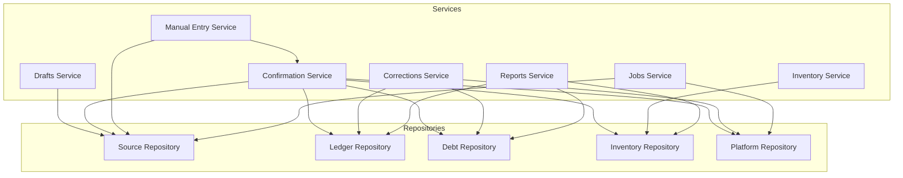
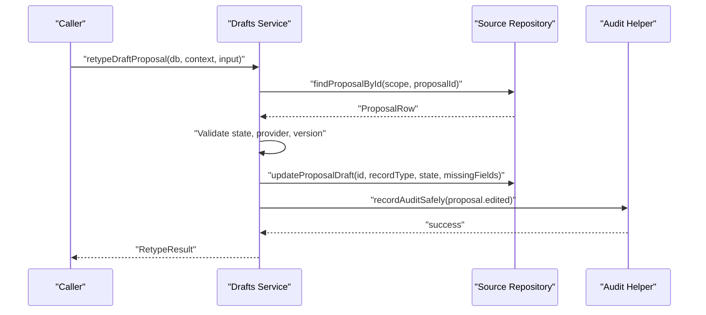
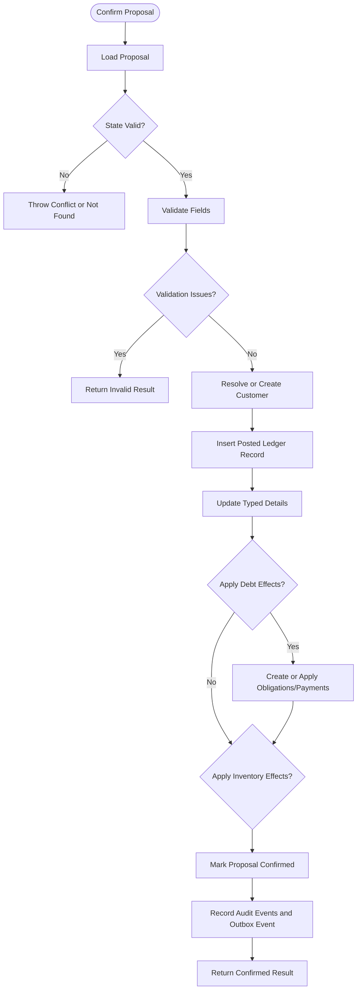
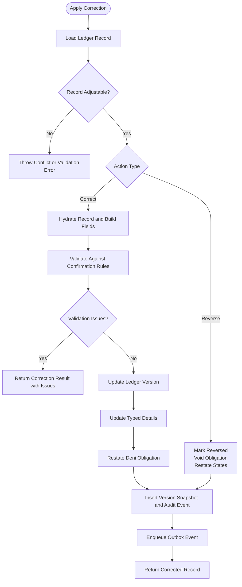
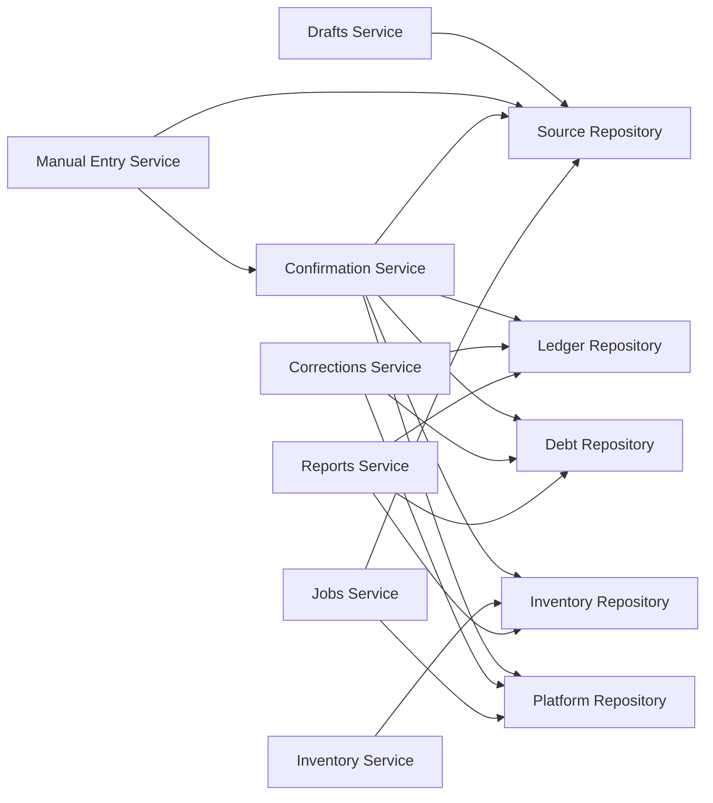

# Business Logic Services

<cite>
**Referenced Files in This Document**
- [drafts.ts](file://src/server/services/drafts.ts)
- [confirmation.ts](file://src/server/services/confirmation.ts)
- [corrections.ts](file://src/server/services/corrections.ts)
- [manual-entry.ts](file://src/server/services/manual-entry.ts)
- [inventory.ts](file://src/server/services/inventory.ts)
- [reports.ts](file://src/server/services/reports.ts)
- [jobs.ts](file://src/server/services/jobs.ts)
- [source.repository.ts](file://src/server/repositories/source.repository.ts)
- [ledger.repository.ts](file://src/server/repositories/ledger.repository.ts)
- [debt.repository.ts](file://src/server/repositories/debt.repository.ts)
- [inventory.repository.ts](file://src/server/repositories/inventory.repository.ts)
- [platform.repository.ts](file://src/server/repositories/platform.repository.ts)
- [proposal.ts](file://src/lib/validation/proposal.ts)
- [types.ts](file://src/server/domain/types.ts)
</cite>

## Table of Contents
1. [Introduction](#introduction)
2. [Project Structure](#project-structure)
3. [Core Components](#core-components)
4. [Architecture Overview](#architecture-overview)
5. [Detailed Component Analysis](#detailed-component-analysis)
6. [Dependency Analysis](#dependency-analysis)
7. [Performance Considerations](#performance-considerations)
8. [Troubleshooting Guide](#troubleshooting-guide)
9. [Conclusion](#conclusion)

## Introduction
This document explains the business logic services that implement core application functionality: draft management, proposal confirmation, record corrections and reversals, manual entry, inventory management, financial reporting, and durable background job processing. It focuses on validation rules, business constraints, error handling, method contracts, transaction boundaries, concurrency controls, side effects, service relationships, common workflows, performance characteristics, and testing guidance.

The system separates user-facing or workflow-oriented services from data access repositories. Services enforce domain invariants; repositories perform tenant-scoped database operations. Validation is centralized around typed proposal schemas so every path into the ledger follows the same rules.

## Project Structure
The relevant business logic lives under `src/server/services`. Each service encapsulates one area of responsibility and depends on shared repositories for persistence, a business context for tenant and feature scoping, and shared validation and domain types.

**Diagram sources**
- [drafts.ts:10-21](file://src/server/services/drafts.ts#L10-L21)
- [confirmation.ts:15-54](file://src/server/services/confirmation.ts#L15-L54)
- [corrections.ts:16-52](file://src/server/services/corrections.ts#L16-L52)
- [manual-entry.ts:10-17](file://src/server/services/manual-entry.ts#L10-L17)
- [inventory.ts:10-22](file://src/server/services/inventory.ts#L10-L22)
- [reports.ts:10-29](file://src/server/services/reports.ts#L10-L29)
- [jobs.ts:10-26](file://src/server/services/jobs.ts#L10-L26)

**Section sources**
- [drafts.ts:1-74](file://src/server/services/drafts.ts#L1-L74)
- [confirmation.ts:1-522](file://src/server/services/confirmation.ts#L1-L522)
- [corrections.ts:1-514](file://src/server/services/corrections.ts#L1-L514)
- [manual-entry.ts:1-116](file://src/server/services/manual-entry.ts#L1-L116)
- [inventory.ts:1-175](file://src/server/services/inventory.ts#L1-L175)
- [reports.ts:1-155](file://src/server/services/reports.ts#L1-L155)
- [jobs.ts:1-241](file://src/server/services/jobs.ts#L1-L241)

## Core Components
- **Drafts service**: Classifies an in-app recording draft by assigning a record type and recomputing missing fields before review.
- **Confirmation service**: The only path from a proposal to a posted ledger record. It enforces human decision, optimistic version checks, customer resolution, debt effects, optional inventory movement, audit logging, and outbox publishing inside a single transaction.
- **Corrections service**: Provides non-destructive corrections and reversals with versioned snapshots, obligation restatement, and consistent audit trails.
- **Manual entry service**: Lets a merchant directly create a proposal and immediately confirm it through the same validation and posting pipeline as reviewed input.
- **Inventory service**: Manages stock items and thresholds while keeping stock balances derived from confirmed movements.
- **Reports service**: Reads only posted records to compute cash summaries, trends, category totals, deni (receivables) summaries, and inventory summaries.
- **Jobs service**: Runs durable background jobs with atomic claiming, retryable failure handling, idempotency keys, and integration with media acquisition, transcription, export generation, and retention cleanup.

**Section sources**
- [drafts.ts:1-74](file://src/server/services/drafts.ts#L1-L74)
- [confirmation.ts:1-522](file://src/server/services/confirmation.ts#L1-L522)
- [corrections.ts:1-514](file://src/server/services/corrections.ts#L1-L514)
- [manual-entry.ts:1-116](file://src/server/services/manual-entry.ts#L1-L116)
- [inventory.ts:1-175](file://src/server/services/inventory.ts#L1-L175)
- [reports.ts:1-155](file://src/server/services/reports.ts#L1-L155)
- [jobs.ts:1-241](file://src/server/services/jobs.ts#L1-L241)

## Architecture Overview
The business layer follows a layered design:

- **Service layer**: Encapsulates workflows such as reclassifying drafts, confirming proposals, correcting records, creating manual entries, managing inventory, computing reports, and executing jobs.
- **Repository layer**: Performs tenant-scoped reads and writes against source events, transcripts, proposals, ledger records, debts, inventory, platform outbox, and jobs.
- **Validation layer**: Centralizes schema definitions and required-field checks for all record types.
- **Domain layer**: Defines stable enums and types for record types, statuses, proposal states, payment methods, movement types, job types, and audit actions.

**Diagram sources**
- [drafts.ts:35-73](file://src/server/services/drafts.ts#L35-L73)
- [source.repository.ts:662-678](file://src/server/repositories/source.repository.ts#L662-L678)
- [platform.repository.ts:52-103](file://src/server/repositories/platform.repository.ts#L52-L103)

## Detailed Component Analysis

### Drafts Service
The drafts service handles incomplete proposals produced by the in-app manual-draft adapter. Its main operation is reclassifying a draft by setting its record type, recomputing missing required fields, deriving the next proposal state, bumping the proposal version, and recording an audit event.

Key behaviors:
- Only proposals in reviewable states can be reclassified.
- Only proposals created by the manual-draft adapter can be retyped.
- An optimistic version check prevents stale reviewers from overwriting edits.
- Missing required fields determine whether the proposal moves to `needs_details` or `needs_review`.
- An audit event captures the previous and new record type, state, and missing fields.

Method contract:
- Function: `retypeDraftProposal`
- Parameters:
  - `db`: Database connection
  - `context`: Business context including `businessId`, `userId`, and feature flags
  - `input`: Object containing `proposalId`, `expectedVersion`, and `recordType`
- Return value: Promise resolving to `RetypeResult` with `recordType`, `state`, and `missingFields`
- Side effects:
  - Updates proposal draft fields and state
  - Bumps proposal version
  - Records an audit event
- Error handling:
  - Throws not found when the proposal does not exist
  - Throws conflict when the proposal is already decided or has changed versions
  - Throws validation failed when the proposal is not a manual draft

Common use cases:
- A reviewer opens a draft without a guessed type and assigns it to sale, expense, or another supported record type.
- The UI displays missing field cues based on the computed `missingFields`.

Concurrency handling:
- Uses optimistic version comparison via `expectedVersion`.
- Version mismatch returns a conflict error instructing the caller to reload.

Transaction boundaries:
- The draft update and audit event are written within repository calls; the service itself does not wrap them in an explicit transaction block, but the underlying repository updates are persistent operations.

Performance considerations:
- Single proposal lookup followed by a targeted update.
- Audit logging is lightweight and safe.

Testing approach:
- Test valid reclassification flow.
- Test rejection for non-reviewable states.
- Test rejection for non-manual-draft providers.
- Test optimistic version conflict behavior.
- Verify audit event contains correct before/after values.

**Section sources**
- [drafts.ts:1-74](file://src/server/services/drafts.ts#L1-L74)
- [source.repository.ts:662-678](file://src/server/repositories/source.repository.ts#L662-L678)
- [types.ts:33-38](file://src/server/domain/types.ts#L33-L38)

### Confirmation Service
The confirmation service is the authoritative transition from a proposal to a posted ledger record. It enforces several invariants:
- A human must confirm the proposal.
- All side effects—customer creation, ledger record insertion, typed detail updates, debt obligations, inventory movements, proposal state change, audit events, and outbox events—commit atomically.
- Optimistic version checks prevent stale decisions.
- Confirming an already confirmed proposal is idempotent and returns the existing record.

Validation and business constraints:
- Proposal existence and state are validated.
- Version conflicts are rejected.
- Field validation uses shared schema logic: sales use partial sale validation; other records use the typed record schema.
- Customer requirements depend on record type and unpaid balance.
- Inventory effects are feature-gated and require item selection, positive quantity, and movement metadata.

Method contracts:
- Function: `confirmProposal`
  - Parameters:
    - `db`: Database connection
    - `context`: Business context
    - `input`: Object containing `proposalId`, `expectedVersion`, `confirmedByUserId`, optional `requestId`, `reasonCode`, `fields`, and `note`
  - Return value: Promise resolving to `ConfirmResult`, which can be `confirmed`, `already_confirmed`, or `invalid`
  - Side effects:
    - Creates or resolves a customer when needed
    - Inserts a posted ledger record
    - Updates sale or expense details
    - Applies debt obligations or payments
    - Records inventory movement when applicable
    - Marks proposal confirmed
    - Records audit events
    - Enqueues an outbox event
  - Error handling:
    - Not found for missing proposals
    - Conflict for rejected or version-conflicted proposals
    - Validation issues returned rather than thrown for invalid fields

- Function: `rejectProposal`
  - Parameters:
    - `db`, `context`, `input` with `proposalId`, `expectedVersion`, `rejectedByUserId`, `reasonCode`, and optional `reasonNote`
  - Return value: Updated proposal row
  - Side effects:
    - Sets proposal state to rejected
    - Records audit event
  - Error handling:
    - Not found for missing proposals
    - Conflict if already confirmed
    - Conflict on version mismatch

- Function: `applyFieldOverrides`
  - Purpose: Merges reviewer-provided field overrides into proposal fields.
  - Returns merged `ProposalFields`.

- Function: `unpaidMinor`
  - Purpose: Computes remaining amount owed for a sale based on payment status and paid amount.

- Function: `confirmationIssues`
  - Purpose: Validates proposed fields using shared schema logic.
  - Returns validation issues array.

Data flows:

**Diagram sources**
- [confirmation.ts:318-455](file://src/server/services/confirmation.ts#L318-L455)
- [ledger.repository.ts:96-137](file://src/server/repositories/ledger.repository.ts#L96-L137)
- [debt.repository.ts:94-114](file://src/server/repositories/debt.repository.ts#L94-L114)
- [platform.repository.ts:143-170](file://src/server/repositories/platform.repository.ts#L143-L170)

Transaction boundaries:
- The entire confirmation path runs inside `withTransaction`, ensuring atomicity across ledger, debt, inventory, proposal state, audit, and outbox writes.

Concurrency handling:
- Optimistic version checks on both proposal load and final confirmation step.
- Idempotent return for already confirmed proposals.

Performance considerations:
- Customer lookup avoids unnecessary creation.
- Debt payment allocation applies to oldest open obligations first.
- Inventory effects are skipped when the feature is disabled.

Testing approach:
- Test full confirmation flow for sale, expense, debt creation, debt payment, stock movement, and note.
- Test already confirmed idempotency.
- Test validation failures.
- Test customer creation by name and by ID.
- Test debt obligation creation and payment application.
- Test inventory movement creation when enabled.
- Test audit events and outbox events.

**Section sources**
- [confirmation.ts:1-522](file://src/server/services/confirmation.ts#L1-L522)
- [ledger.repository.ts:96-137](file://src/server/repositories/ledger.repository.ts#L96-L137)
- [debt.repository.ts:94-114](file://src/server/repositories/debt.repository.ts#L94-L114)
- [inventory.repository.ts:163-187](file://src/server/repositories/inventory.repository.ts#L163-L187)
- [platform.repository.ts:143-170](file://src/server/repositories/platform.repository.ts#L143-L170)
- [proposal.ts:161-264](file://src/lib/validation/proposal.ts#L161-L264)

### Corrections Service
The corrections service implements non-destructive changes to posted records. It supports two actions:
- Correction: Restates editable fields and creates a new version snapshot.
- Reversal: Marks a record reversed so it no longer contributes to derived totals.

Business constraints:
- Only posted records can be corrected or reversed.
- Reversal is limited to financial record types.
- Only a defined set of fields can be corrected; stock quantity is intentionally excluded because movement evidence must remain immutable.
- Correcting amounts may require a customer and can trigger obligation restatement.
- Reducing a debt below already applied payments is refused; reversal is required instead.

Method contracts:
- Function: `applyCorrection`
  - Parameters:
    - `db`, `context`, `input` with `recordId`, `expectedVersion`, `action`, `reasonCode`, optional `reasonNote`, optional `fields`, `actorUserId`, and optional `requestId`
  - Return value: Promise resolving to `CorrectionResult`
  - Side effects:
    - For correction: hydrates record, validates fields, updates ledger version, updates typed details, restates obligations, inserts version snapshot, records audit event, enqueues outbox event
    - For reversal: marks record reversed, voids related obligation, updates obligation states after payment reversal, inserts version snapshot, records audit event, enqueues outbox event
  - Error handling:
    - Not found for missing records
    - Conflict for non-posted or already adjusted records
    - Validation failed for unsupported correction fields or missing changes
    - Conflict for version mismatches

- Function: `recordHistory`
  - Purpose: Returns version history entries for a ledger record.
  - Return value: Array of history entries with version, change kind, actor name, reason code, reason note, snapshot, and timestamp.

- Helper functions:
  - `fieldsFromRecord`: Builds editable fields from a posted record and its detail.
  - `assertAdjustable`: Validates record status and reversible types.
  - `assertCorrectableFields`: Ensures only allowed fields are corrected.
  - `restateDeniAfterCorrection`: Keeps obligations consistent with corrected amounts.
  - `correctedCustomerId`: Resolves or creates a customer for corrections.

Data flows:

**Diagram sources**
- [corrections.ts:281-322](file://src/server/services/corrections.ts#L281-L322)
- [corrections.ts:324-403](file://src/server/services/corrections.ts#L324-L403)
- [corrections.ts:421-486](file://src/server/services/corrections.ts#L421-L486)
- [ledger.repository.ts:558-582](file://src/server/repositories/ledger.repository.ts#L558-L582)
- [debt.repository.ts:210-222](file://src/server/repositories/debt.repository.ts#L210-L222)

Transaction boundaries:
- Both correction and reversal paths run inside `withTransaction`, ensuring atomic updates to ledger versions, obligations, audit events, and outbox events.

Concurrency handling:
- Optimistic version checks on ledger record updates.
- Version conflict errors instruct callers to reload.

Performance considerations:
- Hydration loads typed details and customer names once per correction.
- Reversal avoids deleting obligations; it voids them so historical visibility remains.

Testing approach:
- Test correction of amount, date, description, category, payee, customer, payment status, payment method, paid amount, due date, and note.
- Test rejection of unsupported fields.
- Test reversal of supported record types.
- Test refusal to reverse unsupported types.
- Test obligation restatement and payment protection.
- Test version conflict behavior.
- Test audit and outbox events.

**Section sources**
- [corrections.ts:1-514](file://src/server/services/corrections.ts#L1-L514)
- [ledger.repository.ts:558-582](file://src/server/repositories/ledger.repository.ts#L558-L582)
- [debt.repository.ts:210-222](file://src/server/repositories/debt.repository.ts#L210-L222)
- [proposal.ts:274-312](file://src/lib/validation/proposal.ts#L274-L312)

### Manual Entry Service
The manual entry service allows a merchant to directly enter a ledger record. Because the merchant is already the human decision-maker, the service creates a proposal and immediately confirms it through the same validation and posting path used by reviewed proposals.

Key behaviors:
- Feature-gated by `context.features.manualEntries`.
- Converts API payload into normalized proposal fields.
- Computes missing required fields.
- Creates a proposal with provider `manual` and no source event.
- Immediately calls confirmation service.
- Throws validation failed if confirmation does not succeed.

Method contract:
- Function: `recordManualEntry`
  - Parameters:
    - `db`, `context`, `input` with `recordType`, `occurredAt`, `fields`, and optional `note`
  - Return value: Promise resolving to `ManualEntryResult` containing `proposalId` and successful confirmation result
  - Side effects:
    - Inserts proposal
    - Records audit event
    - Calls confirmation service
  - Error handling:
    - Validation failed when manual entry feature is disabled
    - Validation failed when confirmation fails

Common use cases:
- A merchant types a sale, expense, debt creation, debt payment, stock movement, or note directly in the dashboard.

Concurrency handling:
- Proposal insertion and audit event are wrapped in a transaction.
- Confirmation then proceeds through its own transactional path.

Performance considerations:
- Minimal overhead compared to voice/text extraction because no model inference is involved.

Testing approach:
- Test each supported record type.
- Test missing required fields.
- Test feature flag gating.
- Test immediate confirmation success.
- Test confirmation failure propagation.

**Section sources**
- [manual-entry.ts:1-116](file://src/server/services/manual-entry.ts#L1-L116)
- [source.repository.ts:446-498](file://src/server/repositories/source.repository.ts#L446-L498)
- [confirmation.ts:318-455](file://src/server/services/confirmation.ts#L318-L455)

### Inventory Service
The inventory service manages stock items and their low-stock thresholds. Stock balances are derived from confirmed inventory movements, never stored as mutable totals, so voided or reversed movements cannot leave phantom balances.

Key behaviors:
- Feature-gated by `context.features.inventory`.
- Requires `inventory.manage` permission for write operations.
- Prevents duplicate item names within a business.
- Derives `lowStock` from `onHandMilli` versus threshold.
- Exposes overview, creation, and update operations.

Method contracts:
- Function: `inventoryOverview`
  - Parameters: `db`, `context`
  - Return value: Promise resolving to `InventoryOverview` with items, tracked count, and low-stock count
  - Error handling: Throws feature-not-enabled when inventory is disabled

- Function: `createInventoryItem`
  - Parameters: `db`, `context`, `input` with `name`, `unit`, optional `sku`, optional `lowStockThresholdMilli`
  - Return value: Promise resolving to `InventoryItemSummary`
  - Side effects: Creates item and audit event
  - Error handling: Validation failed for duplicate name; feature-not-enabled

- Function: `updateInventoryItem`
  - Parameters: `db`, `context`, `itemId`, `input` with optional `lowStockThresholdMilli` and `active`
  - Return value: Promise resolving to refreshed `InventoryItemSummary`
  - Side effects: Updates threshold and/or active state; records audit event
  - Error handling: Not found for missing item; feature-not-enabled

Performance considerations:
- Overview queries derive balances from movements joined to posted ledger records.
- Low-stock flag is computed from current on-hand and threshold.

Testing approach:
- Test feature flag gating.
- Test permission checks.
- Test duplicate name prevention.
- Test creation and update flows.
- Test derived low-stock calculation.

**Section sources**
- [inventory.ts:1-175](file://src/server/services/inventory.ts#L1-L175)
- [inventory.repository.ts:68-130](file://src/server/repositories/inventory.repository.ts#L68-L130)
- [inventory.repository.ts:163-192](file://src/server/repositories/inventory.repository.ts#L163-L192)

### Reports Service
The reports service is read-only and computes financial analytics from posted ledger rows in the business timezone. Cash numbers follow the formula: money in minus money out, where money in includes paid sales and received debt payments, and money out includes expenses.

Key outputs:
- `cashSummary`: Current and previous period totals, net cash, and growth percentages.
- `cashTrend`: Time-bucketed cash series for charts.
- `salesByCategory`: Category totals for sales.
- `expensesByCategory`: Category totals for expenses.
- `deniSummary`: Outstanding, overdue, customer count, and top customer balances.
- `inventorySummary`: Low-stock count and tracked item count.

Method contracts:
- Function: `cashSummary`
  - Parameters: `db`, `context`, `range`
  - Return value: Promise resolving to `CashSummary`
- Function: `cashTrend`
  - Parameters: `db`, `context`, `range`, optional `granularity`
  - Return value: Promise resolving to `CashBucket[]`
- Function: `salesByCategory`
  - Parameters: `db`, `context`, `range`
  - Return value: Promise resolving to `CategoryTotal[]`
- Function: `expensesByCategory`
  - Parameters: `db`, `context`, `range`
  - Return value: Promise resolving to `CategoryTotal[]`
- Function: `deniSummary`
  - Parameters: `db`, `context`
  - Return value: Promise resolving to `DeniSummary`
- Function: `inventorySummary`
  - Parameters: `db`, `context`
  - Return value: Promise resolving to `InventorySummary`

Performance considerations:
- Queries filter by `status = 'posted'`.
- Bucketing happens in application code using business timezone helpers.
- Results are aggregated in memory after SQL retrieval.

Testing approach:
- Test date range conversion and previous period computation.
- Test cash summary growth calculations.
- Test trend bucketing granularity.
- Test category aggregation.
- Test deni and inventory summaries.

**Section sources**
- [reports.ts:1-155](file://src/server/services/reports.ts#L1-L155)
- [ledger.repository.ts:377-431](file://src/server/repositories/ledger.repository.ts#L377-L431)
- [ledger.repository.ts:439-512](file://src/server/repositories/ledger.repository.ts#L439-L512)
- [debt.repository.ts:289-382](file://src/server/repositories/debt.repository.ts#L289-L382)
- [inventory.repository.ts:110-130](file://src/server/repositories/inventory.repository.ts#L110-L130)

### Jobs Service
The jobs service provides a durable background job runner. Jobs are claimed atomically, executed with their own run record, and failed with exponential backoff. Handlers are designed to be idempotent by entity because queue delivery is at-least-once.

Supported job types:
- `acquire_media`: Downloads and stores provider-hosted media, then enqueues transcription.
- `transcribe_source`: Processes a source event through the pipeline.
- `delete_expired_media`: Deletes expired media objects per business retention policy.
- `build_export`: Generates an export file for a requested export job.
- `provider_health_check`: Placeholder for provider health checks.

Method contracts:
- Function: `runDueJobs`
  - Parameters: Optional `db` and options object with optional `limit`
  - Return value: Promise resolving to array of `JobRunSummary`
  - Behavior: Claims ready jobs and executes them sequentially up to the limit.

- Function: `enqueueTranscription`
  - Parameters: `db`, `businessId`, `sourceEventId`
  - Return value: Promise<void>
  - Side effect: Enqueues transcription job with idempotency key.

- Function: `enqueueMediaAcquisition`
  - Parameters: `db`, `businessId`, `sourceEventId`
  - Return value: Promise<void>
  - Side effect: Enqueues media acquisition job with idempotency key.

Error handling:
- Bad payloads produce non-retryable errors.
- Retryable errors cause exponential backoff.
- Exhausted retries move jobs to dead letter.

Concurrency handling:
- Atomic claim via UPDATE that flips job status.
- Idempotency keys prevent duplicate execution.

Performance considerations:
- Batch claiming with configurable limit.
- Logging captures job outcomes and error codes.

Testing approach:
- Test each job type handler.
- Test bad payload rejection.
- Test retryable vs non-retryable error classification.
- Test idempotency key deduplication.
- Test dead-letter transition after max attempts.

**Section sources**
- [jobs.ts:1-241](file://src/server/services/jobs.ts#L1-L241)
- [platform.repository.ts:197-302](file://src/server/repositories/platform.repository.ts#L197-L302)

## Dependency Analysis
The services coordinate complex workflows through shared repositories and domain types:

**Diagram sources**
- [drafts.ts:10-21](file://src/server/services/drafts.ts#L10-L21)
- [manual-entry.ts:10-17](file://src/server/services/manual-entry.ts#L10-L17)
- [confirmation.ts:15-54](file://src/server/services/confirmation.ts#L15-L54)
- [corrections.ts:16-52](file://src/server/services/corrections.ts#L16-L52)
- [inventory.ts:10-22](file://src/server/services/inventory.ts#L10-L22)
- [reports.ts:10-29](file://src/server/services/reports.ts#L10-L29)
- [jobs.ts:10-26](file://src/server/services/jobs.ts#L10-L26)

Coupling and cohesion:
- Services are cohesive around specific business capabilities.
- Coupling occurs through shared repositories and domain types.
- Validation logic is centralized in the proposal schema module, reducing duplication between confirmation and corrections.

External dependencies:
- Integration adapters are invoked indirectly through jobs for media acquisition and transcription.
- Storage and WhatsApp integrations are accessed via the integrations factory in job handlers.

Potential circular dependencies:
- No direct circular imports are evident among the analyzed services; they depend downward on repositories and shared modules.

Interface contracts:
- Domain types define stable enums for record types, statuses, and audit actions.
- Validation schemas define strict structures for proposal fields and typed records.

**Section sources**
- [types.ts:8-127](file://src/server/domain/types.ts#L8-L127)
- [proposal.ts:71-97](file://src/lib/validation/proposal.ts#L71-L97)
- [proposal.ts:161-264](file://src/lib/validation/proposal.ts#L161-L264)

## Performance Considerations
- Use tenant-scoped queries to avoid cross-tenant data leakage and improve index utilization.
- Prefer derived balances over mutable running totals to keep inventory and debt figures consistent after corrections and reversals.
- Limit batch sizes for job claiming and report queries.
- Avoid storing sensitive payloads in logs; audit events store only necessary fields.
- Cache expensive read-only aggregates if needed, but ensure cache invalidation aligns with posted-record changes.
- Keep transactions short and focused on atomic business units.

[No sources needed since this section provides general guidance]

## Troubleshooting Guide
Common issues and resolutions:
- Proposal not found: Ensure the proposal exists in the correct business scope.
- Proposal already decided: Check proposal state; only reviewable states can be edited or confirmed.
- Version conflict: Reload the proposal or record before applying changes.
- Manual entry disabled: Enable the manual entry feature for the business.
- Inventory feature disabled: Enable inventory feature before managing items or movements.
- Duplicate inventory item: Choose a unique name within the business.
- Unsupported correction field: Correct only allowed fields; otherwise reverse and re-enter.
- Job payload missing required data: Fix the job payload or enqueue with correct entity identifiers.
- Non-retryable job error: Investigate configuration or external provider issues.
- Audit integrity: Tampering is detectable through chained hash integrity in audit events.

**Section sources**
- [drafts.ts:41-55](file://src/server/services/drafts.ts#L41-L55)
- [confirmation.ts:324-342](file://src/server/services/confirmation.ts#L324-L342)
- [manual-entry.ts:62-64](file://src/server/services/manual-entry.ts#L62-L64)
- [inventory.ts:41-49](file://src/server/services/inventory.ts#L41-L49)
- [corrections.ts:132-159](file://src/server/services/corrections.ts#L132-L159)
- [jobs.ts:35-49](file://src/server/services/jobs.ts#L35-L49)
- [platform.repository.ts:52-103](file://src/server/repositories/platform.repository.ts#L52-L103)

## Conclusion
The business logic services implement a robust, auditable, and transactionally consistent accounting workflow. Drafts allow flexible classification of incomplete proposals. Confirmation is the single authoritative path to posted ledger records, enforcing validation, customer resolution, debt effects, and optional inventory movements. Corrections preserve financial history through versioned snapshots and reversals. Manual entry shares the same validation and posting path as reviewed input. Inventory management derives stock balances from movements. Reports provide read-only financial analytics. Jobs provide durable, idempotent background processing with retry and dead-letter handling. Together, these services form a coherent architecture suitable for small business bookkeeping with strong auditability and correctness guarantees.

[No sources needed since this section summarizes without analyzing specific files]