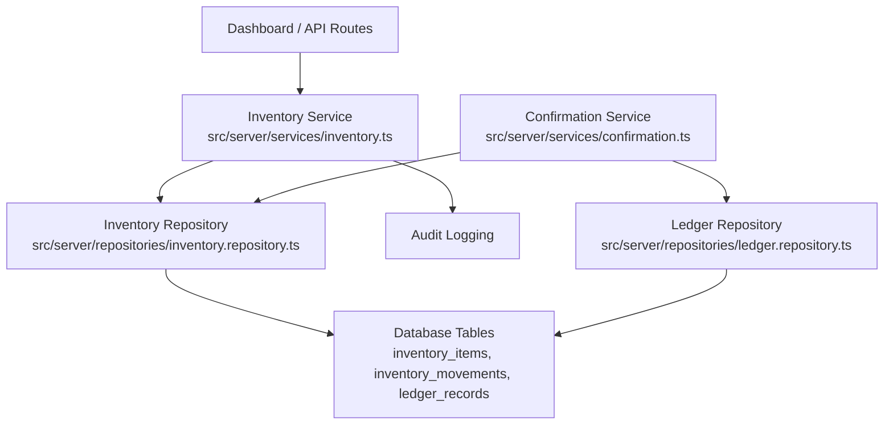
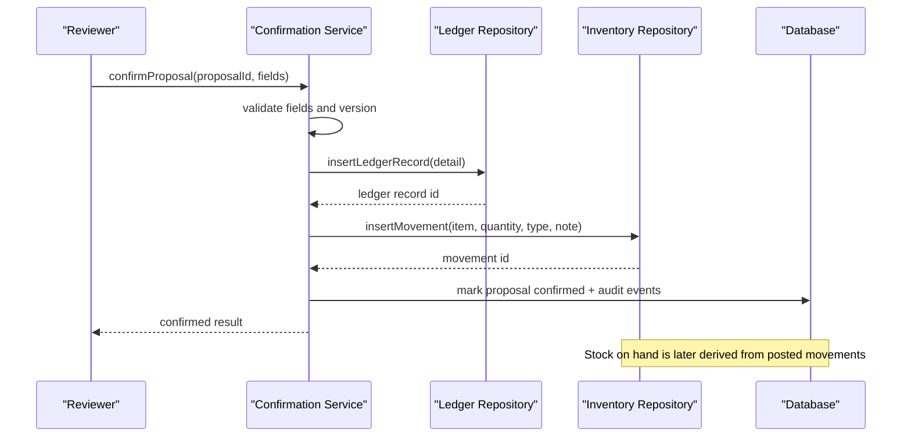
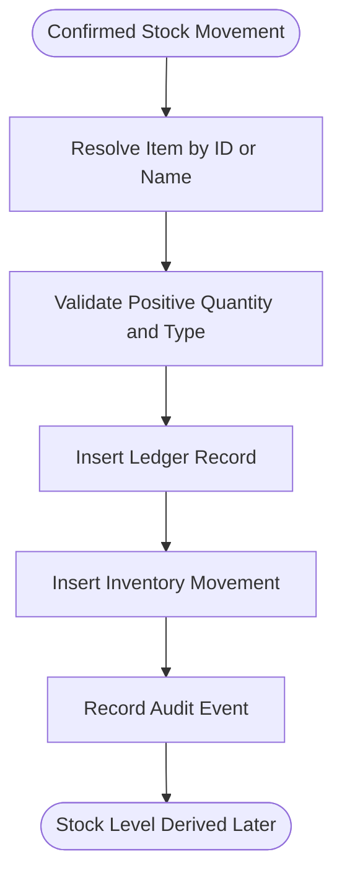
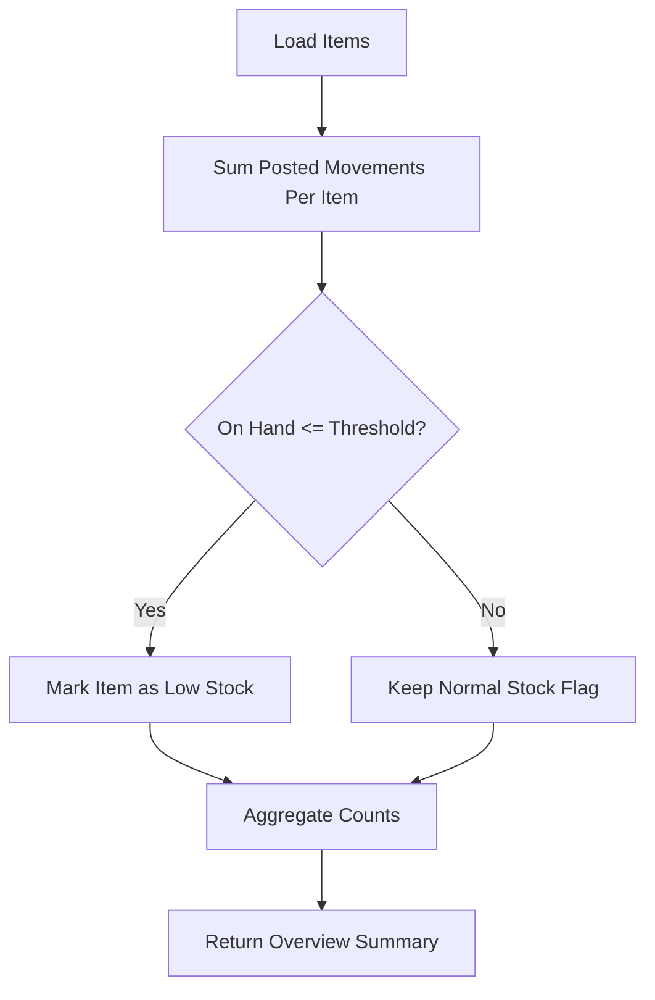
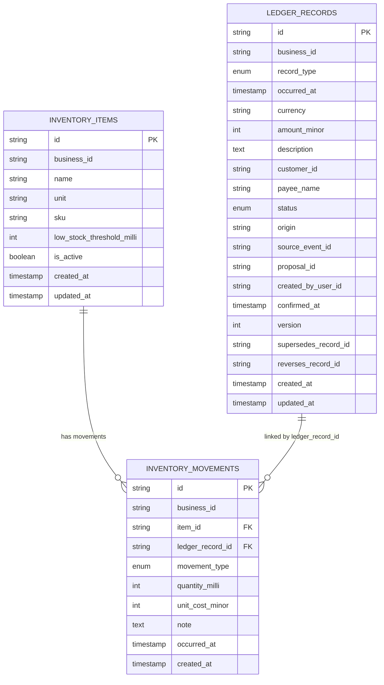
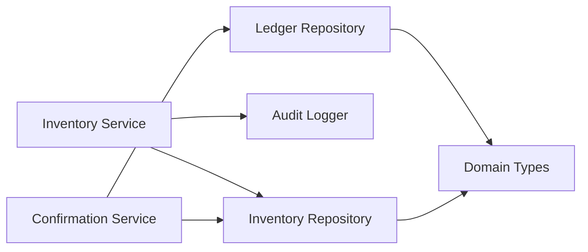

# Inventory Management Service

<cite>
**Referenced Files in This Document**
- [inventory.ts](file://src/server/services/inventory.ts)
- [inventory.repository.ts](file://src/server/repositories/inventory.repository.ts)
- [confirmation.ts](file://src/server/services/confirmation.ts)
- [ledger.repository.ts](file://src/server/repositories/ledger.repository.ts)
- [types.ts](file://src/server/domain/types.ts)
- [migrations.ts](file://src/server/db/migrations.ts)
- [proposal.ts](file://src/lib/validation/proposal.ts)
- [inventory.test.ts](file://tests/inventory.test.ts)
</cite>

## Table of Contents
1. [Introduction](#introduction)
2. [Project Structure](#project-structure)
3. [Core Components](#core-components)
4. [Architecture Overview](#architecture-overview)
5. [Detailed Component Analysis](#detailed-component-analysis)
6. [Dependency Analysis](#dependency-analysis)
7. [Performance Considerations](#performance-considerations)
8. [Troubleshooting Guide](#troubleshooting-guide)
9. [Conclusion](#conclusion)

## Introduction
This document explains the inventory management service that tracks stock levels and manages an item catalog. The system is feature-gated: inventory operations are invisible until the inventory feature is enabled for a business. Stock on hand is never stored as a cached balance; it is always derived from confirmed stock movements linked to ledger records. This design ensures that voided, reversed, or corrected movements cannot leave phantom stock balances.

The service provides:
- Item catalog management: create items, update thresholds, and activate/deactivate items.
- Inventory overview: list tracked items, current stock levels, low-stock flags, and counts.
- Low stock alerts: computed by comparing current stock against a configurable threshold.
- Integration with the ledger system: stock movements are recorded only when a proposal is confirmed through the review flow.
- Auditing: every item creation and update is recorded, and stock movements are tied to ledger records for full traceability.

## Project Structure
The inventory functionality spans three layers:
- Service layer: enforces feature flags, permissions, validation, and audit logging.
- Repository layer: persists items, movements, and computes balances.
- Ledger integration: links stock movements to confirmed ledger records and uses them to derive stock levels.

**Diagram sources**
- [inventory.ts:10-22](file://src/server/services/inventory.ts#L10-L22)
- [inventory.repository.ts:8-11](file://src/server/repositories/inventory.repository.ts#L8-L11)
- [confirmation.ts:15-54](file://src/server/services/confirmation.ts#L15-L54)
- [ledger.repository.ts:9-18](file://src/server/repositories/ledger.repository.ts#L9-L18)

**Section sources**
- [inventory.ts:1-8](file://src/server/services/inventory.ts#L1-L8)
- [inventory.repository.ts:1-6](file://src/server/repositories/inventory.repository.ts#L1-L6)

## Core Components
- Inventory service: exposes functions to create and update inventory items and to compute an inventory overview. It gates access behind a feature flag and permission checks.
- Inventory repository: handles persistence for items and movements, calculates current stock by summing posted movements, and determines low-stock status.
- Confirmation service: the single path from proposals to confirmed ledger records. When a stock movement proposal is confirmed, it creates the ledger record and writes an inventory movement.
- Ledger repository: stores confirmed ledger records and typed details. Stock movement records include a link to the corresponding inventory movement.
- Domain types: define record types, movement types, statuses, and audit actions used across services.

Key responsibilities:
- Adding items: validate uniqueness per business, persist item metadata, and audit the creation.
- Updating items: change low-stock thresholds or active state; do not directly edit the low-stock flag.
- Tracking stock: record positive milli-unit quantities with explicit movement direction via movement type.
- Calculating stock: sum posted inventory movements per item to derive current stock.
- Low stock alerts: compare current stock against the configured threshold.

**Section sources**
- [inventory.ts:24-49](file://src/server/services/inventory.ts#L24-L49)
- [inventory.repository.ts:13-43](file://src/server/repositories/inventory.repository.ts#L13-L43)
- [confirmation.ts:234-272](file://src/server/services/confirmation.ts#L234-L272)
- [types.ts:8-15](file://src/server/domain/types.ts#L8-L15)
- [types.ts:84-85](file://src/server/domain/types.ts#L84-L85)

## Architecture Overview
Stock tracking is event-driven through the confirmation workflow:
1. A stock movement proposal is created (manually or via extraction).
2. A reviewer confirms the proposal.
3. The confirmation service inserts a ledger record and, if inventory is enabled, writes an inventory movement.
4. Current stock is derived by summing posted inventory movements for each item.
5. Low stock is determined by comparing current stock to the item’s threshold.

**Diagram sources**
- [confirmation.ts:318-455](file://src/server/services/confirmation.ts#L318-L455)
- [ledger.repository.ts:96-137](file://src/server/repositories/ledger.repository.ts#L96-L137)
- [inventory.repository.ts:163-188](file://src/server/repositories/inventory.repository.ts#L163-L188)

## Detailed Component Analysis

### Inventory Service
The inventory service provides:
- `inventoryOverview(db, context)`: returns all tracked items with derived stock levels, low-stock flags, and aggregate counts.
- `createInventoryItem(db, context, input)`: creates a new item with name, unit, optional SKU, and optional low-stock threshold.
- `updateInventoryItem(db, context, itemId, input)`: updates threshold or active state and returns refreshed summary data.

Business rules:
- Feature gating: all operations require the inventory feature to be enabled.
- Permission gating: only users with inventory management permission can create or update items.
- Name uniqueness: duplicate names within the same business are rejected.
- Low-stock derivation: the low-stock flag is never edited directly; it is computed from current stock and threshold.
- Tenant isolation: queries are scoped by business ID.

Method signatures and behavior:
- `inventoryOverview`
  - Parameters: database connection, business context.
  - Returns: object with items array, tracked items count, and low stock count.
  - Behavior: fetches items with balances and maps to summaries.
- `createInventoryItem`
  - Parameters: database connection, business context, input with name, unit, optional sku, optional lowStockThresholdMilli.
  - Returns: inventory item summary with zero initial stock.
  - Behavior: validates uniqueness, creates item inside a transaction, records audit event.
- `updateInventoryItem`
  - Parameters: database connection, business context, itemId, input with optional lowStockThresholdMilli and active.
  - Returns: updated inventory item summary.
  - Behavior: finds item, applies allowed updates, records audit event, recomputes summary.

Error handling:
- Feature not enabled: throws a feature-not-enabled error.
- Duplicate name: throws a validation error.
- Not found: throws a not-found error when updating a non-existent item.

**Section sources**
- [inventory.ts:41-72](file://src/server/services/inventory.ts#L41-L72)
- [inventory.ts:74-124](file://src/server/services/inventory.ts#L74-L124)
- [inventory.ts:126-175](file://src/server/services/inventory.ts#L126-L175)

### Inventory Repository
Responsibilities:
- CRUD for inventory items.
- Insertion of inventory movements.
- Computation of current stock and low-stock status.
- Listing recent movements for an item.

Data models:
- `InventoryItemRow`: persisted item fields including business scope, name, unit, SKU, threshold, active flag, timestamps.
- `InventoryMovementRow`: persisted movement fields including linked ledger record, movement type, positive milli quantity, optional unit cost, note, timestamps.
- `ItemWithBalance`: enriched view combining item row, computed on-hand milli units, low-stock boolean, and last movement timestamp.

Key functions:
- `listItems`, `findItemById`, `findItemByName`: tenant-scoped item lookups.
- `createItem`: inserts item and returns persisted row.
- `setItemThreshold`, `setItemActive`: updates item configuration.
- `itemsWithBalances`: joins inventory items with posted movements to compute on-hand and low-stock.
- `listMovementsForItem`: lists recent posted movements for an item.
- `insertMovement`: validates and persists a movement with positive milli quantity and explicit movement type.
- `countLowStockItems`: helper to count low-stock items.
- `itemIsActive`: converts SQL boolean to JS boolean.

Complexity considerations:
- `itemsWithBalances` performs one query per item to compute totals; this is simple but may become expensive at scale.
- Movement insertion validates inputs and uses generated IDs and ISO timestamps.

**Section sources**
- [inventory.repository.ts:13-43](file://src/server/repositories/inventory.repository.ts#L13-L43)
- [inventory.repository.ts:45-108](file://src/server/repositories/inventory.repository.ts#L45-L108)
- [inventory.repository.ts:110-130](file://src/server/repositories/inventory.repository.ts#L110-L130)
- [inventory.repository.ts:132-188](file://src/server/repositories/inventory.repository.ts#L132-L188)
- [inventory.repository.ts:190-196](file://src/server/repositories/inventory.repository.ts#L190-L196)

### Ledger Integration and Stock Movements
Stock movements are not inserted directly by the inventory service. They are written by the confirmation service when a stock movement proposal is confirmed:
- The confirmation service resolves the item by ID or name.
- It validates quantity and movement type.
- It inserts an inventory movement linked to the newly created ledger record.
- It records an audit event for the inventory movement.

Relationship between inventory items and ledger records:
- Each inventory movement references a ledger record ID.
- Stock calculations join inventory movements with ledger records and consider only posted records.
- Reading ledger details for stock movement records includes movement-specific fields such as item ID, movement type, quantity, unit cost, and note.

**Diagram sources**
- [confirmation.ts:234-272](file://src/server/services/confirmation.ts#L234-L272)
- [ledger.repository.ts:268-286](file://src/server/repositories/ledger.repository.ts#L268-L286)

**Section sources**
- [confirmation.ts:234-272](file://src/server/services/confirmation.ts#L234-L272)
- [ledger.repository.ts:268-286](file://src/server/repositories/ledger.repository.ts#L268-L286)

### Low Stock Alerts and Reporting
Low stock is computed by comparing current stock to the configured threshold:
- If no threshold is set, an item is never considered low stock.
- If current stock is less than or equal to the threshold, the item is flagged as low stock.
- The inventory overview aggregates low-stock counts and individual item flags.

Reporting capabilities:
- Inventory overview returns item summaries, tracked item count, and low-stock count.
- Recent movements can be listed per item to support audits and investigations.
- Ledger reports can include stock movement records and their associated line items.

**Diagram sources**
- [inventory.repository.ts:110-130](file://src/server/repositories/inventory.repository.ts#L110-L130)
- [inventory.ts:51-72](file://src/server/services/inventory.ts#L51-L72)

**Section sources**
- [inventory.repository.ts:110-130](file://src/server/repositories/inventory.repository.ts#L110-L130)
- [inventory.ts:51-72](file://src/server/services/inventory.ts#L51-L72)

### Method Signatures, Parameters, Return Values, and Business Rules

#### Inventory Service Methods
- `inventoryOverview(db, context)`
  - Parameters:
    - `db`: database connection.
    - `context`: business context including feature flags and permissions.
  - Returns:
    - `items`: array of item summaries with stock and low-stock flags.
    - `trackedItems`: number of tracked items.
    - `lowStockCount`: number of items flagged as low stock.
  - Business rules:
    - Requires inventory feature enabled.
    - Derives stock from posted movements.
    - Computes low stock based on threshold.

- `createInventoryItem(db, context, input)`
  - Parameters:
    - `input.name`: required item name.
    - `input.unit`: required unit of measure.
    - `input.sku`: optional SKU string.
    - `input.lowStockThresholdMilli`: optional threshold in milli-units.
  - Returns:
    - Inventory item summary with zero initial stock.
  - Business rules:
    - Feature and permission checks.
    - Unique name per business.
    - Transactional creation with audit log.

- `updateInventoryItem(db, context, itemId, input)`
  - Parameters:
    - `itemId`: identifier of the item to update.
    - `input.lowStockThresholdMilli`: optional new threshold.
    - `input.active`: optional active flag.
  - Returns:
    - Updated inventory item summary.
  - Business rules:
    - Feature and permission checks.
    - Only threshold and active state can be updated.
    - Low-stock flag is never directly editable.

#### Inventory Repository Methods
- `itemsWithBalances(db, scope)`
  - Parameters:
    - `scope.businessId`: tenant scope.
  - Returns:
    - Array of `ItemWithBalance` objects.
  - Business rules:
    - Sums posted inventory movements per item.
    - Sets low stock when on-hand is less than or equal to threshold.

- `insertMovement(db, input)`
  - Parameters:
    - `businessId`, `itemId`, `ledgerRecordId`, `movementType`, `quantityMilli`, `unitCostMinor`, `note`, `occurredAt`.
  - Returns:
    - Persisted movement row.
  - Business rules:
    - Quantity must be a positive integer in milli-units.
    - Direction comes from movement type, not sign.

**Section sources**
- [inventory.ts:64-175](file://src/server/services/inventory.ts#L64-L175)
- [inventory.repository.ts:110-188](file://src/server/repositories/inventory.repository.ts#L110-L188)

### Data Models and Relationships

**Diagram sources**
- [inventory.repository.ts:13-36](file://src/server/repositories/inventory.repository.ts#L13-L36)
- [ledger.repository.ts:20-41](file://src/server/repositories/ledger.repository.ts#L20-L41)
- [migrations.ts:335-335](file://src/server/db/migrations.ts#L335-L335)

**Section sources**
- [inventory.repository.ts:13-36](file://src/server/repositories/inventory.repository.ts#L13-L36)
- [ledger.repository.ts:20-41](file://src/server/repositories/ledger.repository.ts#L20-L41)
- [migrations.ts:335-335](file://src/server/db/migrations.ts#L335-L335)

## Dependency Analysis
Coupling and cohesion:
- The inventory service depends on the inventory repository for persistence and on audit logging for compliance.
- The confirmation service depends on both ledger and inventory repositories to apply side effects atomically.
- The ledger repository reads inventory movements when hydrating stock movement records.

External dependencies:
- Database client utilities for transactions, queries, and ID generation.
- Domain types for record and movement enums.
- Validation schemas for proposals.

Potential circular dependencies:
- No direct circular imports are evident; services call repositories, and repositories use domain types and DB clients.

Integration points:
- Feature flags and permissions from business context.
- Audit logging for all inventory changes and movements.
- Outbox events emitted after ledger record confirmation.

**Diagram sources**
- [inventory.ts:10-22](file://src/server/services/inventory.ts#L10-L22)
- [confirmation.ts:15-54](file://src/server/services/confirmation.ts#L15-L54)
- [types.ts:8-15](file://src/server/domain/types.ts#L8-L15)

**Section sources**
- [inventory.ts:10-22](file://src/server/services/inventory.ts#L10-L22)
- [confirmation.ts:15-54](file://src/server/services/confirmation.ts#L15-L54)
- [types.ts:8-15](file://src/server/domain/types.ts#L8-L15)

## Performance Considerations
- Balance computation: `itemsWithBalances` runs one aggregation query per item. For large inventories, consider:
  - Precomputing and caching on-hand values for read-heavy dashboards.
  - Using windowed or paginated queries for item lists.
  - Indexing `inventory_movements` on `business_id`, `item_id`, and `ledger_record_id`.
- Movement insertion: validated and atomic; ensure bulk operations batch movements where possible.
- Ledger joins: stock calculations join movements with ledger records; ensure indexes on `ledger_records.status` and `occurred_at`.
- Low-stock counting: `countLowStockItems` recomputes balances; cache results for reporting endpoints.
- Concurrency: optimistic version checks in confirmation prevent stale reviews; inventory updates are transactional.

[No sources needed since this section provides general guidance]

## Troubleshooting Guide
Common issues and resolutions:
- Feature not enabled:
  - Symptom: inventory endpoints throw a feature-not-enabled error.
  - Resolution: enable the inventory feature for the business context.
- Duplicate item name:
  - Symptom: creating an item fails due to duplicate name within the same business.
  - Resolution: choose a unique name or check existing items before creation.
- Not found during update:
  - Symptom: updating an item fails because the item does not exist in the business scope.
  - Resolution: verify the item ID and business context.
- Zero stock despite movements:
  - Symptom: item shows zero on-hand even after confirming stock movements.
  - Resolution: ensure movements are linked to posted ledger records; only posted movements affect stock.
- Low stock not triggering:
  - Symptom: item is not flagged as low stock.
  - Resolution: set a threshold; low stock requires on-hand less than or equal to threshold.

Validation and testing references:
- Tests assert feature gating, uniqueness, tenant isolation, derived stock, low-stock logic, permissions, and cross-tenant safety.

**Section sources**
- [inventory.test.ts:94-121](file://tests/inventory.test.ts#L94-L121)
- [inventory.test.ts:134-183](file://tests/inventory.test.ts#L134-L183)
- [inventory.test.ts:185-232](file://tests/inventory.test.ts#L185-L232)

## Conclusion
The inventory management service provides a robust, auditable, and ledger-integrated approach to stock tracking. By deriving stock from confirmed movements and gating features and permissions, it maintains consistency and security. Low-stock alerts are computed deterministically from thresholds and actual movements. For large inventories, performance tuning around balance computation and indexing will improve responsiveness. The confirmation workflow ensures that stock adjustments are reviewed, recorded, and traceable through ledger versions and audit events.

[No sources needed since this section summarizes without analyzing specific files]