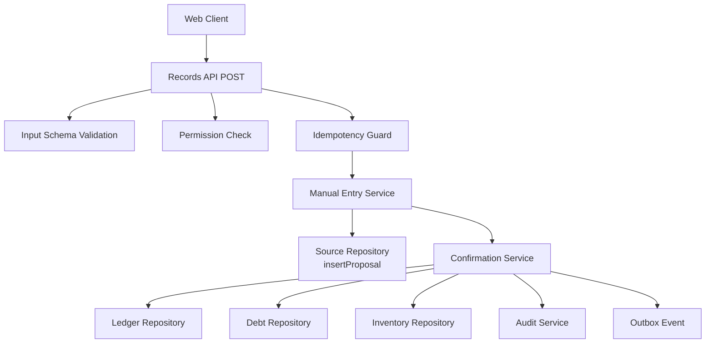
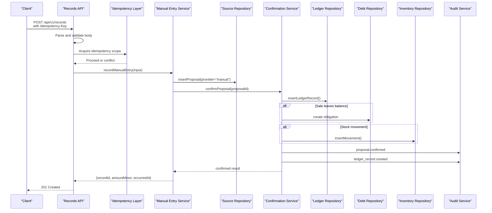
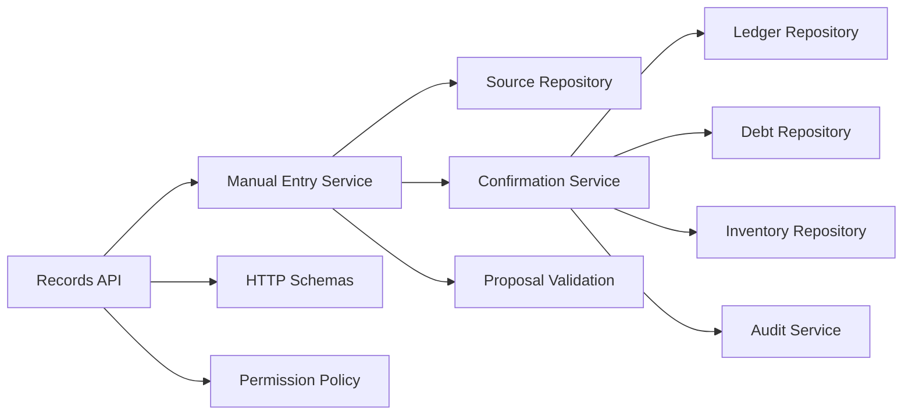

# Manual Entry Service

<cite>
**Referenced Files in This Document**
- [manual-entry.ts](file://src/server/services/manual-entry.ts)
- [records route.ts](file://src/app/api/v1/records/route.ts)
- [schemas.ts](file://src/server/http/schemas.ts)
- [proposal validation.ts](file://src/lib/validation/proposal.ts)
- [confirmation service.ts](file://src/server/services/confirmation.ts)
- [source repository.ts](file://src/server/repositories/source.repository.ts)
- [audit service.ts](file://src/server/services/audit.ts)
- [errors.ts](file://src/lib/errors.ts)
- [policy.ts](file://src/server/permissions/policy.ts)
</cite>

## Table of Contents
1. [Introduction](#introduction)
2. [Project Structure](#project-structure)
3. [Core Components](#core-components)
4. [Architecture Overview](#architecture-overview)
5. [Detailed Component Analysis](#detailed-component-analysis)
6. [Dependency Analysis](#dependency-analysis)
7. [Performance Considerations](#performance-considerations)
8. [Troubleshooting Guide](#troubleshooting-guide)
9. [Conclusion](#conclusion)

## Introduction
The manual entry service enables a merchant to create ledger records directly through the web interface without using voice capture or external integrations. A manually typed record is treated as a human confirmation: it becomes a proposal and then proceeds through the same validation, deni, inventory, debt, and audit paths as a reviewed voice message. This design ensures that manual entries cannot bypass business rules.

Key goals:
- Provide a safe, validated API for direct data input.
- Reuse the proposal system so manual entries are reviewable, auditable, and consistent with other sources.
- Prevent duplicate submissions through idempotency.
- Enforce permissions, feature flags, and schema validation at every boundary.

## Project Structure
Manual entry spans several layers:
- API route: validates request headers and body, enforces permissions, and applies idempotency.
- Service layer: transforms input into proposal fields, checks feature flags, inserts a proposal, and confirms it.
- Validation layer: defines required fields per record type and cross-field rules.
- Confirmation layer: persists the ledger record, applies debt/inventory effects, updates proposal state, emits outbox events, and writes audit events.
- Repository layer: persists proposals, source lineage, and related entities.
- Audit layer: records immutable change history.

**Diagram sources**
- [records route.ts:104-149](file://src/app/api/v1/records/route.ts#L104-L149)
- [manual-entry.ts:57-115](file://src/server/services/manual-entry.ts#L57-L115)
- [confirmation service.ts:318-455](file://src/server/services/confirmation.ts#L318-L455)
- [source repository.ts:446-498](file://src/server/repositories/source.repository.ts#L446-L498)
- [audit service.ts:31-66](file://src/server/services/audit.ts#L31-L66)

**Section sources**
- [records route.ts:1-151](file://src/app/api/v1/records/route.ts#L1-L151)
- [manual-entry.ts:1-116](file://src/server/services/manual-entry.ts#L1-L116)

## Core Components
- Records API POST endpoint: accepts manual entry requests, validates the `Idempotency-Key` header, parses the body against a strict schema, and delegates to the manual entry service.
- Manual entry service: maps the API payload to proposal fields, checks whether manual entries are enabled, computes missing required fields, creates a proposal, and immediately confirms it.
- Input schemas: define allowed record types, timestamps, amounts, payment status/method, customer references, inventory fields, and notes.
- Proposal validation: defines required fields per record type and cross-field constraints such as partial payments.
- Confirmation service: performs final validation, resolves customers, posts ledger records, applies debt and inventory effects, updates proposal state, emits outbox events, and records audit events.
- Source repository: persists proposals and their metadata, including provider, model version, provenance, missing fields, and validation issues.
- Audit service: records immutable audit events safely without failing the main transaction.

**Section sources**
- [records route.ts:97-151](file://src/app/api/v1/records/route.ts#L97-L151)
- [manual-entry.ts:19-115](file://src/server/services/manual-entry.ts#L19-L115)
- [schemas.ts:69-89](file://src/server/http/schemas.ts#L69-L89)
- [proposal validation.ts:274-312](file://src/lib/validation/proposal.ts#L274-L312)
- [confirmation service.ts:318-455](file://src/server/services/confirmation.ts#L318-L455)
- [source repository.ts:446-498](file://src/server/repositories/source.repository.ts#L446-L498)
- [audit service.ts:31-66](file://src/server/services/audit.ts#L31-L66)

## Architecture Overview
The manual entry flow intentionally reuses the proposal pipeline rather than creating a separate posting path. This guarantees consistency across all record sources.

**Diagram sources**
- [records route.ts:104-149](file://src/app/api/v1/records/route.ts#L104-L149)
- [manual-entry.ts:57-115](file://src/server/services/manual-entry.ts#L57-L115)
- [confirmation service.ts:318-455](file://src/server/services/confirmation.ts#L318-L455)
- [source repository.ts:446-498](file://src/server/repositories/source.repository.ts#L446-L498)

## Detailed Component Analysis

### API Endpoint: POST /api/v1/records
Responsibilities:
- Require tenant context and role permission `records.create_manual`.
- Validate the request body against `manualRecordBodySchema`.
- Require an `Idempotency-Key` header scoped to `record.manual`.
- Wrap the operation in idempotency protection.
- Return a created response with the posted record identifier and summary fields.

Method signature and behavior:
- HTTP method: `POST`
- Required headers:
  - `Idempotency-Key`: unique client-generated key; otherwise returns a validation error with code `IDEMPOTENCY_KEY_REQUIRED`.
- Request body: conforms to `manualRecordBodySchema`, which includes:
  - `recordType`: one of the supported record types.
  - `occurredAt`: ISO timestamp.
  - Optional fields: `amountMinor`, `description`, `customerId`, `customerName`, `paymentStatus`, `paymentMethod`, `amountPaidMinor`, `category`, `payee`, `dueDate`, `itemsText`, `itemId`, `itemName`, `quantityMilli`, `unit`, `movementType`, `note`.
- Success response:
  - Status: `201 Created`
  - Body contains: `recordId`, `customerId`, `occurredAt`, `amountMinor`.
- Error responses:
  - `422 VALIDATION_FAILED` when the body fails schema validation or the idempotency key is missing.
  - `409 CONFLICT` when another request with the same idempotency key is still being processed.
  - `403 FORBIDDEN` when the user lacks `records.create_manual`.

Security and safety:
- Permission check via `assertCan(context.role, 'records.create_manual')`.
- Feature flag check inside the service prevents manual entries if disabled.
- Idempotency prevents double submission.

**Section sources**
- [records route.ts:104-151](file://src/app/api/v1/records/route.ts#L104-L151)
- [schemas.ts:69-89](file://src/server/http/schemas.ts#L69-L89)
- [policy.ts:11-34](file://src/server/permissions/policy.ts#L11-L34)
- [errors.ts:8-28](file://src/lib/errors.ts#L8-L28)

### Manual Entry Service: recordManualEntry
Responsibilities:
- Enforce the `features.manualEntries` flag.
- Map the API payload into normalized proposal fields.
- Compute missing required fields based on the selected record type.
- Insert a proposal with `provider = "manual"` and no source event.
- Record an audit event for proposal creation.
- Immediately call the confirmation service to post the record.

Method signature:
- `recordManualEntry(db, context, input): Promise<ManualEntryResult>`
- Parameters:
  - `db`: database connection.
  - `context`: business context including `businessId`, `userId`, `currency`, `timezone`, and `features`.
  - `input`: `ManualEntryInput` containing `recordType`, `occurredAt`, `fields`, and optional `note`.
- Return value:
  - `ManualEntryResult` containing `proposalId` and the confirmation result.
- Errors:
  - Throws a validation error if manual entries are disabled.
  - Throws a validation error if confirmation does not return `confirmed`.

Data transformation:
- The service builds `ProposalFields` from the input, preserving currency, explicit occurrence time, and mapping optional fields like amounts, customer references, payment details, inventory fields, and notes.

Integration with proposal system:
- Creates a proposal with `state = needs_review`, `provider = manual`, and `modelVersion = user:<userId>`.
- Because the caller is a human typing the record, this path treats the input as already reviewed and immediately attempts confirmation.

Audit trail:
- Records `proposal.created` with actor, entity, and after-state information.

**Section sources**
- [manual-entry.ts:19-115](file://src/server/services/manual-entry.ts#L19-L115)
- [source repository.ts:446-498](file://src/server/repositories/source.repository.ts#L446-L498)
- [audit service.ts:31-66](file://src/server/services/audit.ts#L31-L66)

### Input Validation and Data Transformation
Validation occurs at two levels:

1. API-level schema validation:
   - Uses Zod-based schemas to enforce types, ranges, lengths, and enums.
   - Ensures `recordType`, `occurredAt`, and optional numeric/text fields are well-formed.

2. Domain-level proposal validation:
   - Determines required fields per record type.
   - Enforces cross-field rules such as partial payment requiring `amountPaidMinor`.

Required fields by record type:
- Sale: `amountMinor`, `occurredAt`, `paymentStatus`; plus `amountPaidMinor` when payment status is partial.
- Expense: `amountMinor`, `occurredAt`, `category`.
- Debt created: `amountMinor`, `occurredAt`, customer reference.
- Debt payment: `amountMinor`, `occurredAt`, customer reference.
- Stock movement: item reference, quantity, unit, movement type.
- Note: note text.

Complexity:
- Missing field computation is linear in the number of required fields for the selected record type.
- Cross-field checks add constant-time logic per rule.

Error handling:
- Missing required fields are stored in the proposal’s `missingFields` list and surfaced to the reviewer UI.
- Invalid payloads return structured validation errors with codes and details.

**Section sources**
- [schemas.ts:69-89](file://src/server/http/schemas.ts#L69-L89)
- [proposal validation.ts:274-312](file://src/lib/validation/proposal.ts#L274-L312)
- [errors.ts:68-85](file://src/lib/errors.ts#L68-L85)

### Confirmation and Posting Workflow
The confirmation service is the single path from proposal to ledger. For manual entries, it runs immediately after proposal creation.

Workflow:
- Load the proposal and verify its state and version.
- Apply any reviewer overrides (not used for manual entries).
- Run confirmation-specific validation.
- Resolve the customer when required.
- Insert the ledger record with origin marked as manual.
- Update sale or expense detail rows.
- Apply debt effects for sales leaving balances, debt creation, or debt payments.
- Apply inventory movements when applicable.
- Mark the proposal confirmed.
- Emit an outbox event for downstream consumers.
- Record audit events for both the ledger record and the proposal.

Return values:
- `confirmed`: includes the posted ledger record and resolved customer.
- `already_confirmed`: returns the existing record identifier.
- `invalid`: returns validation issues for the fields.

Error handling:
- Not found for missing proposals.
- Conflict for rejected proposals or stale versions.
- Validation failures for invalid fields.

**Section sources**
- [confirmation service.ts:318-455](file://src/server/services/confirmation.ts#L318-L455)
- [confirmation service.ts:464-475](file://src/server/services/confirmation.ts#L464-L475)
- [source repository.ts:723-738](file://src/server/repositories/source.repository.ts#L723-L738)

### Security Measures
- Authentication and authorization:
  - Tenant-scoped context resolution.
  - Role-based permission check for `records.create_manual`.
- Feature gating:
  - Manual entries require `features.manualEntries` to be enabled.
- Input sanitization:
  - Strict schema validation at the API boundary.
  - Length limits and trimming for text fields.
  - Enum validation for record types, payment statuses, payment methods, and movement types.
- Idempotency:
  - Client-provided `Idempotency-Key` header scoped to the business prevents duplicate postings.
- Safe audit recording:
  - Audit failures are logged but do not roll back the business transaction.

**Section sources**
- [policy.ts:11-34](file://src/server/permissions/policy.ts#L11-L34)
- [manual-entry.ts:57-64](file://src/server/services/manual-entry.ts#L57-L64)
- [schemas.ts:69-89](file://src/server/http/schemas.ts#L69-L89)
- [records route.ts:104-149](file://src/app/api/v1/records/route.ts#L104-L149)
- [audit service.ts:49-66](file://src/server/services/audit.ts#L49-L66)

### User Experience Features
- Auto-completion:
  - The proposal retrieval endpoint returns available customers and items when inventory is enabled, allowing the frontend to populate suggestion lists.
- Validation feedback:
  - Missing required fields are returned with the proposal so the UI can highlight incomplete fields before confirmation.
  - Schema validation errors provide clear messages and codes for client-side handling.
- Batch operations:
  - The current manual entry endpoint is designed for single-record creation. Batch operations should be implemented by the client by sending multiple idempotent requests, each with a unique `Idempotency-Key`.

Note: The provided repository does not include a dedicated manual entry form page; the manual entry API is intended to be consumed by a dashboard form that uses the proposal options and validation signals described above.

**Section sources**
- [records route.ts:104-151](file://src/app/api/v1/records/route.ts#L104-L151)
- [proposal validation.ts:274-312](file://src/lib/validation/proposal.ts#L274-L312)
- [source repository.ts:535-595](file://src/server/repositories/source.repository.ts#L535-L595)

## Dependency Analysis

**Diagram sources**
- [records route.ts:104-151](file://src/app/api/v1/records/route.ts#L104-L151)
- [manual-entry.ts:57-115](file://src/server/services/manual-entry.ts#L57-L115)
- [confirmation service.ts:318-455](file://src/server/services/confirmation.ts#L318-L455)
- [schemas.ts:69-89](file://src/server/http/schemas.ts#L69-L89)
- [proposal validation.ts:274-312](file://src/lib/validation/proposal.ts#L274-L312)
- [policy.ts:11-34](file://src/server/permissions/policy.ts#L11-L34)

Coupling and cohesion:
- The manual entry service is cohesive around transforming input into a proposal and confirming it.
- The confirmation service centralizes all side effects, improving maintainability and ensuring consistent rules.
- The API route remains thin, delegating domain logic to services.

Potential circular dependencies:
- No circular imports are evident among these modules; dependencies flow from route to service to repositories and shared validation.

External integration points:
- Outbox event emission for downstream systems.
- Audit logging.
- Customer and inventory repositories for business data.

**Section sources**
- [manual-entry.ts:57-115](file://src/server/services/manual-entry.ts#L57-L115)
- [confirmation service.ts:318-455](file://src/server/services/confirmation.ts#L318-L455)
- [source repository.ts:446-498](file://src/server/repositories/source.repository.ts#L446-L498)

## Performance Considerations
- Database transactions:
  - Proposal insertion and audit recording are wrapped in a transaction.
  - Confirmation performs all ledger, debt, inventory, proposal state, audit, and outbox steps in a single transaction to prevent partial application.
- Idempotency:
  - Protects against network retries and double taps without additional locking overhead beyond the idempotency store.
- Validation cost:
  - Schema validation is lightweight and performed early.
  - Missing field computation is linear in required fields and cheap relative to I/O.
- Concurrency:
  - Optimistic version checks prevent stale overwrites during confirmation.
- Recommendations:
  - Keep manual entry payloads minimal.
  - Use batch UI patterns carefully; send one idempotent request per record.
  - Monitor outbox processing latency if downstream consumers are slow.

[No sources needed since this section provides general guidance]

## Troubleshooting Guide
Common issues and resolutions:

- Missing `Idempotency-Key`:
  - Symptom: validation error with code `IDEMPOTENCY_KEY_REQUIRED`.
  - Resolution: generate a unique key per manual entry attempt and include it in the request header.

- Duplicate submission:
  - Symptom: conflict error with code `IDEMPOTENT_REQUEST_IN_PROGRESS`.
  - Resolution: retry after a short delay; the original request will complete and return the same result.

- Manual entries disabled:
  - Symptom: validation error indicating manual entry is not enabled.
  - Resolution: enable the `manualEntries` feature for the business context.

- Missing required fields:
  - Symptom: proposal remains unconfirmable with missing fields listed.
  - Resolution: fill required fields according to the selected record type, including partial payment amount for partial sales.

- Stale proposal version:
  - Symptom: conflict error indicating the proposal changed since opened.
  - Resolution: reload the proposal and resubmit confirmation with the latest version.

- Invalid payload:
  - Symptom: validation error with field-level messages.
  - Resolution: correct the field according to the schema rules, such as valid timestamps, positive amounts, and allowed enums.

**Section sources**
- [records route.ts:104-151](file://src/app/api/v1/records/route.ts#L104-L151)
- [manual-entry.ts:57-115](file://src/server/services/manual-entry.ts#L57-L115)
- [confirmation service.ts:318-455](file://src/server/services/confirmation.ts#L318-L455)
- [errors.ts:8-28](file://src/lib/errors.ts#L8-L28)

## Conclusion
The manual entry service integrates direct web input into the same proposal and confirmation pipeline used by voice and other sources. This ensures that manual records are validated, audited, and posted consistently with business rules. The API enforces strong input validation, permissions, feature flags, and idempotency, while the confirmation service centralizes ledger, debt, inventory, and audit effects. Clients should implement forms that leverage proposal options and missing-field feedback, use unique idempotency keys, and handle structured error responses for a robust manual entry experience.

[No sources needed since this section summarizes without analyzing specific files]