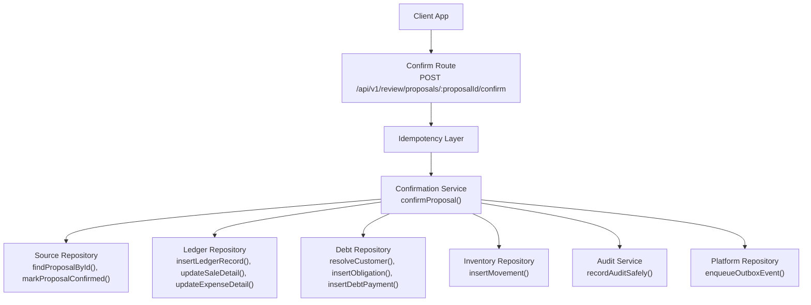
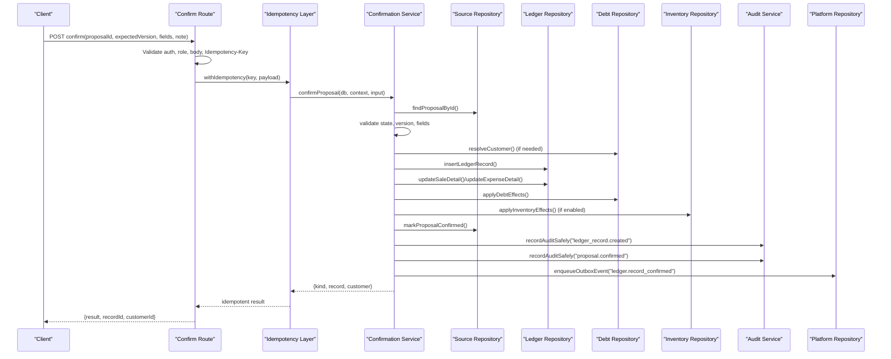
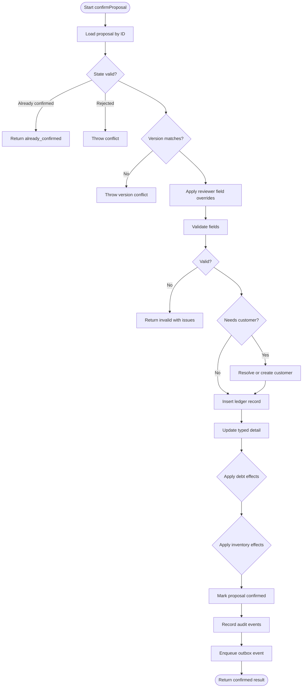
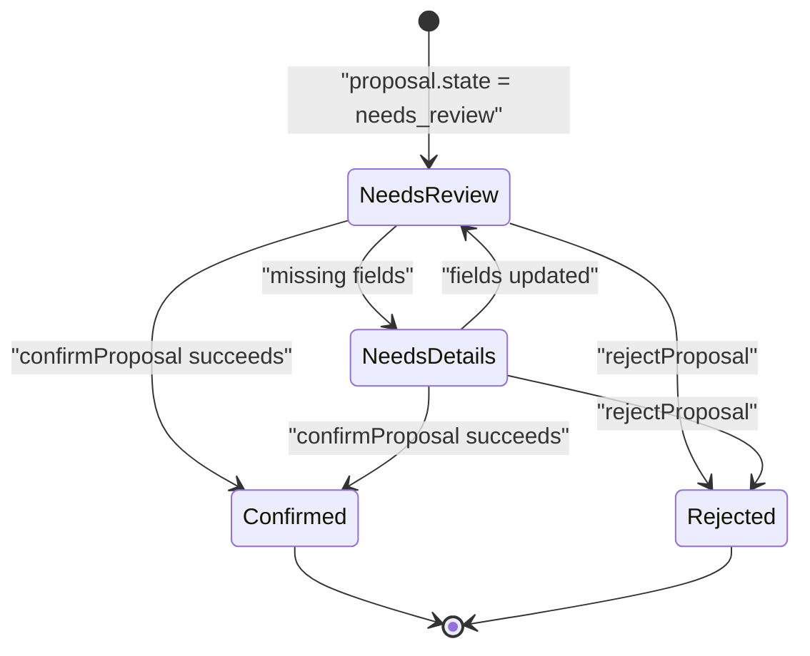
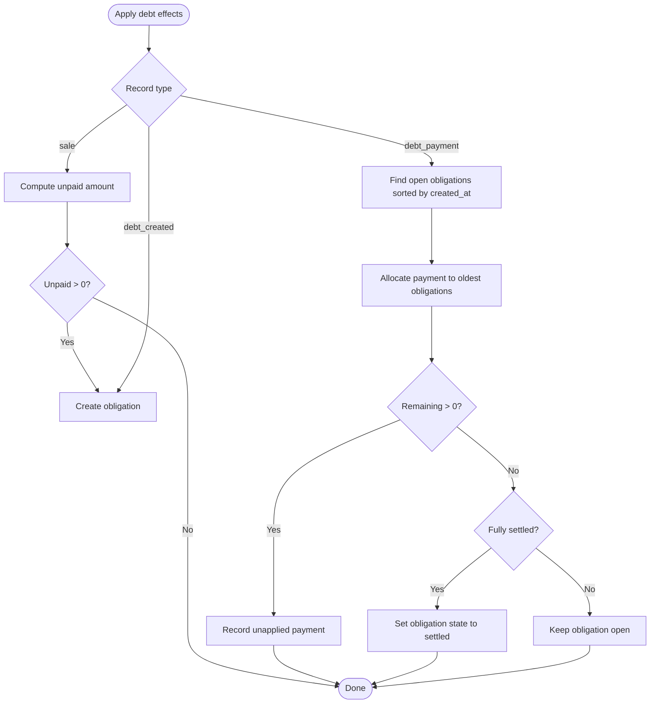
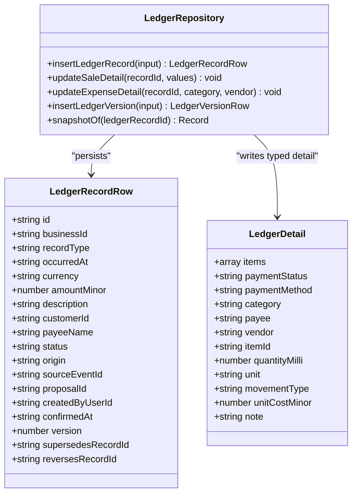
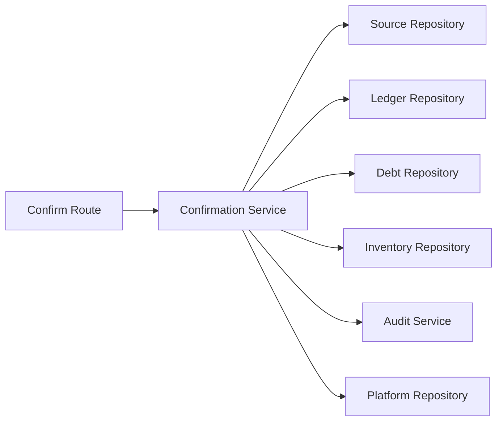

# Confirmation Service

<cite>
**Referenced Files in This Document**
- [confirmation.ts](file://src/server/services/confirmation.ts)
- [confirm route.ts](file://src/app/api/v1/review/proposals/[proposalId]/confirm/route.ts)
- [source.repository.ts](file://src/server/repositories/source.repository.ts)
- [ledger.repository.ts](file://src/server/repositories/ledger.repository.ts)
- [debt.repository.ts](file://src/server/repositories/debt.repository.ts)
- [inventory.repository.ts](file://src/server/repositories/inventory.repository.ts)
- [audit.ts](file://src/server/services/audit.ts)
- [confirmation.test.ts](file://tests/confirmation.test.ts)
</cite>

## Table of Contents
1. [Introduction](#introduction)
2. [Project Structure](#project-structure)
3. [Core Components](#core-components)
4. [Architecture Overview](#architecture-overview)
5. [Detailed Component Analysis](#detailed-component-analysis)
6. [Dependency Analysis](#dependency-analysis)
7. [Performance Considerations](#performance-considerations)
8. [Troubleshooting Guide](#troubleshooting-guide)
9. [Conclusion](#conclusion)

## Introduction
The confirmation service is the only path that turns a reviewed proposal into a confirmed ledger entry. It enforces human approval, validates fields, applies debt and inventory side effects, updates proposal state, records audit events, and emits an outbox event for downstream consumers. Its design prioritizes data integrity: all persistent changes occur inside a database transaction, optimistic version checks prevent stale confirmations, and duplicate confirmations are idempotent.

Key guarantees include:
- A reviewer must explicitly confirm with their user identity.
- Ledger creation, detail updates, debt effects, inventory movements, proposal state change, audit entries, and outbox events are committed atomically.
- Stale or conflicting confirmations are rejected rather than silently overwriting another reviewer’s decision.
- Repeated confirmation requests return the already confirmed record instead of posting duplicates.

## Project Structure
The confirmation workflow spans an API route, a domain service, and several repositories:

**Diagram sources**
- [confirm route.ts:18-73](file://src/app/api/v1/review/proposals/[proposalId]/confirm/route.ts#L18-L73)
- [confirmation.ts:318-455](file://src/server/services/confirmation.ts#L318-L455)
- [source.repository.ts:500-508](file://src/server/repositories/source.repository.ts#L500-L508)
- [source.repository.ts:723-738](file://src/server/repositories/source.repository.ts#L723-L738)
- [ledger.repository.ts:96-137](file://src/server/repositories/ledger.repository.ts#L96-L137)
- [debt.repository.ts:80-90](file://src/server/repositories/debt.repository.ts#L80-L90)
- [debt.repository.ts:94-114](file://src/server/repositories/debt.repository.ts#L94-L114)
- [debt.repository.ts:226-259](file://src/server/repositories/debt.repository.ts#L226-L259)
- [inventory.repository.ts:163-187](file://src/server/repositories/inventory.repository.ts#L163-L187)
- [audit.ts:31-66](file://src/server/services/audit.ts#L31-L66)

**Section sources**
- [confirm route.ts:1-74](file://src/app/api/v1/review/proposals/[proposalId]/confirm/route.ts#L1-L74)
- [confirmation.ts:1-13](file://src/server/services/confirmation.ts#L1-L13)

## Core Components
- **Confirmation service**: Implements `confirmProposal`, `applyFieldOverrides`, `unpaidMinor`, `confirmationIssues`, and `rejectProposal`. It orchestrates validation, customer resolution, ledger insertion, debt and inventory effects, proposal state transitions, audit recording, and outbox publishing.
- **API confirm route**: Validates authentication, authorization, request body, and idempotency key; wraps the service call and returns a stable response shape.
- **Source repository**: Persists source events, transcripts, and proposals, including optimistic versioning and proposal state transitions.
- **Ledger repository**: Persists confirmed ledger records, typed details, versions/snapshots, and derived totals.
- **Debt repository**: Manages customers, obligations, payments, balances, and obligation state transitions.
- **Inventory repository**: Records stock movements and derives on-hand quantities from posted movements.
- **Audit service**: Records before/after snapshots and actor attribution, isolating audit failures from business transactions.

**Section sources**
- [confirmation.ts:56-84](file://src/server/services/confirmation.ts#L56-L84)
- [confirmation.ts:113-122](file://src/server/services/confirmation.ts#L113-L122)
- [confirmation.ts:464-475](file://src/server/services/confirmation.ts#L464-L475)
- [confirm route.ts:18-73](file://src/app/api/v1/review/proposals/[proposalId]/confirm/route.ts#L18-L73)
- [source.repository.ts:446-498](file://src/server/repositories/source.repository.ts#L446-L498)
- [source.repository.ts:687-738](file://src/server/repositories/source.repository.ts#L687-L738)
- [ledger.repository.ts:96-137](file://src/server/repositories/ledger.repository.ts#L96-L137)
- [debt.repository.ts:80-114](file://src/server/repositories/debt.repository.ts#L80-L114)
- [inventory.repository.ts:163-187](file://src/server/repositories/inventory.repository.ts#L163-L187)
- [audit.ts:31-66](file://src/server/services/audit.ts#L31-L66)

## Architecture Overview
The confirmation flow is a multi-step pipeline that transforms a proposal into a confirmed ledger record while preserving lineage and auditability.

**Diagram sources**
- [confirm route.ts:18-73](file://src/app/api/v1/review/proposals/[proposalId]/confirm/route.ts#L18-L73)
- [confirmation.ts:318-455](file://src/server/services/confirmation.ts#L318-L455)
- [source.repository.ts:500-508](file://src/server/repositories/source.repository.ts#L500-L508)
- [source.repository.ts:723-738](file://src/server/repositories/source.repository.ts#L723-L738)
- [ledger.repository.ts:96-137](file://src/server/repositories/ledger.repository.ts#L96-L137)
- [debt.repository.ts:80-114](file://src/server/repositories/debt.repository.ts#L80-L114)
- [inventory.repository.ts:163-187](file://src/server/repositories/inventory.repository.ts#L163-L187)
- [audit.ts:31-66](file://src/server/services/audit.ts#L31-L66)

## Detailed Component Analysis

### Confirmation Workflow
The confirmation service performs these steps:
1. Load the proposal by ID within the current tenant scope.
2. Reject already confirmed or rejected proposals.
3. Compare the caller’s expected version with the stored version to detect concurrent edits.
4. Apply reviewer-provided field overrides to the proposal fields.
5. Validate the resulting fields using shared schema logic.
6. Determine whether a customer is required based on record type and unpaid balance.
7. Execute the entire transformation inside a transaction:
   - Resolve or create the customer if needed.
   - Insert the ledger record with typed detail.
   - Update sale or expense detail tables.
   - Apply debt effects for sales, debt creation, or debt payment.
   - Record inventory movement when applicable.
   - Mark the proposal confirmed with optimistic locking.
   - Record audit events for ledger creation and proposal confirmation.
   - Enqueue an outbox event for downstream systems.
8. Return a result indicating success, idempotent reuse, or validation failure.

**Diagram sources**
- [confirmation.ts:318-455](file://src/server/services/confirmation.ts#L318-L455)

**Section sources**
- [confirmation.ts:318-455](file://src/server/services/confirmation.ts#L318-L455)

### Transaction Boundaries and Rollback Behavior
All persistent changes during confirmation are wrapped in a single transaction. If any step fails—customer lookup, ledger insertion, detail update, debt effect, inventory movement, proposal state update, audit recording, or outbox enqueue—the entire operation rolls back. This prevents partial postings such as a ledger record without a corresponding proposal state change.

Important nuances:
- Audit recording uses a safe wrapper that logs failures but does not throw, so audit gaps do not roll back the business change.
- The final proposal state update includes optimistic locking against the expected version.
- The idempotency layer at the route level prevents duplicate processing across retries.

**Section sources**
- [confirmation.ts:364-455](file://src/server/services/confirmation.ts#L364-L455)
- [audit.ts:49-66](file://src/server/services/audit.ts#L49-L66)
- [confirm route.ts:32-70](file://src/app/api/v1/review/proposals/[proposalId]/confirm/route.ts#L32-L70)

### Optimistic Locking and Conflict Resolution
Optimistic locking protects against stale confirmations:
- The caller supplies `expectedVersion` from the proposal they viewed.
- The service compares it with the stored proposal version before proceeding.
- The final `markProposalConfirmed` call updates the proposal only if its version still matches and its state is reviewable.
- Conflicts are reported with a specific error code and status, instructing the client to reload and re-review.

Conflict scenarios:
- Stale version detected early: immediate conflict.
- Another reviewer confirms first: final optimistic check fails and throws conflict.
- Duplicate confirmation after success: returns `already_confirmed` with the existing record ID.

**Diagram sources**
- [source.repository.ts:687-738](file://src/server/repositories/source.repository.ts#L687-L738)
- [confirmation.ts:327-342](file://src/server/services/confirmation.ts#L327-L342)
- [confirmation.ts:401-411](file://src/server/services/confirmation.ts#L401-L411)

**Section sources**
- [confirmation.ts:327-342](file://src/server/services/confirmation.ts#L327-L342)
- [confirmation.ts:401-411](file://src/server/services/confirmation.ts#L401-L411)
- [source.repository.ts:723-738](file://src/server/repositories/source.repository.ts#L723-L738)

### Proposal-to-Confirmed Record Relationship
A confirmed ledger record is linked to its originating proposal and source event:
- `proposal_id` connects the ledger record to the reviewed proposal.
- `source_event_id` preserves the original inbound event lineage.
- `origin` indicates whether the record came from WhatsApp or manual entry.
- The proposal’s `confirmed_ledger_record_id` points back to the created ledger record.

This linkage supports traceability from money-in/out events back to the original message and reviewer decision.

**Section sources**
- [confirmation.ts:367-381](file://src/server/services/confirmation.ts#L367-L381)
- [ledger.repository.ts:96-137](file://src/server/repositories/ledger.repository.ts#L96-L137)
- [source.repository.ts:723-738](file://src/server/repositories/source.repository.ts#L723-L738)

### Validation of Proposal States and Fields
Validation occurs after applying reviewer overrides:
- Shared schema validation ensures required fields are present and consistent.
- For sales, partial payments require a paid amount; fully paid sales do not.
- Validation errors are returned as structured issues rather than throwing, allowing the UI to highlight missing fields.

Examples validated by tests:
- Part payment without paid amount is invalid.
- Reviewer can supply a missing paid amount and confirm successfully.
- Fully paid walk-in sales do not require a customer.

**Section sources**
- [confirmation.ts:464-475](file://src/server/services/confirmation.ts#L464-L475)
- [confirmation.test.ts:155-198](file://tests/confirmation.test.ts#L155-L198)

### Customer Resolution and Debt Effects
Customer resolution follows these rules:
- If a customer ID is provided, it must exist in the tenant scope.
- If no ID is provided, the service looks up the customer by name.
- If no customer exists, one is created and audited.
- A customer is required for debt-created records, debt-payment records, and unpaid sales.

Debt effects:
- Unpaid sales create an obligation for the remaining amount.
- Partial payments reduce the obligation’s outstanding balance and may settle it.
- Debt payments are applied to the oldest open obligation first; unapplied amounts become customer credit.
- Obligations transition to settled when fully paid.

**Diagram sources**
- [confirmation.ts:124-232](file://src/server/services/confirmation.ts#L124-L232)
- [debt.repository.ts:94-114](file://src/server/repositories/debt.repository.ts#L94-L114)
- [debt.repository.ts:226-259](file://src/server/repositories/debt.repository.ts#L226-L259)

**Section sources**
- [confirmation.ts:86-111](file://src/server/services/confirmation.ts#L86-L111)
- [confirmation.ts:124-232](file://src/server/services/confirmation.ts#L124-L232)
- [debt.repository.ts:80-114](file://src/server/repositories/debt.repository.ts#L80-L114)
- [debt.repository.ts:226-259](file://src/server/repositories/debt.repository.ts#L226-L259)

### Inventory Effects
When inventory is enabled and the record type is a stock movement:
- The item is resolved by ID or name.
- Quantity must be positive and specified in milli-units.
- An inventory movement is recorded and audited.
- Stock balances are derived from posted movements, not stored directly.

**Section sources**
- [confirmation.ts:234-272](file://src/server/services/confirmation.ts#L234-L272)
- [inventory.repository.ts:163-187](file://src/server/repositories/inventory.repository.ts#L163-L187)

### Audit Trail Creation
Audit events capture:
- Actor attribution via `actorUserId`.
- Request correlation via `requestId`.
- Reason codes and optional notes.
- Before/after snapshots where relevant.
- Entity type and ID for traceability.

For confirmation:
- A ledger record creation event captures record type, amount, occurrence time, proposal ID, and source event ID.
- A proposal confirmation event links the proposal to the new ledger record.
- Customer creation, obligation creation, debt payment recording, and inventory movement recording each emit dedicated audit events.

Audit failures are logged but do not fail the business transaction.

**Section sources**
- [confirmation.ts:413-437](file://src/server/services/confirmation.ts#L413-L437)
- [audit.ts:31-66](file://src/server/services/audit.ts#L31-L66)

### Integration with the Ledger System
The confirmation service integrates with the ledger system by:
- Inserting a ledger record with a typed detail structure.
- Updating sale or expense detail tables.
- Recording a ledger version snapshot for the created record.
- Emitting an outbox event `ledger.record_confirmed` for downstream consumers.
- Linking the ledger record to the proposal and source event.

**Diagram sources**
- [ledger.repository.ts:20-77](file://src/server/repositories/ledger.repository.ts#L20-L77)
- [ledger.repository.ts:96-137](file://src/server/repositories/ledger.repository.ts#L96-L137)
- [ledger.repository.ts:584-602](file://src/server/repositories/ledger.repository.ts#L584-L602)
- [ledger.repository.ts:604-638](file://src/server/repositories/ledger.repository.ts#L604-L638)
- [ledger.repository.ts:656-674](file://src/server/repositories/ledger.repository.ts#L656-L674)

**Section sources**
- [confirmation.ts:367-392](file://src/server/services/confirmation.ts#L367-L392)
- [ledger.repository.ts:96-137](file://src/server/repositories/ledger.repository.ts#L96-L137)

### Error Handling for Concurrent Modifications
Concurrent modification handling includes:
- Early version mismatch detection returns a conflict error.
- Final optimistic lock on proposal confirmation rejects double-confirmations.
- Idempotency layer prevents duplicate processing of the same confirmation request.
- Validation failures return structured issues without posting ledger data.

Test coverage verifies:
- Stale version conflicts.
- Idempotent retry behavior.
- Rejected proposals cannot be confirmed later.
- Tenant isolation prevents cross-tenant confirmations.

**Section sources**
- [confirmation.ts:327-342](file://src/server/services/confirmation.ts#L327-L342)
- [confirmation.ts:401-411](file://src/server/services/confirmation.ts#L401-L411)
- [confirm route.ts:32-70](file://src/app/api/v1/review/proposals/[proposalId]/confirm/route.ts#L32-L70)
- [confirmation.test.ts:200-258](file://tests/confirmation.test.ts#L200-L258)

### Examples of Confirmation Flows
- Walk-in cash sale: posts a ledger record without creating a customer.
- Unpaid sale: creates or reuses a customer and opens an obligation.
- Partial payment: records only the received amount and reduces the obligation balance.
- Reviewer override: allows supplying missing fields before validation.
- Idempotent retry: second confirmation returns the existing record ID.

These flows are validated end-to-end in the test suite.

**Section sources**
- [confirmation.test.ts:84-258](file://tests/confirmation.test.ts#L84-L258)

## Dependency Analysis
The confirmation service depends on multiple repositories and services. Coupling is intentional and layered:
- The service coordinates domain logic.
- Repositories encapsulate persistence and tenant scoping.
- Audit and platform integrations are isolated behind safe wrappers.

**Diagram sources**
- [confirmation.ts:15-54](file://src/server/services/confirmation.ts#L15-L54)
- [confirm route.ts:10-16](file://src/app/api/v1/review/proposals/[proposalId]/confirm/route.ts#L10-L16)

**Section sources**
- [confirmation.ts:15-54](file://src/server/services/confirmation.ts#L15-L54)
- [confirm route.ts:10-16](file://src/app/api/v1/review/proposals/[proposalId]/confirm/route.ts#L10-L16)

## Performance Considerations
- Single transaction boundaries minimize lock contention and ensure atomicity.
- Optimistic version checks avoid expensive row-level locks until the final state update.
- Customer and item lookups are tenant-scoped and indexed by business ID.
- Debt payment allocation sorts open obligations by creation time; this is bounded by the number of open obligations per customer.
- Inventory movements are feature-gated, reducing overhead when inventory is disabled.
- Audit recording is safe and non-blocking to business transactions, preventing audit failures from impacting throughput.

[No sources needed since this section provides general guidance]

## Troubleshooting Guide
Common issues and resolutions:
- **Stale proposal version**: Reload the proposal to get the latest version and retry.
- **Proposal already rejected**: Rejection is terminal; create a new proposal if needed.
- **Duplicate confirmation**: The endpoint is idempotent; use the returned record ID.
- **Missing required fields**: Inspect validation issues and supply reviewer overrides.
- **Tenant isolation error**: Ensure the request is scoped to the correct business.
- **Audit gap**: Check logs for `audit.append_failed`; the business change remains valid.

Recommended diagnostics:
- Verify proposal state and version before confirming.
- Confirm the presence of an `Idempotency-Key` header.
- Inspect ledger record linkage to proposal and source event.
- Review audit events for actor attribution and reason codes.
- Check debt obligations and payments for balance discrepancies.

**Section sources**
- [confirmation.test.ts:200-258](file://tests/confirmation.test.ts#L200-L258)
- [audit.ts:49-66](file://src/server/services/audit.ts#L49-L66)

## Conclusion
The confirmation service provides a robust, auditable pathway from proposal to confirmed ledger record. It enforces human approval, validates data, applies financial and inventory side effects, and maintains strong consistency through transactions and optimistic locking. Its design makes it resilient to concurrency, duplication, and audit failures while preserving full traceability across source events, proposals, ledger records, debts, and inventory movements.

[No sources needed since this section summarizes without analyzing specific files]