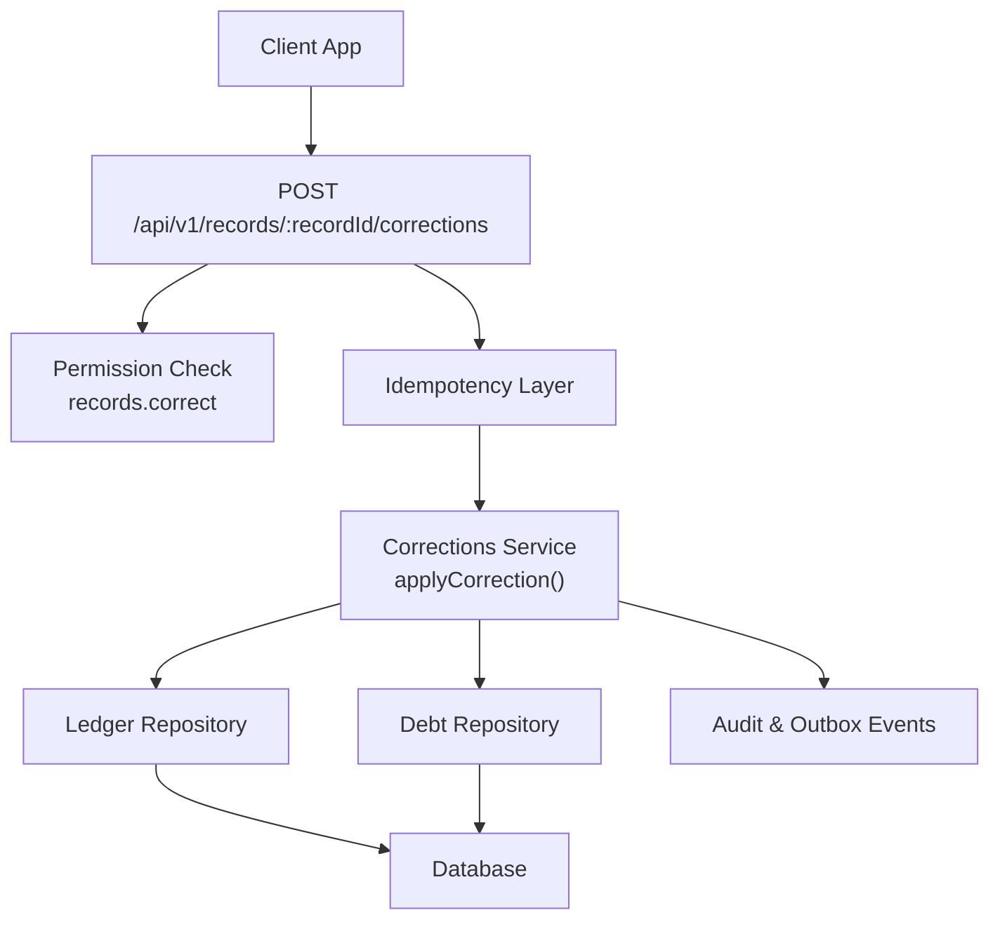
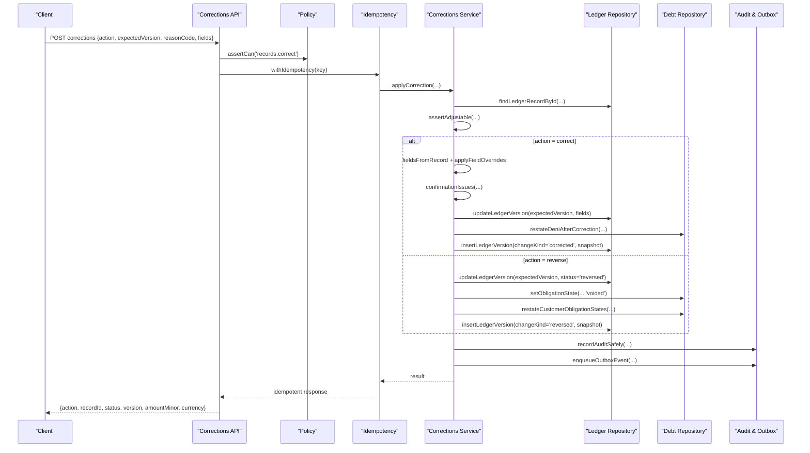
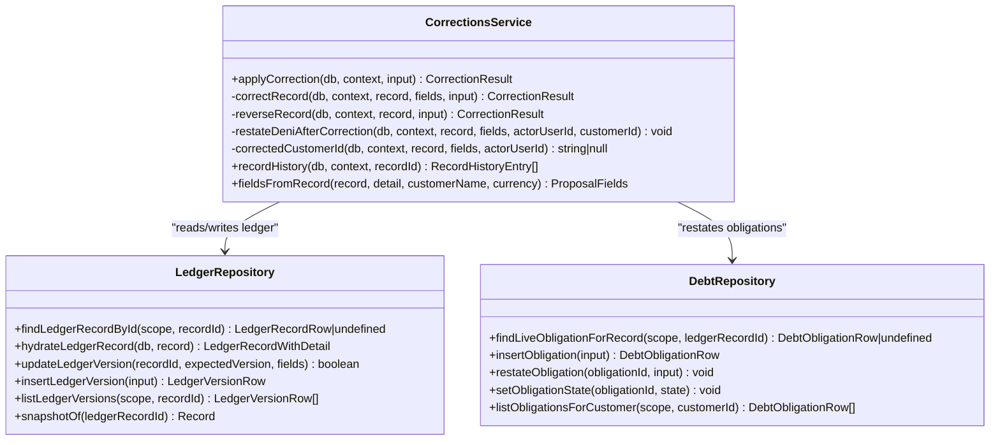
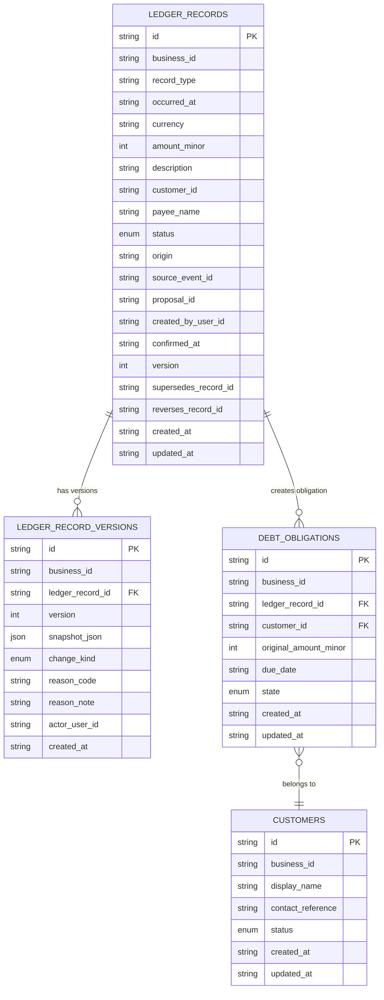
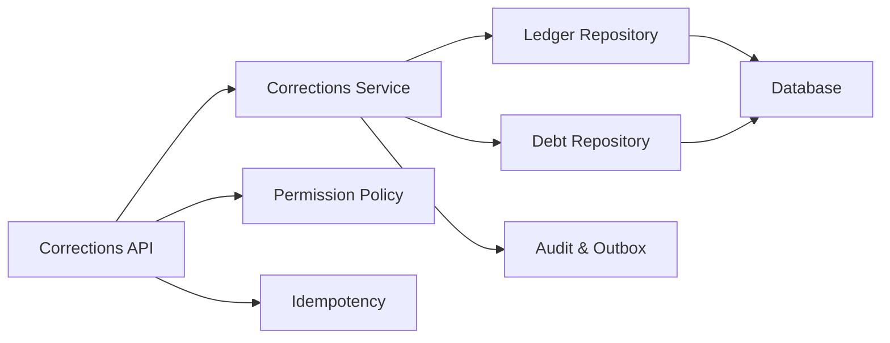

# Corrections Service

<cite>
**Referenced Files in This Document**
- [corrections.ts](file://src/server/services/corrections.ts)
- [corrections route.ts](file://src/app/api/v1/records/[recordId]/corrections/route.ts)
- [ledger.repository.ts](file://src/server/repositories/ledger.repository.ts)
- [debt.repository.ts](file://src/server/repositories/debt.repository.ts)
- [record detail route.ts](file://src/app/api/v1/records/[recordId]/route.ts)
- [corrections.test.ts](file://tests/corrections.test.ts)
- [policy.ts](file://src/server/permissions/policy.ts)
</cite>

## Table of Contents
1. [Introduction](#introduction)
2. [Project Structure](#project-structure)
3. [Core Components](#core-components)
4. [Architecture Overview](#architecture-overview)
5. [Detailed Component Analysis](#detailed-component-analysis)
6. [Dependency Analysis](#dependency-analysis)
7. [Performance Considerations](#performance-considerations)
8. [Troubleshooting Guide](#troubleshooting-guide)
9. [Conclusion](#conclusion)

## Introduction
The corrections service manages changes to already confirmed ledger entries without destroying historical accuracy. Instead of overwriting posted records, it either:
- Restates selected fields and creates a new versioned snapshot for a correction.
- Marks a record as reversed so it stops feeding derived totals such as cash summaries and customer balances.

This design ensures that financial history remains auditable, concurrent edits are safe, and downstream systems (reports, deni obligations, inventory totals) stay consistent with the current state of the ledger.

## Project Structure
The corrections capability spans an API endpoint, a domain service, repository helpers for ledger and debt data, and tests that validate behavior across tenants, versions, and related accounting artifacts.

**Diagram sources**
- [corrections route.ts:19-129](file://src/app/api/v1/records/[recordId]/corrections/route.ts#L19-L129)
- [corrections.ts:281-403](file://src/server/services/corrections.ts#L281-L403)
- [corrections.ts:421-486](file://src/server/services/corrections.ts#L421-L486)
- [ledger.repository.ts:558-637](file://src/server/repositories/ledger.repository.ts#L558-L637)
- [debt.repository.ts:160-222](file://src/server/repositories/debt.repository.ts#L160-L222)

**Section sources**
- [corrections route.ts:1-129](file://src/app/api/v1/records/[recordId]/corrections/route.ts#L1-L129)
- [corrections.ts:1-514](file://src/server/services/corrections.ts#L1-L514)
- [ledger.repository.ts:1-696](file://src/server/repositories/ledger.repository.ts#L1-L696)
- [debt.repository.ts:1-386](file://src/server/repositories/debt.repository.ts#L1-L386)

## Core Components
- **Corrections Service**: Implements `applyCorrection`, `correctRecord`, `reverseRecord`, `restateDeniAfterCorrection`, `correctedCustomerId`, and `recordHistory`. It defines allowed correction fields, reversible record types, and concurrency checks.
- **Corrections API Endpoint**: Validates input, enforces idempotency, requires permission, and returns corrected or reversed record results.
- **Ledger Repository**: Persists confirmed records, version rows, typed details, and provides snapshot and update functions used by corrections.
- **Debt Repository**: Manages customers, obligations, payments, and restatement logic needed when amounts change or payments are reversed.
- **Record Detail Endpoint**: Exposes current record data, deni position, source evidence, audit events, and full version history for reviewers.

**Section sources**
- [corrections.ts:54-94](file://src/server/services/corrections.ts#L54-L94)
- [corrections.ts:281-403](file://src/server/services/corrections.ts#L281-L403)
- [corrections.ts:421-513](file://src/server/services/corrections.ts#L421-L513)
- [corrections route.ts:19-129](file://src/app/api/v1/records/[recordId]/corrections/route.ts#L19-L129)
- [ledger.repository.ts:20-54](file://src/server/repositories/ledger.repository.ts#L20-L54)
- [ledger.repository.ts:558-637](file://src/server/repositories/ledger.repository.ts#L558-L637)
- [debt.repository.ts:23-46](file://src/server/repositories/debt.repository.ts#L23-L46)
- [record detail route.ts:28-114](file://src/app/api/v1/records/[recordId]/route.ts#L28-L114)

## Architecture Overview
The corrections workflow is a controlled mutation path for posted records. The client proposes a change with a reason and the version it viewed; the server validates permissions, applies business rules, updates the ledger safely, records an audit event, and emits an outbox event.

**Diagram sources**
- [corrections route.ts:67-129](file://src/app/api/v1/records/[recordId]/corrections/route.ts#L67-L129)
- [corrections.ts:281-403](file://src/server/services/corrections.ts#L281-L403)
- [corrections.ts:421-486](file://src/server/services/corrections.ts#L421-L486)
- [ledger.repository.ts:558-637](file://src/server/repositories/ledger.repository.ts#L558-L637)
- [debt.repository.ts:160-222](file://src/server/repositories/debt.repository.ts#L160-L222)

## Detailed Component Analysis

### Corrections Service
The service is the central authority for correcting or reversing posted records. It separates validation from persistence and ensures every change is transactional, versioned, and audited.

Key responsibilities:
- Define allowed correction fields and reversible record types.
- Validate that only posted records can be adjusted.
- Prevent unsupported field corrections and empty corrections.
- Resolve or create customers when a correction introduces or changes a debtor.
- Keep deni obligations consistent with corrected amounts.
- Create version snapshots and audit events.
- Emit outbox events for downstream consumers.

**Diagram sources**
- [corrections.ts:54-94](file://src/server/services/corrections.ts#L54-L94)
- [corrections.ts:169-233](file://src/server/services/corrections.ts#L169-L233)
- [corrections.ts:242-272](file://src/server/services/corrections.ts#L242-L272)
- [corrections.ts:281-403](file://src/server/services/corrections.ts#L281-L403)
- [corrections.ts:421-486](file://src/server/services/corrections.ts#L421-L486)
- [ledger.repository.ts:202-302](file://src/server/repositories/ledger.repository.ts#L202-L302)
- [ledger.repository.ts:558-637](file://src/server/repositories/ledger.repository.ts#L558-L637)
- [debt.repository.ts:160-222](file://src/server/repositories/debt.repository.ts#L160-L222)

#### Allowed Modifications
Only a defined subset of fields may be corrected on a posted record. Stock quantity is intentionally excluded because stock movement quantities are evidence stored separately; changing them would rewrite physical inventory history. Quantity changes should go through reversal and re-entry.

Allowed correction fields include monetary amounts, timestamps, descriptions, categories, payee, customer references, payment status/method, paid amounts, due dates, and notes.

**Section sources**
- [corrections.ts:74-94](file://src/server/services/corrections.ts#L74-L94)
- [corrections.ts:149-159](file://src/server/services/corrections.ts#L149-L159)

#### Concurrency Handling
Every correction uses the client-supplied `expectedVersion`. The repository update function only succeeds when the stored version matches the expected version. If two reviewers edit the same record concurrently, the second request fails with a version conflict and must reload the record.

**Section sources**
- [corrections.ts:274-322](file://src/server/services/corrections.ts#L274-L322)
- [ledger.repository.ts:558-582](file://src/server/repositories/ledger.repository.ts#L558-L582)
- [corrections.test.ts:243-263](file://tests/corrections.test.ts#L243-L263)

#### Deni Obligation Consistency
When a sale or debt-created record is corrected, the service recalculates what the customer owes. If no obligation exists but the corrected amount leaves money owed, it creates one. If an obligation already has payments applied, the service refuses to reduce the original amount below what was paid.

**Section sources**
- [corrections.ts:161-233](file://src/server/services/corrections.ts#L161-L233)
- [debt.repository.ts:160-222](file://src/server/repositories/debt.repository.ts#L160-L222)
- [corrections.test.ts:152-241](file://tests/corrections.test.ts#L152-L241)

#### Reversals
Reversals mark a record as reversed rather than deleting it. Reversed records stop feeding derived totals because reports and balances read only posted records. Reversals also void associated obligations and recompute obligation states when a debt payment is reversed.

**Section sources**
- [corrections.ts:96-102](file://src/server/services/corrections.ts#L96-L102)
- [corrections.ts:405-486](file://src/server/services/corrections.ts#L405-L486)
- [corrections.test.ts:338-462](file://tests/corrections.test.ts#L338-L462)

#### Version History and Reporting
The service exposes `recordHistory`, which returns each version’s change kind, actor, reason code, reason note, snapshot, and timestamp. The record detail endpoint includes this history alongside current values, deni position, source evidence, and audit events.

**Section sources**
- [corrections.ts:488-513](file://src/server/services/corrections.ts#L488-L513)
- [record detail route.ts:28-114](file://src/app/api/v1/records/[recordId]/route.ts#L28-L114)

### Corrections API Endpoint
The endpoint accepts correction requests, validates the schema, enforces idempotency, checks permissions, and delegates to the corrections service. It treats validation issues returned by the service as validation failures rather than saved changes.

Important behaviors:
- Requires `Idempotency-Key` header scoped per record.
- Rejects reversals that include changed fields.
- Requires changed fields for corrections.
- Requires a reason note when the reason code is generic.
- Returns corrected/reversed record metadata including status, version, amount, and currency.

**Section sources**
- [corrections route.ts:19-65](file://src/app/api/v1/records/[recordId]/corrections/route.ts#L19-L65)
- [corrections route.ts:67-129](file://src/app/api/v1/records/[recordId]/corrections/route.ts#L67-L129)

### Data Model for Versioned Records
Confirmed ledger records live in `ledger_records`. Each modification creates a row in `ledger_record_versions` containing a snapshot of the record at that version. Reports and totals always filter by `status = 'posted'`, which makes reversals effective without rewriting history.

**Diagram sources**
- [ledger.repository.ts:20-54](file://src/server/repositories/ledger.repository.ts#L20-L54)
- [ledger.repository.ts:604-637](file://src/server/repositories/ledger.repository.ts#L604-L637)
- [debt.repository.ts:13-46](file://src/server/repositories/debt.repository.ts#L13-L46)

**Section sources**
- [ledger.repository.ts:1-7](file://src/server/repositories/ledger.repository.ts#L1-L7)
- [ledger.repository.ts:20-54](file://src/server/repositories/ledger.repository.ts#L20-L54)
- [ledger.repository.ts:604-654](file://src/server/repositories/ledger.repository.ts#L604-L654)
- [debt.repository.ts:13-46](file://src/server/repositories/debt.repository.ts#L13-L46)

### Approval Workflow Context
The corrections service itself does not implement a multi-step approval workflow. A correction is applied immediately after permission and validation succeed. Review workflows exist around proposals before confirmation, but once a record is confirmed and posted, corrections are direct mutations guarded by permissions, version checks, and audit trails.

Permissions required:
- `records.correct` is checked before applying a correction.

**Section sources**
- [corrections route.ts:67-79](file://src/app/api/v1/records/[recordId]/corrections/route.ts#L67-L79)
- [policy.ts:84-104](file://src/server/permissions/policy.ts#L84-L104)

### Examples of Correction Creation
The test suite demonstrates realistic correction scenarios:
- Correcting an amount while preserving the previous snapshot.
- Restating deni when a corrected amount changes what a customer owes.
- Settling deni when a correction removes the outstanding balance.
- Opening deni when a correction turns a paid sale into an unpaid one.
- Refusing to reduce a debt below already applied payments.
- Detecting stale versions and preventing overwrites.
- Returning validation issues without writing changes.
- Refusing unsupported field corrections.
- Enforcing tenant isolation.

These examples show how the service behaves under normal operations, boundary conditions, and adversarial inputs.

**Section sources**
- [corrections.test.ts:128-336](file://tests/corrections.test.ts#L128-L336)

### Examples of Reversal Behavior
The tests also cover reversals:
- A reversed sale drops from cash totals and deni.
- A reversed sale disappears from period totals used by reports.
- Reversing a debt payment reopens a settled obligation.
- Reversing the same record twice is refused.
- Notes cannot be reversed.

**Section sources**
- [corrections.test.ts:338-462](file://tests/corrections.test.ts#L338-L462)

## Dependency Analysis
The corrections service depends on several layers:

Coupling and cohesion:
- The service encapsulates correction business rules and coordinates repositories.
- The ledger repository owns confirmed-record persistence and versioning.
- The debt repository owns obligation lifecycle and balance-related queries.
- The API layer handles HTTP concerns, validation, and idempotency.
- Permissions are enforced at the API boundary.

Potential risks:
- Tight coupling between correction logic and debt obligation state requires careful testing when amounts or payment statuses change.
- Version conflicts protect against silent overwrites but require clients to handle reload prompts.

**Diagram sources**
- [corrections route.ts:67-129](file://src/app/api/v1/records/[recordId]/corrections/route.ts#L67-L129)
- [corrections.ts:281-403](file://src/server/services/corrections.ts#L281-L403)
- [ledger.repository.ts:558-637](file://src/server/repositories/ledger.repository.ts#L558-L637)
- [debt.repository.ts:160-222](file://src/server/repositories/debt.repository.ts#L160-L222)
- [policy.ts:84-104](file://src/server/permissions/policy.ts#L84-L104)

**Section sources**
- [corrections.ts:16-52](file://src/server/services/corrections.ts#L16-L52)
- [corrections route.ts:11-18](file://src/app/api/v1/records/[recordId]/corrections/route.ts#L11-L18)

## Performance Considerations
- Corrections run inside database transactions, ensuring atomicity of ledger updates, version snapshots, audit events, and outbox events.
- Version checks use a single-row conditional update, making concurrency detection efficient.
- Snapshot storage preserves historical accuracy but adds JSON serialization overhead; snapshots are essential for auditability.
- Report totals read only posted records, so reversals avoid expensive compensating entries.
- Customer balance and obligation queries join posted records and payments; large datasets benefit from proper indexing on business scope, record status, and customer identifiers.

[No sources needed since this section provides general guidance]

## Troubleshooting Guide
Common issues and their meanings:

| Symptom | Likely Cause | Resolution |
|---|---|---|
| Version conflict error when applying a correction | Another reviewer changed the record after the client loaded it | Reload the record and retry with the latest version |
| Validation failure saying some fields cannot be corrected | Attempted to correct unsupported fields such as stock quantity | Use reversal and re-entry for quantity changes |
| Empty correction rejected | No fields were provided for a correction | Provide at least one changed field |
| Generic reason code requires explanation | Reason code is `other` without a note | Add a reason note explaining the correction |
| Reversal rejected for non-financial record type | Trying to reverse a note or unsupported type | Only financial record types can be reversed |
| Cannot reduce debt below applied payments | Payments already exist against the obligation | Reverse the record instead of reducing the obligation below paid amounts |
| Cross-tenant correction fails | Request targets another business’s record | Ensure the request belongs to the correct tenant |

**Section sources**
- [corrections.ts:132-159](file://src/server/services/corrections.ts#L132-L159)
- [corrections.ts:207-213](file://src/server/services/corrections.ts#L207-L213)
- [corrections.ts:345-350](file://src/server/services/corrections.ts#L345-L350)
- [corrections.ts:431-436](file://src/server/services/corrections.ts#L431-L436)
- [corrections.test.ts:205-263](file://tests/corrections.test.ts#L205-L263)
- [corrections.test.ts:313-335](file://tests/corrections.test.ts#L313-L335)

## Conclusion
The corrections service implements a robust, auditable mechanism for modifying confirmed ledger entries. It preserves history through versioned snapshots, prevents concurrent overwrites with optimistic locking, keeps deni obligations consistent with corrected amounts, and integrates reversals into reporting and balance calculations. For users, this means corrections are safe, traceable, and compatible with downstream accounting systems. For developers, the service provides clear boundaries between validation, business rules, persistence, and auditing, with comprehensive tests covering both normal and edge-case scenarios.

[No sources needed since this section summarizes without analyzing specific files]