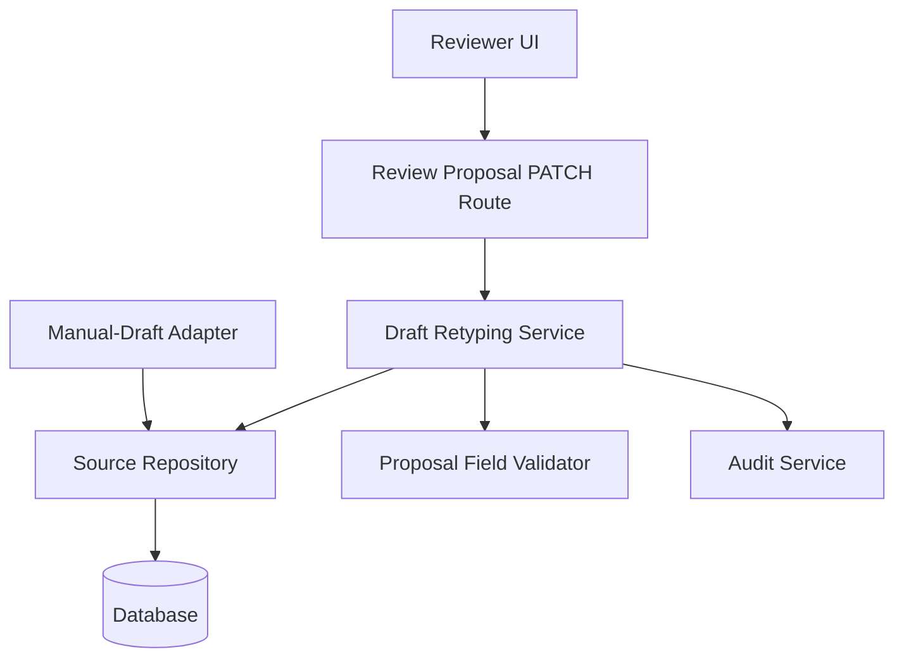
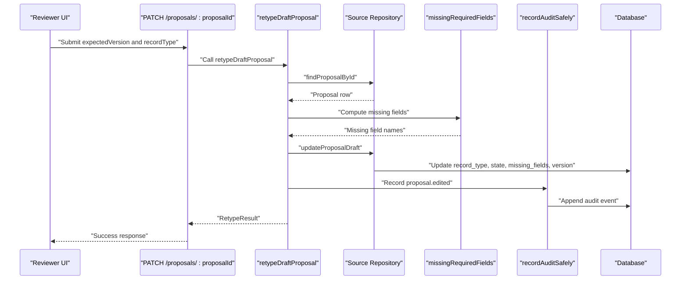
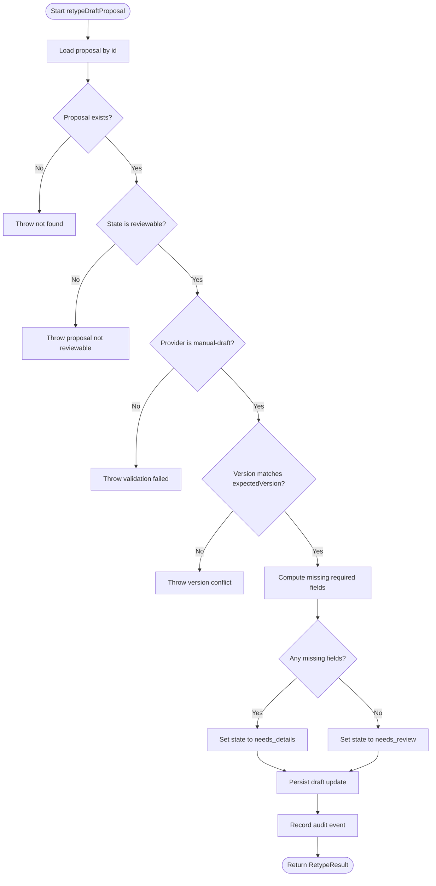
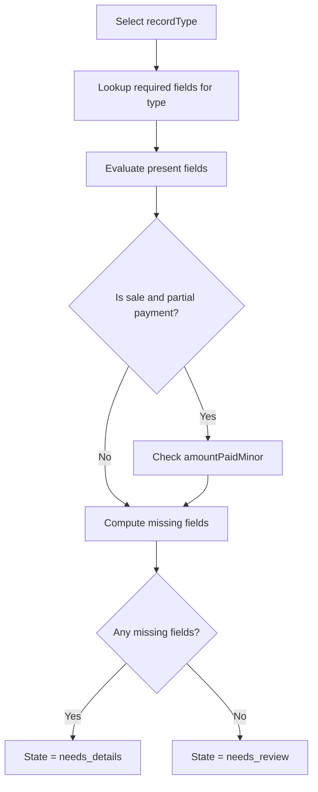
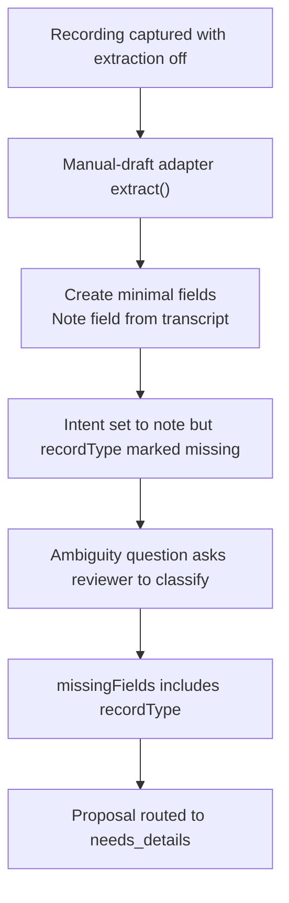
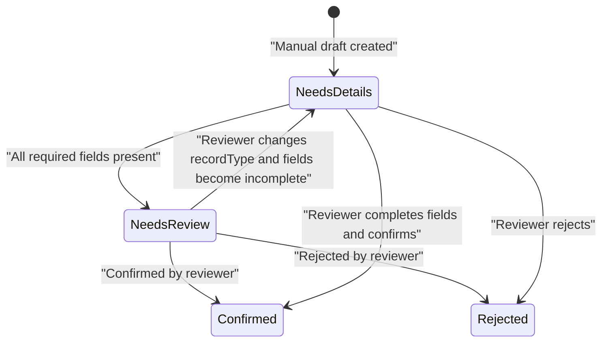
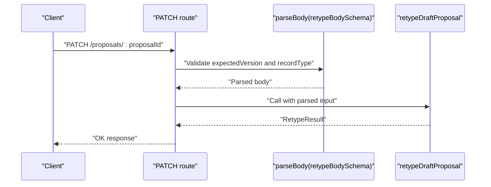
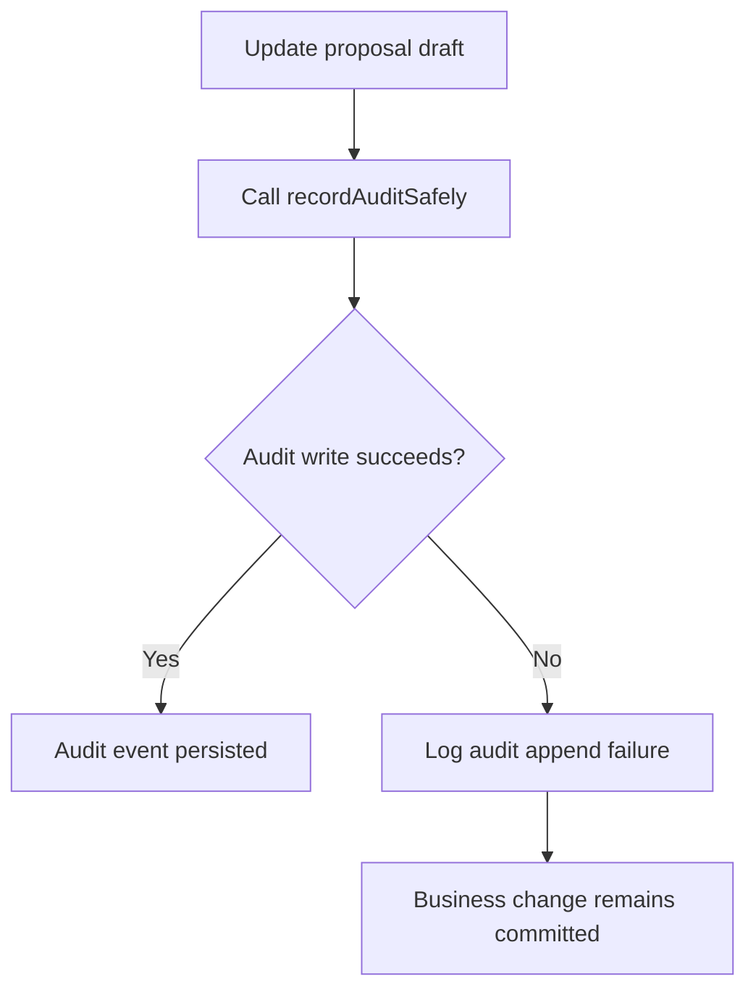
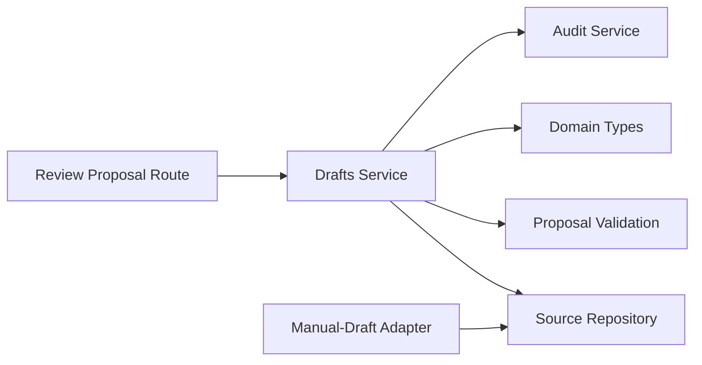

# Draft Management

<cite>
**Referenced Files in This Document**
- [drafts.ts](file://src/server/services/drafts.ts)
- [route.ts](file://src/app/api/v1/review/proposals/[proposalId]/route.ts)
- [manual-draft-adapter.ts](file://src/server/integrations/extraction/manual-draft-adapter.ts)
- [proposal.ts](file://src/lib/validation/proposal.ts)
- [types.ts](file://src/server/domain/types.ts)
- [source.repository.ts](file://src/server/repositories/source.repository.ts)
- [audit.ts](file://src/server/services/audit.ts)
</cite>

## Table of Contents
1. [Introduction](#introduction)
2. [Project Structure](#project-structure)
3. [Core Components](#core-components)
4. [Architecture Overview](#architecture-overview)
5. [Detailed Component Analysis](#detailed-component-analysis)
6. [Dependency Analysis](#dependency-analysis)
7. [Performance Considerations](#performance-considerations)
8. [Troubleshooting Guide](#troubleshooting-guide)
9. [Conclusion](#conclusion)

## Introduction
This document explains the draft management service that handles incomplete proposals created from manual recordings when structured extraction is disabled. It focuses on the `retypeDraftProposal` function, which allows reviewers to classify a manual draft by setting its record type and validating required fields. It also documents how drafts are created, the validation rules for required fields, state transitions between `needs_details` and `needs_review`, error handling for version conflicts and non-reviewable proposals, audit trail logging, and the `RetypeInput` and `RetypeResult` interfaces.

The system intentionally prevents modification of model-generated proposals through reclassification: only proposals produced by the manual-draft adapter can be retyped.

## Project Structure
The draft management feature spans several layers:

- API route layer: exposes a PATCH endpoint for reclassifying a proposal.
- Service layer: implements business logic for retyping a draft.
- Validation layer: defines required fields per record type.
- Domain layer: defines allowed record types, proposal states, and reviewable states.
- Repository layer: persists proposals and updates draft metadata.
- Extraction integration: creates manual drafts when extraction is off.
- Audit service: records changes with before/after snapshots.

**Diagram sources**
- [route.ts:95-113](file://src/app/api/v1/review/proposals/[proposalId]/route.ts#L95-L113)
- [drafts.ts:35-73](file://src/server/services/drafts.ts#L35-L73)
- [proposal.ts:274-312](file://src/lib/validation/proposal.ts#L274-L312)
- [manual-draft-adapter.ts:23-50](file://src/server/integrations/extraction/manual-draft-adapter.ts#L23-L50)
- [source.repository.ts:658-678](file://src/server/repositories/source.repository.ts#L658-L678)
- [audit.ts:49-66](file://src/server/services/audit.ts#L49-L66)

**Section sources**
- [route.ts:95-113](file://src/app/api/v1/review/proposals/[proposalId]/route.ts#L95-L113)
- [drafts.ts:1-74](file://src/server/services/drafts.ts#L1-L74)
- [manual-draft-adapter.ts:1-52](file://src/server/integrations/extraction/manual-draft-adapter.ts#L1-L52)
- [proposal.ts:274-312](file://src/lib/validation/proposal.ts#L274-L312)
- [types.ts:8-47](file://src/server/domain/types.ts#L8-L47)
- [source.repository.ts:658-678](file://src/server/repositories/source.repository.ts#L658-L678)
- [audit.ts:1-79](file://src/server/services/audit.ts#L1-L79)

## Core Components
- **Draft retyping service**: Implements `retypeDraftProposal`, validates input, enforces business rules, computes missing fields, updates draft state, and logs an audit event.
- **API route**: Parses request body using `retypeBodySchema`, calls the service, and returns the result.
- **Manual-draft adapter**: Creates proposals without guessed record types when extraction is disabled, routing them to `needs_details`.
- **Validation module**: Defines required fields per record type and computes missing fields.
- **Domain types**: Defines allowed record types, proposal states, and reviewable states.
- **Repository**: Persists proposal updates and increments the optimistic version.
- **Audit service**: Records edits safely so failures do not roll back the business change.

**Section sources**
- [drafts.ts:23-73](file://src/server/services/drafts.ts#L23-L73)
- [route.ts:95-113](file://src/app/api/v1/review/proposals/[proposalId]/route.ts#L95-L113)
- [manual-draft-adapter.ts:23-50](file://src/server/integrations/extraction/manual-draft-adapter.ts#L23-L50)
- [proposal.ts:274-312](file://src/lib/validation/proposal.ts#L274-L312)
- [types.ts:8-47](file://src/server/domain/types.ts#L8-L47)
- [source.repository.ts:658-678](file://src/server/repositories/source.repository.ts#L658-L678)
- [audit.ts:49-66](file://src/server/services/audit.ts#L49-L66)

## Architecture Overview
The retype workflow connects the reviewer’s UI to the database through a typed API route and a service that enforces domain rules.

**Diagram sources**
- [route.ts:95-113](file://src/app/api/v1/review/proposals/[proposalId]/route.ts#L95-L113)
- [drafts.ts:35-73](file://src/server/services/drafts.ts#L35-L73)
- [proposal.ts:274-312](file://src/lib/validation/proposal.ts#L274-L312)
- [source.repository.ts:658-678](file://src/server/repositories/source.repository.ts#L658-L678)
- [audit.ts:49-66](file://src/server/services/audit.ts#L49-L66)

## Detailed Component Analysis

### Retype Input and Result Interfaces
The service uses two TypeScript interfaces to define the contract for reclassifying a draft:

- `RetypeInput`:
  - `proposalId`: The identifier of the proposal to reclassify.
  - `expectedVersion`: Optimistic concurrency token used to prevent stale writes.
  - `recordType`: The new classification chosen by the reviewer.

- `RetypeResult`:
  - `recordType`: The updated record type.
  - `state`: The resulting proposal state after validation.
  - `missingFields`: List of required fields still missing for the selected record type.

These interfaces ensure the API route and service share a stable contract and that callers receive enough information to guide the next action.

**Section sources**
- [drafts.ts:23-33](file://src/server/services/drafts.ts#L23-L33)

### Retype Workflow and Business Rules
The `retypeDraftProposal` function performs these steps:

1. Load the proposal scoped to the current business context.
2. Reject if the proposal does not exist.
3. Reject if the proposal is already decided or otherwise not reviewable.
4. Reject if the proposal was not produced by the manual-draft adapter.
5. Reject if the submitted `expectedVersion` differs from the stored version.
6. Compute missing required fields based on the requested `recordType`.
7. Set state to `needs_details` if any required fields are missing; otherwise set it to `needs_review`.
8. Persist the updated draft, including the new record type, state, missing fields, and incremented version.
9. Record an audit event with before/after values.
10. Return the result to the caller.

**Diagram sources**
- [drafts.ts:35-73](file://src/server/services/drafts.ts#L35-L73)

**Section sources**
- [drafts.ts:35-73](file://src/server/services/drafts.ts#L35-L73)

### Required Fields and Validation Logic
Required fields are defined per record type and evaluated against normalized proposal fields. The validator maps logical field names to actual proposal properties:

- `sale`: requires amount, occurrence time, and payment status. If payment status is partial, it also requires the partial amount.
- `expense`: requires amount, occurrence time, and category.
- `debt_created`: requires amount, occurrence time, and customer identification.
- `debt_payment`: requires amount, occurrence time, and customer identification.
- `stock_movement`: requires item identification, quantity, unit, and movement type.
- `note`: requires note text.

When `retypeDraftProposal` selects a record type, it recomputes missing fields. If any are missing, the proposal remains in `needs_details`; otherwise it moves to `needs_review`.

**Diagram sources**
- [proposal.ts:274-312](file://src/lib/validation/proposal.ts#L274-L312)
- [drafts.ts:57-59](file://src/server/services/drafts.ts#L57-L59)

**Section sources**
- [proposal.ts:274-312](file://src/lib/validation/proposal.ts#L274-L312)
- [drafts.ts:57-59](file://src/server/services/drafts.ts#L57-L59)

### Draft Creation When Extraction Is Disabled
When structured extraction is disabled, the manual-draft adapter produces a proposal with:

- A provider name identifying it as a manual draft.
- No guessed record type intent.
- Only the transcript text copied into a note field when present.
- `recordType` reported as missing.
- An ambiguity question asking the reviewer to choose the recording’s purpose.
- Routing to `needs_details` because required fields are missing.

This design keeps the pipeline uniform while ensuring human classification happens before ledger posting.

**Diagram sources**
- [manual-draft-adapter.ts:23-50](file://src/server/integrations/extraction/manual-draft-adapter.ts#L23-L50)

**Section sources**
- [manual-draft-adapter.ts:1-52](file://src/server/integrations/extraction/manual-draft-adapter.ts#L1-L52)

### State Transitions Between `needs_details` and `needs_review`
The relevant proposal states are:

- `needs_review`: Ready for final reviewer confirmation.
- `needs_details`: Missing required fields; requires more information.
- `duplicate`: Duplicate candidate awaiting resolution.
- Other states such as `confirmed`, `rejected`, `failed`, `queued`, and `processing` are not part of the retype flow.

Only proposals in reviewable states can be retyped. After reclassification:

- If required fields remain missing, the state becomes `needs_details`.
- If all required fields are present, the state becomes `needs_review`.

**Diagram sources**
- [types.ts:21-47](file://src/server/domain/types.ts#L21-L47)
- [drafts.ts:43-59](file://src/server/services/drafts.ts#L43-L59)

**Section sources**
- [types.ts:21-47](file://src/server/domain/types.ts#L21-L47)
- [drafts.ts:43-59](file://src/server/services/drafts.ts#L43-L59)

### API Contract for Retyping
The PATCH endpoint under `/api/v1/review/proposals/:proposalId` accepts:

- `proposalId`: URL parameter identifying the proposal.
- `expectedVersion`: Expected optimistic version from the client.
- `recordType`: New record type chosen by the reviewer.

It validates the request body using `retypeBodySchema`, checks reviewer permissions, calls `retypeDraftProposal`, and returns the result.

**Diagram sources**
- [route.ts:95-113](file://src/app/api/v1/review/proposals/[proposalId]/route.ts#L95-L113)

**Section sources**
- [route.ts:95-113](file://src/app/api/v1/review/proposals/[proposalId]/route.ts#L95-L113)

### Error Handling
The service throws distinct errors for common failure cases:

- **Proposal not found**: Returned when the proposal ID does not exist in the tenant scope.
- **Proposal not reviewable**: Thrown when the proposal is already decided or outside reviewable states.
- **Non-reviewable provider**: Thrown when the proposal was not produced by the manual-draft adapter, preventing silent rewriting of model-generated proposals.
- **Version conflict**: Thrown when `expectedVersion` differs from the stored version, protecting against stale edits.

The repository also uses optimistic concurrency by incrementing the version during draft updates.

**Section sources**
- [drafts.ts:41-55](file://src/server/services/drafts.ts#L41-L55)
- [source.repository.ts:658-678](file://src/server/repositories/source.repository.ts#L658-L678)

### Audit Trail Logging
Every successful retype records an audit event with:

- Action: `proposal.edited`.
- Entity type: `proposal`.
- Entity ID: the proposal identifier.
- Actor user ID: the reviewer performing the edit.
- Before snapshot: previous `recordType` and `state`.
- After snapshot: new `recordType`, computed `state`, and `missingFields`.

Audit recording is wrapped in a safe helper so audit failures are logged rather than rolling back the business change.

**Diagram sources**
- [drafts.ts:62-70](file://src/server/services/drafts.ts#L62-L70)
- [audit.ts:49-66](file://src/server/services/audit.ts#L49-L66)

**Section sources**
- [drafts.ts:62-70](file://src/server/services/drafts.ts#L62-L70)
- [audit.ts:1-79](file://src/server/services/audit.ts#L1-L79)

## Dependency Analysis
The draft management components have clear boundaries:

- The API route depends on parsing, permission checks, and the draft service.
- The draft service depends on repositories, validation utilities, domain types, and audit logging.
- The manual-draft adapter depends on the proposal schema and extraction port.
- The repository abstracts database operations and provides optimistic versioning.
- Domain types centralize allowed values for record types and proposal states.

**Diagram sources**
- [route.ts:95-113](file://src/app/api/v1/review/proposals/[proposalId]/route.ts#L95-L113)
- [drafts.ts:10-21](file://src/server/services/drafts.ts#L10-L21)
- [manual-draft-adapter.ts:13-18](file://src/server/integrations/extraction/manual-draft-adapter.ts#L13-L18)

**Section sources**
- [route.ts:95-113](file://src/app/api/v1/review/proposals/[proposalId]/route.ts#L95-L113)
- [drafts.ts:10-21](file://src/server/services/drafts.ts#L10-L21)
- [manual-draft-adapter.ts:13-18](file://src/server/integrations/extraction/manual-draft-adapter.ts#L13-L18)

## Performance Considerations
- The retype operation performs one proposal lookup, one validation pass, one database update, and one audit write.
- Database updates increment the optimistic version, avoiding expensive locking while preventing concurrent overwrites.
- Missing-field computation is lightweight and based on a small fixed mapping per record type.
- Audit writing is isolated from the main transactional path via a safe wrapper, reducing risk of rollback due to logging failures.

[No sources needed since this section provides general guidance]

## Troubleshooting Guide
Common issues and their likely causes:

- **Proposal not found**: Verify the proposal ID belongs to the current tenant and exists.
- **Proposal not reviewable**: The proposal may already be confirmed, rejected, or otherwise finalized.
- **Only an in-app recording can be reclassified**: The proposal was generated by a model or another provider; only manual-draft adapters support reclassification.
- **Version conflict**: The client opened a stale view. Reload the proposal and resubmit with the current version.
- **Proposal stays in needs_details**: Required fields for the selected record type are still missing. Complete the required fields according to the validation rules.

**Section sources**
- [drafts.ts:41-55](file://src/server/services/drafts.ts#L41-L55)
- [proposal.ts:274-312](file://src/lib/validation/proposal.ts#L274-L312)

## Conclusion
The draft management service provides a controlled pathway for classifying manual recordings when extraction is disabled. `retypeDraftProposal` ensures that only eligible manual drafts can be reclassified, validates required fields per record type, transitions proposals between `needs_details` and `needs_review`, protects against stale edits with optimistic versioning, and records an immutable audit trail. Model-generated proposals remain protected from silent reclassification, preserving data provenance and reviewer trust.

[No sources needed since this section summarizes without analyzing specific files]