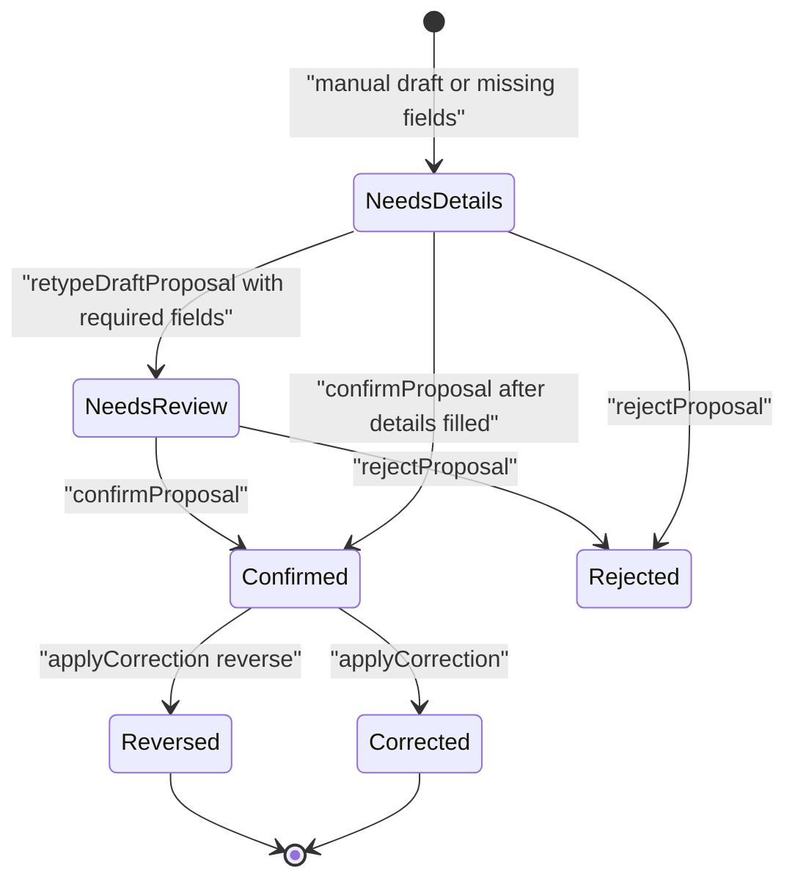
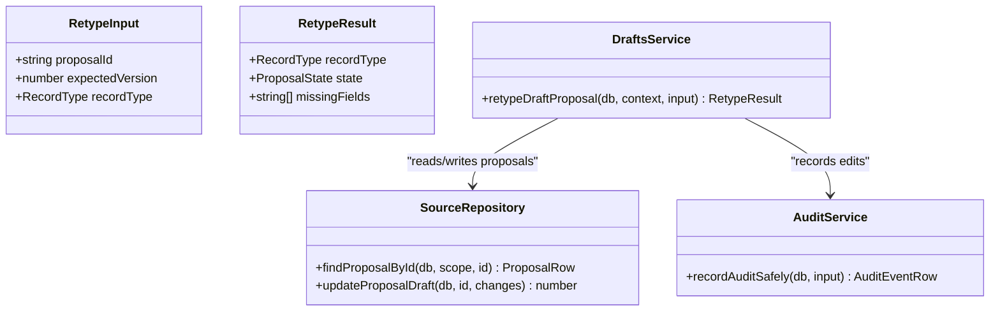
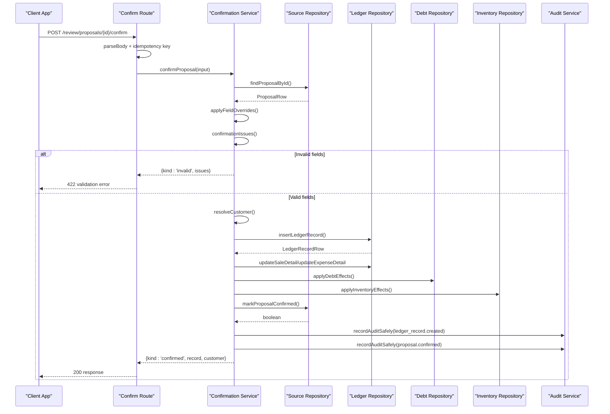
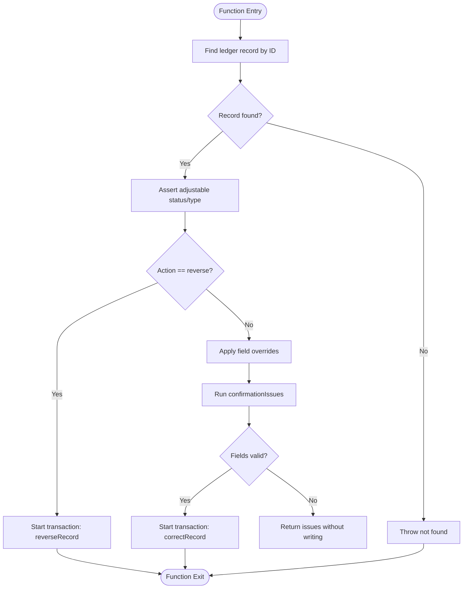
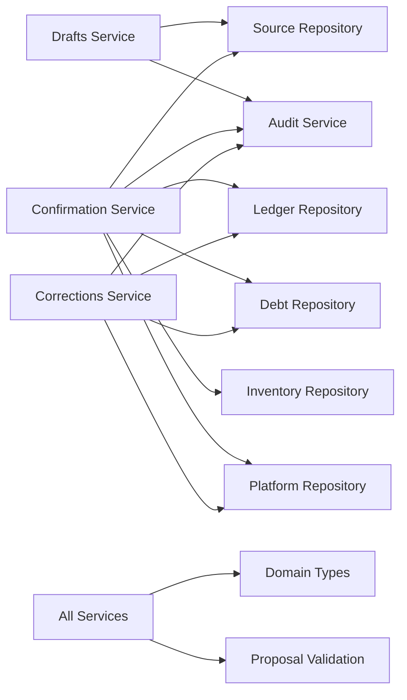

# Proposal Management Services

<cite>
**Referenced Files in This Document**
- [drafts.ts](file://src/server/services/drafts.ts)
- [confirmation.ts](file://src/server/services/confirmation.ts)
- [corrections.ts](file://src/server/services/corrections.ts)
- [types.ts](file://src/server/domain/types.ts)
- [proposal.ts](file://src/lib/validation/proposal.ts)
- [source.repository.ts](file://src/server/repositories/source.repository.ts)
- [manual-draft-adapter.ts](file://src/server/integrations/extraction/manual-draft-adapter.ts)
- [audit.ts](file://src/server/services/audit.ts)
- [confirm route.ts](file://src/app/api/v1/review/proposals/[proposalId]/confirm/route.ts)
- [corrections route.ts](file://src/app/api/v1/records/[recordId]/corrections/route.ts)
- [confirmation.test.ts](file://tests/confirmation.test.ts)
- [corrections.test.ts](file://tests/corrections.test.ts)
</cite>

## Table of Contents
1. [Introduction](#introduction)
2. [Project Structure](#project-structure)
3. [Core Components](#core-components)
4. [Architecture Overview](#architecture-overview)
5. [Detailed Component Analysis](#detailed-component-analysis)
6. [Dependency Analysis](#dependency-analysis)
7. [Performance Considerations](#performance-considerations)
8. [Troubleshooting Guide](#troubleshooting-guide)
9. [Conclusion](#conclusion)

## Introduction
This document explains the proposal management services that handle the complete lifecycle of business proposals: from manual or extracted drafts, through review and confirmation, to confirmed ledger entries and later corrections or reversals. The system is designed for financial integrity: reviewers classify incomplete records, confirmations atomically post ledger data with audit trails, and corrections preserve history without destructive edits.

Key responsibilities:
- Drafts service: classifies manual draft recordings and validates required fields before confirmation.
- Confirmation service: transitions a proposal into an immutable ledger record inside a transaction, handling customers, debt obligations, inventory movements, audit events, and idempotency.
- Corrections service: supports versioned corrections and reversals of posted records while keeping derived totals consistent.

## Project Structure
The proposal workflow spans services, repositories, validation schemas, domain types, API routes, and tests.

```mermaid
graph TB
subgraph "API Layer"
ConfirmRoute["Confirm Proposal Route"]
CorrectionRoute["Correction Route"]
end
subgraph "Services"
DraftsService["Drafts Service<br/>retypeDraftProposal"]
ConfirmationService["Confirmation Service<br/>confirmProposal / rejectProposal"]
CorrectionsService["Corrections Service<br/>applyCorrection / recordHistory"]
AuditService["Audit Service<br/>recordAuditSafely"]
end
subgraph "Repositories"
SourceRepo["Source Repository<br/>proposals, source events"]
LedgerRepo["Ledger Repository<br/>ledger records, versions"]
DebtRepo["Debt Repository<br/>customers, obligations, payments"]
InventoryRepo["Inventory Repository<br/>items, movements"]
PlatformRepo["Platform Repository<br/>outbox, audit append"]
end
subgraph "Domain & Validation"
DomainTypes["Domain Types<br/>states, record types"]
ProposalValidation["Proposal Validation<br/>schemas, missing fields"]
end
subgraph "Integrations"
ManualDraftAdapter["Manual Draft Adapter"]
end
ConfirmRoute --> ConfirmationService
CorrectionRoute --> CorrectionsService
DraftsService --> SourceRepo
ConfirmationService --> SourceRepo
ConfirmationService --> LedgerRepo
ConfirmationService --> DebtRepo
ConfirmationService --> InventoryRepo
ConfirmationService --> PlatformRepo
CorrectionsService --> LedgerRepo
CorrectionsService --> DebtRepo
CorrectionsService --> PlatformRepo
ConfirmationService --> AuditService
CorrectionsService --> AuditService
DraftsService --> AuditService
DraftsService --> ManualDraftAdapter
ConfirmationService --> ProposalValidation
CorrectionsService --> ProposalValidation
AllServices --> DomainTypes
```

**Diagram sources**
- [confirm route.ts:18-73](file://src/app/api/v1/review/proposals/[proposalId]/confirm/route.ts#L18-L73)
- [corrections route.ts:67-129](file://src/app/api/v1/records/[recordId]/corrections/route.ts#L67-L129)
- [drafts.ts:35-73](file://src/server/services/drafts.ts#L35-L73)
- [confirmation.ts:318-456](file://src/server/services/confirmation.ts#L318-L456)
- [corrections.ts:281-403](file://src/server/services/corrections.ts#L281-L403)
- [audit.ts:31-66](file://src/server/services/audit.ts#L31-L66)
- [source.repository.ts:446-771](file://src/server/repositories/source.repository.ts#L446-L771)
- [manual-draft-adapter.ts:23-50](file://src/server/integrations/extraction/manual-draft-adapter.ts#L23-L50)
- [proposal.ts:71-312](file://src/lib/validation/proposal.ts#L71-L312)
- [types.ts:8-111](file://src/server/domain/types.ts#L8-L111)

**Section sources**
- [drafts.ts:1-74](file://src/server/services/drafts.ts#L1-L74)
- [confirmation.ts:1-522](file://src/server/services/confirmation.ts#L1-L522)
- [corrections.ts:1-514](file://src/server/services/corrections.ts#L1-L514)
- [types.ts:8-111](file://src/server/domain/types.ts#L8-L111)
- [proposal.ts:71-312](file://src/lib/validation/proposal.ts#L71-L312)
- [source.repository.ts:446-771](file://src/server/repositories/source.repository.ts#L446-L771)
- [manual-draft-adapter.ts:1-52](file://src/server/integrations/extraction/manual-draft-adapter.ts#L1-L52)
- [audit.ts:1-79](file://src/server/services/audit.ts#L1-L79)
- [confirm route.ts:1-74](file://src/app/api/v1/review/proposals/[proposalId]/confirm/route.ts#L1-L74)
- [corrections route.ts:1-130](file://src/app/api/v1/records/[recordId]/corrections/route.ts#L1-L130)

## Core Components
- Drafts service: manages incomplete proposals created by the manual draft adapter. It allows a reviewer to classify a recording as a sale, expense, debt, stock movement, or note, then validates required fields and sets the proposal state accordingly.
- Confirmation service: the only path from a proposal to the ledger. It enforces human decisions, optimistic concurrency checks, atomic transactions, customer resolution, debt obligation creation, inventory effects, audit logging, and outbox event publishing.
- Corrections service: provides non-destructive corrections and reversals. Corrections update the latest ledger version with allowed fields; reversals mark records reversed so they drop out of derived totals. Both maintain version history and audit trails.

**Section sources**
- [drafts.ts:1-74](file://src/server/services/drafts.ts#L1-L74)
- [confirmation.ts:1-522](file://src/server/services/confirmation.ts#L1-L522)
- [corrections.ts:1-514](file://src/server/services/corrections.ts#L1-L514)

## Architecture Overview
The proposal lifecycle flows through these stages:
- Creation: manual capture or extraction produces a proposal. When extraction is off, the manual draft adapter creates a draft proposal with no guessed type, routed to needs_details.
- Classification: the drafts service reclassifies the draft and validates required fields. If fields are missing, the proposal remains needs_details; otherwise it moves to needs_review.
- Review: a reviewer confirms or rejects the proposal. Confirmation posts a ledger record and related side effects in one transaction. Rejection marks the proposal rejected with reason metadata.
- Post-review: confirmed records can be corrected (field restatement) or reversed (status change). Corrections and reversals are versioned and audited.

**Diagram sources**
- [types.ts:21-47](file://src/server/domain/types.ts#L21-L47)
- [drafts.ts:35-73](file://src/server/services/drafts.ts#L35-L73)
- [confirmation.ts:318-456](file://src/server/services/confirmation.ts#L318-L456)
- [corrections.ts:281-403](file://src/server/services/corrections.ts#L281-L403)

## Detailed Component Analysis

### Drafts Service: Retyping Manual Draft Proposals
The drafts service handles proposals produced by the manual draft adapter when structured extraction is disabled. It ensures only in-app recordings can be reclassified and prevents model proposals from being silently rewritten.

Key behavior:
- Finds the proposal by ID within the business scope.
- Rejects proposals not in reviewable states.
- Restricts reclassification to manual draft provider proposals.
- Enforces optimistic concurrency using expectedVersion.
- Computes missing required fields based on the chosen record type.
- Updates the proposal draft with new recordType, state, and missingFields.
- Records an audit event for proposal.edited.

Method signature summary:
- Function: retypeDraftProposal
- Parameters:
  - db: database connection
  - context: BusinessContext with businessId and userId
  - input: RetypeInput { proposalId, expectedVersion, recordType }
- Returns: Promise<RetypeResult> { recordType, state, missingFields }
- Errors:
  - Not found if proposal does not exist
  - Conflict if proposal is already decided
  - Validation failed if not a manual draft
  - Conflict if expectedVersion mismatches current version

State transition:
- From needs_details or needs_review to needs_details if required fields are missing.
- To needs_review if all required fields are present.

Validation rules:
- Uses missingRequiredFields from proposal validation schema.
- For partial sales, amountPaidMinor becomes required.

Concurrency handling:
- Uses expectedVersion to prevent stale overwrites.

Audit trail:
- Records proposal.edited with before/after values.

**Section sources**
- [drafts.ts:23-73](file://src/server/services/drafts.ts#L23-L73)
- [proposal.ts:274-312](file://src/lib/validation/proposal.ts#L274-L312)
- [source.repository.ts:662-678](file://src/server/repositories/source.repository.ts#L662-L678)
- [manual-draft-adapter.ts:23-50](file://src/server/integrations/extraction/manual-draft-adapter.ts#L23-L50)
- [audit.ts:31-66](file://src/server/services/audit.ts#L31-L66)

#### Class Diagram: Drafts Service

**Diagram sources**
- [drafts.ts:23-73](file://src/server/services/drafts.ts#L23-L73)
- [source.repository.ts:662-678](file://src/server/repositories/source.repository.ts#L662-L678)
- [audit.ts:31-66](file://src/server/services/audit.ts#L31-L66)

### Confirmation Service: Atomic Record Confirmation
The confirmation service is the sole path from a proposal to the ledger. It enforces:
- Human decision requirement via confirmedByUserId.
- Transactional integrity across ledger record creation, detail updates, debt effects, inventory effects, proposal state change, and audit events.
- Optimistic concurrency via expectedVersion.
- Idempotent confirmation returning already_confirmed when the proposal is already confirmed.

Method signatures:
- Function: confirmProposal
  - Parameters:
    - db: database connection
    - context: BusinessContext
    - input: ConfirmInput { proposalId, expectedVersion, confirmedByUserId, requestId?, reasonCode?, fields?, note? }
  - Returns: Promise<ConfirmResult>
    - kind: 'confirmed' | 'already_confirmed' | 'invalid'
    - record: LedgerRecordRow when confirmed
    - customer: CustomerRow|null when confirmed
    - issues: ValidationIssue[] when invalid
- Function: rejectProposal
  - Parameters:
    - db: database connection
    - context: BusinessContext
    - input: RejectInput { proposalId, expectedVersion, rejectedByUserId, reasonCode, reasonNote? }
  - Returns: Promise<ProposalRow>
- Helper: applyFieldOverrides
  - Applies reviewer-provided field overrides to proposal fields.
- Helper: unpaidMinor
  - Calculates remaining owed amount for sales.

Validation rules:
- Uses confirmationIssues which delegates to typedRecordForValidation and z schemas.
- Requires customer for debt_created, debt_payment, and unpaid/partial sales.
- Requires inventory item and positive quantity for stock_movement when inventory feature is enabled.

Side effects:
- Creates or reuses customer accounts.
- Creates obligations for debts and unpaid sales.
- Applies debt payments to oldest open obligations first.
- Records inventory movements when applicable.
- Emits outbox events for ledger.record_confirmed.
- Logs confirmation outcomes.

Concurrency handling:
- Version check before transaction.
- markProposalConfirmed uses version and reviewable states to prevent double confirmation.

Audit trail:
- Records ledger_record.created and proposal.confirmed.

**Section sources**
- [confirmation.ts:56-84](file://src/server/services/confirmation.ts#L56-L84)
- [confirmation.ts:86-122](file://src/server/services/confirmation.ts#L86-L122)
- [confirmation.ts:124-232](file://src/server/services/confirmation.ts#L124-L232)
- [confirmation.ts:234-316](file://src/server/services/confirmation.ts#L234-L316)
- [confirmation.ts:318-456](file://src/server/services/confirmation.ts#L318-L456)
- [confirmation.ts:464-521](file://src/server/services/confirmation.ts#L464-L521)
- [proposal.ts:161-264](file://src/lib/validation/proposal.ts#L161-L264)
- [source.repository.ts:723-738](file://src/server/repositories/source.repository.ts#L723-L738)

#### Sequence Diagram: Confirmation Flow

**Diagram sources**
- [confirm route.ts:18-73](file://src/app/api/v1/review/proposals/[proposalId]/confirm/route.ts#L18-L73)
- [confirmation.ts:318-456](file://src/server/services/confirmation.ts#L318-L456)
- [source.repository.ts:723-738](file://src/server/repositories/source.repository.ts#L723-L738)

### Corrections Service: Versioned Modifications and Reversals
The corrections service supports two actions:
- correct: restates editable fields on a posted record, creating a new version snapshot.
- reverse: marks a record reversed so it drops out of derived totals.

Key behavior:
- Validates record status and record type for reversals.
- Allows only CORRECTABLE_FIELDS to be changed.
- Hydrates the record and applies field overrides.
- Revalidates using confirmationIssues to ensure consistency.
- Restates deni obligations when amounts or payment statuses change.
- Resolves or creates customers for corrections that introduce debt.
- Inserts ledger versions with snapshots and audit events.
- Emits outbox events for ledger.record_corrected and ledger.record_reversed.
- Provides recordHistory to display versioned audit trails.

Method signatures:
- Function: applyCorrection
  - Parameters:
    - db: database connection
    - context: BusinessContext
    - input: CorrectionInput { recordId, expectedVersion, action, reasonCode, reasonNote?, fields?, actorUserId, requestId? }
  - Returns: Promise<CorrectionResult> { action, record, issues? }
- Function: recordHistory
  - Parameters:
    - db: database connection
    - context: BusinessContext
    - recordId: string
  - Returns: Promise<RecordHistoryEntry[]>

Validation rules:
- assertAdjustable ensures record.status === 'posted'.
- assertCorrectableFields restricts changes to CORRECTABLE_FIELDS.
- confirmationIssues reused from confirmation service.

Concurrency handling:
- Expected version checked inside transactions.
- updateLedgerVersion returns boolean to detect conflicts.

Audit trail:
- Records ledger_record.corrected or ledger_record.reversed with before/after snapshots.

**Section sources**
- [corrections.ts:54-102](file://src/server/services/corrections.ts#L54-L102)
- [corrections.ts:104-159](file://src/server/services/corrections.ts#L104-L159)
- [corrections.ts:169-233](file://src/server/services/corrections.ts#L169-L233)
- [corrections.ts:242-272](file://src/server/services/corrections.ts#L242-L272)
- [corrections.ts:281-403](file://src/server/services/corrections.ts#L281-L403)
- [corrections.ts:421-486](file://src/server/services/corrections.ts#L421-L486)
- [corrections.ts:498-513](file://src/server/services/corrections.ts#L498-L513)

#### Flowchart: Correction Algorithm

**Diagram sources**
- [corrections.ts:281-322](file://src/server/services/corrections.ts#L281-L322)
- [corrections.ts:324-403](file://src/server/services/corrections.ts#L324-L403)
- [corrections.ts:421-486](file://src/server/services/corrections.ts#L421-L486)

## Dependency Analysis
The services depend on repositories for persistence, validation schemas for data integrity, domain types for shared vocabulary, and audit/outbox infrastructure for observability and event-driven workflows.

**Diagram sources**
- [drafts.ts:10-21](file://src/server/services/drafts.ts#L10-L21)
- [confirmation.ts:15-54](file://src/server/services/confirmation.ts#L15-L54)
- [corrections.ts:16-52](file://src/server/services/corrections.ts#L16-L52)
- [types.ts:8-111](file://src/server/domain/types.ts#L8-L111)
- [proposal.ts:71-312](file://src/lib/validation/proposal.ts#L71-L312)

**Section sources**
- [drafts.ts:10-21](file://src/server/services/drafts.ts#L10-L21)
- [confirmation.ts:15-54](file://src/server/services/confirmation.ts#L15-L54)
- [corrections.ts:16-52](file://src/server/services/corrections.ts#L16-L52)
- [types.ts:8-111](file://src/server/domain/types.ts#L8-L111)
- [proposal.ts:71-312](file://src/lib/validation/proposal.ts#L71-L312)

## Performance Considerations
- Transactions: Confirmation and correction operations use withTransaction to ensure atomicity and reduce lock contention by grouping related writes.
- Version checks: Optimistic concurrency avoids expensive row-level locking by validating expectedVersion before mutations.
- Outbox events: Asynchronous processing decouples confirmation/correction from downstream consumers, improving request latency.
- Audit logging: recordAuditSafely prevents audit failures from rolling back business changes, but logs errors for visibility.
- Indexing: Repository queries rely on business-scoped unique keys and indexes for efficient tenant isolation.

[No sources needed since this section provides general guidance]

## Troubleshooting Guide
Common issues and resolutions:
- Stale proposal version: Occurs when a reviewer acts on an outdated view. Resolve by reloading the proposal and resubmitting with the current expectedVersion.
- Missing required fields: Occurs when a draft lacks necessary data for its record type. Use retypeDraftProposal to classify and fill fields until the proposal reaches needs_review.
- Invalid confirmation payload: Occurs when reviewer overrides produce invalid typed records. Inspect returned issues and adjust fields accordingly.
- Cross-tenant access: Attempting to confirm or correct another business’s data results in not found or permission errors. Ensure the correct business context is active.
- Double confirmation: Already confirmed proposals return already_confirmed rather than posting again. Check the existing ledger record ID.
- Reversal restrictions: Only posted financial records can be reversed; notes and non-financial records are excluded.
- Obligation constraints: Reducing a debt below already applied payments is refused; reverse the record instead.

Error codes and meanings:
- PROPOSAL_NOT_REVIEWABLE: Proposal is already decided or rejected.
- PROPOSAL_VERSION_CONFLICT: ExpectedVersion mismatch.
- RECORD_NOT_POSTED: Record is not in posted status.
- RECORD_VERSION_CONFLICT: ExpectedVersion mismatch during correction/reversal.
- OBLIGATION_HAS_PAYMENTS: Cannot reduce debt below applied payments.
- IDEMPOTENCY_KEY_REQUIRED: Missing idempotency header.
- IDEMPOTENT_REQUEST_IN_PROGRESS: Concurrent operation still running.

**Section sources**
- [confirmation.ts:324-342](file://src/server/services/confirmation.ts#L324-L342)
- [confirmation.ts:486-521](file://src/server/services/confirmation.ts#L486-L521)
- [corrections.ts:132-159](file://src/server/services/corrections.ts#L132-L159)
- [corrections.ts:207-213](file://src/server/services/corrections.ts#L207-L213)
- [confirm route.ts:23-30](file://src/app/api/v1/review/proposals/[proposalId]/confirm/route.ts#L23-L30)
- [corrections route.ts:73-79](file://src/app/api/v1/records/[recordId]/corrections/route.ts#L73-L79)

## Conclusion
The proposal management services provide a robust, auditable pipeline for converting unstructured or manually captured business events into verified ledger entries. The drafts service ensures incomplete proposals are classified and validated. The confirmation service guarantees atomic, concurrent-safe transitions to posted records with comprehensive side effects. The corrections service preserves historical integrity through versioned corrections and reversals. Together, these components enforce strong invariants, support reviewer workflows, and maintain financial accuracy across the system.

[No sources needed since this section summarizes without analyzing specific files]