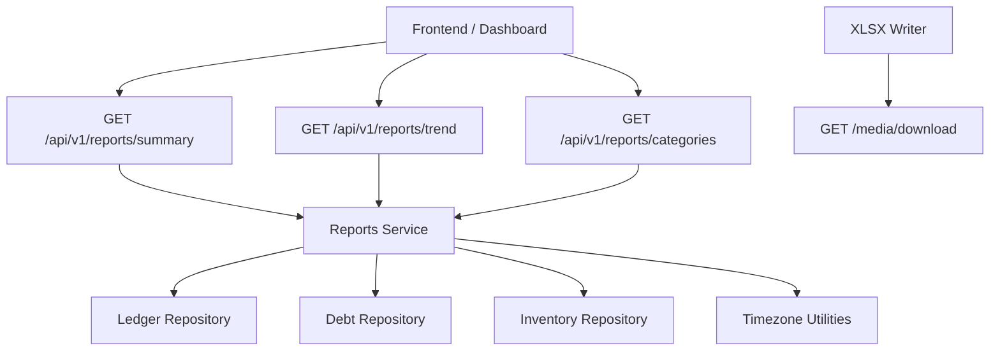
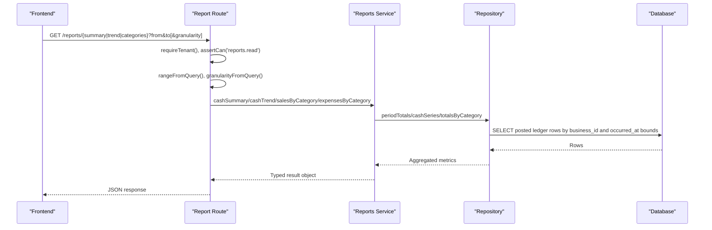
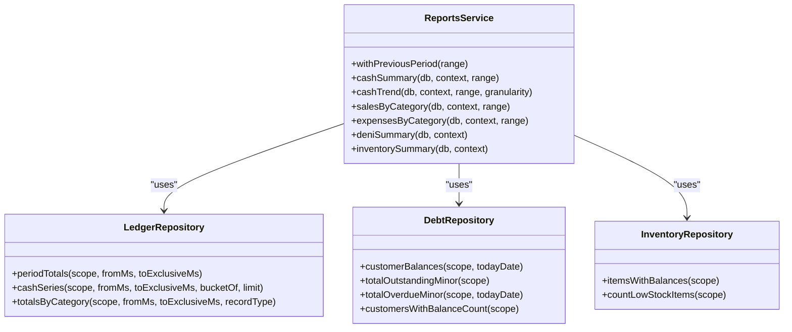
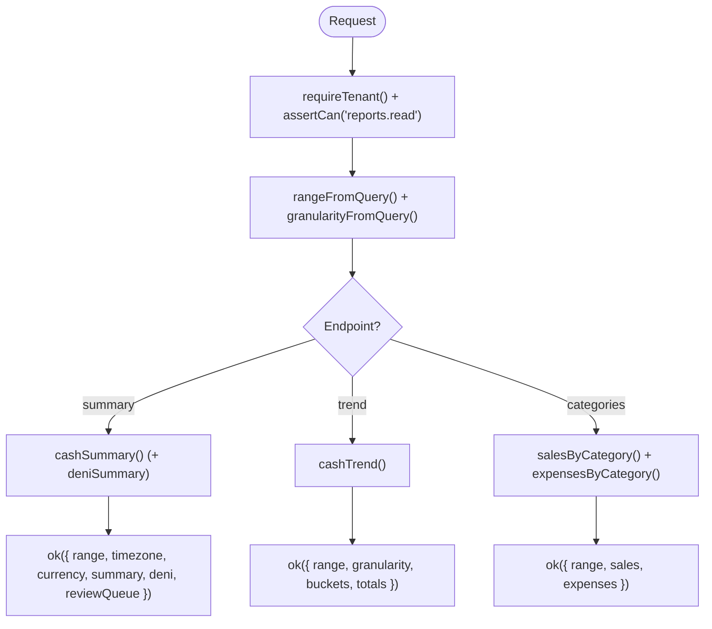
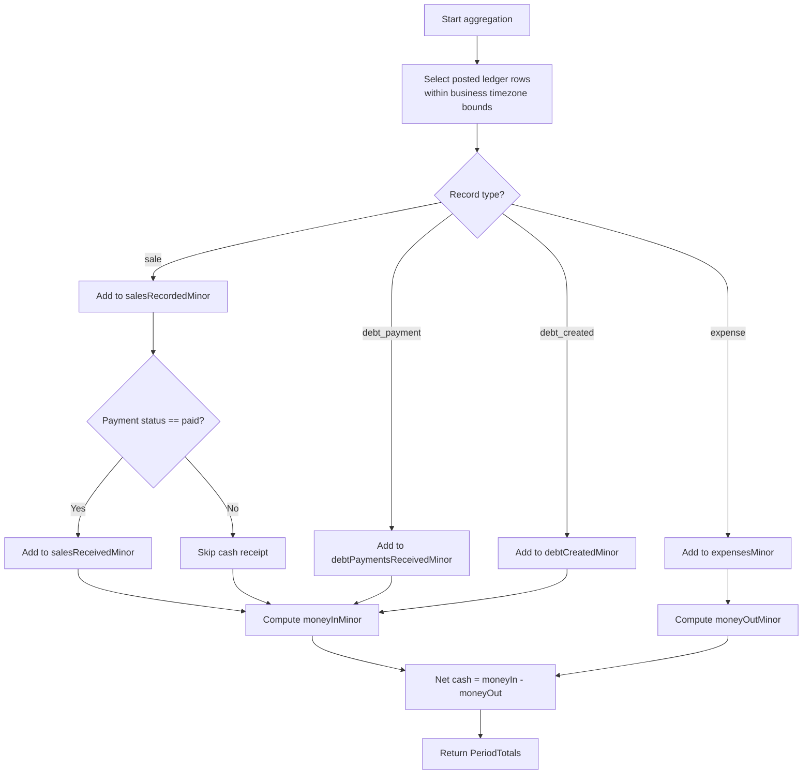
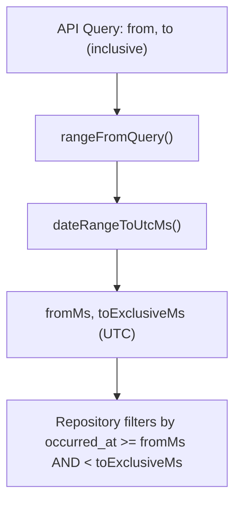
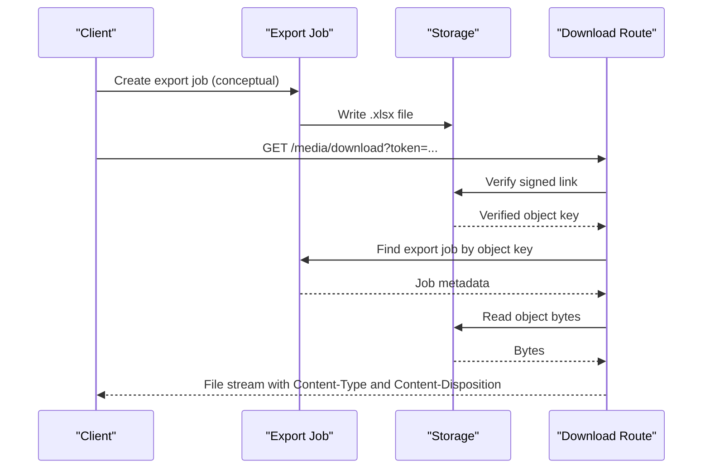
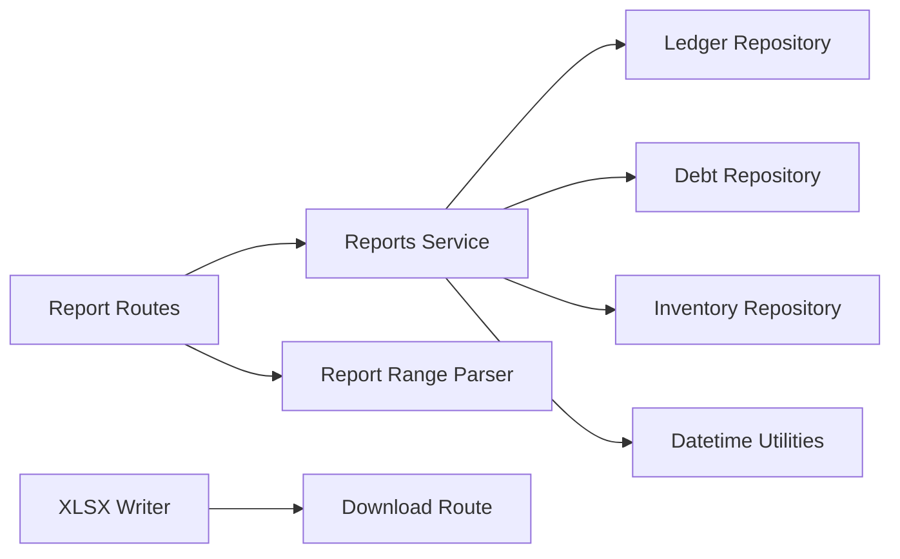

# Reports & Analytics Service

<cite>
**Referenced Files in This Document**
- [reports.ts](file://src/server/services/reports.ts)
- [route.ts (summary)](file://src/app/api/v1/reports/summary/route.ts)
- [route.ts (trend)](file://src/app/api/v1/reports/trend/route.ts)
- [route.ts (categories)](file://src/app/api/v1/reports/categories/route.ts)
- [report-range.ts](file://src/server/http/report-range.ts)
- [ledger.repository.ts](file://src/server/repositories/ledger.repository.ts)
- [debt.repository.ts](file://src/server/repositories/debt.repository.ts)
- [inventory.repository.ts](file://src/server/repositories/inventory.repository.ts)
- [datetime.ts](file://src/lib/formatting/datetime.ts)
- [xlsx.ts](file://src/server/exports/xlsx.ts)
- [download route.ts](file://src/app/api/v1/media/download/route.ts)
- [reports.test.ts](file://tests/reports.test.ts)
</cite>

## Table of Contents
1. [Introduction](#introduction)
2. [Project Structure](#project-structure)
3. [Core Components](#core-components)
4. [Architecture Overview](#architecture-overview)
5. [Detailed Component Analysis](#detailed-component-analysis)
6. [Dependency Analysis](#dependency-analysis)
7. [Performance Considerations](#performance-considerations)
8. [Troubleshooting Guide](#troubleshooting-guide)
9. [Conclusion](#conclusion)
10. [Appendices](#appendices)

## Introduction
This document describes the reports and analytics service that generates financial insights and business intelligence for a bookkeeping application. It covers supported report types, data aggregation algorithms, time period filtering, multi-currency handling, export capabilities, method contracts, performance strategies, caching behavior, and real-time calculation characteristics. The service focuses on cash-based reporting derived from confirmed ledger records, with optional debt and inventory summaries.

The system supports:
- Cash summary with growth comparison against the immediately preceding period
- Cash trend series bucketed by day, week, or month
- Sales and expenses grouped by category
- Debt exposure and overdue totals
- Inventory low-stock indicators
- XLSX export generation and secure download

It does not implement full profit-and-loss statements, balance sheets, or custom analytical query engines as separate modules; instead, it provides building blocks such as period totals, category totals, and trend buckets that can be composed into higher-level reports.

## Project Structure
The reporting feature spans API routes, a domain service layer, repository queries, timezone utilities, and an export writer.

**Diagram sources**
- [route.ts (summary):16-31](file://src/app/api/v1/reports/summary/route.ts#L16-L31)
- [route.ts (trend):12-33](file://src/app/api/v1/reports/trend/route.ts#L12-L33)
- [route.ts (categories):14-41](file://src/app/api/v1/reports/categories/route.ts#L14-L41)
- [reports.ts:72-154](file://src/server/services/reports.ts#L72-L154)
- [ledger.repository.ts:377-512](file://src/server/repositories/ledger.repository.ts#L377-L512)
- [debt.repository.ts:289-381](file://src/server/repositories/debt.repository.ts#L289-L381)
- [inventory.repository.ts:110-192](file://src/server/repositories/inventory.repository.ts#L110-L192)
- [datetime.ts:237-247](file://src/lib/formatting/datetime.ts#L237-L247)
- [xlsx.ts:158-182](file://src/server/exports/xlsx.ts#L158-L182)
- [download route.ts:20-43](file://src/app/api/v1/media/download/route.ts#L20-L43)

**Section sources**
- [route.ts (summary):16-31](file://src/app/api/v1/reports/summary/route.ts#L16-L31)
- [route.ts (trend):12-33](file://src/app/api/v1/reports/trend/route.ts#L12-L33)
- [route.ts (categories):14-41](file://src/app/api/v1/reports/categories/route.ts#L14-L41)
- [reports.ts:1-155](file://src/server/services/reports.ts#L1-L155)

## Core Components
- Reports service: Pure read-only functions that compute summaries, trends, and category breakdowns using tenant-scoped repositories.
- API routes: Enforce tenant context and permissions, parse report ranges and granularity, and return structured JSON responses.
- Repositories: Encapsulate SQL queries over posted ledger records, debts, and inventory movements.
- Timezone utilities: Convert between calendar dates and UTC instants, compute month boundaries, and bucket timestamps by day/week/month in the business timezone.
- Export writer: Generates valid .xlsx files without external dependencies.
- Secure download: Streams exported content with signed-link verification and tenant scoping.

Key responsibilities:
- All figures are computed from posted ledger rows in the business timezone.
- Money-in equals cash received: paid sales plus debt payments received.
- Deni (credit sales) is excluded from money-in to avoid misleading cash figures.
- Period comparisons use the immediately preceding period of equal length.

**Section sources**
- [reports.ts:1-8](file://src/server/services/reports.ts#L1-L8)
- [reports.ts:72-154](file://src/server/services/reports.ts#L72-L154)
- [ledger.repository.ts:377-512](file://src/server/repositories/ledger.repository.ts#L377-L512)
- [datetime.ts:237-247](file://src/lib/formatting/datetime.ts#L237-L247)

## Architecture Overview
The reporting stack follows a layered design:
- HTTP layer validates requests, enforces permissions, and parses parameters.
- Service layer orchestrates calculations and composes results.
- Repository layer executes efficient SQL queries scoped to the tenant.
- Utility layer handles timezone conversions and date math.
- Export layer produces downloadable artifacts.

**Diagram sources**
- [route.ts (summary):16-31](file://src/app/api/v1/reports/summary/route.ts#L16-L31)
- [route.ts (trend):12-33](file://src/app/api/v1/reports/trend/route.ts#L12-L33)
- [route.ts (categories):14-41](file://src/app/api/v1/reports/categories/route.ts#L14-L41)
- [reports.ts:72-154](file://src/server/services/reports.ts#L72-L154)
- [ledger.repository.ts:377-512](file://src/server/repositories/ledger.repository.ts#L377-L512)

## Detailed Component Analysis

### Reports Service
Responsibilities:
- Compute cash summary with current and previous period totals and growth percentages.
- Generate cash trend buckets by day, week, or month in the business timezone.
- Aggregate sales and expenses by category.
- Provide deni and inventory summaries when enabled.

Key methods and contracts:
- `withPreviousPeriod(range)`
  - Parameters: `range` of type `DateRange`.
  - Returns: `{ range, previous }` where `previous` is the immediately preceding period of equal length.
  - Behavior: Uses business timezone-aware date arithmetic to compute the prior interval.

- `cashSummary(db, context, range)`
  - Parameters: database handle, business context, `DateRange`.
  - Returns: `CashSummary` including current and previous `PeriodTotals`, `netCashMinor`, and growth percentages for money-in and money-out.
  - Algorithm: Converts range to UTC milliseconds, computes totals for both periods, then calculates percentage change.

- `cashTrend(db, context, range, granularity = 'day')`
  - Parameters: database handle, business context, `DateRange`, granularity `'day' | 'week' | 'month'`.
  - Returns: Array of `CashBucket` objects keyed by timezone-aware bucket strings.
  - Algorithm: Fetches posted sale and expense rows within the range, groups by bucket key derived from business timezone.

- `salesByCategory(db, context, range)`
  - Parameters: database handle, business context, `DateRange`.
  - Returns: Array of `CategoryTotal` entries for sales.

- `expensesByCategory(db, context, range)`
  - Parameters: database handle, business context, `DateRange`.
  - Returns: Array of `CategoryTotal` entries for expenses.

- `deniSummary(db, context)`
  - Parameters: database handle, business context.
  - Returns: Outstanding and overdue totals, count of customers with balances, and top customer balances.

- `inventorySummary(db, context)`
  - Parameters: database handle, business context.
  - Returns: Low stock item count and tracked item count.

**Diagram sources**
- [reports.ts:56-154](file://src/server/services/reports.ts#L56-L154)
- [ledger.repository.ts:377-512](file://src/server/repositories/ledger.repository.ts#L377-L512)
- [debt.repository.ts:289-381](file://src/server/repositories/debt.repository.ts#L289-L381)
- [inventory.repository.ts:110-192](file://src/server/repositories/inventory.repository.ts#L110-L192)

**Section sources**
- [reports.ts:56-154](file://src/server/services/reports.ts#L56-L154)

### API Routes
- Summary route:
  - Validates tenant and permission `reports.read`.
  - Parses range via `rangeFromQuery`.
  - Calls `cashSummary` and optionally `deniSummary`.
  - Returns range, timezone, currency, summary, deni, and review queue counts.

- Trend route:
  - Validates tenant and permission.
  - Parses range and granularity.
  - Calls `cashTrend`.
  - Computes totals across buckets and returns them.

- Categories route:
  - Validates tenant and permission.
  - Parses range.
  - Calls `salesByCategory` and `expensesByCategory`.
  - Computes share percentages per category and returns totals.

**Diagram sources**
- [route.ts (summary):16-31](file://src/app/api/v1/reports/summary/route.ts#L16-L31)
- [route.ts (trend):12-33](file://src/app/api/v1/reports/trend/route.ts#L12-L33)
- [route.ts (categories):14-41](file://src/app/api/v1/reports/categories/route.ts#L14-L41)

**Section sources**
- [route.ts (summary):16-31](file://src/app/api/v1/reports/summary/route.ts#L16-L31)
- [route.ts (trend):12-33](file://src/app/api/v1/reports/trend/route.ts#L12-L33)
- [route.ts (categories):14-41](file://src/app/api/v1/reports/categories/route.ts#L14-L41)

### Data Aggregation Algorithms
- Period totals:
  - Reads posted ledger rows within the range.
  - Separates sales recorded vs sales received (only when payment status is paid).
  - Adds debt payments received to money-in.
  - Expenses are money-out.
  - Net cash movement equals money-in minus money-out.

- Cash series:
  - Limits fetched rows to reduce memory usage.
  - Groups by bucket key derived from business timezone.
  - Accumulates sales and expenses per bucket.

- Category totals:
  - Joins ledger records with typed detail tables (`sales` or `expenses`).
  - Aggregates amounts and counts per category.
  - Sorts by amount descending.

**Diagram sources**
- [ledger.repository.ts:377-431](file://src/server/repositories/ledger.repository.ts#L377-L431)

**Section sources**
- [ledger.repository.ts:377-512](file://src/server/repositories/ledger.repository.ts#L377-L512)

### Time Period Filtering and Multi-Currency Support
- Time period filtering:
  - API accepts inclusive calendar dates in the business timezone.
  - Internal processing uses exclusive upper bounds in UTC milliseconds.
  - Conversion functions ensure correct boundary handling around midnight and DST transitions.

- Multi-currency support:
  - Ledger rows include a currency field.
  - Current implementation aggregates amounts directly without conversion to a base currency.
  - Consumers should treat amounts as native-currency minor units unless additional conversion logic is added.

**Diagram sources**
- [report-range.ts:17-27](file://src/server/http/report-range.ts#L17-L27)
- [datetime.ts:237-247](file://src/lib/formatting/datetime.ts#L237-L247)
- [ledger.repository.ts:377-389](file://src/server/repositories/ledger.repository.ts#L377-L389)

**Section sources**
- [report-range.ts:17-27](file://src/server/http/report-range.ts#L17-L27)
- [datetime.ts:237-247](file://src/lib/formatting/datetime.ts#L237-L247)
- [ledger.repository.ts:377-389](file://src/server/repositories/ledger.repository.ts#L377-L389)

### Export Functionality
- XLSX writer:
  - Produces valid .xlsx files without external dependencies.
  - Writes a single worksheet with string and number cells and a bold header row.
  - Provides deterministic checksum computation for generated buffers.

- Secure download:
  - Requires a signed token to verify access.
  - Verifies storage signature and ensures the object belongs to a real export job.
  - Streams bytes with appropriate content type and attachment headers.

**Diagram sources**
- [xlsx.ts:158-182](file://src/server/exports/xlsx.ts#L158-L182)
- [download route.ts:20-43](file://src/app/api/v1/media/download/route.ts#L20-L43)

**Section sources**
- [xlsx.ts:1-183](file://src/server/exports/xlsx.ts#L1-L183)
- [download route.ts:20-43](file://src/app/api/v1/media/download/route.ts#L20-L43)

### Real-Time Calculation Capabilities
- Calculations are performed live at request time against posted ledger rows.
- No in-memory caching of report results is implemented in the service layer.
- Results reflect the latest committed data visible to the database transaction.

**Section sources**
- [reports.ts:1-8](file://src/server/services/reports.ts#L1-L8)
- [ledger.repository.ts:377-512](file://src/server/repositories/ledger.repository.ts#L377-L512)

### Caching Mechanisms
- Report results are not cached.
- Timezone formatter instances are cached per timezone to avoid repeated Intl.DateTimeFormat construction.
- Database client connection may be cached depending on environment configuration.

**Section sources**
- [datetime.ts:26-45](file://src/lib/formatting/datetime.ts#L26-L45)

### Method Signatures and Return Values
- `withPreviousPeriod(range)`
  - Input: `DateRange`
  - Output: `{ range: DateRange, previous: DateRange }`

- `cashSummary(db, context, range)`
  - Input: database handle, business context, `DateRange`
  - Output: `CashSummary` with fields including `current`, `previous`, `netCashMinor`, and `growthPercent`

- `cashTrend(db, context, range, granularity)`
  - Input: database handle, business context, `DateRange`, `'day' | 'week' | 'month'`
  - Output: `CashBucket[]`

- `salesByCategory(db, context, range)`
  - Input: database handle, business context, `DateRange`
  - Output: `CategoryTotal[]`

- `expensesByCategory(db, context, range)`
  - Input: database handle, business context, `DateRange`
  - Output: `CategoryTotal[]`

- `deniSummary(db, context)`
  - Input: database handle, business context
  - Output: `DeniSummary` with outstanding, overdue, customer count, and top balances

- `inventorySummary(db, context)`
  - Input: database handle, business context
  - Output: `InventorySummary` with low stock count and tracked items

**Section sources**
- [reports.ts:56-154](file://src/server/services/reports.ts#L56-L154)

### Common Report Generation Scenarios
- Monthly cash summary:
  - Use default month range from query parser.
  - Compare current month’s net cash with the previous month.
  - Display growth percentages for money-in and money-out.

- Weekly trend chart:
  - Request trend endpoint with granularity set to week.
  - Render buckets as time-series points.

- Category breakdown:
  - Request categories endpoint.
  - Show shares of sales and expenses per category.

- Debt overview:
  - Enable deni feature flag.
  - Display outstanding and overdue totals along with top customer balances.

- Inventory alerts:
  - Show low stock count and tracked items.

**Section sources**
- [route.ts (summary):16-31](file://src/app/api/v1/reports/summary/route.ts#L16-L31)
- [route.ts (trend):12-33](file://src/app/api/v1/reports/trend/route.ts#L12-L33)
- [route.ts (categories):14-41](file://src/app/api/v1/reports/categories/route.ts#L14-L41)
- [reports.ts:137-154](file://src/server/services/reports.ts#L137-L154)

### Custom Query Construction
- For ad-hoc analysis, compose repository primitives:
  - Use `periodTotals` for aggregated KPIs.
  - Use `cashSeries` with a custom bucket function for non-standard grouping.
  - Use `totalsByCategory` with either `'sale'` or `'expense'` to build category-specific views.

- Example composition pattern:
  - Define a custom bucketing strategy based on business rules.
  - Filter ledger rows by business ID and posted status.
  - Aggregate amounts per bucket and sort deterministically.

**Section sources**
- [ledger.repository.ts:439-512](file://src/server/repositories/ledger.repository.ts#L439-L512)

### Integration with Frontend Visualization Components
- Summary endpoint:
  - Provides range, timezone, currency, summary, deni, and review queue.
  - Suitable for dashboard cards and high-level KPIs.

- Trend endpoint:
  - Provides buckets and totals.
  - Suitable for line or area charts showing cash flow over time.

- Categories endpoint:
  - Provides category lists with share percentages.
  - Suitable for pie or bar charts illustrating revenue and cost distribution.

**Section sources**
- [route.ts (summary):16-31](file://src/app/api/v1/reports/summary/route.ts#L16-L31)
- [route.ts (trend):12-33](file://src/app/api/v1/reports/trend/route.ts#L12-L33)
- [route.ts (categories):14-41](file://src/app/api/v1/reports/categories/route.ts#L14-L41)

## Dependency Analysis
The reporting module depends on:
- Business context resolution and permissions.
- Ledger repository for core financial data.
- Debt repository for receivables and overdue analysis.
- Inventory repository for stock health indicators.
- Timezone utilities for consistent date handling.
- Export utilities for generating downloadable files.

**Diagram sources**
- [reports.ts:10-29](file://src/server/services/reports.ts#L10-L29)
- [route.ts (summary):8-14](file://src/app/api/v1/reports/summary/route.ts#L8-L14)
- [route.ts (trend):6-10](file://src/app/api/v1/reports/trend/route.ts#L6-L10)
- [route.ts (categories):8-12](file://src/app/api/v1/reports/categories/route.ts#L8-L12)
- [report-range.ts:1-32](file://src/server/http/report-range.ts#L1-L32)
- [xlsx.ts:1-183](file://src/server/exports/xlsx.ts#L1-L183)
- [download route.ts:20-43](file://src/app/api/v1/media/download/route.ts#L20-L43)

**Section sources**
- [reports.ts:10-29](file://src/server/services/reports.ts#L10-L29)
- [route.ts (summary):8-14](file://src/app/api/v1/reports/summary/route.ts#L8-L14)
- [route.ts (trend):6-10](file://src/app/api/v1/reports/trend/route.ts#L6-L10)
- [route.ts (categories):8-12](file://src/app/api/v1/reports/categories/route.ts#L8-L12)
- [report-range.ts:1-32](file://src/server/http/report-range.ts#L1-L32)

## Performance Considerations
- Query shape:
  - Filters by business ID and posted status to minimize scan scope.
  - Uses explicit date bounds to leverage indexes on occurrence timestamps.

- Memory management:
  - Cash series limits fetched rows to prevent large in-memory datasets.
  - Bucket aggregation uses maps to accumulate values efficiently.

- Sorting and ordering:
  - Category totals sort by amount to prioritize significant categories.
  - Trend buckets are sorted by bucket key for chronological rendering.

- Timezone overhead:
  - Formatter instances are cached per timezone to reduce allocation costs.
  - Bucket keys are computed in the business timezone to ensure correctness.

- Recommendations:
  - Ensure indexes exist on `business_id`, `status`, and `occurred_at` columns.
  - Avoid overly broad date ranges; prefer bounded windows.
  - Consider server-side pagination for very large category lists if needed.

**Section sources**
- [ledger.repository.ts:439-479](file://src/server/repositories/ledger.repository.ts#L439-L479)
- [ledger.repository.ts:483-512](file://src/server/repositories/ledger.repository.ts#L483-L512)
- [datetime.ts:26-45](file://src/lib/formatting/datetime.ts#L26-L45)

## Troubleshooting Guide
Common issues and resolutions:
- Inverted date range:
  - Symptom: Error thrown when end date is before start date.
  - Resolution: Validate inputs using `rangeFromQuery`; ensure `toExclusive > from`.

- Incorrect period boundaries:
  - Symptom: Events near midnight appear in wrong periods.
  - Resolution: Confirm business timezone is correctly configured; use `dateRangeToUtcMs` for conversion.

- Missing cash receipts:
  - Symptom: Money-in lower than expected.
  - Resolution: Only paid sales count as cash received; unpaid sales do not contribute to money-in.

- Unexpected category shares:
  - Symptom: Shares do not sum to 100% due to rounding.
  - Resolution: Accept small rounding differences; shares are rounded to two decimal places.

- Export download failures:
  - Symptom: Invalid or expired token error.
  - Resolution: Regenerate signed link; verify storage integration and job existence.

**Section sources**
- [report-range.ts:17-27](file://src/server/http/report-range.ts#L17-L27)
- [datetime.ts:237-247](file://src/lib/formatting/datetime.ts#L237-L247)
- [ledger.repository.ts:377-431](file://src/server/repositories/ledger.repository.ts#L377-L431)
- [download route.ts:20-43](file://src/app/api/v1/media/download/route.ts#L20-L43)

## Conclusion
The reports and analytics service delivers accurate, timezone-aware financial insights grounded in posted ledger records. It emphasizes cash-based metrics, clear separation of sales and expenses, and robust period comparisons. While it does not provide full P&L or balance sheet templates, its modular APIs and repository primitives enable flexible composition for diverse reporting needs. Export capabilities and secure downloads support sharing insights externally, and the design prioritizes correctness, performance, and clarity.

## Appendices

### Supported Report Types
- Cash summary with growth comparison
- Cash trend series by day, week, or month
- Sales and expenses by category
- Debt exposure and overdue totals
- Inventory low-stock indicators

### Notes on Custom Analytical Queries
- Compose repository functions rather than introducing a generic query builder.
- Maintain tenant scoping and posted-status filters.
- Apply business timezone conversions consistently.

**Section sources**
- [reports.ts:72-154](file://src/server/services/reports.ts#L72-L154)
- [ledger.repository.ts:377-512](file://src/server/repositories/ledger.repository.ts#L377-L512)

### Test Coverage Highlights
- Cash summary validates cash-received semantics and period boundaries.
- Trend buckets confirm timezone-aware grouping.
- Category grouping verifies uncategorized handling and aggregation.

**Section sources**
- [reports.test.ts:100-229](file://tests/reports.test.ts#L100-L229)