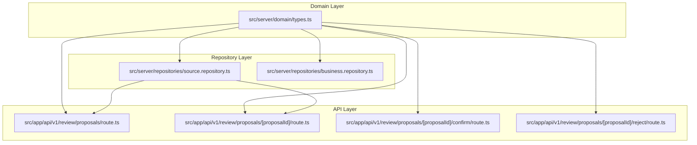
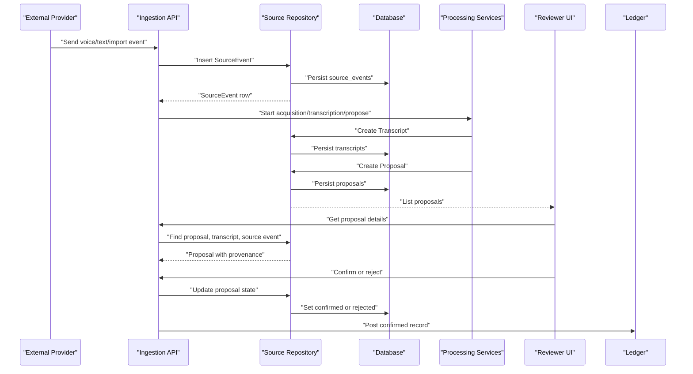
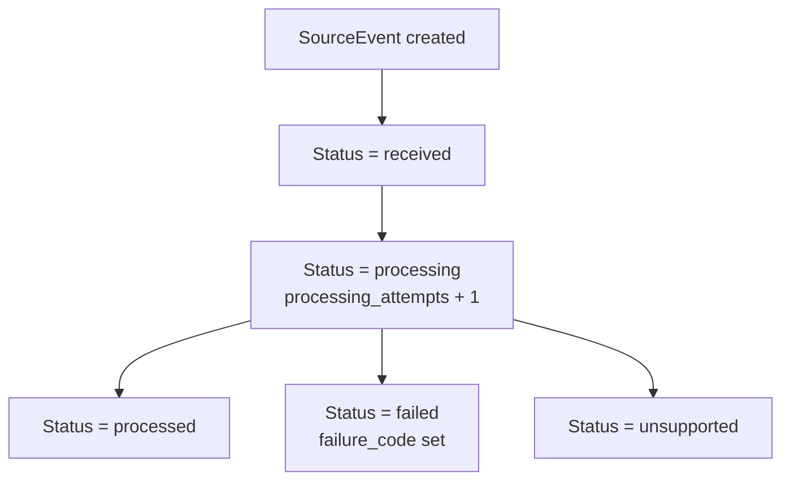
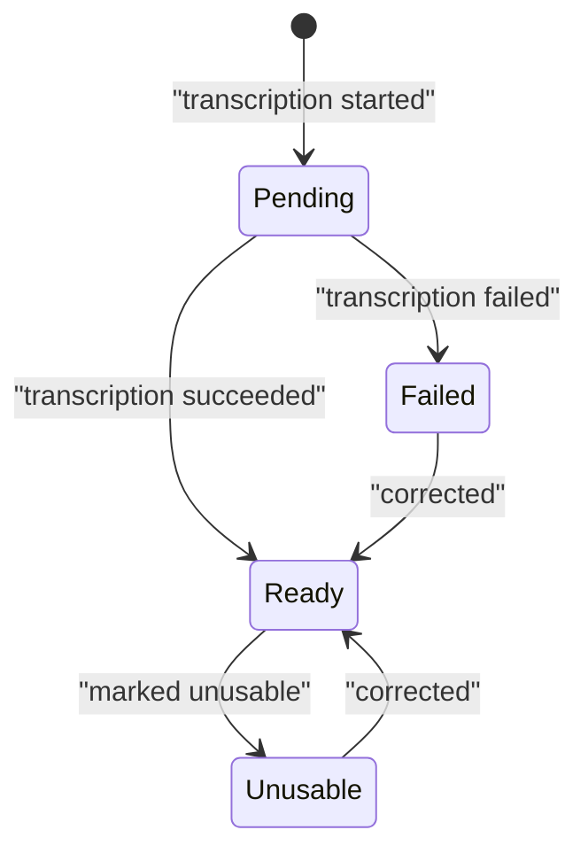
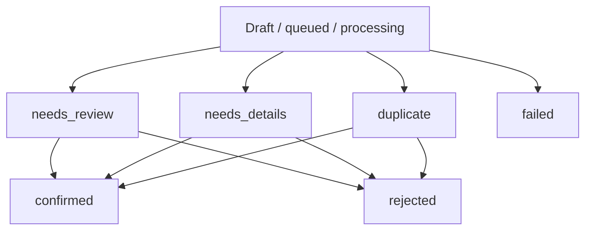
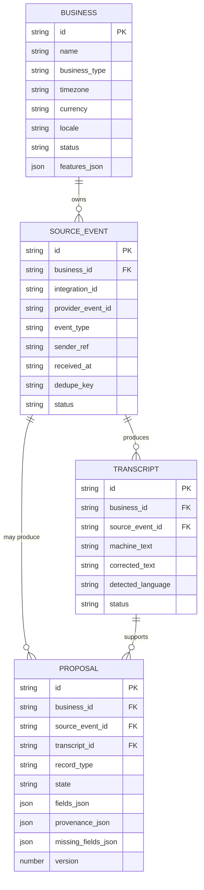
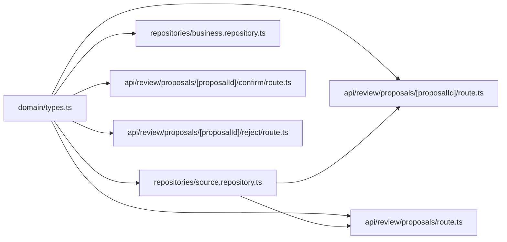

# Core Entities & Domain Types

<cite>
**Referenced Files in This Document**
- [types.ts](file://src/server/domain/types.ts)
- [source.repository.ts](file://src/server/repositories/source.repository.ts)
- [business.repository.ts](file://src/server/repositories/business.repository.ts)
- [proposal-list-route.ts](file://src/app/api/v1/review/proposals/route.ts)
- [proposal-detail-route.ts](file://src/app/api/v1/review/proposals/[proposalId]/route.ts)
- [confirm-proposal-route.ts](file://src/app/api/v1/review/proposals/[proposalId]/confirm/route.ts)
- [reject-proposal-route.ts](file://src/app/api/v1/review/proposals/[proposalId]/reject/route.ts)
</cite>

## Table of Contents
1. [Introduction](#introduction)
2. [Project Structure](#project-structure)
3. [Core Components](#core-components)
4. [Architecture Overview](#architecture-overview)
5. [Detailed Component Analysis](#detailed-component-analysis)
6. [Dependency Analysis](#dependency-analysis)
7. [Performance Considerations](#performance-considerations)
8. [Troubleshooting Guide](#troubleshooting-guide)
9. [Conclusion](#conclusion)

## Introduction
This document describes Daftari’s core domain model and type system. It focuses on the fundamental business concepts that connect inbound source events to accounting records: Business, SourceEvent, Transcript, and Proposal. It also documents shared enum types such as RecordType, ProposalState, SourceKind, Role, and related enumerations that keep services, repositories, and UI components consistent.

The domain vocabulary is intentionally centralized so that persisted database values, API payloads, audit actions, validation rules, and UI labels all refer to the same canonical set of terms.

## Project Structure
The core domain types live in a single shared module. Repository modules map those types to database rows. API route handlers validate incoming parameters against the same enums and return structured responses that reference the same domain vocabulary.

**Diagram sources**
- [types.ts:1-217](file://src/server/domain/types.ts#L1-L217)
- [source.repository.ts:1-771](file://src/server/repositories/source.repository.ts#L1-L771)
- [business.repository.ts:1-556](file://src/server/repositories/business.repository.ts#L1-L556)
- [proposal-list-route.ts:1-109](file://src/app/api/v1/review/proposals/route.ts#L1-L109)
- [proposal-detail-route.ts:1-113](file://src/app/api/v1/review/proposals/[proposalId]/route.ts#L1-L113)
- [confirm-proposal-route.ts:1-30](file://src/app/api/v1/review/proposals/[proposalId]/confirm/route.ts#L1-L30)
- [reject-proposal-route.ts:1-35](file://src/app/api/v1/review/proposals/[proposalId]/reject/route.ts#L1-L35)

**Section sources**
- [types.ts:1-217](file://src/server/domain/types.ts#L1-L217)
- [source.repository.ts:1-771](file://src/server/repositories/source.repository.ts#L1-L771)
- [business.repository.ts:1-556](file://src/server/repositories/business.repository.ts#L1-L556)

## Core Components
Daftari’s core data model revolves around four primary entities:

| Entity | Purpose | Primary Identifier | Key Relationships |
|---|---|---|---|
| Business | Tenant workspace representing a merchant or organization | `id` | Has users, memberships, integrations, and owns all other domain data |
| SourceEvent | Inbound provider event (voice, text, import, manual) | `id` | Produces one or more transcripts; may produce one proposal |
| Transcript | Machine-generated or corrected transcription of media/text | `id` | Belongs to a SourceEvent; referenced by Proposal |
| Proposal | Merchant-facing draft record awaiting review | `id` | References SourceEvent and Transcript; becomes a ledger record when confirmed |

### Shared Enumerations
These enumerations are the single source of truth for domain vocabulary:

| Enumeration | Values | Usage |
|---|---|---|
| `RecordType` | `sale`, `expense`, `debt_created`, `debt_payment`, `stock_movement`, `note` | Classification of financial or inventory records |
| `ProposalState` | `queued`, `processing`, `needs_review`, `needs_details`, `failed`, `confirmed`, `rejected`, `duplicate` | Lifecycle state of a proposal |
| `SourceEventStatus` | `received`, `processing`, `processed`, `failed`, `unsupported` | Processing lifecycle of an inbound event |
| `SourceKind` | `whatsapp_voice`, `whatsapp_text`, `in_app_voice`, `manual`, `import` | Origin classification of a source |
| `Role` | `owner`, `manager`, `staff` | User role within a Business |
| `PaymentStatus` | `paid`, `unpaid`, `partial`, `unknown` | Merchant assertion about payment settlement |
| `PaymentMethod` | `cash`, `mobile_money`, `bank`, `card`, `credit`, `unknown` | Payment method classification |
| `MovementType` | `in`, `out`, `adjustment` | Inventory movement direction |
| `IntegrationStatus` | `connected`, `disconnected`, `error`, `pending` | Integration health/connection state |
| `RejectionReasonCode` | `not_a_business_record`, `wrong_amount`, `wrong_record_type`, `duplicate`, `already_recorded`, `source_unclear`, `other` | Why a proposal was rejected |
| `CorrectionReasonCode` | `wrong_amount`, `wrong_date`, `wrong_category`, `wrong_payment_status`, `wrong_customer`, `wrong_record_type`, `entered_in_error`, `other` | Why a ledger record was corrected |
| `JobType` | `acquire_media`, `transcribe_source`, `extract_proposal`, `validate_proposal`, `refresh_summary`, `build_export`, `delete_expired_media`, `provider_health_check` | Background job classification |
| `JobStatus` | `pending`, `running`, `succeeded`, `failed`, `dead_letter` | Background job lifecycle |

**Section sources**
- [types.ts:8-127](file://src/server/domain/types.ts#L8-L127)

## Architecture Overview
The data flow from an inbound message to a confirmed ledger record follows a clear pipeline:

**Diagram sources**
- [source.repository.ts:127-166](file://src/server/repositories/source.repository.ts#L127-L166)
- [source.repository.ts:324-361](file://src/server/repositories/source.repository.ts#L324-L361)
- [source.repository.ts:446-498](file://src/server/repositories/source.repository.ts#L446-L498)
- [proposal-detail-route.ts:26-92](file://src/app/api/v1/review/proposals/[proposalId]/route.ts#L26-L92)
- [confirm-proposal-route.ts:18-30](file://src/app/api/v1/review/proposals/[proposalId]/confirm/route.ts#L18-L30)
- [reject-proposal-route.ts:15-35](file://src/app/api/v1/review/proposals/[proposalId]/reject/route.ts#L15-L35)

## Detailed Component Analysis

### Business
Business represents a tenant workspace. It stores merchant configuration, feature flags, timezone, currency, locale, retention settings, and analytics opt-in status.

#### Database Row Shape
| Field | Type | Meaning |
|---|---|---|
| `id` | string | Unique business identifier |
| `name` | string | Display name of the business |
| `business_type` | string | Business category |
| `location` | string \| null | Optional location |
| `timezone` | string | Calendar and datetime context |
| `currency` | string | Accounting currency |
| `locale` | string | UI language preference |
| `status` | `'active' \| 'suspended'` | Workspace status |
| `features_json` | string | Serialized feature flags |
| `onboarding_step` | string \| null | Onboarding progress |
| `retention_audio_days` | number | Audio retention period |
| `analytics_opt_in` | number | Analytics consent flag |
| `created_at` | string | Creation timestamp |
| `updated_at` | string | Last update timestamp |

#### Validation Rules
- All reads and writes are scoped by `business_id`.
- Feature defaults include inventory disabled, manual entries enabled, deni enabled, and exports enabled.
- Allowed update fields are explicitly whitelisted.

#### API Mapping
- The repository uses snake_case database columns.
- The domain comment states that API JSON fields use camelCase.
- Business creation is used during user registration to create a default workspace.

#### Example Lifecycle Pattern
1. Create a Business through the registration flow.
2. Attach a Membership with a Role.
3. Update features, timezone, currency, or onboarding step via repository helpers.
4. Use the Business context to scope all subsequent operations.

**Section sources**
- [business.repository.ts:29-44](file://src/server/repositories/business.repository.ts#L29-L44)
- [business.repository.ts:169-212](file://src/server/repositories/business.repository.ts#L169-L212)
- [business.repository.ts:214-252](file://src/server/repositories/business.repository.ts#L214-L252)
- [types.ts:1-6](file://src/server/domain/types.ts#L1-L6)

### SourceEvent
SourceEvent captures an inbound provider event. It preserves identity across ingestion, transcription, proposal creation, decision, and ledger posting.

#### Database Row Shape
| Field | Type | Meaning |
|---|---|---|
| `id` | string | Event identifier |
| `business_id` | string | Tenant ownership |
| `integration_id` | string \| null | Optional integration link |
| `provider_event_id` | string | Provider-side identifier |
| `event_type` | string | Source kind or provider event type |
| `sender_ref` | string \| null | Sender reference |
| `received_at` | string | When the system received it |
| `provider_sent_at` | string \| null | Provider-reported send time |
| `dedupe_key` | string | Idempotency key |
| `payload_redacted` | string \| null | Redacted payload |
| `status` | `SourceEventStatus` | Processing state |
| `failure_code` | string \| null | Failure classification |
| `processing_attempts` | number | Retry counter |
| `created_at` | string | Creation timestamp |
| `updated_at` | string | Last update timestamp |

#### State Transitions
- Initial status is `received`.
- Status transitions to `processing` while work begins.
- Final statuses include `processed`, `failed`, or `unsupported`.
- Processing increments attempt count and clears previous failure code.

#### Validation Rules
- Deduplication supports both integration-scoped lookup and tenant-scoped dedupe-key lookup.
- Every query includes tenant scoping.

#### API Mapping
- The proposal detail endpoint exposes a compact SourceEvent view including id, kind, sender reference, received time, and status.

#### Example Creation Pattern
1. Insert SourceEvent with redacted payload and initial `received` status.
2. Update status to `processing` when transcription or extraction starts.
3. Set final status and optional failure code after processing completes.

**Diagram sources**
- [source.repository.ts:127-166](file://src/server/repositories/source.repository.ts#L127-L166)
- [source.repository.ts:188-210](file://src/server/repositories/source.repository.ts#L188-L210)

**Section sources**
- [source.repository.ts:26-42](file://src/server/repositories/source.repository.ts#L26-L42)
- [source.repository.ts:110-179](file://src/server/repositories/source.repository.ts#L110-L179)
- [source.repository.ts:181-227](file://src/server/repositories/source.repository.ts#L181-L227)
- [proposal-detail-route.ts:61-69](file://src/app/api/v1/review/proposals/[proposalId]/route.ts#L61-L69)

### Transcript
Transcript stores machine-generated text, corrections, quality metadata, and failure information for a SourceEvent.

#### Database Row Shape
| Field | Type | Meaning |
|---|---|---|
| `id` | string | Transcript identifier |
| `business_id` | string | Tenant ownership |
| `source_event_id` | string | Linked source event |
| `media_asset_id` | string \| null | Associated media asset |
| `machine_text` | string | Original transcription |
| `corrected_text` | string \| null | Human-corrected text |
| `corrected_by_user_id` | string \| null | Correcting user |
| `corrected_at` | string \| null | Correction timestamp |
| `marked_unusable` | number | Usability flag |
| `detected_language` | string | Detected language |
| `provider` | string | Transcription provider |
| `model_version` | string | Model version used |
| `quality_json` | string | Quality metadata |
| `status` | `'pending' \| 'ready' \| 'failed' \| 'unusable'` | Transcript lifecycle |
| `failure_code` | string \| null | Failure reason |
| `created_at` | string | Creation timestamp |
| `updated_at` | string | Last update timestamp |

#### Validation Rules
- A successful transcript is inserted with `ready` status.
- Failed transcripts are recorded once per SourceEvent; retries update the existing failure row rather than appending duplicates.
- Corrections mark the transcript ready and optionally mark it unusable for future automatic processing.
- Text retrieval prefers corrected text over machine text.

#### API Mapping
- The proposal detail endpoint returns transcript id, status, detected language, machine text, and failure code.

#### Example Lifecycle Pattern
1. Insert failed transcript when transcription fails.
2. Insert ready transcript when transcription succeeds.
3. Correct transcript through a dedicated update path.
4. Mark transcript unusable if it cannot be trusted.

**Diagram sources**
- [source.repository.ts:324-361](file://src/server/repositories/source.repository.ts#L324-L361)
- [source.repository.ts:363-408](file://src/server/repositories/source.repository.ts#L363-L408)
- [source.repository.ts:410-442](file://src/server/repositories/source.repository.ts#L410-L442)

**Section sources**
- [source.repository.ts:60-78](file://src/server/repositories/source.repository.ts#L60-L78)
- [source.repository.ts:311-361](file://src/server/repositories/source.repository.ts#L311-L361)
- [source.repository.ts:363-442](file://src/server/repositories/source.repository.ts#L363-L442)
- [proposal-detail-route.ts:70-78](file://src/app/api/v1/review/proposals/[proposalId]/route.ts#L70-L78)

### Proposal
Proposal is the central review entity. It holds extracted fields, provenance, missing-field hints, validation issues, duplicate candidates, ambiguity notes, and decision metadata.

#### Database Row Shape
| Field | Type | Meaning |
|---|---|---|
| `id` | string | Proposal identifier |
| `business_id` | string | Tenant ownership |
| `source_event_id` | string \| null | Linked source event |
| `transcript_id` | string \| null | Linked transcript |
| `record_type` | `RecordType` | Financial or inventory classification |
| `state` | `ProposalState` | Review lifecycle state |
| `schema_version` | string | Proposal schema version |
| `provider` | string | Extraction provider |
| `model_version` | string | Extraction model version |
| `fields_json` | string | Extracted field values |
| `provenance_json` | string | Field provenance and confidence |
| `missing_fields_json` | string | Missing required fields |
| `validation_issues_json` | string | Validation problems |
| `duplicate_candidates_json` | string | Potential duplicates |
| `ambiguity_note` | string \| null | Human-readable ambiguity |
| `version` | number | Optimistic concurrency version |
| `assigned_to_user_id` | string \| null | Assigned reviewer |
| `decided_by_user_id` | string \| null | Decision maker |
| `decided_at` | string \| null | Decision timestamp |
| `rejection_reason_code` | string \| null | Rejection classification |
| `rejection_note` | string \| null | Rejection explanation |
| `confirmed_ledger_record_id` | string \| null | Confirmed ledger record |
| `created_at` | string | Creation timestamp |
| `updated_at` | string | Last update timestamp |

#### State Transitions
The allowed states are defined centrally. Some states are considered open and require action; others are terminal.

| Category | States | Meaning |
|---|---|---|
| Open | `queued`, `processing`, `needs_review`, `needs_details`, `duplicate` | Needs automated or manual work |
| Reviewable | `needs_review`, `needs_details`, `duplicate` | A reviewer can act |
| Terminal | `confirmed`, `rejected`, `failed` | No further normal workflow transition |

#### Validation Rules
- Fields, provenance, missing fields, validation issues, and duplicate candidates are stored as serialized JSON.
- Version is incremented on updates to prevent stale overwrites.
- Confirmation requires an expected version and restricts transitions to reviewable states.
- Rejection stores a reason code and optional note but does not post to the ledger.
- Confidence bands are computed from the weakest extracted field confidence for triage ordering.

#### API Mapping
- List endpoint returns summary fields, amount hint, currency, occurrence hint, customer hint, ambiguity note, missing fields, version, and timestamps.
- Detail endpoint returns full proposal fields, provenance, options, linked SourceEvent, and linked Transcript.

#### Example Lifecycle Patterns

##### Creation
1. Ingestion creates a SourceEvent.
2. Processing creates a Transcript.
3. Extraction creates a Proposal with initial state and extracted fields.

##### Review
1. Reviewer lists proposals filtered by state, record type, source kind, date range, and confidence band.
2. Reviewer opens a proposal to see evidence and suggested fields.
3. Reviewer reclassifies a draft proposal if needed.

##### Confirmation
1. Reviewer confirms with an idempotency key and expected version.
2. System marks the proposal confirmed and links the ledger record.

##### Rejection
1. Reviewer rejects with a reason code and optional note.
2. System records rejection without touching the ledger.

**Diagram sources**
- [types.ts:21-47](file://src/server/domain/types.ts#L21-L47)
- [source.repository.ts:687-739](file://src/server/repositories/source.repository.ts#L687-L739)
- [confirm-proposal-route.ts:1-30](file://src/app/api/v1/review/proposals/[proposalId]/confirm/route.ts#L1-L30)
- [reject-proposal-route.ts:1-35](file://src/app/api/v1/review/proposals/[proposalId]/reject/route.ts#L1-L35)

**Section sources**
- [source.repository.ts:80-106](file://src/server/repositories/source.repository.ts#L80-L106)
- [source.repository.ts:446-498](file://src/server/repositories/source.repository.ts#L446-L498)
- [source.repository.ts:535-595](file://src/server/repositories/source.repository.ts#L535-L595)
- [source.repository.ts:629-771](file://src/server/repositories/source.repository.ts#L629-L771)
- [proposal-list-route.ts:52-109](file://src/app/api/v1/review/proposals/route.ts#L52-L109)
- [proposal-detail-route.ts:26-92](file://src/app/api/v1/review/proposals/[proposalId]/route.ts#L26-L92)
- [confirm-proposal-route.ts:18-30](file://src/app/api/v1/review/proposals/[proposalId]/confirm/route.ts#L18-L30)
- [reject-proposal-route.ts:15-35](file://src/app/api/v1/review/proposals/[proposalId]/reject/route.ts#L15-L35)

### Relationship Model
The following diagram shows how the core entities relate at the repository level:

**Diagram sources**
- [business.repository.ts:29-44](file://src/server/repositories/business.repository.ts#L29-L44)
- [source.repository.ts:26-42](file://src/server/repositories/source.repository.ts#L26-L42)
- [source.repository.ts:60-78](file://src/server/repositories/source.repository.ts#L60-L78)
- [source.repository.ts:80-106](file://src/server/repositories/source.repository.ts#L80-L106)

## Dependency Analysis
The domain layer is the single source of truth for enumerations. Repositories depend on these types for typed queries and persistence. API routes validate input against the same constants and return responses built from repository rows.

**Diagram sources**
- [types.ts:8-127](file://src/server/domain/types.ts#L8-L127)
- [source.repository.ts:12-24](file://src/server/repositories/source.repository.ts#L12-L24)
- [business.repository.ts:11-12](file://src/server/repositories/business.repository.ts#L11-L12)
- [proposal-list-route.ts:19-49](file://src/app/api/v1/review/proposals/route.ts#L19-L49)
- [proposal-detail-route.ts:12-24](file://src/app/api/v1/review/proposals/[proposalId]/route.ts#L12-L24)

**Section sources**
- [types.ts:8-127](file://src/server/domain/types.ts#L8-L127)
- [source.repository.ts:12-24](file://src/server/repositories/source.repository.ts#L12-L24)
- [business.repository.ts:11-12](file://src/server/repositories/business.repository.ts#L11-L12)
- [proposal-list-route.ts:19-49](file://src/app/api/v1/review/proposals/route.ts#L19-L49)

## Performance Considerations
- Source events use deduplication keys to avoid duplicate processing.
- Proposals use optimistic concurrency through a version column.
- Proposal listing supports cursor-based pagination and filtering by state, record type, source kind, date range, and confidence band.
- Transcript failures are updated in place rather than appended, keeping history manageable.
- All queries are tenant-scoped to avoid cross-tenant data leakage.

[No sources needed since this section provides general guidance]

## Troubleshooting Guide
Common issues and their domain-level indicators:

| Symptom | Likely Indicator | Recommended Check |
|---|---|---|
| Duplicate ingestion | Multiple SourceEvents with similar provider identifiers | Inspect `dedupe_key`, `provider_event_id`, and `integration_id` |
| Stale proposal edit | Version conflict on confirmation | Compare client `expectedVersion` with server `version` |
| Missing fields in proposal | `missing_fields_json` contains required keys | Inspect proposal missing fields and provenance |
| Low-confidence proposal | Weak field confidence in provenance | Filter by confidence band and inspect `ambiguity_note` |
| Failed transcription | Transcript status `failed` | Check `failure_code` and retry or correct transcript |
| Wrong proposal state | Unexpected `state` value | Validate against `PROPOSAL_STATES` and allowed transitions |
| Invalid filter value | Query parameter not in allowed enum | Validate against `RECORD_TYPES`, `SOURCE_KINDS`, or `PROPOSAL_STATES` |

**Section sources**
- [source.repository.ts:110-179](file://src/server/repositories/source.repository.ts#L110-L179)
- [source.repository.ts:363-408](file://src/server/repositories/source.repository.ts#L363-L408)
- [source.repository.ts:535-595](file://src/server/repositories/source.repository.ts#L535-L595)
- [proposal-list-route.ts:21-49](file://src/app/api/v1/review/proposals/route.ts#L21-L49)

## Conclusion
Daftari’s core domain model centers on a clear separation between raw inbound events, transcriptions, and merchant-reviewed proposals. The shared enumeration layer ensures that Business, SourceEvent, Transcript, and Proposal remain consistent across services, repositories, and UI components. Stateful entities like SourceEvent, Transcript, and Proposal have explicit lifecycle semantics, while Proposal serves as the controlled gateway into the ledger through versioned, audited confirmation.