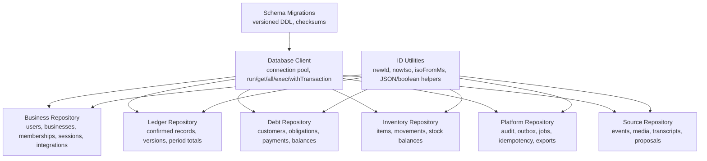
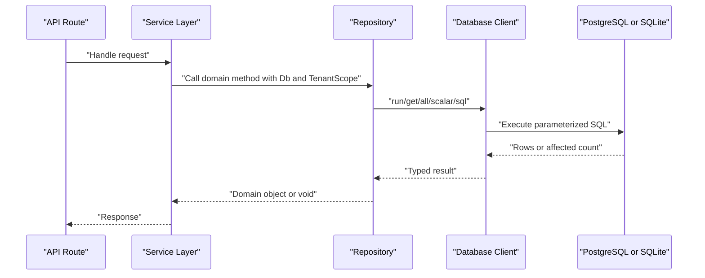
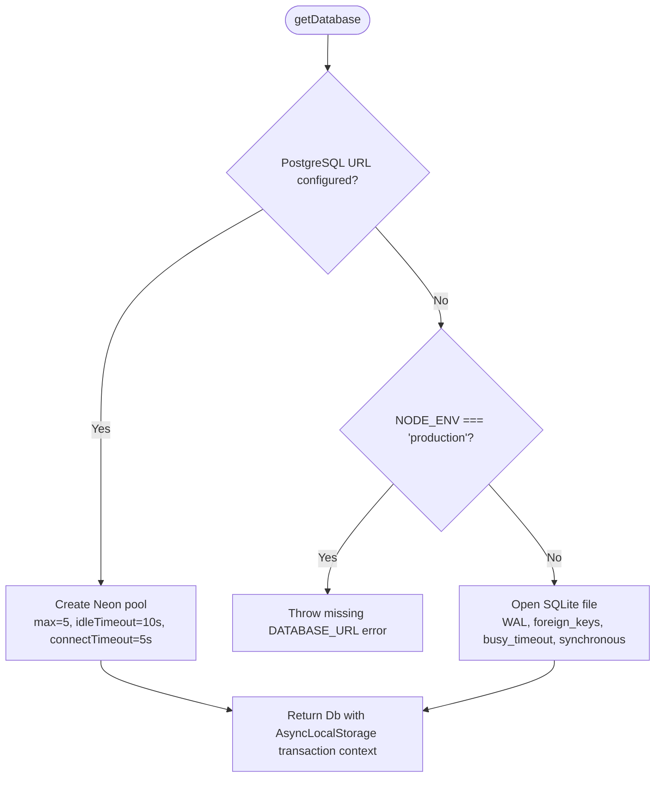
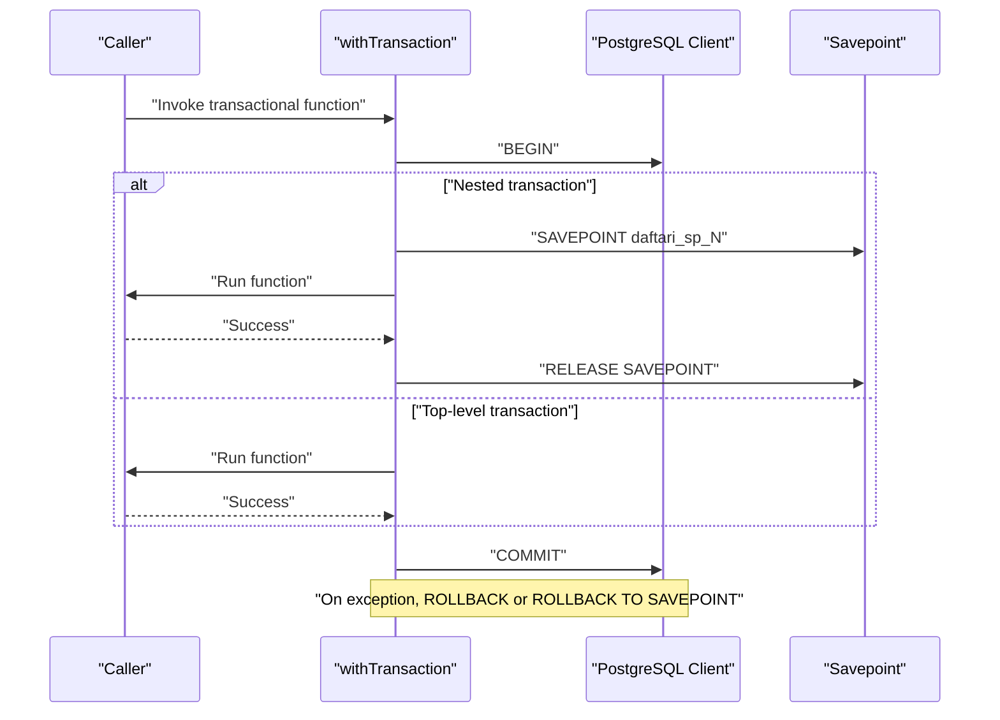
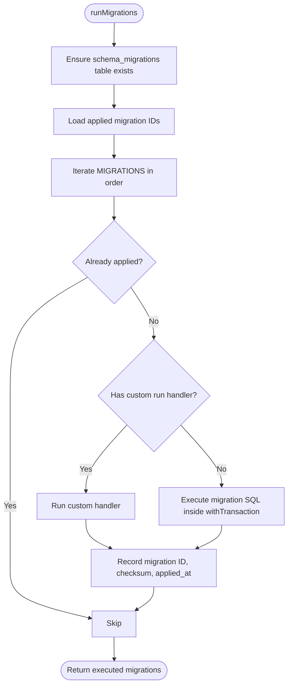
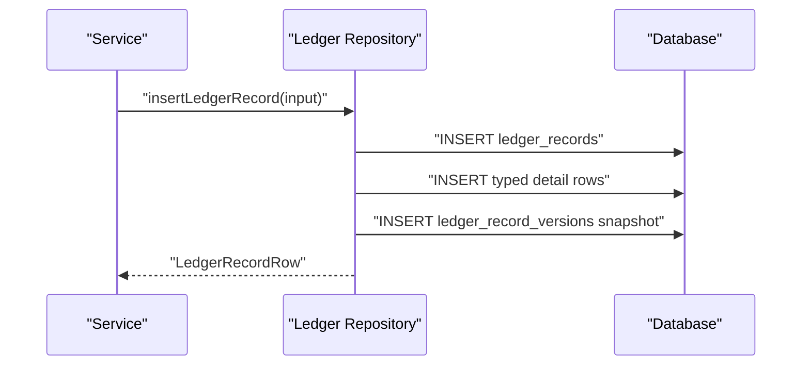
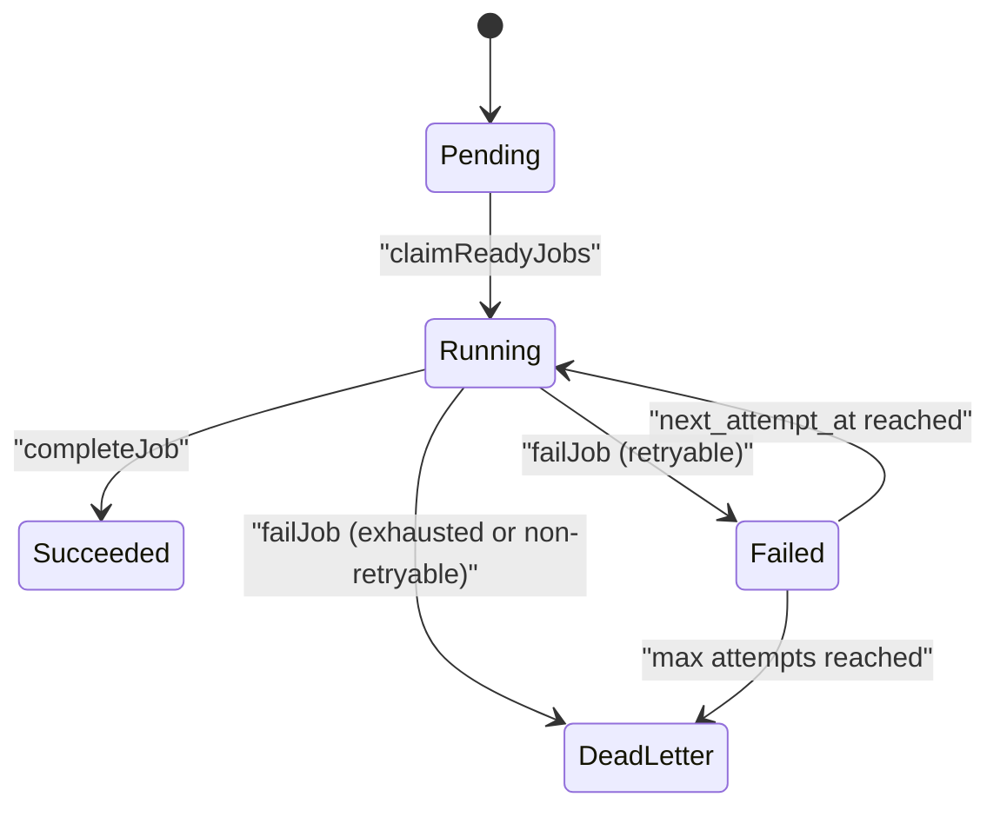
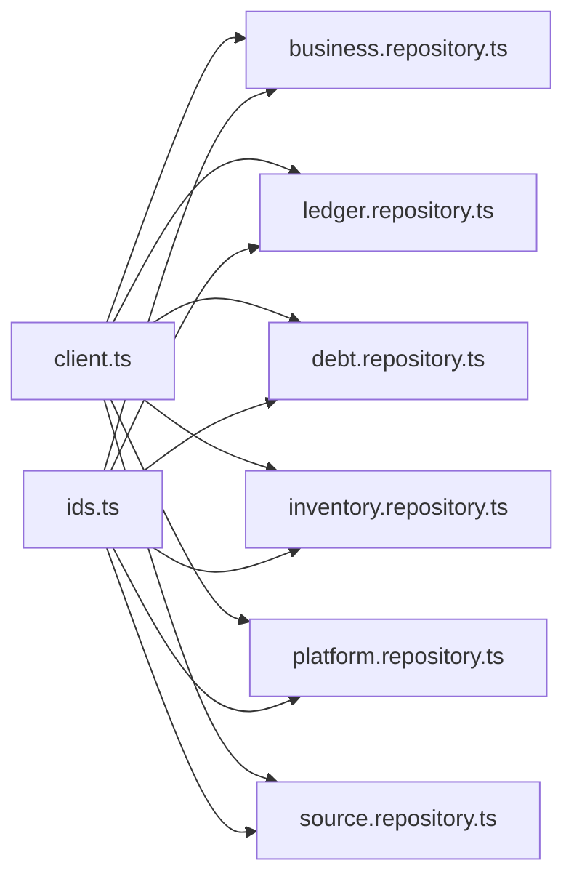

# Database Access Patterns & Repository Layer

<cite>
**Referenced Files in This Document**
- [client.ts](file://src/server/db/client.ts)
- [migrations.ts](file://src/server/db/migrations.ts)
- [ids.ts](file://src/server/db/ids.ts)
- [business.repository.ts](file://src/server/repositories/business.repository.ts)
- [debt.repository.ts](file://src/server/repositories/debt.repository.ts)
- [inventory.repository.ts](file://src/server/repositories/inventory.repository.ts)
- [ledger.repository.ts](file://src/server/repositories/ledger.repository.ts)
- [platform.repository.ts](file://src/server/repositories/platform.repository.ts)
- [source.repository.ts](file://src/server/repositories/source.repository.ts)
</cite>

## Table of Contents
1. [Introduction](#introduction)
2. [Project Structure](#project-structure)
3. [Core Components](#core-components)
4. [Architecture Overview](#architecture-overview)
5. [Detailed Component Analysis](#detailed-component-analysis)
6. [Dependency Analysis](#dependency-analysis)
7. [Performance Considerations](#performance-considerations)
8. [Troubleshooting Guide](#troubleshooting-guide)
9. [Conclusion](#conclusion)

## Introduction
This document explains Daftari’s database access layer and repository pattern. The system uses a portable SQL boundary that supports PostgreSQL via Neon and SQLite for local or test environments. Repositories encapsulate domain operations such as business identity, ledger accounting, debt management, inventory tracking, platform infrastructure, and source event processing.

Key design goals include:
- Tenant isolation through `business_id` scoping at the repository level.
- Portable SQL with parameterized queries and driver abstraction.
- Transactional consistency using savepoints on PostgreSQL and explicit transactions on SQLite.
- Additive, versioned schema migrations with checksum protection.
- Append-only audit history and idempotent job/outbox patterns.
- Derived balances rather than mutable running totals.

## Project Structure
The database access layer is split into three layers:

| Layer | Responsibility | Primary Files |
|---|---|---|
| Database client | Connection pooling, query execution, transaction wrapper, migration helpers | [client.ts](file://src/server/db/client.ts) |
| Schema and migrations | Versioned DDL, checksums, special rebuild logic | [migrations.ts](file://src/server/db/migrations.ts) |
| Domain repositories | Encapsulated CRUD and complex queries per domain | [business.repository.ts](file://src/server/repositories/business.repository.ts), [ledger.repository.ts](file://src/server/repositories/ledger.repository.ts), [debt.repository.ts](file://src/server/repositories/debt.repository.ts), [inventory.repository.ts](file://src/server/repositories/inventory.repository.ts), [platform.repository.ts](file://src/server/repositories/platform.repository.ts), [source.repository.ts](file://src/server/repositories/source.repository.ts) |
| Shared utilities | ID generation, timestamps, boolean/JSON helpers | [ids.ts](file://src/server/db/ids.ts) |

**Diagram sources**
- [client.ts:15-349](file://src/server/db/client.ts#L15-L349)
- [migrations.ts:15-696](file://src/server/db/migrations.ts#L15-L696)
- [ids.ts:1-45](file://src/server/db/ids.ts#L1-L45)
- [business.repository.ts:9-10](file://src/server/repositories/business.repository.ts#L9-L10)
- [ledger.repository.ts:9-18](file://src/server/repositories/ledger.repository.ts#L9-L18)
- [debt.repository.ts:8-11](file://src/server/repositories/debt.repository.ts#L8-L11)
- [inventory.repository.ts:8-11](file://src/server/repositories/inventory.repository.ts#L8-L11)
- [platform.repository.ts:7-10](file://src/server/repositories/platform.repository.ts#L7-L10)
- [source.repository.ts:9-24](file://src/server/repositories/source.repository.ts#L9-L24)

**Section sources**
- [client.ts:1-349](file://src/server/db/client.ts#L1-L349)
- [migrations.ts:1-706](file://src/server/db/migrations.ts#L1-L706)
- [ids.ts:1-45](file://src/server/db/ids.ts#L1-L45)

## Core Components
The core components are the database client, shared ID utilities, and the six domain repositories.

### Database Client
The client abstracts two backends:
- PostgreSQL via a connection pool.
- SQLite via an in-process synchronous connection used only locally or in tests.

It exposes:
- Parameter normalization for dates, booleans, and undefined values.
- Placeholder translation from portable `?` to PostgreSQL `$n`.
- Query functions: `run`, `get`, `all`, `scalar`.
- Statement executor: `exec`.
- Transaction wrapper: `withTransaction`.
- Migration helper: `splitSqlStatements`.

Connection pooling characteristics:
- Pool size is fixed at five connections.
- Idle timeout is ten seconds.
- Connection timeout is five seconds.
- Transactions use `AsyncLocalStorage` so nested repository calls reuse the same client inside a transaction.

SQLite configuration:
- WAL journal mode.
- Foreign keys enabled.
- Busy timeout of five seconds.
- Synchronous mode set to normal.

Error handling:
- Exceptions thrown by repository code propagate through `withTransaction`, which rolls back PostgreSQL transactions or SQLite transactions.
- Savepoints are used for nested transactions on PostgreSQL.

**Section sources**
- [client.ts:15-89](file://src/server/db/client.ts#L15-L89)
- [client.ts:99-166](file://src/server/db/client.ts#L99-L166)
- [client.ts:168-198](file://src/server/db/client.ts#L168-L198)
- [client.ts:200-286](file://src/server/db/client.ts#L200-L286)
- [client.ts:288-349](file://src/server/db/client.ts#L288-L349)

### Shared ID and Serialization Utilities
Utilities provide:
- Opaque server-generated IDs with prefixes.
- ISO timestamp generation.
- Epoch-to-ISO conversion for lexicographic range queries.
- Boolean conversion between JavaScript booleans and SQLite 0/1.
- Safe JSON serialization and parsing with fallbacks.

These utilities ensure consistent identifiers, chronological ordering, and safe storage of structured data across both backends.

**Section sources**
- [ids.ts:1-45](file://src/server/db/ids.ts#L1-L45)

### Repository Interface Design
Repositories do not expose a single TypeScript interface; instead, they follow a consistent contract:

| Contract Element | Pattern |
|---|---|
| Dependency injection | Every function receives a `Db` instance. |
| Tenant scoping | Most functions accept a `TenantScope` containing `businessId`. |
| Parameterization | All queries use `?` placeholders. |
| Row types | Each repository defines row types matching table columns. |
| Domain transformation | Helper functions convert raw rows into domain-friendly values. |
| Idempotency | Some operations use unique constraints or explicit version checks. |
| Auditability | Platform repository writes append-only audit events. |

This design keeps repositories decoupled from HTTP routes, services, and specific database drivers while preserving tenant isolation.

**Section sources**
- [business.repository.ts:1-13](file://src/server/repositories/business.repository.ts#L1-L13)
- [ledger.repository.ts:1-18](file://src/server/repositories/ledger.repository.ts#L1-L18)
- [debt.repository.ts:1-11](file://src/server/repositories/debt.repository.ts#L1-L11)
- [inventory.repository.ts:1-11](file://src/server/repositories/inventory.repository.ts#L1-L11)
- [platform.repository.ts:1-10](file://src/server/repositories/platform.repository.ts#L1-L10)
- [source.repository.ts:1-7](file://src/server/repositories/source.repository.ts#L1-L7)

## Architecture Overview
At runtime, requests flow through API routes into service logic, then into repositories. Repositories call the database client, which selects the correct backend and executes parameterized SQL.

**Diagram sources**
- [client.ts:155-198](file://src/server/db/client.ts#L155-L198)
- [business.repository.ts:90-157](file://src/server/repositories/business.repository.ts#L90-L157)
- [ledger.repository.ts:96-137](file://src/server/repositories/ledger.repository.ts#L96-L137)

## Detailed Component Analysis

### Database Client: Connection Pooling, Transactions, and Error Handling
The client chooses PostgreSQL when `DATABASE_URL` or `NEON_DATABASE_URL` is configured. Otherwise, it falls back to SQLite in non-production environments.

**Diagram sources**
- [client.ts:52-89](file://src/server/db/client.ts#L52-L89)

Transaction behavior:
- SQLite: wraps work in `BEGIN IMMEDIATE` / `COMMIT` / `ROLLBACK`.
- PostgreSQL: acquires a pooled client, begins a transaction, and stores it in `AsyncLocalStorage`. Nested calls detect the existing client and use savepoints.

**Diagram sources**
- [client.ts:288-333](file://src/server/db/client.ts#L288-L333)

Migration statement splitting:
- The client splits SQL statements safely, respecting string literals, comments, block comments, and dollar-quoted blocks.
- This prevents accidental splitting inside trigger bodies or function definitions.

**Section sources**
- [client.ts:52-89](file://src/server/db/client.ts#L52-L89)
- [client.ts:99-166](file://src/server/db/client.ts#L99-L166)
- [client.ts:168-198](file://src/server/db/client.ts#L168-L198)
- [client.ts:200-286](file://src/server/db/client.ts#L200-L286)
- [client.ts:288-349](file://src/server/db/client.ts#L288-L349)

### Schema Migrations and Rollback Strategy
Migrations are additive and versioned. They are stored in an ordered array and applied against a `schema_migrations` table that records each migration ID, checksum, and application time.

Key properties:
- Initial schema creates users, businesses, memberships, sessions, integrations, source events, media assets, transcripts, proposals, customers, ledger records, debt tables, inventory tables, audit events, outbox, jobs, job runs, idempotency keys, and export jobs.
- Later migrations add sales categories, session token hashes, ledger amount rules, append-only audit triggers, and credential sign-in columns.
- Structural changes that cannot run inside a transaction have custom `run` handlers.
- A FNV-1a checksum protects against accidental edits to applied migrations.

Rollback strategy:
- There is no automatic rollback mechanism.
- Rollbacks must be implemented as new additive migrations that restore state or replace data safely.
- The ledger rebuild migration demonstrates how to handle destructive structural changes by rebuilding the table and validating foreign key integrity afterward.

**Diagram sources**
- [migrations.ts:647-688](file://src/server/db/migrations.ts#L647-L688)
- [migrations.ts:698-706](file://src/server/db/migrations.ts#L698-L706)

**Section sources**
- [migrations.ts:26-465](file://src/server/db/migrations.ts#L26-L465)
- [migrations.ts:467-577](file://src/server/db/migrations.ts#L467-L577)
- [migrations.ts:579-654](file://src/server/db/migrations.ts#L579-L654)
- [migrations.ts:656-706](file://src/server/db/migrations.ts#L656-L706)

### Business Repository
Responsibilities:
- User lookup by ID, provider subject, and normalized email.
- Business creation and field updates.
- Membership lifecycle: invite, activate, revoke, list.
- Session creation, lookup by token hash, active business switching, revocation.
- Integration upsert, status updates, consent tracking, webhook recording, health metadata.

Tenant isolation:
- Membership, integration, and session queries consistently filter by `business_id`.
- Cross-tenant identifiers return “not found” rather than exposing other tenants’ data.

Security considerations:
- Email enumeration is avoided during sign-in by performing password verification unconditionally.
- Session lookup uses a hashed token column rather than exposing session IDs directly.

Common CRUD examples:
- Create user: [createUser:126-157](file://src/server/repositories/business.repository.ts#L126-L157).
- Find business: [findBusinessById:165-167](file://src/server/repositories/business.repository.ts#L165-L167).
- Create membership: [createMembership:295-328](file://src/server/repositories/business.repository.ts#L295-L328).
- Create session: [createSession:361-388](file://src/server/repositories/business.repository.ts#L361-L388).
- Upsert integration: [upsertIntegration:441-493](file://src/server/repositories/business.repository.ts#L441-L493).

**Section sources**
- [business.repository.ts:14-87](file://src/server/repositories/business.repository.ts#L14-L87)
- [business.repository.ts:90-161](file://src/server/repositories/business.repository.ts#L90-L161)
- [business.repository.ts:165-252](file://src/server/repositories/business.repository.ts#L165-L252)
- [business.repository.ts:256-357](file://src/server/repositories/business.repository.ts#L256-L357)
- [business.repository.ts:361-412](file://src/server/repositories/business.repository.ts#L361-L412)
- [business.repository.ts:416-556](file://src/server/repositories/business.repository.ts#L416-L556)

### Ledger Repository
Responsibilities:
- Insert confirmed ledger records with typed detail rows.
- Read typed details for sales, expenses, notes, line items, and stock movements.
- Hydrate records with customer and confirmer names.
- List records with cursor-based pagination and filters.
- Compute period totals, cash series, category totals, and probable duplicates.
- Maintain versioned snapshots for corrections and reversals.

Data model highlights:
- `ledger_records` holds confirmed financial entries.
- `sales`, `expenses`, `business_notes`, and `line_items` hold type-specific detail.
- `ledger_record_versions` stores immutable snapshots of record state changes.

Complex query example:
- Period totals aggregate posted records and join sales payment status to distinguish recorded versus received sales. See [periodTotals:377-431](file://src/server/repositories/ledger.repository.ts#L377-L431).

Versioning flow:

**Diagram sources**
- [ledger.repository.ts:96-137](file://src/server/repositories/ledger.repository.ts#L96-L137)
- [ledger.repository.ts:604-638](file://src/server/repositories/ledger.repository.ts#L604-L638)

**Section sources**
- [ledger.repository.ts:20-94](file://src/server/repositories/ledger.repository.ts#L20-L94)
- [ledger.repository.ts:96-200](file://src/server/repositories/ledger.repository.ts#L96-L200)
- [ledger.repository.ts:202-302](file://src/server/repositories/ledger.repository.ts#L202-L302)
- [ledger.repository.ts:304-431](file://src/server/repositories/ledger.repository.ts#L304-L431)
- [ledger.repository.ts:433-533](file://src/server/repositories/ledger.repository.ts#L433-L533)
- [ledger.repository.ts:535-696](file://src/server/repositories/ledger.repository.ts#L535-L696)

### Debt Repository
Responsibilities:
- Customer CRUD scoped by business.
- Debt obligation creation, listing, state transitions, and restatement after ledger corrections.
- Debt payment insertion and listing.
- Balance derivation from obligations minus posted payments.

Balance derivation:
- Balances are computed from `debt_obligations.original_amount_minor` minus `debt_payments.amount_minor`, filtered by posted ledger records.
- No mutable running balance is stored, preventing phantom balances after voids or reversals.

Complex query example:
- Customer balances compute per-customer outstanding amounts, oldest due date, overdue flag, last payment, and obligation count. See [customerBalances:289-335](file://src/server/repositories/debt.repository.ts#L289-L335).

**Section sources**
- [debt.repository.ts:13-46](file://src/server/repositories/debt.repository.ts#L13-L46)
- [debt.repository.ts:50-90](file://src/server/repositories/debt.repository.ts#L50-L90)
- [debt.repository.ts:94-222](file://src/server/repositories/debt.repository.ts#L94-L222)
- [debt.repository.ts:226-386](file://src/server/repositories/debt.repository.ts#L226-L386)

### Inventory Repository
Responsibilities:
- Item CRUD scoped by business.
- Low-stock threshold management.
- Movement recording with positive milli-unit quantities and direction encoded by movement type.
- Stock-on-hand derived from confirmed movements.

Stock calculation:
- On-hand quantity is computed by summing `inventory_movements.quantity_milli` joined to posted ledger records.
- Low-stock detection compares derived on-hand quantity against the configured threshold.

Validation example:
- Movement insertion rejects non-positive or non-integer milli-unit quantities. See [insertMovement:163-188](file://src/server/repositories/inventory.repository.ts#L163-L188).

**Section sources**
- [inventory.repository.ts:13-43](file://src/server/repositories/inventory.repository.ts#L13-L43)
- [inventory.repository.ts:45-108](file://src/server/repositories/inventory.repository.ts#L45-L108)
- [inventory.repository.ts:110-196](file://src/server/repositories/inventory.repository.ts#L110-L196)

### Platform Repository
Responsibilities:
- Append-only audit events with chained integrity hashes.
- Transactional outbox enqueueing.
- Durable job queue with idempotency keys, retry backoff, and dead-letter handling.
- Job attempt recording.
- Request-level idempotency records.
- Export job lifecycle and signed-link resolution.

Audit chain:
- Each audit event computes an integrity hash from the previous event’s hash and its own payload, making tampering detectable.

Job lifecycle:

**Diagram sources**
- [platform.repository.ts:197-235](file://src/server/repositories/platform.repository.ts#L197-L235)
- [platform.repository.ts:252-302](file://src/server/repositories/platform.repository.ts#L252-L302)

**Section sources**
- [platform.repository.ts:14-103](file://src/server/repositories/platform.repository.ts#L14-L103)
- [platform.repository.ts:105-139](file://src/server/repositories/platform.repository.ts#L105-L139)
- [platform.repository.ts:143-170](file://src/server/repositories/platform.repository.ts#L143-L170)
- [platform.repository.ts:197-346](file://src/server/repositories/platform.repository.ts#L197-L346)
- [platform.repository.ts:361-394](file://src/server/repositories/platform.repository.ts#L361-L394)
- [platform.repository.ts:417-491](file://src/server/repositories/platform.repository.ts#L417-L491)

### Source Repository
Responsibilities:
- Source event deduplication and lifecycle.
- Media asset registration with retention deadlines and access classification.
- Transcript creation, failure recording, correction, and quality metadata.
- Proposal creation, filtering, state transitions, and confirmation linkage to ledger records.

Deduplication:
- Source events can be deduplicated by integration-scoped provider event ID or by tenant-scoped dedupe key.

Proposal filtering:
- Supports state, record type, source kind, date range, confidence band, and cursor-based ordering.

**Section sources**
- [source.repository.ts:26-106](file://src/server/repositories/source.repository.ts#L26-L106)
- [source.repository.ts:110-227](file://src/server/repositories/source.repository.ts#L110-L227)
- [source.repository.ts:231-307](file://src/server/repositories/source.repository.ts#L231-L307)
- [source.repository.ts:311-442](file://src/server/repositories/source.repository.ts#L311-L442)
- [source.repository.ts:446-771](file://src/server/repositories/source.repository.ts#L446-L771)

## Dependency Analysis
The repositories depend on:
- The database client for all SQL execution.
- ID utilities for stable identifiers and timestamps.
- Domain types for record types, statuses, and movement types.
- Business context types for tenant scoping.

**Diagram sources**
- [client.ts:15-349](file://src/server/db/client.ts#L15-L349)
- [ids.ts:1-45](file://src/server/db/ids.ts#L1-L45)
- [business.repository.ts:9-12](file://src/server/repositories/business.repository.ts#L9-L12)
- [ledger.repository.ts:9-18](file://src/server/repositories/ledger.repository.ts#L9-L18)
- [debt.repository.ts:8-11](file://src/server/repositories/debt.repository.ts#L8-L11)
- [inventory.repository.ts:8-11](file://src/server/repositories/inventory.repository.ts#L8-L11)
- [platform.repository.ts:7-10](file://src/server/repositories/platform.repository.ts#L7-L10)
- [source.repository.ts:9-24](file://src/server/repositories/source.repository.ts#L9-L24)

There are no circular dependencies among repositories. Each repository is focused on one domain area and communicates with the database through the shared client.

**Section sources**
- [client.ts:15-349](file://src/server/db/client.ts#L15-L349)
- [ids.ts:1-45](file://src/server/db/ids.ts#L1-L45)
- [business.repository.ts:9-12](file://src/server/repositories/business.repository.ts#L9-L12)
- [ledger.repository.ts:9-18](file://src/server/repositories/ledger.repository.ts#L9-L18)
- [debt.repository.ts:8-11](file://src/server/repositories/debt.repository.ts#L8-L11)
- [inventory.repository.ts:8-11](file://src/server/repositories/inventory.repository.ts#L8-L11)
- [platform.repository.ts:7-10](file://src/server/repositories/platform.repository.ts#L7-L10)
- [source.repository.ts:9-24](file://src/server/repositories/source.repository.ts#L9-L24)

## Performance Considerations
### Indexing Strategy
Indexes are defined in the initial schema and later migrations:

| Area | Indexes | Purpose |
|---|---|---|
| Memberships | Partial unique index on `(business_id, user_id)` for active/invited memberships | Fast tenant membership lookups |
| Sessions | Index on `(user_id, revoked_at)` | Efficient session cleanup and lookup |
| Integrations | Unique partial index on `(provider, external_account_ref)` | Prevent duplicate provider accounts |
| Source events | Unique index on `(integration_id, provider_event_id)` | Deduplication |
| Ledger records | Indexes on `(business_id, occurred_at)`, `(business_id, record_type, status)`, `(business_id, customer_id)`, and `proposal_id` | Time-range scans, reporting, and proposal linkage |
| Ledger versions | Unique index on `(ledger_record_id, version)` | Version integrity |
| Debt obligations | Index on `(business_id, customer_id, state)` | Customer debt queries |
| Debt payments | Index on `(business_id, customer_id, received_at)` | Payment history |
| Line items | Index on `(business_id, ledger_record_id)` | Detail joins |
| Inventory items | Index on `(business_id, name)` | Tenant item search |
| Inventory movements | Index on `(business_id, item_id, occurred_at)` | Stock movement queries |
| Audit events | Indexes on `(business_id, event_time)` and `(business_id, entity_type, entity_id)` | Audit browsing |
| Outbox | Index on `(status, created_at)` | Worker polling |
| Jobs | Unique index on `idempotency_key`, index on `(status, next_attempt_at)`, index on `(business_id, job_type)` | Idempotency and scheduling |
| Job runs | Index on `(job_id, attempt)` | Attempt history |
| Idempotency keys | Unique index on `(scope, idempotency_key)` | Request deduplication |
| Export jobs | Index on `(business_id, requested_at)` | Export history |

### Query Optimization Patterns
- Cursor-based pagination avoids deep offset scans.
- Bounded limits prevent unbounded result sets.
- Time ranges use ISO strings converted from epoch milliseconds to keep lexicographic comparisons index-friendly.
- Derived balances avoid mutable counters and rely on deterministic aggregation.
- Search queries limit results to prevent expensive full-text scans.

### Connection Pooling Characteristics
- Fixed pool size reduces resource consumption but may become a bottleneck under high concurrency.
- Short idle timeouts help release unused connections.
- Transaction clients are reused within `AsyncLocalStorage`, reducing connection churn inside a transaction.

### Data Transformation Costs
- Complex hydration methods like `hydrateLedgerRecord` perform multiple joins and secondary reads.
- Batch operations should prefer fewer round trips where possible.
- JSON fields are serialized and deserialized in application code; heavy JSON payloads increase memory usage.

[No sources needed since this section provides general guidance]

## Troubleshooting Guide
### Missing Database Configuration
In production, if neither `DATABASE_URL` nor `NEON_DATABASE_URL` is set, the client throws an error. Verify environment variables before deployment.

**Section sources**
- [client.ts:75-77](file://src/server/db/client.ts#L75-L77)

### Transaction Failures
If repository code throws inside `withTransaction`:
- PostgreSQL rolls back the transaction or the relevant savepoint.
- SQLite rolls back the immediate transaction.
- Inspect the error thrown by the repository method rather than assuming the database returned a generic failure.

**Section sources**
- [client.ts:291-333](file://src/server/db/client.ts#L291-L333)

### Migration Checksum Mismatch
If a migration SQL body is edited after being applied, the checksum will differ. The migration runner records checksums for every applied migration, protecting against accidental drift.

**Section sources**
- [migrations.ts:698-706](file://src/server/db/migrations.ts#L698-L706)

### Ledger Rebuild Integrity
The ledger rebuild migration validates foreign key integrity after swapping tables. If violations exist, the migration fails explicitly.

**Section sources**
- [migrations.ts:555-577](file://src/server/db/migrations.ts#L555-L577)

### Audit Event Tampering
Audit events store a chained integrity hash. If the chain breaks, the history has been modified.

**Section sources**
- [platform.repository.ts:48-103](file://src/server/repositories/platform.repository.ts#L48-L103)

### Duplicate Webhook or Confirmation
Unique indexes on source events and idempotency keys make duplicate delivery and double confirmation structurally impossible rather than unlikely.

**Section sources**
- [migrations.ts:123-125](file://src/server/db/migrations.ts#L123-L125)
- [migrations.ts:434-444](file://src/server/db/migrations.ts#L434-L444)

## Conclusion
Daftari’s database access layer combines a portable SQL client, additive versioned migrations, and domain-focused repositories. The design emphasizes tenant isolation, append-only auditability, idempotent processing, and derived financial balances. PostgreSQL is used in production with connection pooling and savepoint-based nested transactions, while SQLite provides a simple local fallback.

For future evolution:
- Keep migrations additive and reversible through new migrations.
- Prefer indexed tenant-scoped queries.
- Use cursor-based pagination and bounded limits.
- Continue deriving balances from immutable facts.
- Treat repository exceptions as the primary signal for transaction rollback and error reporting.