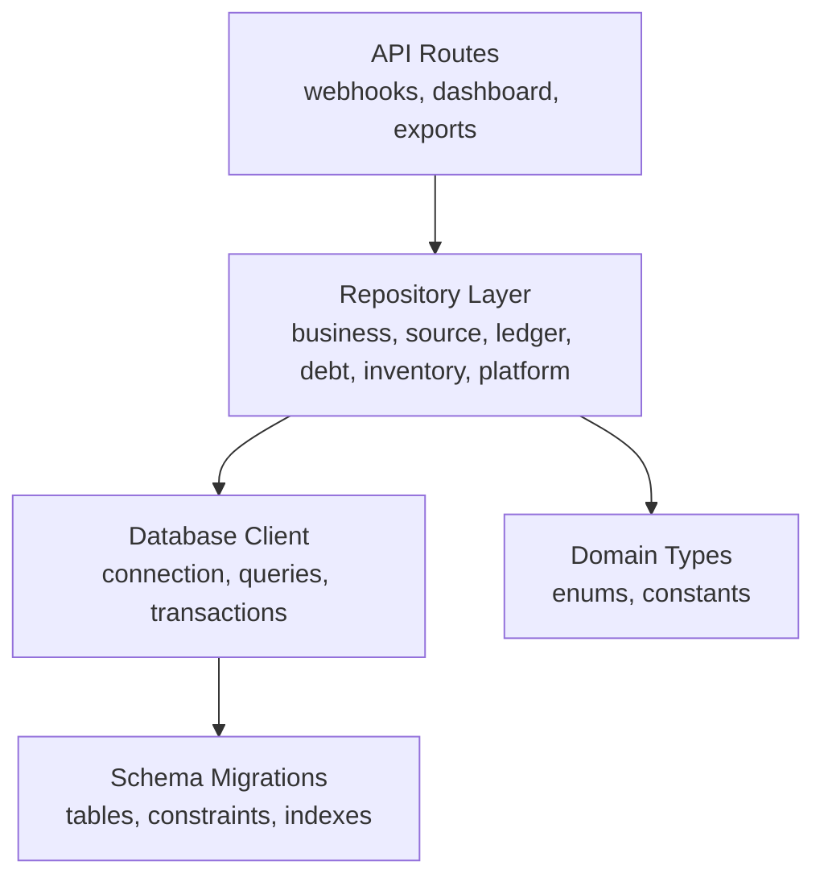
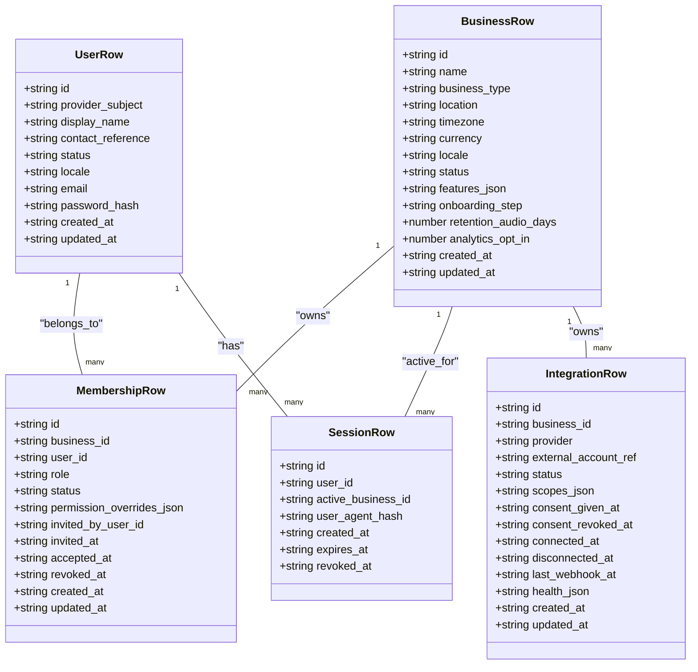
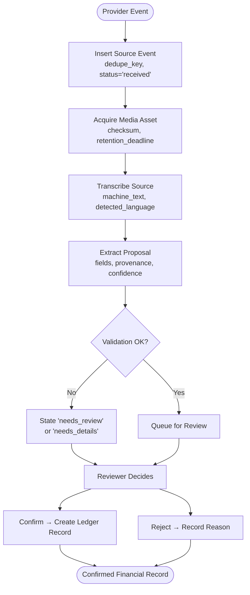
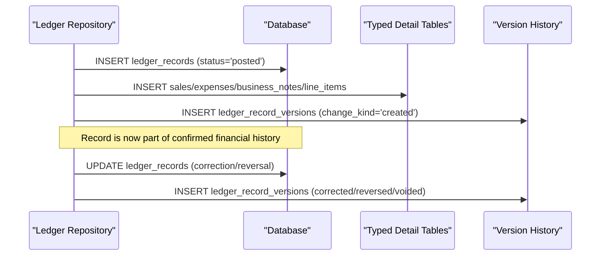
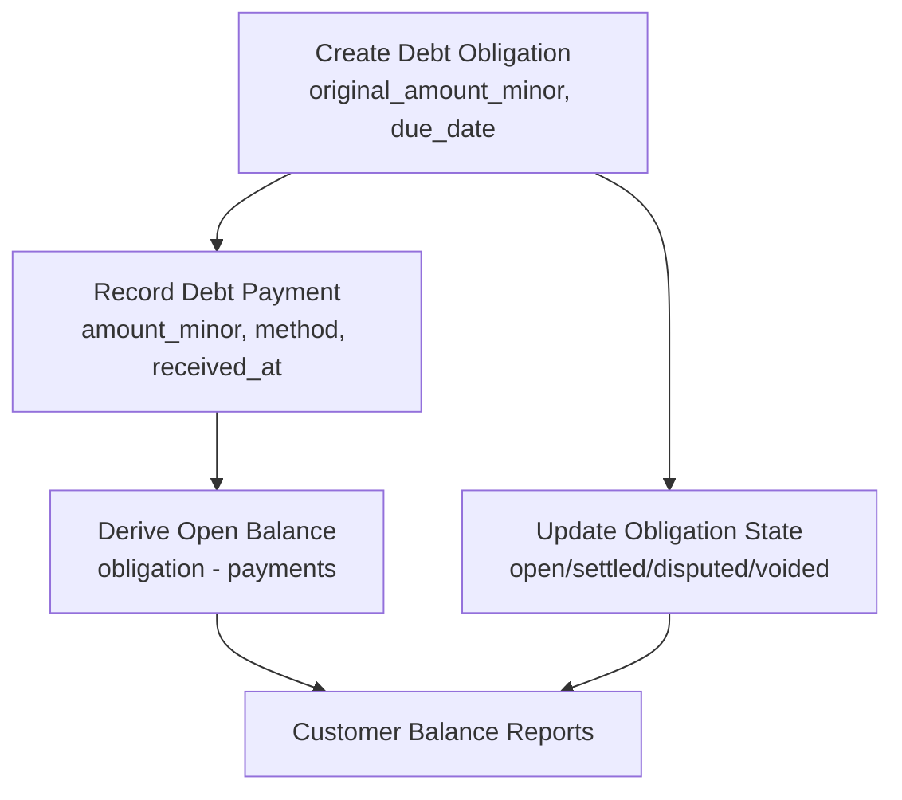
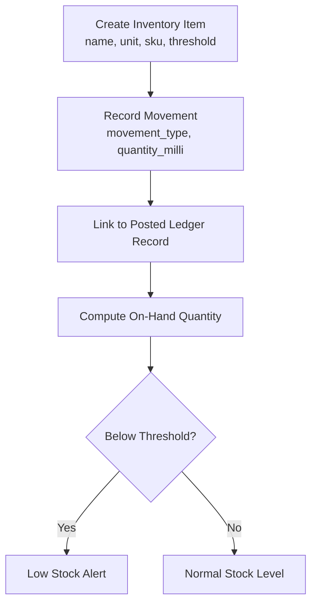
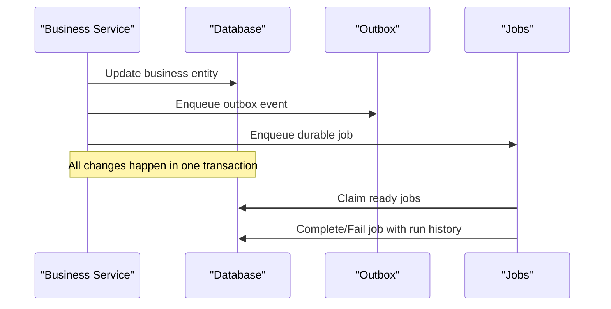
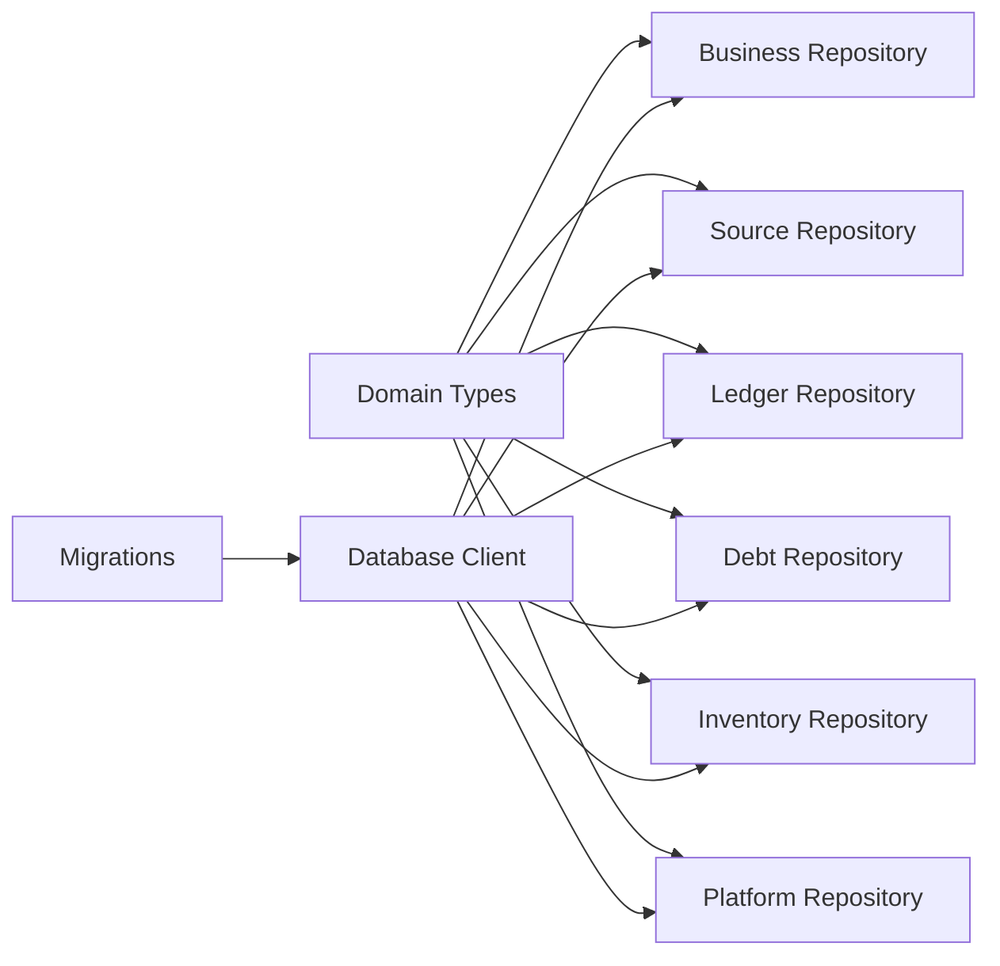

# Database Schema & Data Models

<cite>
**Referenced Files in This Document**
- [client.ts](file://src/server/db/client.ts)
- [migrations.ts](file://src/server/db/migrations.ts)
- [types.ts](file://src/server/domain/types.ts)
- [business.repository.ts](file://src/server/repositories/business.repository.ts)
- [source.repository.ts](file://src/server/repositories/source.repository.ts)
- [ledger.repository.ts](file://src/server/repositories/ledger.repository.ts)
- [debt.repository.ts](file://src/server/repositories/debt.repository.ts)
- [inventory.repository.ts](file://src/server/repositories/inventory.repository.ts)
- [platform.repository.ts](file://src/server/repositories/platform.repository.ts)
- [migrate.ts](file://scripts/migrate.ts)
</cite>

## Table of Contents
1. [Introduction](#introduction)
2. [Project Structure](#project-structure)
3. [Core Components](#core-components)
4. [Architecture Overview](#architecture-overview)
5. [Detailed Component Analysis](#detailed-component-analysis)
6. [Dependency Analysis](#dependency-analysis)
7. [Performance Considerations](#performance-considerations)
8. [Troubleshooting Guide](#troubleshooting-guide)
9. [Conclusion](#conclusion)

## Introduction
This document describes Daftari’s database schema and domain data model. It explains how business entities such as Business, SourceEvent, Transcript, Proposal, LedgerRecord, CustomerDebt, and InventoryItem are represented in the database, how they relate to each other, and how the repository layer enforces multi-tenant isolation, validation rules, referential integrity, and auditability. It also documents migration strategy, data lifecycle policies, security considerations, and performance patterns used by queries and jobs.

The system is a PostgreSQL-first application with an optional SQLite fallback for local and test environments. All persistence logic goes through a small database client that abstracts SQL execution, parameter normalization, transaction handling, and migration application.

## Project Structure
The database-related code is organized into:
- A portable database client for connection management, query helpers, transactions, and migration execution.
- Versioned migrations defining tables, constraints, indexes, and append-only enforcement.
- Domain type definitions enumerating allowed values for record types, states, roles, payment attributes, job types, and audit actions.
- Repository modules implementing tenant-scoped data access for business identity, source lineage, confirmed ledger records, debt obligations/payments, inventory, and platform infrastructure.



**Diagram sources**
- [client.ts:1-350](file://src/server/db/client.ts#L1-L350)
- [migrations.ts:1-706](file://src/server/db/migrations.ts#L1-L706)
- [types.ts:1-217](file://src/server/domain/types.ts#L1-L217)
- [business.repository.ts:1-556](file://src/server/repositories/business.repository.ts#L1-L556)
- [source.repository.ts:1-771](file://src/server/repositories/source.repository.ts#L1-L771)
- [ledger.repository.ts:1-696](file://src/server/repositories/ledger.repository.ts#L1-L696)
- [debt.repository.ts:1-386](file://src/server/repositories/debt.repository.ts#L1-L386)
- [inventory.repository.ts:1-196](file://src/server/repositories/inventory.repository.ts#L1-L196)
- [platform.repository.ts:1-491](file://src/server/repositories/platform.repository.ts#L1-L491)

**Section sources**
- [client.ts:1-350](file://src/server/db/client.ts#L1-L350)
- [migrations.ts:1-706](file://src/server/db/migrations.ts#L1-L706)
- [types.ts:1-217](file://src/server/domain/types.ts#L1-L217)

## Core Components
Daftari’s data model centers around tenancy, source lineage, financial confirmation, debt accounting, inventory tracking, and platform operations.

### Tenancy and Identity
- `users`: identity accounts, including optional credential sign-in fields.
- `businesses`: tenants with configuration, features, retention policy, and analytics opt-in.
- `business_memberships`: role-based membership scoped to a business.
- `sessions`: active sessions with token hash and business context.
- `integrations`: third-party provider connections with consent and health metadata.

All reads and writes are scoped by `business_id`. Cross-tenant identifiers do not match, so service layers report missing rows rather than leaking another tenant’s data.

### Source Lineage
- `source_events`: inbound provider events with deduplication keys, status, failure codes, and redacted payloads.
- `media_assets`: private media objects with checksum, encryption metadata, retention deadline, and deletion marker.
- `transcripts`: machine or corrected text linked to a source event and optional media asset.
- `proposals`: extracted or manually drafted business record proposals with state, provenance, validation issues, and duplicate candidates.

Lineage flows from provider event to transcript, proposal, decision, and confirmed ledger record.

### Confirmed Financial Records
- `ledger_records`: confirmed sale, expense, debt creation/payment, stock movement, or note entries.
- `ledger_record_versions`: append-only version history with snapshots and change reasons.
- `sales`, `expenses`, `business_notes`, `line_items`: typed detail tables joined to ledger records.

Totals are computed only from posted records; corrections create new versions instead of overwriting history.

### Debt Accounting
- `customers`: merchant-defined customers.
- `debt_obligations`: obligations created by debt records, with original amount, due date, and state.
- `debt_payments`: payments applied to obligations or customers, linked to posted ledger records.

Balances are derived from confirmed obligations minus applied payments, never stored as mutable running totals.

### Inventory
- `inventory_items`: items with unit, SKU, low-stock threshold, and active flag.
- `inventory_movements`: positive quantity movements with direction encoded by movement type.

Stock on hand is derived from confirmed movements, preventing phantom balances after voids or reversals.

### Platform Infrastructure
- `audit_events`: chained, append-only audit trail with integrity hashing.
- `outbox_events`: transactional outbox for reliable downstream processing.
- `jobs` and `job_runs`: durable job queue with idempotency keys, retry backoff, and run history.
- `idempotency_keys`: request-level idempotency records.
- `export_jobs`: export generation jobs with format, range, object key, and expiration.

**Section sources**
- [business.repository.ts:14-86](file://src/server/repositories/business.repository.ts#L14-L86)
- [source.repository.ts:26-106](file://src/server/repositories/source.repository.ts#L26-L106)
- [ledger.repository.ts:20-94](file://src/server/repositories/ledger.repository.ts#L20-L94)
- [debt.repository.ts:13-46](file://src/server/repositories/debt.repository.ts#L13-L46)
- [inventory.repository.ts:13-43](file://src/server/repositories/inventory.repository.ts#L13-L43)
- [platform.repository.ts:14-46](file://src/server/repositories/platform.repository.ts#L14-L46)

## Architecture Overview
The database architecture emphasizes:
- Multi-tenancy enforced at every query via `business_id`.
- Additive, versioned migrations with constraints and unique indexes.
- Append-only audit history and ledger versions.
- Derived balances and stock levels rather than mutable counters.
- Transactional outbox and durable jobs for asynchronous work.
- Idempotent operations using unique idempotency keys.

```mermaid
erDiagram
businesses {
text id PK
text name
text business_type
text location
text timezone
text currency
text locale
text status
text features_json
text onboarding_step
integer retention_audio_days
integer analytics_opt_in
text created_at
text updated_at
}
users {
text id PK
text provider_subject UK
text display_name
text contact_reference
text status
text locale
text email UK_null
text password_hash
text created_at
text updated_at
}
business_memberships {
text id PK
text business_id FK
text user_id FK
text role
text status
text permission_overrides_json
text invited_by_user_id FK
text invited_at
text accepted_at
text revoked_at
text created_at
text updated_at
}
sessions {
text id PK
text user_id FK
text active_business_id FK
text user_agent_hash
text created_at
text expires_at
text revoked_at
text token_hash UK
}
integrations {
text id PK
text business_id FK
text provider
text external_account_ref
text status
text scopes_json
text consent_given_at
text consent_revoked_at
text connected_at
text disconnected_at
text last_webhook_at
text health_json
text created_at
text updated_at
}
source_events {
text id PK
text business_id FK
text integration_id FK
text provider_event_id
text event_type
text sender_ref
text received_at
text provider_sent_at
text dedupe_key
text payload_redacted
text status
text failure_code
integer processing_attempts
text created_at
text updated_at
}
media_assets {
text id PK
text business_id FK
text source_event_id FK
text object_key UK
text media_type
integer byte_size
real duration_seconds
text checksum
text encryption_metadata
text retention_deadline
text deleted_at
text access_classification
text created_at
}
transcripts {
text id PK
text business_id FK
text source_event_id FK
text media_asset_id FK
text machine_text
text corrected_text
text corrected_by_user_id FK
text corrected_at
integer marked_unusable
text detected_language
text provider
text model_version
text quality_json
text status
text failure_code
text created_at
text updated_at
}
proposals {
text id PK
text business_id FK
text source_event_id FK
text transcript_id FK
text record_type
text state
text schema_version
text provider
text model_version
text fields_json
text provenance_json
text missing_fields_json
text validation_issues_json
text duplicate_candidates_json
text ambiguity_note
real min_confidence
integer version
text assigned_to_user_id FK
text decided_by_user_id FK
text decided_at
text rejection_reason_code
text rejection_note
text confirmed_ledger_record_id
text created_at
text updated_at
}
customers {
text id PK
text business_id FK
text display_name
text contact_reference
text status
text created_at
text updated_at
}
ledger_records {
text id PK
text business_id FK
text record_type
text occurred_at
text currency
integer amount_minor
text description
text customer_id FK
text payee_name
text status
text origin
text source_event_id
text proposal_id
text created_by_user_id FK
text confirmed_at
integer version
text supersedes_record_id
text reverses_record_id
text created_at
text updated_at
}
ledger_record_versions {
text id PK
text business_id FK
text ledger_record_id FK
integer version
text snapshot_json
text change_kind
text reason_code
text reason_note
text actor_user_id FK
text created_at
}
sales {
text ledger_record_id PK FK
text business_id FK
text payment_status
text payment_method
text external_reference
text paid_at
text category
}
expenses {
text ledger_record_id PK FK
text business_id FK
text category
text vendor
}
business_notes {
text ledger_record_id PK FK
text business_id FK
text note
text privacy_classification
}
line_items {
text id PK
text business_id FK
text ledger_record_id FK
text description
text item_id FK
integer quantity_milli
text unit
integer unit_price_minor
integer line_amount_minor
text created_at
}
debt_obligations {
text id PK
text business_id FK
text ledger_record_id FK
text customer_id FK
integer original_amount_minor
text due_date
text state
text created_at
text updated_at
}
debt_payments {
text id PK
text business_id FK
text ledger_record_id FK
text obligation_id FK
text customer_id FK
integer amount_minor
text method
text reference
text received_at
text created_at
}
inventory_items {
text id PK
text business_id FK
text name
text unit
text sku
integer low_stock_threshold_milli
integer is_active
text created_at
text updated_at
}
inventory_movements {
text id PK
text business_id FK
text item_id FK
text ledger_record_id FK
text movement_type
integer quantity_milli
integer unit_cost_minor
text note
text occurred_at
text created_at
}
audit_events {
text id PK
text business_id FK
text actor_type
text actor_user_id FK
text action
text entity_type
text entity_id
text event_time
text request_id
text reason_code
text reason_note
text before_json
text after_json
text source
text integrity_hash
text previous_hash
}
outbox_events {
text id PK
text business_id
text topic
text entity_type
text entity_id
text payload_json
text status
integer attempts
text next_attempt_at
text last_error_code
text created_at
text processed_at
}
jobs {
text id PK
text business_id
text job_type
text entity_type
text entity_id
text idempotency_key UK
text payload_json
text status
integer attempts
integer max_attempts
text next_attempt_at
text last_error_code
text provider_correlation_id
text created_at
text updated_at
text completed_at
}
job_runs {
text id PK
text job_id FK
integer attempt
text status
text started_at
text finished_at
integer duration_ms
text error_code
text provider_request_id
}
idempotency_keys {
text id PK
text scope
text idempotency_key
text request_hash
text status
integer response_status
text response_json
text created_at
}
export_jobs {
text id PK
text business_id FK
text requested_by_user_id FK
text status
text format
text from_date
text to_date
text record_types_json
text object_key
integer row_count
integer byte_size
text failure_code
text requested_at
text ready_at
text expires_at
text downloaded_at
}
businesses ||--o{ business_memberships : "has"
users ||--o{ business_memberships : "member"
businesses ||--o{ sessions : "active_context"
businesses ||--o{ integrations : "owns"
businesses ||--o{ source_events : "receives"
integrations ||--o{ source_events : "produces"
source_events ||--o{ media_assets : "contains"
source_events ||--o{ transcripts : "generates"
transcripts ||--o{ proposals : "supports"
source_events ||--o{ proposals : "drives"
businesses ||--o{ customers : "defines"
customers ||--o{ ledger_records : "related"
businesses ||--o{ ledger_records : "owns"
ledger_records ||--o| ledger_record_versions : "versions"
ledger_records ||--o| sales : "typed_detail"
ledger_records ||--o| expenses : "typed_detail"
ledger_records ||--o| business_notes : "typed_detail"
ledger_records ||--o| line_items : "contains"
ledger_records ||--o{ debt_obligations : "creates"
customers ||--o{ debt_obligations : "owes"
ledger_records ||--o{ debt_payments : "records_payment"
customers ||--o{ debt_payments : "pays"
businesses ||--o{ inventory_items : "owns"
inventory_items ||--o{ inventory_movements : "moves"
ledger_records ||--o{ inventory_movements : "links_movement"
businesses ||--o{ audit_events : "audits"
users ||--o{ audit_events : "actors"
businesses ||--o{ outbox_events : "emits"
businesses ||--o{ jobs : "queues"
jobs ||--o{ job_runs : "runs"
businesses ||--o{ export_jobs : "requests"
users ||--o{ export_jobs : "requested_by"
```

**Diagram sources**
- [migrations.ts:26-465](file://src/server/db/migrations.ts#L26-L465)

**Section sources**
- [migrations.ts:26-465](file://src/server/db/migrations.ts#L26-L465)

## Detailed Component Analysis

### Business, Membership, Session, Integration
These tables form the tenancy and identity foundation. Every operation is scoped by `business_id`, and cross-tenant lookups return “not found” rather than exposing other tenants’ data.

Key behaviors:
- Users support both OIDC provider subjects and optional credential sign-in.
- Businesses store feature flags, retention settings, and analytics preferences.
- Memberships enforce role and status constraints.
- Sessions use hashed tokens and can be revoked per session.
- Integrations track provider connections, scopes, consent timestamps, and health metadata.



**Diagram sources**
- [business.repository.ts:14-86](file://src/server/repositories/business.repository.ts#L14-L86)
- [migrations.ts:27-104](file://src/server/db/migrations.ts#L27-L104)

**Section sources**
- [business.repository.ts:88-556](file://src/server/repositories/business.repository.ts#L88-L556)
- [migrations.ts:27-104](file://src/server/db/migrations.ts#L27-L104)

### Source Events, Media Assets, Transcripts, Proposals
Source lineage preserves provider identity and supports voice/text capture, transcription, extraction, validation, and manual review.

Key behaviors:
- Source events include deduplication keys and provider-specific identifiers.
- Media assets carry checksums, encryption metadata, retention deadlines, and soft deletion markers.
- Transcripts store machine text, corrected text, language detection, provider/model metadata, and quality metrics.
- Proposals track extraction confidence, missing fields, validation issues, duplicate candidates, and reviewer decisions.



**Diagram sources**
- [source.repository.ts:127-166](file://src/server/repositories/source.repository.ts#L127-L166)
- [source.repository.ts:231-268](file://src/server/repositories/source.repository.ts#L231-L268)
- [source.repository.ts:324-378](file://src/server/repositories/source.repository.ts#L324-L378)
- [source.repository.ts:446-498](file://src/server/repositories/source.repository.ts#L446-L498)

**Section sources**
- [source.repository.ts:26-106](file://src/server/repositories/source.repository.ts#L26-L106)
- [source.repository.ts:127-166](file://src/server/repositories/source.repository.ts#L127-L166)
- [source.repository.ts:231-268](file://src/server/repositories/source.repository.ts#L231-L268)
- [source.repository.ts:324-378](file://src/server/repositories/source.repository.ts#L324-L378)
- [source.repository.ts:446-498](file://src/server/repositories/source.repository.ts#L446-L498)
- [migrations.ts:106-197](file://src/server/db/migrations.ts#L106-L197)

### Ledger Records, Versions, Sales, Expenses, Notes, Line Items
Ledger records represent confirmed financial activity. Corrections and reversals create new versions rather than mutating history. Totals are always computed from posted records.

Key behaviors:
- Record types include sale, expense, debt creation/payment, stock movement, and note.
- Amounts are stored in minor units; notes and stock movements have no monetary amount.
- Typed detail tables specialize sale, expense, note, and line item data.
- Version history captures snapshots, change kinds, and actor information.



**Diagram sources**
- [ledger.repository.ts:96-137](file://src/server/repositories/ledger.repository.ts#L96-L137)
- [ledger.repository.ts:139-200](file://src/server/repositories/ledger.repository.ts#L139-L200)
- [ledger.repository.ts:604-638](file://src/server/repositories/ledger.repository.ts#L604-L638)
- [migrations.ts:210-315](file://src/server/db/migrations.ts#L210-L315)

**Section sources**
- [ledger.repository.ts:20-94](file://src/server/repositories/ledger.repository.ts#L20-L94)
- [ledger.repository.ts:96-137](file://src/server/repositories/ledger.repository.ts#L96-L137)
- [ledger.repository.ts:139-200](file://src/server/repositories/ledger.repository.ts#L139-L200)
- [ledger.repository.ts:604-638](file://src/server/repositories/ledger.repository.ts#L604-L638)
- [migrations.ts:210-315](file://src/server/db/migrations.ts#L210-L315)

### Customers, Debt Obligations, Debt Payments
Debt accounting separates obligations from payments and derives balances from confirmed records.

Key behaviors:
- Obligations link to a ledger record and customer, with original amount and due date.
- Payments link to a ledger record, optionally to an obligation, and to a customer.
- Balance queries join obligations, payments, and posted ledger records.
- Restatement updates reflect corrections to underlying records.



**Diagram sources**
- [debt.repository.ts:94-114](file://src/server/repositories/debt.repository.ts#L94-L114)
- [debt.repository.ts:226-260](file://src/server/repositories/debt.repository.ts#L226-L260)
- [debt.repository.ts:289-335](file://src/server/repositories/debt.repository.ts#L289-L335)
- [migrations.ts:276-301](file://src/server/db/migrations.ts#L276-L301)

**Section sources**
- [debt.repository.ts:13-46](file://src/server/repositories/debt.repository.ts#L13-L46)
- [debt.repository.ts:94-114](file://src/server/repositories/debt.repository.ts#L94-L114)
- [debt.repository.ts:226-260](file://src/server/repositories/debt.repository.ts#L226-L260)
- [debt.repository.ts:289-335](file://src/server/repositories/debt.repository.ts#L289-L335)
- [migrations.ts:276-301](file://src/server/db/migrations.ts#L276-L301)

### Inventory Items and Movements
Inventory tracks physical goods with derived stock levels.

Key behaviors:
- Items have units, SKUs, low-stock thresholds, and active flags.
- Movements store positive quantities; direction comes from movement type.
- Stock on hand is computed from confirmed movements linked to posted ledger records.
- Low-stock detection compares derived on-hand quantity against thresholds.



**Diagram sources**
- [inventory.repository.ts:68-92](file://src/server/repositories/inventory.repository.ts#L68-L92)
- [inventory.repository.ts:110-130](file://src/server/repositories/inventory.repository.ts#L110-L130)
- [inventory.repository.ts:163-188](file://src/server/repositories/inventory.repository.ts#L163-L188)
- [migrations.ts:317-342](file://src/server/db/migrations.ts#L317-L342)

**Section sources**
- [inventory.repository.ts:13-43](file://src/server/repositories/inventory.repository.ts#L13-L43)
- [inventory.repository.ts:68-92](file://src/server/repositories/inventory.repository.ts#L68-L92)
- [inventory.repository.ts:110-130](file://src/server/repositories/inventory.repository.ts#L110-L130)
- [inventory.repository.ts:163-188](file://src/server/repositories/inventory.repository.ts#L163-L188)
- [migrations.ts:317-342](file://src/server/db/migrations.ts#L317-L342)

### Audit Events, Outbox, Jobs, Idempotency, Exports
Platform tables provide auditability, reliability, and operational visibility.

Key behaviors:
- Audit events are append-only and chained by integrity hash.
- Outbox events ensure downstream work is enqueued atomically with business state changes.
- Jobs use idempotency keys, retry backoff, and run history.
- Export jobs track format, date ranges, object storage references, and expiration.



**Diagram sources**
- [platform.repository.ts:52-103](file://src/server/repositories/platform.repository.ts#L52-L103)
- [platform.repository.ts:143-170](file://src/server/repositories/platform.repository.ts#L143-L170)
- [platform.repository.ts:197-235](file://src/server/repositories/platform.repository.ts#L197-L235)
- [platform.repository.ts:252-302](file://src/server/repositories/platform.repository.ts#L252-L302)
- [migrations.ts:353-465](file://src/server/db/migrations.ts#L353-L465)

**Section sources**
- [platform.repository.ts:14-46](file://src/server/repositories/platform.repository.ts#L14-L46)
- [platform.repository.ts:52-103](file://src/server/repositories/platform.repository.ts#L52-L103)
- [platform.repository.ts:143-170](file://src/server/repositories/platform.repository.ts#L143-L170)
- [platform.repository.ts:197-235](file://src/server/repositories/platform.repository.ts#L197-L235)
- [platform.repository.ts:252-302](file://src/server/repositories/platform.repository.ts#L252-L302)
- [migrations.ts:353-465](file://src/server/db/migrations.ts#L353-L465)

## Dependency Analysis
The repository layer depends on:
- The database client for connection pooling, query execution, parameter normalization, and transaction boundaries.
- Domain types for validated enums and constants.
- Migration definitions for table structure, constraints, and indexes.



**Diagram sources**
- [types.ts:8-123](file://src/server/domain/types.ts#L8-L123)
- [client.ts:15-350](file://src/server/db/client.ts#L15-L350)
- [business.repository.ts:1-12](file://src/server/repositories/business.repository.ts#L1-L12)
- [source.repository.ts:1-24](file://src/server/repositories/source.repository.ts#L1-L24)
- [ledger.repository.ts:1-18](file://src/server/repositories/ledger.repository.ts#L1-L18)
- [debt.repository.ts:1-11](file://src/server/repositories/debt.repository.ts#L1-L11)
- [inventory.repository.ts:1-11](file://src/server/repositories/inventory.repository.ts#L1-L11)
- [platform.repository.ts:1-10](file://src/server/repositories/platform.repository.ts#L1-L10)

**Section sources**
- [types.ts:8-123](file://src/server/domain/types.ts#L8-L123)
- [client.ts:15-350](file://src/server/db/client.ts#L15-L350)

## Performance Considerations
- Connection pooling: PostgreSQL uses a pooled connection with configurable pool size and timeouts.
- Parameter normalization: Dates, booleans, and undefined values are normalized before execution.
- Indexing: Tenant-scoped indexes begin with `business_id`; unique indexes prevent duplicates.
- Cursor pagination: Ledger records and proposals use cursor-based pagination for large datasets.
- Derived metrics: Balances and stock levels are computed from confirmed records, avoiding stale counters.
- Transaction safety: Savepoints and nested transaction support reduce partial-write risks.
- Query scoping: All queries filter by `business_id`, improving isolation and index utilization.

[No sources needed since this section provides general guidance]

## Troubleshooting Guide
Common issues and resolutions:
- Missing database URL: Production requires `DATABASE_URL` or `NEON_DATABASE_URL`; otherwise, an error is thrown.
- Migration failures: Use the migration script to apply pending migrations and inspect schema version.
- Duplicate webhooks: Deduplication keys and unique indexes prevent duplicate source events.
- Stale ledger versions: Version checks prevent concurrent overwrites during corrections.
- Expired media: Retention deadlines and deletion markers allow safe cleanup jobs.
- Audit tampering: Append-only triggers reject updates and deletes on audit events.

**Section sources**
- [client.ts:52-88](file://src/server/db/client.ts#L52-L88)
- [migrate.ts:1-25](file://scripts/migrate.ts#L1-L25)
- [source.repository.ts:110-125](file://src/server/repositories/source.repository.ts#L110-L125)
- [ledger.repository.ts:558-582](file://src/server/repositories/ledger.repository.ts#L558-L582)
- [source.repository.ts:289-307](file://src/server/repositories/source.repository.ts#L289-L307)
- [migrations.ts:588-626](file://src/server/db/migrations.ts#L588-L626)

## Conclusion
Daftari’s database schema is designed for multi-tenant isolation, financial accuracy, and operational reliability. It uses additive migrations, strict constraints, append-only audit trails, and derived balances to ensure correctness. The repository layer enforces domain rules, tenant scoping, and data lifecycle policies. Performance is addressed through indexing, cursor pagination, connection pooling, and transaction safety. Security considerations include hashed session tokens, redacted payloads, encrypted media metadata, and append-only audit chains.

[No sources needed since this section summarizes without analyzing specific files]