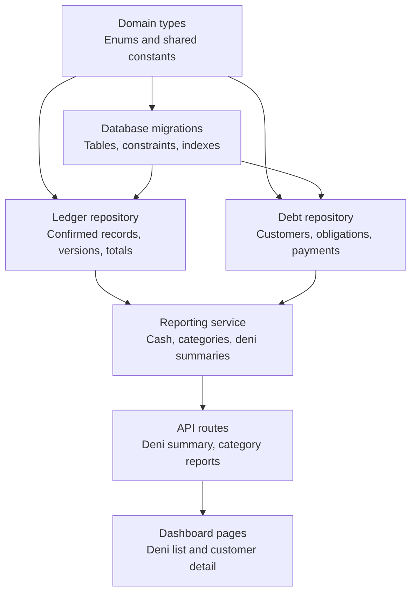
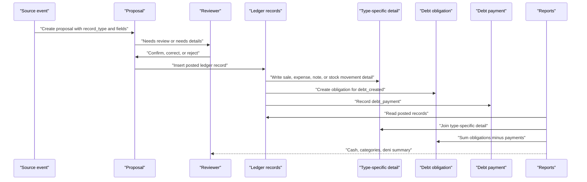
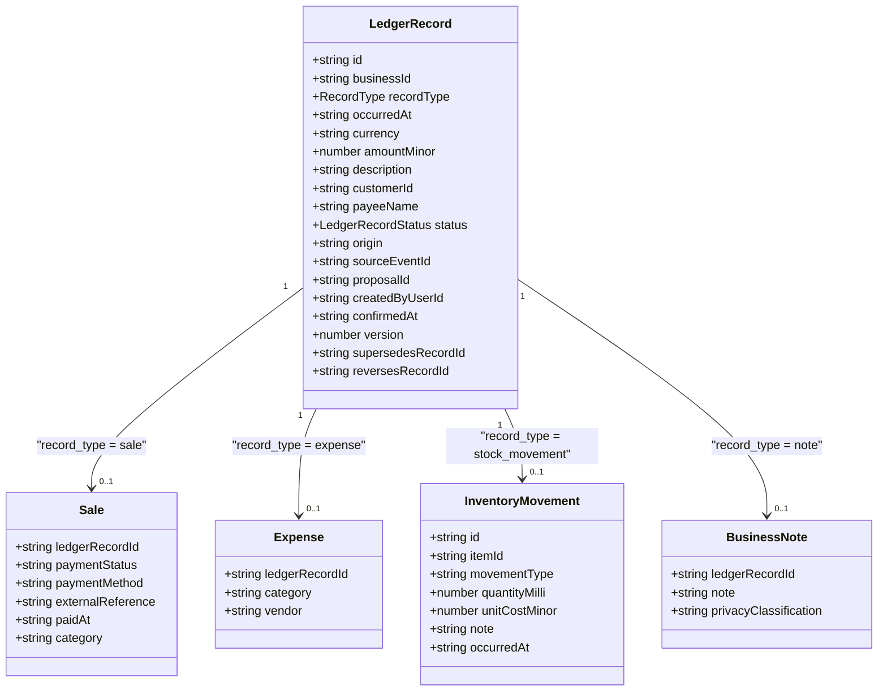
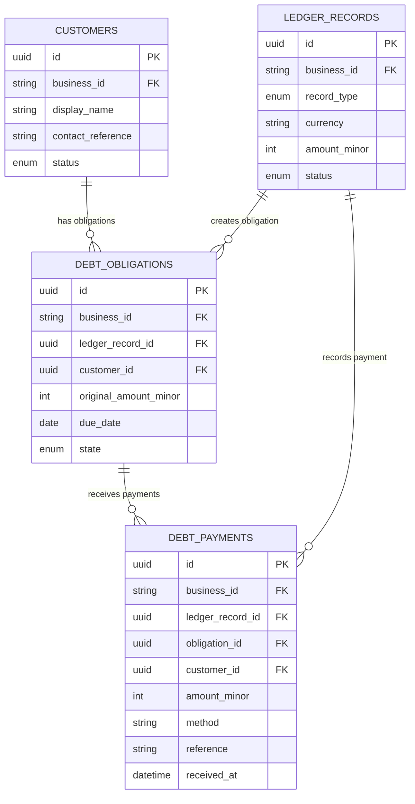
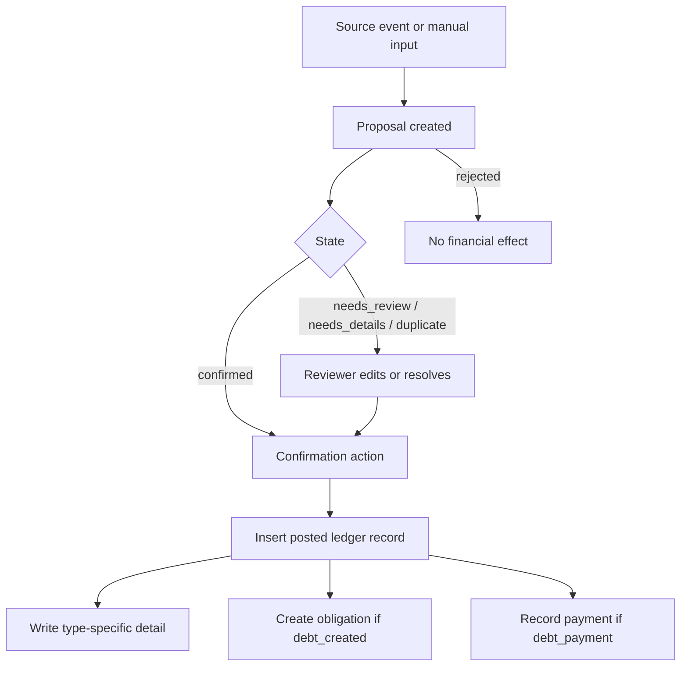
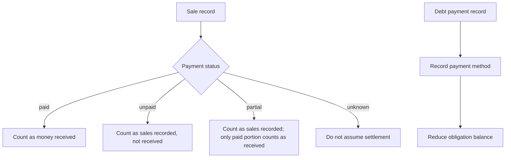
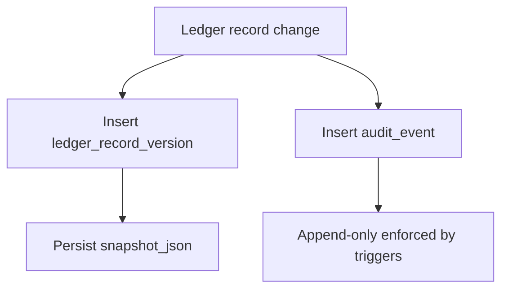
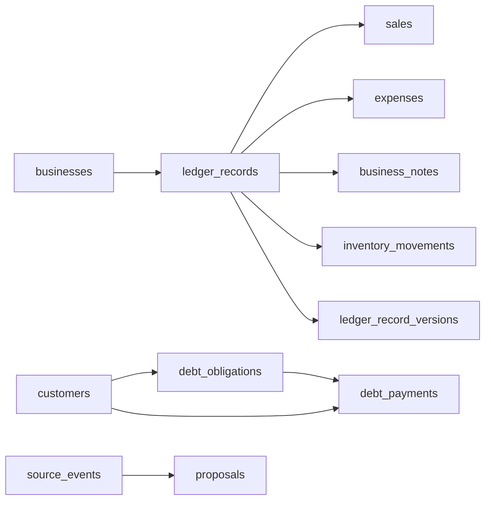
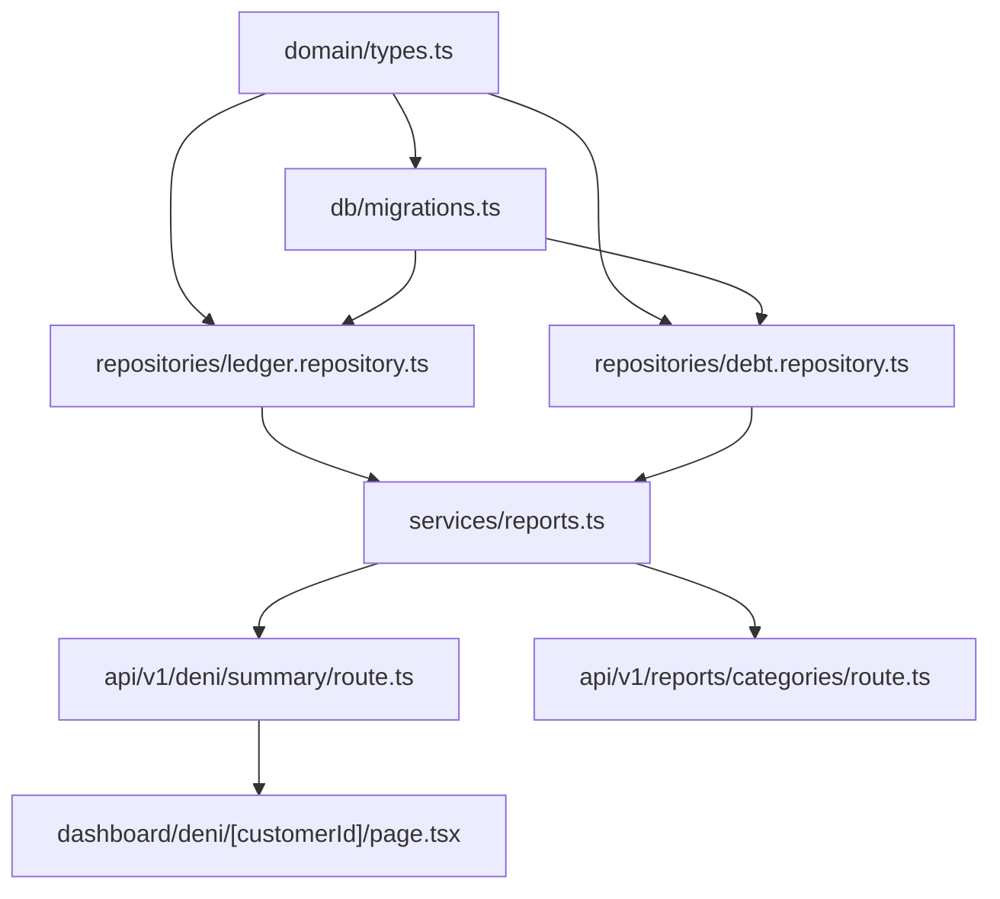

# Financial Data Models

<cite>
**Referenced Files in This Document**
- [domain/types.ts](file://src/server/domain/types.ts)
- [migrations.ts](file://src/server/db/migrations.ts)
- [ledger.repository.ts](file://src/server/repositories/ledger.repository.ts)
- [debt.repository.ts](file://src/server/repositories/debt.repository.ts)
- [reports.ts](file://src/server/services/reports.ts)
- [deni summary route.ts](file://src/app/api/v1/deni/summary/route.ts)
- [customer deni page.tsx](file://src/app/(dashboard)/deni/[customerId]/page.tsx)
- [category reports route.ts](file://src/app/api/v1/reports/categories/route.ts)
- [bookkeeping algorithm.md](file://"# Daftari Bookkeeping Algorithm.md")
</cite>

## Table of Contents
1. [Introduction](#introduction)
2. [Project Structure](#project-structure)
3. [Core Components](#core-components)
4. [Architecture Overview](#architecture-overview)
5. [Detailed Component Analysis](#detailed-component-analysis)
6. [Dependency Analysis](#dependency-analysis)
7. [Performance Considerations](#performance-considerations)
8. [Troubleshooting Guide](#troubleshooting-guide)
9. [Conclusion](#conclusion)

## Introduction
This document describes the financial data models used by Daftari to record, confirm, correct, and report business transactions. It focuses on:

- The `LedgerRecord` structure and its supported record types: sale, expense, debt_created, debt_payment, stock_movement, and note.
- Customer obligations and payments for tracking customer debts (deni).
- The relationship between proposals and confirmed ledger records.
- Payment statuses and payment methods.
- Audit trail requirements and multi-currency considerations.
- Accounting principles enforced by the data model and referential integrity constraints.

The documentation is grounded in the repository’s domain types, database migrations, repository implementations, reporting services, and product specification.

## Project Structure
The financial data model spans several layers:

- Domain vocabulary defines stable enums and shared types.
- Database migrations define tables, constraints, indexes, and append-only audit enforcement.
- Repositories implement persistence and derived calculations for ledger records, sales, expenses, obligations, and payments.
- Services compute reports from posted ledger rows.
- API routes and dashboard pages expose summaries and detail views.

**Diagram sources**
- [domain/types.ts:8-85](file://src/server/domain/types.ts#L8-L85)
- [migrations.ts:210-349](file://src/server/db/migrations.ts#L210-L349)
- [ledger.repository.ts:96-137](file://src/server/repositories/ledger.repository.ts#L96-L137)
- [debt.repository.ts:94-114](file://src/server/repositories/debt.repository.ts#L94-L114)
- [reports.ts:72-145](file://src/server/services/reports.ts#L72-L145)
- [deni summary route.ts:15-29](file://src/app/api/v1/deni/summary/route.ts#L15-L29)
- [customer deni page.tsx:33-116](file://src/app/(dashboard)/deni/[customerId]/page.tsx#L33-L116)

**Section sources**
- [domain/types.ts:8-85](file://src/server/domain/types.ts#L8-L85)
- [migrations.ts:210-349](file://src/server/db/migrations.ts#L210-L349)
- [ledger.repository.ts:96-137](file://src/server/repositories/ledger.repository.ts#L96-L137)
- [debt.repository.ts:94-114](file://src/server/repositories/debt.repository.ts#L94-L114)
- [reports.ts:72-145](file://src/server/services/reports.ts#L72-L145)

## Core Components
Daftari’s financial data model centers on a small set of core entities:

| Entity | Purpose | Key fields |
|---|---|---|
| `businesses` | Business workspace with currency, timezone, locale, and feature flags | `id`, `currency`, `timezone`, `features_json` |
| `customers` | Customer profiles scoped to a business | `id`, `display_name`, `contact_reference`, `status` |
| `proposals` | AI or manual proposals awaiting human confirmation | `record_type`, `state`, `fields_json`, `confirmed_ledger_record_id` |
| `ledger_records` | Confirmed, versioned financial events | `record_type`, `amount_minor`, `currency`, `occurred_at`, `status`, `proposal_id` |
| `sales` | Type-specific details for sale records | `payment_status`, `payment_method`, `external_reference`, `paid_at`, `category` |
| `expenses` | Type-specific details for expense records | `category`, `vendor` |
| `debt_obligations` | Customer obligations created by `debt_created` records | `original_amount_minor`, `due_date`, `state` |
| `debt_payments` | Payments applied against obligations | `amount_minor`, `method`, `reference`, `received_at` |
| `inventory_items` | Stock items when inventory tracking is enabled | `name`, `unit`, `sku`, `low_stock_threshold_milli` |
| `inventory_movements` | Quantity movements linked to stock movement records | `movement_type`, `quantity_milli`, `unit_cost_minor` |
| `line_items` | Optional line-level detail for sales and stock movements | `description`, `quantity_milli`, `unit`, `line_amount_minor` |
| `business_notes` | Non-money notes attached to a ledger record | `note`, `privacy_classification` |
| `ledger_record_versions` | Immutable history of changes to a ledger record | `snapshot_json`, `change_kind`, `reason_code`, `actor_user_id` |
| `audit_events` | Append-only system-wide audit log | `action`, `entity_type`, `entity_id`, `before_json`, `after_json` |

Money values are stored as integer minor units. Currency is explicit per business and per record. Notes do not carry monetary amounts; other money-affecting record types require an amount.

**Section sources**
- [migrations.ts:27-53](file://src/server/db/migrations.ts#L27-L53)
- [migrations.ts:199-208](file://src/server/db/migrations.ts#L199-L208)
- [migrations.ts:166-195](file://src/server/db/migrations.ts#L166-L195)
- [migrations.ts:210-237](file://src/server/db/migrations.ts#L210-L237)
- [migrations.ts:260-349](file://src/server/db/migrations.ts#L260-L349)
- [migrations.ts:353-372](file://src/server/db/migrations.ts#L353-L372)

## Architecture Overview
The financial workflow enforces deterministic processing, human confirmation, immutable history, and balanced reporting.

**Diagram sources**
- [migrations.ts:166-195](file://src/server/db/migrations.ts#L166-L195)
- [migrations.ts:210-237](file://src/server/db/migrations.ts#L210-L237)
- [migrations.ts:260-300](file://src/server/db/migrations.ts#L260-L300)
- [ledger.repository.ts:96-137](file://src/server/repositories/ledger.repository.ts#L96-L137)
- [debt.repository.ts:94-114](file://src/server/repositories/debt.repository.ts#L94-L114)
- [debt.repository.ts:226-260](file://src/server/repositories/debt.repository.ts#L226-L260)
- [reports.ts:72-145](file://src/server/services/reports.ts#L72-L145)

## Detailed Component Analysis

### LedgerRecord and Record Types
A `LedgerRecord` is the central confirmed financial event. Its `record_type` determines which detail table stores additional information.

Supported record types:

| Record type | Monetary? | Detail table | Meaning |
|---|---:|---|---|
| `sale` | Yes | `sales` | Revenue event with optional payment status, method, reference, category, and line items |
| `expense` | Yes | `expenses` | Cost event with category and vendor/payee |
| `debt_created` | Yes | None directly; creates `debt_obligations` | Creates a customer obligation |
| `debt_payment` | Yes | None directly; creates `debt_payments` | Records a customer payment |
| `stock_movement` | No | `inventory_movements` plus optional `line_items` | Tracks quantity movement, optionally with unit cost |
| `note` | No | `business_notes` | Operational or explanatory note |

Constraints:

- `record_type` is restricted to the defined set.
- `status` is restricted to `posted`, `voided`, or `reversed`.
- `origin` is restricted to `whatsapp`, `manual`, or `import`.
- Notes must have no monetary amount; all other money-affecting record types must have an amount.
- A stock movement is intentionally non-monetary at the ledger level, though it may include an optional unit cost and quantity.

**Diagram sources**
- [migrations.ts:210-237](file://src/server/db/migrations.ts#L210-L237)
- [migrations.ts:260-349](file://src/server/db/migrations.ts#L260-L349)
- [ledger.repository.ts:139-200](file://src/server/repositories/ledger.repository.ts#L139-L200)

**Section sources**
- [domain/types.ts:8-19](file://src/server/domain/types.ts#L8-L19)
- [domain/types.ts:211-217](file://src/server/domain/types.ts#L211-L217)
- [migrations.ts:210-237](file://src/server/db/migrations.ts#L210-L237)
- [migrations.ts:303-349](file://src/server/db/migrations.ts#L303-L349)
- [ledger.repository.ts:139-200](file://src/server/repositories/ledger.repository.ts#L139-L200)

### CustomerDebt and DebtPayment Models
Customer debt is modeled as an obligation linked to a `debt_created` ledger record, with separate payments linked to both the obligation and the posting ledger record.

Key relationships:

- `debt_obligations.ledger_record_id` references the confirmed `debt_created` record.
- `debt_obligations.customer_id` references the customer.
- `debt_payments.obligation_id` optionally links a payment to a specific obligation.
- `debt_payments.ledger_record_id` links the payment to the confirmed `debt_payment` record.
- Balances are derived from `original_amount_minor` minus applied posted payments; they are not stored as mutable running totals.

**Diagram sources**
- [migrations.ts:199-208](file://src/server/db/migrations.ts#L199-L208)
- [migrations.ts:210-237](file://src/server/db/migrations.ts#L210-L237)
- [migrations.ts:276-300](file://src/server/db/migrations.ts#L276-L300)
- [debt.repository.ts:94-114](file://src/server/repositories/debt.repository.ts#L94-L114)
- [debt.repository.ts:226-260](file://src/server/repositories/debt.repository.ts#L226-L260)

Balance derivation logic:

- Outstanding balance equals the sum of active obligations minus posted payments applied to those obligations.
- Overdue balance sums positive balances where `due_date` is before the current business-date boundary.
- Customer lists exclude voided obligations and only count posted ledger records.

**Section sources**
- [migrations.ts:276-300](file://src/server/db/migrations.ts#L276-L300)
- [debt.repository.ts:116-133](file://src/server/repositories/debt.repository.ts#L116-L133)
- [debt.repository.ts:277-335](file://src/server/repositories/debt.repository.ts#L277-L335)
- [debt.repository.ts:337-382](file://src/server/repositories/debt.repository.ts#L337-L382)

### Relationship Between Proposals and Confirmed Ledger Records
Proposals represent pre-confirmation interpretations of voice, text, import, or manual input. They are not financial facts until confirmed.

Important relationships:

- `proposals.record_type` mirrors the intended ledger record type.
- `proposals.state` tracks lifecycle states such as queued, processing, needs_review, needs_details, failed, confirmed, rejected, and duplicate.
- When confirmed, a proposal can link to a posted ledger record through `proposals.confirmed_ledger_record_id`.
- `ledger_records.proposal_id` links the confirmed record back to the originating proposal.
- Only posted ledger records contribute to financial totals and reports.

**Diagram sources**
- [domain/types.ts:21-31](file://src/server/domain/types.ts#L21-L31)
- [migrations.ts:166-195](file://src/server/db/migrations.ts#L166-L195)
- [migrations.ts:210-237](file://src/server/db/migrations.ts#L210-L237)
- [ledger.repository.ts:213-222](file://src/server/repositories/ledger.repository.ts#L213-L222)

**Section sources**
- [domain/types.ts:21-31](file://src/server/domain/types.ts#L21-L31)
- [migrations.ts:166-195](file://src/server/db/migrations.ts#L166-L195)
- [ledger.repository.ts:213-222](file://src/server/repositories/ledger.repository.ts#L213-L222)

### Payment Statuses and Payment Methods
Payment semantics are separated into two concepts:

- **Payment status:** How much of a sale has been paid according to the reviewer’s assertion.
- **Payment method:** How the money was received.

Defined values:

| Concept | Values | Meaning |
|---|---|---|
| `PaymentStatus` | `paid`, `unpaid`, `partial`, `unknown` | Merchant assertion about whether a sale is fully paid, unpaid, partially paid, or unknown |
| `PaymentMethod` | `cash`, `mobile_money`, `bank`, `card`, `credit`, `unknown` | Channel used to receive or record payment |

Rules:

- A sale’s `paid_at` timestamp is set only when the payment status is `paid`.
- Reported cash-in includes paid sales and debt payments received.
- Unpaid or partial sales are recorded but are not treated as received cash unless explicitly marked paid.
- Debt payments are tracked separately from sales and reduce outstanding obligations.

**Diagram sources**
- [domain/types.ts:67-82](file://src/server/domain/types.ts#L67-L82)
- [migrations.ts:260-267](file://src/server/db/migrations.ts#L260-L267)
- [ledger.repository.ts:145-159](file://src/server/repositories/ledger.repository.ts#L145-L159)
- [ledger.repository.ts:377-431](file://src/server/repositories/ledger.repository.ts#L377-L431)

**Section sources**
- [domain/types.ts:67-82](file://src/server/domain/types.ts#L67-L82)
- [migrations.ts:260-267](file://src/server/db/migrations.ts#L260-L267)
- [ledger.repository.ts:145-159](file://src/server/repositories/ledger.repository.ts#L145-L159)
- [ledger.repository.ts:377-431](file://src/server/repositories/ledger.repository.ts#L377-L431)

### Audit Trail Requirements
Financial history is immutable after posting. Corrections create new versions rather than overwriting existing rows.

Audit mechanisms:

- `ledger_record_versions` stores snapshots, change kind, reason code, reason note, actor, and timestamp.
- `audit_events` is append-only and enforced by database triggers.
- Actions are drawn from a single source of truth in domain types.
- Before/after snapshots support traceability without requiring destructive edits.

**Diagram sources**
- [migrations.ts:243-258](file://src/server/db/migrations.ts#L243-L258)
- [migrations.ts:353-372](file://src/server/db/migrations.ts#L353-L372)
- [migrations.ts:588-626](file://src/server/db/migrations.ts#L588-L626)
- [domain/types.ts:135-179](file://src/server/domain/types.ts#L135-L179)
- [ledger.repository.ts:604-638](file://src/server/repositories/ledger.repository.ts#L604-L638)

**Section sources**
- [migrations.ts:243-258](file://src/server/db/migrations.ts#L243-L258)
- [migrations.ts:353-372](file://src/server/db/migrations.ts#L353-L372)
- [migrations.ts:588-626](file://src/server/db/migrations.ts#L588-L626)
- [domain/types.ts:135-179](file://src/server/domain/types.ts#L135-L179)
- [ledger.repository.ts:604-638](file://src/server/repositories/ledger.repository.ts#L604-L638)

### Multi-Currency Support Considerations
Multi-currency support is intentionally limited in the current implementation:

- Each business has a default currency configured during setup.
- Every ledger record carries an explicit `currency` field.
- Amounts are stored as integer minor units, avoiding binary floating-point arithmetic.
- The bookkeeping algorithm specifies one functional currency per business for MVP behavior and defers exchange-rate handling and consolidation to later modules.

Recommendations based on the model:

- Always persist and report with the record’s currency.
- Display amounts using the business currency and minor-unit formatting.
- Do not infer exchange rates from the ledger model alone.
- If future multi-currency features are added, introduce explicit exchange-rate metadata and conversion rules outside the base ledger row.

**Section sources**
- [migrations.ts:38-53](file://src/server/db/migrations.ts#L38-L53)
- [migrations.ts:210-237](file://src/server/db/migrations.ts#L210-L237)
- ["# Daftari Bookkeeping Algorithm.md":71-90](file://"# Daftari Bookkeeping Algorithm.md"#L71-L90)

### Accounting Principles Enforced by the Data Model
The data model enforces these accounting principles:

- **Deterministic processing:** Proposed records are not posted until confirmed.
- **Human confirmation:** AI extraction creates proposals; only user confirmation creates financial facts.
- **Immutable history:** Posted entries are corrected by reversal or replacement, never silently overwritten.
- **Separation of recording and settlement:** Sales recorded are distinct from cash received; debt payments settle obligations.
- **Explicit basis and currency:** Cash versus accrual treatment and currency are configuration choices, not hidden assumptions.
- **Derived balances:** Customer balances are computed from obligations and payments, not stored as mutable running totals.
- **Clear terminology:** Reports distinguish money received, sales recorded, expenses, net cash movement, and outstanding debt.

These principles are reflected in proposal states, ledger statuses, payment status semantics, and report formulas.

**Section sources**
- [domain/types.ts:8-31](file://src/server/domain/types.ts#L8-L31)
- [domain/types.ts:67-82](file://src/server/domain/types.ts#L67-L82)
- ["# Daftari Bookkeeping Algorithm.md":25-33](file://"# Daftari Bookkeeping Algorithm.md"#L25-L33)
- ["# Daftari Bookkeeping Algorithm.md":71-90](file://"# Daftari Bookkeeping Algorithm.md"#L71-L90)
- ["# Daftari Bookkeeping Algorithm.md":173-293](file://"# Daftari Bookkeeping Algorithm.md"#L173-L293)
- ["# Daftari Bookkeeping Algorithm.md":294-343](file://"# Daftari Bookkeeping Algorithm.md"#L294-L343)

### Referential Integrity Constraints
The schema uses foreign keys and check constraints to enforce integrity:

- All financial tables are scoped by `business_id`.
- `ledger_records.business_id` references `businesses.id`.
- `sales.ledger_record_id`, `expenses.ledger_record_id`, `business_notes.ledger_record_id`, and `inventory_movements.ledger_record_id` reference `ledger_records.id`.
- `debt_obligations.customer_id` references `customers.id`.
- `debt_payments.customer_id` references `customers.id`.
- `debt_payments.obligation_id` optionally references `debt_obligations.id`.
- `proposals.source_event_id` references `source_events.id`.
- `ledger_record_versions.ledger_record_id` references `ledger_records.id`.
- Check constraints restrict allowed values for record types, statuses, origins, movement types, and states.

**Diagram sources**
- [migrations.ts:210-237](file://src/server/db/migrations.ts#L210-L237)
- [migrations.ts:260-349](file://src/server/db/migrations.ts#L260-L349)
- [migrations.ts:166-195](file://src/server/db/migrations.ts#L166-L195)

**Section sources**
- [migrations.ts:210-237](file://src/server/db/migrations.ts#L210-L237)
- [migrations.ts:260-349](file://src/server/db/migrations.ts#L260-L349)
- [migrations.ts:166-195](file://src/server/db/migrations.ts#L166-L195)

## Dependency Analysis
The financial data model depends on consistent domain vocabulary and migration-defined constraints.

**Diagram sources**
- [domain/types.ts:8-85](file://src/server/domain/types.ts#L8-L85)
- [migrations.ts:210-349](file://src/server/db/migrations.ts#L210-L349)
- [ledger.repository.ts:96-137](file://src/server/repositories/ledger.repository.ts#L96-L137)
- [debt.repository.ts:94-114](file://src/server/repositories/debt.repository.ts#L94-L114)
- [reports.ts:72-145](file://src/server/services/reports.ts#L72-L145)
- [deni summary route.ts:15-29](file://src/app/api/v1/deni/summary/route.ts#L15-L29)
- [category reports route.ts:14-41](file://src/app/api/v1/reports/categories/route.ts#L14-L41)
- [customer deni page.tsx:33-116](file://src/app/(dashboard)/deni/[customerId]/page.tsx#L33-L116)

**Section sources**
- [domain/types.ts:8-85](file://src/server/domain/types.ts#L8-L85)
- [migrations.ts:210-349](file://src/server/db/migrations.ts#L210-L349)
- [ledger.repository.ts:96-137](file://src/server/repositories/ledger.repository.ts#L96-L137)
- [debt.repository.ts:94-114](file://src/server/repositories/debt.repository.ts#L94-L114)
- [reports.ts:72-145](file://src/server/services/reports.ts#L72-L145)
- [deni summary route.ts:15-29](file://src/app/api/v1/deni/summary/route.ts#L15-L29)
- [category reports route.ts:14-41](file://src/app/api/v1/reports/categories/route.ts#L14-L41)
- [customer deni page.tsx:33-116](file://src/app/(dashboard)/deni/[customerId]/page.tsx#L33-L116)

## Performance Considerations
- Use indexed columns for tenant-scoped queries: `business_id`, `occurred_at`, `record_type`, `status`, `customer_id`, `proposal_id`, and debt-related indexes.
- Compute totals from posted ledger rows rather than trusting client-submitted figures.
- Avoid storing mutable running balances; derive customer balances from obligations and payments.
- Bucket time-series data in application logic using the business timezone because portable SQL timezone grouping is not reliable across databases.
- Keep audit and version tables append-only to preserve integrity while allowing historical inspection.

[No sources needed since this section provides general guidance]

## Troubleshooting Guide
Common issues and their data-model implications:

| Symptom | Likely cause | Resolution |
|---|---|---|
| A sale shows as recorded but not counted as cash received | Payment status is not `paid` | Update sale payment status only after verified merchant assertion; remember it is not bank settlement proof |
| Customer balance does not match expectation | Obligation was restated, voided, or payment is not posted | Inspect `debt_obligations.state`, `ledger_records.status`, and applied `debt_payments` |
| Correction does not appear in totals | Correction created a new version or reversal instead of overwriting | Read posted rows and version history; do not assume single-row mutation |
| Stock movement cannot be confirmed | Original constraint required an amount for non-note records | Migration allows stock movements without monetary amounts |
| Audit log cannot be updated or deleted | Append-only trigger prevents modification | Use new audit events; never edit existing audit rows |
| Deni summary is disabled | Feature flag `context.features.deni` is false | Enable the deni feature in business settings |

**Section sources**
- [ledger.repository.ts:145-159](file://src/server/repositories/ledger.repository.ts#L145-L159)
- [debt.repository.ts:146-152](file://src/server/repositories/debt.repository.ts#L146-L152)
- [debt.repository.ts:210-222](file://src/server/repositories/debt.repository.ts#L210-L222)
- [migrations.ts:490-553](file://src/server/db/migrations.ts#L490-L553)
- [migrations.ts:588-626](file://src/server/db/migrations.ts#L588-L626)
- [deni summary route.ts:19-21](file://src/app/api/v1/deni/summary/route.ts#L19-L21)

## Conclusion
Daftari’s financial data model separates proposals from confirmed records, enforces immutable history, and derives balances from explicit obligations and payments. The model supports sales, expenses, customer debts, payments, stock movements, and notes, with clear distinctions between recorded revenue and received cash. Payment status and payment method are independent, and audit trails protect financial integrity. Multi-currency support is present at the record level but remains conservative for MVP purposes. Reporting reads only posted records and computes cash flow, categories, and deni summaries deterministically from the ledger and related tables.

[No sources needed since this section summarizes without analyzing specific files]