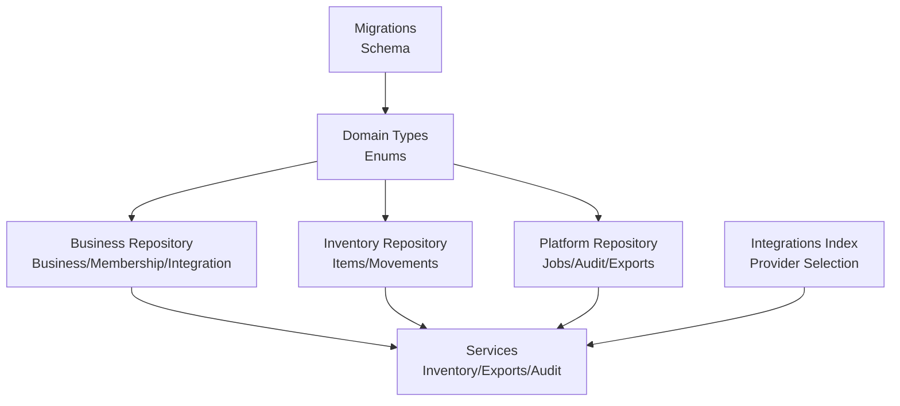
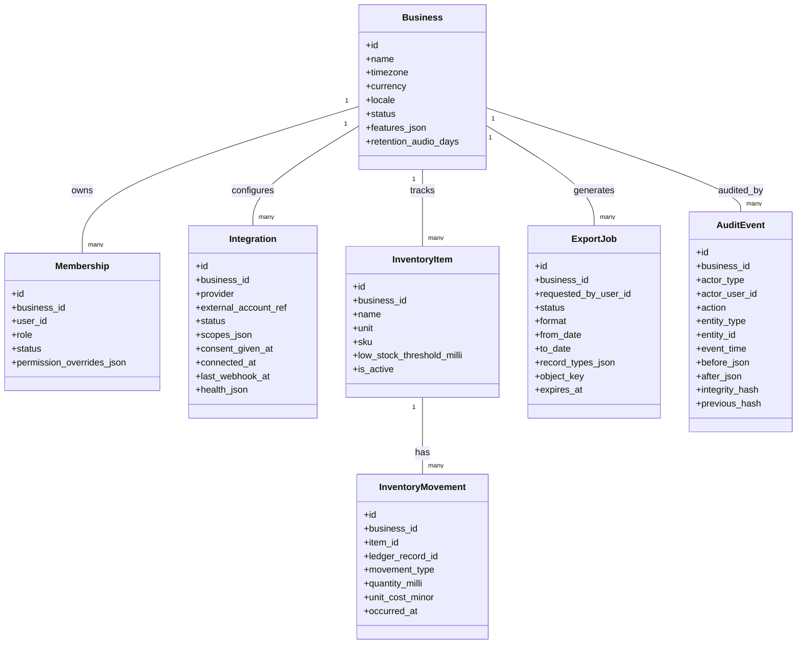
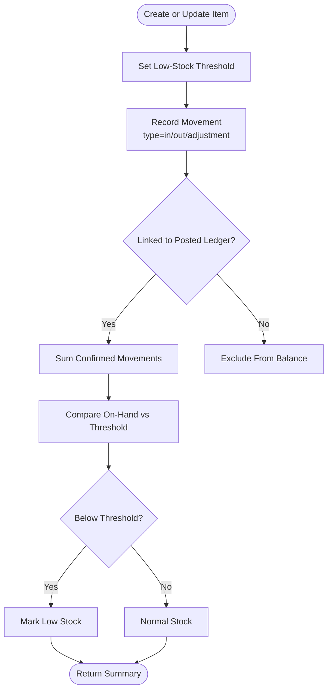
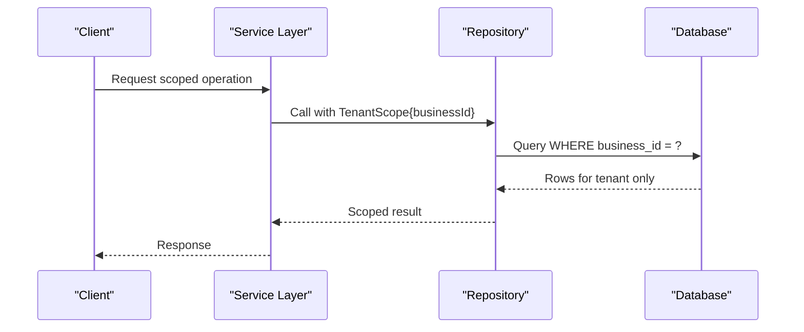
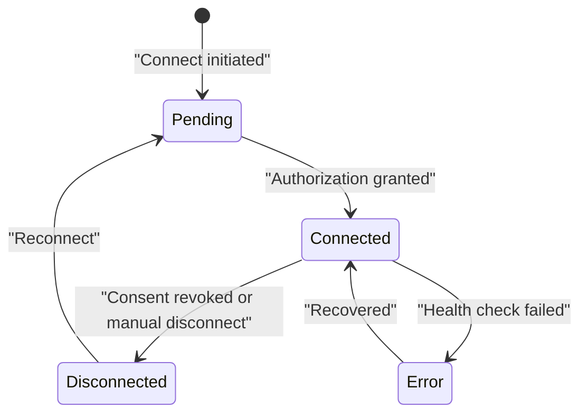
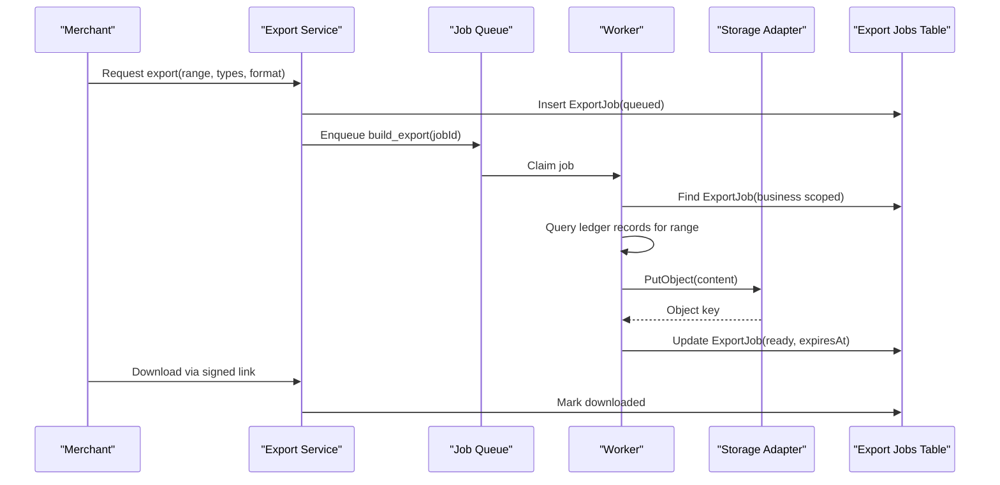
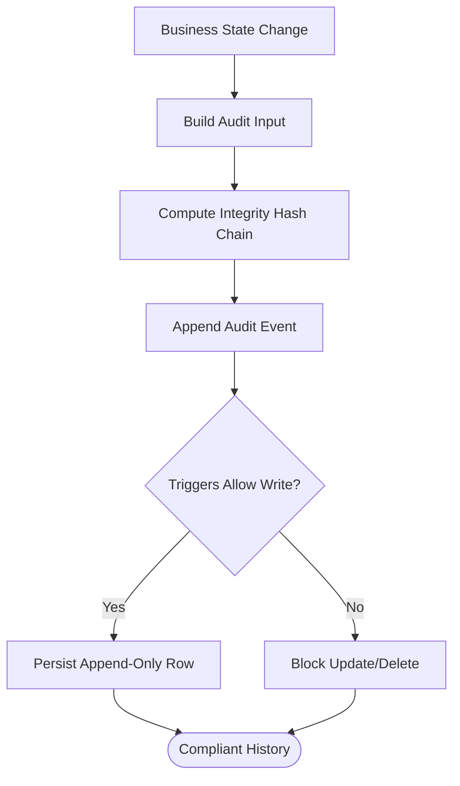
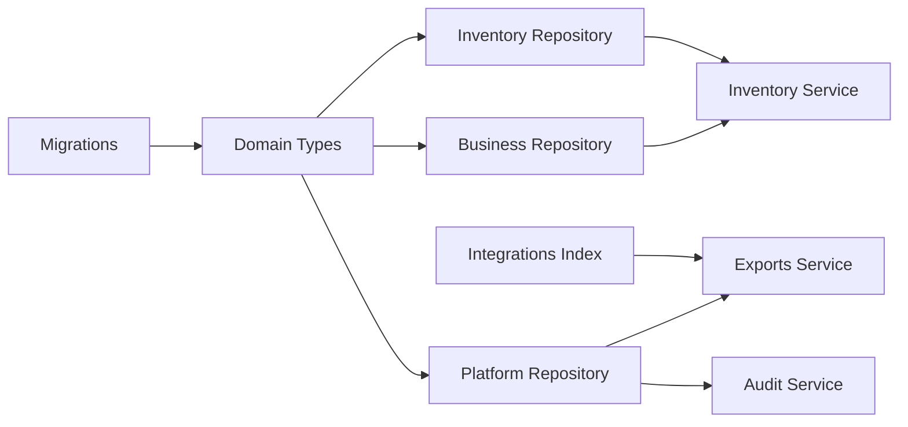

# Operational Data Models

<cite>
**Referenced Files in This Document**
- [migrations.ts](file://src/server/db/migrations.ts)
- [types.ts](file://src/server/domain/types.ts)
- [business.repository.ts](file://src/server/repositories/business.repository.ts)
- [inventory.repository.ts](file://src/server/repositories/inventory.repository.ts)
- [inventory.ts](file://src/server/services/inventory.ts)
- [platform.repository.ts](file://src/server/repositories/platform.repository.ts)
- [exports.ts](file://src/server/services/exports.ts)
- [audit.ts](file://src/server/services/audit.ts)
- [index.ts](file://src/server/integrations/index.ts)
</cite>

## Table of Contents
1. [Introduction](#introduction)
2. [Project Structure](#project-structure)
3. [Core Components](#core-components)
4. [Architecture Overview](#architecture-overview)
5. [Detailed Component Analysis](#detailed-component-analysis)
6. [Dependency Analysis](#dependency-analysis)
7. [Performance Considerations](#performance-considerations)
8. [Troubleshooting Guide](#troubleshooting-guide)
9. [Conclusion](#conclusion)

## Introduction
This document describes Daftari’s operational data models with a focus on inventory, business context and tenant isolation, integration configuration, export jobs, audit logging, and movement tracking. It explains how stock levels are derived from movements, how low-stock alerts are computed, how external integrations are configured and tracked, and how system operations are recorded for compliance. It also clarifies the relationship between business context and data isolation patterns, and outlines retention and archival strategies used by the platform.

## Project Structure
The operational data model is defined in migrations, typed in domain types, persisted through repositories, and orchestrated by services. The most relevant files are:

- Schema definitions: `src/server/db/migrations.ts`
- Domain enums and constants: `src/server/domain/types.ts`
- Business, membership, session, and integration persistence: `src/server/repositories/business.repository.ts`
- Inventory item and movement persistence: `src/server/repositories/inventory.repository.ts`
- Inventory service logic: `src/server/services/inventory.ts`
- Platform jobs, audit events, idempotency, and export jobs: `src/server/repositories/platform.repository.ts`
- Export job orchestration: `src/server/services/exports.ts`
- Audit recording helpers: `src/server/services/audit.ts`
- External provider adapter selection: `src/server/integrations/index.ts`

**Diagram sources**
- [migrations.ts:38-104](file://src/server/db/migrations.ts#L38-L104)
- [migrations.ts:317-342](file://src/server/db/migrations.ts#L317-L342)
- [migrations.ts:353-372](file://src/server/db/migrations.ts#L353-L372)
- [migrations.ts:446-464](file://src/server/db/migrations.ts#L446-L464)
- [types.ts:64-88](file://src/server/domain/types.ts#L64-L88)
- [types.ts:113-126](file://src/server/domain/types.ts#L113-L126)
- [types.ts:135-194](file://src/server/domain/types.ts#L135-L194)
- [business.repository.ts:29-86](file://src/server/repositories/business.repository.ts#L29-L86)
- [inventory.repository.ts:13-43](file://src/server/repositories/inventory.repository.ts#L13-L43)
- [platform.repository.ts:14-46](file://src/server/repositories/platform.repository.ts#L14-L46)
- [platform.repository.ts:398-415](file://src/server/repositories/platform.repository.ts#L398-L415)
- [index.ts:34-40](file://src/server/integrations/index.ts#L34-L40)

**Section sources**
- [migrations.ts:1-10](file://src/server/db/migrations.ts#L1-L10)
- [types.ts:1-10](file://src/server/domain/types.ts#L1-L10)

## Core Components
This section summarizes the primary entities and their responsibilities.

### InventoryItem
- Purpose: Represents a tracked product or stock unit within a single business.
- Key fields: identifier, business scope, name, unit, optional SKU, low-stock threshold, active flag, timestamps.
- Stock level: Not stored directly; derived from confirmed inventory movements.
- Low-stock alert: Computed by comparing derived stock on hand to the configured threshold.

**Section sources**
- [migrations.ts:317-328](file://src/server/db/migrations.ts#L317-L328)
- [inventory.repository.ts:13-23](file://src/server/repositories/inventory.repository.ts#L13-L23)
- [inventory.repository.ts:110-130](file://src/server/repositories/inventory.repository.ts#L110-L130)
- [inventory.ts:24-39](file://src/server/services/inventory.ts#L24-L39)

### MovementType
- Allowed values: `in`, `out`, `adjustment`.
- Direction semantics: Movement quantity is always positive; direction comes from the movement type.
- Usage: Used by inventory movements and linked ledger records to represent stock inflows, outflows, and corrections.

**Section sources**
- [types.ts:84-85](file://src/server/domain/types.ts#L84-L85)
- [migrations.ts:330-342](file://src/server/db/migrations.ts#L330-L342)
- [inventory.repository.ts:159-187](file://src/server/repositories/inventory.repository.ts#L159-L187)

### InventoryMovement
- Purpose: Records one stock change for an inventory item.
- Key fields: identifier, business scope, item reference, optional ledger record link, movement type, positive quantity in milli-units, optional unit cost, note, occurrence timestamp, creation timestamp.
- Integrity: Only posted ledger-linked movements are included when computing balances.

**Section sources**
- [migrations.ts:330-342](file://src/server/db/migrations.ts#L330-L342)
- [inventory.repository.ts:25-36](file://src/server/repositories/inventory.repository.ts#L25-L36)
- [inventory.repository.ts:132-146](file://src/server/repositories/inventory.repository.ts#L132-L146)

### Business
- Purpose: Tenant root entity containing settings such as timezone, currency, locale, status, feature flags, onboarding step, retention policy, and analytics opt-in.
- Feature flags: Control availability of features like inventory and exports.
- Retention: Stores audio retention days per business.

**Section sources**
- [migrations.ts:38-53](file://src/server/db/migrations.ts#L38-L53)
- [business.repository.ts:29-44](file://src/server/repositories/business.repository.ts#L29-L44)
- [business.repository.ts:169-212](file://src/server/repositories/business.repository.ts#L169-L212)
- [business.repository.ts:245-252](file://src/server/repositories/business.repository.ts#L245-L252)

### Membership and Roles
- Purpose: Links users to businesses with roles and membership lifecycle states.
- Roles: `owner`, `manager`, `staff`.
- States: `invited`, `active`, `revoked`.
- Permission overrides: Stored per membership for fine-grained control.

**Section sources**
- [migrations.ts:55-72](file://src/server/db/migrations.ts#L55-L72)
- [types.ts:64-65](file://src/server/domain/types.ts#L64-L65)
- [business.repository.ts:46-59](file://src/server/repositories/business.repository.ts#L46-L59)
- [business.repository.ts:256-347](file://src/server/repositories/business.repository.ts#L256-L347)

### Integration
- Purpose: Tracks connections to external providers (storage, speech, extraction, WhatsApp).
- Fields: provider, external account reference, status, scopes, consent timestamps, connection timestamps, last webhook time, health metadata.
- Statuses: `connected`, `disconnected`, `error`, `pending`.

**Section sources**
- [migrations.ts:85-104](file://src/server/db/migrations.ts#L85-L104)
- [types.ts:87-88](file://src/server/domain/types.ts#L87-L88)
- [business.repository.ts:71-86](file://src/server/repositories/business.repository.ts#L71-L86)
- [business.repository.ts:416-552](file://src/server/repositories/business.repository.ts#L416-L552)

### ExportJob
- Purpose: Represents an asynchronous export request and its generated file state.
- Lifecycle: `queued`, `processing`, `ready`, `expired`, `failed`.
- Metadata: format, date range, selected record types, object key, row count, byte size, failure code, timestamps for requested/ready/expires/downloaded.

**Section sources**
- [migrations.ts:446-464](file://src/server/db/migrations.ts#L446-L464)
- [platform.repository.ts:398-415](file://src/server/repositories/platform.repository.ts#L398-L415)
- [platform.repository.ts:417-491](file://src/server/repositories/platform.repository.ts#L417-L491)
- [exports.ts:26-33](file://src/server/services/exports.ts#L26-L33)
- [exports.ts:130-154](file://src/server/services/exports.ts#L130-L154)
- [exports.ts:194-235](file://src/server/services/exports.ts#L194-L235)

### AuditLog
- Purpose: Append-only, tamper-evident history of important state changes across the system.
- Fields: actor type/user, action, entity type/id, event time, reason codes/notes, before/after snapshots, source, integrity hash chain.
- Enforcement: Database triggers prevent updates and deletes.

**Section sources**
- [migrations.ts:353-372](file://src/server/db/migrations.ts#L353-L372)
- [migrations.ts:579-626](file://src/server/db/migrations.ts#L579-L626)
- [platform.repository.ts:14-46](file://src/server/repositories/platform.repository.ts#L14-L46)
- [platform.repository.ts:52-103](file://src/server/repositories/platform.repository.ts#L52-L103)
- [audit.ts:16-29](file://src/server/services/audit.ts#L16-L29)
- [audit.ts:31-78](file://src/server/services/audit.ts#L31-L78)

## Architecture Overview
The data architecture centers on a business-scoped schema with strict constraints and append-only audit trails. Inventory balances are derived from movements rather than cached, ensuring consistency even after reversals or voids. External integrations are modeled as tenant-scoped connections with explicit consent and health tracking. Export jobs decouple user requests from file generation and storage. Audit logs provide compliance-grade history with cryptographic chaining.

**Diagram sources**
- [migrations.ts:38-104](file://src/server/db/migrations.ts#L38-L104)
- [migrations.ts:317-342](file://src/server/db/migrations.ts#L317-L342)
- [migrations.ts:446-464](file://src/server/db/migrations.ts#L446-L464)
- [migrations.ts:353-372](file://src/server/db/migrations.ts#L353-L372)

## Detailed Component Analysis

### InventoryItem and Movement Tracking
Stock on hand is never stored; it is calculated by summing quantities from confirmed inventory movements. Low-stock alerts are computed by comparing this derived total to the configured threshold. Movement direction is encoded by `movement_type`, while quantities remain positive to avoid sign ambiguity.

**Diagram sources**
- [inventory.repository.ts:110-130](file://src/server/repositories/inventory.repository.ts#L110-L130)
- [inventory.repository.ts:159-187](file://src/server/repositories/inventory.repository.ts#L159-L187)
- [inventory.ts:131-175](file://src/server/services/inventory.ts#L131-L175)

**Section sources**
- [inventory.repository.ts:13-43](file://src/server/repositories/inventory.repository.ts#L13-L43)
- [inventory.repository.ts:110-130](file://src/server/repositories/inventory.repository.ts#L110-L130)
- [inventory.repository.ts:159-187](file://src/server/repositories/inventory.repository.ts#L159-L187)
- [inventory.ts:41-49](file://src/server/services/inventory.ts#L41-L49)
- [inventory.ts:64-72](file://src/server/services/inventory.ts#L64-L72)
- [inventory.ts:81-124](file://src/server/services/inventory.ts#L81-L124)
- [inventory.ts:131-175](file://src/server/services/inventory.ts#L131-L175)

### MovementType Definitions
MovementType defines three directions:
- `in`: Stock received.
- `out`: Stock consumed or sold.
- `adjustment`: Correction or reconciliation.

These values constrain database inserts and drive balance calculations.

**Section sources**
- [types.ts:84-85](file://src/server/domain/types.ts#L84-L85)
- [migrations.ts:330-342](file://src/server/db/migrations.ts#L330-L342)
- [inventory.repository.ts:159-187](file://src/server/repositories/inventory.repository.ts#L159-L187)

### Business Settings and Tenant Isolation
Every operational table includes a `business_id` column, and repository queries consistently filter by it. Cross-tenant identifiers resolve to “not found,” preventing data leakage. Business settings include timezone, currency, locale, feature flags, retention days, and analytics opt-in.

**Diagram sources**
- [business.repository.ts:1-7](file://src/server/repositories/business.repository.ts#L1-L7)
- [business.repository.ts:165-212](file://src/server/repositories/business.repository.ts#L165-L212)
- [business.repository.ts:256-347](file://src/server/repositories/business.repository.ts#L256-L347)
- [inventory.repository.ts:45-66](file://src/server/repositories/inventory.repository.ts#L45-L66)

**Section sources**
- [business.repository.ts:29-44](file://src/server/repositories/business.repository.ts#L29-L44)
- [business.repository.ts:169-212](file://src/server/repositories/business.repository.ts#L169-L212)
- [business.repository.ts:245-252](file://src/server/repositories/business.repository.ts#L245-L252)
- [business.repository.ts:256-347](file://src/server/repositories/business.repository.ts#L256-L347)

### Membership Roles and Permissions
Roles are constrained to `owner`, `manager`, and `staff`. Memberships track invitation, acceptance, and revocation. Permission overrides allow per-member adjustments.

**Section sources**
- [migrations.ts:55-72](file://src/server/db/migrations.ts#L55-L72)
- [types.ts:64-65](file://src/server/domain/types.ts#L64-L65)
- [business.repository.ts:46-59](file://src/server/repositories/business.repository.ts#L46-L59)
- [business.repository.ts:295-347](file://src/server/repositories/business.repository.ts#L295-L347)

### Integration Configuration and Status Tracking
Integrations store provider identity, external account references, authorization scopes, consent timestamps, connection lifecycle, webhook activity, and health metadata. Status transitions update connection timestamps and maintain a clear audit trail.

**Diagram sources**
- [migrations.ts:85-104](file://src/server/db/migrations.ts#L85-L104)
- [types.ts:87-88](file://src/server/domain/types.ts#L87-L88)
- [business.repository.ts:416-552](file://src/server/repositories/business.repository.ts#L416-L552)

**Section sources**
- [migrations.ts:85-104](file://src/server/db/migrations.ts#L85-L104)
- [types.ts:87-88](file://src/server/domain/types.ts#L87-L88)
- [business.repository.ts:71-86](file://src/server/repositories/business.repository.ts#L71-L86)
- [business.repository.ts:416-552](file://src/server/repositories/business.repository.ts#L416-L552)
- [index.ts:34-40](file://src/server/integrations/index.ts#L34-L40)
- [index.ts:41-78](file://src/server/integrations/index.ts#L41-L78)

### ExportJob Lifecycle
Export jobs are asynchronous. A user requests an export, a job is queued, a worker builds the file, stores it via the storage integration, and marks the job ready with an expiration. Downloads use signed links tied to the job’s object key.

**Diagram sources**
- [exports.ts:130-154](file://src/server/services/exports.ts#L130-L154)
- [exports.ts:156-183](file://src/server/services/exports.ts#L156-L183)
- [exports.ts:194-235](file://src/server/services/exports.ts#L194-L235)
- [platform.repository.ts:398-491](file://src/server/repositories/platform.repository.ts#L398-L491)

**Section sources**
- [migrations.ts:446-464](file://src/server/db/migrations.ts#L446-L464)
- [platform.repository.ts:398-491](file://src/server/repositories/platform.repository.ts#L398-L491)
- [exports.ts:26-33](file://src/server/services/exports.ts#L26-L33)
- [exports.ts:101-121](file://src/server/services/exports.ts#L101-L121)
- [exports.ts:130-154](file://src/server/services/exports.ts#L130-L154)
- [exports.ts:194-235](file://src/server/services/exports.ts#L194-L235)

### AuditLog Compliance Model
Audit events capture who changed what, when, why, and how the system responded. Each event chains to the previous event’s integrity hash, making tampering detectable. Database triggers enforce append-only behavior.

**Diagram sources**
- [platform.repository.ts:52-103](file://src/server/repositories/platform.repository.ts#L52-L103)
- [migrations.ts:579-626](file://src/server/db/migrations.ts#L579-L626)
- [audit.ts:31-78](file://src/server/services/audit.ts#L31-L78)

**Section sources**
- [migrations.ts:353-372](file://src/server/db/migrations.ts#L353-L372)
- [migrations.ts:579-626](file://src/server/db/migrations.ts#L579-L626)
- [platform.repository.ts:14-46](file://src/server/repositories/platform.repository.ts#L14-L46)
- [platform.repository.ts:52-103](file://src/server/repositories/platform.repository.ts#L52-L103)
- [audit.ts:16-29](file://src/server/services/audit.ts#L16-L29)
- [audit.ts:31-78](file://src/server/services/audit.ts#L31-L78)

## Dependency Analysis
The following diagram shows how core modules depend on each other to implement the operational data model.

**Diagram sources**
- [migrations.ts:38-104](file://src/server/db/migrations.ts#L38-L104)
- [types.ts:64-88](file://src/server/domain/types.ts#L64-L88)
- [business.repository.ts:1-12](file://src/server/repositories/business.repository.ts#L1-L12)
- [inventory.repository.ts:8-11](file://src/server/repositories/inventory.repository.ts#L8-L11)
- [platform.repository.ts:6-10](file://src/server/repositories/platform.repository.ts#L6-L10)
- [inventory.ts:10-22](file://src/server/services/inventory.ts#L10-L22)
- [exports.ts:10-24](file://src/server/services/exports.ts#L10-L24)
- [audit.ts:9-12](file://src/server/services/audit.ts#L9-L12)
- [index.ts:9-32](file://src/server/integrations/index.ts#L9-L32)

**Section sources**
- [migrations.ts:1-10](file://src/server/db/migrations.ts#L1-L10)
- [types.ts:1-10](file://src/server/domain/types.ts#L1-L10)

## Performance Considerations
- Derived stock balances: Calculated from movements; avoids stale cache but requires aggregation on read.
- Indexed queries: Business-scoped indexes improve tenant isolation performance.
- Job queueing: Asynchronous export generation prevents blocking user requests.
- Idempotency: Duplicate job keys and idempotency keys reduce redundant work.
- Audit hashing: Integrity hash computation adds minimal overhead but ensures tamper detection.

[No sources needed since this section provides general guidance]

## Troubleshooting Guide
- Inventory low-stock false positives: Verify that the threshold is set and that movements are linked to posted ledger records.
- Missing stock balance: Ensure movements have valid `movement_type` and are associated with posted ledger records.
- Integration not connecting: Check provider configuration, consent timestamps, and status transitions.
- Export not downloadable: Confirm the job status is `ready`, the object key exists, and the signed link has not expired.
- Audit gaps: Audit failures are logged without rolling back the main transaction; inspect logs for append failures.

**Section sources**
- [inventory.repository.ts:110-130](file://src/server/repositories/inventory.repository.ts#L110-L130)
- [inventory.repository.ts:159-187](file://src/server/repositories/inventory.repository.ts#L159-L187)
- [business.repository.ts:416-552](file://src/server/repositories/business.repository.ts#L416-L552)
- [exports.ts:194-235](file://src/server/services/exports.ts#L194-L235)
- [audit.ts:49-66](file://src/server/services/audit.ts#L49-L66)

## Conclusion
Daftari’s operational data model enforces strong tenant isolation, immutable audit trails, and consistent inventory accounting through derived balances. Integrations are explicitly configured and monitored, while export jobs provide reliable, asynchronous data access. MovementType standardizes stock tracking, and business settings govern feature availability and retention policies. Together, these components deliver a compliant, scalable foundation for multi-tenant bookkeeping and inventory management.

[No sources needed since this section summarizes without analyzing specific files]