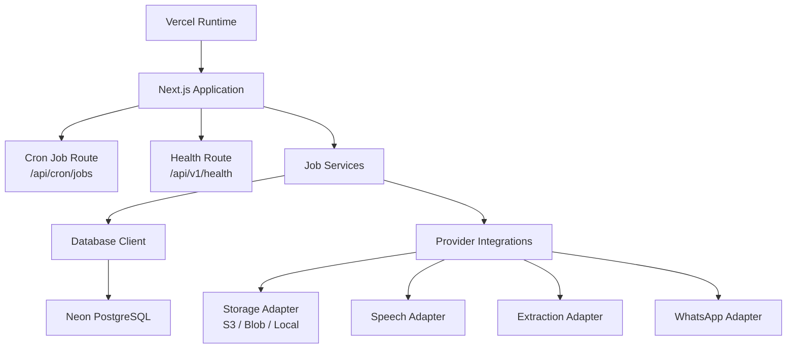
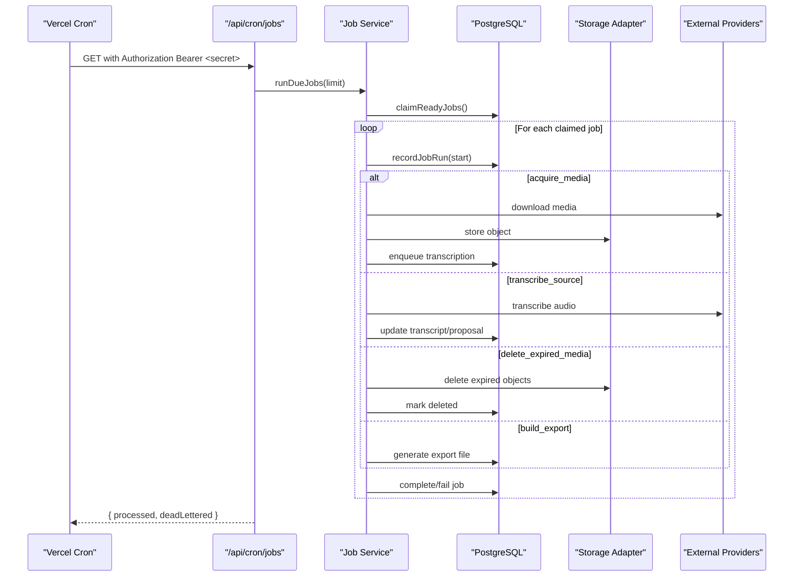
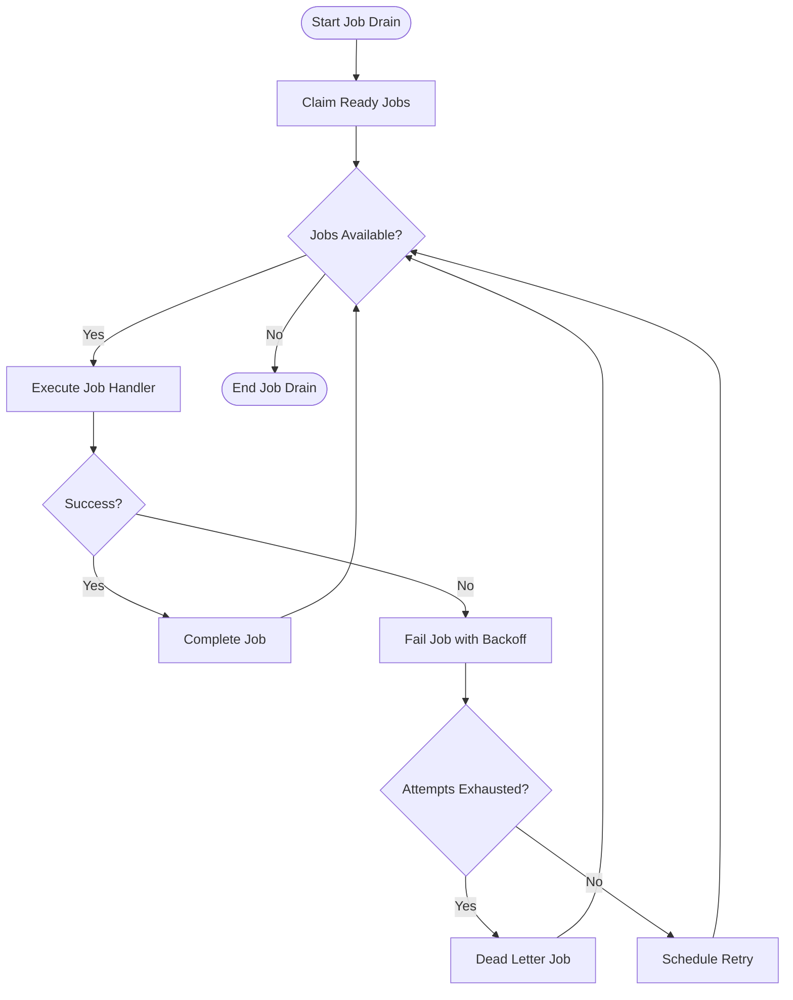
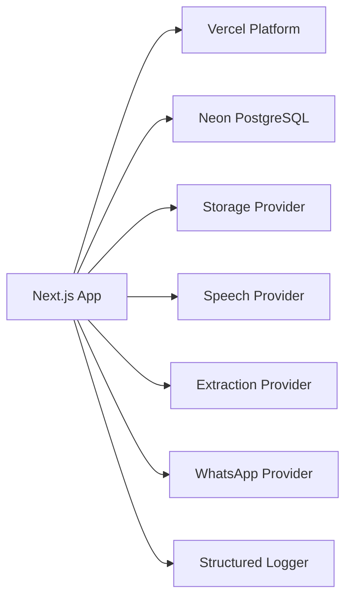

# Deployment & Operations

<cite>
**Referenced Files in This Document**
- [vercel.json](file://vercel.json)
- [next.config.ts](file://next.config.ts)
- [package.json](file://package.json)
- [ci.yml](file://.github/workflows/ci.yml)
- [env.ts](file://src/server/config/env.ts)
- [client.ts](file://src/server/db/client.ts)
- [migrations.ts](file://src/server/db/migrations.ts)
- [logger.ts](file://src/server/observability/logger.ts)
- [route.ts (cron jobs)](file://src/app/api/cron/jobs/route.ts)
- [route.ts (health)](file://src/app/api/v1/health/route.ts)
- [jobs.ts](file://src/server/services/jobs.ts)
- [index.ts (integrations)](file://src/server/integrations/index.ts)
- [migrate.ts](file://scripts/migrate.ts)
- [run-jobs.ts](file://scripts/run-jobs.ts)
</cite>

## Table of Contents
1. [Introduction](#introduction)
2. [Project Structure](#project-structure)
3. [Core Components](#core-components)
4. [Architecture Overview](#architecture-overview)
5. [Detailed Component Analysis](#detailed-component-analysis)
6. [Dependency Analysis](#dependency-analysis)
7. [Performance Considerations](#performance-considerations)
8. [Troubleshooting Guide](#troubleshooting-guide)
9. [Conclusion](#conclusion)
10. [Appendices](#appendices)

## Introduction
This document provides production deployment and operations guidance for Daftari, a Next.js application deployed on Vercel with PostgreSQL via Neon. It covers environment configuration, build and CI behavior, scheduled job processing, structured logging, health checks, database migrations, operational runbooks, scaling considerations, security hardening, and troubleshooting procedures. The goal is to help operators deploy safely, monitor reliably, recover quickly, and optimize cost without compromising data integrity or privacy.

## Project Structure
Daftari follows a Next.js App Router layout:
- API routes under `src/app/api` handle HTTP endpoints, including health, cron scheduling, and business APIs.
- Server-side logic lives under `src/server`, including configuration, database access, integrations, services, and observability.
- Scripts under `scripts` provide local operational tooling for migrations, seeding, and job draining.
- Vercel-specific configuration is defined at the repository root.

**Diagram sources**
- [vercel.json:1-10](file://vercel.json#L1-L10)
- [route.ts (cron jobs):1-48](file://src/app/api/cron/jobs/route.ts#L1-L48)
- [route.ts (health):1-19](file://src/app/api/v1/health/route.ts#L1-L19)
- [jobs.ts:1-241](file://src/server/services/jobs.ts#L1-L241)
- [client.ts:1-350](file://src/server/db/client.ts#L1-L350)
- [index.ts (integrations):1-93](file://src/server/integrations/index.ts#L1-L93)

**Section sources**
- [vercel.json:1-10](file://vercel.json#L1-L10)
- [package.json:1-47](file://package.json#L1-L47)
- [next.config.ts:1-24](file://next.config.ts#L1-L24)

## Core Components
- Environment configuration: Centralized provider selection and validation with fail-fast errors when required variables are missing.
- Database client: Abstracts PostgreSQL (Neon) and SQLite; enforces connection pooling and transaction semantics.
- Migrations: Versioned schema migrations with checksums, additive-only changes, and special handling for structural rebuilds.
- Structured logging: Redaction of sensitive fields, request/job correlation, and analytics events.
- Scheduled jobs: Vercel Cron triggers a secure endpoint that drains durable jobs with backoff and dead-lettering.
- Health endpoint: Lightweight liveness/readiness check reporting schema version.

**Section sources**
- [env.ts:1-184](file://src/server/config/env.ts#L1-L184)
- [client.ts:1-350](file://src/server/db/client.ts#L1-L350)
- [migrations.ts:1-706](file://src/server/db/migrations.ts#L1-L706)
- [logger.ts:1-98](file://src/server/observability/logger.ts#L1-L98)
- [route.ts (cron jobs):1-48](file://src/app/api/cron/jobs/route.ts#L1-L48)
- [route.ts (health):1-19](file://src/app/api/v1/health/route.ts#L1-L19)

## Architecture Overview
The production runtime uses Vercel Functions for serverless execution, with a nightly cron job driving background work through a durable job queue stored in PostgreSQL. Provider integrations (storage, speech, extraction, WhatsApp) are selected at runtime based on environment variables.

**Diagram sources**
- [vercel.json:1-10](file://vercel.json#L1-L10)
- [route.ts (cron jobs):1-48](file://src/app/api/cron/jobs/route.ts#L1-L48)
- [jobs.ts:1-241](file://src/server/services/jobs.ts#L1-L241)
- [client.ts:1-350](file://src/server/db/client.ts#L1-L350)
- [index.ts (integrations):1-93](file://src/server/integrations/index.ts#L1-L93)

## Detailed Component Analysis

### Vercel Deployment Configuration
- Cron schedule: A single cron entry calls `/api/cron/jobs` daily at 03:00 UTC.
- Security: The cron endpoint requires an `Authorization: Bearer <CRON_SECRET>` header and fails closed if no secret is configured.
- Function limits: The route sets dynamic rendering and a maximum duration suitable for batch job draining.

Operational notes:
- Ensure `DAFTARI_CRON_SECRET` or `CRON_SECRET` is set in Vercel environment variables.
- Configure Vercel Cron to send the bearer token matching the configured secret.
- Monitor the cron response for `deadLettered` counts and alert on non-zero values.

**Section sources**
- [vercel.json:1-10](file://vercel.json#L1-L10)
- [route.ts (cron jobs):1-48](file://src/app/api/cron/jobs/route.ts#L1-L48)
- [env.ts:171-176](file://src/server/config/env.ts#L171-L176)

### Environment Variable Management
Environment variables are validated at startup and per feature:
- Provider selectors: `DAFTARI_WHATSAPP_PROVIDER`, `DAFTARI_STORAGE_PROVIDER`, `DAFTARI_SPEECH_PROVIDER`, `DAFTARI_EXTRACTION_PROVIDER`.
- Credentials: Twilio (`TWILIO_ACCOUNT_SID`, `TWILIO_AUTH_TOKEN`, `TWILIO_WHATSAPP_NUMBER`), OpenAI (`OPENAI_API_KEY`, optional base URL and model names).
- Storage: S3 credentials and bucket settings, or Vercel Blob store ID.
- Media signing: `DAFTARI_MEDIA_SIGNING_SECRET` is required in managed deployments for signed media links.
- Cron secret: `DAFTARI_CRON_SECRET` or `CRON_SECRET`.
- Analytics opt-in: `DAFTARI_ANALYTICS_ENABLED`.

Best practices:
- Never commit secrets; use Vercel’s environment variable UI or CI secrets.
- Validate all required variables before deploying; missing values throw explicit configuration errors.
- Use short-lived OIDC tokens where supported (e.g., Vercel Blob) to avoid static keys.

**Section sources**
- [env.ts:1-184](file://src/server/config/env.ts#L1-L184)
- [index.ts (integrations):1-93](file://src/server/integrations/index.ts#L1-L93)

### Build Process Optimization and CI
- Node engine: Requires Node >= 24.
- Scripts: Development, build, lint, typecheck, test, database migrations, seeding, reset, and job runner.
- CI pipeline: Typecheck, lint, tests, and production build; dependency audit step included.
- Production build flags: `NODE_ENV=production`; developer sign-in can be toggled via `DAFTARI_ALLOW_DEV_LOGIN`.

Recommendations:
- Keep CI cache enabled for npm dependencies.
- Run full verification locally using `npm run verify`.
- Audit dependencies regularly and address high-severity issues.

**Section sources**
- [package.json:1-47](file://package.json#L1-L47)
- [ci.yml:1-71](file://.github/workflows/ci.yml#L1-L71)

### Monitoring and Logging
Structured logging centralizes redaction and context:
- Fields include timestamp, level, service, environment, message, and contextual metadata such as requestId, jobId, businessId, entityId, operation, durationMs, result, errorCode.
- Sensitive keys are automatically redacted; strings are truncated to prevent log bloat.
- Analytics events are opt-in and contain only approved event types and safe properties.

Integration points:
- Use the logger across API routes, job handlers, and services.
- Correlate requests and jobs using generated IDs.
- Forward logs to your platform’s log aggregation system (e.g., Vercel Logs) and set alerts on error/warn levels.

**Section sources**
- [logger.ts:1-98](file://src/server/observability/logger.ts#L1-L98)

### Error Tracking and Performance Monitoring
- Errors: Job failures emit structured warnings with error codes and retryability flags. Dead-lettered jobs indicate exhausted retries.
- Metrics: Log durations and attempt counts; consider exporting metrics to a monitoring system.
- Observability: Add request tracing headers and propagate requestId across components.

Operational tips:
- Alert on repeated job failures and dead-letter spikes.
- Track latency percentiles for API routes and job processing times.
- Use structured queries to filter by errorCode and businessId.

**Section sources**
- [jobs.ts:1-241](file://src/server/services/jobs.ts#L1-L241)
- [logger.ts:1-98](file://src/server/observability/logger.ts#L1-L98)

### Operational Procedures: Database Migrations
Migrations are versioned and additive:
- Initial schema defines core tables for users, businesses, ledger records, proposals, customers, inventory, audit events, outbox, jobs, and exports.
- Subsequent migrations add features like sales categories, session token hashing, ledger constraint fixes, append-only audit enforcement, and credential sign-in columns.
- Structural rebuilds (e.g., ledger constraint change) are handled explicitly outside transactions where required.

Runbook:
- Apply migrations before starting the app in new environments.
- Use `npm run db:migrate` to apply pending migrations and print applied versions.
- Verify current migration with the health endpoint’s schemaVersion field.
- Back up the database before running migrations in production.

**Section sources**
- [migrations.ts:1-706](file://src/server/db/migrations.ts#L1-L706)
- [migrate.ts:1-25](file://scripts/migrate.ts#L1-L25)
- [route.ts (health):1-19](file://src/app/api/v1/health/route.ts#L1-L19)

### Backup Strategies and Disaster Recovery
- Database backups: Use Neon’s built-in backup and restore capabilities; schedule regular snapshots and retain according to compliance requirements.
- Point-in-time recovery: Leverage Neon’s time travel and branch restore features for quick recovery.
- Data export: Use the export job system to generate CSV/XLSX reports for offline archives.
- Disaster recovery plan:
  - Restore from latest snapshot.
  - Re-run migrations to ensure schema consistency.
  - Validate health endpoint schemaVersion matches expected baseline.
  - Rehydrate critical state via exports if needed.

[No sources needed since this section provides general guidance]

### Scaling Considerations and Resource Allocation
- Database:
  - Use Neon pooled connections for serverless workloads; direct connections for migrations and admin tasks.
  - Scale compute independently for read-heavy workloads using read replicas.
  - Tune pool size and timeouts in the database client as concurrency grows.
- Storage:
  - Prefer managed storage (S3 or Vercel Blob) for scalability and durability.
  - Configure retention policies and lifecycle rules to control costs.
- Compute:
  - Vercel scales functions automatically; monitor cold starts and adjust concurrency limits.
  - Offload long-running work to background jobs; keep API responses fast.

**Section sources**
- [client.ts:1-350](file://src/server/db/client.ts#L1-L350)
- [env.ts:87-132](file://src/server/config/env.ts#L87-L132)

### Cost Optimization
- Disable unnecessary providers in production (e.g., speech/extraction off unless required).
- Use mock adapters in development and staging to avoid external costs.
- Set appropriate TTLs for signed media URLs to limit exposure and reduce storage churn.
- Optimize retention periods for media and transcripts to balance compliance and cost.

**Section sources**
- [env.ts:134-184](file://src/server/config/env.ts#L134-L184)

### Job Processing System
Background jobs are durable and idempotent:
- Job types include media acquisition, transcription, proposal extraction/validation, summary refresh, export building, media deletion, and provider health checks.
- Jobs are claimed atomically, executed with attempt tracking, and failed with exponential backoff.
- Dead-lettering occurs when retries are exhausted or errors are non-retryable.

Operational controls:
- Use `npm run jobs:run` locally to drain due jobs.
- In production, rely on Vercel Cron to call `/api/cron/jobs`.
- Monitor job summaries and dead-letter counts; investigate failed job types and error codes.

**Diagram sources**
- [jobs.ts:1-241](file://src/server/services/jobs.ts#L1-L241)
- [route.ts (cron jobs):1-48](file://src/app/api/cron/jobs/route.ts#L1-L48)

**Section sources**
- [jobs.ts:1-241](file://src/server/services/jobs.ts#L1-L241)
- [run-jobs.ts:1-57](file://scripts/run-jobs.ts#L1-L57)

### Health Check Endpoints
- Liveness/readiness: `/api/v1/health` returns status, schema version, and timestamp.
- Use this endpoint for Kubernetes-style probes or Vercel health checks.
- Schema version indicates migration state; mismatches signal stale deployments.

**Section sources**
- [route.ts (health):1-19](file://src/app/api/v1/health/route.ts#L1-L19)

### Operational Dashboards
- Logs dashboard: Filter by level, service, errorCode, businessId, and requestId.
- Job dashboard: Track processed counts, dead-letter rates, and failure trends.
- Health dashboard: Monitor schemaVersion drift and uptime.

[No sources needed since this section provides general guidance]

### Security Hardening
- HTTP security headers: Enforce content-type sniffing prevention, frame denial, strict referrer policy, and restrictive permissions policy.
- Authentication: Cron endpoint secured via shared secret; sessions use hashed tokens with unique indexes.
- Data protection: Signed media links require a shared secret; storage encryption options available.
- Compliance: Append-only audit table enforced via database triggers; sensitive data redacted in logs.

**Section sources**
- [next.config.ts:1-24](file://next.config.ts#L1-L24)
- [route.ts (cron jobs):1-48](file://src/app/api/cron/jobs/route.ts#L1-L48)
- [migrations.ts:351-372](file://src/server/db/migrations.ts#L351-L372)
- [logger.ts:1-98](file://src/server/observability/logger.ts#L1-L98)

### Operational Runbooks for Support Teams
- Incident triage:
  - Check health endpoint for schema version and status.
  - Review logs for error-level entries and errorCode classifications.
  - Inspect job summaries for dead-lettered jobs and failure reasons.
- Recovery steps:
  - Re-run migrations if schemaVersion is outdated.
  - Trigger a manual job drain to process backlog.
  - Restore from backup if data corruption is suspected.
- Escalation criteria:
  - Persistent dead-letter spikes.
  - External provider failures (Twilio, OpenAI, S3/Blob).
  - Database connectivity or migration failures.

**Section sources**
- [route.ts (health):1-19](file://src/app/api/v1/health/route.ts#L1-L19)
- [jobs.ts:1-241](file://src/server/services/jobs.ts#L1-L241)
- [migrate.ts:1-25](file://scripts/migrate.ts#L1-L25)

## Dependency Analysis
The application depends on:
- Vercel runtime for hosting and cron scheduling.
- Neon PostgreSQL for persistent storage and migrations.
- External providers (Twilio, OpenAI, S3/Blob) selected via environment variables.
- Structured logging and analytics for observability.

**Diagram sources**
- [index.ts (integrations):1-93](file://src/server/integrations/index.ts#L1-L93)
- [client.ts:1-350](file://src/server/db/client.ts#L1-L350)
- [logger.ts:1-98](file://src/server/observability/logger.ts#L1-L98)

**Section sources**
- [index.ts (integrations):1-93](file://src/server/integrations/index.ts#L1-L93)
- [client.ts:1-350](file://src/server/db/client.ts#L1-L350)

## Performance Considerations
- Connection pooling: Use Neon’s pooled connections for serverless functions; tune pool size and idle timeouts.
- Query optimization: Rely on indexed columns defined in migrations; avoid scanning large tables without filters.
- Job batching: Limit job drain size to balance throughput and function duration constraints.
- Caching: Avoid caching authenticated HTML/API output; leverage short-lived signed URLs for media access.

**Section sources**
- [client.ts:52-89](file://src/server/db/client.ts#L52-L89)
- [migrations.ts:1-706](file://src/server/db/migrations.ts#L1-L706)
- [route.ts (cron jobs):18-19](file://src/app/api/cron/jobs/route.ts#L18-L19)

## Troubleshooting Guide
Common issues and resolutions:
- Missing environment variables:
  - Symptom: Startup or runtime throws configuration errors.
  - Action: Verify all required variables are set in Vercel; re-deploy after updating.
- Cron job not executing:
  - Symptom: No job processing; health endpoint shows expected schema version but no progress.
  - Action: Confirm Vercel Cron configuration and bearer token match the configured secret.
- Job failures:
  - Symptom: Dead-lettered jobs appear; logs show error codes.
  - Action: Investigate payload validity and provider availability; re-run jobs manually if needed.
- Database migration mismatch:
  - Symptom: Health endpoint schemaVersion differs from expected.
  - Action: Run migrations and verify schemaVersion aligns with deployment baseline.
- Storage access errors:
  - Symptom: Media upload/download failures.
  - Action: Validate storage provider configuration and credentials; check bucket/prefix and encryption settings.

**Section sources**
- [env.ts:1-184](file://src/server/config/env.ts#L1-L184)
- [route.ts (cron jobs):1-48](file://src/app/api/cron/jobs/route.ts#L1-L48)
- [jobs.ts:1-241](file://src/server/services/jobs.ts#L1-L241)
- [route.ts (health):1-19](file://src/app/api/v1/health/route.ts#L1-L19)

## Conclusion
Daftari’s production deployment leverages Vercel Functions, Neon PostgreSQL, and configurable provider integrations to deliver a secure, scalable, and observable bookkeeping platform. Operators should focus on robust environment configuration, disciplined migration practices, structured observability, and proactive capacity planning. By following the runbooks and recommendations herein, teams can maintain reliability, comply with security and privacy requirements, and optimize costs effectively.

[No sources needed since this section summarizes without analyzing specific files]

## Appendices

### Environment Variables Reference
- Provider selectors:
  - `DAFTARI_WHATSAPP_PROVIDER`: local | twilio
  - `DAFTARI_STORAGE_PROVIDER`: local | s3 | blob
  - `DAFTARI_SPEECH_PROVIDER`: mock | openai
  - `DAFTARI_EXTRACTION_PROVIDER`: off | mock | openai
- Credentials:
  - `TWILIO_ACCOUNT_SID`, `TWILIO_AUTH_TOKEN`, `TWILIO_WHATSAPP_NUMBER`
  - `OPENAI_API_KEY`, `OPENAI_BASE_URL`, `OPENAI_TRANSCRIBE_MODEL`, `OPENAI_EXTRACTION_MODEL`
  - `S3_BUCKET`, `S3_REGION`, `S3_ACCESS_KEY_ID`, `S3_SECRET_ACCESS_KEY`, `S3_ENDPOINT`, `S3_FORCE_PATH_STYLE`, `S3_PREFIX`, `S3_SSE`
  - `BLOB_STORE_ID`
- Security:
  - `DAFTARI_MEDIA_SIGNING_SECRET`
  - `DAFTARI_CRON_SECRET` or `CRON_SECRET`
- Features:
  - `DAFTARI_WHATSAPP_ENABLED`
  - `DAFTARI_ANALYTICS_ENABLED`
  - `DAFTARI_MEDIA_URL_TTL_SECONDS`

**Section sources**
- [env.ts:46-184](file://src/server/config/env.ts#L46-L184)