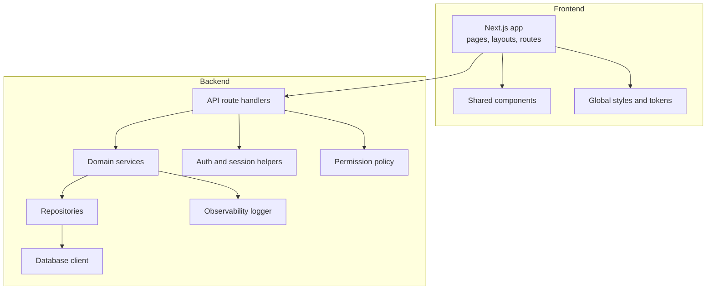
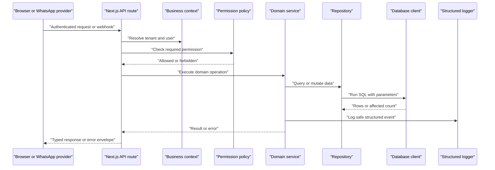
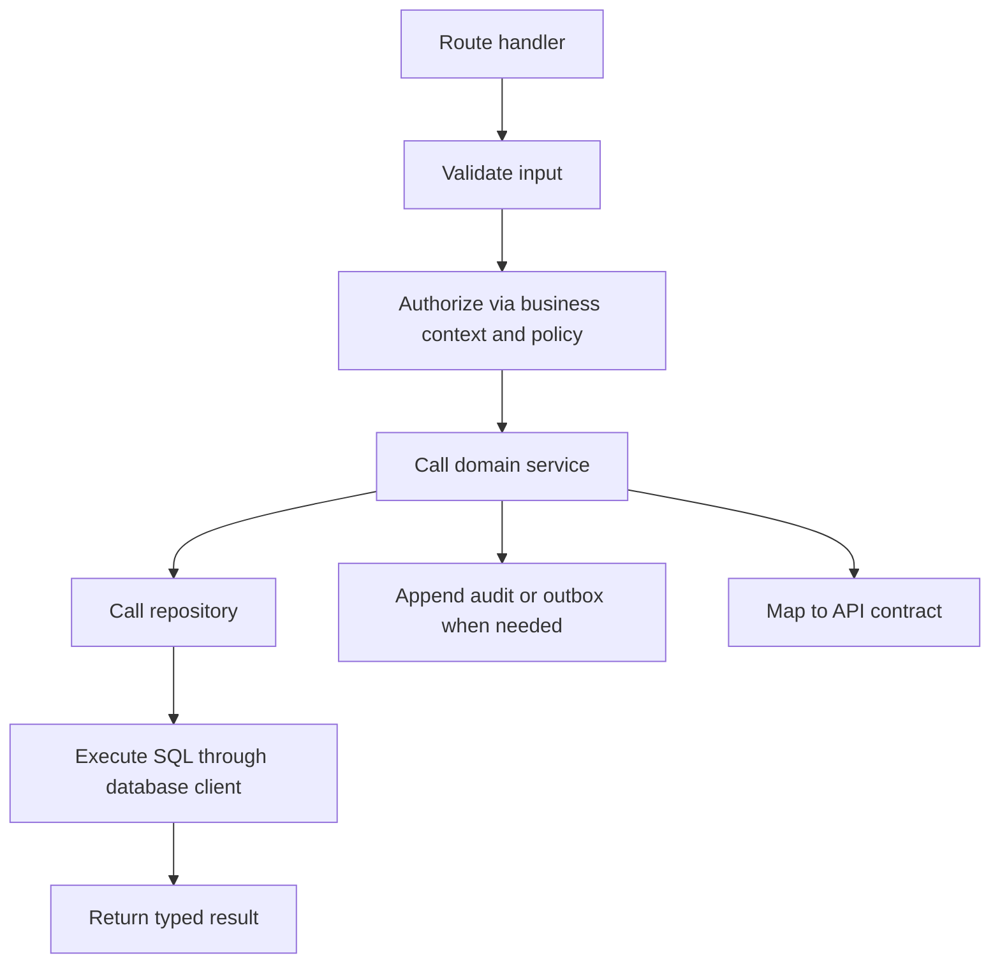
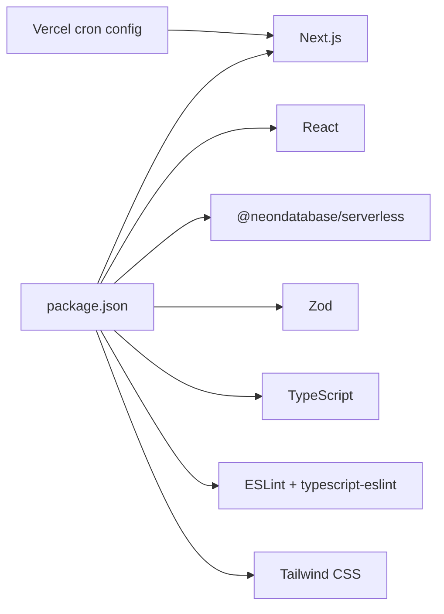

# Developer Guide

<cite>
**Referenced Files in This Document**
- [package.json](file://package.json)
- [eslint.config.mjs](file://eslint.config.mjs)
- [tsconfig.json](file://tsconfig.json)
- [next.config.ts](file://next.config.ts)
- [vercel.json](file://vercel.json)
- [.github/workflows/ci.yml](file://.github/workflows/ci.yml)
- [architecture.md](file://architecture.md)
- [PRD.md](file://PRD.md)
- [AGENTS.md](file://AGENTS.md)
- [CLAUDE.md](file://CLAUDE.md)
- [src/server/observability/logger.ts](file://src/server/observability/logger.ts)
- [src/server/business-context/context.ts](file://src/server/business-context/context.ts)
- [src/server/permissions/policy.ts](file://src/server/permissions/policy.ts)
- [src/server/db/client.ts](file://src/server/db/client.ts)
- [src/app/api/v1/review/proposals/route.ts](file://src/app/api/v1/review/proposals/route.ts)
</cite>

## Table of Contents
1. [Introduction](#introduction)
2. [Project Structure](#project-structure)
3. [Core Components](#core-components)
4. [Architecture Overview](#architecture-overview)
5. [Detailed Component Analysis](#detailed-component-analysis)
6. [Dependency Analysis](#dependency-analysis)
7. [Performance Considerations](#performance-considerations)
8. [Troubleshooting Guide](#troubleshooting-guide)
9. [Conclusion](#conclusion)
10. [Appendices](#appendices)

## Introduction
This developer guide explains how to contribute to the Daftari project: code organization, coding standards, development workflow, debugging and performance practices, feature addition guidelines, agent configuration, onboarding, code review expectations, and quality assurance. Daftari is a voice-first, WhatsApp-native AI bookkeeping dashboard for Tanzanian small businesses. The product emphasizes human confirmation of financial records, source lineage, tenant isolation, idempotency, privacy, and clear UX under real-world constraints.

The repository uses Next.js App Router, TypeScript, ESLint, Node.js test runner, Zod-based validation patterns, PostgreSQL (Neon) with an SQLite fallback for local testing, and Vercel deployment conventions.

**Section sources**
- [PRD.md:1-20](file://PRD.md#L1-L20)
- [architecture.md:1-37](file://architecture.md#L1-L37)

## Project Structure
The repository follows a layered structure:

- `src/app`: Next.js routes, pages, layouts, and API handlers.
- `src/server`: Server-side domain logic, business context, permissions, database client, repositories, services, integrations, observability, and exports.
- `src/lib`: Shared formatting, localization, validation, errors, and redirect helpers.
- `src/components`: Shared UI components.
- `src/messages`: Localization files.
- `src/styles`: Global styles and design tokens.
- `scripts`: Database migrations, seeding, job running, and alias registration.
- `tests`: Node test suite covering server logic and integration scenarios.
- `.agents/skills`: Agent skills for Neon and Neon Postgres diagnostics.
- `.github/workflows/ci.yml`: CI pipeline enforcing typecheck, lint, tests, build, and dependency audit.

**Diagram sources**
- [architecture.md:496-558](file://architecture.md#L496-L558)
- [architecture.md:589-604](file://architecture.md#L589-L604)

**Section sources**
- [architecture.md:496-558](file://architecture.md#L496-L558)
- [architecture.md:589-604](file://architecture.md#L589-L604)

## Core Components
This section summarizes the core runtime components relevant to contributors.

- **Next.js application**: Uses React Strict Mode and security headers; authenticated HTML/API output must not be cached.
- **TypeScript compiler**: Strict mode, ES2023 target, bundler module resolution, path aliases, and strict null checks.
- **ESLint rules**: Recommended JS/TS rules, React Hooks rules, consistent type imports, strict equality, restricted console usage, and money-file coercion rules.
- **Business context**: Central tenant-scoped context with role-based permissions and feature flags.
- **Permission policy**: Centralized permission set and role mapping with deny-by-default assertions.
- **Database client**: Portable SQL boundary supporting Neon PostgreSQL and local SQLite, parameter normalization, statement splitting, transactions, and savepoints.
- **Structured logger**: Central redaction for sensitive fields, analytics event typing, and environment-aware logging.

**Section sources**
- [next.config.ts:1-24](file://next.config.ts#L1-L24)
- [tsconfig.json:1-50](file://tsconfig.json#L1-L50)
- [eslint.config.mjs:1-50](file://eslint.config.mjs#L1-L50)
- [src/server/business-context/context.ts:1-131](file://src/server/business-context/context.ts#L1-L131)
- [src/server/permissions/policy.ts:1-104](file://src/server/permissions/policy.ts#L1-L104)
- [src/server/db/client.ts:1-350](file://src/server/db/client.ts#L1-L350)
- [src/server/observability/logger.ts:1-98](file://src/server/observability/logger.ts#L1-L98)

## Architecture Overview
Daftari’s architecture centers on a secure ingestion-to-review pipeline with strong tenant boundaries and immutable financial history.

**Diagram sources**
- [architecture.md:53-80](file://architecture.md#L53-L80)
- [architecture.md:175-313](file://architecture.md#L175-L313)
- [src/server/business-context/context.ts:1-131](file://src/server/business-context/context.ts#L1-L131)
- [src/server/permissions/policy.ts:1-104](file://src/server/permissions/policy.ts#L1-L104)
- [src/server/db/client.ts:155-198](file://src/server/db/client.ts#L155-L198)
- [src/server/observability/logger.ts:1-98](file://src/server/observability/logger.ts#L1-L98)

**Section sources**
- [architecture.md:53-80](file://architecture.md#L53-L80)
- [architecture.md:175-313](file://architecture.md#L175-L313)

## Detailed Component Analysis

### Code Organization Principles
- Feature-first layout for UI; thin route handlers that parse, validate, authorize, call services, and map results.
- Domain services are independent of React and provider SDK types.
- Repositories encapsulate SQL and tenant scoping.
- Integrations use adapter ports so providers remain replaceable.
- Money, time, locale, and currency formatting live in shared libraries.
- Errors and validation utilities centralize failure handling.

**Diagram sources**
- [architecture.md:496-558](file://architecture.md#L496-L558)
- [architecture.md:589-604](file://architecture.md#L589-L604)

**Section sources**
- [architecture.md:496-558](file://architecture.md#L496-L558)
- [architecture.md:589-604](file://architecture.md#L589-L604)

### Coding Standards and Style Guidelines
Enforced by ESLint and TypeScript:

- Use strict TypeScript settings: no implicit any, strict null checks, isolated modules, verbatim module syntax, and bundler-style module resolution.
- Prefer `type` imports consistently.
- Enforce strict equality comparisons.
- Restrict `console` usage to the structured logger and scripts/tests/config files.
- Disallow implicit coercion in money-related files.
- Enable React Hooks recommended rules.
- Use path alias `@/*` pointing at `src/*`.

Recommended style:

- PascalCase for components and types; camelCase for functions and variables; UPPER_SNAKE_CASE only for true constants.
- Database identifiers use snake_case; API JSON uses camelCase.
- Keep provider-specific payload types inside adapters; normalize at boundaries.
- Centralize money/time/locale formatting and localization keys.

**Section sources**
- [tsconfig.json:1-50](file://tsconfig.json#L1-L50)
- [eslint.config.mjs:1-50](file://eslint.config.mjs#L1-L50)
- [architecture.md:570-579](file://architecture.md#L570-L579)

### Development Workflow
Local development:

- Install dependencies using npm.
- Run the development server.
- Typecheck, lint, and run tests locally before committing.
- Use the provided scripts for database migration, seeding, reset, and jobs.

CI workflow:

- Runs on push and pull requests to main/master.
- Installs dependencies with Node 24.
- Executes typecheck, lint, and tests.
- Confirms tests ran and fail if any test failed.
- Builds the production application with production environment variables.
- Runs a dependency audit.

Branching strategy:

- CI targets `main` and `master`; feature branches should merge into one of these.
- Use short-lived branches per change and keep commits focused.

Commit conventions:

- Write clear commit messages describing intent, scope, and impact.
- Include references to requirements or issues where applicable.
- Avoid mixing unrelated changes in one commit.

Pull request process:

- Ensure all CI checks pass.
- Keep PRs small and reviewable.
- Include tests for new behavior and edge cases.
- Update documentation when contracts, configuration, or operational behavior change.

**Section sources**
- [package.json:9-21](file://package.json#L9-L21)
- [.github/workflows/ci.yml:1-71](file://.github/workflows/ci.yml#L1-L71)

### Debugging Techniques
Use the structured logger for server-side debugging:

- Log operations with opaque IDs, business IDs, job IDs, durations, and safe error codes.
- Never log raw transcripts, audio URLs, secrets, customer names, phone numbers, or full financial records.
- Use analytics events only when enabled and with approved properties.

For frontend debugging:

- Use browser developer tools and React DevTools.
- Inspect network requests against `/api/v1` endpoints.
- Verify tenant-scoped responses and error envelopes.

For database debugging:

- Use the portable database client to run queries safely.
- For PostgreSQL, prefer diagnostic commands and query plans from Neon tooling rather than ad-hoc mutations.
- For local SQLite, inspect the configured data directory and file path.

**Section sources**
- [src/server/observability/logger.ts:1-98](file://src/server/observability/logger.ts#L1-L98)
- [src/server/db/client.ts:32-43](file://src/server/db/client.ts#L32-L43)
- [architecture.md:608-626](file://architecture.md#L608-L626)

### Profiling Tools and Performance Analysis
- Use the Node.js profiler and CPU/memory snapshots during local development.
- Measure API latency and error rates for `/api/v1` endpoints.
- Monitor queue depth, retry counts, and job duration for background processing.
- For PostgreSQL, use Neon inspection tools to identify slow queries, unused indexes, cache behavior, and vacuum status.
- For SQLite, ensure WAL mode and foreign keys are enabled, and avoid blocking long-running statements.

**Section sources**
- [architecture.md:606-626](file://architecture.md#L606-L626)
- [src/server/db/client.ts:81-87](file://src/server/db/client.ts#L81-L87)

### Adding New Features
Follow this checklist:

1. Identify the feature area: UI page, API endpoint, domain service, repository, integration adapter, or configuration.
2. Define or update schemas and types before UI depends on undocumented data.
3. Implement server-side validation and authorization first.
4. Add tenant scoping to every repository method.
5. Preserve source lineage and audit trails for state-changing actions.
6. Add tests covering success, failure, concurrency, idempotency, and permission denial.
7. Update localization strings and accessibility labels.
8. Confirm backward compatibility for API contracts and database migrations.
9. Add observability without sensitive data.
10. Review against non-negotiable invariants: human confirmation for ledger changes, tenant isolation, idempotency, and privacy.

**Section sources**
- [architecture.md:699-752](file://architecture.md#L699-L752)
- [architecture.md:754-767](file://architecture.md#L754-L767)

### Modifying Existing Functionality
- Prefer small, focused changes.
- Keep existing contracts stable unless breaking changes are explicitly versioned.
- Use expand/migrate/contract strategies for schema changes.
- Do not delete or overwrite financial history; use corrections or reversals.
- Revalidate permissions and tenant scope after refactoring.
- Update tests and documentation accordingly.

**Section sources**
- [architecture.md:684-691](file://architecture.md#L684-L691)
- [architecture.md:482-494](file://architecture.md#L482-L494)

### Maintaining Backward Compatibility
- Version API responses and proposal schemas.
- Return standard error envelopes with actionable codes.
- Support cursor pagination and validated filters.
- Avoid exposing internal IDs, storage keys, or provider secrets.
- Test migration compatibility from supported prior schemas.

**Section sources**
- [architecture.md:175-313](file://architecture.md#L175-L313)
- [architecture.md:642-644](file://architecture.md#L642-L644)

### Agent Configuration for AI-Assisted Development
- Read `AGENTS.md` before writing code because Next.js conventions may differ from training data.
- `CLAUDE.md` references `AGENTS.md`, so agents should follow the same guidance.
- Use repository-established patterns instead of inventing APIs or providers.
- Respect non-negotiable rules: do not bypass tenant authorization, never commit AI extraction directly to the ledger, preserve source lineage, and avoid floating-point money arithmetic.

**Section sources**
- [AGENTS.md:1-10](file://AGENTS.md#L1-L10)
- [CLAUDE.md:1-2](file://CLAUDE.md#L1-L2)
- [architecture.md:754-767](file://architecture.md#L754-L767)

### Code Generation Patterns
- Derive API response types from validated schemas where possible.
- Generate or enforce enum values for record types, proposal states, and source kinds.
- Use adapter ports for speech, extraction, storage, and WhatsApp integrations.
- Keep generated or scaffolded code aligned with naming conventions and centralized formatting/localization.

**Section sources**
- [architecture.md:570-579](file://architecture.md#L570-L579)
- [architecture.md:589-604](file://architecture.md#L589-L604)

### Automated Tooling
- Linting: `npm run lint`.
- Type checking: `npm run typecheck`.
- Testing: `npm run test` and `npm run test:watch`.
- Verification: `npm run verify` runs typecheck, lint, and tests.
- Database scripts: migrate, seed, reset, and jobs runner.
- CI: GitHub Actions enforces verification and build.

**Section sources**
- [package.json:9-21](file://package.json#L9-L21)
- [.github/workflows/ci.yml:18-53](file://.github/workflows/ci.yml#L18-L53)

### Onboarding Information for New Contributors
1. Install Node 24 and dependencies.
2. Start the development server.
3. Run `npm run verify` to confirm the baseline passes.
4. Explore the review queue API route and related repositories.
5. Read the product requirements and architecture document.
6. Follow the branching, commit, and PR conventions.
7. Add tests and documentation for every meaningful change.

**Section sources**
- [package.json:6-21](file://package.json#L6-L21)
- [PRD.md:1-20](file://PRD.md#L1-L20)
- [architecture.md:1-37](file://architecture.md#L1-L37)

### Code Review Guidelines
Reviewers should check:

- Tenant isolation and authorization enforcement.
- Input/output validation and error safety.
- Idempotency for webhooks, jobs, confirmations, and exports.
- Financial correctness: integer minor units, explicit currency, timezone handling.
- Source lineage and audit trail preservation.
- Privacy: no sensitive data in logs, analytics, or screenshots.
- Accessibility and localization completeness.
- Test coverage for critical paths and edge cases.

**Section sources**
- [architecture.md:743-752](file://architecture.md#L743-L752)
- [architecture.md:754-767](file://architecture.md#L754-L767)

### Quality Assurance Processes
- Unit tests for money math, dates, permissions, validation, and redaction.
- Integration tests for transactions, deduplication, tenant filters, and adapter contracts.
- Contract tests for API and provider payloads.
- End-to-end flows covering ingestion, review, confirmation, correction, and export.
- AI evaluation using consented examples and field-level metrics.

**Section sources**
- [architecture.md:628-663](file://architecture.md#L628-L663)

## Dependency Analysis
Key runtime and tooling dependencies:

- Next.js, React, and React DOM for the dashboard.
- Neon serverless driver for PostgreSQL.
- Zod for validation patterns.
- ESLint, TypeScript, and TypeScript ESLint for static analysis.
- Tailwind CSS and PostCSS for styling.
- Vercel cron configuration for scheduled jobs.

**Diagram sources**
- [package.json:23-45](file://package.json#L23-L45)
- [vercel.json:1-10](file://vercel.json#L1-L10)

**Section sources**
- [package.json:1-47](file://package.json#L1-L47)
- [vercel.json:1-10](file://vercel.json#L1-L10)

## Performance Considerations
- Avoid caching authenticated HTML or API output.
- Use cursor pagination and server-side filtering.
- Keep money calculations in integer minor units.
- Normalize timestamps to UTC and render in business timezone.
- Minimize sensitive data in logs and analytics.
- Use bounded retries, rate limits, and dead-letter handling for external providers.
- Monitor queue health, provider latency, and error rates.
- Optimize database queries with proper indexing and tenant-scoped filters.

**Section sources**
- [next.config.ts:3-21](file://next.config.ts#L3-L21)
- [architecture.md:486-494](file://architecture.md#L486-L494)
- [architecture.md:394-425](file://architecture.md#L394-L425)
- [architecture.md:606-626](file://architecture.md#L606-L626)

## Troubleshooting Guide
Common issues and resolutions:

- **Missing database configuration**: Production requires `DATABASE_URL` or `NEON_DATABASE_URL`; SQLite is a local/test fallback.
- **Permission denied**: Ensure the active role has the required permission; check policy mappings.
- **Tenant leakage**: Verify every repository call includes tenant scope and that parent-child ownership is validated.
- **Duplicate processing**: Confirm idempotency keys and unique provider event IDs are enforced.
- **Sensitive data in logs**: Use the structured logger and avoid logging raw transcripts, audio URLs, secrets, or customer details.
- **Money formatting errors**: Store amounts as integer minor units; format only at presentation boundaries.
- **Build failures**: Run `npm run verify` locally; ensure Node 24 and dependencies match CI.

Operational tips:

- Use the logger’s safe context fields for correlation.
- Inspect the review queue route for proposal listing and filtering.
- Use CI logs to reproduce failures in a clean environment.

**Section sources**
- [src/server/db/client.ts:52-88](file://src/server/db/client.ts#L52-L88)
- [src/server/permissions/policy.ts:76-92](file://src/server/permissions/policy.ts#L76-L92)
- [src/server/observability/logger.ts:1-98](file://src/server/observability/logger.ts#L1-L98)
- [src/app/api/v1/review/proposals/route.ts:1-32](file://src/app/api/v1/review/proposals/route.ts#L1-L32)
- [.github/workflows/ci.yml:36-53](file://.github/workflows/ci.yml#L36-L53)

## Conclusion
Contributing effectively to Daftari means respecting its financial invariants, tenant boundaries, privacy rules, and adapter-driven architecture. Use the established stack, follow the coding standards, add tests, and maintain backward compatibility. When adding features, prioritize secure ingestion, human confirmation, source lineage, and observable, auditable outcomes. For performance, focus on correct data modeling, efficient queries, bounded retries, and careful logging.

[No sources needed since this section summarizes without analyzing specific files]

## Appendices

### Quick Commands Reference
- Development: `npm run dev`
- Build: `npm run build`
- Start: `npm run start`
- Verify: `npm run verify`
- Lint: `npm run lint`
- Typecheck: `npm run typecheck`
- Test: `npm run test`
- Test watch: `npm run test:watch`
- Database migrate: `npm run db:migrate`
- Database seed: `npm run db:seed`
- Database reset: `npm run db:reset`
- Jobs runner: `npm run jobs:run`

**Section sources**
- [package.json:9-21](file://package.json#L9-L21)