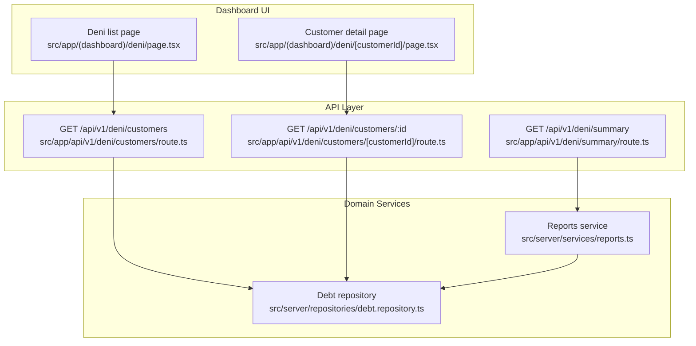
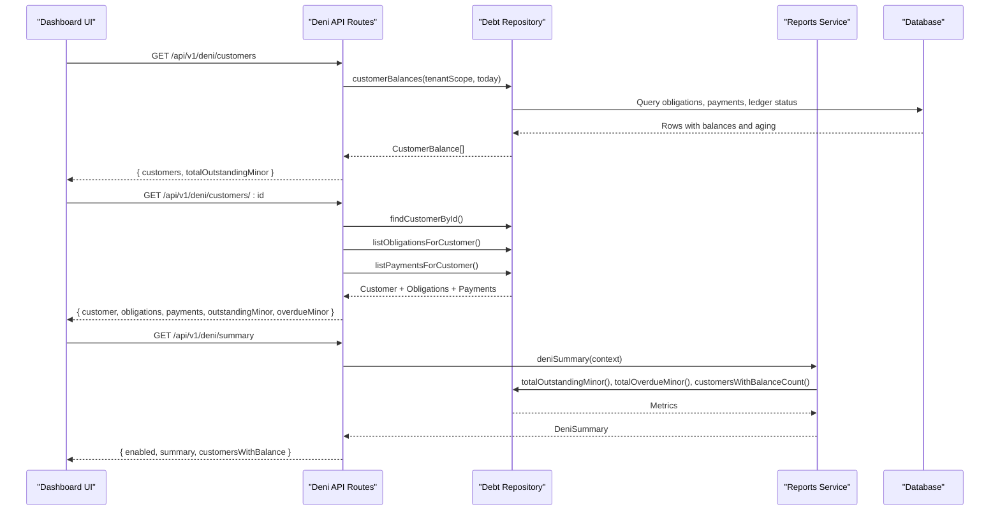
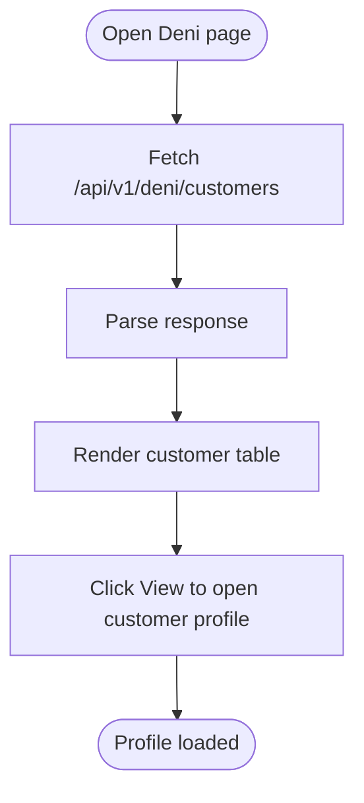
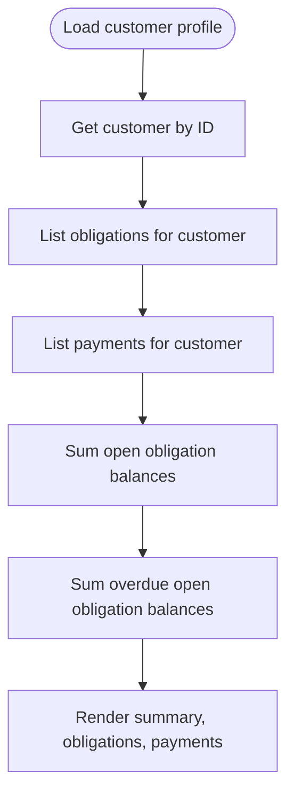
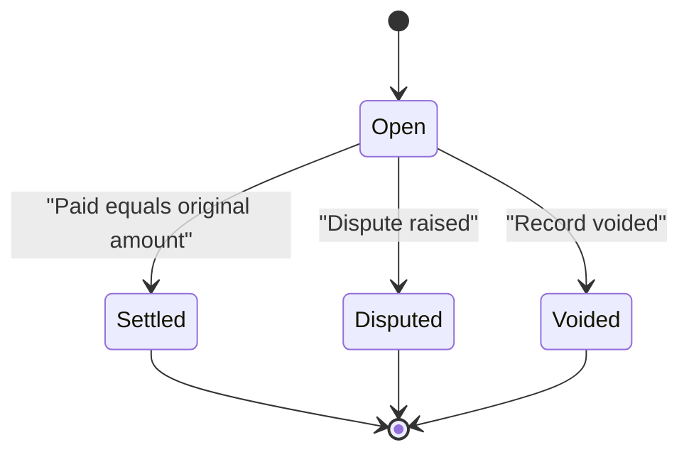
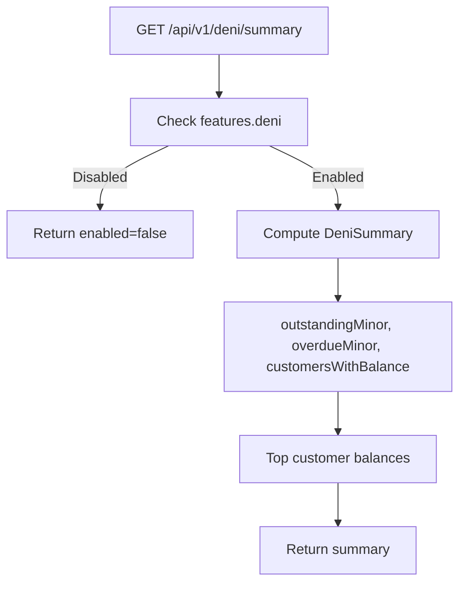
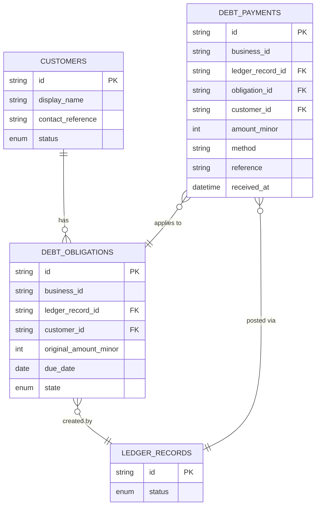
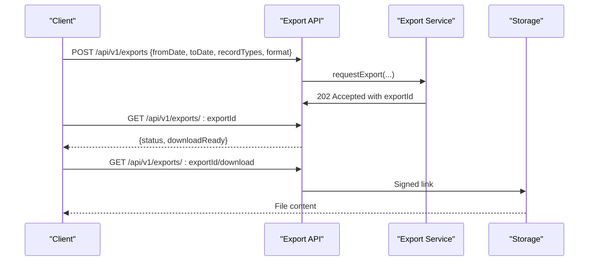
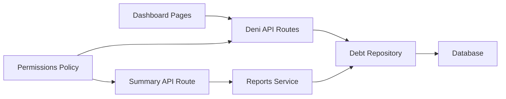

# Deni Debt Tracking

<cite>
**Referenced Files in This Document**
- [deni page.tsx](file://src/app/(dashboard)/deni/page.tsx)
- [customer detail page.tsx](file://src/app/(dashboard)/deni/[customerId]/page.tsx)
- [customers route.ts](file://src/app/api/v1/deni/customers/route.ts)
- [customer detail route.ts](file://src/app/api/v1/deni/customers/[customerId]/route.ts)
- [summary route.ts](file://src/app/api/v1/deni/summary/route.ts)
- [debt repository.ts](file://src/server/repositories/debt.repository.ts)
- [reports service.ts](file://src/server/services/reports.ts)
- [exports route.ts](file://src/app/api/v1/exports/route.ts)
- [export status route.ts](file://src/app/api/v1/exports/[exportId]/route.ts)
- [exports service.ts](file://src/server/services/exports.ts)
- [whatsapp port.ts](file://src/server/integrations/whatsapp/port.ts)
- [policy.ts](file://src/server/permissions/policy.ts)
</cite>

## Table of Contents
1. [Introduction](#introduction)
2. [Project Structure](#project-structure)
3. [Core Components](#core-components)
4. [Architecture Overview](#architecture-overview)
5. [Detailed Component Analysis](#detailed-component-analysis)
6. [Dependency Analysis](#dependency-analysis)
7. [Performance Considerations](#performance-considerations)
8. [Troubleshooting Guide](#troubleshooting-guide)
9. [Conclusion](#conclusion)
10. [Appendices](#appendices)

## Introduction
Deni is the debt tracking subsystem that records customer obligations, tracks partial and full payments, and reports outstanding and overdue balances. It is intentionally separated from cash reporting so that money owed to the business is never mixed with money already collected. The system provides:
- A customer overview dashboard showing outstanding debts, overdue flags, obligation counts, and totals.
- An individual customer profile view with obligations, payment history, and balance calculations.
- Summary reporting for aggregate debt metrics and aging indicators.
- Export capabilities for accounting reconciliation across sales, expenses, debt creation, and debt payments.
- Permission-gated access and feature flags controlling who can read or record debt activity.

## Project Structure
The Deni feature spans Next.js App Router pages, API routes, a domain-focused repository layer, and shared services.

**Diagram sources**
- [deni page.tsx:35-50](file://src/app/(dashboard)/deni/page.tsx#L35-L50)
- [customer detail page.tsx:40-55](file://src/app/(dashboard)/deni/[customerId]/page.tsx#L40-L55)
- [customers route.ts:14-38](file://src/app/api/v1/deni/customers/route.ts#L14-L38)
- [customer detail route.ts:17-66](file://src/app/api/v1/deni/customers/[customerId]/route.ts#L17-L66)
- [summary route.ts:15-29](file://src/app/api/v1/deni/summary/route.ts#L15-L29)
- [debt repository.ts:288-335](file://src/server/repositories/debt.repository.ts#L288-L335)
- [reports service.ts:137-146](file://src/server/services/reports.ts#L137-L146)

**Section sources**
- [deni page.tsx:1-124](file://src/app/(dashboard)/deni/page.tsx#L1-L124)
- [customer detail page.tsx:1-117](file://src/app/(dashboard)/deni/[customerId]/page.tsx#L1-L117)
- [customers route.ts:1-39](file://src/app/api/v1/deni/customers/route.ts#L1-L39)
- [customer detail route.ts:1-67](file://src/app/api/v1/deni/customers/[customerId]/route.ts#L1-L67)
- [summary route.ts:1-30](file://src/app/api/v1/deni/summary/route.ts#L1-L30)
- [debt repository.ts:1-386](file://src/server/repositories/debt.repository.ts#L1-L386)
- [reports service.ts:1-155](file://src/server/services/reports.ts#L1-L155)

## Core Components
- Customer overview dashboard: Lists customers with non-zero balances, total outstanding amount, overdue flags, obligation counts, and navigation to individual profiles.
- Individual customer profile: Shows customer identity, outstanding and overdue amounts, obligations with original and paid amounts, due dates, and payment history.
- Debt repository: Persists customers, obligations, and payments; computes balances by subtracting posted payments from confirmed obligations; exposes per-customer and aggregate queries.
- Reports service: Aggregates Deni metrics such as total outstanding, total overdue, number of customers with balances, and top customer balances.
- Permissions and feature flags: Read access requires `deni.read`; recording payments uses `deni.record_payment`; exports require `reports.export`. Feature flags gate summary availability.

**Section sources**
- [deni page.tsx:29-123](file://src/app/(dashboard)/deni/page.tsx#L29-L123)
- [customer detail page.tsx:33-116](file://src/app/(dashboard)/deni/[customerId]/page.tsx#L33-L116)
- [debt repository.ts:48-222](file://src/server/repositories/debt.repository.ts#L48-L222)
- [debt repository.ts:224-382](file://src/server/repositories/debt.repository.ts#L224-L382)
- [reports service.ts:44-49](file://src/server/services/reports.ts#L44-L49)
- [reports service.ts:137-146](file://src/server/services/reports.ts#L137-L146)
- [policy.ts:88-104](file://src/server/permissions/policy.ts#L88-L104)

## Architecture Overview
Deni follows a layered architecture:
- Presentation layer (Next.js pages) fetches data from API routes.
- API routes enforce tenant context, permissions, and request validation.
- Repository layer performs SQL queries over customers, obligations, payments, and ledger records.
- Reporting service composes aggregate metrics using repository functions.

**Diagram sources**
- [customers route.ts:14-38](file://src/app/api/v1/deni/customers/route.ts#L14-L38)
- [customer detail route.ts:17-66](file://src/app/api/v1/deni/customers/[customerId]/route.ts#L17-L66)
- [summary route.ts:15-29](file://src/app/api/v1/deni/summary/route.ts#L15-L29)
- [debt repository.ts:288-382](file://src/server/repositories/debt.repository.ts#L288-L382)
- [reports service.ts:137-146](file://src/server/services/reports.ts#L137-L146)

## Detailed Component Analysis

### Customer Overview Dashboard
The Deni list page displays:
- Total outstanding amount across all customers.
- Per-customer rows including name, balance, overdue flag, obligation count, and navigation link to the customer profile.
- Client-side loading and error states.

Data flow:
- The page calls `/api/v1/deni/customers`.
- The API returns paginated customers sorted by highest balance first, plus a total outstanding minor amount.
- The client renders a table and formats currency values.

**Diagram sources**
- [deni page.tsx:35-50](file://src/app/(dashboard)/deni/page.tsx#L35-L50)
- [deni page.tsx:52-123](file://src/app/(dashboard)/deni/page.tsx#L52-L123)
- [customers route.ts:14-38](file://src/app/api/v1/deni/customers/route.ts#L14-L38)

**Section sources**
- [deni page.tsx:1-124](file://src/app/(dashboard)/deni/page.tsx#L1-L124)
- [customers route.ts:1-39](file://src/app/api/v1/deni/customers/route.ts#L1-L39)

### Individual Customer Profile View
The customer profile shows:
- Customer identity and contact reference.
- Outstanding and overdue amounts.
- Obligations with original amount, paid amount, state, and due date.
- Payment history with amount, method, and received date.

Balance calculation:
- Outstanding is computed as the sum of open obligations’ remaining balances.
- Overdue is computed as the sum of open obligations whose due date is before today.

**Diagram sources**
- [customer detail route.ts:17-66](file://src/app/api/v1/deni/customers/[customerId]/route.ts#L17-L66)
- [customer detail page.tsx:40-55](file://src/app/(dashboard)/deni/[customerId]/page.tsx#L40-L55)
- [customer detail page.tsx:61-116](file://src/app/(dashboard)/deni/[customerId]/page.tsx#L61-L116)

**Section sources**
- [customer detail page.tsx:1-117](file://src/app/(dashboard)/deni/[customerId]/page.tsx#L1-L117)
- [customer detail route.ts:1-67](file://src/app/api/v1/deni/customers/[customerId]/route.ts#L1-L67)

### Debt Lifecycle
The lifecycle moves from creation through partial payments to settlement:
- Creation: A ledger record creates an obligation with an original amount and optional due date.
- Partial payments: One or more payments are recorded against an obligation.
- Settlement: When paid equals original amount, the obligation can be marked settled.
- Corrections: If a ledger record changes, the related obligation may need restatement.

**Diagram sources**
- [debt repository.ts:94-114](file://src/server/repositories/debt.repository.ts#L94-L114)
- [debt repository.ts:146-152](file://src/server/repositories/debt.repository.ts#L146-L152)
- [debt repository.ts:210-222](file://src/server/repositories/debt.repository.ts#L210-L222)

**Section sources**
- [debt repository.ts:92-222](file://src/server/repositories/debt.repository.ts#L92-L222)

### Summary Reporting Functionality
The summary endpoint returns:
- Whether Deni is enabled for the tenant.
- Aggregate metrics: outstanding minor, overdue minor, number of customers with balances.
- Top customer balances up to a limit.

Aging analysis:
- Overdue is determined by comparing each obligation’s due date to the current day in the business timezone.
- The report separates Deni from cash totals to avoid mixing receivables with collected funds.

**Diagram sources**
- [summary route.ts:15-29](file://src/app/api/v1/deni/summary/route.ts#L15-L29)
- [reports service.ts:137-146](file://src/server/services/reports.ts#L137-L146)
- [debt repository.ts:337-382](file://src/server/repositories/debt.repository.ts#L337-L382)

**Section sources**
- [summary route.ts:1-30](file://src/app/api/v1/deni/summary/route.ts#L1-L30)
- [reports service.ts:1-155](file://src/server/services/reports.ts#L1-L155)

### Data Relationships
The core entities and their relationships:
- Customers have many obligations.
- Obligations belong to a ledger record and a customer.
- Payments belong to an obligation and a ledger record and are tied to a customer.
- Only posted ledger records participate in balance calculations.

**Diagram sources**
- [debt repository.ts:13-46](file://src/server/repositories/debt.repository.ts#L13-L46)
- [debt repository.ts:116-133](file://src/server/repositories/debt.repository.ts#L116-L133)
- [debt repository.ts:262-275](file://src/server/repositories/debt.repository.ts#L262-L275)

**Section sources**
- [debt repository.ts:1-46](file://src/server/repositories/debt.repository.ts#L1-L46)
- [debt repository.ts:116-133](file://src/server/repositories/debt.repository.ts#L116-L133)
- [debt repository.ts:262-275](file://src/server/repositories/debt.repository.ts#L262-L275)

### Common Debt Management Scenarios
- New debt created from a sale: A ledger record generates an obligation with an original amount and optional due date.
- Partial payment applied: A payment reduces the paid amount on an obligation; outstanding decreases accordingly.
- Full settlement: Once paid equals original amount, the obligation becomes settled.
- Dispute handling: An obligation can be marked disputed while investigation continues.
- Correction and restatement: If a ledger record is corrected, the related obligation is restated to reflect updated amounts and due dates.

Operational guidance:
- Use the customer profile to review obligations and payments.
- Track overdue amounts to prioritize collections.
- Ensure only posted ledger records affect balances.

**Section sources**
- [debt repository.ts:94-114](file://src/server/repositories/debt.repository.ts#L94-L114)
- [debt repository.ts:226-260](file://src/server/repositories/debt.repository.ts#L226-L260)
- [debt repository.ts:210-222](file://src/server/repositories/debt.repository.ts#L210-L222)
- [customer detail route.ts:29-47](file://src/app/api/v1/deni/customers/[customerId]/route.ts#L29-L47)

### Bulk Payment Processing
Bulk processing is not implemented as a dedicated endpoint in the analyzed code. However, the repository supports inserting multiple payments and listing them per customer. To implement bulk payments:
- Validate each payment amount and method.
- Insert payments one by one or batch insert if supported by the database layer.
- Re-fetch obligations and payments to update UI balances.
- Ensure idempotency keys prevent duplicate processing when clients retry requests.

Integration points:
- Payment insertion uses `insertDebtPayment` with business scope, ledger record linkage, obligation linkage, and timestamps.
- Listing payments uses `listPaymentsForCustomer`, filtered to posted ledger records.

**Section sources**
- [debt repository.ts:226-260](file://src/server/repositories/debt.repository.ts#L226-L260)
- [debt repository.ts:262-275](file://src/server/repositories/debt.repository.ts#L262-L275)

### Automated Reminders
Automated reminders are not implemented in the analyzed Deni endpoints. The WhatsApp integration defines inbound message parsing and media fetching but does not include outbound reminder logic here. Future enhancements could:
- Schedule jobs to identify overdue obligations.
- Compose messages referencing obligation details and due dates.
- Send via WhatsApp adapter after authentication and signature verification.

Current integration surface:
- Inbound message schema and webhook delivery types are available for receiving customer replies or media.

**Section sources**
- [whatsapp port.ts:1-91](file://src/server/integrations/whatsapp/port.ts#L1-L91)

### Payment Validation Rules
Validation rules observed in the codebase:
- Amounts are stored in minor units and must be positive integers.
- Payments must be linked to a posted ledger record.
- Method and reference fields are recorded for auditability.
- Idempotency keys are required for export requests and can be used for payment operations to prevent duplicates.

Note: Specific business rules such as maximum payment amounts or allowed methods beyond what is stored are not enforced in the analyzed files.

**Section sources**
- [debt repository.ts:226-260](file://src/server/repositories/debt.repository.ts#L226-L260)
- [exports route.ts:17-32](file://src/app/api/v1/exports/route.ts#L17-L32)

### Integration with the Main Ledger
Deni integrates tightly with the main ledger:
- Obligations are created from ledger records and track the originating record ID.
- Payments are also linked to ledger records and only counted when the ledger record status is posted.
- Balance calculations join obligations with ledger records and exclude voided obligations and unposted records.

This ensures that Deni reflects only confirmed financial movements.

**Section sources**
- [debt repository.ts:116-133](file://src/server/repositories/debt.repository.ts#L116-L133)
- [debt repository.ts:262-275](file://src/server/repositories/debt.repository.ts#L262-L275)
- [debt repository.ts:288-335](file://src/server/repositories/debt.repository.ts#L288-L335)

### Export Capabilities for Accounting Reconciliation
Exports allow downloading confirmed ledger records, including debt-related events:
- Supported record types include `sale`, `expense`, `debt_created`, `debt_payment`, `stock_movement`, and `note`.
- Exports are asynchronous jobs; clients request an export, poll status, and download when ready.
- Output formats include CSV and XLSX with standardized columns.

Workflow:
- POST `/api/v1/exports` with range, record types, format, and idempotency key.
- GET `/api/v1/exports/:exportId` to check status and readiness.
- Download when ready via the separate signed download route.

**Diagram sources**
- [exports route.ts:17-63](file://src/app/api/v1/exports/route.ts#L17-L63)
- [export status route.ts:16-41](file://src/app/api/v1/exports/[exportId]/route.ts#L16-L41)
- [exports service.ts:130-154](file://src/server/services/exports.ts#L130-L154)
- [exports service.ts:194-235](file://src/server/services/exports.ts#L194-L235)

**Section sources**
- [exports route.ts:1-64](file://src/app/api/v1/exports/route.ts#L1-L64)
- [export status route.ts:1-42](file://src/app/api/v1/exports/[exportId]/route.ts#L1-L42)
- [exports service.ts:1-242](file://src/server/services/exports.ts#L1-L242)

## Dependency Analysis
Key dependencies:
- Pages depend on API routes for data.
- API routes depend on repositories and services for business logic.
- Repositories depend on the database and ledger records.
- Reports service depends on debt repository functions.
- Permissions policy gates access to Deni and export features.

**Diagram sources**
- [deni page.tsx:35-50](file://src/app/(dashboard)/deni/page.tsx#L35-L50)
- [customer detail page.tsx:40-55](file://src/app/(dashboard)/deni/[customerId]/page.tsx#L40-L55)
- [customers route.ts:14-38](file://src/app/api/v1/deni/customers/route.ts#L14-L38)
- [customer detail route.ts:17-66](file://src/app/api/v1/deni/customers/[customerId]/route.ts#L17-L66)
- [summary route.ts:15-29](file://src/app/api/v1/deni/summary/route.ts#L15-L29)
- [reports service.ts:137-146](file://src/server/services/reports.ts#L137-L146)
- [policy.ts:88-104](file://src/server/permissions/policy.ts#L88-L104)

**Section sources**
- [policy.ts:84-104](file://src/server/permissions/policy.ts#L84-L104)
- [debt repository.ts:288-382](file://src/server/repositories/debt.repository.ts#L288-L382)
- [reports service.ts:137-146](file://src/server/services/reports.ts#L137-L146)

## Performance Considerations
- Balances are derived from confirmed obligations minus applied payments rather than stored mutable totals, ensuring accuracy at the cost of computation.
- Queries filter by posted ledger records and exclude voided obligations to reduce noise.
- Customer lists are sorted by balance descending to prioritize collection efforts.
- Summary limits top customers to 50 entries to control payload size.
- Exports are asynchronous jobs to avoid long-running HTTP responses.

Recommendations:
- Add indexes on frequently queried columns such as `business_id`, `customer_id`, `ledger_record_id`, and `received_at`.
- Paginate large customer lists beyond the default limit where needed.
- Cache summary metrics for short intervals if read-heavy dashboards are expected.

[No sources needed since this section provides general guidance]

## Troubleshooting Guide
Common issues and resolutions:
- Missing Deni data: Verify the user has `deni.read` permission and the feature flag is enabled.
- Incorrect balances: Confirm ledger records are posted and obligations are not voided.
- Overdue mismatches: Check the business timezone and compare due dates against the current day.
- Export not ready: Poll the export status endpoint until `downloadReady` is true; ensure the idempotency key was provided.
- WhatsApp replies: Validate inbound messages against the schema and handle media fetching if required.

**Section sources**
- [summary route.ts:15-29](file://src/app/api/v1/deni/summary/route.ts#L15-L29)
- [debt repository.ts:288-335](file://src/server/repositories/debt.repository.ts#L288-L335)
- [exports route.ts:17-63](file://src/app/api/v1/exports/route.ts#L17-L63)
- [export status route.ts:16-41](file://src/app/api/v1/exports/[exportId]/route.ts#L16-L41)
- [whatsapp port.ts:1-91](file://src/server/integrations/whatsapp/port.ts#L1-L91)

## Conclusion
Deni provides a focused, ledger-integrated approach to managing customer debts. It emphasizes accurate balance derivation, clear separation from cash reporting, and robust reporting and export capabilities. The system currently offers strong read paths for dashboards and summaries, with extensibility points for payment recording workflows, automated reminders, and bulk operations. Proper use of permissions, feature flags, and ledger posting ensures reliable debt tracking and reconciliation.

[No sources needed since this section summarizes without analyzing specific files]

## Appendices

### API Reference Summary
- GET `/api/v1/deni/customers`: Returns customers with non-zero balances, total outstanding, pagination metadata.
- GET `/api/v1/deni/customers/:id`: Returns customer profile, obligations, payments, outstanding and overdue amounts.
- GET `/api/v1/deni/summary`: Returns Deni summary metrics and feature enablement.
- POST `/api/v1/exports`: Requests an export job with range, record types, and format.
- GET `/api/v1/exports/:exportId`: Returns export job status and readiness.

**Section sources**
- [customers route.ts:14-38](file://src/app/api/v1/deni/customers/route.ts#L14-L38)
- [customer detail route.ts:17-66](file://src/app/api/v1/deni/customers/[customerId]/route.ts#L17-L66)
- [summary route.ts:15-29](file://src/app/api/v1/deni/summary/route.ts#L15-L29)
- [exports route.ts:17-63](file://src/app/api/v1/exports/route.ts#L17-L63)
- [export status route.ts:16-41](file://src/app/api/v1/exports/[exportId]/route.ts#L16-L41)