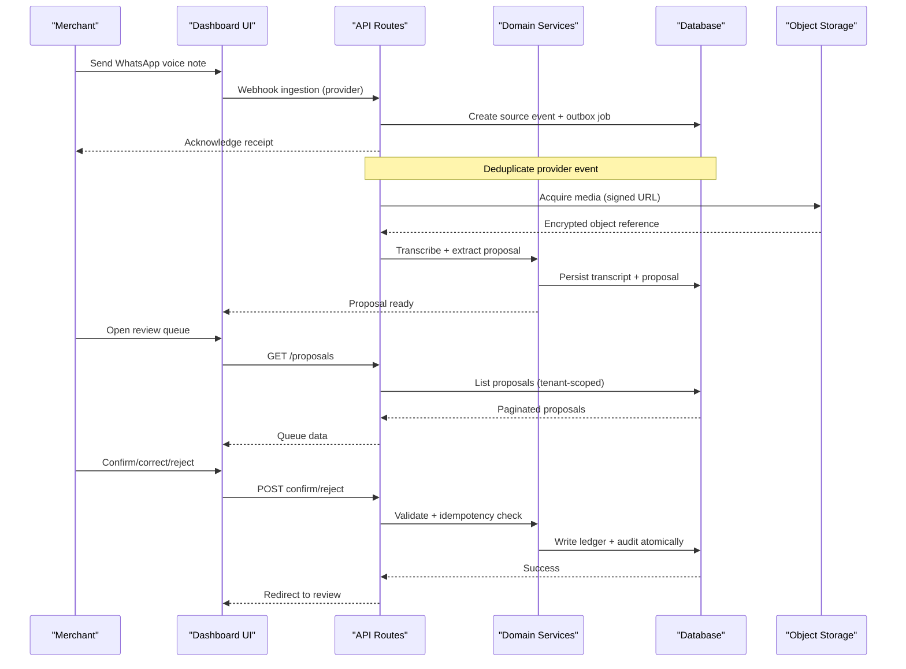
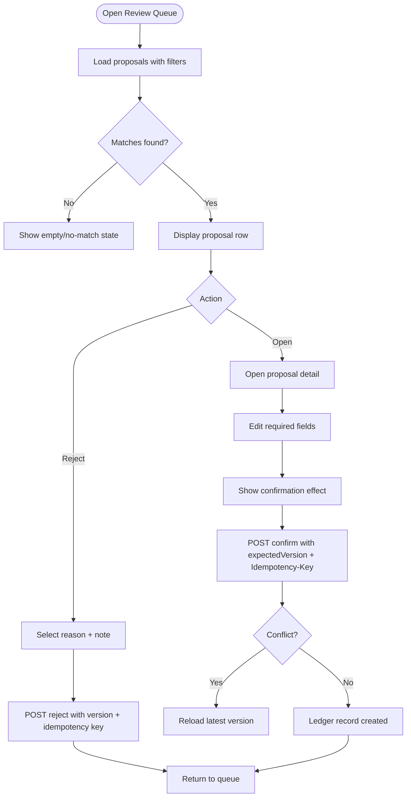
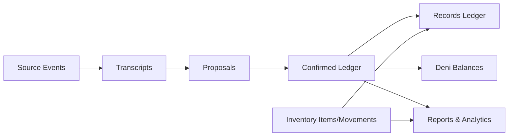

# Feature Documentation

<cite>
**Referenced Files in This Document**
- [PRD.md](file://PRD.md)
- [architecture.md](file://architecture.md)
- [review page.tsx](file://src/app/(dashboard)/review/page.tsx)
- [proposal detail page.tsx](file://src/app/(dashboard)/review/[proposalId]/page.tsx)
- [review proposals route.ts](file://src/app/api/v1/review/proposals/route.ts)
- [records list page.tsx](file://src/app/(dashboard)/records/page.tsx)
- [record detail page.tsx](file://src/app/(dashboard)/records/[recordId]/page.tsx)
- [deni list page.tsx](file://src/app/(dashboard)/deni/page.tsx)
- [deni customer detail page.tsx](file://src/app/(dashboard)/deni/[customerId]/page.tsx)
- [deni summary route.ts](file://src/app/api/v1/deni/summary/route.ts)
- [inventory page.tsx](file://src/app/(dashboard)/inventory/page.tsx)
- [inventory item update route.ts](file://src/app/api/v1/inventory/items/[itemId]/route.ts)
- [reports page.tsx](file://src/app/(dashboard)/reports/page.tsx)
- [report categories route.ts](file://src/app/api/v1/reports/categories/route.ts)
- [media download route.ts](file://src/app/api/v1/media/download/route.ts)
- [logger.ts](file://src/server/observability/logger.ts)
</cite>

## Table of Contents
1. [Introduction](#introduction)
2. [Project Structure](#project-structure)
3. [Core Components](#core-components)
4. [Architecture Overview](#architecture-overview)
5. [Detailed Component Analysis](#detailed-component-analysis)
6. [Dependency Analysis](#dependency-analysis)
7. [Performance Considerations](#performance-considerations)
8. [Troubleshooting Guide](#troubleshooting-guide)
9. [Conclusion](#conclusion)

## Introduction
This document explains the user-facing features of the Daftari dashboard: Review System, Records Ledger, Deni (debt) tracking, Inventory Management, and Reports and Analytics. It describes workflows, interface interactions, data relationships, business rules, roles and permissions, error states, recovery procedures, and configuration options. The system is voice-first and WhatsApp-native; the dashboard is the merchant’s review and control center. AI extraction creates proposals, but only an authorized human can confirm a financial record.

Key product principles:
- Human confirmation for money records.
- Source lineage from message to proposal to confirmed ledger record.
- Plain language, TZS defaults, and Tanzania timezone context.
- Tenancy isolation and backend-enforced permissions.

**Section sources**
- [PRD.md:10-37](file://PRD.md#L10-L37)
- [PRD.md:75-117](file://PRD.md#L75-L117)
- [architecture.md:9-36](file://architecture.md#L9-L36)

## Project Structure
The dashboard is organized by feature pages under `src/app/(dashboard)` with corresponding API routes under `src/app/api/v1`. Core domain logic, repositories, services, permissions, and integrations live under `src/server`.

```mermaid
graph TB
subgraph "Dashboard Pages"
Review["Review Queue<br/>src/app/(dashboard)/review/page.tsx"]
ProposalDetail["Proposal Detail<br/>src/app/(dashboard)/review/[proposalId]/page.tsx"]
RecordsList["Records List<br/>src/app/(dashboard)/records/page.tsx"]
RecordDetail["Record Detail<br/>src/app/(dashboard)/records/[recordId]/page.tsx"]
DeniList["Deni List<br/>src/app/(dashboard)/deni/page.tsx"]
DeniCustomer["Deni Customer<br/>src/app/(dashboard)/deni/[customerId]/page.tsx"]
InventoryPage["Inventory Page<br/>src/app/(dashboard)/inventory/page.tsx"]
ReportsPage["Reports Page<br/>src/app/(dashboard)/reports/page.tsx"]
end
subgraph "API Routes"
ProposalsRoute["Review Proposals Route<br/>src/app/api/v1/review/proposals/route.ts"]
DeniSummaryRoute["Deni Summary Route<br/>src/app/api/v1/deni/summary/route.ts"]
InventoryItemUpdate["Inventory Item Update<br/>src/app/api/v1/inventory/items/[itemId]/route.ts"]
ReportCategories["Report Categories<br/>src/app/api/v1/reports/categories/route.ts"]
MediaDownload["Media Download<br/>src/app/api/v1/media/download/route.ts"]
end
Review --> ProposalsRoute
ProposalDetail --> ProposalsRoute
RecordsList --> RecordDetail
DeniList --> DeniSummaryRoute
DeniCustomer --> DeniSummaryRoute
InventoryPage --> InventoryItemUpdate
ReportsPage --> ReportCategories
ProposalDetail --> MediaDownload
```

**Diagram sources**
- [review page.tsx:1-276](file://src/app/(dashboard)/review/page.tsx#L1-L276)
- [proposal detail page.tsx:1-632](file://src/app/(dashboard)/review/[proposalId]/page.tsx#L1-L632)
- [records list page.tsx:1-124](file://src/app/(dashboard)/records/page.tsx#L1-L124)
- [record detail page.tsx:1-130](file://src/app/(dashboard)/records/[recordId]/page.tsx#L1-L130)
- [deni list page.tsx:1-124](file://src/app/(dashboard)/deni/page.tsx#L1-L124)
- [deni customer detail page.tsx:1-117](file://src/app/(dashboard)/deni/[customerId]/page.tsx#L1-L117)
- [inventory page.tsx:1-213](file://src/app/(dashboard)/inventory/page.tsx#L1-L213)
- [reports page.tsx:1-123](file://src/app/(dashboard)/reports/page.tsx#L1-L123)
- [review proposals route.ts:1-109](file://src/app/api/v1/review/proposals/route.ts#L1-L109)
- [deni summary route.ts:1-29](file://src/app/api/v1/deni/summary/route.ts#L1-L29)
- [inventory item update route.ts:1-31](file://src/app/api/v1/inventory/items/[itemId]/route.ts#L1-L31)
- [report categories route.ts:1-41](file://src/app/api/v1/reports/categories/route.ts#L1-L41)
- [media download route.ts:1-31](file://src/app/api/v1/media/download/route.ts#L1-L31)

**Section sources**
- [architecture.md:496-558](file://architecture.md#L496-L558)
- [PRD.md:102-117](file://PRD.md#L102-L117)

## Core Components
- Review System: queue filtering, editing workflows, confirmation, rejection, and duplicate handling.
- Records Ledger: browsing confirmed transactions with search/filtering and correction capabilities.
- Deni Tracking: customer balances, overdue status, obligations, and payment history.
- Inventory Management: stock items, low-stock alerts, movement history, and feature gating.
- Reports and Analytics: cash summaries, trends, category breakdowns, and export controls.

Business rules:
- Only confirmed records affect totals and reports.
- Corrections are versioned or reversed; no destructive edits.
- All actions are tenant-scoped and permission-checked.
- Money values use integer minor units; dates use business timezone.

**Section sources**
- [PRD.md:158-231](file://PRD.md#L158-L231)
- [architecture.md:125-155](file://architecture.md#L125-L155)
- [architecture.md:379-393](file://architecture.md#L379-L393)

## Architecture Overview
The pipeline preserves source evidence, transcribes, extracts proposals, validates, queues for review, and writes confirmed records atomically with audit events.

**Diagram sources**
- [architecture.md:13-25](file://architecture.md#L13-L25)
- [architecture.md:314-393](file://architecture.md#L314-L393)
- [review proposals route.ts:52-109](file://src/app/api/v1/review/proposals/route.ts#L52-L109)
- [proposal detail page.tsx:247-341](file://src/app/(dashboard)/review/[proposalId]/page.tsx#L247-L341)

## Detailed Component Analysis

### Review System
Purpose:
- Present AI-generated proposals requiring a decision.
- Let reviewers compare source/transcript, edit fields, confirm, reject, or reclassify drafts.

Queue filtering:
- Tabs: Needs review, Missing details, Failed processing, Recently decided.
- Filters: record type, source kind, date range, confidence band (internal), assignee (future).
- Sorting: oldest actionable first by default; newest-first option supported.

Editing workflow:
- Evidence panel shows source metadata, transcript, ambiguity notes, missing fields.
- Editable form adapts to record type: sale, expense, debt created/payment, stock movement, note.
- Required fields validated inline; amounts parsed to minor units; datetime converted to business timezone.

Confirmation process:
- Shows exact effect before confirming.
- Sends expected version and Idempotency-Key; server reruns validation and permission checks.
- Creates ledger record and audit event atomically; redirects back to review.

Rejection handling:
- Requires reason code and optional note.
- Preserves source and proposal; does not delete them.
- Audit records the decision.

Concurrency:
- If another user changes the proposal, client detects conflict and prompts reload.

User roles and permissions:
- Owner, Manager/bookkeeper can review, correct, confirm, reject.
- Staff cannot review by default.
- Backend enforces `proposals.read` and action-specific permissions.

Error states and recovery:
- Loading, empty, no-match, stale, failed transcription, conflict, permission denied.
- Retry refreshes queue; conflict requires reload.

Configuration and customization:
- Confidence band filter available internally.
- Manual draft reclassification supports non-voice entries.

**Diagram sources**
- [review page.tsx:63-146](file://src/app/(dashboard)/review/page.tsx#L63-L146)
- [proposal detail page.tsx:247-341](file://src/app/(dashboard)/review/[proposalId]/page.tsx#L247-L341)
- [review proposals route.ts:21-50](file://src/app/api/v1/review/proposals/route.ts#L21-L50)

**Section sources**
- [PRD.md:158-194](file://PRD.md#L158-L194)
- [review page.tsx:1-276](file://src/app/(dashboard)/review/page.tsx#L1-L276)
- [proposal detail page.tsx:1-632](file://src/app/(dashboard)/review/[proposalId]/page.tsx#L1-L632)
- [review proposals route.ts:1-109](file://src/app/api/v1/review/proposals/route.ts#L1-L109)

### Records Ledger
Purpose:
- Browse the confirmed source of truth for sales, expenses, debts, payments, stock movements, and notes.

Interface:
- Table columns include occurred date, type, description, customer/payee, amount, payment status/method, source, last changed.
- On small screens, rows render as accessible cards.
- Links to record detail for full evidence and correction actions.

Search and filtering:
- Text search across permitted fields; date range; type; payment status; source; customer/payee.
- Filters should be URL-addressable where practical with clear reset.

Corrections:
- Do not destructively edit financial history.
- Create correction/reversal with actor, timestamp, reason, before/after values, and source link.
- Void/reverse requires reason and confirmation.

User roles and permissions:
- Owner and Manager/bookkeeper can view and correct within grants.
- Backend enforces tenant scope and role-based access.

Error states and recovery:
- Loading, empty, error with retry, stale data indicator.

**Section sources**
- [PRD.md:195-206](file://PRD.md#L195-L206)
- [records list page.tsx:1-124](file://src/app/(dashboard)/records/page.tsx#L1-L124)
- [record detail page.tsx:1-130](file://src/app/(dashboard)/records/[recordId]/page.tsx#L1-L130)

### Deni (Debt) Tracking
Purpose:
- Help owners see customer balances, overdue amounts, obligations, and payment history.

Interface:
- Summary shows total outstanding and overdue totals.
- Customer list shows balance, overdue flag, obligation count, and “View” link.
- Customer detail shows obligations and payments with amounts, methods, and dates.

Data relationships:
- Obligations linked to ledger records; payments applied to obligations.
- Outstanding derived from confirmed records; not added to cash totals.

User roles and permissions:
- Read access controlled via `deni.read`; feature may be gated by business settings.

Error states and recovery:
- Loading, no debts, partial payment, fully settled, disputed/needs correction, stale data.

Configuration:
- Deni feature can be disabled per business; summary endpoint returns enabled flag.

**Section sources**
- [PRD.md:207-215](file://PRD.md#L207-L215)
- [deni list page.tsx:1-124](file://src/app/(dashboard)/deni/page.tsx#L1-L124)
- [deni customer detail page.tsx:1-117](file://src/app/(dashboard)/deni/[customerId]/page.tsx#L1-L117)
- [deni summary route.ts:1-29](file://src/app/api/v1/deni/summary/route.ts#L1-L29)

### Inventory Management
Purpose:
- Show stock on hand and movement history when enabled.

Interface:
- Gated screen: if disabled, shows gated message.
- Add item form with name and unit.
- Table shows tracked items, on-hand quantity, low-stock flag, threshold, last movement time.

Business rules:
- AI-detected stock changes remain proposals until confirmed.
- Low-stock thresholds configurable per item.
- Quantities stored in milli-units for fractional support.

User roles and permissions:
- Manage inventory requires `inventory.manage` and feature enabled.

Error states and recovery:
- Loading, error, add failure with message, feature-gated state.

Configuration:
- Feature gate checked at route and service layers.

**Section sources**
- [PRD.md:217-222](file://PRD.md#L217-L222)
- [inventory page.tsx:1-213](file://src/app/(dashboard)/inventory/page.tsx#L1-L213)
- [inventory item update route.ts:1-31](file://src/app/api/v1/inventory/items/[itemId]/route.ts#L1-L31)

### Reports and Analytics
Purpose:
- Provide understandable summaries from confirmed data: cash movement, trends, and category breakdowns.

Interface:
- Cash In, Cash Out, Net cards.
- Trend buckets showing sales minus expenses per period.
- Sales and Expenses by Category with shares.

Backend:
- Categories endpoint computes totals and shares separately for sales and expenses.
- Date ranges interpreted in business timezone.

Exports:
- Export jobs create downloadable files via signed links.
- Downloads require valid token and tenant-scoped job lookup.

User roles and permissions:
- Reports read requires `reports.read`.
- Exports require explicit permission and audit logging.

Error states and recovery:
- Loading, empty periods, stale data indicators.

**Section sources**
- [PRD.md:223-228](file://PRD.md#L223-L228)
- [reports page.tsx:1-123](file://src/app/(dashboard)/reports/page.tsx#L1-L123)
- [report categories route.ts:1-41](file://src/app/api/v1/reports/categories/route.ts#L1-L41)
- [media download route.ts:1-31](file://src/app/api/v1/media/download/route.ts#L1-L31)

## Dependency Analysis
Feature dependencies and relationships:
- Review depends on source events, transcripts, and proposals.
- Records depend on confirmed ledger records and corrections.
- Deni depends on debt obligations and payments derived from ledger.
- Inventory depends on items and movements; feature-gated.
- Reports depend on confirmed ledger aggregates and categories.

**Diagram sources**
- [architecture.md:162-173](file://architecture.md#L162-L173)
- [review proposals route.ts:52-109](file://src/app/api/v1/review/proposals/route.ts#L52-L109)
- [report categories route.ts:14-41](file://src/app/api/v1/reports/categories/route.ts#L14-L41)

**Section sources**
- [architecture.md:162-173](file://architecture.md#L162-L173)

## Performance Considerations
- Pagination and cursor-based loading for review queue and records.
- Lazy-load audio and transcripts; avoid downloading original recordings unless requested.
- Use integer minor units for money arithmetic to avoid floating-point errors.
- Server-render or fetch sensitive initial data through authenticated APIs.
- Cache keys scoped by business ID and locale; invalidate on confirmation/correction.

[No sources needed since this section provides general guidance]

## Troubleshooting Guide
Common issues and recovery:
- Proposal version conflict: reload the latest version and reconcile edits.
- Failed transcription: show transcript if available; ask user to retry or correct text.
- Unsupported media: explain reason and recommend supported voice note.
- Extraction uncertain: show missing fields and “Check details”.
- Provider outage: keep source, retry automatically, show delayed state.
- WhatsApp disconnected: show last successful event and reconnection steps.
- Permission denied: verify role and active business membership.

Operational safeguards:
- Logs exclude raw transcripts, audio, secrets, and PII.
- Analytics events track workflow milestones without sensitive content.

**Section sources**
- [architecture.md:394-425](file://architecture.md#L394-L425)
- [logger.ts:78-98](file://src/server/observability/logger.ts#L78-L98)

## Conclusion
Daftari’s dashboard centers on safe, auditable bookkeeping: AI proposes, humans decide. The Review System ensures every financial change is intentional and traceable. The Records Ledger provides a durable, searchable history. Deni clarifies customer obligations. Inventory tracks stock when enabled. Reports translate confirmed activity into useful summaries. Permissions, tenancy, and auditability protect data integrity and privacy.

[No sources needed since this section summarizes without analyzing specific files]