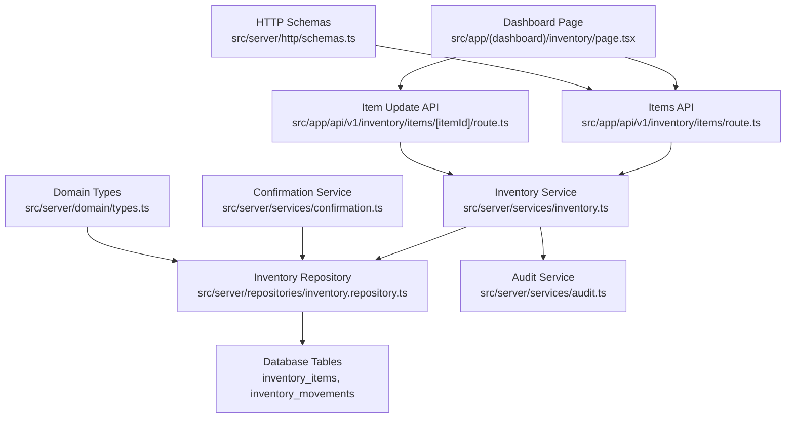
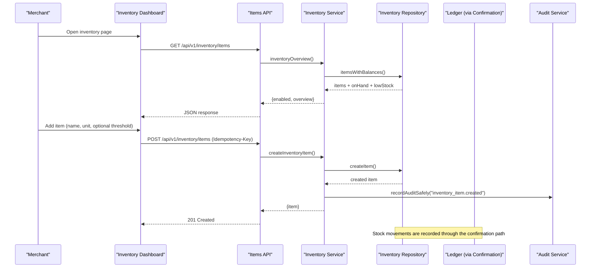
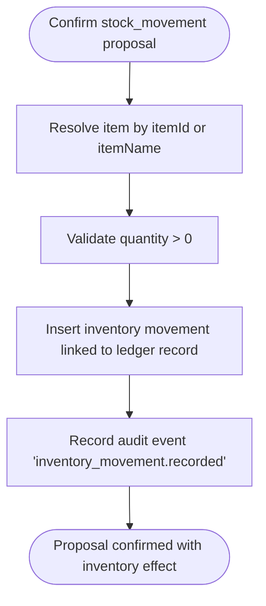
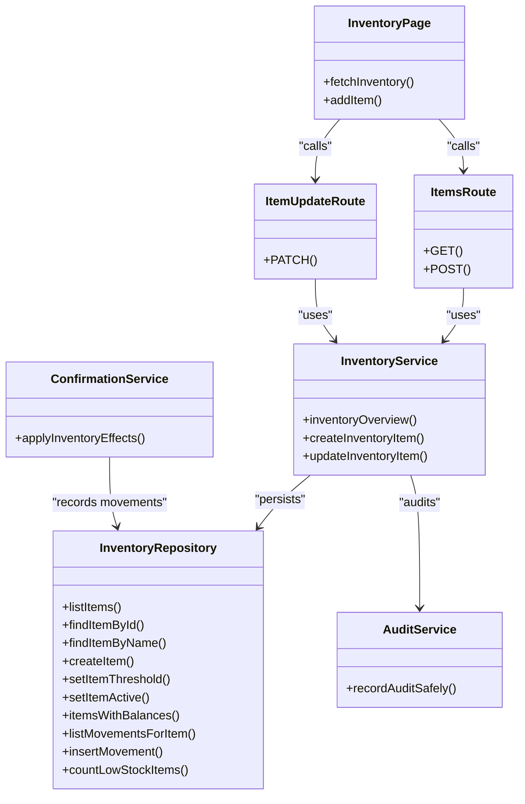
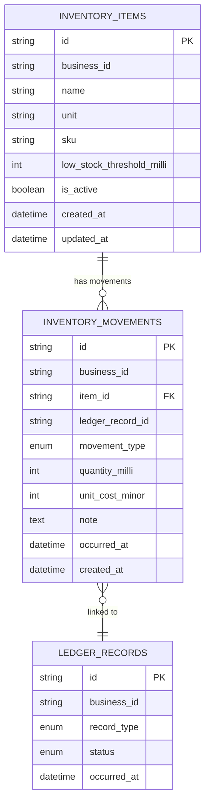

# Inventory Management

<cite>
**Referenced Files in This Document**
- [inventory page](file://src/app/(dashboard)/inventory/page.tsx)
- [items route](file://src/app/api/v1/inventory/items/route.ts)
- [item update route](file://src/app/api/v1/inventory/items/[itemId]/route.ts)
- [inventory repository](file://src/server/repositories/inventory.repository.ts)
- [inventory service](file://src/server/services/inventory.ts)
- [domain types](file://src/server/domain/types.ts)
- [HTTP schemas](file://src/server/http/schemas.ts)
- [audit service](file://src/server/services/audit.ts)
- [confirmation service](file://src/server/services/confirmation.ts)
- [inventory tests](file://tests/inventory.test.ts)
</cite>

## Table of Contents
1. [Introduction](#introduction)
2. [Project Structure](#project-structure)
3. [Core Components](#core-components)
4. [Architecture Overview](#architecture-overview)
5. [Detailed Component Analysis](#detailed-component-analysis)
6. [Dependency Analysis](#dependency-analysis)
7. [Performance Considerations](#performance-considerations)
8. [Troubleshooting Guide](#troubleshooting-guide)
9. [Conclusion](#conclusion)
10. [Appendices](#appendices)

## Introduction
This document explains the Inventory Management feature that tracks stock levels and item movements. It covers:
- The inventory dashboard showing current stock levels, low stock alerts, and movement history context.
- Item catalog management for adding items, updating thresholds and active state.
- Stock movement tracking through receipts, sales, adjustments, and transfers via the shared confirmation pipeline.
- Low stock alerting based on configurable reorder points.
- Integration with financial records and audit trails.
- Reporting considerations and valuation concepts grounded in the implementation.

The system is feature-gated: inventory is invisible until enabled, and operations are scoped per business tenant.

## Project Structure
Inventory functionality spans the Next.js app routes, server services, repositories, domain types, HTTP validation schemas, and tests.

**Diagram sources**
- [inventory page:1-213](file://src/app/(dashboard)/inventory/page.tsx#L1-L213)
- [items route:1-68](file://src/app/api/v1/inventory/items/route.ts#L1-L68)
- [item update route:1-31](file://src/app/api/v1/inventory/items/[itemId]/route.ts#L1-L31)
- [inventory service:1-175](file://src/server/services/inventory.ts#L1-L175)
- [inventory repository:1-196](file://src/server/repositories/inventory.repository.ts#L1-L196)
- [audit service:1-79](file://src/server/services/audit.ts#L1-L79)
- [confirmation service:234-272](file://src/server/services/confirmation.ts#L234-L272)
- [domain types:84-85](file://src/server/domain/types.ts#L84-L85)
- [HTTP schemas:110-122](file://src/server/http/schemas.ts#L110-L122)

**Section sources**
- [inventory page:1-213](file://src/app/(dashboard)/inventory/page.tsx#L1-L213)
- [items route:1-68](file://src/app/api/v1/inventory/items/route.ts#L1-L68)
- [item update route:1-31](file://src/app/api/v1/inventory/items/[itemId]/route.ts#L1-L31)
- [inventory service:1-175](file://src/server/services/inventory.ts#L1-L175)
- [inventory repository:1-196](file://src/server/repositories/inventory.repository.ts#L1-L196)
- [domain types:84-85](file://src/server/domain/types.ts#L84-L85)
- [HTTP schemas:110-122](file://src/server/http/schemas.ts#L110-L122)
- [audit service:1-79](file://src/server/services/audit.ts#L1-L79)
- [confirmation service:234-272](file://src/server/services/confirmation.ts#L234-L272)

## Core Components
- Dashboard page: Displays enabled state, overview metrics, item list, low stock indicators, and a form to add new items.
- Items API: Lists inventory overview and creates items idempotently; enforces feature gating and permissions.
- Item update API: Updates reorder point threshold and active status.
- Inventory service: Validates feature flags and permissions, manages items, computes summaries, and records audits.
- Inventory repository: Persists items and movements; derives on-hand balances from posted ledger-linked movements.
- Domain types: Defines movement types and other shared enums.
- HTTP schemas: Validates request bodies for inventory operations.
- Audit service: Records audit events safely without failing business transactions.
- Confirmation service: Integrates stock movements into the ledger and inventory when confirming proposals.

**Section sources**
- [inventory page:1-213](file://src/app/(dashboard)/inventory/page.tsx#L1-L213)
- [items route:1-68](file://src/app/api/v1/inventory/items/route.ts#L1-L68)
- [item update route:1-31](file://src/app/api/v1/inventory/items/[itemId]/route.ts#L1-L31)
- [inventory service:1-175](file://src/server/services/inventory.ts#L1-L175)
- [inventory repository:1-196](file://src/server/repositories/inventory.repository.ts#L1-L196)
- [domain types:84-85](file://src/server/domain/types.ts#L84-L85)
- [HTTP schemas:110-122](file://src/server/http/schemas.ts#L110-L122)
- [audit service:1-79](file://src/server/services/audit.ts#L1-L79)
- [confirmation service:234-272](file://src/server/services/confirmation.ts#L234-L272)

## Architecture Overview
The inventory feature integrates with the proposal-to-ledger confirmation flow. Stock movements are not stored as direct balance updates; instead, they are recorded as movements linked to confirmed ledger records. On-hand quantities are derived by summing these movements for posted records.

**Diagram sources**
- [items route:18-67](file://src/app/api/v1/inventory/items/route.ts#L18-L67)
- [inventory service:64-124](file://src/server/services/inventory.ts#L64-L124)
- [inventory repository:110-130](file://src/server/repositories/inventory.repository.ts#L110-L130)
- [audit service:54-66](file://src/server/services/audit.ts#L54-L66)

## Detailed Component Analysis

### Inventory Dashboard
- Shows whether inventory is enabled.
- Displays tracked items count and low stock count.
- Renders a table with item name, unit, on-hand quantity, low stock flag, threshold, and last movement timestamp.
- Provides a form to add new items with idempotent creation.

Key behaviors:
- Fetches overview from `/api/v1/inventory/items`.
- Formats milli-unit quantities for display.
- Handles loading, error, and gated states.

**Section sources**
- [inventory page:1-213](file://src/app/(dashboard)/inventory/page.tsx#L1-L213)

### Items API
- GET returns `{enabled, overview}`; if disabled, overview is null.
- POST creates an item with:
  - Feature gate check.
  - Permission check (`inventory.manage`).
  - Idempotency enforcement via `Idempotency-Key`.
  - Validation using `inventoryItemBodySchema`.
  - Audit recording inside a transaction.

Response handling:
- Returns conflict if an idempotent request is still in progress.
- Returns created item on success.

**Section sources**
- [items route:1-68](file://src/app/api/v1/inventory/items/route.ts#L1-L68)
- [HTTP schemas:110-115](file://src/server/http/schemas.ts#L110-L115)
- [inventory service:81-124](file://src/server/services/inventory.ts#L81-L124)

### Item Update API
- PATCH updates only `lowStockThresholdMilli` and `active`.
- Enforces feature gate and permission checks.
- Uses `inventoryItemUpdateBodySchema`.
- Audits changes and returns updated summary.

Important design rule:
- The low stock flag is never edited directly; it is always derived from on-hand vs threshold.

**Section sources**
- [item update route:1-31](file://src/app/api/v1/inventory/items/[itemId]/route.ts#L1-L31)
- [HTTP schemas:117-122](file://src/server/http/schemas.ts#L117-L122)
- [inventory service:136-175](file://src/server/services/inventory.ts#L136-L175)

### Inventory Service
Responsibilities:
- Feature gating and permission assertions.
- Creating items with uniqueness checks per business.
- Updating thresholds and active state.
- Building overview summaries including low stock counts.
- Recording audit events for item lifecycle changes.

Data transformation:
- Converts repository rows to API summaries.
- Ensures derived fields like `lowStock` are consistent.

**Section sources**
- [inventory service:1-175](file://src/server/services/inventory.ts#L1-L175)

### Inventory Repository
Responsibilities:
- CRUD for inventory items within tenant scope.
- Movement persistence with validated positive milli-quantities.
- Deriving on-hand balances by summing movements linked to posted ledger records.
- Counting low stock items.

Key queries:
- `itemsWithBalances`: Joins movements with ledger records filtered by posted status to compute on-hand and last movement time.
- `listMovementsForItem`: Retrieves recent movements for an item.

Design note:
- Stock on hand is derived, not stored, preventing phantom balances after voided or reversed movements.

**Section sources**
- [inventory repository:1-196](file://src/server/repositories/inventory.repository.ts#L1-L196)

### Domain Types and Schemas
- Movement types: `in`, `out`, `adjustment`.
- HTTP schemas validate inventory item creation and updates, ensuring safe inputs.

**Section sources**
- [domain types:84-85](file://src/server/domain/types.ts#L84-L85)
- [HTTP schemas:110-122](file://src/server/http/schemas.ts#L110-L122)

### Audit Trail
- Every item creation and update records an audit event via `recordAuditSafely`.
- Audit failures are logged but do not roll back the business change.
- Inventory movements also generate audit entries when recorded through confirmation.

**Section sources**
- [audit service:1-79](file://src/server/services/audit.ts#L1-L79)
- [inventory service:102-110](file://src/server/services/inventory.ts#L102-L110)
- [inventory service:158-166](file://src/server/services/inventory.ts#L158-L166)
- [confirmation service:264-271](file://src/server/services/confirmation.ts#L264-L271)

### Stock Movement Tracking Through Confirmation
Stock movements enter the system via the proposal confirmation path:
- A proposal of type `stock_movement` is reviewed and confirmed.
- During confirmation, the service resolves the inventory item by ID or name.
- It validates quantity and movement type, then inserts a movement linked to the newly created ledger record.
- An audit event is recorded for the movement.

Movement types supported:
- Inbound receipts: `in`
- Sales outflows: `out`
- Adjustments: `adjustment`

Transfers are represented conceptually as paired movements (e.g., an outbound movement at source and an inbound movement at destination), both recorded through the same confirmation path.

**Diagram sources**
- [confirmation service:234-272](file://src/server/services/confirmation.ts#L234-L272)

**Section sources**
- [confirmation service:234-272](file://src/server/services/confirmation.ts#L234-L272)
- [domain types:84-85](file://src/server/domain/types.ts#L84-L85)

### Low Stock Alerts and Reorder Points
- Each item can have a `lowStockThresholdMilli`.
- Low stock is computed as `onHandMilli <= threshold` when a threshold is set.
- Thresholds are configured via the item update API.
- The dashboard highlights low stock items and shows the threshold value.

Behavioral guarantees:
- No threshold means never low stock.
- At-or-below threshold triggers low stock.
- Cross-tenant isolation ensures one business cannot see another’s items or affect their thresholds.

**Section sources**
- [inventory repository:110-130](file://src/server/repositories/inventory.repository.ts#L110-L130)
- [inventory service:136-175](file://src/server/services/inventory.ts#L136-L175)
- [inventory tests:134-165](file://tests/inventory.test.ts#L134-L165)
- [inventory tests:204-219](file://tests/inventory.test.ts#L204-L219)

### Examples of Common Inventory Operations
- Add a new item:
  - Use the dashboard form or POST `/api/v1/inventory/items` with `name`, `unit`, optional `sku`, and optional `lowStockThresholdMilli`.
  - Include an `Idempotency-Key` header to prevent duplicates on retries.
- Update reorder point:
  - PATCH `/api/v1/inventory/items/:itemId` with `lowStockThresholdMilli`.
- Activate or deactivate an item:
  - PATCH `/api/v1/inventory/items/:itemId` with `active`.
- Track stock receipt:
  - Confirm a `stock_movement` proposal with `movementType: "in"` and a positive `quantityMilli`.
- Track sale outflow:
  - Confirm a `stock_movement` proposal with `movementType: "out"` and a positive `quantityMilli`.
- Record adjustment:
  - Confirm a `stock_movement` proposal with `movementType: "adjustment"` and a positive `quantityMilli`; direction is determined by how the business treats the adjustment elsewhere.

Note: All movements are tied to a posted ledger record and are summed to derive on-hand quantities.

**Section sources**
- [items route:29-67](file://src/app/api/v1/inventory/items/route.ts#L29-L67)
- [item update route:16-30](file://src/app/api/v1/inventory/items/[itemId]/route.ts#L16-L30)
- [confirmation service:234-272](file://src/server/services/confirmation.ts#L234-L272)
- [inventory repository:163-187](file://src/server/repositories/inventory.repository.ts#L163-L187)

### Bulk Stock Updates
- The current implementation does not expose a dedicated bulk endpoint.
- To perform bulk updates:
  - Create multiple idempotent POST requests for item creation.
  - Confirm multiple stock movement proposals for receipts, sales, or adjustments.
  - Ensure each request includes a unique `Idempotency-Key` to avoid duplicate effects.

**Section sources**
- [items route:29-67](file://src/app/api/v1/inventory/items/route.ts#L29-L67)
- [confirmation service:318-455](file://src/server/services/confirmation.ts#L318-L455)

### Integration With Sales and Expense Records
- Sales and expenses are separate record types and do not automatically adjust inventory unless explicitly modeled as `stock_movement`.
- When a sale involves physical goods, confirm a corresponding `stock_movement` with `movementType: "out"` to reduce on-hand.
- Expenses may include purchased goods; confirm a `stock_movement` with `movementType: "in"` to increase on-hand.

Relationship to financial records:
- Stock movements link to ledger records via `ledger_record_id`.
- Only posted ledger records contribute to on-hand calculations.
- Voided or reversed records do not affect derived balances.

**Section sources**
- [confirmation service:234-272](file://src/server/services/confirmation.ts#L234-L272)
- [inventory repository:110-130](file://src/server/repositories/inventory.repository.ts#L110-L130)

### Inventory Valuation Methods and Depreciation
- The implementation stores `unit_cost_minor` on movements but does not implement FIFO/LIFO/Average cost valuation logic.
- Depreciation tracking is not implemented in this codebase.
- For valuation reporting, you would need to extend the repository and service to aggregate costs according to a chosen method.

Current capabilities:
- Movements carry unit cost metadata for potential future valuation features.
- On-hand is purely quantity-based.

**Section sources**
- [inventory repository:163-187](file://src/server/repositories/inventory.repository.ts#L163-L187)

### Audit Trail Maintenance
- Item creation and updates are audited.
- Inventory movements are audited upon confirmation.
- Audit events are appended safely; failures are logged without rolling back the main transaction.

**Section sources**
- [inventory service:102-110](file://src/server/services/inventory.ts#L102-L110)
- [inventory service:158-166](file://src/server/services/inventory.ts#L158-L166)
- [confirmation service:264-271](file://src/server/services/confirmation.ts#L264-L271)
- [audit service:54-66](file://src/server/services/audit.ts#L54-L66)

### Reporting Capabilities
- The dashboard provides basic visibility: tracked items, low stock count, and per-item on-hand and last movement timestamps.
- Movement history per item can be retrieved via repository functions for custom reports.
- Turnover rates and cost calculations require additional aggregation logic beyond the current implementation.

Recommendations:
- Build report endpoints that query `inventory_movements` joined with ledger records to compute turnover and valuation metrics.
- Use the existing `listMovementsForItem` as a foundation for detailed movement histories.

**Section sources**
- [inventory repository:132-146](file://src/server/repositories/inventory.repository.ts#L132-L146)
- [inventory page:158-206](file://src/app/(dashboard)/inventory/page.tsx#L158-L206)

## Dependency Analysis

**Diagram sources**
- [inventory page:1-213](file://src/app/(dashboard)/inventory/page.tsx#L1-L213)
- [items route:1-68](file://src/app/api/v1/inventory/items/route.ts#L1-L68)
- [item update route:1-31](file://src/app/api/v1/inventory/items/[itemId]/route.ts#L1-L31)
- [inventory service:1-175](file://src/server/services/inventory.ts#L1-L175)
- [inventory repository:1-196](file://src/server/repositories/inventory.repository.ts#L1-L196)
- [confirmation service:234-272](file://src/server/services/confirmation.ts#L234-L272)
- [audit service:1-79](file://src/server/services/audit.ts#L1-L79)

**Section sources**
- [inventory page:1-213](file://src/app/(dashboard)/inventory/page.tsx#L1-L213)
- [items route:1-68](file://src/app/api/v1/inventory/items/route.ts#L1-L68)
- [item update route:1-31](file://src/app/api/v1/inventory/items/[itemId]/route.ts#L1-L31)
- [inventory service:1-175](file://src/server/services/inventory.ts#L1-L175)
- [inventory repository:1-196](file://src/server/repositories/inventory.repository.ts#L1-L196)
- [confirmation service:234-272](file://src/server/services/confirmation.ts#L234-L272)
- [audit service:1-79](file://src/server/services/audit.ts#L1-L79)

## Performance Considerations
- On-hand derivation joins movements with ledger records and sums quantities; ensure indexes exist on `business_id`, `item_id`, and ledger status columns for performance.
- Avoid frequent full scans by limiting movement history queries and paginating results where needed.
- Idempotency keys prevent duplicate work during retries, reducing unnecessary database writes.

[No sources needed since this section provides general guidance]

## Troubleshooting Guide
Common issues and resolutions:
- Inventory appears disabled:
  - Check feature flag; the API returns `enabled: false` when inventory is off.
- Duplicate item creation attempts:
  - Provide a unique `Idempotency-Key` header; repeated calls return the original result.
- Permission errors:
  - Only users with `inventory.manage` can create or update items; readers can view overview.
- Low stock not triggering:
  - Ensure a threshold is set; without a threshold, items are never flagged low stock.
- Movement not reflected in on-hand:
  - Verify the related ledger record is posted; only posted records contribute to balances.
- Cross-tenant isolation:
  - IDs from another business resolve as not found; verify tenant scoping.

**Section sources**
- [items route:18-67](file://src/app/api/v1/inventory/items/route.ts#L18-L67)
- [item update route:16-30](file://src/app/api/v1/inventory/items/[itemId]/route.ts#L16-L30)
- [inventory repository:110-130](file://src/server/repositories/inventory.repository.ts#L110-L130)
- [inventory tests:94-132](file://tests/inventory.test.ts#L94-L132)
- [inventory tests:167-183](file://tests/inventory.test.ts#L167-L183)

## Conclusion
The Inventory Management feature provides a secure, auditable, and feature-gated way to track stock levels and movements. It integrates tightly with the ledger via the confirmation pipeline, deriving on-hand quantities from posted movements and supporting configurable low stock alerts. While valuation methods and depreciation are not implemented, the data model supports future extensions. Reporting can be extended by leveraging the movement history and ledger linkage.

[No sources needed since this section summarizes without analyzing specific files]

## Appendices

### Data Model Relationships

**Diagram sources**
- [inventory repository:13-36](file://src/server/repositories/inventory.repository.ts#L13-L36)
- [inventory repository:110-130](file://src/server/repositories/inventory.repository.ts#L110-L130)