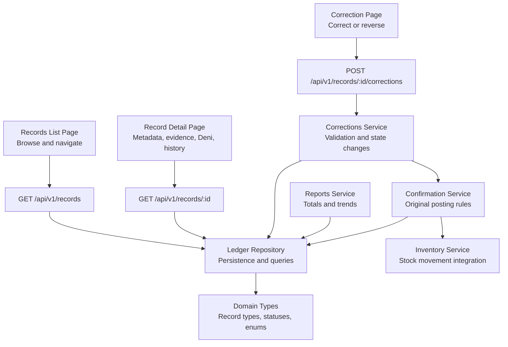
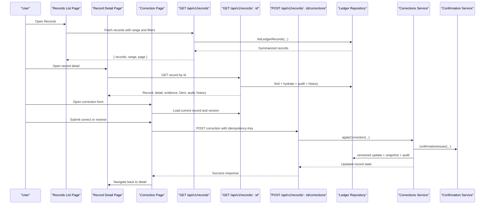
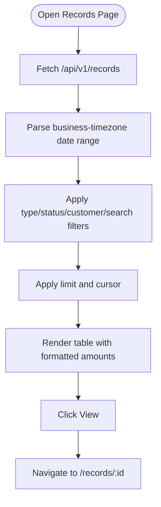
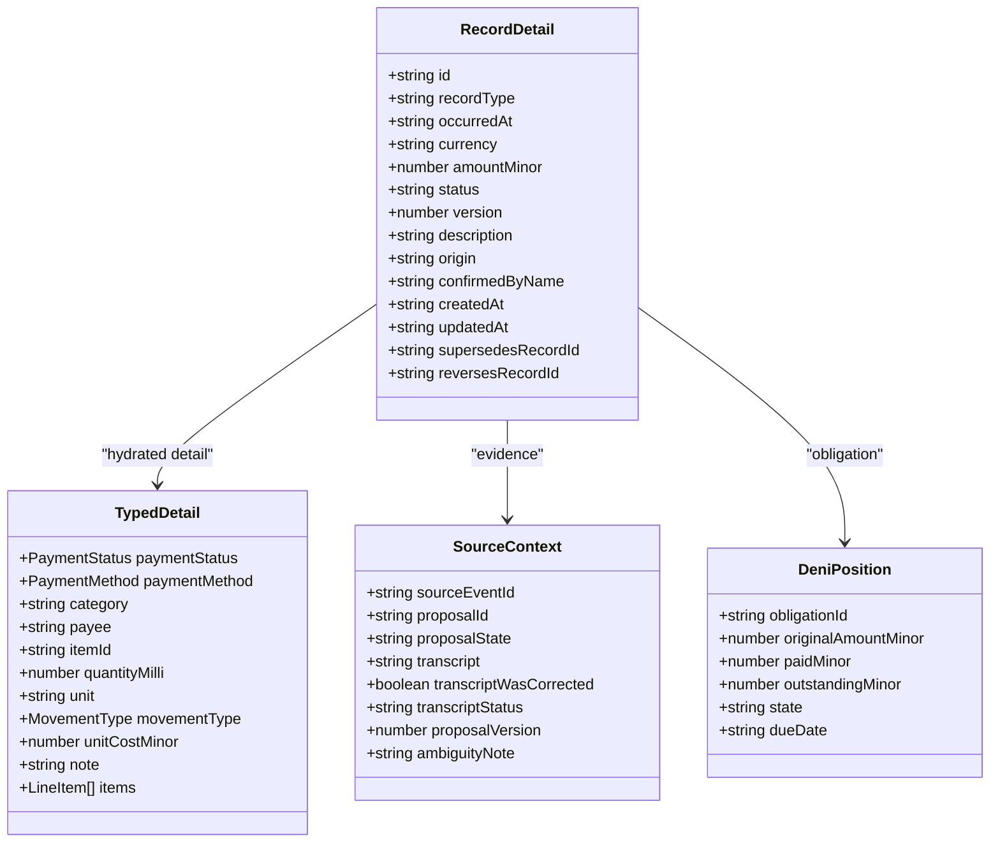
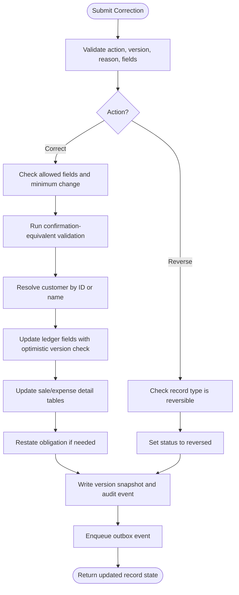
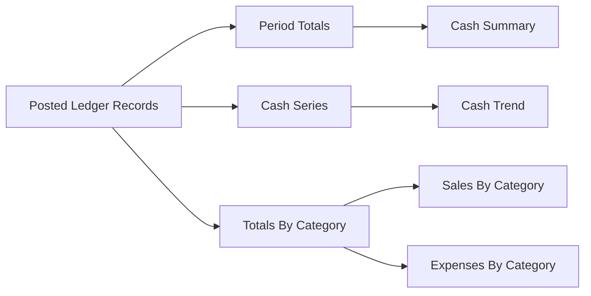
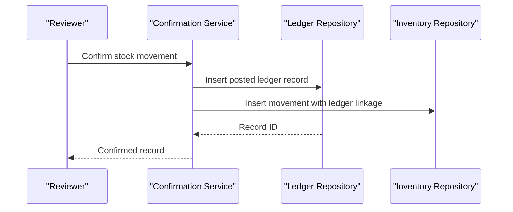
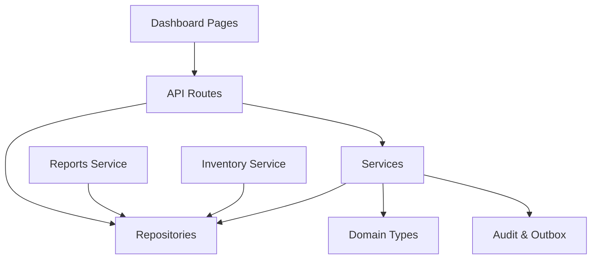

# Records Ledger

<cite>
**Referenced Files in This Document**
- [records list page](file://src/app/(dashboard)/records/page.tsx)
- [record detail page](file://src/app/(dashboard)/records/[recordId]/page.tsx)
- [record correction page](file://src/app/(dashboard)/records/[recordId]/edit/page.tsx)
- [records API route](file://src/app/api/v1/records/route.ts)
- [record detail API route](file://src/app/api/v1/records/[recordId]/route.ts)
- [corrections API route](file://src/app/api/v1/records/[recordId]/corrections/route.ts)
- [ledger repository](file://src/server/repositories/ledger.repository.ts)
- [corrections service](file://src/server/services/corrections.ts)
- [confirmation service](file://src/server/services/confirmation.ts)
- [domain types](file://src/server/domain/types.ts)
- [reports service](file://src/server/services/reports.ts)
- [inventory service](file://src/server/services/inventory.ts)
</cite>

## Table of Contents
1. [Introduction](#introduction)
2. [Project Structure](#project-structure)
3. [Core Components](#core-components)
4. [Architecture Overview](#architecture-overview)
5. [Detailed Component Analysis](#detailed-component-analysis)
6. [Dependency Analysis](#dependency-analysis)
7. [Performance Considerations](#performance-considerations)
8. [Troubleshooting Guide](#troubleshooting-guide)
9. [Conclusion](#conclusion)

## Introduction
The Records Ledger is the system’s source of truth for confirmed financial transactions. It stores only posted records, preserves every change as a new version with a snapshot, and derives all totals from posted rows. This design makes corrections and reversals safe: no existing history is overwritten, and downstream reports, debt balances, and inventory movements stay consistent because they read the current ledger state rather than reconstructing it from raw inputs.

The feature supports:
- Browsing confirmed records with range-based filtering by date, type, status, customer, and search text.
- Viewing record metadata, typed detail, evidence transcripts, associated obligations/payments, audit events, and version history.
- Correcting editable fields or reversing entire records through an idempotent, permission-gated workflow.
- Enforcing validation rules that are identical to those used when originally confirming a record.
- Integrating with reports, debt management, and inventory tracking.

## Project Structure
The Records Ledger spans Next.js App Router pages, API routes, domain types, repositories, services, and reporting utilities.

**Diagram sources**
- [records list page:1-124](file://src/app/(dashboard)/records/page.tsx#L1-L124)
- [record detail page:1-130](file://src/app/(dashboard)/records/[recordId]/page.tsx#L1-L130)
- [record correction page:1-162](file://src/app/(dashboard)/records/[recordId]/edit/page.tsx#L1-L162)
- [records API route:1-151](file://src/app/api/v1/records/route.ts#L1-L151)
- [record detail API route:1-116](file://src/app/api/v1/records/[recordId]/route.ts#L1-L116)
- [corrections API route:1-130](file://src/app/api/v1/records/[recordId]/corrections/route.ts#L1-L130)
- [ledger repository:1-696](file://src/server/repositories/ledger.repository.ts#L1-L696)
- [corrections service:1-514](file://src/server/services/corrections.ts#L1-L514)
- [confirmation service:1-522](file://src/server/services/confirmation.ts#L1-L522)
- [domain types:1-217](file://src/server/domain/types.ts#L1-L217)
- [reports service:1-155](file://src/server/services/reports.ts#L1-L155)
- [inventory service:1-175](file://src/server/services/inventory.ts#L1-L175)

**Section sources**
- [records list page:1-124](file://src/app/(dashboard)/records/page.tsx#L1-L124)
- [record detail page:1-130](file://src/app/(dashboard)/records/[recordId]/page.tsx#L1-L130)
- [record correction page:1-162](file://src/app/(dashboard)/records/[recordId]/edit/page.tsx#L1-L162)
- [records API route:1-151](file://src/app/api/v1/records/route.ts#L1-L151)
- [record detail API route:1-116](file://src/app/api/v1/records/[recordId]/route.ts#L1-L116)
- [corrections API route:1-130](file://src/app/api/v1/records/[recordId]/corrections/route.ts#L1-L130)
- [ledger repository:1-696](file://src/server/repositories/ledger.repository.ts#L1-L696)
- [corrections service:1-514](file://src/server/services/corrections.ts#L1-L514)
- [confirmation service:1-522](file://src/server/services/confirmation.ts#L1-L522)
- [domain types:1-217](file://src/server/domain/types.ts#L1-L217)
- [reports service:1-155](file://src/server/services/reports.ts#L1-L155)
- [inventory service:1-175](file://src/server/services/inventory.ts#L1-L175)

## Core Components
- **Records list interface**: Loads a paginated set of confirmed records and displays occurred time, type, amount, status, customer name, and a link to the detail view.
- **Record detail interface**: Shows core record metadata, typed detail, evidence transcript, Deni obligation summary, payments, audit events, and version history. It also exposes the correction entry point.
- **Correction interface**: Lets users choose between correcting specific fields or reversing the whole record, supply a reason code and optional note, and submit idempotently.
- **Records listing API**: Parses tenant scope, permissions, date range, type/status filters, customer filter, search text, and cursor pagination; returns summarized records plus range and paging metadata.
- **Record detail API**: Returns the full record, typed detail, customer name, payee, source proposal/transcript context, Deni obligation, payments, audit events, and version history.
- **Corrections API**: Validates the correction request, enforces idempotency, delegates business logic to the corrections service, and returns the updated record state.
- **Ledger repository**: Persists confirmed records, typed details, versions/snapshots, and provides listing, hydration, totals, series, category aggregation, duplicate detection, and versioned updates.
- **Corrections service**: Implements correction and reversal workflows, field allowlists, confirmation-equivalent validation, obligation restatement, audit logging, outbox events, and optimistic concurrency control.
- **Confirmation service**: Defines the original posting rules, typed detail creation, debt effects, inventory movement recording, and shared validation reused by corrections.
- **Domain types**: Centralizes record types, statuses, payment states, movement types, reason codes, and audit vocabulary.
- **Reports service**: Reads only posted ledger data to compute cash summaries, trends, category totals, Deni summaries, and inventory summaries.
- **Inventory service**: Manages inventory items and gates stock-related behavior behind a feature flag; stock balances are derived from confirmed movements.

**Section sources**
- [records list page:1-124](file://src/app/(dashboard)/records/page.tsx#L1-L124)
- [record detail page:1-130](file://src/app/(dashboard)/records/[recordId]/page.tsx#L1-L130)
- [record correction page:1-162](file://src/app/(dashboard)/records/[recordId]/edit/page.tsx#L1-L162)
- [records API route:1-151](file://src/app/api/v1/records/route.ts#L1-L151)
- [record detail API route:1-116](file://src/app/api/v1/records/[recordId]/route.ts#L1-L116)
- [corrections API route:1-130](file://src/app/api/v1/records/[recordId]/corrections/route.ts#L1-L130)
- [ledger repository:1-696](file://src/server/repositories/ledger.repository.ts#L1-L696)
- [corrections service:1-514](file://src/server/services/corrections.ts#L1-L514)
- [confirmation service:1-522](file://src/server/services/confirmation.ts#L1-L522)
- [domain types:1-217](file://src/server/domain/types.ts#L1-L217)
- [reports service:1-155](file://src/server/services/reports.ts#L1-L155)
- [inventory service:1-175](file://src/server/services/inventory.ts#L1-L175)

## Architecture Overview
The ledger architecture separates user-facing browsing and editing from persistence and business rules. All financial totals derive from `status = 'posted'` rows, so corrections update values while preserving snapshots, and reversals mark records so they stop contributing to totals.

**Diagram sources**
- [records list page:1-124](file://src/app/(dashboard)/records/page.tsx#L1-L124)
- [record detail page:1-130](file://src/app/(dashboard)/records/[recordId]/page.tsx#L1-L130)
- [record correction page:1-162](file://src/app/(dashboard)/records/[recordId]/edit/page.tsx#L1-L162)
- [records API route:1-151](file://src/app/api/v1/records/route.ts#L1-L151)
- [record detail API route:1-116](file://src/app/api/v1/records/[recordId]/route.ts#L1-L116)
- [corrections API route:1-130](file://src/app/api/v1/records/[recordId]/corrections/route.ts#L1-L130)
- [ledger repository:1-696](file://src/server/repositories/ledger.repository.ts#L1-L696)
- [corrections service:1-514](file://src/server/services/corrections.ts#L1-L514)
- [confirmation service:1-522](file://src/server/services/confirmation.ts#L1-L522)

## Detailed Component Analysis

### Transaction Browsing Interface
The records list page fetches records from `/api/v1/records`, formats amounts using minor units and currency, and renders a table with occurred time, type, amount, status, customer name, and a View link. The backend supports:
- Date range filtering based on the business timezone.
- Filtering by record type and status.
- Optional customer ID filter.
- Text search across description, payee, and customer display name.
- Cursor pagination using occurred timestamp and record ID.

This list endpoint intentionally shares the same tenant-scoped query pattern used by reports, ensuring that “this month” means the same interval everywhere.

**Diagram sources**
- [records list page:1-124](file://src/app/(dashboard)/records/page.tsx#L1-L124)
- [records API route:1-151](file://src/app/api/v1/records/route.ts#L1-L151)
- [ledger repository:304-360](file://src/server/repositories/ledger.repository.ts#L304-L360)

**Section sources**
- [records list page:1-124](file://src/app/(dashboard)/records/page.tsx#L1-L124)
- [records API route:1-151](file://src/app/api/v1/records/route.ts#L1-L151)
- [ledger repository:304-360](file://src/server/repositories/ledger.repository.ts#L304-L360)

### Record Detail View
The detail view loads one record and enriches it with:
- Core metadata: ID, type, occurred time, currency, amount, description, status, origin, version, timestamps, and links to related records.
- Typed detail: sale-specific payment state and method, expense category and vendor, stock movement item and quantity, or note content.
- Evidence: transcript text and correction status from the source event.
- Deni position: obligation state, outstanding balance, due date, and related payments.
- Audit events: recent ledger audit entries.
- Version history: created/corrected/reversed snapshots showing who changed what and why.

The UI shows evidence and Deni information and provides a Correct/Reverse action.

**Diagram sources**
- [record detail page:1-130](file://src/app/(dashboard)/records/[recordId]/page.tsx#L1-L130)
- [record detail API route:1-116](file://src/app/api/v1/records/[recordId]/route.ts#L1-L116)
- [ledger repository:202-302](file://src/server/repositories/ledger.repository.ts#L202-L302)

**Section sources**
- [record detail page:1-130](file://src/app/(dashboard)/records/[recordId]/page.tsx#L1-L130)
- [record detail API route:1-116](file://src/app/api/v1/records/[recordId]/route.ts#L1-L116)
- [ledger repository:202-302](file://src/server/repositories/ledger.repository.ts#L202-L302)

### Correction Workflow
The correction workflow supports two actions:
- **Correct**: Restate editable fields such as amount, occurred date, description, category, payee, customer, payment state, payment method, amount paid, due date, and note.
- **Reverse**: Mark the record reversed so it stops contributing to totals and related balances. Reversals do not accept changed fields.

Key behaviors:
- Only posted records can be corrected or reversed.
- Only certain record types can be reversed.
- Corrections must include at least one changed field.
- Reversals cannot carry changed fields.
- If the reason code is “other”, a note is required.
- The client sends an `expectedVersion`; concurrent edits return a conflict requiring reload.
- Every change is audited and persisted as a new version with a snapshot.
- Debt obligations are restated when amounts or customer relationships change.
- Stock movement quantities are deliberately not correctable; changing them requires reversing and re-entering.

**Diagram sources**
- [record correction page:1-162](file://src/app/(dashboard)/records/[recordId]/edit/page.tsx#L1-L162)
- [corrections API route:1-130](file://src/app/api/v1/records/[recordId]/corrections/route.ts#L1-L130)
- [corrections service:1-514](file://src/server/services/corrections.ts#L1-L514)
- [confirmation service:458-475](file://src/server/services/confirmation.ts#L458-L475)

**Section sources**
- [record correction page:1-162](file://src/app/(dashboard)/records/[recordId]/edit/page.tsx#L1-L162)
- [corrections API route:1-130](file://src/app/api/v1/records/[recordId]/corrections/route.ts#L1-L130)
- [corrections service:1-514](file://src/server/services/corrections.ts#L1-L514)
- [confirmation service:458-475](file://src/server/services/confirmation.ts#L458-L475)

### Record Types and Validation Rules
The ledger supports several record types, each with specific typed detail and validation behavior.

| Record Type | Purpose | Key Fields | Validation Notes |
|---|---|---|---|
| `sale` | Recorded revenue | Amount, occurred date, description, category, payment status, payment method, external reference, items | Payment status affects whether an obligation is created; partial payments reduce unpaid balance. |
| `expense` | Recorded spending | Amount, occurred date, description, category, vendor/payee | Category defaults may be applied; vendor/payee is stored in the expense detail. |
| `debt_created` | New customer obligation | Amount, occurred date, description, customer, due date | Always creates or updates an obligation for the named customer. |
| `debt_payment` | Customer payment | Amount, occurred date, description, payment method | Applied to oldest open obligations first; excess becomes unapplied credit. |
| `stock_movement` | Inventory movement | Item, quantity, unit, movement type, unit cost, note | Amount is null; quantity is not correctable—reverse and re-enter instead. |
| `note` | Business note | Note text | Not a money record; does not affect totals. |

These types and their statuses, payment states, movement types, and reason codes are centralized in the domain types module.

**Section sources**
- [domain types:8-15](file://src/server/domain/types.ts#L8-L15)
- [domain types:18-19](file://src/server/domain/types.ts#L18-L19)
- [domain types:67-85](file://src/server/domain/types.ts#L67-L85)
- [domain types:101-111](file://src/server/domain/types.ts#L101-L111)
- [domain types:212-217](file://src/server/domain/types.ts#L212-L217)
- [confirmation service:274-316](file://src/server/services/confirmation.ts#L274-L316)
- [ledger repository:139-200](file://src/server/repositories/ledger.repository.ts#L139-L200)
- [ledger repository:224-287](file://src/server/repositories/ledger.repository.ts#L224-L287)

### Common Ledger Operations

#### Create a Manual Record
A manual entry is treated as human confirmation. It validates against the same schema as reviewed proposals and posts directly into the ledger. The request must include an `Idempotency-Key` header to prevent double posting.

Typical steps:
1. Choose record type and fill required fields.
2. Send a POST to `/api/v1/records` with an idempotency key.
3. Receive the confirmed record ID, amount, and occurred time.

**Section sources**
- [records API route:97-151](file://src/app/api/v1/records/route.ts#L97-L151)
- [confirmation service:318-455](file://src/server/services/confirmation.ts#L318-L455)

#### Browse and Filter Records
Use the records list endpoint with:
- `from` and `toExclusive` date range.
- Optional `types` array.
- Optional `statuses` array.
- Optional `customerId`.
- Optional `search` text.
- Optional `limit` and cursor parameters.

**Section sources**
- [records API route:21-95](file://src/app/api/v1/records/route.ts#L21-L95)
- [ledger repository:304-360](file://src/server/repositories/ledger.repository.ts#L304-L360)

#### View Record Evidence and History
Open the record detail endpoint to get:
- Current record values and version.
- Typed detail.
- Transcript evidence.
- Obligation and payment context.
- Recent audit events.
- Full version history with snapshots.

**Section sources**
- [record detail API route:28-116](file://src/app/api/v1/records/[recordId]/route.ts#L28-L116)
- [ledger repository:202-302](file://src/server/repositories/ledger.repository.ts#L202-L302)
- [corrections service:498-513](file://src/server/services/corrections.ts#L498-L513)

#### Correct a Field
Use the correction endpoint with:
- `action: "correct"`
- `expectedVersion`
- `reasonCode`
- Optional `reasonNote`
- `fields` containing only allowed corrected fields

The server validates the corrected values using the same rules as original confirmation.

**Section sources**
- [record correction page:56-92](file://src/app/(dashboard)/records/[recordId]/edit/page.tsx#L56-L92)
- [corrections API route:19-65](file://src/app/api/v1/records/[recordId]/corrections/route.ts#L19-L65)
- [corrections service:281-322](file://src/server/services/corrections.ts#L281-L322)

#### Reverse a Record
Use the correction endpoint with:
- `action: "reverse"`
- `expectedVersion`
- `reasonCode`
- Optional `reasonNote`
- No `fields`

The record becomes reversed and stops feeding totals. Related obligations are voided where applicable.

**Section sources**
- [corrections API route:19-65](file://src/app/api/v1/records/[recordId]/corrections/route.ts#L19-L65)
- [corrections service:421-486](file://src/server/services/corrections.ts#L421-L486)

#### Bulk Corrections
The current correction endpoint operates on one record at a time. For bulk operations:
- Iterate over selected records.
- Use a unique `Idempotency-Key` per correction request.
- Handle conflicts by reloading the affected records before retrying.
- Respect validation errors returned for invalid corrected values.

There is no dedicated bulk endpoint in the analyzed code, so clients should implement batching with retries and error handling.

**Section sources**
- [corrections API route:67-129](file://src/app/api/v1/records/[recordId]/corrections/route.ts#L67-L129)
- [corrections service:281-322](file://src/server/services/corrections.ts#L281-L322)

### Reporting Integrations
Reports read only posted ledger records within the business timezone. They compute:
- Cash summary with current and previous period totals.
- Cash trend buckets.
- Sales and expenses by category.
- Deni outstanding and overdue balances.
- Inventory low-stock counts and tracked items.

Because totals are derived from `status = 'posted'`, corrections and reversals automatically propagate to reports without special reconciliation logic.

**Diagram sources**
- [reports service:1-155](file://src/server/services/reports.ts#L1-L155)
- [ledger repository:362-512](file://src/server/repositories/ledger.repository.ts#L362-L512)

**Section sources**
- [reports service:1-155](file://src/server/services/reports.ts#L1-L155)
- [ledger repository:362-512](file://src/server/repositories/ledger.repository.ts#L362-L512)

### Relationship With Inventory Management
Stock movements are recorded as ledger records with typed inventory detail. When the inventory feature is enabled:
- A confirmed stock movement creates an inventory movement linked to the ledger record.
- On-hand balances are derived from movements, not stored separately.
- Reversed or voided movements remove their effect from derived balances.
- Quantity changes require reversing and re-entering because movement quantity is evidence.

**Diagram sources**
- [confirmation service:234-272](file://src/server/services/confirmation.ts#L234-L272)
- [inventory service:1-175](file://src/server/services/inventory.ts#L1-L175)
- [ledger repository:139-200](file://src/server/repositories/ledger.repository.ts#L139-L200)

**Section sources**
- [confirmation service:234-272](file://src/server/services/confirmation.ts#L234-L272)
- [inventory service:1-175](file://src/server/services/inventory.ts#L1-L175)
- [ledger repository:139-200](file://src/server/repositories/ledger.repository.ts#L139-L200)

## Dependency Analysis
The ledger feature has clear layering:
- UI pages depend on API routes.
- API routes depend on repositories and services.
- Services depend on repositories, domain types, audit, and outbox mechanisms.
- Repositories encapsulate SQL and typed data models.
- Reports and inventory integrate with the ledger but do not write ledger records directly.

**Diagram sources**
- [records list page:1-124](file://src/app/(dashboard)/records/page.tsx#L1-L124)
- [record detail page:1-130](file://src/app/(dashboard)/records/[recordId]/page.tsx#L1-L130)
- [record correction page:1-162](file://src/app/(dashboard)/records/[recordId]/edit/page.tsx#L1-L162)
- [records API route:1-151](file://src/app/api/v1/records/route.ts#L1-L151)
- [record detail API route:1-116](file://src/app/api/v1/records/[recordId]/route.ts#L1-L116)
- [corrections API route:1-130](file://src/app/api/v1/records/[recordId]/corrections/route.ts#L1-L130)
- [ledger repository:1-696](file://src/server/repositories/ledger.repository.ts#L1-L696)
- [corrections service:1-514](file://src/server/services/corrections.ts#L1-L514)
- [confirmation service:1-522](file://src/server/services/confirmation.ts#L1-L522)
- [reports service:1-155](file://src/server/services/reports.ts#L1-L155)
- [inventory service:1-175](file://src/server/services/inventory.ts#L1-L175)

**Section sources**
- [records API route:1-151](file://src/app/api/v1/records/route.ts#L1-L151)
- [record detail API route:1-116](file://src/app/api/v1/records/[recordId]/route.ts#L1-L116)
- [corrections API route:1-130](file://src/app/api/v1/records/[recordId]/corrections/route.ts#L1-L130)
- [ledger repository:1-696](file://src/server/repositories/ledger.repository.ts#L1-L696)
- [corrections service:1-514](file://src/server/services/corrections.ts#L1-L514)
- [confirmation service:1-522](file://src/server/services/confirmation.ts#L1-L522)
- [reports service:1-155](file://src/server/services/reports.ts#L1-L155)
- [inventory service:1-175](file://src/server/services/inventory.ts#L1-L175)

## Performance Considerations
- **Cursor pagination**: The list endpoint uses a cursor based on occurred timestamp and record ID, which avoids expensive offset scans.
- **Bounded limits**: Listing caps results to avoid large payloads; callers should paginate when `hasMore` is true.
- **Hydration cost**: Detail loading joins multiple tables and loads audit/history; this is appropriate for single-record views but should not be used for bulk lists.
- **Reporting queries**: Period totals, cash series, and category totals are scoped to posted records and bounded ranges, reducing unnecessary computation.
- **Idempotency**: Both manual entry and corrections use idempotency keys, preventing duplicate writes under retry scenarios.

[No sources needed since this section provides general guidance]

## Troubleshooting Guide

### Common Errors and Resolutions
- **Unknown record type or status**: The list endpoint validates query values against allowed enums. Fix the filter value or remove it.
- **Missing Idempotency-Key**: Manual entry and corrections require an idempotency header. Generate a stable key per intended operation.
- **Request still being applied**: An idempotency-in-progress conflict indicates a prior request is still running; wait and retry.
- **Record not found**: The requested ledger record does not exist in the tenant scope.
- **Record not posted**: Only posted records can be corrected or reversed.
- **Version conflict**: Another reviewer changed the record after the client loaded it. Reload the record and resubmit with the new version.
- **Invalid corrected values**: Corrections reuse confirmation validation. Inspect the returned issues and adjust fields accordingly.
- **Obligation has payments**: Reducing a sale or debt amount below already-paid amounts is rejected; reverse the record instead.
- **Customer not found**: Corrections and confirmations resolve customers by ID or name; ensure the customer exists or provide a valid name.

**Section sources**
- [records API route:21-42](file://src/app/api/v1/records/route.ts#L21-L42)
- [records API route:104-151](file://src/app/api/v1/records/route.ts#L104-L151)
- [corrections API route:19-79](file://src/app/api/v1/records/[recordId]/corrections/route.ts#L19-L79)
- [corrections API route:81-129](file://src/app/api/v1/records/[recordId]/corrections/route.ts#L81-L129)
- [corrections service:132-159](file://src/server/services/corrections.ts#L132-L159)
- [corrections service:169-233](file://src/server/services/corrections.ts#L169-L233)
- [corrections service:281-351](file://src/server/services/corrections.ts#L281-L351)

### Data Integrity Constraints
- Only confirmed records appear in the ledger.
- Corrections create new versions with snapshots; they do not overwrite history.
- Reversals mark records so they stop contributing to totals and related balances.
- Debt obligations are kept consistent with corrected amounts and payment application.
- Stock movement quantities are evidence and are not restatable through corrections.
- All critical paths use transactions to prevent partial application.

**Section sources**
- [ledger repository:1-7](file://src/server/repositories/ledger.repository.ts#L1-L7)
- [ledger repository:604-638](file://src/server/repositories/ledger.repository.ts#L604-L638)
- [corrections service:1-14](file://src/server/services/corrections.ts#L1-L14)
- [corrections service:74-94](file://src/server/services/corrections.ts#L74-L94)
- [confirmation service:1-13](file://src/server/services/confirmation.ts#L1-L13)

### Rollback Procedures
There is no destructive rollback. Instead:
- To undo a numeric mistake, use a correction to change the field if it is allowed.
- To fully remove a record’s effect, use a reversal.
- After reversing a debt payment, obligation settlement states are recomputed so customers are not incorrectly marked settled.

**Section sources**
- [corrections service:421-486](file://src/server/services/corrections.ts#L421-L486)

### Compliance Requirements
- Every significant change is audited with actor, reason code, reason note, and before/after snapshots.
- Audit actions and entity types are centrally defined, making exports and compliance checks predictable.
- Corrections require a reason; “other” requires an explanatory note.
- Idempotency keys protect against duplicate writes during retries.
- Permission checks gate reading, creating manual records, and correcting records.

**Section sources**
- [domain types:128-194](file://src/server/domain/types.ts#L128-L194)
- [corrections API route:19-65](file://src/app/api/v1/records/[recordId]/corrections/route.ts#L19-L65)
- [corrections service:367-402](file://src/server/services/corrections.ts#L367-L402)
- [corrections service:459-486](file://src/server/services/corrections.ts#L459-L486)

## Conclusion
The Records Ledger provides a robust, auditable foundation for confirmed financial transactions. Its design emphasizes immutability of history, consistency of derived totals, and safety of corrections and reversals. The browsing interface supports practical filtering and navigation, the detail view consolidates evidence and audit context, and the correction workflow enforces strict validation and concurrency control. Integration with reports, debt management, and inventory ensures that ledger changes remain coherent across the system.

[No sources needed since this section summarizes without analyzing specific files]