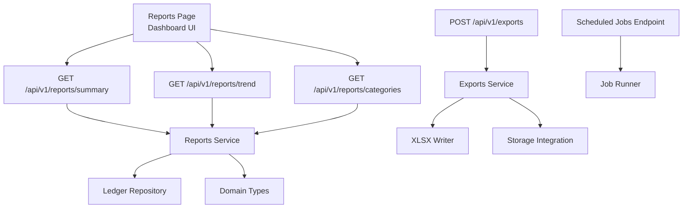
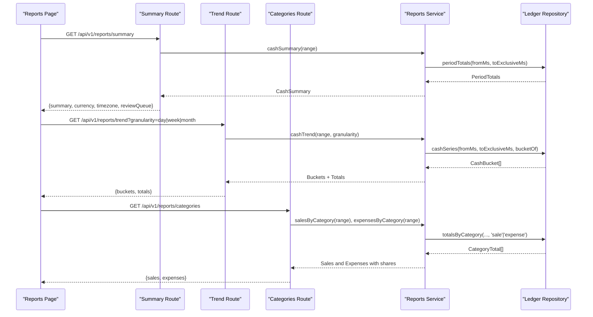
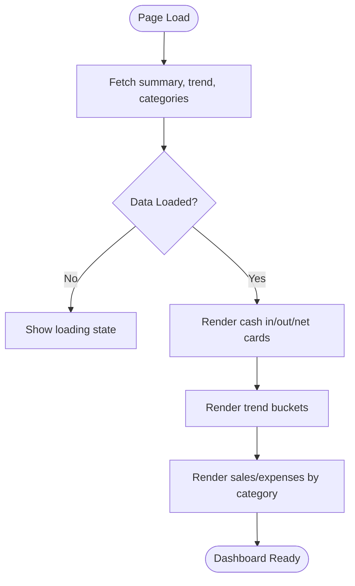
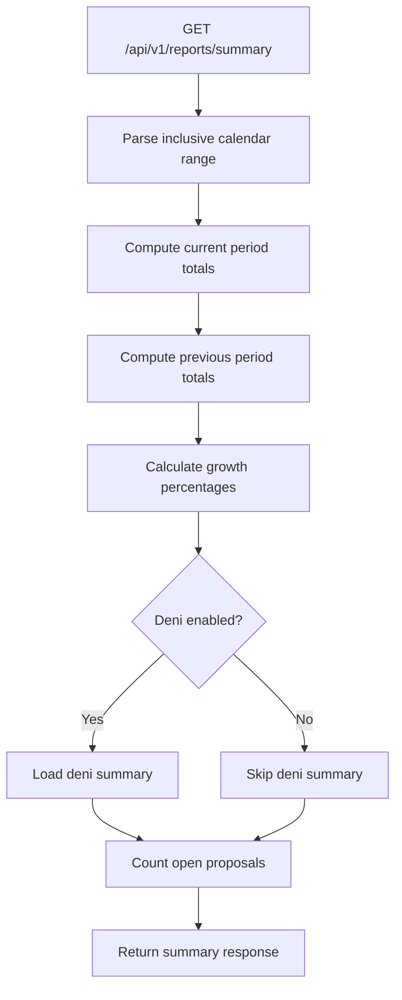
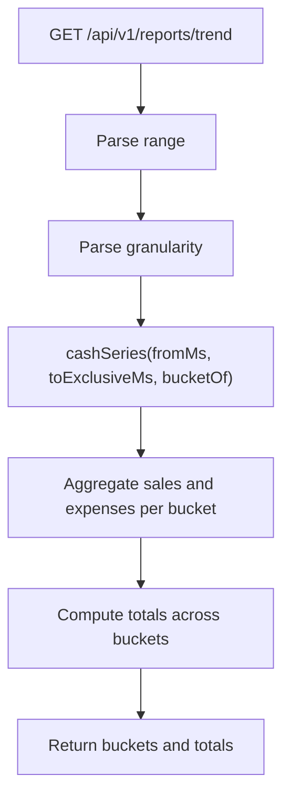
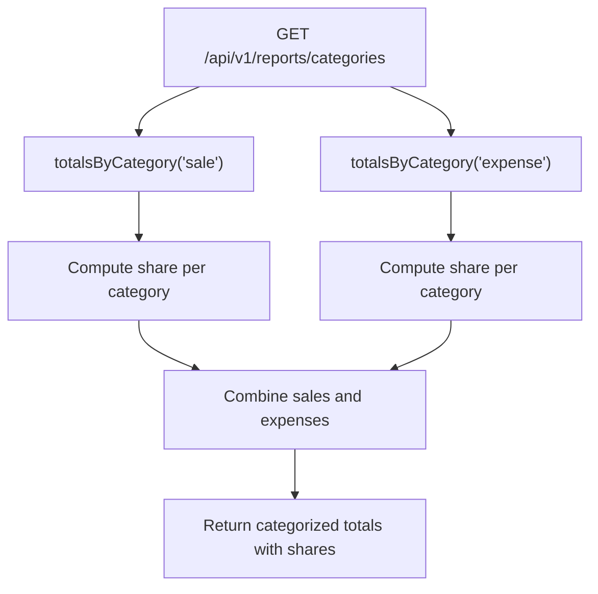
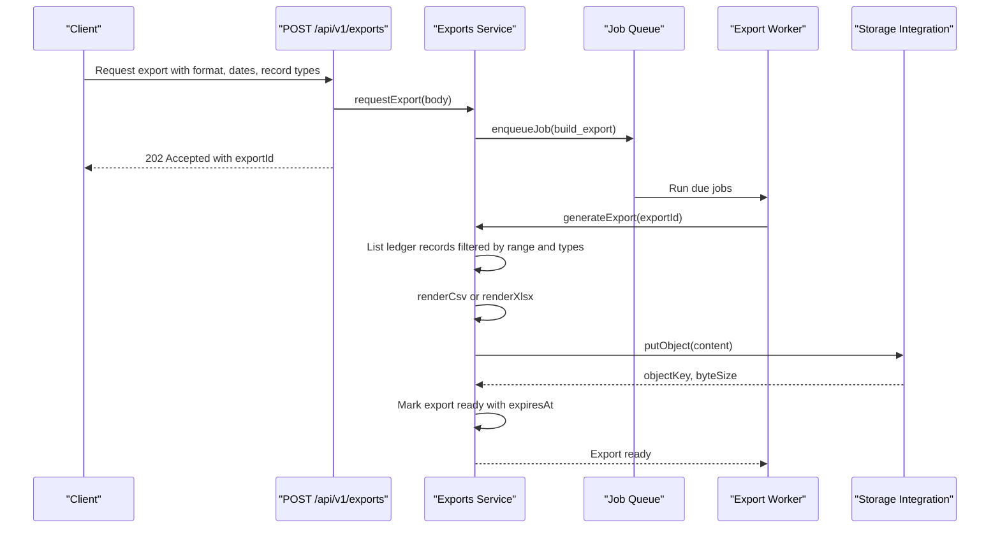
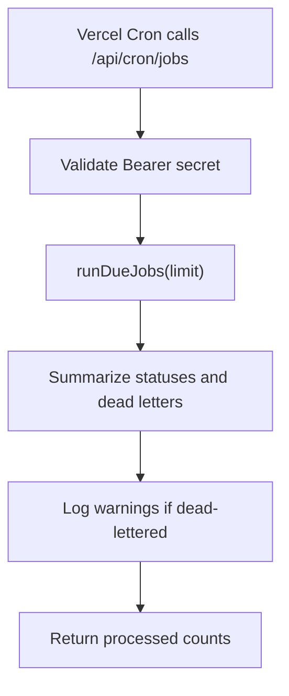
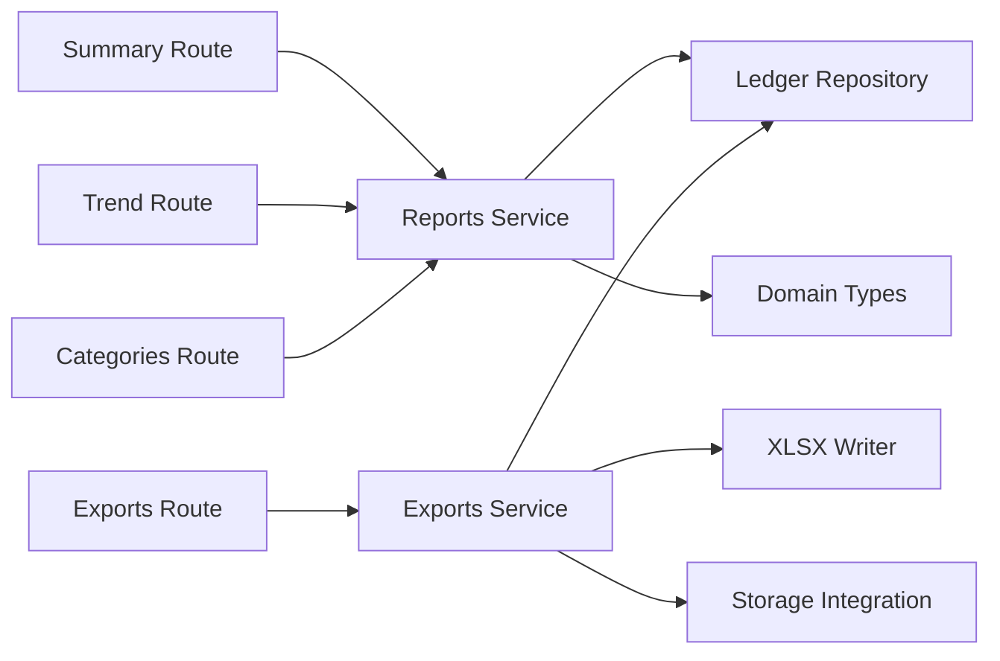

# Reports & Analytics

<cite>
**Referenced Files in This Document**
- [reports page](file://src/app/(dashboard)/reports/page.tsx)
- [summary route](file://src/app/api/v1/reports/summary/route.ts)
- [trend route](file://src/app/api/v1/reports/trend/route.ts)
- [categories route](file://src/app/api/v1/reports/categories/route.ts)
- [report-range parser](file://src/server/http/report-range.ts)
- [reports service](file://src/server/services/reports.ts)
- [ledger repository](file://src/server/repositories/ledger.repository.ts)
- [domain types](file://src/server/domain/types.ts)
- [exports route](file://src/app/api/v1/exports/route.ts)
- [exports service](file://src/server/services/exports.ts)
- [xlsx writer](file://src/server/exports/xlsx.ts)
- [scheduled jobs endpoint](file://src/app/api/cron/jobs/route.ts)
- [local job runner](file://scripts/run-jobs.ts)
</cite>

## Table of Contents
1. [Introduction](#introduction)
2. [Project Structure](#project-structure)
3. [Core Components](#core-components)
4. [Architecture Overview](#architecture-overview)
5. [Detailed Component Analysis](#detailed-component-analysis)
6. [Dependency Analysis](#dependency-analysis)
7. [Performance Considerations](#performance-considerations)
8. [Troubleshooting Guide](#troubleshooting-guide)
9. [Conclusion](#conclusion)

## Introduction
The Reports & Analytics feature provides financial insights and data exports for a business’s confirmed ledger records. It exposes a dashboard-style reports screen, time-based trend analysis, category breakdowns, and an asynchronous export pipeline that produces CSV or Excel files. All figures are derived from posted ledger rows within the business timezone, ensuring consistent reporting across charts, tables, and exported files.

Key capabilities include:
- Financial summaries showing cash inflows, outflows, net movement, currency, and review queue status.
- Trend analysis with day, week, or month granularity over a configurable date range.
- Category-based reporting separating sales and expenses so totals are not misleadingly netted.
- Export requests for selected record types and date ranges, generated asynchronously as jobs.
- Scheduled job execution for background processing such as report generation and export building.

## Project Structure
The feature spans the Next.js App Router API routes, a reporting service layer, ledger repositories, domain types, and an export subsystem. The frontend reports page fetches summary, trend, and category data in parallel and renders cards, buckets, and category lists.

**Diagram sources**
- [reports page:36-58](file://src/app/(dashboard)/reports/page.tsx#L36-L58)
- [summary route:16-31](file://src/app/api/v1/reports/summary/route.ts#L16-L31)
- [trend route:12-33](file://src/app/api/v1/reports/trend/route.ts#L12-L33)
- [categories route:14-41](file://src/app/api/v1/reports/categories/route.ts#L14-L41)
- [reports service:72-154](file://src/server/services/reports.ts#L72-L154)
- [ledger repository:377-512](file://src/server/repositories/ledger.repository.ts#L377-L512)
- [exports route:17-63](file://src/app/api/v1/exports/route.ts#L17-L63)
- [exports service:130-235](file://src/server/services/exports.ts#L130-L235)
- [xlsx writer:158-177](file://src/server/exports/xlsx.ts#L158-L177)
- [scheduled jobs endpoint:28-46](file://src/app/api/cron/jobs/route.ts#L28-L46)

**Section sources**
- [reports page:36-58](file://src/app/(dashboard)/reports/page.tsx#L36-L58)
- [summary route:16-31](file://src/app/api/v1/reports/summary/route.ts#L16-L31)
- [trend route:12-33](file://src/app/api/v1/reports/trend/route.ts#L12-L33)
- [categories route:14-41](file://src/app/api/v1/reports/categories/route.ts#L14-L41)
- [exports route:17-63](file://src/app/api/v1/exports/route.ts#L17-L63)

## Core Components
- Reports page: Client-side component that loads summary, trend, and categories concurrently and displays financial cards, trend buckets, and category breakdowns.
- Summary API: Returns current and previous period totals, growth percentages, currency, timezone, optional deni summary, and open proposal count.
- Trend API: Returns time-bucketed sales and expenses plus computed totals for the requested range and granularity.
- Categories API: Returns sales and expenses grouped by category with share percentages.
- Reports service: Pure read-only logic computing cash summaries, trends, category totals, deni summaries, and inventory summaries using posted ledger rows.
- Ledger repository: Data access layer performing SQL aggregation for period totals, cash series, and category totals.
- Exports subsystem: Validates export requests, enqueues build jobs, generates CSV/XLSX, stores files, and returns signed download links.
- Scheduling: A cron endpoint drains durable jobs; a local script drains them during development.

**Section sources**
- [reports page:36-122](file://src/app/(dashboard)/reports/page.tsx#L36-L122)
- [summary route:16-31](file://src/app/api/v1/reports/summary/route.ts#L16-L31)
- [trend route:12-33](file://src/app/api/v1/reports/trend/route.ts#L12-L33)
- [categories route:14-41](file://src/app/api/v1/reports/categories/route.ts#L14-L41)
- [reports service:72-154](file://src/server/services/reports.ts#L72-L154)
- [ledger repository:377-512](file://src/server/repositories/ledger.repository.ts#L377-L512)
- [exports service:130-235](file://src/server/services/exports.ts#L130-L235)
- [scheduled jobs endpoint:28-46](file://src/app/api/cron/jobs/route.ts#L28-L46)

## Architecture Overview
The reporting stack follows a layered architecture:
- Presentation: Reports page renders KPI cards, trend buckets, and category lists.
- API Layer: Route handlers validate permissions, parse query parameters, and delegate to services.
- Service Layer: Business logic computes summaries, trends, and category breakdowns without writing data.
- Repository Layer: SQL queries aggregate posted ledger records and typed detail tables.
- Export Pipeline: Asynchronous job-based export generation producing CSV or XLSX files stored via storage integration.

**Diagram sources**
- [reports page:42-58](file://src/app/(dashboard)/reports/page.tsx#L42-L58)
- [summary route:16-31](file://src/app/api/v1/reports/summary/route.ts#L16-L31)
- [trend route:12-33](file://src/app/api/v1/reports/trend/route.ts#L12-L33)
- [categories route:14-41](file://src/app/api/v1/reports/categories/route.ts#L14-L41)
- [reports service:72-154](file://src/server/services/reports.ts#L72-L154)
- [ledger repository:377-512](file://src/server/repositories/ledger.repository.ts#L377-L512)

## Detailed Component Analysis

### Reporting Dashboard
The dashboard aggregates three endpoints concurrently:
- Summary: Shows cash in, cash out, and net amounts formatted in the business currency.
- Trend: Displays buckets with start dates and net values per bucket.
- Categories: Lists sales and expenses by category with amounts.

The client formats minor units into major currency units and renders simple text-based visualizations.

**Diagram sources**
- [reports page:42-58](file://src/app/(dashboard)/reports/page.tsx#L42-L58)
- [reports page:62-122](file://src/app/(dashboard)/reports/page.tsx#L62-L122)

**Section sources**
- [reports page:36-122](file://src/app/(dashboard)/reports/page.tsx#L36-L122)

### Financial Summaries
The summary endpoint returns:
- Range and timezone.
- Currency.
- Current and previous period totals including money in, money out, and net cash movement.
- Growth percentages for money in and money out.
- Optional deni summary when enabled.
- Open proposal count for the review queue.

Money in includes only received payments (paid sales and debt payments received). Unpaid sales are recorded but not counted as cash until confirmed paid.

**Diagram sources**
- [summary route:16-31](file://src/app/api/v1/reports/summary/route.ts#L16-L31)
- [reports service:72-101](file://src/server/services/reports.ts#L72-L101)
- [ledger repository:377-431](file://src/server/repositories/ledger.repository.ts#L377-L431)

**Section sources**
- [summary route:16-31](file://src/app/api/v1/reports/summary/route.ts#L16-L31)
- [reports service:72-101](file://src/server/services/reports.ts#L72-L101)
- [ledger repository:377-431](file://src/server/repositories/ledger.repository.ts#L377-L431)

### Trend Analysis
Trend analysis supports day, week, or month granularity. Buckets are computed in the business timezone, and totals are aggregated across buckets.

**Diagram sources**
- [trend route:12-33](file://src/app/api/v1/reports/trend/route.ts#L12-L33)
- [reports service:103-117](file://src/server/services/reports.ts#L103-L117)
- [ledger repository:439-479](file://src/server/repositories/ledger.repository.ts#L439-L479)

**Section sources**
- [trend route:12-33](file://src/app/api/v1/reports/trend/route.ts#L12-L33)
- [reports service:103-117](file://src/server/services/reports.ts#L103-L117)
- [ledger repository:439-479](file://src/server/repositories/ledger.repository.ts#L439-L479)

### Category-Based Reporting
Sales and expenses are reported separately because their categories live in different detail tables. The categories endpoint computes total amounts and percentage shares for each category.

**Diagram sources**
- [categories route:14-41](file://src/app/api/v1/reports/categories/route.ts#L14-L41)
- [reports service:119-135](file://src/server/services/reports.ts#L119-L135)
- [ledger repository:483-512](file://src/server/repositories/ledger.repository.ts#L483-L512)

**Section sources**
- [categories route:14-41](file://src/app/api/v1/reports/categories/route.ts#L14-L41)
- [reports service:119-135](file://src/server/services/reports.ts#L119-L135)
- [ledger repository:483-512](file://src/server/repositories/ledger.repository.ts#L483-L512)

### Export Functionality
Exports support CSV and XLSX formats with customizable date ranges and record type filters. Requests are idempotent and queued as jobs. Generation writes files through the storage integration and marks exports ready with metadata.

**Diagram sources**
- [exports route:17-63](file://src/app/api/v1/exports/route.ts#L17-L63)
- [exports service:130-235](file://src/server/services/exports.ts#L130-L235)
- [xlsx writer:158-177](file://src/server/exports/xlsx.ts#L158-L177)

**Section sources**
- [exports route:17-63](file://src/app/api/v1/exports/route.ts#L17-L63)
- [exports service:130-235](file://src/server/services/exports.ts#L130-L235)
- [xlsx writer:158-177](file://src/server/exports/xlsx.ts#L158-L177)

### Scheduled Report Generation
Background jobs are drained by a scheduled endpoint protected by a shared secret. A local script drains jobs during development.

**Diagram sources**
- [scheduled jobs endpoint:28-46](file://src/app/api/cron/jobs/route.ts#L28-L46)
- [local job runner:26-54](file://scripts/run-jobs.ts#L26-L54)

**Section sources**
- [scheduled jobs endpoint:28-46](file://src/app/api/cron/jobs/route.ts#L28-L46)
- [local job runner:26-54](file://scripts/run-jobs.ts#L26-L54)

## Dependency Analysis
The reporting system has clear separation between API routes, services, and repositories. Services depend on repositories for data aggregation and on domain types for vocabulary. Exports depend on the ledger repository for record retrieval and on the storage integration for file persistence.

**Diagram sources**
- [summary route:16-31](file://src/app/api/v1/reports/summary/route.ts#L16-L31)
- [trend route:12-33](file://src/app/api/v1/reports/trend/route.ts#L12-L33)
- [categories route:14-41](file://src/app/api/v1/reports/categories/route.ts#L14-L41)
- [reports service:72-154](file://src/server/services/reports.ts#L72-L154)
- [ledger repository:377-512](file://src/server/repositories/ledger.repository.ts#L377-L512)
- [exports route:17-63](file://src/app/api/v1/exports/route.ts#L17-L63)
- [exports service:130-235](file://src/server/services/exports.ts#L130-L235)
- [xlsx writer:158-177](file://src/server/exports/xlsx.ts#L158-L177)

**Section sources**
- [reports service:72-154](file://src/server/services/reports.ts#L72-L154)
- [ledger repository:377-512](file://src/server/repositories/ledger.repository.ts#L377-L512)
- [exports service:130-235](file://src/server/services/exports.ts#L130-L235)

## Performance Considerations
- Aggregation performance:
  - Period totals and category totals use SQL aggregation over posted ledger rows, minimizing application-side computation.
  - Cash series limits returned rows to reduce memory usage and improve chart responsiveness.
- Timezone handling:
  - Date ranges are converted to UTC milliseconds before querying; bucketing occurs in the business timezone at the application layer.
- Export scalability:
  - Exports are asynchronous jobs to avoid long-running HTTP responses.
  - Record retrieval is limited to a maximum number of rows to prevent excessive memory consumption.
- Caching strategies:
  - No explicit caching is implemented in the reporting service or routes.
  - For high-frequency dashboards, consider adding server-side caching (e.g., Redis) keyed by business ID, range, and granularity.
- Query optimization:
  - Ensure indexes exist on business_id, occurred_at, and status columns for faster filtering.
  - Consider materialized views for frequently accessed summaries if dataset size grows significantly.

[No sources needed since this section provides general guidance]

## Troubleshooting Guide
Common issues and resolutions:
- Invalid date ranges:
  - The end date must be after the start date; otherwise validation fails.
  - Ensure inclusive calendar dates are provided for reports and exports.
- Missing permissions:
  - Reading reports requires the appropriate role permission.
  - Exporting requires both the export permission and feature flag enabled.
- Idempotency key required:
  - Export requests must include an Idempotency-Key header to prevent duplicate generation.
- Export not ready:
  - Check job status via the export status endpoint and ensure scheduled jobs are running.
- Timezone mismatches:
  - Verify business timezone configuration; report ranges are interpreted in the business timezone.

**Section sources**
- [report-range parser:17-31](file://src/server/http/report-range.ts#L17-L31)
- [exports route:17-63](file://src/app/api/v1/exports/route.ts#L17-L63)
- [exports service:101-121](file://src/server/services/exports.ts#L101-L121)

## Conclusion
The Reports & Analytics feature delivers robust financial insights through a clean layered architecture. It provides accurate summaries, flexible trend analysis, detailed category breakdowns, and scalable asynchronous exports. By relying on posted ledger rows and business timezone-aware calculations, it ensures consistency across the dashboard and exported data. Future enhancements may include server-side caching, advanced forecasting models, and deeper integrations with external accounting systems.

[No sources needed since this section summarizes without analyzing specific files]