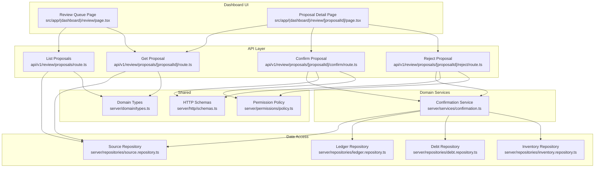
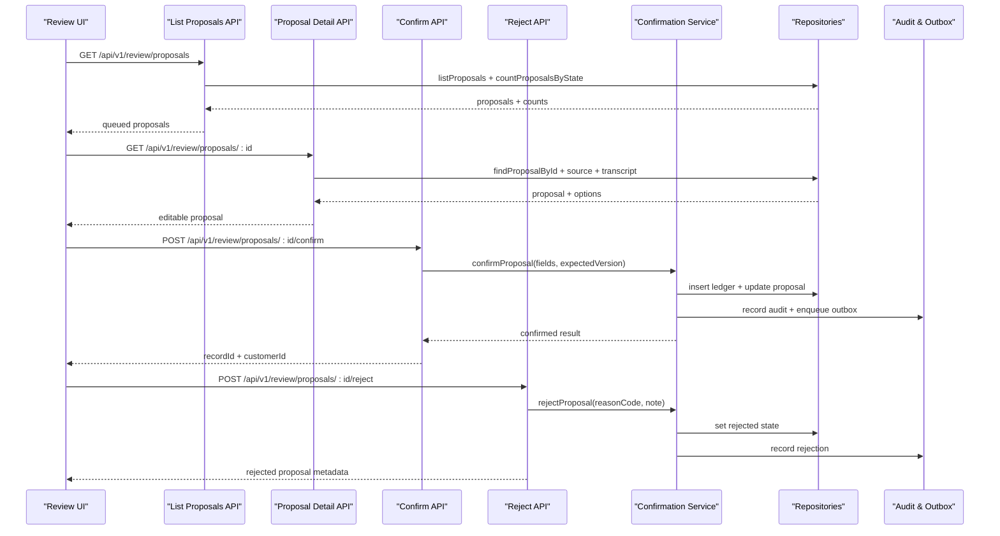
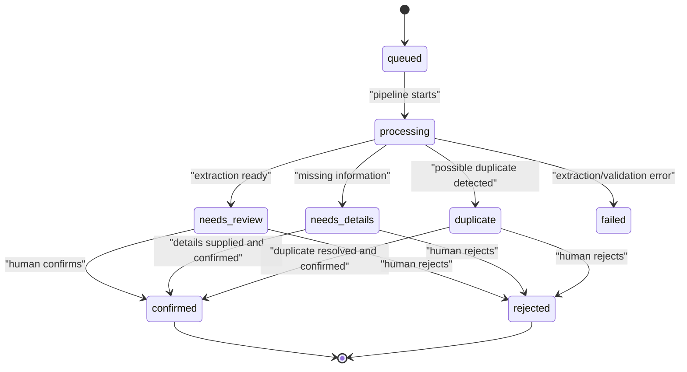
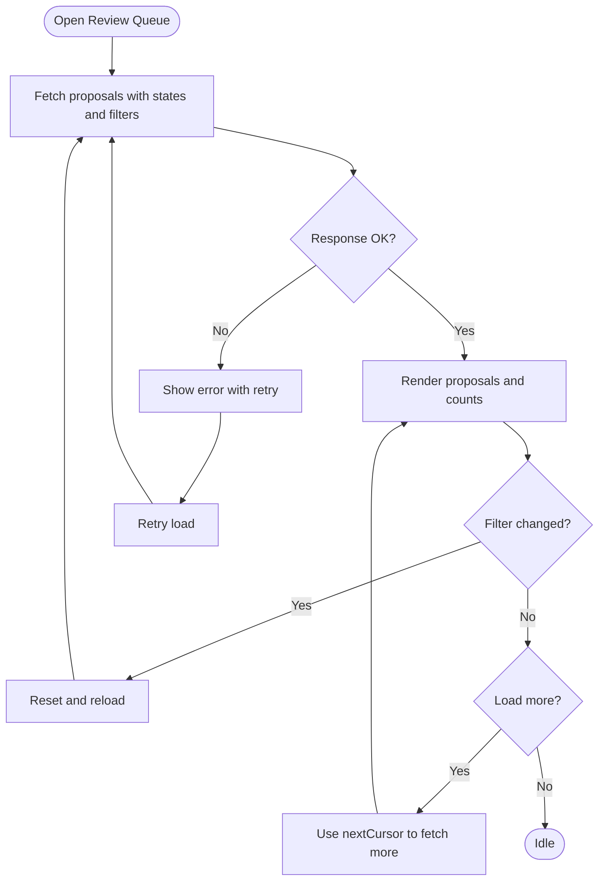
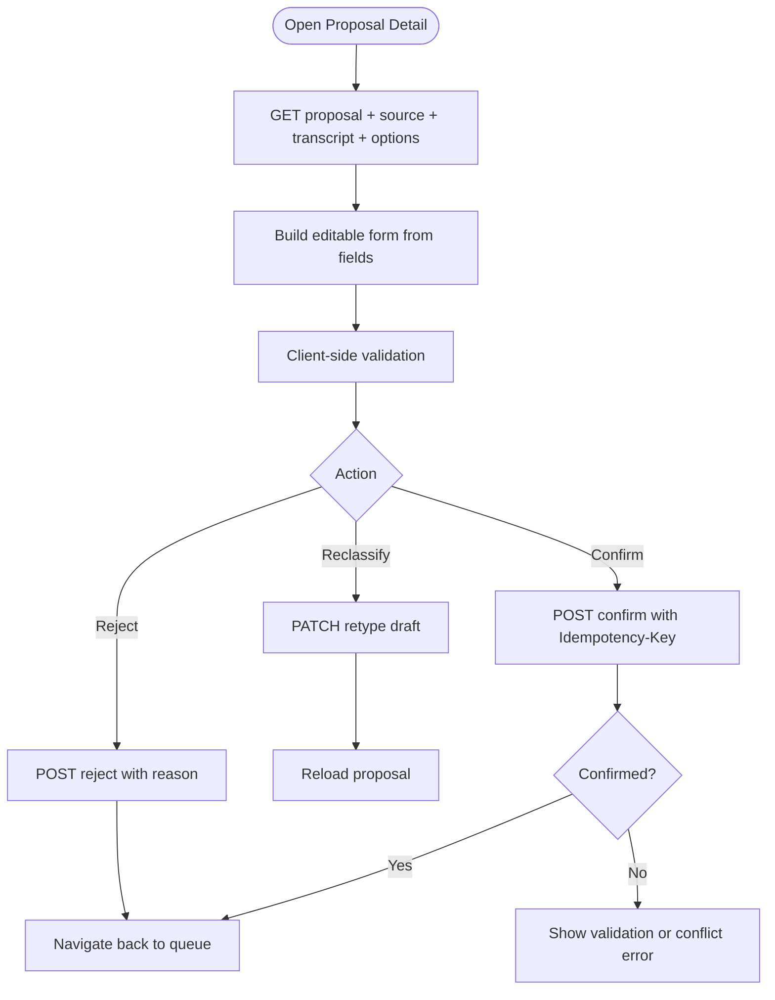
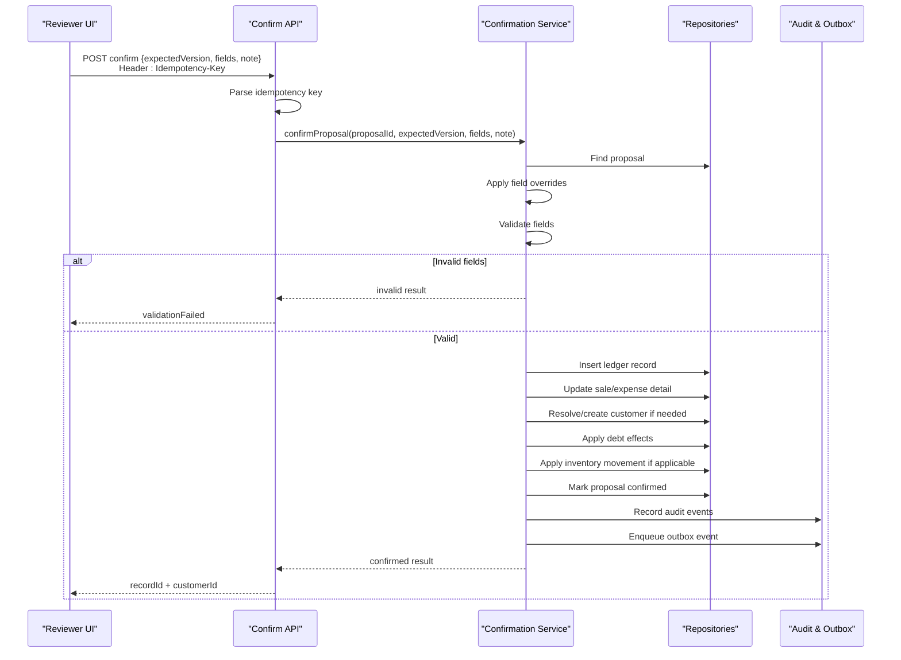
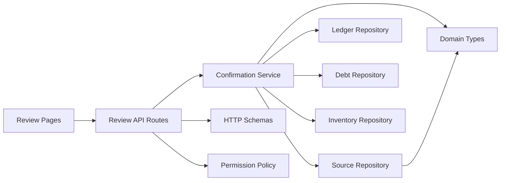

# Review System

<cite>
**Referenced Files in This Document**
- [review/page.tsx](file://src/app/(dashboard)/review/page.tsx)
- [review/[proposalId]/page.tsx](file://src/app/(dashboard)/review/[proposalId]/page.tsx)
- [proposals route](file://src/app/api/v1/review/proposals/route.ts)
- [proposal detail route](file://src/app/api/v1/review/proposals/[proposalId]/route.ts)
- [confirm route](file://src/app/api/v1/review/proposals/[proposalId]/confirm/route.ts)
- [reject route](file://src/app/api/v1/review/proposals/[proposalId]/reject/route.ts)
- [confirmation service](file://src/server/services/confirmation.ts)
- [source repository](file://src/server/repositories/source.repository.ts)
- [domain types](file://src/server/domain/types.ts)
- [HTTP schemas](file://src/server/http/schemas.ts)
- [permission policy](file://src/server/permissions/policy.ts)
</cite>

## Table of Contents
1. [Introduction](#introduction)
2. [Project Structure](#project-structure)
3. [Core Components](#core-components)
4. [Architecture Overview](#architecture-overview)
5. [Detailed Component Analysis](#detailed-component-analysis)
6. [Dependency Analysis](#dependency-analysis)
7. [Performance Considerations](#performance-considerations)
8. [Troubleshooting Guide](#troubleshooting-guide)
9. [Conclusion](#conclusion)

## Introduction
The Review System is the human-in-the-loop layer between AI-extracted business proposals and the ledger. Proposals are created by automated processing; a reviewer then inspects, edits, confirms, or rejects them. Confirmation is the only path that posts financial data to the ledger. Rejection records why a proposal was not recorded without changing accounting balances.

Key goals:
- Make every decision auditable and version-safe.
- Let reviewers correct extracted fields before confirmation.
- Provide a clear queue for pending work with filtering and pagination.
- Keep rejection safe, traceable, and separate from ledger operations.
- Integrate with customers, debt obligations, inventory movements, and audit/outbox events.

## Project Structure
The feature spans Next.js App Router pages, API routes, domain services, repositories, shared types, and permission checks.

**Diagram sources**
- [review/page.tsx:63-103](file://src/app/(dashboard)/review/page.tsx#L63-L103)
- [review/[proposalId]/page.tsx:179-341](file://src/app/(dashboard)/review/[proposalId]/page.tsx#L179-L341)
- [proposals route:52-109](file://src/app/api/v1/review/proposals/route.ts#L52-L109)
- [proposal detail route:26-113](file://src/app/api/v1/review/proposals/[proposalId]/route.ts#L26-L113)
- [confirm route:18-73](file://src/app/api/v1/review/proposals/[proposalId]/confirm/route.ts#L18-L73)
- [reject route:15-35](file://src/app/api/v1/review/proposals/[proposalId]/reject/route.ts#L15-L35)
- [confirmation service:318-455](file://src/server/services/confirmation.ts#L318-L455)
- [source repository:535-595](file://src/server/repositories/source.repository.ts#L535-L595)

**Section sources**
- [review/page.tsx:1-276](file://src/app/(dashboard)/review/page.tsx#L1-L276)
- [review/[proposalId]/page.tsx:1-632](file://src/app/(dashboard)/review/[proposalId]/page.tsx#L1-L632)
- [proposals route:1-110](file://src/app/api/v1/review/proposals/route.ts#L1-L110)
- [proposal detail route:1-114](file://src/app/api/v1/review/proposals/[proposalId]/route.ts#L1-L114)
- [confirm route:1-74](file://src/app/api/v1/review/proposals/[proposalId]/confirm/route.ts#L1-L74)
- [reject route:1-36](file://src/app/api/v1/review/proposals/[proposalId]/reject/route.ts#L1-L36)
- [confirmation service:1-522](file://src/server/services/confirmation.ts#L1-L522)
- [source repository:1-771](file://src/server/repositories/source.repository.ts#L1-L771)
- [domain types:1-217](file://src/server/domain/types.ts#L1-L217)
- [HTTP schemas:1-140](file://src/server/http/schemas.ts#L1-L140)
- [permission policy:1-104](file://src/server/permissions/policy.ts#L1-L104)

## Core Components
- **Review Queue Page**: Lists pending proposals, supports tabs for review states, filters by record type and source kind, and paginates results.
- **Proposal Detail Page**: Shows evidence (source event, transcript), editable fields, missing-field warnings, reclassification for manual drafts, and confirm/reject actions.
- **List Proposals API**: Validates query parameters, applies tenant scoping, and returns summaries with counts and cursor-based pagination.
- **Proposal Detail API**: Returns full proposal data, linked source event, transcript, and selectable options such as customers and inventory items.
- **Confirm API**: Idempotent confirmation endpoint requiring an idempotency key, expected version, optional field corrections, and audit recording.
- **Reject API**: Stores rejection reason and note without touching the ledger.
- **Confirmation Service**: Central validation, customer resolution, debt effects, inventory effects, ledger posting, proposal state updates, audit logging, and outbox publishing.
- **Source Repository**: Persists source events, transcripts, proposals, and proposal lifecycle changes.
- **Domain Types**: Enumerates record types, proposal states, roles, payment values, rejection reasons, and audit vocabulary.
- **HTTP Schemas**: Zod-based request validation for confirm, reject, retype, and other endpoints.
- **Permission Policy**: Role-to-permission mapping and runtime authorization checks.

**Section sources**
- [review/page.tsx:63-146](file://src/app/(dashboard)/review/page.tsx#L63-L146)
- [review/[proposalId]/page.tsx:190-341](file://src/app/(dashboard)/review/[proposalId]/page.tsx#L190-L341)
- [proposals route:52-109](file://src/app/api/v1/review/proposals/route.ts#L52-L109)
- [proposal detail route:26-113](file://src/app/api/v1/review/proposals/[proposalId]/route.ts#L26-L113)
- [confirm route:18-73](file://src/app/api/v1/review/proposals/[proposalId]/confirm/route.ts#L18-L73)
- [reject route:15-35](file://src/app/api/v1/review/proposals/[proposalId]/reject/route.ts#L15-L35)
- [confirmation service:318-521](file://src/server/services/confirmation.ts#L318-L521)
- [source repository:446-771](file://src/server/repositories/source.repository.ts#L446-L771)
- [domain types:8-127](file://src/server/domain/types.ts#L8-L127)
- [HTTP schemas:30-67](file://src/server/http/schemas.ts#L30-L67)
- [permission policy:11-92](file://src/server/permissions/policy.ts#L11-L92)

## Architecture Overview
The Review System follows a layered architecture:
- Presentation layer: Next.js client pages render queues and forms.
- API layer: Route handlers validate input, enforce permissions, and delegate to services.
- Service layer: Business logic for confirmation, rejection, validation, and side effects.
- Repository layer: Database access for proposals, source events, transcripts, ledger records, debts, and inventory.
- Shared layers: Domain enums, HTTP schemas, permissions, and observability.

**Diagram sources**
- [proposals route:52-109](file://src/app/api/v1/review/proposals/route.ts#L52-L109)
- [proposal detail route:26-93](file://src/app/api/v1/review/proposals/[proposalId]/route.ts#L26-L93)
- [confirm route:18-73](file://src/app/api/v1/review/proposals/[proposalId]/confirm/route.ts#L18-L73)
- [reject route:15-35](file://src/app/api/v1/review/proposals/[proposalId]/reject/route.ts#L15-L35)
- [confirmation service:318-455](file://src/server/services/confirmation.ts#L318-L455)

## Detailed Component Analysis

### Proposal Lifecycle
A proposal moves through these states:
- `queued` and `processing`: automated pipeline phases.
- `needs_review`, `needs_details`, `duplicate`: human review phases.
- `failed`: processing failure.
- `confirmed`: posted to the ledger.
- `rejected`: declined with a reason.

**Diagram sources**
- [domain types:21-47](file://src/server/domain/types.ts#L21-L47)
- [source repository:687-738](file://src/server/repositories/source.repository.ts#L687-L738)
- [confirmation service:318-455](file://src/server/services/confirmation.ts#L318-L455)

**Section sources**
- [domain types:21-47](file://src/server/domain/types.ts#L21-L47)
- [source repository:687-738](file://src/server/repositories/source.repository.ts#L687-L738)
- [confirmation service:318-455](file://src/server/services/confirmation.ts#L318-L455)

### Dashboard Interface: Review Queue
The queue page provides:
- Tabs for `needs_review`, `needs_details`, `failed`, and `decided`.
- Filters for record type and source kind.
- Pagination using cursor-based navigation.
- Summary cards showing state, amount hint, customer hint, missing fields, and received time.

Behavior highlights:
- Default tab shows active review states.
- Refresh button reloads the current filter set.
- Error state includes retry behavior.
- Empty state guides users when no proposals match.

**Diagram sources**
- [review/page.tsx:76-129](file://src/app/(dashboard)/review/page.tsx#L76-L129)
- [proposals route:52-109](file://src/app/api/v1/review/proposals/route.ts#L52-L109)

**Section sources**
- [review/page.tsx:63-276](file://src/app/(dashboard)/review/page.tsx#L63-L276)
- [proposals route:52-109](file://src/app/api/v1/review/proposals/route.ts#L52-L109)

### Proposal Detail Interface: Editing and Evidence
The detail page shows:
- Evidence panel with source event, transcript status/language/text, ambiguity notes, and missing fields.
- Editable form fields based on record type.
- Reclassification control for manual draft proposals.
- Decision bar with confirm or reject controls.

Validation and UX rules:
- Missing fields are highlighted.
- Date inputs use the business timezone.
- Amounts are parsed into minor units.
- Customer and item lists are provided as options where available.
- Conflict state appears when another user edited the proposal while open.

**Diagram sources**
- [review/[proposalId]/page.tsx:179-341](file://src/app/(dashboard)/review/[proposalId]/page.tsx#L179-L341)
- [proposal detail route:26-113](file://src/app/api/v1/review/proposals/[proposalId]/route.ts#L26-L113)
- [confirm route:18-73](file://src/app/api/v1/review/proposals/[proposalId]/confirm/route.ts#L18-L73)
- [reject route:15-35](file://src/app/api/v1/review/proposals/[proposalId]/reject/route.ts#L15-L35)

**Section sources**
- [review/[proposalId]/page.tsx:190-632](file://src/app/(dashboard)/review/[proposalId]/page.tsx#L190-L632)
- [proposal detail route:26-113](file://src/app/api/v1/review/proposals/[proposalId]/route.ts#L26-L113)

### Confirmation Workflow
Confirmation is the only operation that creates ledger entries. It enforces:
- Human confirmation via a user ID.
- Optimistic concurrency using `expectedVersion`.
- Idempotency via `Idempotency-Key`.
- Field correction before posting.
- Transactional integrity across ledger, debt, inventory, proposal state, audit, and outbox.

**Diagram sources**
- [confirm route:18-73](file://src/app/api/v1/review/proposals/[proposalId]/confirm/route.ts#L18-L73)
- [confirmation service:318-455](file://src/server/services/confirmation.ts#L318-L455)

**Section sources**
- [confirm route:18-73](file://src/app/api/v1/review/proposals/[proposalId]/confirm/route.ts#L18-L73)
- [confirmation service:318-455](file://src/server/services/confirmation.ts#L318-L455)
- [HTTP schemas:30-56](file://src/server/http/schemas.ts#L30-L56)

### Validation Rules
Validation occurs at multiple layers:
- Request schema validation in API routes.
- Domain-specific validation in the confirmation service.
- Client-side validation in the detail page.

Rules include:
- Required amounts, dates, quantities, categories, and record-type-specific fields.
- Payment status and method must be valid enum values.
- Stock movement requires an item, quantity, unit, and movement type.
- Customer is required when there is a balance to collect.
- Version conflicts prevent stale overwrites.

Common validation outcomes:
- `invalid`: Some fields need attention before confirmation.
- `already_confirmed`: The proposal was already posted.
- `PROPOSAL_NOT_REVIEWABLE`: The proposal cannot be reviewed or confirmed in its current state.
- `PROPOSAL_VERSION_CONFLICT`: Another edit occurred while the reviewer was working.

**Section sources**
- [HTTP schemas:30-67](file://src/server/http/schemas.ts#L30-L67)
- [confirmation service:464-475](file://src/server/services/confirmation.ts#L464-L475)
- [confirmation service:318-352](file://src/server/services/confirmation.ts#L318-L352)
- [review/[proposalId]/page.tsx:239-299](file://src/app/(dashboard)/review/[proposalId]/page.tsx#L239-L299)

### Correction Capabilities
Reviewers can correct:
- Amounts and partial payments.
- Occurred date/time in business timezone.
- Customer name or selected customer.
- Items text, payee, category, due date.
- Stock movement item, quantity, unit, movement type, unit cost.
- Notes and descriptions.

Corrections are applied inside the confirmation transaction so they are atomic with ledger posting.

**Section sources**
- [review/[proposalId]/page.tsx:247-299](file://src/app/(dashboard)/review/[proposalId]/page.tsx#L247-L299)
- [confirmation service:72-84](file://src/server/services/confirmation.ts#L72-L84)
- [confirmation service:318-455](file://src/server/services/confirmation.ts#L318-L455)

### Audit Trail Generation
Every important action is recorded:
- Proposal creation, editing, confirmation, rejection, and retry/duplicate handling.
- Ledger record creation and corrections.
- Customer creation during confirmation.
- Obligation creation and debt payment application.
- Inventory movement recording.

Audit events include actor, entity type, entity ID, reason codes, and before/after snapshots where relevant.

**Section sources**
- [domain types:135-179](file://src/server/domain/types.ts#L135-L179)
- [confirmation service:413-444](file://src/server/services/confirmation.ts#L413-L444)
- [confirmation service:496-519](file://src/server/services/confirmation.ts#L496-L519)

### Rejection Process
Rejection:
- Requires a reason code and optional note.
- Does not touch the ledger.
- Updates proposal state to `rejected`.
- Records who rejected it and when.
- Creates an audit event with reason code and note.

Supported reason codes include non-business records, wrong amount/type, duplicates, already recorded, unclear source, and other.

**Section sources**
- [reject route:15-35](file://src/app/api/v1/review/proposals/[proposalId]/reject/route.ts#L15-L35)
- [confirmation service:485-521](file://src/server/services/confirmation.ts#L485-L521)
- [domain types:90-99](file://src/server/domain/types.ts#L90-L99)

### User Roles and Permissions
Roles and permissions relevant to review:
- `owner`: all permissions.
- `manager`: includes proposal read and review, plus many operational permissions.
- `staff`: limited to dashboard read, proposal read, capture, and some reporting.

Review endpoints require:
- `proposals.read` for listing and viewing proposals.
- `proposals.review` for confirming, rejecting, and reclassifying.

**Section sources**
- [permission policy:11-92](file://src/server/permissions/policy.ts#L11-L92)
- [proposals route:52-54](file://src/app/api/v1/review/proposals/route.ts#L52-L54)
- [proposal detail route:28-29](file://src/app/api/v1/review/proposals/[proposalId]/route.ts#L28-L29)
- [confirm route:18-21](file://src/app/api/v1/review/proposals/[proposalId]/confirm/route.ts#L18-L21)
- [reject route:15-18](file://src/app/api/v1/review/proposals/[proposalId]/reject/route.ts#L15-L18)

### Error States During Processing
Common error states:
- Network or server errors displayed in the queue and detail pages.
- Validation failures for malformed requests or invalid fields.
- Conflict errors for concurrent edits or already-decided proposals.
- Idempotency errors when a confirmation is still being processed or missing required headers.

Recovery procedures:
- Retry button on the queue page.
- Reload button on the detail page when a conflict occurs.
- Regenerate `Idempotency-Key` and resubmit confirmation after resolving conflicts.
- Correct missing fields and retry confirmation.

**Section sources**
- [review/page.tsx:86-103](file://src/app/(dashboard)/review/page.tsx#L86-L103)
- [review/page.tsx:205-219](file://src/app/(dashboard)/review/page.tsx#L205-L219)
- [review/[proposalId]/page.tsx:239-245](file://src/app/(dashboard)/review/[proposalId]/page.tsx#L239-L245)
- [confirm route:24-30](file://src/app/api/v1/review/proposals/[proposalId]/confirm/route.ts#L24-L30)
- [confirm route:62-70](file://src/app/api/v1/review/proposals/[proposalId]/confirm/route.ts#L62-L70)

### Recovery Procedures
- For stale views: reload the proposal to get the latest version and fields.
- For failed transcription: check transcript status and language; consider correcting or marking unusable through transcript workflows.
- For failed extraction: inspect failure codes and retry through pipeline jobs.
- For duplicate detection: resolve candidates and confirm or reject accordingly.
- For ledger integration issues: check audit events and outbox events for confirmation publication.

**Section sources**
- [proposal detail route:35-40](file://src/app/api/v1/review/proposals/[proposalId]/route.ts#L35-L40)
- [source repository:311-408](file://src/server/repositories/source.repository.ts#L311-L408)
- [confirmation service:438-444](file://src/server/services/confirmation.ts#L438-L444)

### Examples of Common Review Scenarios
- Sale with partial payment:
  - Set amount, payment status to partial, and amount paid.
  - Optionally select customer and payment method.
  - Confirm to create sale, obligation, and audit events.
- Expense with category and payee:
  - Fill payee and category.
  - Confirm to post expense and related details.
- Stock movement:
  - Select item, quantity, unit, movement type, and unit cost.
  - Confirm to create inventory movement and audit event.
- Note:
  - Add free-text note.
  - Save as note without ledger impact.
- Manual draft classification:
  - Choose record type for a draft proposal.
  - Fields and missing-field cues update automatically.

**Section sources**
- [review/[proposalId]/page.tsx:452-622](file://src/app/(dashboard)/review/[proposalId]/page.tsx#L452-L622)
- [confirmation service:274-316](file://src/server/services/confirmation.ts#L274-L316)

### Bulk Operations
The current implementation does not expose bulk confirm or reject endpoints. Recommended approach:
- Use the queue’s pagination to process proposals sequentially.
- Implement client-side batching only if necessary, ensuring each confirmation sends a unique `Idempotency-Key`.
- Avoid parallel confirmations for the same proposal to prevent idempotency conflicts.

**Section sources**
- [proposals route:52-109](file://src/app/api/v1/review/proposals/route.ts#L52-L109)
- [confirm route:24-35](file://src/app/api/v1/review/proposals/[proposalId]/confirm/route.ts#L24-L35)

### Integration with the Ledger System
Confirmation integrates with:
- Ledger repository for inserting records and typed details.
- Debt repository for creating obligations and applying payments.
- Inventory repository for recording stock movements.
- Platform repository for enqueueing outbox events.
- Audit service for persistent audit trails.

Outbox topic `ledger.record_confirmed` signals downstream consumers that a ledger record has been created from a proposal.

**Section sources**
- [confirmation service:318-455](file://src/server/services/confirmation.ts#L318-L455)
- [domain types:135-179](file://src/server/domain/types.ts#L135-L179)

## Dependency Analysis
The Review System depends on several modules:

**Diagram sources**
- [review/page.tsx:63-103](file://src/app/(dashboard)/review/page.tsx#L63-L103)
- [review/[proposalId]/page.tsx:179-341](file://src/app/(dashboard)/review/[proposalId]/page.tsx#L179-L341)
- [proposals route:52-109](file://src/app/api/v1/review/proposals/route.ts#L52-L109)
- [proposal detail route:26-113](file://src/app/api/v1/review/proposals/[proposalId]/route.ts#L26-L113)
- [confirm route:18-73](file://src/app/api/v1/review/proposals/[proposalId]/confirm/route.ts#L18-L73)
- [reject route:15-35](file://src/app/api/v1/review/proposals/[proposalId]/reject/route.ts#L15-L35)
- [confirmation service:318-521](file://src/server/services/confirmation.ts#L318-L521)
- [source repository:535-771](file://src/server/repositories/source.repository.ts#L535-L771)
- [HTTP schemas:30-67](file://src/server/http/schemas.ts#L30-L67)
- [permission policy:11-92](file://src/server/permissions/policy.ts#L11-L92)
- [domain types:8-127](file://src/server/domain/types.ts#L8-L127)

**Section sources**
- [proposals route:52-109](file://src/app/api/v1/review/proposals/route.ts#L52-L109)
- [proposal detail route:26-113](file://src/app/api/v1/review/proposals/[proposalId]/route.ts#L26-L113)
- [confirm route:18-73](file://src/app/api/v1/review/proposals/[proposalId]/confirm/route.ts#L18-L73)
- [reject route:15-35](file://src/app/api/v1/review/proposals/[proposalId]/reject/route.ts#L15-L35)
- [confirmation service:318-521](file://src/server/services/confirmation.ts#L318-L521)
- [source repository:535-771](file://src/server/repositories/source.repository.ts#L535-L771)
- [HTTP schemas:30-67](file://src/server/http/schemas.ts#L30-L67)
- [permission policy:11-92](file://src/server/permissions/policy.ts#L11-L92)
- [domain types:8-127](file://src/server/domain/types.ts#L8-L127)

## Performance Considerations
- **Queue pagination**: Uses cursor-based pagination with `limit` and `nextCursor` to handle large proposal queues efficiently.
- **Ordering guarantees**: Defaults to oldest-first to prioritize older messages, with support for newest-first ordering.
- **Confidence band filtering**: Internal triage uses weakest field confidence to help reviewers prioritize uncertain proposals.
- **Idempotency**: Prevents duplicate ledger postings and reduces retries overhead.
- **Transaction boundaries**: Confirmation groups ledger, debt, inventory, proposal state, audit, and outbox operations into one transaction to avoid partial state.
- **Real-time updates**: The current UI uses explicit refresh and reload rather than WebSocket push. For real-time updates, consider adding server-sent events or polling intervals tied to proposal state changes.

Recommendations:
- Cache static option lists (customers, items) where appropriate.
- Monitor queue depth and oldest-open-proposal timestamps for alerting.
- Add metrics around confirmation latency, rejection rates, and validation failure frequency.
- Consider background workers for heavy outbox processing and report generation.

[No sources needed since this section provides general guidance]

## Troubleshooting Guide
Common issues and resolutions:
- **Missing Idempotency-Key**: Add a unique header value per confirmation attempt.
- **Stale view conflict**: Reload the proposal to get the latest version and fields.
- **Invalid fields**: Fix missing or incorrect fields indicated by validation messages.
- **Already confirmed**: Do not reconfirm; navigate back to the queue.
- **Rejected proposal**: Cannot be confirmed; correct the underlying issue and resubmit through ingestion or manual entry workflows.
- **Transcript failed**: Check failure code and retry transcription or correct the transcript.
- **Duplicate candidate**: Review candidates and decide whether to merge or reject.

Operational checks:
- Inspect audit events for confirmation and rejection traces.
- Verify outbox events for ledger integration delivery.
- Review proposal state and version fields for concurrency issues.

**Section sources**
- [confirm route:24-30](file://src/app/api/v1/review/proposals/[proposalId]/confirm/route.ts#L24-L30)
- [confirm route:62-70](file://src/app/api/v1/review/proposals/[proposalId]/confirm/route.ts#L62-L70)
- [confirmation service:327-342](file://src/server/services/confirmation.ts#L327-L342)
- [confirmation service:485-521](file://src/server/services/confirmation.ts#L485-L521)
- [source repository:311-408](file://src/server/repositories/source.repository.ts#L311-L408)

## Conclusion
The Review System provides a robust, auditable workflow for turning AI-extracted proposals into verified ledger records. It emphasizes safety through optimistic concurrency, idempotency, and transactional integrity, while offering a practical interface for human review and correction. Rejections are tracked separately to preserve transparency without affecting accounting. With careful attention to performance, error handling, and integration points, the system scales to large proposal queues and supports reliable downstream ledger operations.

[No sources needed since this section summarizes without analyzing specific files]