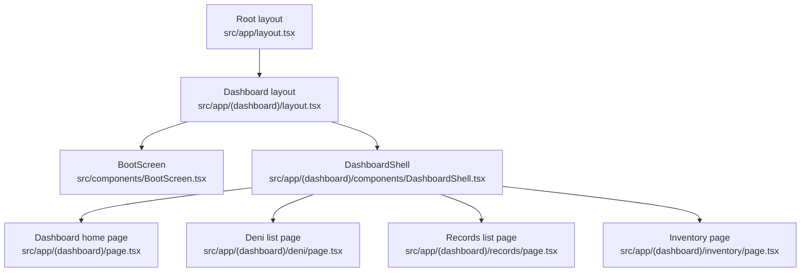
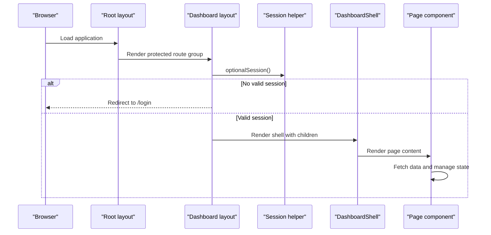
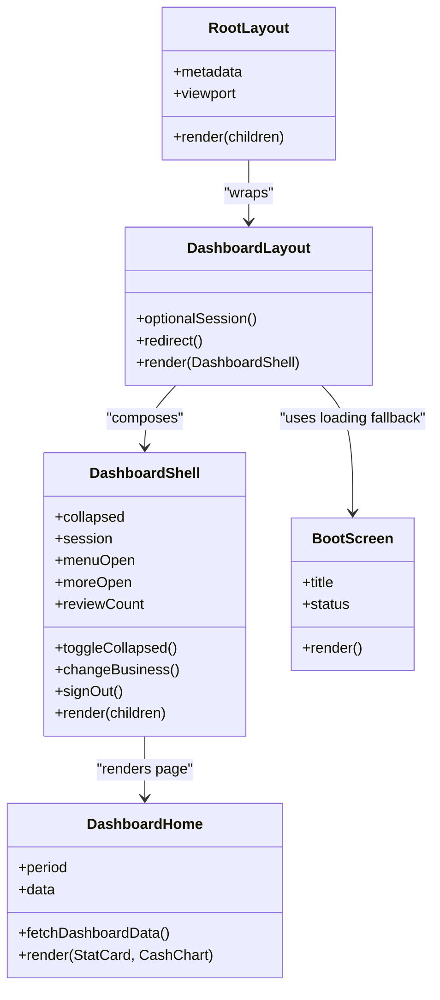
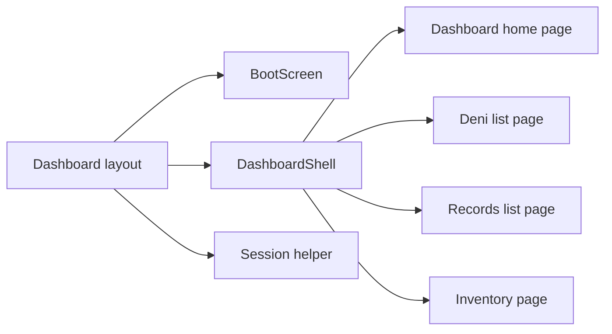

# Component Structure & Organization

<cite>
**Referenced Files in This Document**
- [BootScreen.tsx](file://src/components/BootScreen.tsx)
- [DashboardShell.tsx](file://src/app/(dashboard)/components/DashboardShell.tsx)
- [Root layout](file://src/app/layout.tsx)
- [Dashboard route-group layout](file://src/app/(dashboard)/layout.tsx)
- [Dashboard loading fallback](file://src/app/(dashboard)/loading.tsx)
- [Dashboard error boundary](file://src/app/(dashboard)/error.tsx)
- [Dashboard home page](file://src/app/(dashboard)/page.tsx)
- [Deni list page](file://src/app/(dashboard)/deni/page.tsx)
- [Records list page](file://src/app/(dashboard)/records/page.tsx)
- [Inventory page](file://src/app/(dashboard)/inventory/page.tsx)
- [Session server helper](file://src/server/auth/session.ts)
</cite>

## Table of Contents
1. [Introduction](#introduction)
2. [Project Structure](#project-structure)
3. [Core Components](#core-components)
4. [Architecture Overview](#architecture-overview)
5. [Detailed Component Analysis](#detailed-component-analysis)
6. [Dependency Analysis](#dependency-analysis)
7. [Performance Considerations](#performance-considerations)
8. [Troubleshooting Guide](#troubleshooting-guide)
9. [Conclusion](#conclusion)

## Introduction
This document explains the React component architecture and organization patterns used in the project, focusing on how the application boots, how the dashboard shell wraps pages, and how UI, layout, and page components are separated. It also covers naming conventions, file organization, import/export strategies, communication through props and state, reusable composition patterns, testing considerations, and performance guidance for large component trees.

The entry point for the user-facing boot experience is `BootScreen`, while `DashboardShell` is the main dashboard container that provides navigation, workspace switching, account controls, and responsive chrome around page content. The Next.js app router organizes protected routes under a `(dashboard)` group whose layout enforces authentication before rendering the shell.

## Project Structure
The frontend is built with Next.js App Router. The relevant structure for this documentation is:

- `src/components`: Shared UI components such as the boot screen.
- `src/app`: Next.js app router entry points, layouts, global styles, and route groups.
- `src/app/(dashboard)`: Protected dashboard routes grouped together; its layout performs server-side session checks and renders `DashboardShell`.
- `src/app/(dashboard)/components`: Dashboard-specific layout and shell components.
- `src/app/(dashboard)/*`: Page components for each feature area.
- `src/server/auth/session.ts`: Server-side session helpers used by the dashboard layout to gate access.

**Diagram sources**
- [Root layout:22-27](file://src/app/layout.tsx#L22-L27)
- [Dashboard route-group layout:19-32](file://src/app/(dashboard)/layout.tsx#L19-L32)
- [DashboardShell:103-461](file://src/app/(dashboard)/components/DashboardShell.tsx#L103-L461)
- [Dashboard home page:283-502](file://src/app/(dashboard)/page.tsx#L283-L502)
- [Deni list page:29-123](file://src/app/(dashboard)/deni/page.tsx#L29-L123)
- [Records list page:28-124](file://src/app/(dashboard)/records/page.tsx#L28-L124)
- [Inventory page:86-161](file://src/app/(dashboard)/inventory/page.tsx#L86-L161)

**Section sources**
- [Root layout:1-28](file://src/app/layout.tsx#L1-L28)
- [Dashboard route-group layout:1-33](file://src/app/(dashboard)/layout.tsx#L1-L33)

## Core Components
This section documents the primary building blocks of the component hierarchy.

### BootScreen
`BootScreen` is a shared UI component representing an accessible loading surface. It communicates progress without fabricating percentages, uses semantic roles and live regions for assistive technology, and supports reduced-motion preferences. It is reused by the dashboard loading fallback so users see meaningful status text rather than a bare spinner during slow navigation.

Key responsibilities:
- Display product branding and localized status text.
- Provide an indeterminate visual indicator.
- Announce loading state to screen readers.
- Remain lightweight and presentation-focused.

Props:
- Optional title override.
- Optional status message override.

Accessibility highlights:
- Uses `role="status"` and `aria-live="polite"`.
- Decorative elements use `aria-hidden="true"`.
- Screen-reader-only text mirrors the rail’s meaning.

**Section sources**
- [BootScreen.tsx:1-47](file://src/components/BootScreen.tsx#L1-L47)

### DashboardShell
`DashboardShell` is the main dashboard container. It owns navigation state, workspace switching, profile menus, mobile navigation, and the active business context. It renders the sidebar, topbar, main content area, and mobile navigation, then projects page content via `children`.

Responsibilities:
- Resolve and display the current session and active business.
- Manage collapsed navigation state persisted in `localStorage`.
- Fetch review counts and session data from `/api/v1/*`.
- Handle sign-out and business switching flows.
- Provide keyboard-accessible menus and disclosure controls.
- Render error banners for unauthenticated or network issues.
- Wrap page content in a `<main>` element with accessibility attributes.

Communication model:
- Props: receives `children` for page content.
- State: local React state for menus, switching, signing out, review count, and session issues.
- External store: uses `useSyncExternalStore` to read collapsed navigation state from `localStorage` and window events.
- Side effects: fetches session and review data, sets up keyboard listeners, and dispatches storage events.

Navigation and routing:
- Uses `usePathname` to highlight active links.
- Supports both desktop sidebar and mobile bottom tabs.
- Provides a “more” menu for non-mobile routes.

Workspace switching:
- Renders a real `<select>` for business selection.
- Calls `/api/v1/session/switch` and performs a full-page navigation to refresh server-rendered caches.

Account actions:
- Profile dropdown and mobile “more” menu.
- Sign-out calls `/api/v1/session` and redirects to `/login`.

**Section sources**
- [DashboardShell.tsx:1-461](file://src/app/(dashboard)/components/DashboardShell.tsx#L1-L461)

### Dashboard Route-Group Layout
The dashboard layout is the authoritative authentication gate for protected routes. It runs on the server, resolves the session, and redirects unauthenticated users to `/login`. If a valid session exists, it renders `DashboardShell` with the requested page content.

Responsibilities:
- Server-side session resolution using `optionalSession`.
- Redirect to login when no session is present.
- Compose `DashboardShell` around child routes.

**Section sources**
- [Dashboard route-group layout:1-33](file://src/app/(dashboard)/layout.tsx#L1-L33)
- [Session server helper:40-68](file://src/server/auth/session.ts#L40-L68)

### Dashboard Loading Fallback
The dashboard loading fallback renders `BootScreen` inside the route group so the shell chrome remains intact during slow navigation. It shows localized loading text and keeps the user within the authenticated context.

**Section sources**
- [Dashboard loading fallback:1-12](file://src/app/(dashboard)/loading.tsx#L1-L12)
- [BootScreen.tsx:1-47](file://src/components/BootScreen.tsx#L1-L47)

### Dashboard Error Boundary
The dashboard error boundary catches client-side errors within the route segment. It logs structured information including a digest, displays a user-safe error message, and offers a retry action that re-renders the segment without a full page load.

Responsibilities:
- Log error details safely.
- Present a friendly error surface.
- Allow recovery via `reset()`.

**Section sources**
- [Dashboard error boundary:1-46](file://src/app/(dashboard)/error.tsx#L1-L46)

### Dashboard Home Page
The dashboard home page is a feature-rich client component that composes smaller internal components like `StatCard` and `CashChart`. It fetches summary, trend, records, and proposal data in parallel, manages period selection, formatting, and error handling, and renders KPIs, charts, recent activity, and empty states.

Responsibilities:
- Fetch dashboard data from multiple API endpoints.
- Manage local state for loading, error, period, timezone, and user name.
- Format money, dates, and relative time.
- Compose reusable subcomponents for statistics and charts.
- Provide retry behavior and skeleton loading states.

Composition pattern:
- Internal components (`StatCard`, `CashChart`) receive data via props.
- The page component orchestrates data fetching and state.

**Section sources**
- [Dashboard home page:1-503](file://src/app/(dashboard)/page.tsx#L1-L503)

### Feature Pages
Feature pages such as Deni, Records, and Inventory follow a consistent pattern:
- Client components marked with `'use client'`.
- Local state for loading, error, and data.
- `useEffect` to fetch data from `/api/v1/*`.
- Simple table or form layouts with localized labels.
- Links to nested routes for detail views.

Examples:
- Deni list page fetches customer balances and overdue obligations.
- Records list page fetches ledger records and formats amounts.
- Inventory page includes form submission with idempotency keys and success/error feedback.

**Section sources**
- [Deni list page:1-124](file://src/app/(dashboard)/deni/page.tsx#L1-L124)
- [Records list page:1-124](file://src/app/(dashboard)/records/page.tsx#L1-L124)
- [Inventory page:86-161](file://src/app/(dashboard)/inventory/page.tsx#L86-L161)

## Architecture Overview
The application follows a layered approach:

- Root layout defines global metadata and HTML structure.
- Dashboard layout enforces authentication and composes the shell.
- DashboardShell provides layout chrome and shared navigation.
- Page components render feature-specific content.
- Shared UI components like `BootScreen` provide reusable presentation logic.

**Diagram sources**
- [Root layout:22-27](file://src/app/layout.tsx#L22-L27)
- [Dashboard route-group layout:19-32](file://src/app/(dashboard)/layout.tsx#L19-L32)
- [Session server helper:64-68](file://src/server/auth/session.ts#L64-L68)
- [DashboardShell:103-461](file://src/app/(dashboard)/components/DashboardShell.tsx#L103-L461)
- [Dashboard home page:283-502](file://src/app/(dashboard)/page.tsx#L283-L502)

## Detailed Component Analysis

### Component Hierarchy and Composition Strategy
The hierarchy starts at the root layout, moves into the dashboard layout, then into `DashboardShell`, which wraps page components. Shared UI components like `BootScreen` are composed where needed.

**Diagram sources**
- [Root layout:22-27](file://src/app/layout.tsx#L22-L27)
- [Dashboard route-group layout:19-32](file://src/app/(dashboard)/layout.tsx#L19-L32)
- [DashboardShell:103-461](file://src/app/(dashboard)/components/DashboardShell.tsx#L103-L461)
- [BootScreen.tsx:21-47](file://src/components/BootScreen.tsx#L21-L47)
- [Dashboard home page:283-502](file://src/app/(dashboard)/page.tsx#L283-L502)

### Separation of Concerns
- UI components: Presentation-only components like `BootScreen` focus on accessibility, localization, and visual feedback.
- Layout components: `DashboardShell` handles navigation, workspace switching, and chrome layout.
- Page components: Feature pages like `DashboardHome`, `DeniPage`, `RecordsListPage`, and `InventoryPage` own domain data fetching and feature-specific state.

This separation keeps concerns clear:
- UI components avoid business logic.
- Layout components avoid page-specific data contracts.
- Page components compose UI and layout components.

### Naming Conventions and File Organization
- Components are PascalCase function components.
- Page components are named after their feature (e.g., `DashboardHome`, `DeniPage`, `RecordsListPage`).
- Layout files are named `layout.tsx`; loading and error files are named `loading.tsx` and `error.tsx`.
- Shared UI components live under `src/components`.
- Dashboard-specific layout components live under `src/app/(dashboard)/components`.
- Feature pages live directly under their route group folder.

### Import and Export Strategies
- Default exports are used for components and layouts.
- Named imports are used for Next.js primitives like `Link` and hooks.
- Localization is centralized through `createTranslator`.
- Server-side session helpers are imported from `@/server/auth/session`.

### Communication Through Props, Context, and State
- Props: Components receive data and callbacks via typed props. Examples include `BootScreen` title/status and `StatCard` fields.
- Context: The codebase does not define a custom React context in the analyzed files; instead, it relies on props and external stores.
- State:
  - Local React state manages UI state (menus, loading, errors).
  - External store via `useSyncExternalStore` persists navigation collapse state.
  - Server-side session state is resolved in the layout and consumed by the shell.

### Reusable Component Patterns
- Small presentational components: `StatCard` and `CashChart` encapsulate chart and stat rendering logic.
- Loading fallback composition: `BootScreen` is reused across loading surfaces.
- Data-fetching pattern: Pages use `useEffect` with cleanup flags to avoid state updates after unmount.

### Best Practices for Clean Component Boundaries
- Keep UI components focused on presentation and accessibility.
- Keep layout components focused on chrome and navigation.
- Keep page components focused on data orchestration and feature logic.
- Use explicit prop types to enforce boundaries.
- Avoid leaking business logic into UI components.

## Dependency Analysis
The following diagram maps key dependencies among core components and server helpers.

**Diagram sources**
- [Dashboard route-group layout:14-32](file://src/app/(dashboard)/layout.tsx#L14-L32)
- [DashboardShell:103-461](file://src/app/(dashboard)/components/DashboardShell.tsx#L103-L461)
- [BootScreen.tsx:17-47](file://src/components/BootScreen.tsx#L17-L47)
- [Dashboard home page:1-503](file://src/app/(dashboard)/page.tsx#L1-L503)
- [Deni list page:1-124](file://src/app/(dashboard)/deni/page.tsx#L1-L124)
- [Records list page:1-124](file://src/app/(dashboard)/records/page.tsx#L1-L124)
- [Inventory page:86-161](file://src/app/(dashboard)/inventory/page.tsx#L86-L161)
- [Session server helper:40-68](file://src/server/auth/session.ts#L40-L68)

**Section sources**
- [Dashboard route-group layout:1-33](file://src/app/(dashboard)/layout.tsx#L1-L33)
- [DashboardShell.tsx:1-461](file://src/app/(dashboard)/components/DashboardShell.tsx#L1-L461)
- [BootScreen.tsx:1-47](file://src/components/BootScreen.tsx#L1-L47)
- [Dashboard home page:1-503](file://src/app/(dashboard)/page.tsx#L1-L503)
- [Deni list page:1-124](file://src/app/(dashboard)/deni/page.tsx#L1-L124)
- [Records list page:1-124](file://src/app/(dashboard)/records/page.tsx#L1-L124)
- [Inventory page:86-161](file://src/app/(dashboard)/inventory/page.tsx#L86-L161)
- [Session server helper:40-68](file://src/server/auth/session.ts#L40-L68)

## Performance Considerations
- Prefer composition over deep nesting: keep page components thin and delegate presentation to small components.
- Avoid unnecessary re-renders: memoize derived values and stable callbacks where appropriate.
- Use Next.js route segments and loading/error boundaries to isolate failures and reduce full-page reloads.
- Minimize client-side state scope: keep UI state local to the component that needs it.
- Batch independent data fetches: the dashboard home page fetches multiple endpoints in parallel.
- Respect user preferences: support reduced motion and provide non-animated fallbacks.
- Be careful with external stores: `useSyncExternalStore` avoids effect duplication but requires stable subscription functions.

[No sources needed since this section provides general guidance]

## Troubleshooting Guide
Common issues and their handling patterns:

- Unauthenticated access:
  - The dashboard layout redirects to `/login` if no session is present.
  - The shell displays a banner when session data is unavailable or unauthenticated.

- Network errors:
  - Pages catch fetch failures and set user-friendly error messages.
  - The dashboard error boundary logs structured error info and offers retry.

- Navigation state persistence:
  - Collapsed navigation state is stored in `localStorage` and synchronized across tabs via a custom event.
  - Storage access failures are swallowed gracefully.

- Business switching:
  - Switching requires a full-page navigation to refresh server-rendered caches.
  - Errors are surfaced in the shell with a dismissable alert.

- Accessibility regressions:
  - Menus close on Escape and return focus to triggers.
  - Disclosure controls keep `aria-expanded` in sync.
  - Workspace switcher uses a real `<select>` for keyboard operability.

**Section sources**
- [Dashboard route-group layout:19-32](file://src/app/(dashboard)/layout.tsx#L19-L32)
- [DashboardShell.tsx:134-234](file://src/app/(dashboard)/components/DashboardShell.tsx#L134-L234)
- [Dashboard error boundary:18-46](file://src/app/(dashboard)/error.tsx#L18-L46)

## Conclusion
The project’s component architecture emphasizes clear separation between UI, layout, and page concerns. `BootScreen` provides a robust loading surface, while `DashboardShell` centralizes navigation, workspace management, and account controls. The dashboard layout enforces authentication server-side, ensuring that only valid sessions reach the shell. Pages compose small, focused components and manage their own data-fetching lifecycles. This structure supports maintainability, accessibility, and predictable performance as the component tree grows.

[No sources needed since this section summarizes without analyzing specific files]