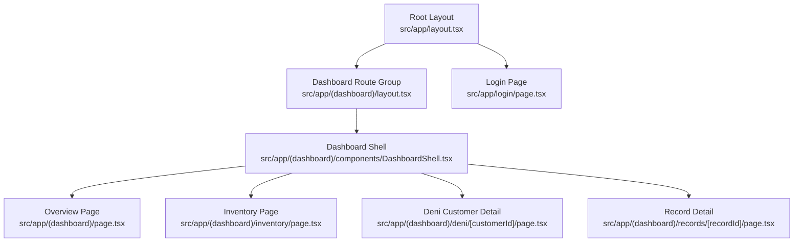
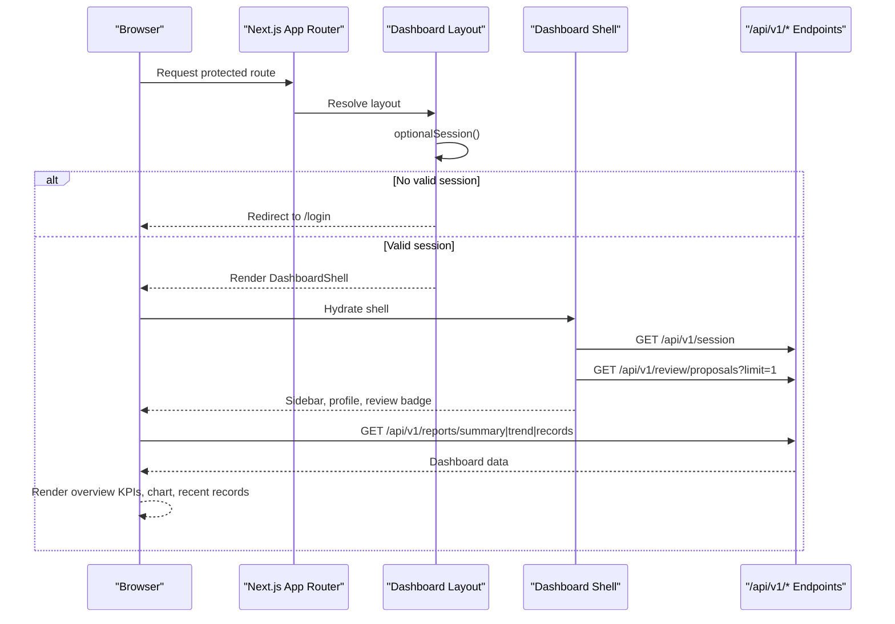
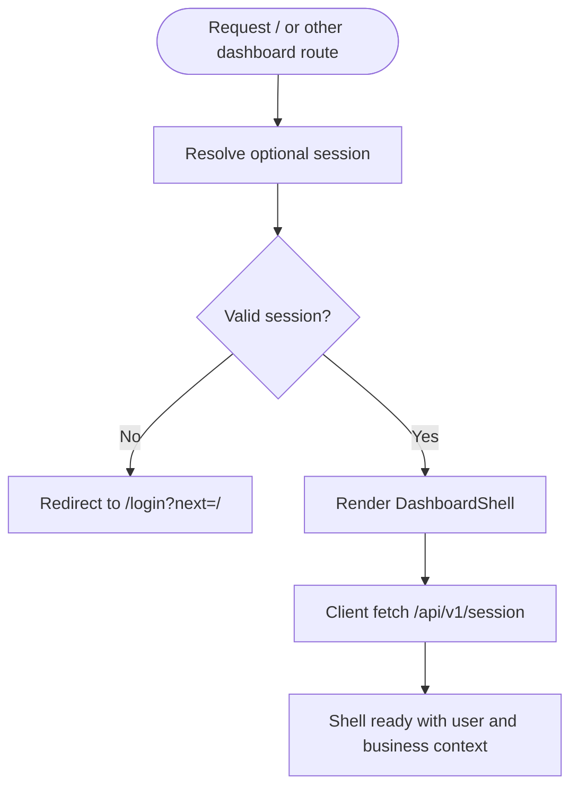
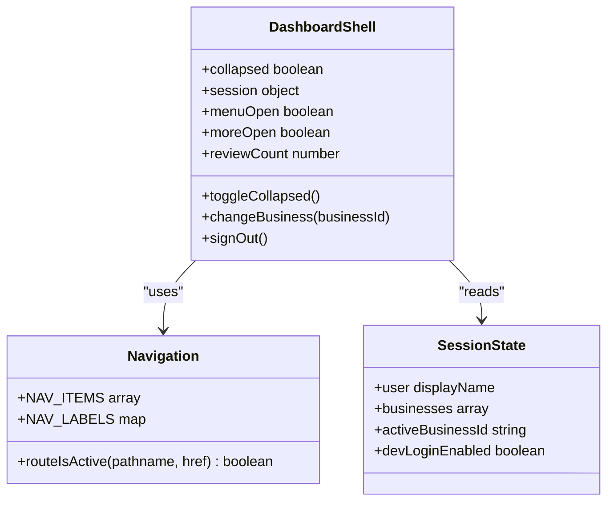
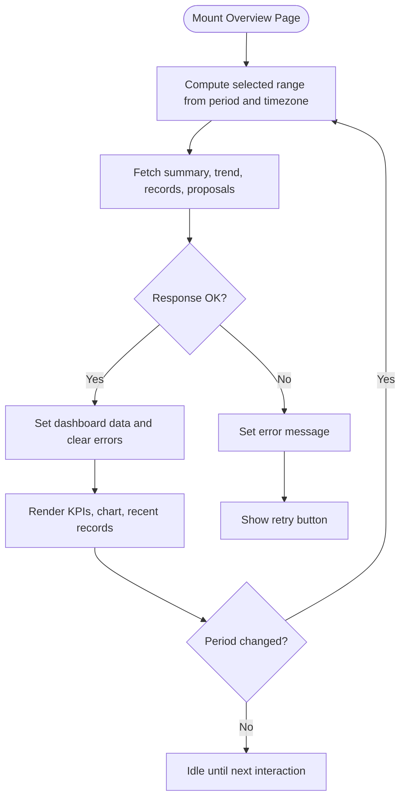
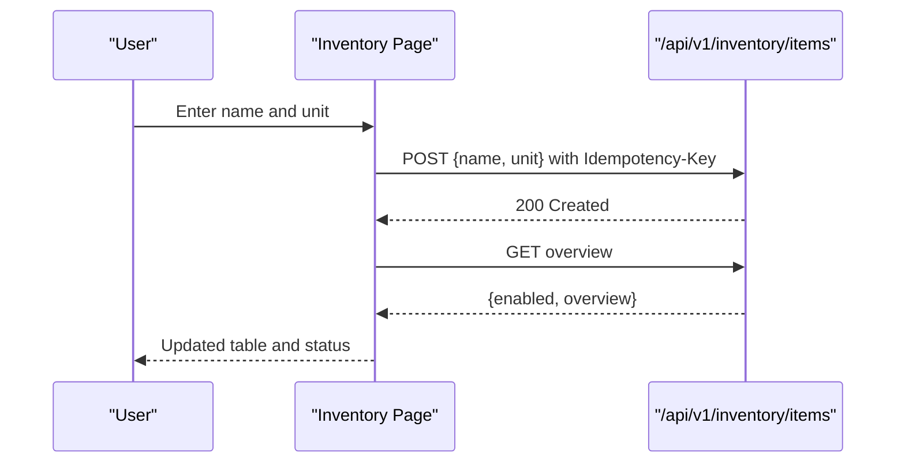
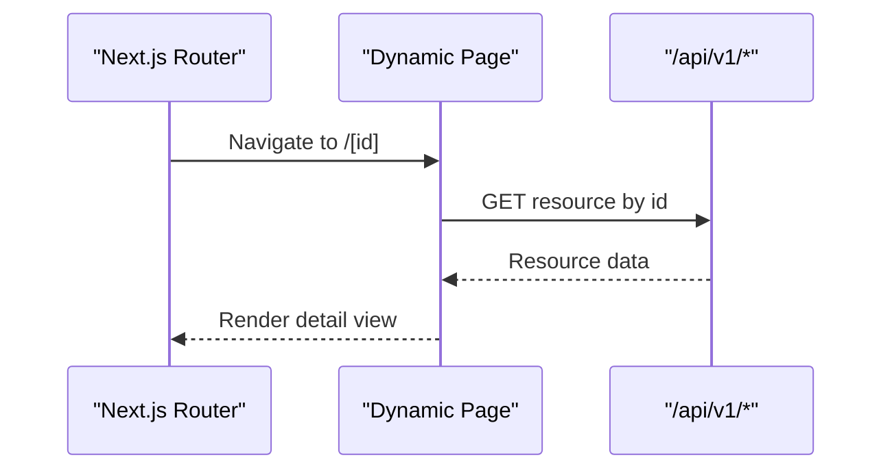
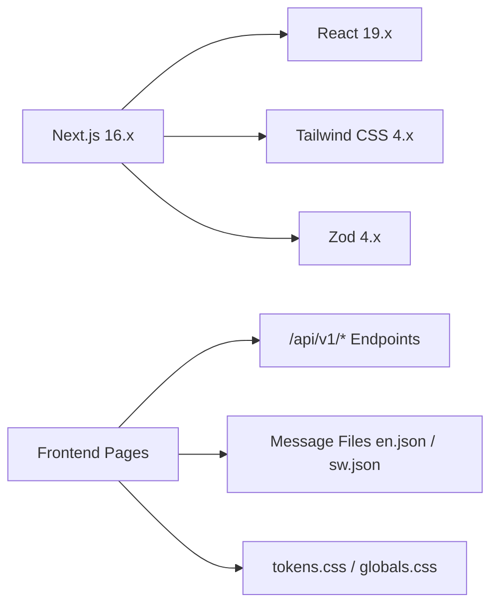

# Frontend Architecture

<cite>
**Referenced Files in This Document**
- [package.json](file://package.json)
- [next.config.ts](file://next.config.ts)
- [src/app/layout.tsx](file://src/app/layout.tsx)
- [src/app/(dashboard)/layout.tsx](file://src/app/(dashboard)/layout.tsx)
- [src/app/(dashboard)/components/DashboardShell.tsx](file://src/app/(dashboard)/components/DashboardShell.tsx)
- [src/app/(dashboard)/page.tsx](file://src/app/(dashboard)/page.tsx)
- [src/app/login/page.tsx](file://src/app/login/page.tsx)
- [src/app/(dashboard)/inventory/page.tsx](file://src/app/(dashboard)/inventory/page.tsx)
- [src/app/(dashboard)/deni/[customerId]/page.tsx](file://src/app/(dashboard)/deni/[customerId]/page.tsx)
- [src/app/(dashboard)/records/[recordId]/page.tsx](file://src/app/(dashboard)/records/[recordId]/page.tsx)
- [src/messages/en.json](file://src/messages/en.json)
- [src/messages/sw.json](file://src/messages/sw.json)
- [src/styles/tokens.css](file://src/styles/tokens.css)
- [src/styles/globals.css](file://src/styles/globals.css)
- [src/components/BootScreen.tsx](file://src/components/BootScreen.tsx)
- [src/server/auth/session-store.ts](file://src/server/auth/session-store.ts)
- [src/server/auth/session.ts](file://src/server/auth/session.ts)
</cite>

## Table of Contents
1. [Introduction](#introduction)
2. [Project Structure](#project-structure)
3. [Core Components](#core-components)
4. [Architecture Overview](#architecture-overview)
5. [Detailed Component Analysis](#detailed-component-analysis)
6. [Dependency Analysis](#dependency-analysis)
7. [Performance Considerations](#performance-considerations)
8. [Troubleshooting Guide](#troubleshooting-guide)
9. [Conclusion](#conclusion)
10. [Appendices](#appendices)

## Introduction
This document explains the frontend architecture of the Daftari dashboard, a Next.js and React application built for Tanzanian small businesses. It covers component organization, routing with the Next.js App Router, client-side state management, internationalization for English and Swahili, styling through CSS variables and Tailwind CSS, responsive design, accessibility, shared layout and navigation patterns, data fetching conventions, performance optimization, code splitting, and backend integration.

The app is intentionally mobile-first: it provides a collapsible sidebar on desktop and a bottom tab bar on smaller screens. Authentication is enforced server-side before rendering protected dashboard pages, while all business data is fetched from `/api/v1/*` endpoints by client components.

## Project Structure
The frontend follows the Next.js App Router structure under `src/app`. Protected routes live in the `(dashboard)` route group, which enforces authentication at the layout level. Public routes such as login are outside that group. Shared UI lives in `src/components`, messages in `src/messages`, and global styles in `src/styles`.

**Diagram sources**
- [src/app/layout.tsx:1-28](file://src/app/layout.tsx#L1-L28)
- [src/app/(dashboard)/layout.tsx:1-33](file://src/app/(dashboard)/layout.tsx#L1-L33)
- [src/app/(dashboard)/components/DashboardShell.tsx:1-461](file://src/app/(dashboard)/components/DashboardShell.tsx#L1-L461)
- [src/app/(dashboard)/page.tsx:1-503](file://src/app/(dashboard)/page.tsx#L1-L503)
- [src/app/login/page.tsx:1-79](file://src/app/login/page.tsx#L1-L79)
- [src/app/(dashboard)/inventory/page.tsx:1-212](file://src/app/(dashboard)/inventory/page.tsx#L1-L212)
- [src/app/(dashboard)/deni/[customerId]/page.tsx:1-117](file://src/app/(dashboard)/deni/[customerId]/page.tsx#L1-L117)
- [src/app/(dashboard)/records/[recordId]/page.tsx:1-130](file://src/app/(dashboard)/records/[recordId]/page.tsx#L1-L130)

**Section sources**
- [src/app/layout.tsx:1-28](file://src/app/layout.tsx#L1-L28)
- [src/app/(dashboard)/layout.tsx:1-33](file://src/app/(dashboard)/layout.tsx#L1-L33)
- [src/app/(dashboard)/components/DashboardShell.tsx:1-461](file://src/app/(dashboard)/components/DashboardShell.tsx#L1-L461)

## Core Components
- Root layout defines metadata, viewport, language, and imports global styles.
- Dashboard layout acts as the authoritative authentication gate for protected routes.
- Dashboard shell renders the sidebar, topbar, workspace switcher, account menu, and mobile navigation.
- Overview page fetches summary, trend, records, and review queue data and composes KPIs, charts, and recent activity.
- Login page handles unauthenticated entry and redirects authenticated users away.
- Feature pages such as inventory, deni customer detail, and record detail follow consistent client-side data fetching and error handling.

Key responsibilities:
- Routing: App Router groups, dynamic segments, and nested layouts.
- State: Local React state per page; session and navigation state managed inside the shell.
- Data: Client-side `fetch` to `/api/v1/*` with `cache: 'no-store'`.
- Internationalization: Message keys resolved through a localization utility.
- Styling: Tailwind CSS plus CSS variables defined in tokens.

**Section sources**
- [src/app/layout.tsx:1-28](file://src/app/layout.tsx#L1-L28)
- [src/app/(dashboard)/layout.tsx:1-33](file://src/app/(dashboard)/layout.tsx#L1-L33)
- [src/app/(dashboard)/components/DashboardShell.tsx:1-461](file://src/app/(dashboard)/components/DashboardShell.tsx#L1-L461)
- [src/app/(dashboard)/page.tsx:1-503](file://src/app/(dashboard)/page.tsx#L1-L503)
- [src/app/login/page.tsx:1-79](file://src/app/login/page.tsx#L1-L79)
- [src/app/(dashboard)/inventory/page.tsx:1-212](file://src/app/(dashboard)/inventory/page.tsx#L1-L212)
- [src/app/(dashboard)/deni/[customerId]/page.tsx:1-117](file://src/app/(dashboard)/deni/[customerId]/page.tsx#L1-L117)
- [src/app/(dashboard)/records/[recordId]/page.tsx:1-130](file://src/app/(dashboard)/records/[recordId]/page.tsx#L1-L130)

## Architecture Overview
The frontend is a client-heavy dashboard layered over Next.js server-rendered layouts. The root layout sets global metadata and theme. The dashboard layout ensures only authenticated users reach protected pages. Inside the shell, client components call REST endpoints for business data.

**Diagram sources**
- [src/app/(dashboard)/layout.tsx:1-33](file://src/app/(dashboard)/layout.tsx#L1-L33)
- [src/app/(dashboard)/components/DashboardShell.tsx:103-174](file://src/app/(dashboard)/components/DashboardShell.tsx#L103-L174)
- [src/app/(dashboard)/page.tsx:92-120](file://src/app/(dashboard)/page.tsx#L92-L120)
- [src/server/auth/session.ts:64-68](file://src/server/auth/session.ts#L64-L68)

## Detailed Component Analysis

### Root Layout and Global Configuration
The root layout configures SEO metadata, viewport settings, and imports global styles. Security headers are applied at the Next.js configuration layer to protect sensitive dashboard content.

- Metadata includes title templates and robots directives.
- Viewport sets device width, initial scale, and theme color.
- Global styles import Tailwind and token variables.

**Section sources**
- [src/app/layout.tsx:1-28](file://src/app/layout.tsx#L1-L28)
- [next.config.ts:1-24](file://next.config.ts#L1-L24)
- [src/styles/globals.css:1-2](file://src/styles/globals.css#L1-L2)

### Authentication Gate and Session Flow
Protected dashboard routes are guarded by the dashboard layout. It calls the server-side session resolver and redirects unauthenticated visitors to login. The login page also checks the session and redirects authenticated users away.

**Diagram sources**
- [src/app/(dashboard)/layout.tsx:19-32](file://src/app/(dashboard)/layout.tsx#L19-L32)
- [src/app/login/page.tsx:28-33](file://src/app/login/page.tsx#L28-L33)
- [src/server/auth/session.ts:64-68](file://src/server/auth/session.ts#L64-L68)

**Section sources**
- [src/app/(dashboard)/layout.tsx:1-33](file://src/app/(dashboard)/layout.tsx#L1-L33)
- [src/app/login/page.tsx:1-79](file://src/app/login/page.tsx#L1-L79)
- [src/server/auth/session-store.ts:21-58](file://src/server/auth/session-store.ts#L21-L58)
- [src/server/auth/session.ts:45-68](file://src/server/auth/session.ts#L45-L68)

### Dashboard Shell: Navigation, Workspace Switching, and Accessibility
The shell manages:
- Collapsible sidebar persisted in localStorage.
- Active route highlighting.
- Workspace switcher that performs a full navigation after switching business.
- Account menu with sign-out flow.
- Mobile bottom navigation and more-menu for non-mobile items.
- Keyboard and screen-reader support including skip link, focus management, and aria attributes.

**Diagram sources**
- [src/app/(dashboard)/components/DashboardShell.tsx:43-64](file://src/app/(dashboard)/components/DashboardShell.tsx#L43-L64)
- [src/app/(dashboard)/components/DashboardShell.tsx:90-101](file://src/app/(dashboard)/components/DashboardShell.tsx#L90-L101)
- [src/app/(dashboard)/components/DashboardShell.tsx:103-234](file://src/app/(dashboard)/components/DashboardShell.tsx#L103-L234)

**Section sources**
- [src/app/(dashboard)/components/DashboardShell.tsx:1-461](file://src/app/(dashboard)/components/DashboardShell.tsx#L1-L461)

### Overview Page: Data Fetching, Period Selection, and Composition
The overview page:
- Computes date ranges based on selected period and business timezone.
- Fetches summary, trend, recent records, and proposals concurrently.
- Renders KPI cards, a cash flow chart, and recent activity list.
- Handles loading skeletons, errors, retry actions, and stale data indicators.

**Diagram sources**
- [src/app/(dashboard)/page.tsx:66-120](file://src/app/(dashboard)/page.tsx#L66-L120)
- [src/app/(dashboard)/page.tsx:283-344](file://src/app/(dashboard)/page.tsx#L283-L344)
- [src/app/(dashboard)/page.tsx:346-503](file://src/app/(dashboard)/page.tsx#L346-L503)

**Section sources**
- [src/app/(dashboard)/page.tsx:1-503](file://src/app/(dashboard)/page.tsx#L1-L503)

### Inventory Page: Form Handling and Idempotent Creation
The inventory page:
- Loads enabled flag and item overview.
- Provides a form to add items with name and unit.
- Sends an idempotent POST request using a generated idempotency key.
- Displays success, error, and low-stock indicators.

**Diagram sources**
- [src/app/(dashboard)/inventory/page.tsx:40-45](file://src/app/(dashboard)/inventory/page.tsx#L40-L45)
- [src/app/(dashboard)/inventory/page.tsx:86-107](file://src/app/(dashboard)/inventory/page.tsx#L86-L107)

**Section sources**
- [src/app/(dashboard)/inventory/page.tsx:1-212](file://src/app/(dashboard)/inventory/page.tsx#L1-L212)

### Dynamic Pages: Deni Customer and Record Detail
Both pages follow a consistent pattern:
- Read parameters via Next.js hooks.
- Fetch resource details from `/api/v1/*`.
- Show loading, error, and empty states.
- Format money and dates locally.

**Diagram sources**
- [src/app/(dashboard)/deni/[customerId]/page.tsx:33-55](file://src/app/(dashboard)/deni/[customerId]/page.tsx#L33-L55)
- [src/app/(dashboard)/records/[recordId]/page.tsx:32-55](file://src/app/(dashboard)/records/[recordId]/page.tsx#L32-L55)

**Section sources**
- [src/app/(dashboard)/deni/[customerId]/page.tsx:1-117](file://src/app/(dashboard)/deni/[customerId]/page.tsx#L1-L117)
- [src/app/(dashboard)/records/[recordId]/page.tsx:1-130](file://src/app/(dashboard)/records/[recordId]/page.tsx#L1-L130)

### Boot Screen and Loading States
The boot screen communicates progress without fake percentages and respects reduced motion preferences. It uses localized strings and accessible roles.

**Section sources**
- [src/components/BootScreen.tsx:1-47](file://src/components/BootScreen.tsx#L1-L47)

## Dependency Analysis
Frontend dependencies include Next.js, React, Tailwind CSS, and Zod for validation. The app relies on server-side session resolution and REST APIs for business data.

**Diagram sources**
- [package.json:23-44](file://package.json#L23-L44)
- [src/messages/en.json:1-729](file://src/messages/en.json#L1-L729)
- [src/messages/sw.json:1-729](file://src/messages/sw.json#L1-L729)
- [src/styles/tokens.css:1-105](file://src/styles/tokens.css#L1-L105)
- [src/styles/globals.css:1-2](file://src/styles/globals.css#L1-L2)

**Section sources**
- [package.json:1-47](file://package.json#L1-L47)

## Performance Considerations
- Avoid caching authenticated HTML or API output. Security headers are configured globally.
- Use `cache: 'no-store'` for client-side fetches to prevent stale dashboard data.
- Prefer concurrent requests where possible, as seen in the overview page.
- Keep client components focused on presentation and local state; keep authorization and session resolution server-side.
- Use CSS variables and Tailwind utilities to minimize custom style duplication.
- Defer heavy work to server endpoints; the frontend consumes normalized payloads.

[No sources needed since this section provides general guidance]

## Troubleshooting Guide
Common issues and resolutions:
- Unauthenticated access to dashboard routes: Ensure the session exists; the dashboard layout redirects to login if missing.
- Network errors during data load: Display error banners and provide retry actions; verify endpoint availability and credentials.
- Stale business context after switching workspace: Perform a full navigation rather than relying solely on client cache refresh.
- Microphone or media permissions denied: Surface localized error messages and guide users to browser settings.
- Reduced motion preferences: Ensure animations respect `prefers-reduced-motion`; the boot screen avoids fake progress bars.

**Section sources**
- [src/app/(dashboard)/layout.tsx:19-32](file://src/app/(dashboard)/layout.tsx#L19-L32)
- [src/app/(dashboard)/components/DashboardShell.tsx:200-234](file://src/app/(dashboard)/components/DashboardShell.tsx#L200-L234)
- [src/app/(dashboard)/page.tsx:337-344](file://src/app/(dashboard)/page.tsx#L337-L344)
- [src/components/BootScreen.tsx:1-47](file://src/components/BootScreen.tsx#L1-L47)

## Conclusion
The Daftari frontend combines Next.js App Router routing, server-enforced authentication, and client-driven data fetching into a cohesive dashboard experience. Internationalization supports English and Swahili through centralized message files. Styling is driven by CSS variables and Tailwind CSS, with strong attention to responsive behavior and accessibility. The architecture encourages consistent patterns for adding new pages, implementing forms, handling data, and managing UI state while keeping performance and security in mind.

[No sources needed since this section summarizes without analyzing specific files]

## Appendices

### Internationalization System
- Message files: `en.json` and `sw.json` contain all user-facing strings.
- Localization utility: Components use a translator function to resolve keys and interpolate values.
- Scope: Application labels, navigation, forms, errors, and feature-specific copy.

Guidelines:
- Add new keys to both language files.
- Use descriptive namespaces such as `app`, `nav`, `overview`, `review`, `records`, `deni`, `inventory`, `reports`, `settings`, `signin`, `state`, `audit`, `manualEntry`, `dateRange`, `common`.
- Interpolate dynamic values using placeholders supported by the translator.

**Section sources**
- [src/messages/en.json:1-729](file://src/messages/en.json#L1-L729)
- [src/messages/sw.json:1-729](file://src/messages/sw.json#L1-L729)

### Styling System and Design Tokens
- Token source: `tokens.css` defines brand colors, surfaces, borders, text, semantic states, radii, shadows, typography, z-index, spacing, and motion.
- Global styles: `globals.css` imports Tailwind and tokens, sets base styles, focus-visible outlines, utility classes, and layout components like sidebar, topbar, and bento cards.
- Tailwind integration: Enabled via PostCSS and imported at the top of global styles.

Guidelines:
- Prefer tokens over raw hex values.
- Use utility classes for layout and spacing when appropriate.
- Maintain dark mode defaults and WCAG-compliant focus indicators.

**Section sources**
- [src/styles/tokens.css:1-105](file://src/styles/tokens.css#L1-L105)
- [src/styles/globals.css:1-175](file://src/styles/globals.css#L1-L175)

### Adding New Pages
Recommended steps:
1. Create a new route segment under `src/app/(dashboard)` for protected pages or `src/app` for public pages.
2. If the page requires authentication, rely on the dashboard layout; otherwise, handle auth explicitly.
3. Implement client-side data fetching with `fetch` and `cache: 'no-store'`.
4. Compose localized strings through the translator.
5. Handle loading, error, and empty states consistently.
6. Add navigation entries in the shell’s navigation configuration if the page should be discoverable.

**Section sources**
- [src/app/(dashboard)/components/DashboardShell.tsx:43-64](file://src/app/(dashboard)/components/DashboardShell.tsx#L43-L64)
- [src/app/(dashboard)/page.tsx:92-120](file://src/app/(dashboard)/page.tsx#L92-L120)

### Implementing Forms
Patterns observed:
- Controlled inputs with local state.
- Validation feedback using localized messages.
- Idempotent mutations for create operations.
- Optimistic updates followed by refetch or explicit refresh.

Example reference:
- Inventory form submission and idempotency key usage.

**Section sources**
- [src/app/(dashboard)/inventory/page.tsx:86-107](file://src/app/(dashboard)/inventory/page.tsx#L86-L107)

### Managing UI State
Recommendations:
- Keep UI state local to components unless shared across multiple components.
- Use the shell for cross-cutting concerns like session, workspace, and navigation state.
- Avoid global stores unless necessary; prefer URL-driven state and server-backed data.

**Section sources**
- [src/app/(dashboard)/components/DashboardShell.tsx:103-174](file://src/app/(dashboard)/components/DashboardShell.tsx#L103-L174)

### Backend Integration Guidelines
- Call `/api/v1/*` endpoints from client components.
- Normalize responses and handle envelope structures consistently.
- Surface errors with localized messages and actionable recovery options.
- Respect business timezone and currency in formatting logic.

**Section sources**
- [src/app/(dashboard)/page.tsx:92-120](file://src/app/(dashboard)/page.tsx#L92-L120)
- [src/app/(dashboard)/inventory/page.tsx:40-45](file://src/app/(dashboard)/inventory/page.tsx#L40-L45)
- [src/app/(dashboard)/deni/[customerId]/page.tsx:40-55](file://src/app/(dashboard)/deni/[customerId]/page.tsx#L40-L55)
- [src/app/(dashboard)/records/[recordId]/page.tsx:40-55](file://src/app/(dashboard)/records/[recordId]/page.tsx#L40-L55)