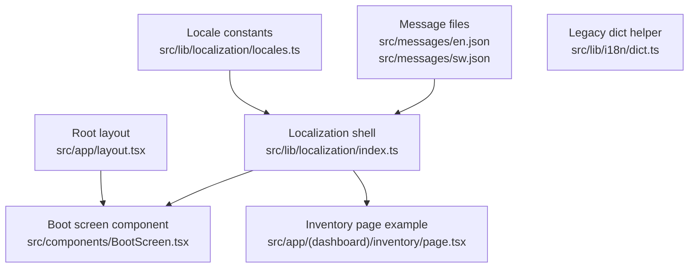
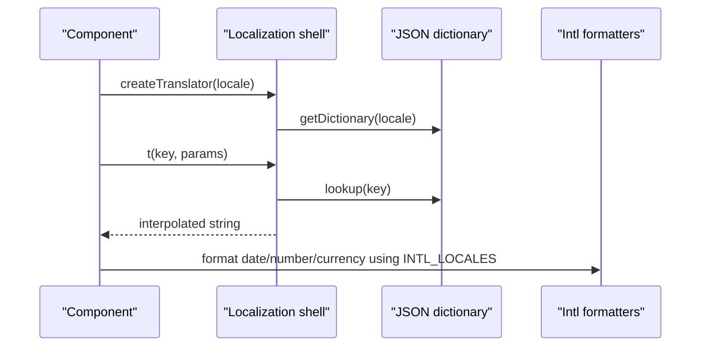
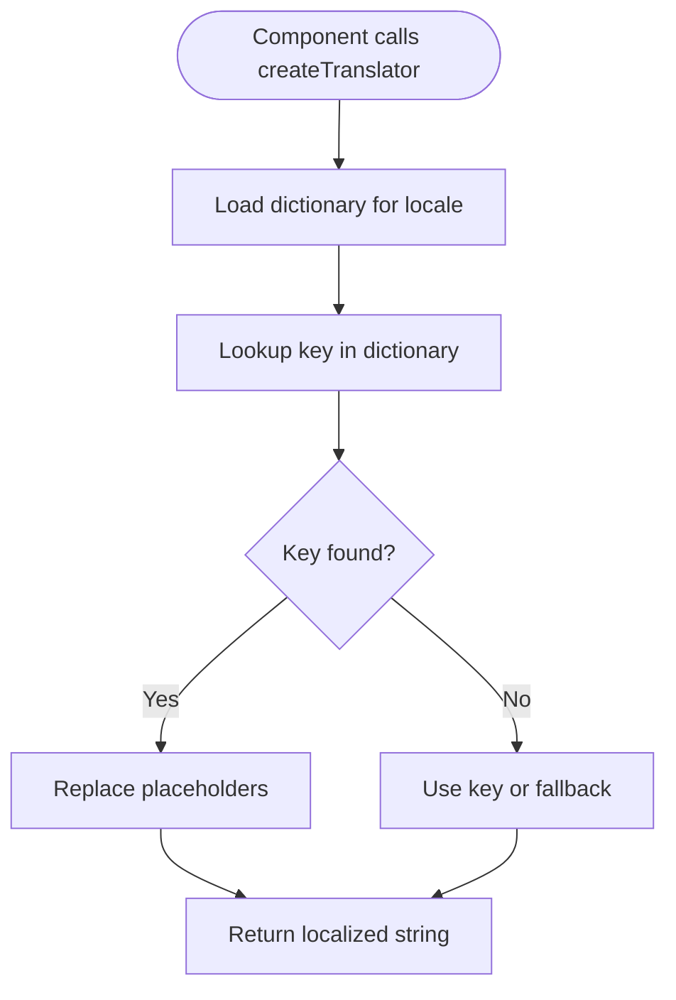
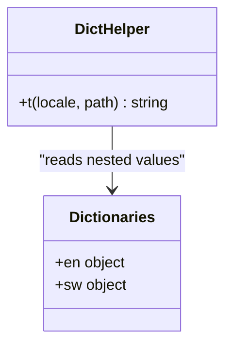
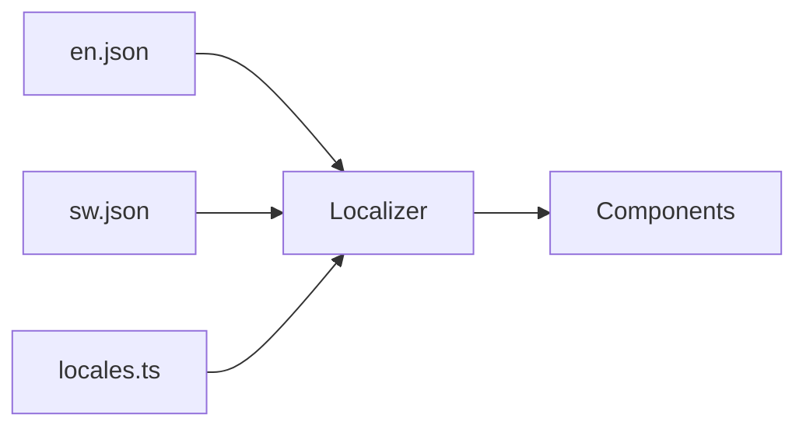

# Internationalization & Localization

<cite>
**Referenced Files in This Document**
- [en.json](file://src/messages/en.json)
- [sw.json](file://src/messages/sw.json)
- [index.ts](file://src/lib/localization/index.ts)
- [locales.ts](file://src/lib/localization/locales.ts)
- [dict.ts](file://src/lib/i18n/dict.ts)
- [layout.tsx](file://src/app/layout.tsx)
- [BootScreen.tsx](file://src/components/BootScreen.tsx)
- [inventory page.tsx](file://src/app/(dashboard)/inventory/page.tsx)
</cite>

## Table of Contents
1. [Introduction](#introduction)
2. [Project Structure](#project-structure)
3. [Core Components](#core-components)
4. [Architecture Overview](#architecture-overview)
5. [Detailed Component Analysis](#detailed-component-analysis)
6. [Dependency Analysis](#dependency-analysis)
7. [Performance Considerations](#performance-considerations)
8. [Troubleshooting Guide](#troubleshooting-guide)
9. [Conclusion](#conclusion)
10. [Appendices](#appendices)

## Introduction
This document explains the internationalization and localization system for English and Swahili in the project. It covers message file structure, key naming conventions, translation management workflow, i18n configuration, locale detection, language switching, formatting utilities, pluralization guidance, RTL considerations, font loading, performance optimization, testing strategies, and automated validation approaches.

The system currently supports two UI locales:
- English (`en`)
- Swahili (`sw`)

It uses JSON message files under `src/messages`, a lightweight client-side translator, and BCP 47 locale tags for date, number, and currency formatting.

## Project Structure
Internationalization-related code is organized into three main areas:
- Message dictionaries: `src/messages/en.json` and `src/messages/sw.json`
- Client-side localization utilities: `src/lib/localization`
- A small legacy dictionary helper: `src/lib/i18n/dict.ts`

**Diagram sources**
- [en.json](file://src/messages/en.json)
- [sw.json](file://src/messages/sw.json)
- [index.ts](file://src/lib/localization/index.ts)
- [locales.ts](file://src/lib/localization/locales.ts)
- [dict.ts](file://src/lib/i18n/dict.ts)
- [layout.tsx](file://src/app/layout.tsx)
- [BootScreen.tsx](file://src/components/BootScreen.tsx)
- [inventory page.tsx](file://src/app/(dashboard)/inventory/page.tsx)

**Section sources**
- [en.json](file://src/messages/en.json)
- [sw.json](file://src/messages/sw.json)
- [index.ts](file://src/lib/localization/index.ts)
- [locales.ts](file://src/lib/localization/locales.ts)
- [dict.ts](file://src/lib/i18n/dict.ts)
- [layout.tsx](file://src/app/layout.tsx)
- [BootScreen.tsx](file://src/components/BootScreen.tsx)
- [inventory page.tsx](file://src/app/(dashboard)/inventory/page.tsx)

## Core Components
- Message dictionaries: flat JSON files with dot-separated keys.
- Localization shell: loads dictionaries by locale, provides a typed translator, interpolation, and language label helpers.
- Locale registry: defines supported locales, default locale, BCP 47 tags for formatting, and speech hints.
- Legacy dict helper: a small nested dictionary resolver with English fallback.

Key responsibilities:
- Provide consistent access to translated strings.
- Enforce stable semantic keys.
- Map UI locales to formatting locales.
- Offer helpers for displaying language names.

**Section sources**
- [index.ts](file://src/lib/localization/index.ts)
- [locales.ts](file://src/lib/localization/locales.ts)
- [dict.ts](file://src/lib/i18n/dict.ts)

## Architecture Overview
The runtime flow for rendering localized text is straightforward:
1. A component imports `createTranslator`.
2. The translator resolves the active locale and returns a function that looks up messages.
3. Interpolation replaces placeholders like `{name}` or `{count}`.
4. Formatting utilities use BCP 47 locale tags from the locale registry.

**Diagram sources**
- [index.ts](file://src/lib/localization/index.ts)
- [locales.ts](file://src/lib/localization/locales.ts)

## Detailed Component Analysis

### Message File Structure and Key Conventions
- Files: `src/messages/en.json` and `src/messages/sw.json`.
- Keys are dot-separated strings grouped by feature area:
  - `app.*`: global application labels.
  - `nav.*`: navigation labels.
  - `common.*`: shared domain terms such as record types, states, payment methods, and roles.
  - Feature-specific sections: `signin.*`, `onboarding.*`, `overview.*`, `record.*`, `review.*`, `records.*`, `deni.*`, `inventory.*`, `reports.*`, `settings.*`, `dateRange.*`, `state.*`, `manualEntry.*`, `audit.*`, `dev.*`.
- Values are user-facing strings. Placeholders use curly braces, for example `{name}`, `{count}`, `{amount}`, `{from}`, `{to}`, `{timezone}`, `{days}`, `{version}`, `{language}`, `{span}`, `{actor}`, `{duration}`, `{granularity}`, `{period}`, `{value}`.
- Keys must remain stable across translations; never use translated text as a key.

Examples of key groups:
- Global actions: save, cancel, confirm, retry, refresh.
- Navigation: overview, review, records, deni, inventory, reports, settings.
- Common domain: record types, states, payment methods, roles.
- Feature copy: sign-in, onboarding steps, dashboard overview, recording, review queue, confirmed records, debts, inventory, reports, settings, audit logs, developer tools.

**Section sources**
- [en.json](file://src/messages/en.json)
- [sw.json](file://src/messages/sw.json)

### Localization Shell and Translator
The localization shell:
- Imports both dictionaries.
- Exposes `getDictionary(locale)` to retrieve the correct dictionary.
- Provides `createTranslator(locale)` returning a typed function `t(key, params)`.
- Implements placeholder interpolation for `{key}` patterns.
- Includes helpers for language labels:
  - `languageLabel(code, locale)`: returns localized display names for language codes.
  - `languageLabelKey(code)`: maps a language code to a message key such as `app.language.en` or `app.language.sw`.

Type safety:
- `MessageKey` is derived from the English dictionary type.
- `Dictionary` is a mapped record type over those keys.

Usage pattern:
- Create a translator once per module or component.
- Call `t('key', { params })` to render localized text.

**Diagram sources**
- [index.ts](file://src/lib/localization/index.ts)

**Section sources**
- [index.ts](file://src/lib/localization/index.ts)

### Locale Registry and Formatting
The locale registry:
- Defines supported locales: `['en', 'sw']`.
- Sets default locale: `en`.
- Maps UI locales to BCP 47 tags used by `Intl`:
  - `en` → `en-TZ`
  - `sw` → `sw-TZ`
- Provides speech recognition hints:
  - `en` → `en-TZ`
  - `sw` → `sw-TZ`

Formatting guidance:
- Use `Intl.DateTimeFormat`, `Intl.NumberFormat`, and `Intl.RelativeTimeFormat` with the corresponding BCP 47 tag from `INTL_LOCALES`.
- For currency, prefer `Intl.NumberFormat` with a currency option and the business currency setting.
- For dates, include timezone information where relevant, since the product emphasizes cash movement and reporting periods.

**Section sources**
- [locales.ts](file://src/lib/localization/locales.ts)

### Legacy Dict Helper
The legacy helper:
- Holds a small nested dictionary for both languages.
- Exposes a `t(locale, path)` function that traverses nested objects.
- Falls back to English if a key is missing in the target locale.
- Returns the raw path when no string is found.

This helper is separate from the main JSON-based localization shell and can be used for small, static strings.

**Diagram sources**
- [dict.ts](file://src/lib/i18n/dict.ts)

**Section sources**
- [dict.ts](file://src/lib/i18n/dict.ts)

### Language Switching and Locale Detection
Current implementation notes:
- The root layout sets `lang="en"` statically.
- Components import `createTranslator` with a hardcoded locale in examples shown.
- There is no visible language switcher in the referenced files.
- To implement language switching:
  - Persist the chosen locale in a cookie, session storage, or URL query parameter.
  - Resolve the locale early in the app shell.
  - Update the HTML `lang` attribute dynamically.
  - Re-render components with the new locale.
  - Ensure server-side data fetching respects the selected locale where applicable.

Locale detection strategy recommendations:
- Prefer an explicit user choice stored in a durable client location.
- Fall back to browser locale only if it matches a supported locale.
- Normalize BCP 47 tags to the supported set: `en` or `sw`.

**Section sources**
- [layout.tsx](file://src/app/layout.tsx)
- [index.ts](file://src/lib/localization/index.ts)
- [locales.ts](file://src/lib/localization/locales.ts)

### Examples of Using Translations in Components
- Boot screen:
  - Uses `createTranslator('en')` to render product title, status, and accessibility text.
- Inventory page:
  - Creates a translator and uses it for error messages and UI text.

These examples demonstrate how components should obtain a translator and call it with stable keys.

**Section sources**
- [BootScreen.tsx](file://src/components/BootScreen.tsx)
- [inventory page.tsx](file://src/app/(dashboard)/inventory/page.tsx)

## Dependency Analysis
The localization layer depends on:
- Message dictionaries for content.
- Locale registry for supported locales and formatting tags.
- Components for consumption.

**Diagram sources**
- [en.json](file://src/messages/en.json)
- [sw.json](file://src/messages/sw.json)
- [index.ts](file://src/lib/localization/index.ts)
- [locales.ts](file://src/lib/localization/locales.ts)

**Section sources**
- [index.ts](file://src/lib/localization/index.ts)
- [locales.ts](file://src/lib/localization/locales.ts)

## Performance Considerations
- Keep message keys flat and semantic to avoid deep traversal overhead.
- Avoid loading unused dictionaries at runtime; the current shell imports both dictionaries statically. If the bundle grows significantly, consider lazy-loading dictionaries per locale.
- Cache translators at module scope rather than recreating them frequently.
- Use `Intl` formatters efficiently:
  - Reuse formatter instances where possible.
  - Format numbers and dates close to display time.
- Minimize re-renders caused by locale changes by isolating localized state and memoizing formatted values.
- For large translation files:
  - Split dictionaries by route or feature.
  - Preload only the dictionaries needed for the current view.
  - Defer non-critical translations until after initial paint.

[No sources needed since this section provides general guidance]

## Troubleshooting Guide
Common issues and resolutions:
- Missing translation key:
  - Symptom: The key name appears instead of translated text.
  - Cause: Key not present in the target dictionary.
  - Resolution: Add the key to all supported dictionaries or ensure fallback behavior is intentional.
- Placeholder not replaced:
  - Symptom: Template shows `{name}` literally.
  - Cause: Parameter missing or named differently.
  - Resolution: Pass the required parameters to the translator.
- Wrong locale applied:
  - Symptom: Text is always in English or another unexpected locale.
  - Cause: Locale not persisted or resolved correctly.
  - Resolution: Verify locale detection and persistence logic.
- Formatting not localized:
  - Symptom: Dates or numbers do not match regional expectations.
  - Cause: Not using BCP 47 tags from `INTL_LOCALES`.
  - Resolution: Use `en-TZ` or `sw-TZ` for formatting.

**Section sources**
- [index.ts](file://src/lib/localization/index.ts)
- [locales.ts](file://src/lib/localization/locales.ts)

## Conclusion
The project’s internationalization system centers on stable JSON message keys, a simple translator, and BCP 47 locale tags for formatting. English and Swahili are fully supported through parallel dictionaries. To extend the system:
- Add new message keys consistently across dictionaries.
- Implement locale persistence and dynamic language switching.
- Use `Intl` formatters with the configured BCP 47 tags.
- Plan for performance and test coverage as the translation surface grows.

[No sources needed since this section summarizes without analyzing specific files]

## Appendices

### How to Add a New Language
Steps:
1. Create a new message file, for example `src/messages/fr.json`, mirroring the keys in `en.json`.
2. Add the locale to the locale registry:
   - Extend `LOCALES`.
   - Add a mapping in `INTL_LOCALES`.
   - Add a speech hint in `SPEECH_LANGUAGE_HINTS` if applicable.
3. Import the new dictionary in the localization shell and add it to the dictionaries map.
4. Update any language label helpers to recognize the new language code.
5. Test translation resolution, interpolation, and formatting.

**Section sources**
- [index.ts](file://src/lib/localization/index.ts)
- [locales.ts](file://src/lib/localization/locales.ts)

### Managing Translation Keys
Guidelines:
- Use descriptive, feature-scoped keys with dot notation.
- Group related keys together.
- Avoid embedding dynamic values in keys; use placeholders instead.
- Keep keys stable across versions.
- Review missing keys regularly during development.

**Section sources**
- [en.json](file://src/messages/en.json)
- [sw.json](file://src/messages/sw.json)

### Pluralization Rules
Current approach:
- The system does not implement automatic pluralization rules.
- Use separate keys for singular and plural forms where necessary, for example:
  - `overview.reviewCardSingle`
  - `overview.reviewCardTitle`
- Alternatively, construct pluralized messages in the component using conditional logic and existing keys.

For future expansion:
- Consider adding a pluralization utility that selects keys based on count and locale-specific rules.

**Section sources**
- [en.json](file://src/messages/en.json)
- [sw.json](file://src/messages/sw.json)

### Dynamic Content and Error Messages
Recommendations:
- Use placeholders for dynamic values such as names, amounts, dates, and counts.
- Keep error messages concise and actionable.
- Separate validation messages from success messages.
- Store reusable phrases under `common.*` or feature-specific namespaces.

**Section sources**
- [index.ts](file://src/lib/localization/index.ts)
- [en.json](file://src/messages/en.json)
- [sw.json](file://src/messages/sw.json)

### RTL Language Support Considerations
Notes:
- Neither English nor Swahili is RTL, but plan ahead for RTL-capable languages.
- When adding RTL languages:
  - Set the HTML `dir` attribute dynamically.
  - Ensure CSS uses logical properties (`margin-inline-start`, `padding-inline-end`).
  - Test icons, layouts, and media alignment.
  - Validate screen reader announcements and focus order.

[No sources needed since this section provides general guidance]

### Font Loading for Different Scripts
Recommendations:
- Load fonts that support the character sets used by each language.
- Use font-display strategies to prevent invisible text during load.
- Subset fonts where possible to reduce payload size.
- Test rendering for special characters and diacritics.

[No sources needed since this section provides general guidance]

### Testing Strategies for Internationalized Components
Approach:
- Snapshot tests for UI text surfaces.
- Unit tests for translators and interpolation.
- Integration tests that render pages in multiple locales.
- Accessibility tests to verify readable text and proper `lang` attributes.
- Validation tests to ensure every key exists in all supported dictionaries.

Automated validation ideas:
- Compare key sets across dictionaries.
- Check for missing placeholders in templates.
- Fail builds when a key is present in one dictionary but missing in another.

[No sources needed since this section provides general guidance]