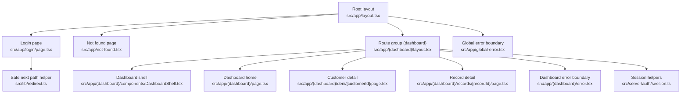
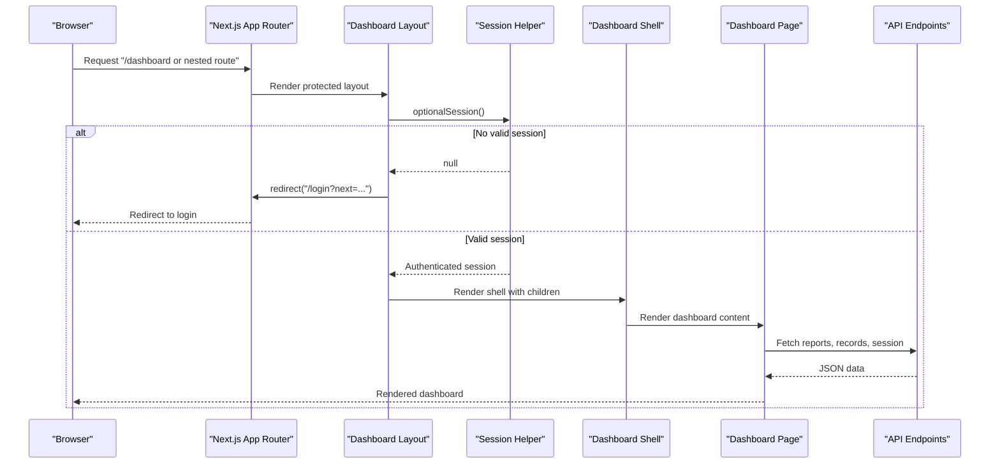
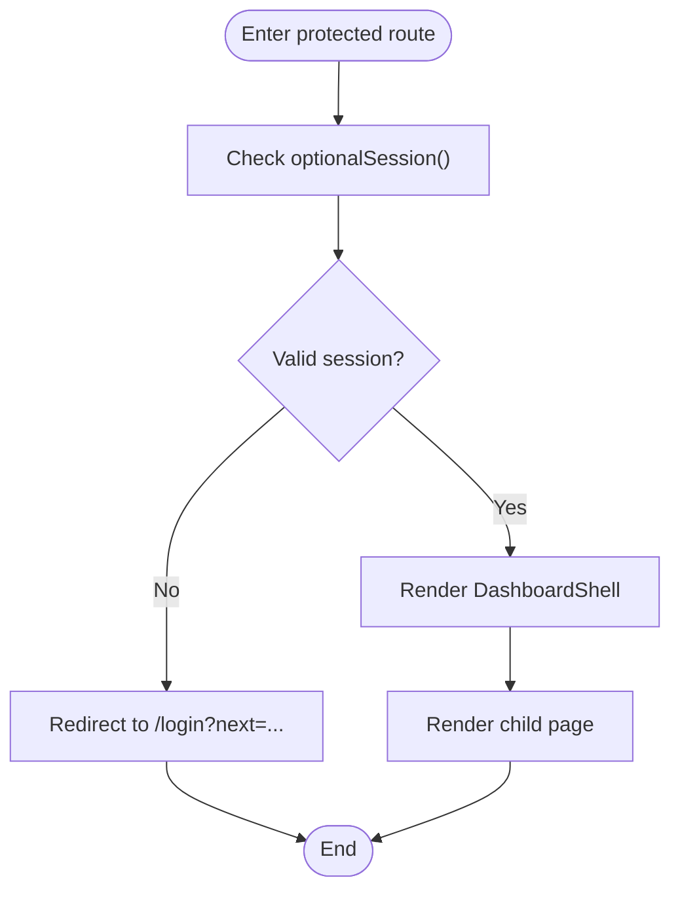
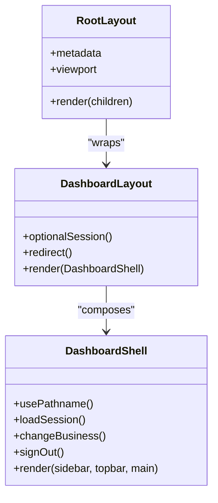
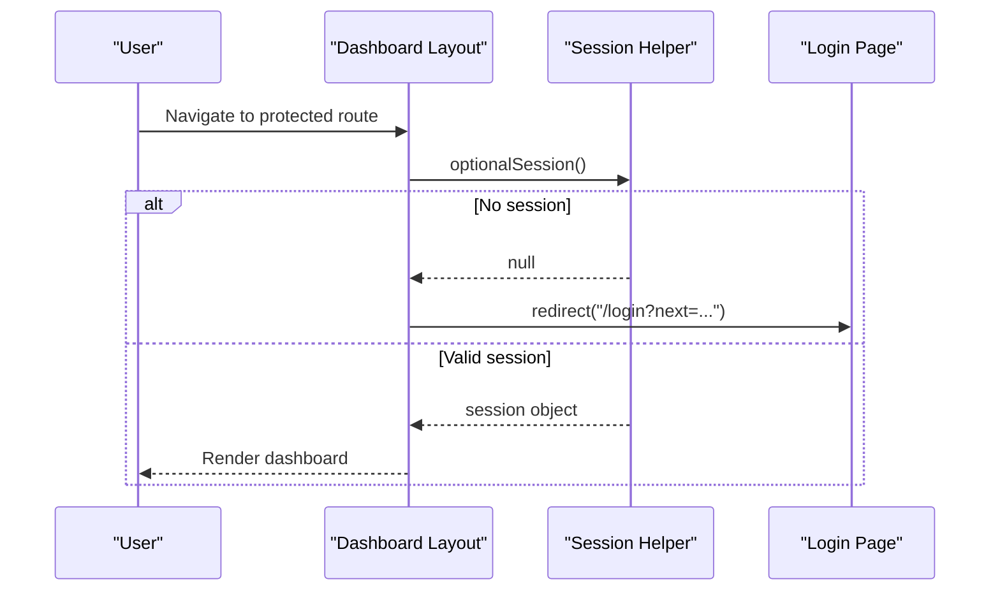
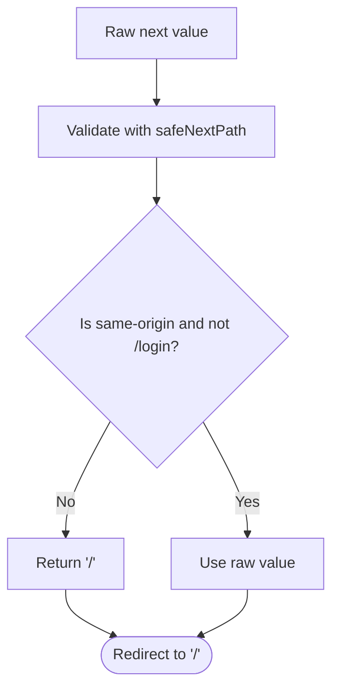
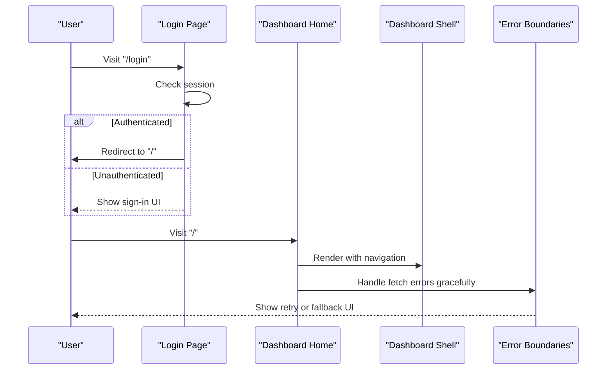
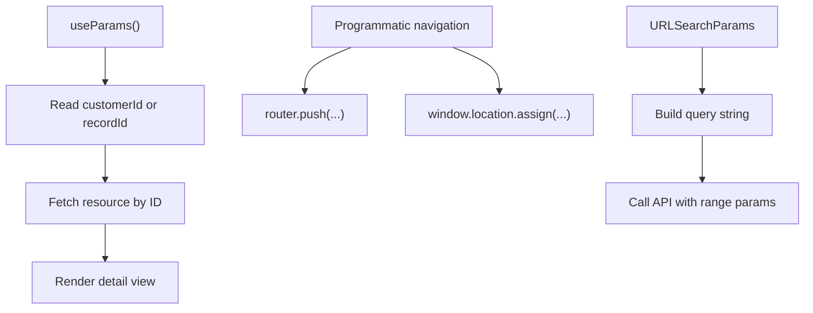
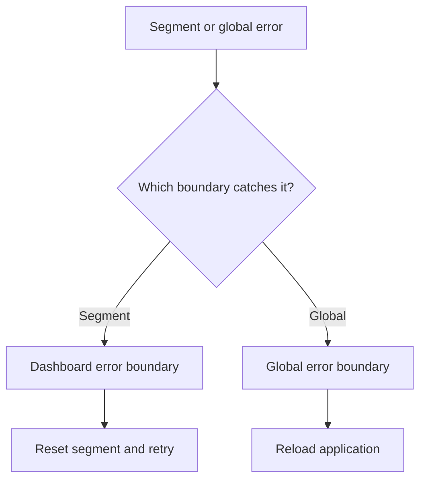
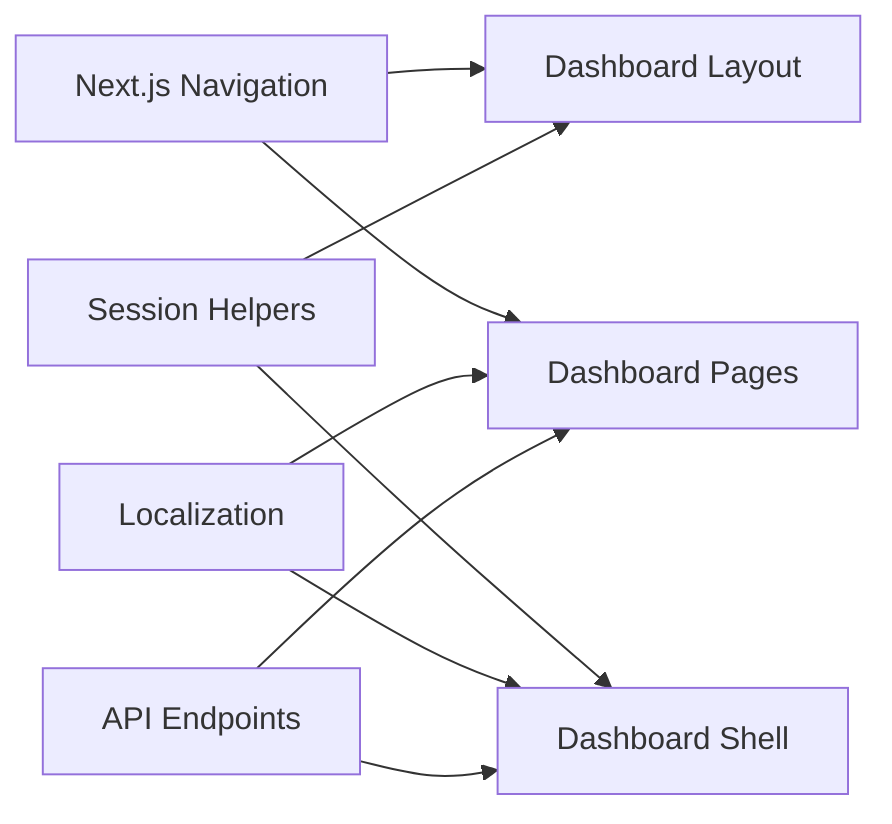

# Routing & Navigation Patterns

<cite>
**Referenced Files in This Document**
- [layout.tsx](file://src/app/layout.tsx)
- [dashboard layout.tsx](file://src/app/(dashboard)/layout.tsx)
- [dashboard page.tsx](file://src/app/(dashboard)/page.tsx)
- [login page.tsx](file://src/app/login/page.tsx)
- [not-found.tsx](file://src/app/not-found.tsx)
- [DashboardShell.tsx](file://src/app/(dashboard)/components/DashboardShell.tsx)
- [session.ts](file://src/server/auth/session.ts)
- [redirect.ts](file://src/lib/redirect.ts)
- [customer detail page.tsx](file://src/app/(dashboard)/deni/[customerId]/page.tsx)
- [record detail page.tsx](file://src/app/(dashboard)/records/[recordId]/page.tsx)
- [dashboard error.tsx](file://src/app/(dashboard)/error.tsx)
- [global-error.tsx](file://src/app/global-error.tsx)
</cite>

## Table of Contents
1. [Introduction](#introduction)
2. [Project Structure](#project-structure)
3. [Core Components](#core-components)
4. [Architecture Overview](#architecture-overview)
5. [Detailed Component Analysis](#detailed-component-analysis)
6. [Dependency Analysis](#dependency-analysis)
7. [Performance Considerations](#performance-considerations)
8. [Troubleshooting Guide](#troubleshooting-guide)
9. [Conclusion](#conclusion)

## Introduction
This document explains the Next.js App Router implementation and navigation patterns used by the application. It covers:

- Route groups, especially the `(dashboard)` group for protected routes.
- Nested routing structure and dynamic route segments.
- Layout composition with the root layout and dashboard-specific layout.
- Authentication-based routing guards, redirect strategies, and unauthorized access handling.
- Navigation flow between login, dashboard sections, and error pages.
- Programmatic navigation, route parameters, and query string management.
- SEO considerations, metadata management, and performance optimization through route-level code splitting.
- The `not-found` page and custom error handling patterns.

The goal is to make these patterns understandable for both developers and stakeholders while remaining grounded in the actual source files.

## Project Structure
The application uses the Next.js App Router under `src/app`. Public-facing pages live at the top level, while authenticated dashboard features are grouped under `(dashboard)`. API endpoints live under `api`, and shared server-side session logic lives under `server/auth`.

**Diagram sources**
- [layout.tsx:1-28](file://src/app/layout.tsx#L1-L28)
- [dashboard layout.tsx:1-33](file://src/app/(dashboard)/layout.tsx#L1-L33)
- [dashboard page.tsx:1-503](file://src/app/(dashboard)/page.tsx#L1-L503)
- [login page.tsx:1-79](file://src/app/login/page.tsx#L1-L79)
- [not-found.tsx:1-17](file://src/app/not-found.tsx#L1-L17)
- [DashboardShell.tsx:1-461](file://src/app/(dashboard)/components/DashboardShell.tsx#L1-L461)
- [session.ts:1-69](file://src/server/auth/session.ts#L1-L69)
- [redirect.ts:1-25](file://src/lib/redirect.ts#L1-L25)
- [customer detail page.tsx:1-117](file://src/app/(dashboard)/deni/[customerId]/page.tsx#L1-L117)
- [record detail page.tsx:1-130](file://src/app/(dashboard)/records/[recordId]/page.tsx#L1-L130)
- [dashboard error.tsx:1-46](file://src/app/(dashboard)/error.tsx#L1-L46)
- [global-error.tsx:1-65](file://src/app/global-error.tsx#L1-L65)

**Section sources**
- [layout.tsx:1-28](file://src/app/layout.tsx#L1-L28)
- [dashboard layout.tsx:1-33](file://src/app/(dashboard)/layout.tsx#L1-L33)
- [dashboard page.tsx:1-503](file://src/app/(dashboard)/page.tsx#L1-L503)
- [login page.tsx:1-79](file://src/app/login/page.tsx#L1-L79)
- [not-found.tsx:1-17](file://src/app/not-found.tsx#L1-L17)
- [DashboardShell.tsx:1-461](file://src/app/(dashboard)/components/DashboardShell.tsx#L1-L461)
- [session.ts:1-69](file://src/server/auth/session.ts#L1-L69)
- [redirect.ts:1-25](file://src/lib/redirect.ts#L1-L25)
- [customer detail page.tsx:1-117](file://src/app/(dashboard)/deni/[customerId]/page.tsx#L1-L117)
- [record detail page.tsx:1-130](file://src/app/(dashboard)/records/[recordId]/page.tsx#L1-L130)
- [dashboard error.tsx:1-46](file://src/app/(dashboard)/error.tsx#L1-L46)
- [global-error.tsx:1-65](file://src/app/global-error.tsx#L1-L65)

## Core Components
- Root layout defines global metadata, viewport settings, and the HTML shell.
- The `(dashboard)` layout acts as an authentication gate before rendering the dashboard shell.
- The dashboard shell provides navigation, workspace switching, account menu, and mobile navigation.
- The login page handles unauthenticated entry and redirects authenticated users away from the sign-in screen.
- Dynamic pages under `deni/[customerId]` and `records/[recordId]` demonstrate parameterized routes.
- Error boundaries provide user-friendly recovery paths at segment and global levels.
- A safe redirect helper validates post-authentication destinations.

**Section sources**
- [layout.tsx:1-28](file://src/app/layout.tsx#L1-L28)
- [dashboard layout.tsx:1-33](file://src/app/(dashboard)/layout.tsx#L1-L33)
- [DashboardShell.tsx:1-461](file://src/app/(dashboard)/components/DashboardShell.tsx#L1-L461)
- [login page.tsx:1-79](file://src/app/login/page.tsx#L1-L79)
- [customer detail page.tsx:1-117](file://src/app/(dashboard)/deni/[customerId]/page.tsx#L1-L117)
- [record detail page.tsx:1-130](file://src/app/(dashboard)/records/[recordId]/page.tsx#L1-L130)
- [dashboard error.tsx:1-46](file://src/app/(dashboard)/error.tsx#L1-L46)
- [global-error.tsx:1-65](file://src/app/global-error.tsx#L1-L65)
- [redirect.ts:1-25](file://src/lib/redirect.ts#L1-L25)

## Architecture Overview
The routing architecture separates public and protected areas using a route group. Protected routes require a valid server-side session; otherwise, users are redirected to login. Client components fetch data from REST-like API endpoints, while layouts handle authentication and UI composition.

**Diagram sources**
- [dashboard layout.tsx:1-33](file://src/app/(dashboard)/layout.tsx#L1-L33)
- [session.ts:40-68](file://src/server/auth/session.ts#L40-L68)
- [DashboardShell.tsx:103-222](file://src/app/(dashboard)/components/DashboardShell.tsx#L103-L222)
- [dashboard page.tsx:92-120](file://src/app/(dashboard)/page.tsx#L92-L120)

## Detailed Component Analysis

### Route Groups and Protected Routes
The `(dashboard)` route group centralizes authentication checks. Its layout calls `optionalSession()` and redirects unauthenticated visitors to `/login`. This ensures that no dashboard page renders without a validated session.

Key behaviors:
- Unauthenticated requests are redirected to `/login` with a `next` parameter indicating the intended destination.
- The login page also checks for an existing session and redirects authenticated users to the root dashboard.
- The dashboard shell manages client-side state such as active business, review counts, and navigation menus.

**Diagram sources**
- [dashboard layout.tsx:19-32](file://src/app/(dashboard)/layout.tsx#L19-L32)
- [login page.tsx:28-33](file://src/app/login/page.tsx#L28-L33)

**Section sources**
- [dashboard layout.tsx:1-33](file://src/app/(dashboard)/layout.tsx#L1-L33)
- [login page.tsx:1-79](file://src/app/login/page.tsx#L1-L79)

### Layout Composition System
- Root layout (`src/app/layout.tsx`) sets global metadata and viewport configuration and wraps all pages with `<html>` and `<body>`.
- Dashboard layout (`src/app/(dashboard)/layout.tsx`) enforces authentication and composes the dashboard shell around child routes.
- The dashboard shell (`src/app/(dashboard)/components/DashboardShell.tsx`) provides:
  - Sidebar navigation with active route detection.
  - Workspace switcher backed by a session endpoint.
  - Account menu with sign-out behavior.
  - Mobile navigation with a “more” menu for secondary routes.

**Diagram sources**
- [layout.tsx:5-27](file://src/app/layout.tsx#L5-L27)
- [dashboard layout.tsx:19-32](file://src/app/(dashboard)/layout.tsx#L19-L32)
- [DashboardShell.tsx:103-222](file://src/app/(dashboard)/components/DashboardShell.tsx#L103-L222)

**Section sources**
- [layout.tsx:1-28](file://src/app/layout.tsx#L1-L28)
- [dashboard layout.tsx:1-33](file://src/app/(dashboard)/layout.tsx#L1-L33)
- [DashboardShell.tsx:1-461](file://src/app/(dashboard)/components/DashboardShell.tsx#L1-L461)

### Authentication-Based Routing Guards
Authentication is enforced server-side in the dashboard layout:
- `optionalSession()` reads the HTTP-only cookie and resolves it against the database.
- If no valid session exists, `redirect('/login?next=/')` is called.
- The login page also calls `optionalSession()` and redirects authenticated users to `/`.

**Diagram sources**
- [dashboard layout.tsx:24-30](file://src/app/(dashboard)/layout.tsx#L24-L30)
- [session.ts:64-68](file://src/server/auth/session.ts#L64-L68)
- [login page.tsx:28-33](file://src/app/login/page.tsx#L28-L33)

**Section sources**
- [dashboard layout.tsx:1-33](file://src/app/(dashboard)/layout.tsx#L1-L33)
- [session.ts:1-69](file://src/server/auth/session.ts#L1-L69)
- [login page.tsx:1-79](file://src/app/login/page.tsx#L1-L79)

### Redirect Strategies and Unauthorized Access Handling
- The dashboard layout redirects unauthenticated users to `/login` with a `next` parameter.
- The login page redirects authenticated users to `/`.
- Post-authentication redirect safety is handled by `safeNextPath`, which rejects unsafe inputs like absolute URLs, protocol-relative URLs, backslashes, and `/login` itself.

**Diagram sources**
- [redirect.ts:18-24](file://src/lib/redirect.ts#L18-L24)

**Section sources**
- [dashboard layout.tsx:24-30](file://src/app/(dashboard)/layout.tsx#L24-L30)
- [login page.tsx:28-33](file://src/app/login/page.tsx#L28-L33)
- [redirect.ts:1-25](file://src/lib/redirect.ts#L1-L25)

### Navigation Flow Between Login, Dashboard Sections, and Error Pages
- Login page presents branding, benefits, and a form. It redirects authenticated users to the dashboard.
- Dashboard home fetches summary, trend, records, and proposals via API endpoints and displays KPIs, charts, and recent activity.
- Navigation links within the dashboard shell route to overview, record creation, review queue, records list, deni, inventory, reports, and settings.
- Error pages include:
  - Segment-level dashboard error boundary for recoverable failures.
  - Global error boundary for unrecoverable failures.
  - Not found page for missing routes.

**Diagram sources**
- [login page.tsx:28-33](file://src/app/login/page.tsx#L28-L33)
- [dashboard page.tsx:283-344](file://src/app/(dashboard)/page.tsx#L283-L344)
- [DashboardShell.tsx:103-222](file://src/app/(dashboard)/components/DashboardShell.tsx#L103-L222)
- [dashboard error.tsx:18-43](file://src/app/(dashboard)/error.tsx#L18-L43)
- [global-error.tsx:12-60](file://src/app/global-error.tsx#L12-L60)

**Section sources**
- [login page.tsx:1-79](file://src/app/login/page.tsx#L1-L79)
- [dashboard page.tsx:1-503](file://src/app/(dashboard)/page.tsx#L1-L503)
- [DashboardShell.tsx:1-461](file://src/app/(dashboard)/components/DashboardShell.tsx#L1-L461)
- [dashboard error.tsx:1-46](file://src/app/(dashboard)/error.tsx#L1-L46)
- [global-error.tsx:1-65](file://src/app/global-error.tsx#L1-L65)

### Programmatic Navigation, Route Parameters, and Query Strings
- Programmatic navigation:
  - Record detail page uses `router.push` to navigate to the edit route.
  - Dashboard shell uses `window.location.assign` for full-page navigation when switching businesses or signing out.
- Route parameters:
  - Customer detail page reads `customerId` via `useParams`.
  - Record detail page reads `recordId` via `useParams`.
- Query strings:
  - Dashboard home builds query parameters for report endpoints using `URLSearchParams`.

**Diagram sources**
- [customer detail page.tsx:33-55](file://src/app/(dashboard)/deni/[customerId]/page.tsx#L33-L55)
- [record detail page.tsx:32-55](file://src/app/(dashboard)/records/[recordId]/page.tsx#L32-L55)
- [dashboard page.tsx:104-120](file://src/app/(dashboard)/page.tsx#L104-L120)
- [DashboardShell.tsx:200-234](file://src/app/(dashboard)/components/DashboardShell.tsx#L200-L234)

**Section sources**
- [customer detail page.tsx:1-117](file://src/app/(dashboard)/deni/[customerId]/page.tsx#L1-L117)
- [record detail page.tsx:1-130](file://src/app/(dashboard)/records/[recordId]/page.tsx#L1-L130)
- [dashboard page.tsx:92-120](file://src/app/(dashboard)/page.tsx#L92-L120)
- [DashboardShell.tsx:200-234](file://src/app/(dashboard)/components/DashboardShell.tsx#L200-L234)

### SEO Considerations and Metadata Management
- Root layout defines:
  - Default title and template for page titles.
  - Description text for search engines.
  - Application name.
  - Robots directive set to disallow indexing and following.
  - Viewport configuration including theme color.
- Login page defines its own metadata for title and description.

Recommendations:
- Keep sensitive dashboard pages unindexed.
- Add structured data where appropriate for public landing pages.
- Ensure each route has meaningful titles and descriptions.

**Section sources**
- [layout.tsx:5-20](file://src/app/layout.tsx#L5-L20)
- [login page.tsx:21-24](file://src/app/login/page.tsx#L21-L24)

### Performance Optimization for Route-Level Code Splitting
- Each route file is a separate segment, enabling automatic code splitting by Next.js.
- Client components inside dashboard pages fetch data on the client side, reducing server-rendered payload size.
- The dashboard shell uses external store synchronization for collapsed navigation state to avoid hydration mismatches.
- Avoid unnecessary re-renders by memoizing derived values and separating concerns between layout, shell, and page components.

Best practices:
- Keep heavy UI logic in client components only where needed.
- Prefer server-side session checks in layouts to prevent rendering protected UI unnecessarily.
- Use `no-store` caching for dynamic API calls to ensure fresh data.

**Section sources**
- [dashboard page.tsx:92-120](file://src/app/(dashboard)/page.tsx#L92-L120)
- [DashboardShell.tsx:115-132](file://src/app/(dashboard)/components/DashboardShell.tsx#L115-L132)

### Not Found Page Implementation
The `not-found.tsx` component renders a centered panel with a 404 indicator, localized message, and a link back to the home page. It integrates with the localization system and uses consistent styling classes.

**Section sources**
- [not-found.tsx:1-17](file://src/app/not-found.tsx#L1-L17)

### Custom Error Handling Patterns
- Dashboard error boundary:
  - Catches segment-level errors.
  - Logs structured information including digest and message.
  - Provides a user-friendly message and a retry button that resets the segment.
- Global error boundary:
  - Replaces the root layout when errors escape all other boundaries.
  - Renders inline styles and minimal markup since global CSS may be unavailable.
  - Displays a reference digest and a reload button.

**Diagram sources**
- [dashboard error.tsx:18-43](file://src/app/(dashboard)/error.tsx#L18-L43)
- [global-error.tsx:12-60](file://src/app/global-error.tsx#L12-L60)

**Section sources**
- [dashboard error.tsx:1-46](file://src/app/(dashboard)/error.tsx#L1-L46)
- [global-error.tsx:1-65](file://src/app/global-error.tsx#L1-L65)

## Dependency Analysis
The routing and navigation layer depends on:
- Next.js navigation utilities (`redirect`, `useParams`, `useRouter`, `usePathname`).
- Server-side session helpers for authentication.
- Localization utilities for user-facing messages.
- API endpoints for data fetching and session management.

**Diagram sources**
- [dashboard layout.tsx:14-17](file://src/app/(dashboard)/layout.tsx#L14-L17)
- [dashboard page.tsx:3-6](file://src/app/(dashboard)/page.tsx#L3-L6)
- [DashboardShell.tsx:21-24](file://src/app/(dashboard)/components/DashboardShell.tsx#L21-L24)
- [session.ts:13-22](file://src/server/auth/session.ts#L13-L22)

**Section sources**
- [dashboard layout.tsx:14-17](file://src/app/(dashboard)/layout.tsx#L14-L17)
- [dashboard page.tsx:3-6](file://src/app/(dashboard)/page.tsx#L3-L6)
- [DashboardShell.tsx:21-24](file://src/app/(dashboard)/components/DashboardShell.tsx#L21-L24)
- [session.ts:13-22](file://src/server/auth/session.ts#L13-L22)

## Performance Considerations
- Route-level code splitting reduces initial bundle size by loading only the necessary segments.
- Client components fetch data on demand, improving perceived performance for interactive dashboards.
- External store synchronization avoids hydration mismatches for persistent UI state.
- Avoiding unnecessary server-side rendering for protected routes improves efficiency by redirecting early.

[No sources needed since this section provides general guidance]

## Troubleshooting Guide
Common issues and resolutions:
- Unauthenticated access to dashboard routes:
  - Verify that `optionalSession()` returns a valid session.
  - Check cookie configuration and session expiration.
- Redirect loops after login:
  - Ensure `safeNextPath` is used to validate the `next` parameter.
  - Confirm that `/login` is not included as a safe destination.
- Data fetch failures in dashboard pages:
  - Inspect API response status and error payloads.
  - Use the dashboard error boundary to reset failed segments.
- Global application crashes:
  - Review the global error boundary for stack traces and digests.
  - Reload the application if the root layout cannot render.

**Section sources**
- [dashboard layout.tsx:24-30](file://src/app/(dashboard)/layout.tsx#L24-L30)
- [redirect.ts:18-24](file://src/lib/redirect.ts#L18-L24)
- [dashboard page.tsx:92-120](file://src/app/(dashboard)/page.tsx#L92-L120)
- [dashboard error.tsx:18-43](file://src/app/(dashboard)/error.tsx#L18-L43)
- [global-error.tsx:12-60](file://src/app/global-error.tsx#L12-L60)

## Conclusion
The application’s routing and navigation patterns leverage Next.js App Router conventions effectively:
- Route groups enforce authentication at the layout level.
- Layout composition separates global concerns from dashboard-specific UI.
- Client components manage interactive state and data fetching.
- Error boundaries provide resilient user experiences.
- Safe redirect validation prevents open redirect vulnerabilities.
- Metadata and viewport settings support SEO and mobile usability.

These patterns create a maintainable, secure, and performant foundation for expanding the application’s features.

[No sources needed since this section summarizes without analyzing specific files]