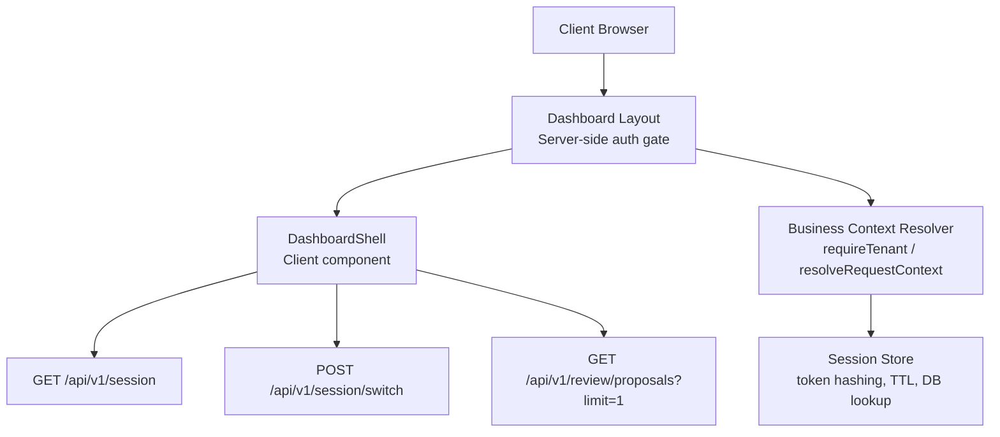
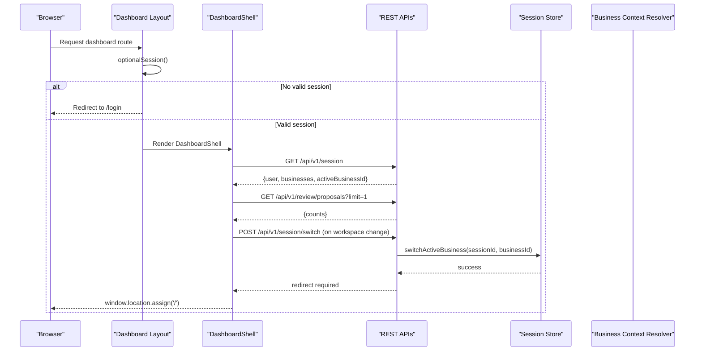
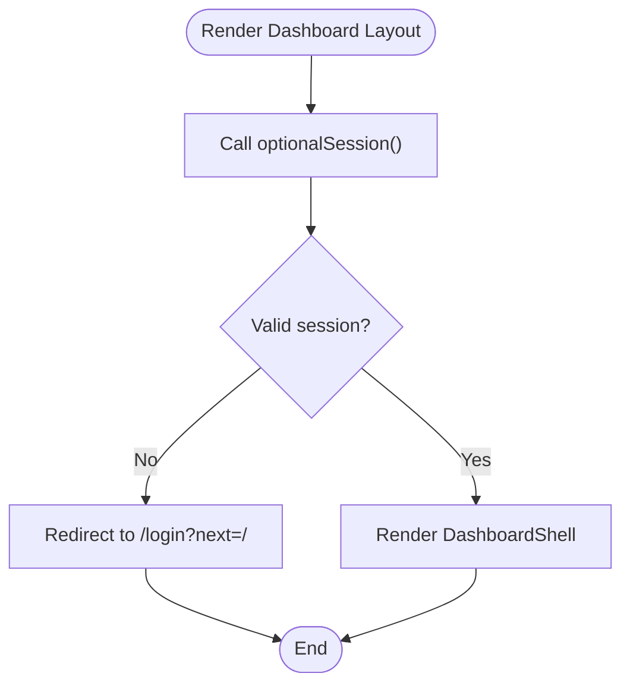
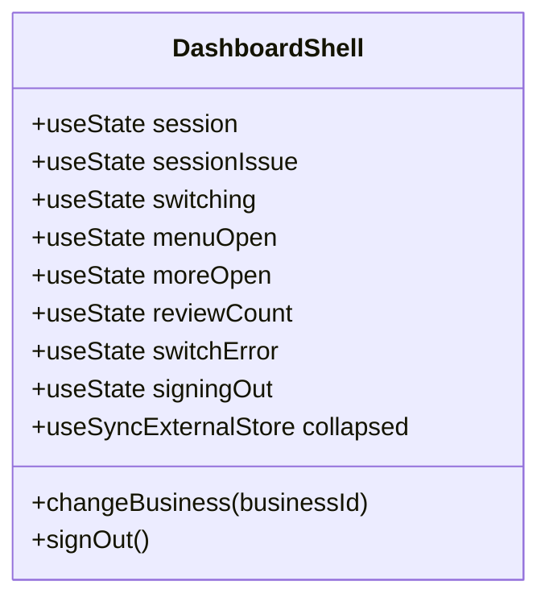
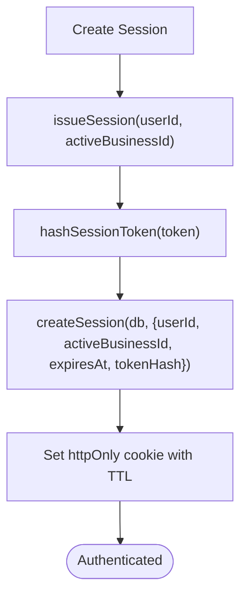
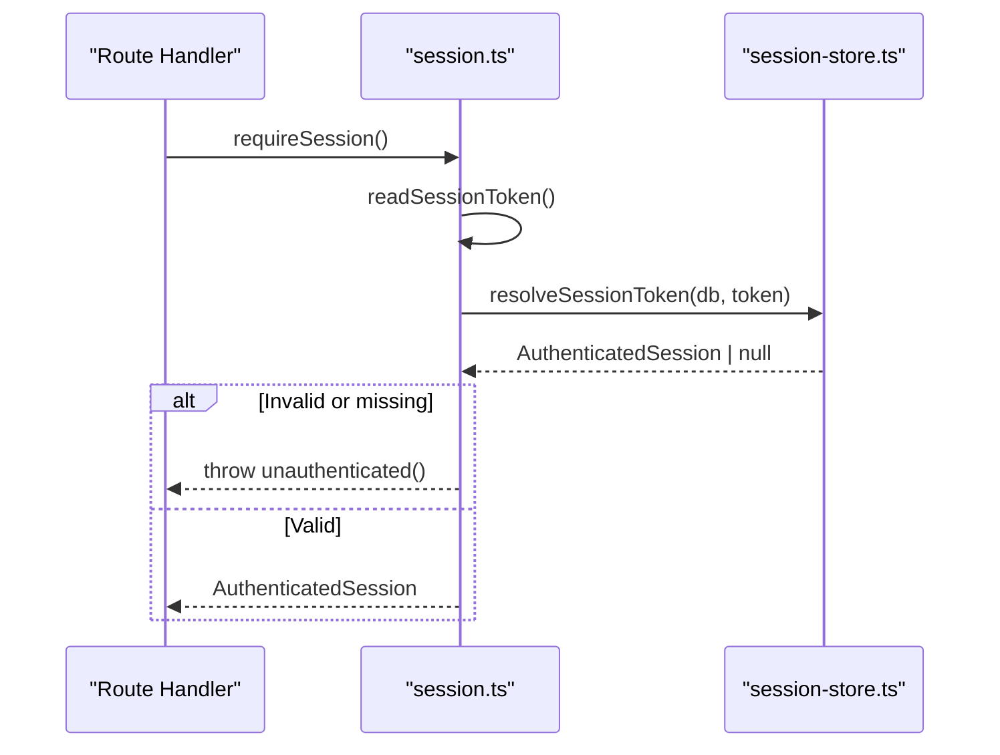
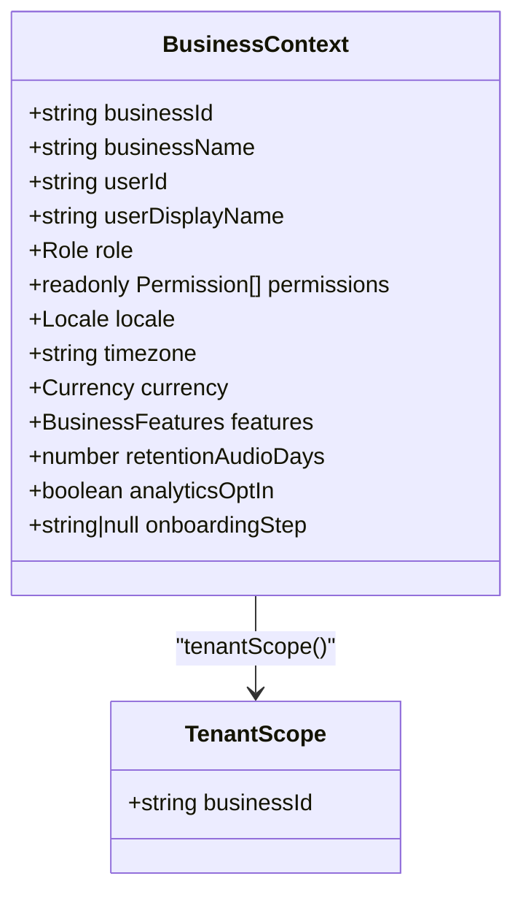
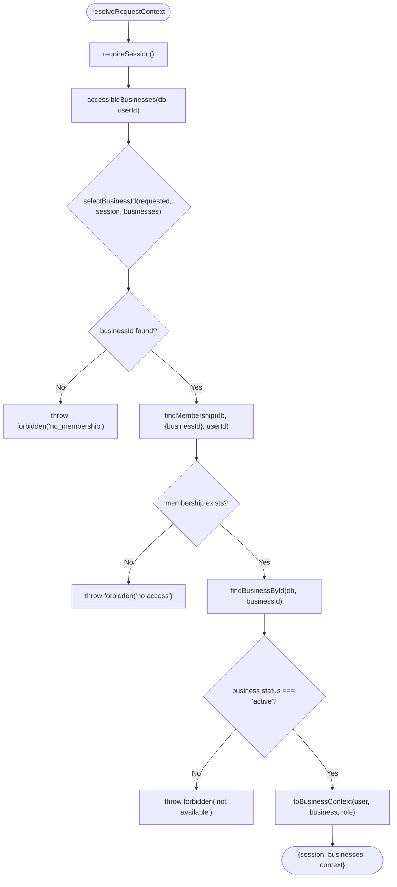
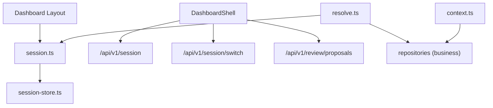

# State Management & Data Flow

<cite>
**Referenced Files in This Document**
- [layout.tsx](file://src/app/(dashboard)/layout.tsx)
- [DashboardShell.tsx](file://src/app/(dashboard)/components/DashboardShell.tsx)
- [session-store.ts](file://src/server/auth/session-store.ts)
- [session.ts](file://src/server/auth/session.ts)
- [context.ts](file://src/server/business-context/context.ts)
- [resolve.ts](file://src/server/business-context/resolve.ts)
</cite>

## Table of Contents
1. [Introduction](#introduction)
2. [Project Structure](#project-structure)
3. [Core Components](#core-components)
4. [Architecture Overview](#architecture-overview)
5. [Detailed Component Analysis](#detailed-component-analysis)
6. [Dependency Analysis](#dependency-analysis)
7. [Performance Considerations](#performance-considerations)
8. [Troubleshooting Guide](#troubleshooting-guide)
9. [Conclusion](#conclusion)

## Introduction
This document explains the frontend state management architecture and data flow patterns for the application, focusing on:
- How server-side business context is propagated to client components
- Session state management and user authentication state
- Separation between component state and application state
- Local state patterns using React hooks
- Global state strategies used by the shell
- Data fetching patterns, caching behavior, and error/loading states
- Business context switching and persistence
- Performance considerations for re-renders and memory management

The system uses Next.js App Router with a server-gated dashboard layout that enforces authentication before rendering the client shell. The shell manages session data, workspace selection, navigation state, and UI interactions through local React state and external store integration.

## Project Structure
At a high level:
- Server-side authentication and business context are resolved before any dashboard page renders.
- The dashboard layout acts as an authentication gate and wraps pages inside a client shell.
- The client shell fetches session information from a REST API and manages UI state locally.
- Business context (tenant, permissions, features) is built and validated on the server; the client receives only what it needs to render safely.

**Diagram sources**
- [layout.tsx:1-33](file://src/app/(dashboard)/layout.tsx#L1-L33)
- [DashboardShell.tsx:103-174](file://src/app/(dashboard)/components/DashboardShell.tsx#L103-L174)
- [resolve.ts:73-108](file://src/server/business-context/resolve.ts#L73-L108)
- [session-store.ts:67-96](file://src/server/auth/session-store.ts#L67-L96)

**Section sources**
- [layout.tsx:1-33](file://src/app/(dashboard)/layout.tsx#L1-L33)
- [DashboardShell.tsx:103-174](file://src/app/(dashboard)/components/DashboardShell.tsx#L103-L174)

## Core Components
- Dashboard Layout: Enforces authentication via optional session resolution and redirects unauthenticated users to login. It ensures no dashboard page renders without a valid session.
- DashboardShell: A client component that owns UI state (navigation collapse, menus, review count), fetches session data, handles business switching, and provides the dashboard chrome.
- Session Store: Framework-free session contract including token issuance, hashing, TTL, cookie options, and database-backed session resolution.
- Session Module: HTTP-only cookie boundary that reads/writes cookies and exposes requireSession/optionalSession helpers.
- Business Context: Defines tenant-scoped context types, permission checks, feature flags, locale/timezone/currency normalization, and helper functions for building contexts.
- Context Resolver: Resolves authenticated tenant context per request, validates membership, selects active business, and returns a verified BusinessContext.

Key responsibilities:
- Authentication gating at the layout layer
- Client-side session fetching and error handling
- Workspace switching with full-page navigation
- External store integration for persistent UI preferences
- Server-side tenant scoping and permission enforcement

**Section sources**
- [layout.tsx:1-33](file://src/app/(dashboard)/layout.tsx#L1-L33)
- [DashboardShell.tsx:103-234](file://src/app/(dashboard)/components/DashboardShell.tsx#L103-L234)
- [session-store.ts:21-105](file://src/server/auth/session-store.ts#L21-L105)
- [session.ts:1-69](file://src/server/auth/session.ts#L1-L69)
- [context.ts:20-86](file://src/server/business-context/context.ts#L20-L86)
- [resolve.ts:50-108](file://src/server/business-context/resolve.ts#L50-L108)

## Architecture Overview
The application separates concerns across layers:
- Server-side: Authentication, session management, business context resolution, and tenant scoping.
- Client-side: UI state management, data fetching, and user interactions.

**Diagram sources**
- [layout.tsx:19-32](file://src/app/(dashboard)/layout.tsx#L19-L32)
- [DashboardShell.tsx:134-174](file://src/app/(dashboard)/components/DashboardShell.tsx#L134-L174)
- [DashboardShell.tsx:200-222](file://src/app/(dashboard)/components/DashboardShell.tsx#L200-L222)
- [session-store.ts:102-104](file://src/server/auth/session-store.ts#L102-L104)

## Detailed Component Analysis

### Dashboard Layout: Authentication Gate
Responsibilities:
- Resolve optional session on the server
- Redirect to login if no valid session exists
- Wrap children with DashboardShell when authenticated

Behavior:
- Uses optionalSession to avoid throwing on missing tokens
- Redirects with next parameter for return navigation
- Ensures all dashboard pages run under a verified session

**Diagram sources**
- [layout.tsx:19-32](file://src/app/(dashboard)/layout.tsx#L19-L32)

**Section sources**
- [layout.tsx:1-33](file://src/app/(dashboard)/layout.tsx#L1-L33)

### DashboardShell: Client State and Data Fetching
Responsibilities:
- Manage UI state (collapsed rail, menus, review count, switching, errors)
- Fetch session data and review counts
- Handle workspace switching and sign-out flows
- Integrate external store for collapsed rail preference

Local state patterns:
- useState for session payload, switching, menu toggles, review count, errors
- useSyncExternalStore for collapsed rail preference persisted in localStorage
- useCallback for stable handlers
- useEffect for data fetching and keyboard listeners

Data fetching:
- GET /api/v1/session with cache: 'no-store'
- GET /api/v1/review/proposals?limit=1 with cache: 'no-store'
- Error handling sets sessionIssue or clears counts on failure

Workspace switching:
- POST /api/v1/session/switch with JSON body
- On success, performs full navigation via window.location.assign('/')
- On error, displays switchError message

Sign-out:
- DELETE /api/v1/session
- Navigates to /login regardless of network failure

**Diagram sources**
- [DashboardShell.tsx:103-174](file://src/app/(dashboard)/components/DashboardShell.tsx#L103-L174)
- [DashboardShell.tsx:200-234](file://src/app/(dashboard)/components/DashboardShell.tsx#L200-L234)

**Section sources**
- [DashboardShell.tsx:103-234](file://src/app/(dashboard)/components/DashboardShell.tsx#L103-L234)

### Session Store: Token Lifecycle and Persistence
Responsibilities:
- Generate opaque session tokens
- Hash tokens before storing in database
- Define cookie options (httpOnly, sameSite, secure, path, maxAge)
- Issue sessions with expiration and active business ID
- Resolve sessions by hashed token and validate user status
- Revoke sessions and switch active business

Key behaviors:
- SESSION_TTL_MS defines 14-day TTL
- devLoginEnabled restricts development sign-in
- hashUserAgent stores a truncated hash for device fingerprinting

**Diagram sources**
- [session-store.ts:41-81](file://src/server/auth/session-store.ts#L41-L81)
- [session-store.ts:50-58](file://src/server/auth/session-store.ts#L50-L58)

**Section sources**
- [session-store.ts:21-105](file://src/server/auth/session-store.ts#L21-L105)

### Session Module: Cookie Boundary
Responsibilities:
- Read/write/clear session cookies
- Expose requireSession and optionalSession
- Re-export core session utilities from session-store

Behavior:
- requireSession throws unauthenticated if no token or invalid session
- optionalSession returns null when no token present
- Cookie options derived from session-store

**Diagram sources**
- [session.ts:40-68](file://src/server/auth/session.ts#L40-L68)
- [session-store.ts:90-96](file://src/server/auth/session-store.ts#L90-L96)

**Section sources**
- [session.ts:1-69](file://src/server/auth/session.ts#L1-L69)

### Business Context: Tenant Scoping and Permissions
Responsibilities:
- Define BusinessContext and TenantScope types
- Provide hasPermission/assertPermission helpers
- Build context from authorized user and business row
- Normalize locale, timezone, currency, and feature flags

Key behaviors:
- toBusinessContext maps rows into typed context
- contextForTesting constructs minimal contexts for tests/jobs
- Feature flags parsed from JSON with defaults

**Diagram sources**
- [context.ts:20-50](file://src/server/business-context/context.ts#L20-L50)
- [context.ts:66-86](file://src/server/business-context/context.ts#L66-L86)

**Section sources**
- [context.ts:20-131](file://src/server/business-context/context.ts#L20-L131)

### Context Resolver: Request-Time Resolution
Responsibilities:
- Resolve authenticated tenant context per request
- Select active business based on header, session default, or first available
- Validate membership and business availability
- Return verified BusinessContext or throw forbidden/unauthenticated

Key behaviors:
- ACTIVE_BUSINESS_HEADER constant for x-active-business-id
- selectBusinessId prioritizes requested > session.active_business_id > first business
- requireTenant wraps resolution and returns db, context, session, businesses

**Diagram sources**
- [resolve.ts:50-108](file://src/server/business-context/resolve.ts#L50-L108)

**Section sources**
- [resolve.ts:1-152](file://src/server/business-context/resolve.ts#L1-L152)

## Dependency Analysis
Component relationships:
- Dashboard Layout depends on session.ts for optionalSession
- DashboardShell depends on REST endpoints (/api/v1/session, /api/v1/session/switch, /api/v1/review/proposals)
- Session Store is used by session.ts and business context resolver indirectly via repositories
- Business Context Resolver depends on session.ts and repositories for membership/business data

**Diagram sources**
- [layout.tsx:19-32](file://src/app/(dashboard)/layout.tsx#L19-L32)
- [DashboardShell.tsx:134-174](file://src/app/(dashboard)/components/DashboardShell.tsx#L134-L174)
- [session.ts:40-68](file://src/server/auth/session.ts#L40-L68)
- [session-store.ts:67-96](file://src/server/auth/session-store.ts#L67-L96)
- [resolve.ts:73-108](file://src/server/business-context/resolve.ts#L73-L108)

**Section sources**
- [layout.tsx:1-33](file://src/app/(dashboard)/layout.tsx#L1-L33)
- [DashboardShell.tsx:103-234](file://src/app/(dashboard)/components/DashboardShell.tsx#L103-L234)
- [session.ts:1-69](file://src/server/auth/session.ts#L1-L69)
- [session-store.ts:21-105](file://src/server/auth/session-store.ts#L21-L105)
- [resolve.ts:1-152](file://src/server/business-context/resolve.ts#L1-L152)

## Performance Considerations
- Avoid unnecessary re-renders:
  - Use useCallback for event handlers like toggleCollapsed and changeBusiness
  - Keep session fetching scoped to useEffect with cleanup flag to prevent stale updates
  - Use useSyncExternalStore for collapsed rail preference to avoid effect-driven state duplication
- Minimize network calls:
  - Use cache: 'no-store' for session and review count endpoints to ensure fresh data
  - Batch related operations where possible; currently, session and review count are fetched independently
- Memory management:
  - Remove event listeners in useEffect cleanup for keyboard handling
  - Abort or ignore async work after component unmount using active flag
- UI responsiveness:
  - Disable controls during switching/sign-out to prevent race conditions
  - Show loading/booting state to indicate initial data load

[No sources needed since this section provides general guidance]

## Troubleshooting Guide
Common issues and resolutions:
- Unauthenticated session banner:
  - Occurs when GET /api/v1/session returns non-OK with 401
  - Action: Redirect to login; verify cookie presence and validity
- Network error banner:
  - Occurs when session fetch fails due to network issues
  - Action: Retry logic can be added; currently shows generic error
- Workspace switch error:
  - Occurs when POST /api/v1/session/switch fails
  - Action: Display switchError; ensure full navigation occurs on success
- Sign-out not clearing cookie:
  - DELETE /api/v1/session may fail; server clears cookie on success
  - Action: Force navigation to /login regardless of fetch failure

Diagnostic steps:
- Verify optionalSession resolves correctly in dashboard layout
- Inspect session cookie name and TTL settings
- Check business membership and active business selection in context resolver
- Confirm feature flags and permissions are normalized correctly

**Section sources**
- [DashboardShell.tsx:134-174](file://src/app/(dashboard)/components/DashboardShell.tsx#L134-L174)
- [DashboardShell.tsx:200-234](file://src/app/(dashboard)/components/DashboardShell.tsx#L200-L234)
- [session-store.ts:41-81](file://src/server/auth/session-store.ts#L41-L81)
- [resolve.ts:91-108](file://src/server/business-context/resolve.ts#L91-L108)

## Conclusion
The application employs a clear separation between server-side authentication and business context resolution and client-side UI state management. The dashboard layout enforces authentication, while the client shell manages local state for navigation, workspace switching, and user interactions. Session handling uses a robust, framework-free store with hashed tokens and database-backed validation. Business context is strictly enforced on the server, ensuring tenant isolation and permission checks. The client fetches minimal necessary data, handles errors gracefully, and persists UI preferences externally. Performance optimizations include stable handlers, external store integration, and careful cleanup of side effects.

[No sources needed since this section summarizes without analyzing specific files]