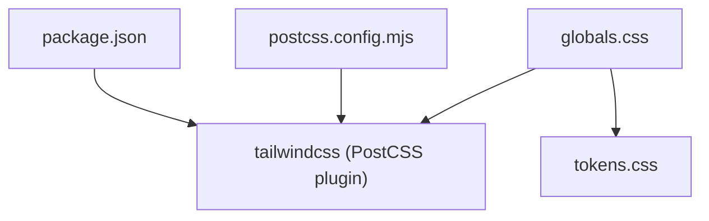
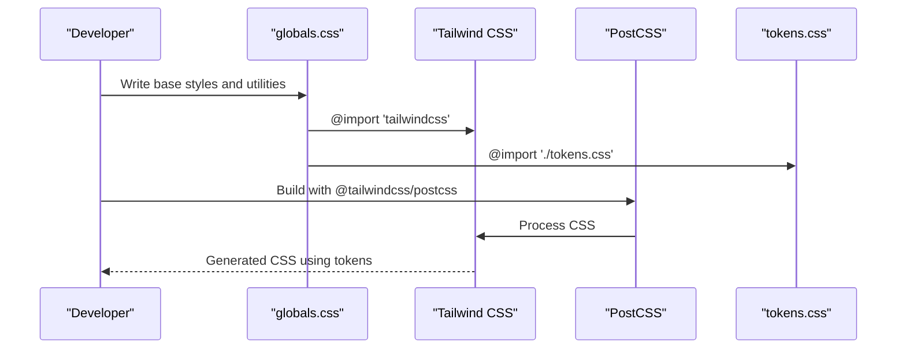
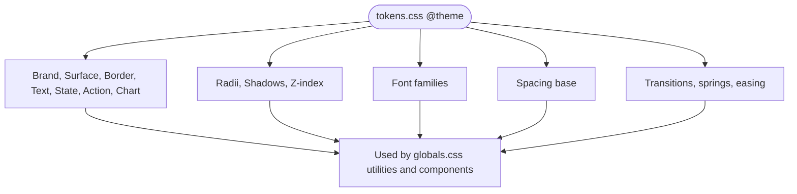
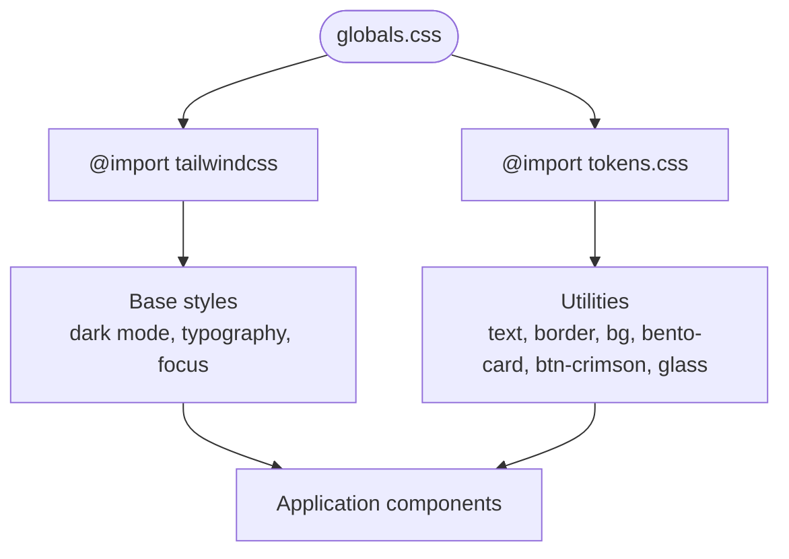
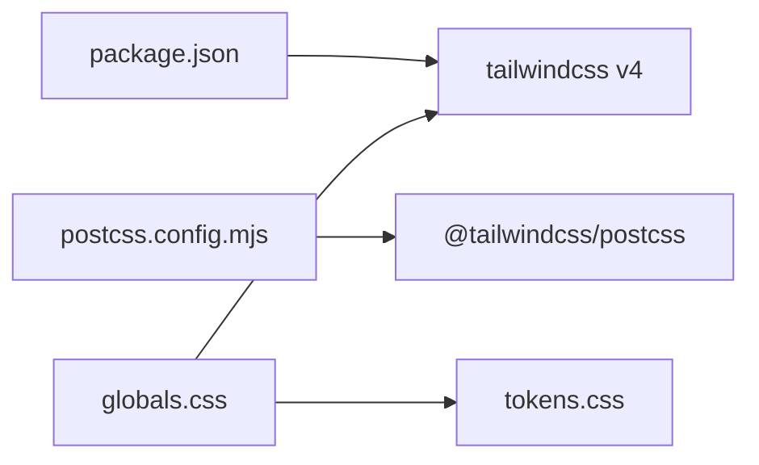
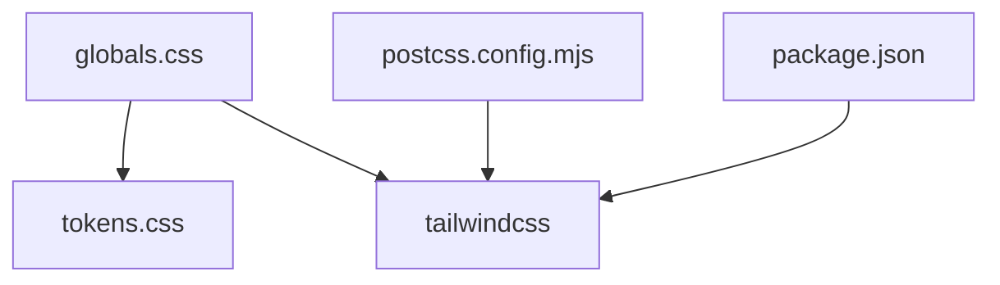

# Styling System & Design Tokens

<cite>
**Referenced Files in This Document**
- [tokens.css](file://src/styles/tokens.css)
- [globals.css](file://src/styles/globals.css)
- [postcss.config.mjs](file://postcss.config.mjs)
- [package.json](file://package.json)
</cite>

## Table of Contents
1. [Introduction](#introduction)
2. [Project Structure](#project-structure)
3. [Core Components](#core-components)
4. [Architecture Overview](#architecture-overview)
5. [Detailed Component Analysis](#detailed-component-analysis)
6. [Dependency Analysis](#dependency-analysis)
7. [Performance Considerations](#performance-considerations)
8. [Troubleshooting Guide](#troubleshooting-guide)
9. [Conclusion](#conclusion)
10. [Appendices](#appendices)

## Introduction
This document explains the styling architecture for the Daftari dashboard, focusing on how CSS variables, design tokens, and Tailwind CSS work together to create a consistent, accessible, and performant visual system. The project uses Tailwind CSS v4 with PostCSS, defines all design tokens in a single CSS file via the `@theme` block, and composes global base styles and utility classes in another stylesheet.

The design philosophy emphasizes clarity, deference, and depth: a pitch-black background, stark white text, restrained use of crimson accents, Apple-style rounded surfaces, subtle shadows, and fluid micro-interactions.

## Project Structure
The styling layer is intentionally minimal:
- `src/styles/tokens.css`: Centralized design tokens (colors, radii, shadows, typography, spacing, motion).
- `src/styles/globals.css`: Imports Tailwind and tokens, then defines base styles, accessibility rules, and reusable utility classes.
- `postcss.config.mjs`: Configures the Tailwind PostCSS plugin.
- `package.json`: Declares Tailwind CSS v4 and its PostCSS integration.

**Diagram sources**
- [globals.css:1-2](file://src/styles/globals.css#L1-L2)
- [postcss.config.mjs:1-7](file://postcss.config.mjs#L1-L7)
- [package.json:32-44](file://package.json#L32-L44)

**Section sources**
- [tokens.css:1-105](file://src/styles/tokens.css#L1-L105)
- [globals.css:1-175](file://src/styles/globals.css#L1-L175)
- [postcss.config.mjs:1-7](file://postcss.config.mjs#L1-L7)
- [package.json:32-44](file://package.json#L32-L44)

## Core Components
- Design token source (`tokens.css`)
- Global base styles and utilities (`globals.css`)
- Tailwind CSS integration via PostCSS (`postcss.config.mjs`, `package.json`)

Key responsibilities:
- `tokens.css`: Defines semantic color roles, surface hierarchy, borders, text colors, state colors, chart colors, radii, shadows, fonts, z-index scale, spacing base, and motion values.
- `globals.css`: Applies dark mode defaults, resets, typography baselines, focus visibility, and component-level utility classes such as cards, buttons, glass overlays, and layout helpers.
- PostCSS config: Enables Tailwind CSS v4 through `@tailwindcss/postcss`.
- Package manifest: Pins Tailwind CSS v4 and its PostCSS adapter.

**Section sources**
- [tokens.css:16-105](file://src/styles/tokens.css#L16-L105)
- [globals.css:1-175](file://src/styles/globals.css#L1-L175)
- [postcss.config.mjs:1-7](file://postcss.config.mjs#L1-L7)
- [package.json:32-44](file://package.json#L32-L44)

## Architecture Overview
The styling pipeline is straightforward:
1. `globals.css` imports Tailwind and the token file.
2. PostCSS processes Tailwind using the configured plugin.
3. Tailwind reads CSS variables from `@theme` and exposes them throughout the app.
4. Base styles set the dark theme, typography, and accessibility defaults.
5. Utility classes compose tokens into reusable UI patterns.

**Diagram sources**
- [globals.css:1-2](file://src/styles/globals.css#L1-L2)
- [postcss.config.mjs:1-7](file://postcss.config.mjs#L1-L7)

## Detailed Component Analysis

### Design Token System (`tokens.css`)
The token system centralizes visual primitives under `@theme`. It organizes tokens by category:
- Brand colors: matte black, white, and constrained crimson accents.
- Surfaces: layered backgrounds for depth (base, raised, subtle, sunken, disabled, inverse variants).
- Borders: subtle, strong, inverse, and accent borders.
- Text: primary, muted, subtle, inverse, and link colors.
- Semantic states: success, warning, danger, info, and neutral surfaces.
- Actions and focus: primary action color, hover variant, text contrast, and focus ring.
- Charts: sales, expenses, grid, and axis colors.
- Radii: small to large and pill shapes.
- Shadows: card, raised, and overlay elevations.
- Typography: sans, display, and mono font stacks.
- Z-index scale: base, sticky, drawer, overlay, toast.
- Spacing: base unit driving a consistent scale.
- Motion: default transition duration, spring duration, easing curve, and click scale.

**Diagram sources**
- [tokens.css:16-105](file://src/styles/tokens.css#L16-L105)

Guidelines derived from tokens:
- Use semantic tokens rather than raw hex values.
- Reserve crimson for high-priority interactive accents and focal points.
- Maintain surface hierarchy using raised/subtle/sunken tokens.
- Apply focus rings consistently via the focus-ring token.
- Compose spacing using the base spacing variable.
- Animate with the provided durations and easing.

**Section sources**
- [tokens.css:1-105](file://src/styles/tokens.css#L1-L105)

### Global Styles (`globals.css`)
`globals.css` performs three main tasks:
- Imports Tailwind and tokens.
- Establishes base styles and accessibility defaults.
- Provides reusable utility classes for common UI patterns.

Base styles include:
- Dark color scheme and body defaults (background, text, font family, size, line height).
- Visible focus outlines for keyboard navigation.
- Consistent heading weights and letter-spacing.
- Accessible minimum text sizing for form controls.

Utility classes include:
- Numeric formatting for tabular data.
- Text color helpers aligned to tokens.
- Border and background helpers.
- Skip-link for screen readers.
- Bento card with hover/active micro-interactions.
- Crimson button with hover and active states.
- Glass overlay with backdrop blur.

**Diagram sources**
- [globals.css:1-175](file://src/styles/globals.css#L1-L175)

Accessibility highlights:
- Focus-visible outlines ensure keyboard users can navigate clearly.
- Skip-link improves screen reader flow.
- Color is never used alone to convey meaning; paired with shape or text where applicable.

Responsive behavior:
- The current global styles do not define explicit breakpoints. Responsive behavior should be implemented using Tailwind’s responsive utilities and the existing token system.

**Section sources**
- [globals.css:1-175](file://src/styles/globals.css#L1-L175)

### Tailwind CSS Integration
Tailwind CSS v4 is integrated via PostCSS:
- `postcss.config.mjs` enables the Tailwind PostCSS plugin.
- `globals.css` imports Tailwind at the top of the stylesheet.
- `package.json` declares Tailwind CSS v4 and the PostCSS adapter.

**Diagram sources**
- [postcss.config.mjs:1-7](file://postcss.config.mjs#L1-L7)
- [package.json:32-44](file://package.json#L32-L44)
- [globals.css:1-2](file://src/styles/globals.css#L1-L2)

Configuration notes:
- No separate `tailwind.config.js` is present; configuration is driven by CSS `@theme` tokens and Tailwind v4 conventions.
- All custom theme values are defined in `tokens.css`.

**Section sources**
- [postcss.config.mjs:1-7](file://postcss.config.mjs#L1-L7)
- [package.json:32-44](file://package.json#L32-L44)
- [globals.css:1-2](file://src/styles/globals.css#L1-L2)

### Responsive Design Patterns
Current implementation:
- No explicit breakpoint definitions exist in the styling files.
- The application should leverage Tailwind’s responsive utilities alongside the token system for consistent spacing, colors, and typography across devices.

Recommended approach:
- Use mobile-first utilities in components.
- Scale spacing and typography using tokens and Tailwind utilities.
- Keep layout changes (e.g., sidebar collapse, grid reflow) within component styles or page layouts, not in global tokens.

[No sources needed since this section provides general guidance]

### Color System
The color system is organized semantically:
- Brand: matte black, white, crimson.
- Surfaces: layered backgrounds for depth.
- Borders: subtle, strong, inverse, and accent.
- Text: primary, muted, subtle, inverse, link.
- States: success, warning, danger, info, neutral surfaces.
- Actions: primary action color, hover, text contrast, focus ring.
- Charts: sales, expenses, grid, axis.

Usage guidelines:
- Prefer semantic tokens over raw colors.
- Use crimson sparingly for high-priority interactions.
- Ensure sufficient contrast between text and surface tokens.

**Section sources**
- [tokens.css:17-67](file://src/styles/tokens.css#L17-L67)

### Typography Scale
Typography tokens define:
- Sans stack for body and UI.
- Display stack for headings.
- Mono stack for code and data.

Base styles apply:
- Body font family, size, and line height.
- Heading weights and letter-spacing.
- Accessible input sizing.

Guidelines:
- Use the provided font stacks to maintain platform-native feel.
- Avoid arbitrary font sizes; prefer tokens and utilities.

**Section sources**
- [tokens.css:81-88](file://src/styles/tokens.css#L81-L88)
- [globals.css:13-46](file://src/styles/globals.css#L13-L46)

### Spacing Guidelines
Spacing is based on a single base unit:
- The spacing base drives a consistent scale (e.g., multiples of the base unit).
- Components should use tokens and utilities instead of hard-coded pixel values.

Guidelines:
- Compose spacing using the base spacing variable.
- Maintain consistent gaps and paddings across components.

**Section sources**
- [tokens.css:97-98](file://src/styles/tokens.css#L97-L98)

### Motion and Micro-interactions
Motion tokens provide:
- Default transition duration.
- Spring duration and easing.
- Click scale factor.

Utilities demonstrate:
- Card hover elevation and border transitions.
- Button hover and active scaling.
- Smooth focus and interaction feedback.

Guidelines:
- Use the provided durations and easing for consistency.
- Keep animations subtle and purposeful.

**Section sources**
- [tokens.css:100-105](file://src/styles/tokens.css#L100-L105)
- [globals.css:116-175](file://src/styles/globals.css#L116-L175)

### Component Styling Patterns
Reusable patterns in `globals.css`:
- Bento card: soft border, subtle shadow, hover lift, active scale.
- Crimson button: compact, accessible, with hover and active states.
- Glass overlay: backdrop blur and translucent background.
- Skip-link: hidden until focused for accessibility.

These patterns illustrate:
- Composition of tokens into cohesive UI elements.
- Consistent interaction states.
- Accessibility considerations (focus, contrast, skip navigation).

**Section sources**
- [globals.css:98-175](file://src/styles/globals.css#L98-L175)

### CSS-in-JS Alternatives and Style Composition
While this project uses CSS variables and Tailwind, similar composition principles apply when using CSS-in-JS:
- Centralize design tokens in a single source.
- Map tokens to runtime values (e.g., theme objects).
- Compose components from small, reusable style fragments.
- Keep animation and motion values centralized.

[No sources needed since this section provides general guidance]

## Dependency Analysis
The styling dependencies are minimal and well-scoped:
- `globals.css` depends on Tailwind and tokens.
- Tailwind is processed by PostCSS.
- Tokens are consumed by utilities and components.

**Diagram sources**
- [globals.css:1-2](file://src/styles/globals.css#L1-L2)
- [postcss.config.mjs:1-7](file://postcss.config.mjs#L1-L7)
- [package.json:32-44](file://package.json#L32-L44)

**Section sources**
- [globals.css:1-2](file://src/styles/globals.css#L1-L2)
- [postcss.config.mjs:1-7](file://postcss.config.mjs#L1-L7)
- [package.json:32-44](file://package.json#L32-L44)

## Performance Considerations
- CSS bundle size:
  - Rely on Tailwind’s purge and build-time processing to generate only used utilities.
  - Keep tokens centralized to avoid duplication.
- Critical CSS:
  - Inline critical base styles if necessary; otherwise, let Tailwind optimize delivery.
- Runtime calculations:
  - Prefer CSS variables for dynamic values to minimize JS-driven style updates.
  - Use provided motion tokens to keep animations predictable and GPU-friendly.

[No sources needed since this section provides general guidance]

## Troubleshooting Guide
Common issues and resolutions:
- Tokens not applied:
  - Ensure `tokens.css` is imported before utilities in `globals.css`.
  - Verify that `@theme` is recognized by Tailwind v4.
- Tailwind utilities missing:
  - Confirm PostCSS is configured with `@tailwindcss/postcss`.
  - Check that `globals.css` imports Tailwind at the top.
- Focus styles not visible:
  - Ensure `:focus-visible` rules are present and tokens are correctly referenced.
- Contrast problems:
  - Validate text against surface tokens; adjust using semantic tokens rather than ad-hoc colors.

**Section sources**
- [globals.css:1-28](file://src/styles/globals.css#L1-L28)
- [postcss.config.mjs:1-7](file://postcss.config.mjs#L1-L7)

## Conclusion
The Daftari styling system centers on a single token source, clear global base styles, and Tailwind CSS v4 integration. By composing utilities from semantic tokens, the project achieves visual consistency, accessibility, and performance. Future enhancements should continue to expand tokens thoughtfully, maintain mobile-first responsiveness, and keep interaction patterns consistent with the established motion and color guidelines.

[No sources needed since this section summarizes without analyzing specific files]

## Appendices

### Adding New Design Tokens
Steps:
1. Add new tokens to `tokens.css` under the appropriate category.
2. Reference tokens in `globals.css` utilities or components.
3. Validate contrast and accessibility implications.
4. Update documentation and examples to reflect the new token.

**Section sources**
- [tokens.css:16-105](file://src/styles/tokens.css#L16-L105)
- [globals.css:69-175](file://src/styles/globals.css#L69-L175)

### Maintaining Visual Consistency
- Use semantic tokens everywhere.
- Reuse utility classes for common patterns.
- Keep motion values consistent.
- Avoid hard-coded colors, sizes, and shadows.

[No sources needed since this section provides general guidance]