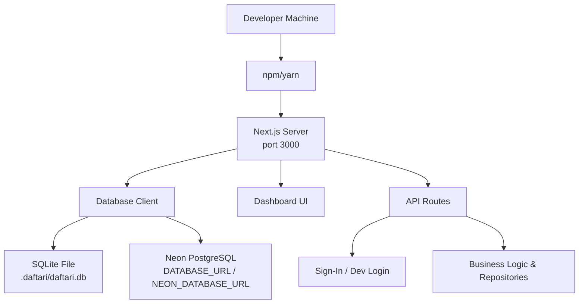
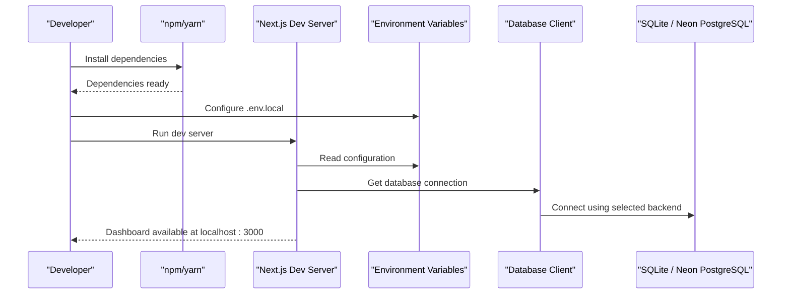
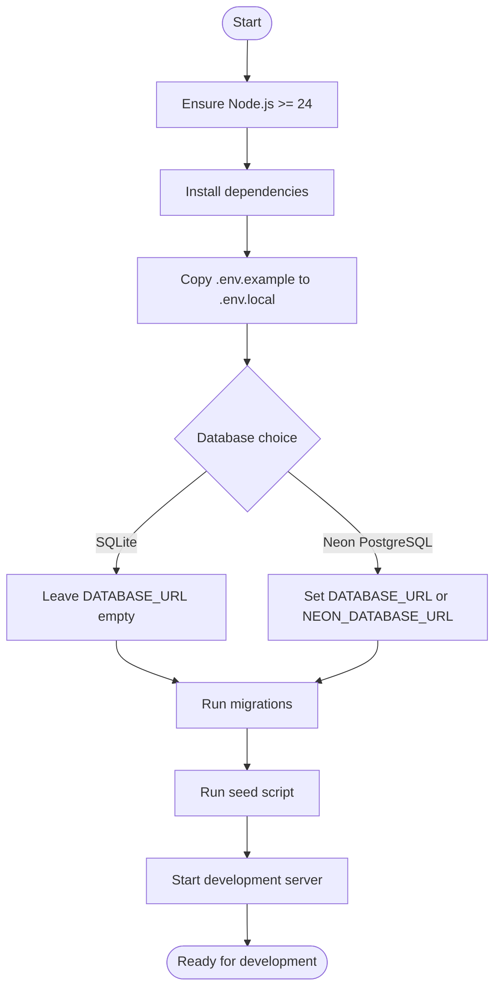
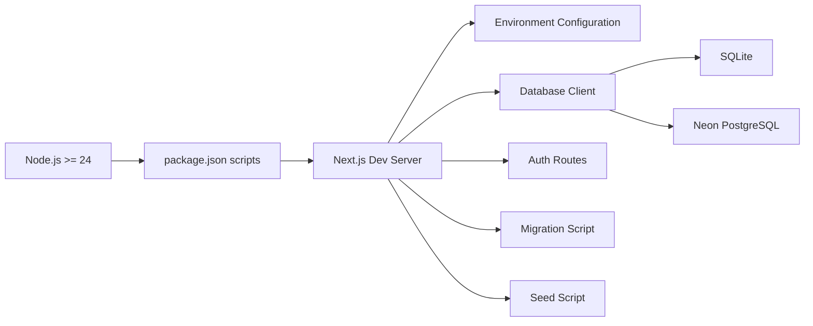

# Getting Started

<cite>
**Referenced Files in This Document**
- [package.json](file://package.json)
- [.env.example](file://.env.example)
- [next.config.ts](file://next.config.ts)
- [src/server/db/client.ts](file://src/server/db/client.ts)
- [src/server/db/migrations.ts](file://src/server/db/migrations.ts)
- [scripts/migrate.ts](file://scripts/migrate.ts)
- [scripts/seed.ts](file://scripts/seed.ts)
- [src/server/config/env.ts](file://src/server/config/env.ts)
- [src/app/api/v1/auth/sign-in/route.ts](file://src/app/api/v1/auth/sign-in/route.ts)
- [src/app/api/v1/dev/login/route.ts](file://src/app/api/v1/dev/login/route.ts)
</cite>

## Table of Contents
1. [Introduction](#introduction)
2. [Project Structure](#project-structure)
3. [Core Components](#core-components)
4. [Architecture Overview](#architecture-overview)
5. [Detailed Component Analysis](#detailed-component-analysis)
6. [Dependency Analysis](#dependency-analysis)
7. [Performance Considerations](#performance-considerations)
8. [Troubleshooting Guide](#troubleshooting-guide)
9. [Verification Checklist](#verification-checklist)
10. [Conclusion](#conclusion)

## Introduction
This guide helps you set up the Daftari development environment, run the dashboard, configure authentication, and prepare a working database for local development. It covers Node.js requirements, dependency installation, database setup with Neon PostgreSQL or SQLite, environment configuration, migrations, initial data seeding, and basic troubleshooting.

Daftari is a Next.js application that supports:
- Local SQLite for fast iteration.
- Neon PostgreSQL via `DATABASE_URL` or `NEON_DATABASE_URL`.
- A credential-based sign-in flow and a local development login endpoint.
- Versioned database migrations and an idempotent seed script.

## Project Structure
At a high level, the repository contains:
- Application code under `src/`, including API routes, server-side logic, and the Next.js app shell.
- Database client and migration logic under `src/server/db/`.
- Scripts for migrations, seeding, and job execution under `scripts/`.
- Environment documentation and defaults under `.env.example`.
- Runtime provider configuration under `src/server/config/env.ts`.

**Diagram sources**
- [package.json:9-21](file://package.json#L9-L21)
- [src/server/db/client.ts:52-88](file://src/server/db/client.ts#L52-L88)
- [next.config.ts:3-22](file://next.config.ts#L3-L22)

**Section sources**
- [package.json:1-47](file://package.json#L1-L47)
- [next.config.ts:1-24](file://next.config.ts#L1-L24)

## Core Components
- **Runtime engine**: Node.js version 24 or newer is required by the project’s engine constraint.
- **Package manager**: Use npm or yarn to install dependencies.
- **Application server**: The `dev` script starts the Next.js development server.
- **Database layer**: A unified client selects between SQLite (local/test) and Neon PostgreSQL (production).
- **Migrations**: Versioned schema migrations are applied through a dedicated script.
- **Seed script**: Creates a minimal tenant, business, WhatsApp integration, and inventory items for end-to-end testing.
- **Authentication**: Credential sign-in and a local development login route are available.

Key responsibilities:
- `package.json`: Defines scripts, engines, and dependencies.
- `.env.example`: Documents required and optional environment variables.
- `src/server/db/client.ts`: Chooses SQLite or PostgreSQL, manages connections, and exposes query helpers.
- `src/server/db/migrations.ts`: Defines migrations and applies them safely.
- `scripts/migrate.ts` and `scripts/seed.ts`: CLI entry points for database setup.
- `src/server/config/env.ts`: Validates provider configuration and fails fast on missing settings.
- Authentication routes: Provide session creation for both production-style credentials and local development.

**Section sources**
- [package.json:6-21](file://package.json#L6-L21)
- [.env.example:1-85](file://.env.example#L1-L85)
- [src/server/db/client.ts:1-88](file://src/server/db/client.ts#L1-L88)
- [src/server/db/migrations.ts:647-688](file://src/server/db/migrations.ts#L647-L688)
- [scripts/migrate.ts:1-25](file://scripts/migrate.ts#L1-L25)
- [scripts/seed.ts:1-87](file://scripts/seed.ts#L1-L87)
- [src/server/config/env.ts:1-44](file://src/server/config/env.ts#L1-L44)
- [src/app/api/v1/auth/sign-in/route.ts:1-87](file://src/app/api/v1/auth/sign-in/route.ts#L1-L87)
- [src/app/api/v1/dev/login/route.ts:1-77](file://src/app/api/v1/dev/login/route.ts#L1-L77)

## Architecture Overview
The development workflow centers around Next.js, a database client that abstracts SQLite and PostgreSQL, and a small set of scripts for maintenance tasks.

**Diagram sources**
- [package.json:9-21](file://package.json#L9-L21)
- [src/server/db/client.ts:52-88](file://src/server/db/client.ts#L52-L88)
- [.env.example:1-85](file://.env.example#L1-L85)

## Detailed Component Analysis

### Installation and Setup
1. **Install Node.js**
   - Use Node.js 24 or newer.
   - Verify your version before proceeding.

2. **Install Dependencies**
   - Run your package manager to install all dependencies.
   - The project defines standard scripts for development, building, linting, type checking, and testing.

3. **Create Local Environment Configuration**
   - Copy `.env.example` to `.env.local`.
   - Adjust values according to your preferred database and providers.

4. **Choose a Database Backend**
   - **SQLite (recommended for local development)**: Leave `DATABASE_URL` and `NEON_DATABASE_URL` empty. The application creates a file under `.daftari/daftari.db`.
   - **Neon PostgreSQL (recommended for deployment or realistic local testing)**: Set either `DATABASE_URL` or `NEON_DATABASE_URL` to a valid Neon connection string.

5. **Run Migrations**
   - Apply pending migrations using the provided script.
   - The script prints the data directory, newly applied migrations, schema version, and current migration.

6. **Seed Initial Data**
   - Run the seed script to create a developer user, business, WhatsApp integration, and sample inventory items.
   - The seed is idempotent; running it multiple times does not duplicate core entities.

**Diagram sources**
- [package.json:6-21](file://package.json#L6-L21)
- [.env.example:6-12](file://.env.example#L6-L12)
- [scripts/migrate.ts:10-22](file://scripts/migrate.ts#L10-L22)
- [scripts/seed.ts:79-84](file://scripts/seed.ts#L79-L84)

**Section sources**
- [package.json:6-21](file://package.json#L6-L21)
- [.env.example:1-85](file://.env.example#L1-L85)
- [scripts/migrate.ts:1-25](file://scripts/migrate.ts#L1-L25)
- [scripts/seed.ts:1-87](file://scripts/seed.ts#L1-L87)

### Database Setup

#### SQLite for Local Development
- When no PostgreSQL connection string is present, the database client falls back to SQLite.
- The SQLite file path is resolved from `DAFTARI_DATA_DIR`; if unset, it defaults to `.daftari`.
- SQLite-specific pragmas are enabled for WAL mode, foreign keys, busy timeout, and synchronous behavior.

Key behaviors:
- Production without a PostgreSQL URL throws a configuration error.
- Tests can point the SQLite file to a temporary location through the database configuration helper.

**Section sources**
- [src/server/db/client.ts:32-88](file://src/server/db/client.ts#L32-L88)

#### Neon PostgreSQL
- Set `DATABASE_URL` or `NEON_DATABASE_URL` to connect to Neon.
- The client uses a pooled connection with configurable limits and timeouts.
- Parameter placeholders are normalized so repositories can use portable `?` syntax.

Security and reliability notes:
- Transactions are supported through `withTransaction`.
- Nested transactions use savepoints on PostgreSQL.
- Migration statements are split carefully to avoid breaking on semicolons inside strings or comments.

**Section sources**
- [src/server/db/client.ts:52-88](file://src/server/db/client.ts#L52-L88)
- [src/server/db/client.ts:99-165](file://src/server/db/client.ts#L99-L165)
- [src/server/db/client.ts:200-286](file://src/server/db/client.ts#L200-L286)
- [src/server/db/client.ts:288-339](file://src/server/db/client.ts#L288-L339)

### Environment Variables
Use `.env.example` as the source of truth for configuration. Important categories include:

- **Data directory and database**
  - `DAFTARI_DATA_DIR`: Directory for SQLite files and local media.
  - `DATABASE_URL` or `NEON_DATABASE_URL`: PostgreSQL connection string.

- **Webhooks and security**
  - `DAFTARI_WEBHOOK_SECRET`: Secret used by the local WhatsApp webhook adapter.
  - `DAFTARI_MEDIA_URL_TTL_SECONDS`: Lifetime of signed media URLs.
  - `DAFTARI_ALLOW_DEV_LOGIN`: Enables the local development login endpoint.

- **Provider selection**
  - `DAFTARI_WHATSAPP_ENABLED` and `DAFTARI_WHATSAPP_PROVIDER`: Controls WhatsApp ingestion.
  - `DAFTARI_STORAGE_PROVIDER`: Selects local, S3-compatible, or Vercel Blob storage.
  - `DAFTARI_SPEECH_PROVIDER` and `DAFTARI_EXTRACTION_PROVIDER`: Controls speech and extraction adapters.
  - OpenAI-related variables when using the OpenAI providers.

- **Seed configuration**
  - `DAFTARI_SEED_SUBJECT`, `DAFTARI_SEED_DISPLAY_NAME`, `DAFTARI_SEED_BUSINESS_NAME`, and `DAFTARI_WHATSAPP_ACCOUNT_REF`.

Validation rules:
- Provider selectors default to offline or mock adapters.
- Missing required provider credentials cause a `ConfigError` early in runtime.
- Boolean flags accept `1`, `true`, or `yes`.

**Section sources**
- [.env.example:1-85](file://.env.example#L1-L85)
- [src/server/config/env.ts:14-44](file://src/server/config/env.ts#L14-L44)
- [src/server/config/env.ts:46-85](file://src/server/config/env.ts#L46-L85)
- [src/server/config/env.ts:87-132](file://src/server/config/env.ts#L87-L132)
- [src/server/config/env.ts:134-184](file://src/server/config/env.ts#L134-L184)

### Migrations
Migrations are versioned and additive. The system tracks applied migrations in a schema table and computes checksums to detect accidental edits.

Important migration features:
- Additive schema changes such as new tables, indexes, and columns.
- Safe structural rebuilds where necessary, especially for SQLite constraints.
- Append-only enforcement for audit events through database triggers.
- Support for both SQLite and PostgreSQL differences.

Running migrations:
- Use the provided script to apply pending migrations.
- The script reports which migrations were applied and the current schema state.

**Section sources**
- [src/server/db/migrations.ts:26-465](file://src/server/db/migrations.ts#L26-L465)
- [src/server/db/migrations.ts:467-654](file://src/server/db/migrations.ts#L467-L654)
- [src/server/db/migrations.ts:656-706](file://src/server/db/migrations.ts#L656-L706)
- [scripts/migrate.ts:1-25](file://scripts/migrate.ts#L1-L25)

### Initial Data Seeding
The seed script prepares a minimal tenant for development:
- Creates or reuses a developer user by subject.
- Creates a business and assigns the user as owner.
- Upserts a WhatsApp integration record.
- Adds two sample inventory items if none exist.

Configuration:
- Customize the developer subject, display name, business name, and WhatsApp account reference through environment variables.
- The script runs migrations automatically before seeding.

Output:
- Prints created user, business, integration, and inventory items.
- Instructs you to sign in via the dashboard and send a WhatsApp message to exercise the pipeline.

**Section sources**
- [scripts/seed.ts:1-87](file://scripts/seed.ts#L1-L87)

### Authentication and Dashboard Access

#### Development Login
For local development, you can enable the development login endpoint by setting `DAFTARI_ALLOW_DEV_LOGIN=1`.

Behavior:
- The endpoint checks whether dev login is enabled.
- It creates or finds a user by provider subject.
- It optionally creates a business and membership.
- It issues a session cookie and returns user, active business, businesses, permissions, and session expiry.

Security:
- The endpoint refuses to run unless explicitly enabled.
- It is intended for development only and should not be exposed in production.

**Section sources**
- [.env.example:21-23](file://.env.example#L21-L23)
- [src/app/api/v1/dev/login/route.ts:1-77](file://src/app/api/v1/dev/login/route.ts#L1-L77)

#### Credential Sign-In
The credential sign-in route exchanges an email and password for a session cookie.

Behavior:
- Validates request body fields.
- Applies rate limiting per client and per email.
- Looks up the user by email.
- Verifies the password even when the user is unknown to prevent enumeration.
- Issues a session and sets a secure cookie.
- Returns user information, active business, businesses, and permissions.

Security:
- Failure responses are uniform to avoid leaking account existence.
- Rate limiting protects against brute-force attempts.

**Section sources**
- [src/app/api/v1/auth/sign-in/route.ts:1-87](file://src/app/api/v1/auth/sign-in/route.ts#L1-L87)

### Running the Development Server
After installing dependencies and configuring the environment:
1. Start the development server.
2. Open the dashboard in your browser.
3. If using local development login, ensure `DAFTARI_ALLOW_DEV_LOGIN=1`.
4. If using credential sign-in, create a user through your preferred provisioning path or use the seed and development login endpoints as appropriate for your workflow.

Security headers:
- The Next.js configuration adds security headers such as content type options, frame options, referrer policy, and permissions policy.

**Section sources**
- [package.json:9-12](file://package.json#L9-L12)
- [next.config.ts:3-22](file://next.config.ts#L3-L22)

## Dependency Analysis
The development workflow depends on:
- Node.js runtime.
- Next.js application server.
- Database client supporting SQLite and Neon PostgreSQL.
- Environment-driven provider configuration.
- Migration and seed scripts.

**Diagram sources**
- [package.json:6-21](file://package.json#L6-L21)
- [src/server/db/client.ts:52-88](file://src/server/db/client.ts#L52-L88)
- [src/server/config/env.ts:1-44](file://src/server/config/env.ts#L1-L44)

**Section sources**
- [package.json:1-47](file://package.json#L1-L47)
- [src/server/db/client.ts:1-88](file://src/server/db/client.ts#L1-L88)
- [src/server/config/env.ts:1-44](file://src/server/config/env.ts#L1-L44)

## Performance Considerations
- Prefer Neon PostgreSQL for realistic performance and concurrency characteristics during local testing.
- SQLite is convenient for quick iteration but may not reflect production workload patterns.
- Keep media storage configured appropriately for your deployment target; local storage does not persist on serverless hosts.
- Tune provider selections to avoid unnecessary external calls during development.

[No sources needed since this section provides general guidance]

## Troubleshooting Guide

### Common Setup Issues
- **Wrong Node.js version**
  - Symptom: Installation or runtime errors related to unsupported Node versions.
  - Fix: Install Node.js 24 or newer.

- **Missing dependencies**
  - Symptom: Module not found or script failures.
  - Fix: Reinstall dependencies using your package manager.

- **Development login disabled**
  - Symptom: Local development login endpoint returns forbidden.
  - Fix: Set `DAFTARI_ALLOW_DEV_LOGIN=1` in `.env.local`.

**Section sources**
- [package.json:6-8](file://package.json#L6-L8)
- [src/app/api/v1/dev/login/route.ts:32-37](file://src/app/api/v1/dev/login/route.ts#L32-L37)

### Database Connection Problems
- **PostgreSQL not configured**
  - Symptom: Error indicating `DATABASE_URL` or `NEON_DATABASE_URL` must be configured in production.
  - Fix: Set one of those variables to a valid Neon connection string.

- **SQLite file path issues**
  - Symptom: Errors writing to the data directory.
  - Fix: Ensure `DAFTARI_DATA_DIR` exists and is writable, or leave it unset to use the default `.daftari`.

- **Migration failures**
  - Symptom: Migration script reports applied migrations or schema version problems.
  - Fix: Review migration output, confirm the correct database backend, and rerun migrations.

**Section sources**
- [src/server/db/client.ts:75-77](file://src/server/db/client.ts#L75-L77)
- [src/server/db/client.ts:32-43](file://src/server/db/client.ts#L32-L43)
- [scripts/migrate.ts:10-22](file://scripts/migrate.ts#L10-L22)

### Environment Configuration Errors
- **Missing provider credentials**
  - Symptom: `ConfigError` stating a variable is required.
  - Fix: Set the required provider variables documented in `.env.example`.

- **Invalid provider selector**
  - Symptom: Error indicating a variable must be one of allowed values.
  - Fix: Correct the provider selector to match the documented choices.

- **WhatsApp webhook signature mismatch**
  - Symptom: Webhook deliveries rejected.
  - Fix: Set `DAFTARI_WEBHOOK_SECRET` and ensure the provider matches your configuration.

**Section sources**
- [src/server/config/env.ts:14-44](file://src/server/config/env.ts#L14-L44)
- [.env.example:14-16](file://.env.example#L14-L16)
- [.env.example:36-45](file://.env.example#L36-L45)
- [.env.example:47-64](file://.env.example#L47-L64)
- [.env.example:66-75](file://.env.example#L66-L75)

### Authentication Issues
- **Credential sign-in always fails**
  - Symptom: Uniform failure response regardless of email.
  - Fix: Confirm the user exists, has a valid password hash, and is active. Check rate limiting if many attempts occurred.

- **Local development login blocked**
  - Symptom: Endpoint says local sign-in is disabled.
  - Fix: Enable `DAFTARI_ALLOW_DEV_LOGIN=1`.

**Section sources**
- [src/app/api/v1/auth/sign-in/route.ts:26-66](file://src/app/api/v1/auth/sign-in/route.ts#L26-L66)
- [src/app/api/v1/dev/login/route.ts:32-37](file://src/app/api/v1/dev/login/route.ts#L32-L37)

## Verification Checklist
Before starting development, verify the following:

- [ ] Node.js version is 24 or newer.
- [ ] Dependencies are installed successfully.
- [ ] `.env.local` exists and contains required variables.
- [ ] Database backend is configured:
  - SQLite: `DATABASE_URL` and `NEON_DATABASE_URL` are empty.
  - Neon PostgreSQL: One of those variables is set.
- [ ] Migrations ran without errors.
- [ ] Seed script completed and printed expected entities.
- [ ] Development server started and dashboard loads.
- [ ] Authentication works:
  - Local development login enabled if used.
  - Credential sign-in returns expected user and permissions.
- [ ] Provider configuration matches your intended integrations.

**Section sources**
- [package.json:6-21](file://package.json#L6-L21)
- [.env.example:1-85](file://.env.example#L1-L85)
- [scripts/migrate.ts:10-22](file://scripts/migrate.ts#L10-L22)
- [scripts/seed.ts:71-76](file://scripts/seed.ts#L71-L76)
- [src/app/api/v1/dev/login/route.ts:32-75](file://src/app/api/v1/dev/login/route.ts#L32-L75)
- [src/app/api/v1/auth/sign-in/route.ts:35-86](file://src/app/api/v1/auth/sign-in/route.ts#L35-L86)

## Conclusion
You now have a complete path to set up Daftari locally with SQLite or Neon PostgreSQL, configure environment variables, run migrations, seed initial data, and access the dashboard. Use the troubleshooting guide for common issues and the verification checklist to confirm your environment is ready for development. As you integrate external providers, follow the environment configuration rules to fail fast and keep your setup predictable.