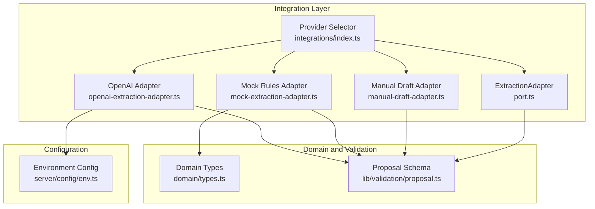
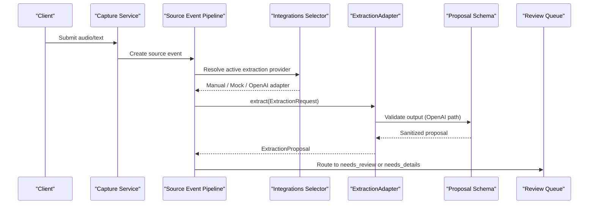
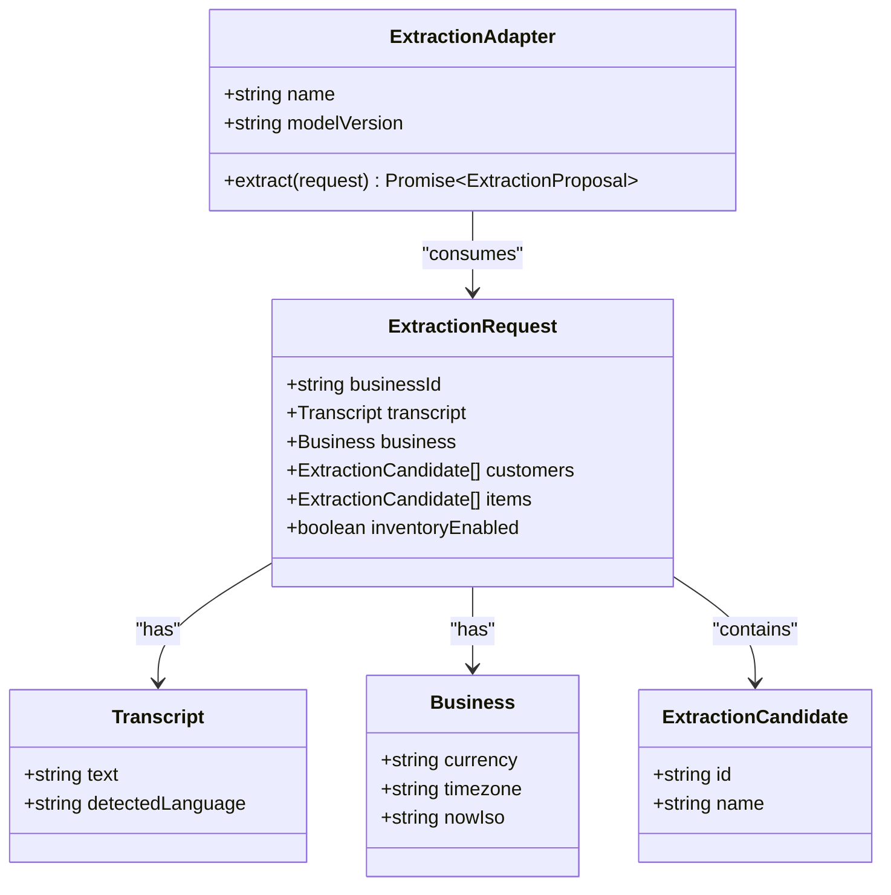
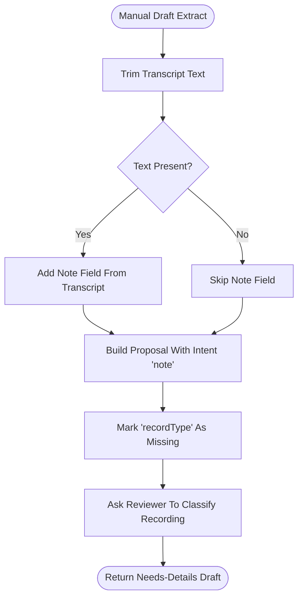
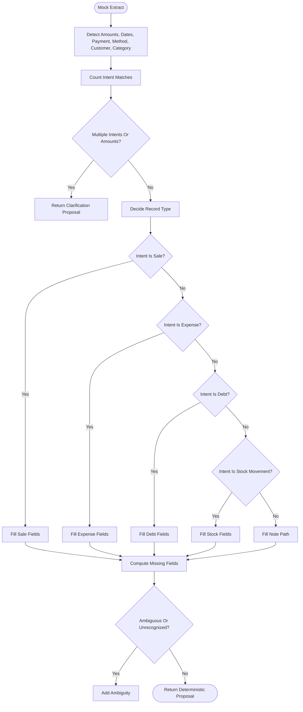
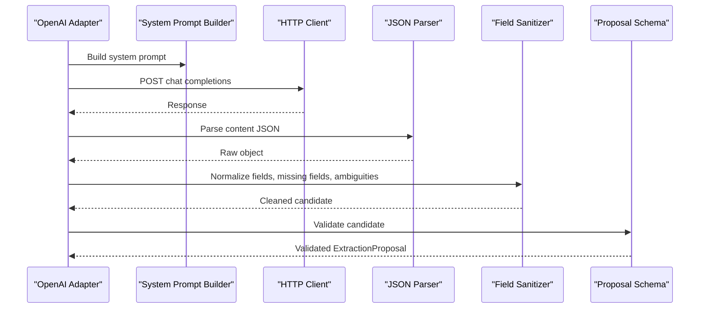
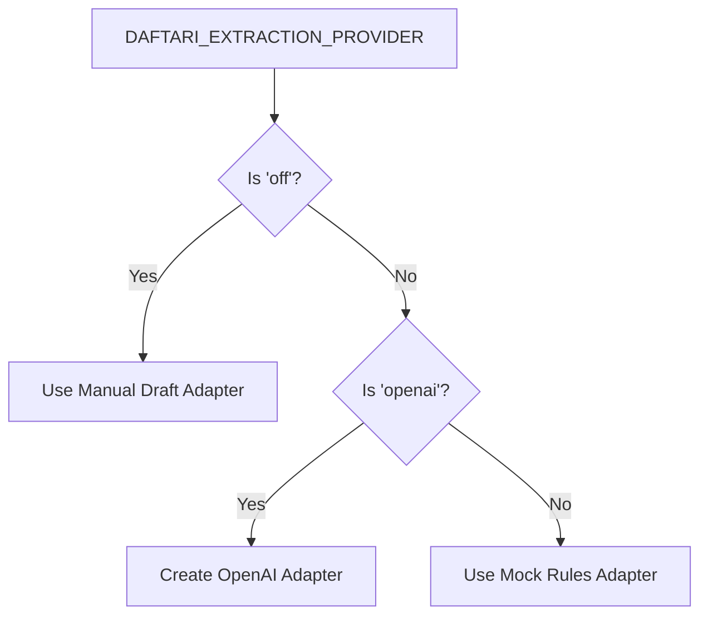
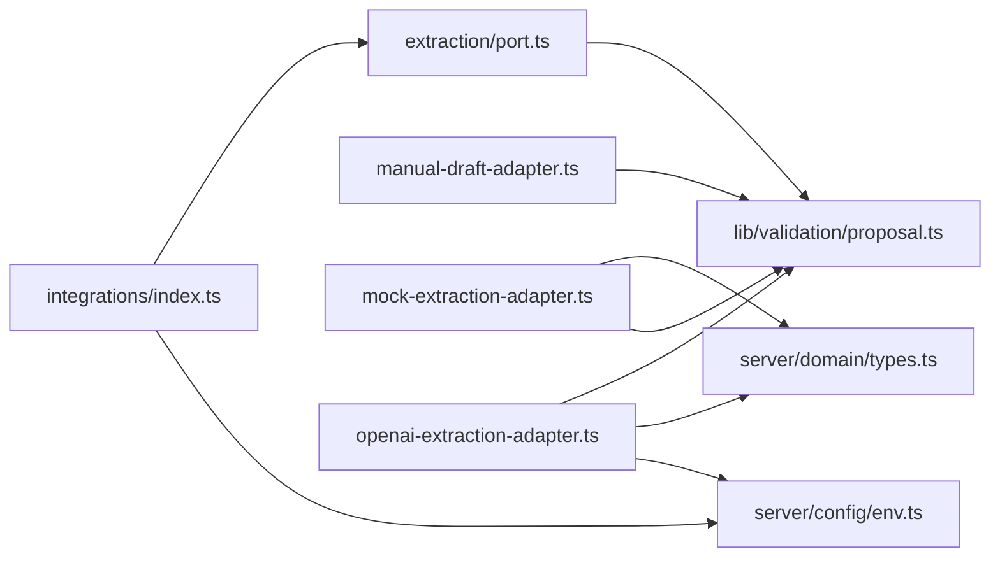

# AI Extraction Adapters

<cite>
**Referenced Files in This Document**
- [port.ts](file://src/server/integrations/extraction/port.ts)
- [manual-draft-adapter.ts](file://src/server/integrations/extraction/manual-draft-adapter.ts)
- [mock-extraction-adapter.ts](file://src/server/integrations/extraction/mock-extraction-adapter.ts)
- [openai-extraction-adapter.ts](file://src/server/integrations/extraction/openai-extraction-adapter.ts)
- [index.ts](file://src/server/integrations/index.ts)
- [env.ts](file://src/server/config/env.ts)
- [proposal.ts](file://src/lib/validation/proposal.ts)
- [types.ts](file://src/server/domain/types.ts)
- [capture.test.ts](file://tests/capture.test.ts)
- [providers.test.ts](file://tests/providers.test.ts)
</cite>

## Table of Contents
1. [Introduction](#introduction)
2. [Project Structure](#project-structure)
3. [Core Components](#core-components)
4. [Architecture Overview](#architecture-overview)
5. [Detailed Component Analysis](#detailed-component-analysis)
6. [Dependency Analysis](#dependency-analysis)
7. [Performance Considerations](#performance-considerations)
8. [Troubleshooting Guide](#troubleshooting-guide)
9. [Conclusion](#conclusion)

## Introduction
This document explains the AI extraction adapter layer that turns transcribed voice or text into structured bookkeeping proposals. The system supports three adapters:

- **Manual draft adapter**: used when extraction is disabled; it never guesses business intent and routes recordings to a reviewer.
- **Mock extraction adapter**: deterministic rule-based logic for local development and tests, supporting Swahili and English phrases.
- **OpenAI extraction adapter**: production-grade adapter that calls an external model with a strict prompt and validates output against a shared schema.

The design keeps the pipeline free of provider-specific branches by exposing one `ExtractionAdapter` interface. Extracted data is intentionally untrusted: values without evidence become missing fields or ambiguities, and only validated proposals reach downstream services.

## Project Structure
The extraction subsystem lives under `src/server/integrations/extraction`. It defines the contract, three implementations, and an integration selector that chooses the active provider based on environment configuration.

**Diagram sources**
- [port.ts:1-38](file://src/server/integrations/extraction/port.ts#L1-L38)
- [manual-draft-adapter.ts:1-52](file://src/server/integrations/extraction/manual-draft-adapter.ts#L1-L52)
- [mock-extraction-adapter.ts:1-528](file://src/server/integrations/extraction/mock-extraction-adapter.ts#L1-L528)
- [openai-extraction-adapter.ts:1-224](file://src/server/integrations/extraction/openai-extraction-adapter.ts#L1-L224)
- [index.ts:41-70](file://src/server/integrations/index.ts#L41-L70)
- [env.ts:134-169](file://src/server/config/env.ts#L134-L169)
- [proposal.ts:1-52](file://src/lib/validation/proposal.ts#L1-L52)
- [types.ts:8-15](file://src/server/domain/types.ts#L8-L15)

**Section sources**
- [port.ts:1-38](file://src/server/integrations/extraction/port.ts#L1-L38)
- [index.ts:1-93](file://src/server/integrations/index.ts#L1-L93)
- [env.ts:134-169](file://src/server/config/env.ts#L134-L169)

## Core Components
The extraction layer centers on four core concepts:

| Concept | Purpose | Key Location |
|---|---|---|
| `ExtractionAdapter` | Defines the contract for analyzing transcripts and returning versioned proposals. | [port.ts:34-37](file://src/server/integrations/extraction/port.ts#L34-L37) |
| `ExtractionRequest` | Supplies transcript text, detected language, business context, customer/item candidates, and inventory capability. | [port.ts:16-32](file://src/server/integrations/extraction/port.ts#L16-L32) |
| `ExtractionProposal` | Versioned, schema-validated result containing intent, field provenance, missing fields, ambiguities, and model metadata. | [proposal.ts:32-52](file://src/lib/validation/proposal.ts#L32-L52) |
| Provider selection | Chooses between manual draft, mock rules, and OpenAI at runtime. | [index.ts:57-63](file://src/server/integrations/index.ts#L57-L63) |

### ExtractionAdapter Contract
The adapter exposes:

- A stable `name` identifying the implementation.
- A `modelVersion` describing the proposal generation strategy.
- An `extract(request)` method returning a promise of `ExtractionProposal`.

The contract deliberately avoids posting to any ledger. Instead, it returns structured evidence so downstream validation can ask focused questions.

**Section sources**
- [port.ts:1-38](file://src/server/integrations/extraction/port.ts#L1-L38)
- [proposal.ts:1-52](file://src/lib/validation/proposal.ts#L1-L52)

## Architecture Overview
The extraction flow is part of a broader capture-to-proposal pipeline. Voice or text is captured, stored, transcribed, then passed through the selected extraction adapter. The resulting proposal enters review rather than direct ledger posting.

**Diagram sources**
- [index.ts:57-63](file://src/server/integrations/index.ts#L57-L63)
- [openai-extraction-adapter.ts:131-224](file://src/server/integrations/extraction/openai-extraction-adapter.ts#L131-L224)
- [proposal.ts:32-52](file://src/lib/validation/proposal.ts#L32-L52)

## Detailed Component Analysis

### ExtractionAdapter Interface and Request Model
The port defines the stable boundary between the pipeline and extraction providers.

| Field | Meaning |
|---|---|
| `businessId` | Tenant identifier for isolation. |
| `transcript.text` | Normalized transcription text. |
| `transcript.detectedLanguage` | Language hint for model prompting or rule matching. |
| `business.currency` | Supported currency code used by formatting and validation. |
| `business.timezone` | Timezone used to resolve relative dates such as “today” or “yesterday”. |
| `business.nowIso` | Reference timestamp for resolving relative time expressions. |
| `customers` | Candidate customers available for ID resolution. |
| `items` | Candidate inventory items available for stock movement mapping. |
| `inventoryEnabled` | Indicates whether stock movements are allowed. |

The adapter must return a proposal whose `intent` matches one of the domain record types. Unknown or unsupported intents should not be silently accepted by the OpenAI adapter because they fail schema validation.

**Diagram sources**
- [port.ts:11-37](file://src/server/integrations/extraction/port.ts#L11-L37)

**Section sources**
- [port.ts:1-38](file://src/server/integrations/extraction/port.ts#L1-L38)

### Manual Draft Adapter
The manual draft adapter is the safe fallback when extraction is disabled. Its behavior is intentionally conservative:

- It does not guess `recordType`.
- It stores the transcript as a note field when present.
- It reports `recordType` as missing.
- It adds an ambiguity asking the reviewer to classify the recording.
- It sets `clarificationRequired` to false because the problem is classification, not multiple events.

This adapter preserves the provider seam while ensuring no automated business decision is made from raw transcript text.

**Diagram sources**
- [manual-draft-adapter.ts:23-50](file://src/server/integrations/extraction/manual-draft-adapter.ts#L23-L50)

**Section sources**
- [manual-draft-adapter.ts:1-52](file://src/server/integrations/extraction/manual-draft-adapter.ts#L1-L52)
- [capture.test.ts:309-348](file://tests/capture.test.ts#L309-L348)

### Mock Extraction Adapter
The mock adapter implements deterministic business rules over Swahili and English phrases. It is designed for offline development and test coverage rather than production accuracy.

Key behaviors include:

- Detecting sale, expense, debt creation, debt payment, stock movement, and note patterns.
- Parsing amounts in digits, scaled words, and Swahili number phrases.
- Resolving explicit dates, named months, today, and yesterday.
- Matching customers using prepositions and candidate lists.
- Inferring payment status and payment method from keywords.
- Refusing to guess when multiple intents or amounts appear.
- Treating spoken payment claims as assertions, not verified settlements.

**Diagram sources**
- [mock-extraction-adapter.ts:25-100](file://src/server/integrations/extraction/mock-extraction-adapter.ts#L25-L100)
- [mock-extraction-adapter.ts:210-359](file://src/server/integrations/extraction/mock-extraction-adapter.ts#L210-L359)
- [mock-extraction-adapter.ts:361-515](file://src/server/integrations/extraction/mock-extraction-adapter.ts#L361-L515)

**Section sources**
- [mock-extraction-adapter.ts:1-528](file://src/server/integrations/extraction/mock-extraction-adapter.ts#L1-L528)

### OpenAI Extraction Adapter
The OpenAI adapter is the production path. It builds a strict system prompt, sends the transcript and business context, parses JSON output, sanitizes fields, and validates the result against the shared proposal schema.

Important characteristics:

- Money is returned in minor units.
- Timestamps include UTC offsets.
- Source spans preserve literal text fragments.
- Confidence scores are clamped to `[0, 1]`.
- Unknown intents fail validation.
- Malformed JSON fails validation.
- Network errors and provider failures are wrapped in a typed provider error.

**Diagram sources**
- [openai-extraction-adapter.ts:96-129](file://src/server/integrations/extraction/openai-extraction-adapter.ts#L96-L129)
- [openai-extraction-adapter.ts:131-224](file://src/server/integrations/extraction/openai-extraction-adapter.ts#L131-L224)

**Section sources**
- [openai-extraction-adapter.ts:1-224](file://src/server/integrations/extraction/openai-extraction-adapter.ts#L1-L224)
- [providers.test.ts:203-258](file://tests/providers.test.ts#L203-L258)

### Integration Selection and Configuration
The integration selector owns provider choice. It reads `DAFTARI_EXTRACTION_PROVIDER`:

- `off`: uses the manual draft adapter.
- `mock`: uses the deterministic mock adapter.
- `openai`: constructs the OpenAI adapter with configured credentials and model.

**Diagram sources**
- [index.ts:57-63](file://src/server/integrations/index.ts#L57-L63)
- [env.ts:150-152](file://src/server/config/env.ts#L150-L152)

**Section sources**
- [index.ts:1-93](file://src/server/integrations/index.ts#L1-L93)
- [env.ts:134-169](file://src/server/config/env.ts#L134-L169)

## Dependency Analysis
The adapters depend on shared domain vocabulary and validation schemas rather than each other.

**Diagram sources**
- [port.ts:9-37](file://src/server/integrations/extraction/port.ts#L9-L37)
- [manual-draft-adapter.ts:13-18](file://src/server/integrations/extraction/manual-draft-adapter.ts#L13-L18)
- [mock-extraction-adapter.ts:17-23](file://src/server/integrations/extraction/mock-extraction-adapter.ts#L17-L23)
- [openai-extraction-adapter.ts:14-24](file://src/server/integrations/extraction/openai-extraction-adapter.ts#L14-L24)
- [index.ts:9-22](file://src/server/integrations/index.ts#L9-L22)

**Section sources**
- [types.ts:8-15](file://src/server/domain/types.ts#L8-L15)
- [proposal.ts:1-52](file://src/lib/validation/proposal.ts#L1-L52)

## Performance Considerations
- **Manual draft adapter**: constant-time processing with minimal memory use. Suitable when AI analysis is disabled.
- **Mock adapter**: CPU-bound regex scanning and string operations. It is deterministic and fast but limited by hand-written rules.
- **OpenAI adapter**: network latency dominates. It performs lightweight parsing and validation locally after receiving model output.
- **Schema validation**: occurs once per successful OpenAI response, preventing malformed proposals from entering downstream flows.
- **Provider selection**: resolved once and cached, avoiding repeated environment checks.

[No sources needed since this section provides general guidance]

## Troubleshooting Guide

### Common Extraction States
| State | Meaning | Typical Cause |
|---|---|---|
| `needs_details` | Fields are missing or ambiguous. | Disabled extraction, unclear transcript, or incomplete rule/model output. |
| `needs_review` | Proposal is complete enough for human confirmation. | Successful extraction with all required fields. |
| `failed` | Processing failed before completion. | Provider error, invalid input, or unexpected adapter output. |

### Manual Draft Issues
- If a recording becomes a note with `recordType` missing, check that extraction is set to `off`.
- Reviewers can reclassify drafts only when the provider is the manual draft adapter.
- Retyping is blocked for already confirmed proposals or stale versions.

**Section sources**
- [manual-draft-adapter.ts:23-50](file://src/server/integrations/extraction/manual-draft-adapter.ts#L23-L50)
- [capture.test.ts:208-306](file://tests/capture.test.ts#L208-L306)

### Mock Adapter Issues
- If multiple intents or amounts are detected, the adapter returns clarification instead of guessing.
- Cash sales paid in full may omit the customer because no party is owed anything.
- Payment status is inferred only when explicitly stated.

**Section sources**
- [mock-extraction-adapter.ts:361-515](file://src/server/integrations/extraction/mock-extraction-adapter.ts#L361-L515)

### OpenAI Adapter Issues
- Authentication failures produce a non-retryable provider error.
- Transient HTTP errors are marked retryable.
- Malformed JSON or unknown intents fail validation.
- Confidence values outside `[0, 1]` are clamped rather than rejected.

**Section sources**
- [openai-extraction-adapter.ts:153-224](file://src/server/integrations/extraction/openai-extraction-adapter.ts#L153-L224)
- [providers.test.ts:203-258](file://tests/providers.test.ts#L203-L258)

## Conclusion
The extraction adapter layer provides a clean separation between business intent analysis and the rest of the application. The manual draft adapter guarantees safety when AI is disabled, the mock adapter enables deterministic testing, and the OpenAI adapter delivers production-grade extraction with strict validation. All adapters return versioned proposals with field-level provenance, allowing the system to ask focused questions instead of silently inventing financial records.

Customization should follow these principles:

- Extend prompts or rules to match new business phrases without changing the adapter contract.
- Keep money in minor units and timestamps offset-aware.
- Prefer missing fields and ambiguities over confident guesses.
- Use the integration selector to swap providers without touching pipeline code.
- Validate every adapter output against the shared proposal schema.

[No sources needed since this section summarizes without analyzing specific files]