# Adapter Pattern Overview

<cite>
**Referenced Files in This Document**
- [index.ts](file://src/server/integrations/index.ts)
- [env.ts](file://src/server/config/env.ts)
- [port.ts](file://src/server/integrations/storage/port.ts)
- [local-storage-adapter.ts](file://src/server/integrations/storage/local-storage-adapter.ts)
- [s3-storage-adapter.ts](file://src/server/integrations/storage/s3-storage-adapter.ts)
- [vercel-blob-storage-adapter.ts](file://src/server/integrations/storage/vercel-blob-storage-adapter.ts)
- [port.ts](file://src/server/integrations/speech/port.ts)
- [mock-speech-adapter.ts](file://src/server/integrations/speech/mock-speech-adapter.ts)
- [openai-speech-adapter.ts](file://src/server/integrations/speech/openai-speech-adapter.ts)
- [port.ts](file://src/server/integrations/extraction/port.ts)
- [manual-draft-adapter.ts](file://src/server/integrations/extraction/manual-draft-adapter.ts)
- [mock-extraction-adapter.ts](file://src/server/integrations/extraction/mock-extraction-adapter.ts)
- [openai-extraction-adapter.ts](file://src/server/integrations/extraction/openai-extraction-adapter.ts)
- [port.ts](file://src/server/integrations/whatsapp/port.ts)
- [local-whatsapp-adapter.ts](file://src/server/integrations/whatsapp/local-whatsapp-adapter.ts)
- [twilio-whatsapp-adapter.ts](file://src/server/integrations/whatsapp/twilio-whatsapp-adapter.ts)
- [provider-error.ts](file://src/server/integrations/provider-error.ts)
- [providers.test.ts](file://tests/providers.test.ts)
</cite>

## Table of Contents
1. [Introduction](#introduction)
2. [Project Structure](#project-structure)
3. [Core Components](#core-components)
4. [Architecture Overview](#architecture-overview)
5. [Detailed Component Analysis](#detailed-component-analysis)
6. [Dependency Analysis](#dependency-analysis)
7. [Performance Considerations](#performance-considerations)
8. [Troubleshooting Guide](#troubleshooting-guide)
9. [Conclusion](#conclusion)

## Introduction
This document explains the adapter pattern implementation used by Daftari’s integration system. External service dependencies are abstracted behind consistent ports, and a central factory selects the concrete provider based on environment configuration. Feature code calls adapters through stable interfaces without branching on environment flags. The design improves testability, flexibility, and maintainability while keeping sensitive media and webhook handling secure and predictable.

## Project Structure
The integration layer is organized by capability: storage, speech, extraction, and WhatsApp. Each capability defines a port (interface), one or more adapters (implementations), and an optional shared error type. A single integrations module owns provider selection and caching.

```mermaid
graph TB
subgraph "Integrations"
IDX["integrations/index.ts"]
ENV["config/env.ts"]
ERR["integrations/provider-error.ts"]
end
subgraph "Storage"
S_PORT["storage/port.ts"]
S_LOCAL["storage/local-storage-adapter.ts"]
S_S3["storage/s3-storage-adapter.ts"]
S_BLOB["storage/vercel-blob-storage-adapter.ts"]
end
subgraph "Speech"
P_PORT["speech/port.ts"]
P_MOCK["speech/mock-speech-adapter.ts"]
P_OPENAI["speech/openai-speech-adapter.ts"]
end
subgraph "Extraction"
E_PORT["extraction/port.ts"]
E_MANUAL["extraction/manual-draft-adapter.ts"]
E_MOCK["extraction/mock-extraction-adapter.ts"]
E_OPENAI["extraction/openai-extraction-adapter.ts"]
end
subgraph "WhatsApp"
W_PORT["whatsapp/port.ts"]
W_LOCAL["whatsapp/local-whatsapp-adapter.ts"]
W_TWILIO["whatsapp/twilio-whatsapp-adapter.ts"]
end
IDX --> ENV
IDX --> S_PORT
IDX --> P_PORT
IDX --> E_PORT
IDX --> W_PORT
IDX --> ERR
S_LOCAL --> S_PORT
S_S3 --> S_PORT
S_BLOB --> S_PORT
P_MOCK --> P_PORT
P_OPENAI --> P_PORT
E_MANUAL --> E_PORT
E_MOCK --> E_PORT
E_OPENAI --> E_PORT
W_LOCAL --> W_PORT
W_TWILIO --> W_PORT
```

**Diagram sources**
- [index.ts:1-93](file://src/server/integrations/index.ts#L1-L93)
- [env.ts:1-184](file://src/server/config/env.ts#L1-L184)
- [port.ts:1-34](file://src/server/integrations/storage/port.ts#L1-L34)
- [port.ts:1-45](file://src/server/integrations/speech/port.ts#L1-L45)
- [port.ts:1-38](file://src/server/integrations/extraction/port.ts#L1-L38)
- [port.ts:1-91](file://src/server/integrations/whatsapp/port.ts#L1-L91)

**Section sources**
- [index.ts:1-93](file://src/server/integrations/index.ts#L1-L93)
- [env.ts:1-184](file://src/server/config/env.ts#L1-L184)

## Core Components
- Integrations factory: creates and caches `storage`, `speech`, `extraction`, and `whatsapp` adapters based on environment selectors. It also exposes a process-wide override mechanism for tests and development.
- Provider configuration: reads environment variables, validates choices, and returns typed configuration objects. Missing required values fail fast with descriptive errors.
- Ports: TypeScript interfaces that define the contract for each external capability. Adapters implement these contracts so feature code depends only on stable types.
- Provider error: a unified error type with a machine-readable code and a retryable flag, allowing callers to decide whether to retry or fail fast.

Key responsibilities:
- Environment-based selection without branching in feature code.
- Deterministic defaults for local development.
- Shared signed-link semantics across storage backends.
- Consistent error classification for retries.

**Section sources**
- [index.ts:34-93](file://src/server/integrations/index.ts#L34-L93)
- [env.ts:14-44](file://src/server/config/env.ts#L14-L44)
- [env.ts:46-184](file://src/server/config/env.ts#L46-L184)
- [provider-error.ts:1-19](file://src/server/integrations/provider-error.ts#L1-L19)

## Architecture Overview
The adapter architecture separates three concerns:
1. Configuration: which provider to use and what credentials it needs.
2. Selection: constructing the correct adapter instance once per process.
3. Usage: feature code calling adapters through ports.

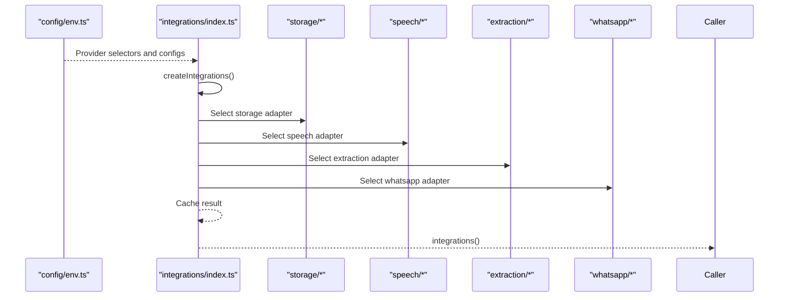

**Diagram sources**
- [index.ts:41-78](file://src/server/integrations/index.ts#L41-L78)
- [env.ts:46-184](file://src/server/config/env.ts#L46-L184)

## Detailed Component Analysis

### Storage Adapters
The storage port defines operations for private media: storing, reading, deleting, creating signed links, verifying signed links, and checking existence. All implementations share the same signed-link scheme so switching providers does not change the download contract.

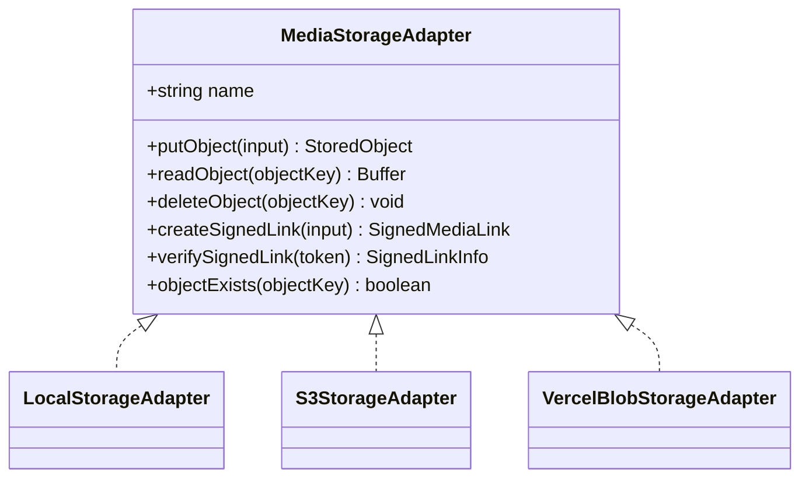

Selection logic:
- `DAFTARI_STORAGE_PROVIDER` chooses between `local`, `s3`, or `blob`.
- S3 requires bucket, region, credentials, and a shared signing secret.
- Vercel Blob uses a store ID paired with platform OIDC authentication.
- Local storage writes to a private data directory and issues HMAC-signed links.

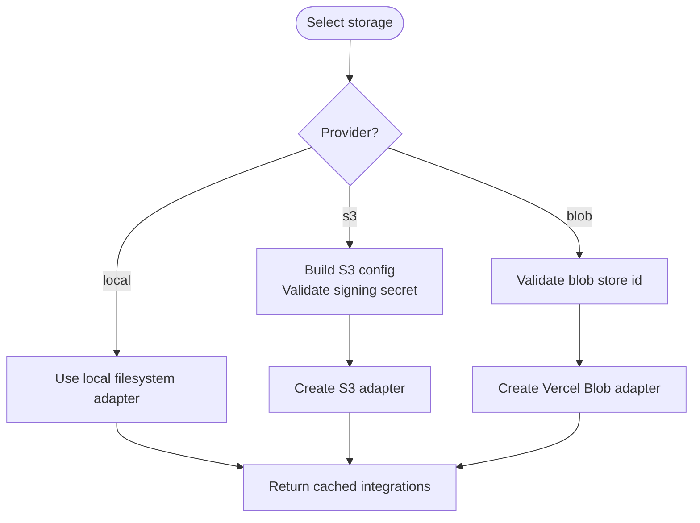

**Diagram sources**
- [index.ts:42-48](file://src/server/integrations/index.ts#L42-L48)
- [env.ts:87-132](file://src/server/config/env.ts#L87-L132)

**Section sources**
- [port.ts:1-34](file://src/server/integrations/storage/port.ts#L1-L34)
- [local-storage-adapter.ts:1-88](file://src/server/integrations/storage/local-storage-adapter.ts#L1-L88)
- [s3-storage-adapter.ts:1-101](file://src/server/integrations/storage/s3-storage-adapter.ts#L1-L101)
- [vercel-blob-storage-adapter.ts:1-72](file://src/server/integrations/storage/vercel-blob-storage-adapter.ts#L1-L72)
- [index.ts:42-48](file://src/server/integrations/index.ts#L42-L48)
- [env.ts:87-132](file://src/server/config/env.ts#L87-L132)

### Speech Adapters
The speech port defines transcription requests and results, including detected language, model version, quality metrics, and segments. The mock adapter supports deterministic testing using synthetic audio metadata. The OpenAI adapter reads audio from private storage, uploads it to Whisper, and normalizes verbose responses.

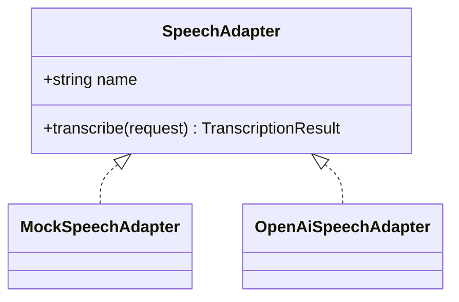

Selection logic:
- `DAFTARI_SPEECH_PROVIDER` chooses between `mock` and `openai`.
- OpenAI speech adapter receives the storage adapter because it must read the same private object the pipeline stores.

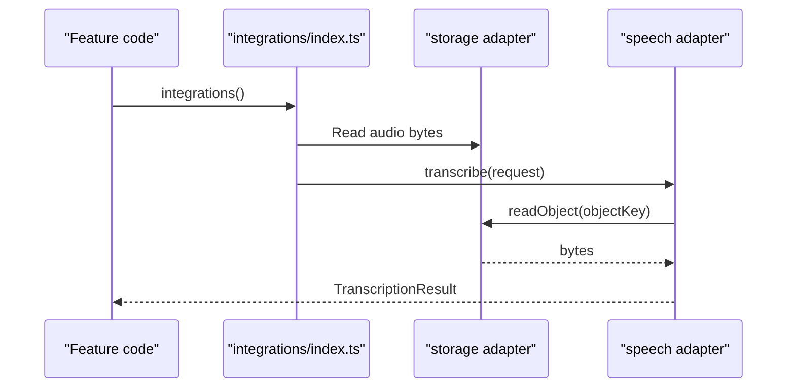

**Diagram sources**
- [index.ts:50-55](file://src/server/integrations/index.ts#L50-L55)
- [openai-speech-adapter.ts:42-102](file://src/server/integrations/speech/openai-speech-adapter.ts#L42-L102)

**Section sources**
- [port.ts:1-45](file://src/server/integrations/speech/port.ts#L1-L45)
- [mock-speech-adapter.ts:1-69](file://src/server/integrations/speech/mock-speech-adapter.ts#L1-L69)
- [openai-speech-adapter.ts:1-102](file://src/server/integrations/speech/openai-speech-adapter.ts#L1-L102)
- [index.ts:50-55](file://src/server/integrations/index.ts#L50-L55)
- [env.ts:134-169](file://src/server/config/env.ts#L134-L169)

### Extraction Adapters
The extraction port defines structured extraction requests and proposals with field-level provenance. Three adapters exist:
- Manual draft: used when extraction is disabled; never guesses and routes to human review.
- Mock rules: deterministic rule-based extraction for offline development.
- OpenAI: sends a strict prompt and validates the response against a schema.

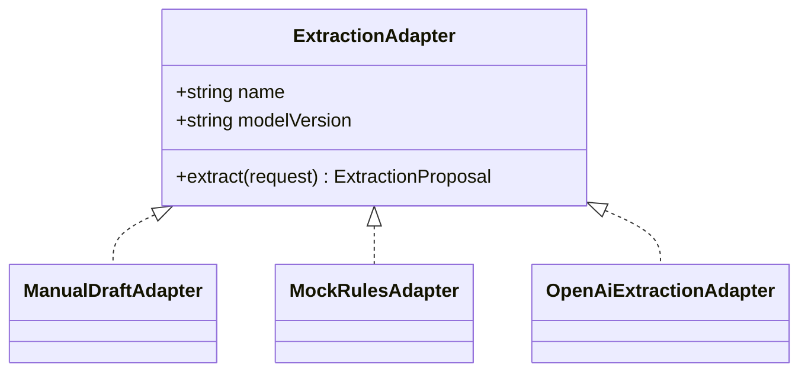

Selection logic:
- `DAFTARI_EXTRACTION_PROVIDER` chooses between `off`, `mock`, or `openai`.
- `off` produces a manual draft proposal instead of sending transcripts to a model.

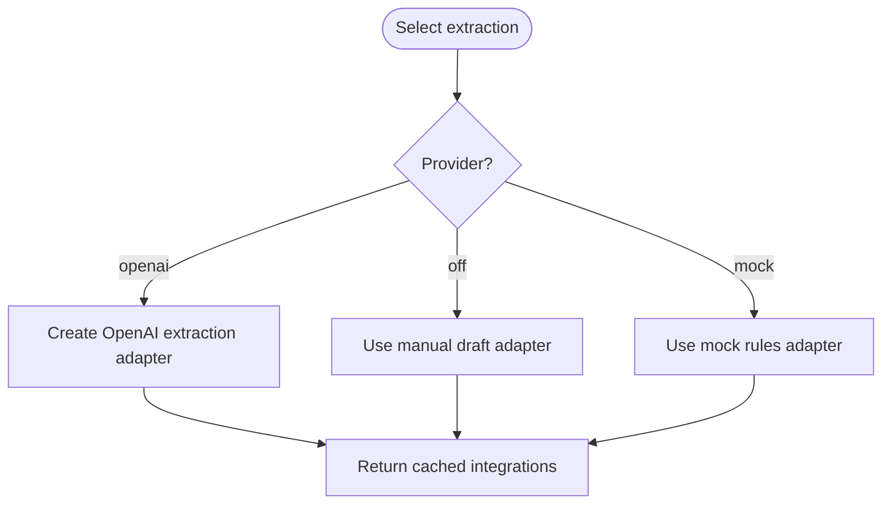

**Diagram sources**
- [index.ts:57-63](file://src/server/integrations/index.ts#L57-L63)
- [openai-extraction-adapter.ts:131-224](file://src/server/integrations/extraction/openai-extraction-adapter.ts#L131-L224)

**Section sources**
- [port.ts:1-38](file://src/server/integrations/extraction/port.ts#L1-L38)
- [manual-draft-adapter.ts:1-52](file://src/server/integrations/extraction/manual-draft-adapter.ts#L1-L52)
- [mock-extraction-adapter.ts:1-528](file://src/server/integrations/extraction/mock-extraction-adapter.ts#L1-L528)
- [openai-extraction-adapter.ts:1-224](file://src/server/integrations/extraction/openai-extraction-adapter.ts#L1-L224)
- [index.ts:57-63](file://src/server/integrations/index.ts#L57-L63)
- [env.ts:134-169](file://src/server/config/env.ts#L134-L169)

### WhatsApp Adapters
The WhatsApp port defines webhook delivery, inbound message normalization, signature verification, and optional media fetching. Two adapters exist:
- Local: HMAC over timestamp and body for development.
- Twilio: HMAC-SHA1 over URL plus sorted form parameters, with Basic-auth media downloads.

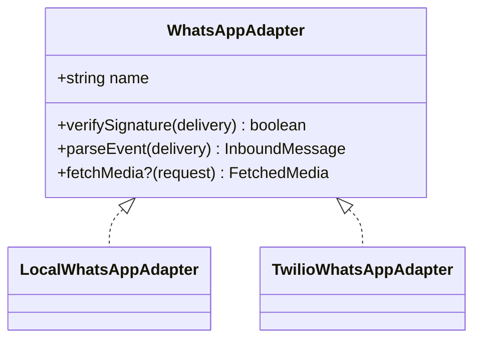

Selection logic:
- `DAFTARI_WHATSAPP_PROVIDER` chooses between `local` and `twilio`.
- Twilio adapter computes signatures differently than the local adapter but still implements the same interface.

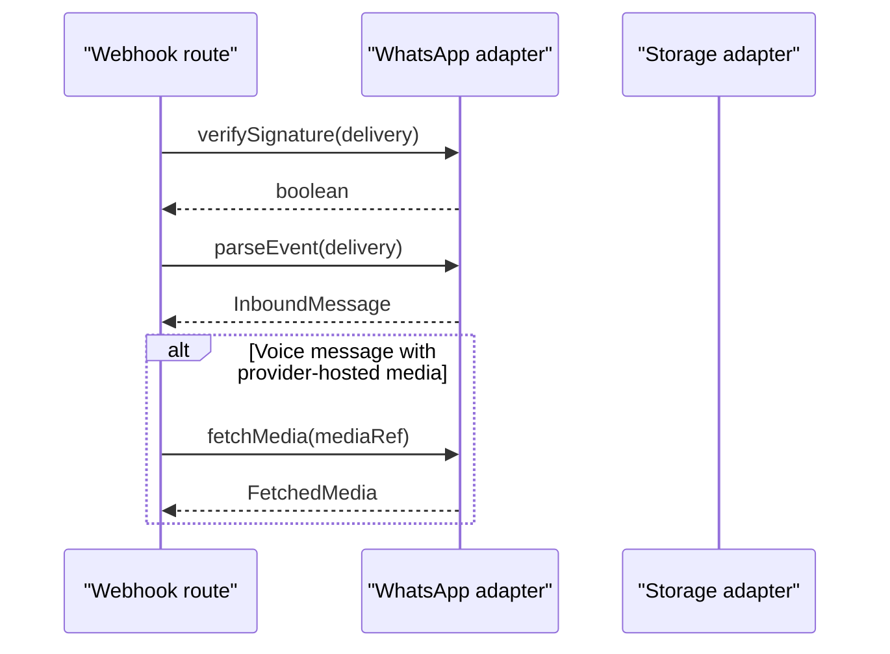

**Diagram sources**
- [index.ts:65-68](file://src/server/integrations/index.ts#L65-L68)
- [twilio-whatsapp-adapter.ts:47-122](file://src/server/integrations/whatsapp/twilio-whatsapp-adapter.ts#L47-L122)

**Section sources**
- [port.ts:1-91](file://src/server/integrations/whatsapp/port.ts#L1-L91)
- [local-whatsapp-adapter.ts:1-39](file://src/server/integrations/whatsapp/local-whatsapp-adapter.ts#L1-L39)
- [twilio-whatsapp-adapter.ts:1-122](file://src/server/integrations/whatsapp/twilio-whatsapp-adapter.ts#L1-L122)
- [index.ts:65-68](file://src/server/integrations/index.ts#L65-L68)
- [env.ts:46-85](file://src/server/config/env.ts#L46-L85)

### Provider Override Mechanism
The integrations module caches a single `Integrations` instance per process. Tests can replace selected adapters temporarily and restore the previous state. This seam allows exercising failure paths without changing production behavior.

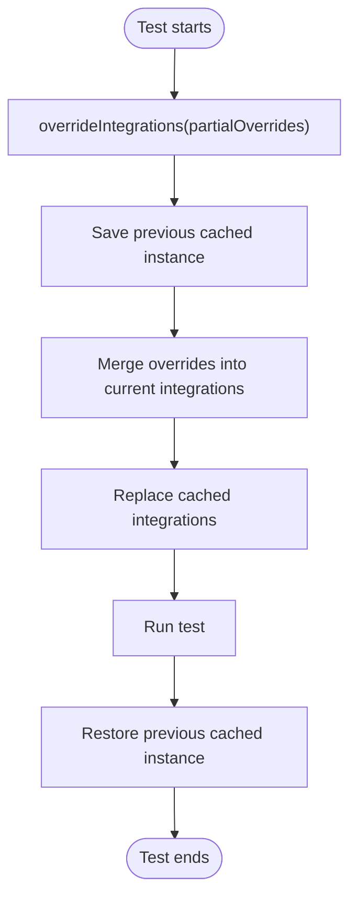

**Diagram sources**
- [index.ts:73-93](file://src/server/integrations/index.ts#L73-L93)

**Section sources**
- [index.ts:73-93](file://src/server/integrations/index.ts#L73-L93)

### Example Provider Selection Scenarios
- Storage:
  - Development: `DAFTARI_STORAGE_PROVIDER=local` uses the filesystem adapter.
  - Production cloud: `DAFTARI_STORAGE_PROVIDER=s3` or `blob` uses a managed backend.
- Speech:
  - Development: `DAFTARI_SPEECH_PROVIDER=mock` uses deterministic synthetic transcription.
  - Production: `DAFTARI_SPEECH_PROVIDER=openai` uses Whisper via OpenAI.
- Extraction:
  - Safe default: `DAFTARI_EXTRACTION_PROVIDER=off` forces manual review.
  - Testing: `DAFTARI_EXTRACTION_PROVIDER=mock` uses rule-based extraction.
  - Automation: `DAFTARI_EXTRACTION_PROVIDER=openai` uses structured LLM extraction.
- WhatsApp:
  - Development: `DAFTARI_WHATSAPP_PROVIDER=local` signs payloads locally.
  - Production: `DAFTARI_WHATSAPP_PROVIDER=twilio` verifies Twilio signatures and downloads media.

These selections happen only in the integrations factory. Feature code imports `integrations()` and calls methods on the resulting adapters.

**Section sources**
- [index.ts:41-70](file://src/server/integrations/index.ts#L41-L70)
- [env.ts:46-184](file://src/server/config/env.ts#L46-L184)

## Dependency Analysis
The integrations factory is the single point where environment configuration maps to concrete adapters. Ports decouple feature code from provider details.

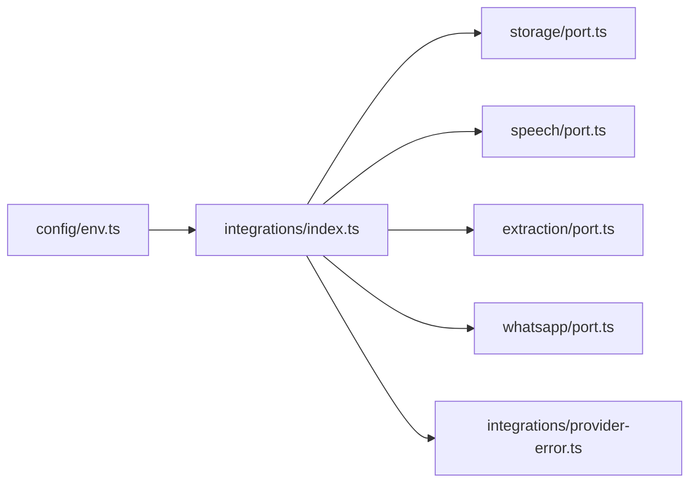

Coupling and cohesion:
- High cohesion within each adapter family (storage, speech, extraction, whatsapp).
- Low coupling to external services because feature code depends only on ports.
- Centralized selection avoids scattered conditional logic.

External dependencies:
- AWS SDK for S3 is loaded lazily.
- Vercel Blob SDK is loaded lazily.
- OpenAI HTTP calls are made through injectable `fetchImpl` in tests.

**Diagram sources**
- [index.ts:9-32](file://src/server/integrations/index.ts#L9-L32)
- [env.ts:1-184](file://src/server/config/env.ts#L1-L184)

**Section sources**
- [index.ts:1-93](file://src/server/integrations/index.ts#L1-L93)
- [env.ts:1-184](file://src/server/config/env.ts#L1-L184)

## Performance Considerations
- Lazy loading: S3 and Vercel Blob SDKs are imported only when those providers are selected, reducing startup cost for local and non-cloud deployments.
- Caching: The integrations instance is created once per process, avoiding repeated configuration parsing and adapter construction.
- Signed links: Storage adapters issue short-lived tokens rather than exposing public URLs, reducing exposure and simplifying access control.
- Network calls: External provider calls are wrapped with clear error classification so retries can be applied selectively.

[No sources needed since this section provides general guidance]

## Troubleshooting Guide
Common issues and how the adapter layer helps diagnose them:

- Missing environment variables:
  - Configuration helpers throw `ConfigError` with messages identifying the missing variable and its purpose.
  - Selector functions validate allowed values and fail fast if misconfigured.

- Provider failures:
  - Adapters throw `ProviderError` with a stable code and a `retryable` flag.
  - Callers can distinguish transient network issues from client-side validation problems.

- Signature verification failures:
  - WhatsApp adapters reject malformed or mismatched signatures before parsing events.
  - Local and Twilio adapters use different signing schemes but both return false early on invalid input.

- Signed link verification failures:
  - Storage adapters verify tokens using a shared signing secret. Tampered tokens return null.

Recommended debugging steps:
1. Verify provider selector environment variables.
2. Confirm required credentials are present.
3. Inspect `ProviderError.code` and `retryable` to decide retry strategy.
4. For storage, ensure `DAFTARI_MEDIA_SIGNING_SECRET` is set consistently across instances.
5. For WhatsApp, confirm webhook URL, signature algorithm, and content type match the selected adapter.

**Section sources**
- [env.ts:14-44](file://src/server/config/env.ts#L14-L44)
- [env.ts:46-184](file://src/server/config/env.ts#L46-L184)
- [provider-error.ts:1-19](file://src/server/integrations/provider-error.ts#L1-L19)
- [twilio-whatsapp-adapter.ts:56-69](file://src/server/integrations/whatsapp/twilio-whatsapp-adapter.ts#L56-L69)
- [local-whatsapp-adapter.ts:24-34](file://src/server/integrations/whatsapp/local-whatsapp-adapter.ts#L24-L34)
- [s3-storage-adapter.ts:84-98](file://src/server/integrations/storage/s3-storage-adapter.ts#L84-L98)
- [local-storage-adapter.ts:55-65](file://src/server/integrations/storage/local-storage-adapter.ts#L55-L65)

## Conclusion
Daftari’s integration system uses the adapter pattern to isolate external dependencies behind stable ports. A single factory selects providers based on environment configuration, caches instances, and exposes a process-wide override seam for testing. This approach removes branching logic from feature code, makes failure modes explicit through a unified error type, and keeps sensitive media handling consistent across storage backends. As a result, the system is easier to test, simpler to extend with new providers, and safer to operate in multiple environments.

[No sources needed since this section summarizes without analyzing specific files]