# Integration Adapters

<cite>
**Referenced Files in This Document**
- [index.ts](file://src/server/integrations/index.ts)
- [provider-error.ts](file://src/server/integrations/provider-error.ts)
- [whatsapp-port.ts](file://src/server/integrations/whatsapp/port.ts)
- [local-whatsapp-adapter.ts](file://src/server/integrations/whatsapp/local-whatsapp-adapter.ts)
- [twilio-whatsapp-adapter.ts](file://src/server/integrations/whatsapp/twilio-whatsapp-adapter.ts)
- [speech-port.ts](file://src/server/integrations/speech/port.ts)
- [mock-speech-adapter.ts](file://src/server/integrations/speech/mock-speech-adapter.ts)
- [openai-speech-adapter.ts](file://src/server/integrations/speech/openai-speech-adapter.ts)
- [extraction-port.ts](file://src/server/integrations/extraction/port.ts)
- [manual-draft-adapter.ts](file://src/server/integrations/extraction/manual-draft-adapter.ts)
- [mock-extraction-adapter.ts](file://src/server/integrations/extraction/mock-extraction-adapter.ts)
- [openai-extraction-adapter.ts](file://src/server/integrations/extraction/openai-extraction-adapter.ts)
- [storage-port.ts](file://src/server/integrations/storage/port.ts)
- [local-storage-adapter.ts](file://src/server/integrations/storage/local-storage-adapter.ts)
- [s3-storage-adapter.ts](file://src/server/integrations/storage/s3-storage-adapter.ts)
- [vercel-blob-storage-adapter.ts](file://src/server/integrations/storage/vercel-blob-storage-adapter.ts)
</cite>

## Table of Contents
1. [Introduction](#introduction)
2. [Project Structure](#project-structure)
3. [Core Components](#core-components)
4. [Architecture Overview](#architecture-overview)
5. [Detailed Component Analysis](#detailed-component-analysis)
6. [Dependency Analysis](#dependency-analysis)
7. [Performance Considerations](#performance-considerations)
8. [Troubleshooting Guide](#troubleshooting-guide)
9. [Conclusion](#conclusion)
10. [Appendices](#appendices)

## Introduction
This document explains the integration adapter system that abstracts external service dependencies behind stable port interfaces. The system uses the adapter pattern to isolate WhatsApp providers, speech-to-text services, AI extraction engines, and storage backends from business logic. A central provider factory selects implementations based on environment configuration, while a shared error abstraction lets callers distinguish retryable failures without knowing provider-specific status codes.

The design keeps feature code free of environment branches: only the integrations index chooses an implementation, and all other modules depend on ports rather than concrete adapters. This makes testing straightforward through mock adapters and enables swapping providers at runtime for local development or controlled overrides.

## Project Structure
The integration layer lives under `src/server/integrations`. Each adapter family has its own directory containing:
- A port file defining the interface and shared types.
- One or more adapter implementations.
- Optional helpers for parsing, validation, or signed-link handling.

```mermaid
graph TB
subgraph "Integrations"
WA["WhatsApp<br/>port + adapters"]
STT["Speech<br/>port + adapters"]
EX["Extraction<br/>port + adapters"]
ST["Storage<br/>port + adapters"]
IDX["Provider Factory<br/>integrations/index.ts"]
ERR["ProviderError"]
end
IDX --> WA
IDX --> STT
IDX --> EX
IDX --> ST
WA -.-> ERR
STT -.-> ERR
EX -.-> ERR
```

**Diagram sources**
- [index.ts:1-93](file://src/server/integrations/index.ts#L1-L93)
- [whatsapp-port.ts:1-91](file://src/server/integrations/whatsapp/port.ts#L1-L91)
- [speech-port.ts:1-45](file://src/server/integrations/speech/port.ts#L1-L45)
- [extraction-port.ts:1-38](file://src/server/integrations/extraction/port.ts#L1-L38)
- [storage-port.ts:1-34](file://src/server/integrations/storage/port.ts#L1-L34)
- [provider-error.ts:1-19](file://src/server/integrations/provider-error.ts#L1-L19)

**Section sources**
- [index.ts:1-93](file://src/server/integrations/index.ts#L1-L93)

## Core Components
The integration layer exposes four primary ports:
- WhatsAppAdapter: authenticates webhook deliveries, parses inbound messages, and optionally downloads provider-hosted media.
- SpeechAdapter: transcribes audio stored privately into text with language detection and quality metadata.
- ExtractionAdapter: converts transcripts into versioned proposals with field-level provenance and ambiguity reporting.
- MediaStorageAdapter: stores, reads, deletes, and signs private media objects.

A single factory builds these adapters once per process and caches them. It also provides a test seam for overriding specific adapters during tests.

Key responsibilities:
- Provider selection: choose implementations by reading environment-driven configuration values.
- Error abstraction: wrap provider failures in a uniform error type with a retry flag.
- Composition: pass shared dependencies such as storage into adapters that need them.
- Deterministic behavior: provide local and mock adapters so workflows can run offline.

**Section sources**
- [index.ts:34-93](file://src/server/integrations/index.ts#L34-L93)
- [whatsapp-port.ts:71-91](file://src/server/integrations/whatsapp/port.ts#L71-L91)
- [speech-port.ts:42-45](file://src/server/integrations/speech/port.ts#L42-L45)
- [extraction-port.ts:34-38](file://src/server/integrations/extraction/port.ts#L34-L38)
- [storage-port.ts:20-34](file://src/server/integrations/storage/port.ts#L20-L34)

## Architecture Overview
The provider factory is the single place where environment configuration maps to concrete adapters. Business services consume the resulting `Integrations` object instead of importing provider-specific modules.

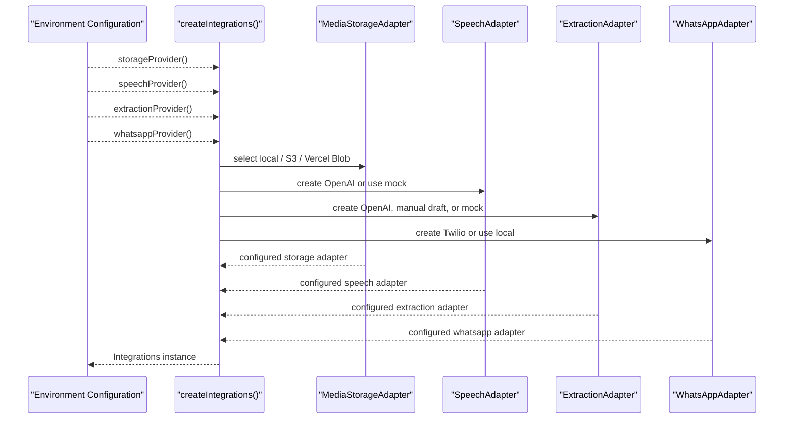

**Diagram sources**
- [index.ts:41-71](file://src/server/integrations/index.ts#L41-L71)

## Detailed Component Analysis

### WhatsApp Adapter Port and Implementations
The WhatsApp port defines a small contract focused on authentication and normalization. It does not store or process messages; it accepts a webhook delivery, verifies its signature, and returns a normalized inbound message. When a provider hosts media separately, the optional `fetchMedia` method downloads it into bytes.

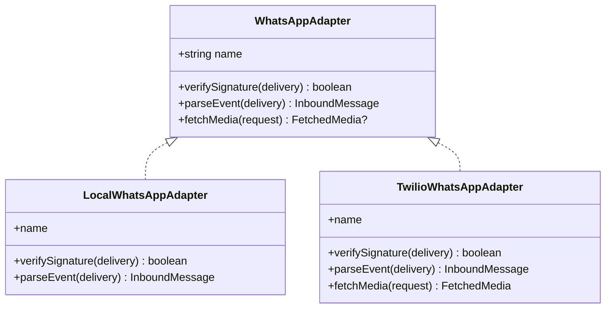

**Diagram sources**
- [whatsapp-port.ts:71-91](file://src/server/integrations/whatsapp/port.ts#L71-L91)
- [local-whatsapp-adapter.ts:24-39](file://src/server/integrations/whatsapp/local-whatsapp-adapter.ts#L24-L39)
- [twilio-whatsapp-adapter.ts:47-121](file://src/server/integrations/whatsapp/twilio-whatsapp-adapter.ts#L47-L121)

Implementation highlights:
- Local adapter: implements HMAC verification compatible with the development simulator and never touches the network.
- Twilio adapter: handles form-encoded payloads, computes URL-based signatures, extracts voice versus text, and downloads media using HTTP Basic authentication. Network errors are wrapped in `ProviderError` with appropriate retry flags.

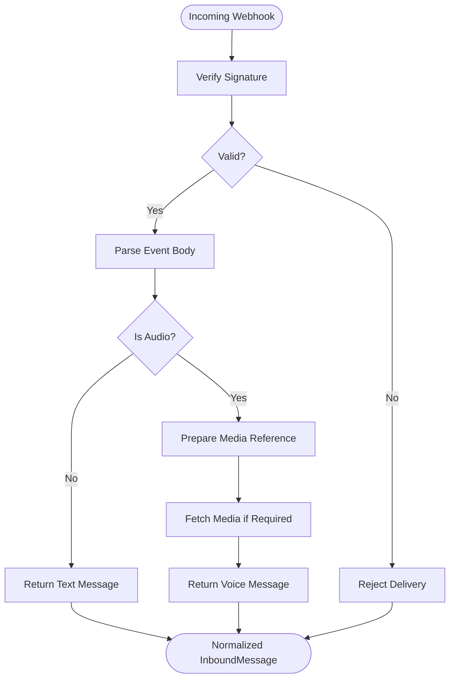

**Diagram sources**
- [twilio-whatsapp-adapter.ts:56-96](file://src/server/integrations/whatsapp/twilio-whatsapp-adapter.ts#L56-L96)
- [twilio-whatsapp-adapter.ts:98-121](file://src/server/integrations/whatsapp/twilio-whatsapp-adapter.ts#L98-L121)

**Section sources**
- [whatsapp-port.ts:1-91](file://src/server/integrations/whatsapp/port.ts#L1-L91)
- [local-whatsapp-adapter.ts:1-39](file://src/server/integrations/whatsapp/local-whatsapp-adapter.ts#L1-L39)
- [twilio-whatsapp-adapter.ts:1-122](file://src/server/integrations/whatsapp/twilio-whatsapp-adapter.ts#L1-L122)

### Speech Adapter Port and Implementations
The speech port defines transcription requests and results. Language detection is explicit because Swahili and English vary per utterance. Results include provider identity, model version, confidence-like quality signals, and optional segments.

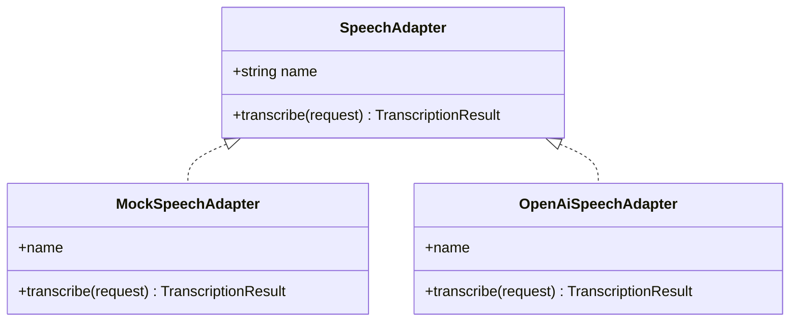

**Diagram sources**
- [speech-port.ts:42-45](file://src/server/integrations/speech/port.ts#L42-L45)
- [mock-speech-adapter.ts:16-69](file://src/server/integrations/speech/mock-speech-adapter.ts#L16-L69)
- [openai-speech-adapter.ts:42-101](file://src/server/integrations/speech/openai-speech-adapter.ts#L42-L101)

Implementation highlights:
- Mock adapter: reads synthetic metadata embedded by the local simulator and returns deterministic transcripts and quality signals. It throws typed `ProviderError` values for scripted failure scenarios.
- OpenAI adapter: reads audio from private storage, uploads it as multipart data, normalizes verbose JSON output, and maps HTTP statuses to `ProviderError` with retry semantics.

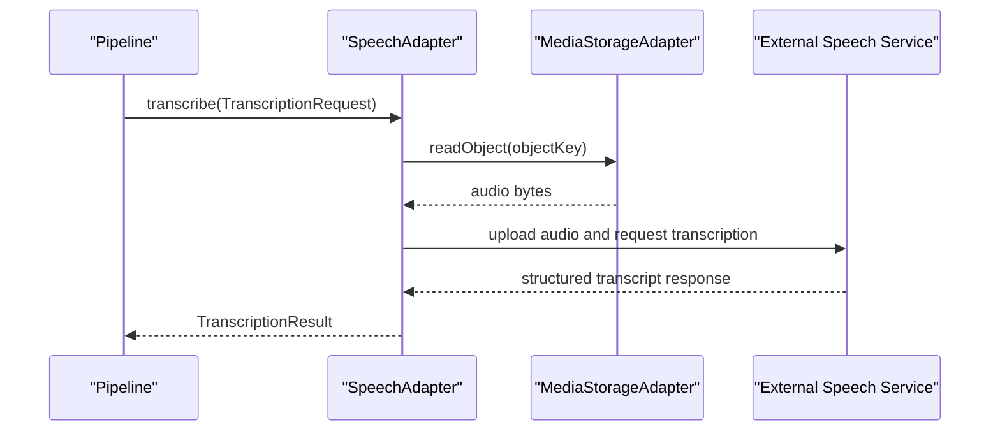

**Diagram sources**
- [openai-speech-adapter.ts:52-99](file://src/server/integrations/speech/openai-speech-adapter.ts#L52-L99)
- [speech-port.ts:15-38](file://src/server/integrations/speech/port.ts#L15-L38)

**Section sources**
- [speech-port.ts:1-45](file://src/server/integrations/speech/port.ts#L1-L45)
- [mock-speech-adapter.ts:1-69](file://src/server/integrations/speech/mock-speech-adapter.ts#L1-L69)
- [openai-speech-adapter.ts:1-102](file://src/server/integrations/speech/openai-speech-adapter.ts#L1-L102)

### Extraction Adapter Port and Implementations
The extraction port turns transcripts into versioned proposals with field-level provenance. It must never post directly to a ledger; missing or ambiguous values are surfaced so the review queue asks focused questions.

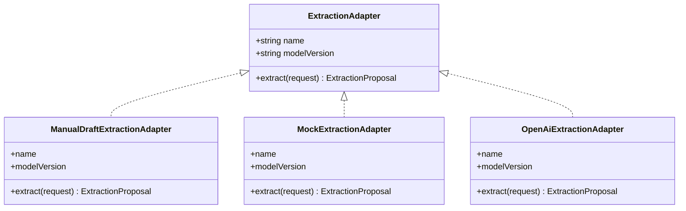

**Diagram sources**
- [extraction-port.ts:34-38](file://src/server/integrations/extraction/port.ts#L34-L38)
- [manual-draft-adapter.ts:23-51](file://src/server/integrations/extraction/manual-draft-adapter.ts#L23-L51)
- [mock-extraction-adapter.ts:361-515](file://src/server/integrations/extraction/mock-extraction-adapter.ts#L361-L515)
- [openai-extraction-adapter.ts:131-223](file://src/server/integrations/extraction/openai-extraction-adapter.ts#L131-L223)

Implementation highlights:
- Manual draft adapter: used when structured extraction is disabled. It preserves the transcript as a note and forces the proposal into a “needs details” state.
- Mock adapter: implements deterministic rules over Swahili and English phrases, refuses to guess, and produces clarification proposals when multiple intents or amounts are detected.
- OpenAI adapter: sends a strict system prompt and context, sanitizes untrusted model output, validates against the shared proposal schema, and wraps network or parsing failures in `ProviderError`.

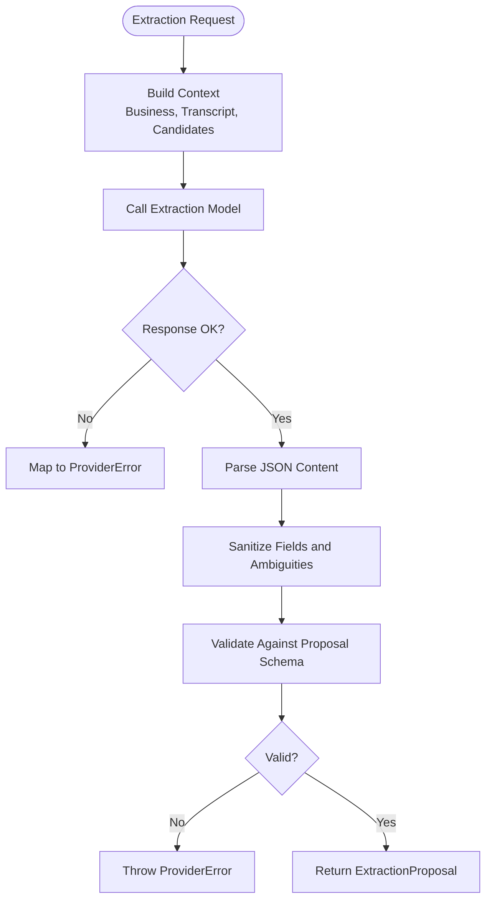

**Diagram sources**
- [openai-extraction-adapter.ts:141-220](file://src/server/integrations/extraction/openai-extraction-adapter.ts#L141-L220)

**Section sources**
- [extraction-port.ts:1-38](file://src/server/integrations/extraction/port.ts#L1-L38)
- [manual-draft-adapter.ts:1-52](file://src/server/integrations/extraction/manual-draft-adapter.ts#L1-L52)
- [mock-extraction-adapter.ts:1-528](file://src/server/integrations/extraction/mock-extraction-adapter.ts#L1-L528)
- [openai-extraction-adapter.ts:1-224](file://src/server/integrations/extraction/openai-extraction-adapter.ts#L1-L224)

### Storage Adapter Port and Implementations
The storage port defines private media operations and short-lived signed links. Objects are never publicly exposed; access requires authorization and a signed token.

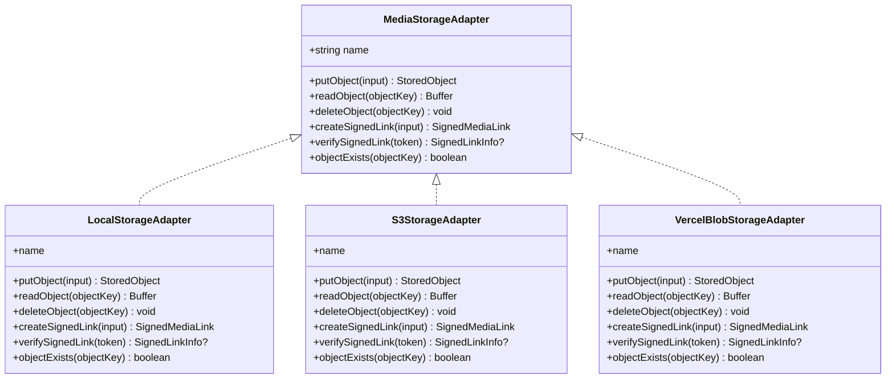

**Diagram sources**
- [storage-port.ts:20-34](file://src/server/integrations/storage/port.ts#L20-L34)
- [local-storage-adapter.ts:26-66](file://src/server/integrations/storage/local-storage-adapter.ts#L26-L66)
- [s3-storage-adapter.ts:19-99](file://src/server/integrations/storage/s3-storage-adapter.ts#L19-L99)
- [vercel-blob-storage-adapter.ts:21-70](file://src/server/integrations/storage/vercel-blob-storage-adapter.ts#L21-L70)

Implementation highlights:
- Local adapter: writes files under a private data directory with restrictive permissions and generates opaque keys.
- S3 adapter: lazily loads the AWS SDK, supports prefixes and server-side encryption, and delegates signed-link creation to a shared helper.
- Vercel Blob adapter: uses OIDC-backed credentials on Vercel and lazily imports the Blob SDK.

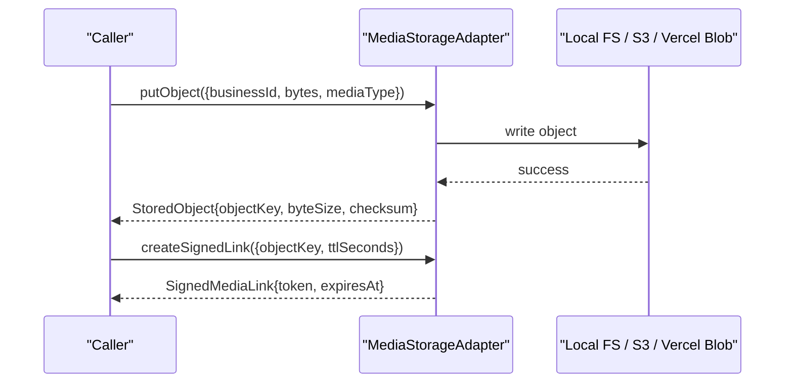

**Diagram sources**
- [local-storage-adapter.ts:29-41](file://src/server/integrations/storage/local-storage-adapter.ts#L29-L41)
- [s3-storage-adapter.ts:44-65](file://src/server/integrations/storage/s3-storage-adapter.ts#L44-L65)
- [vercel-blob-storage-adapter.ts:25-39](file://src/server/integrations/storage/vercel-blob-storage-adapter.ts#L25-L39)

**Section sources**
- [storage-port.ts:1-34](file://src/server/integrations/storage/port.ts#L1-L34)
- [local-storage-adapter.ts:1-88](file://src/server/integrations/storage/local-storage-adapter.ts#L1-L88)
- [s3-storage-adapter.ts:1-101](file://src/server/integrations/storage/s3-storage-adapter.ts#L1-L101)
- [vercel-blob-storage-adapter.ts:1-72](file://src/server/integrations/storage/vercel-blob-storage-adapter.ts#L1-L72)

### Provider Factory and Configuration Management
The integrations index owns provider selection. It reads configuration values such as storage provider, speech provider, extraction provider, WhatsApp provider, and third-party credentials. It constructs adapters in dependency order: storage first, then speech (which may depend on storage), then extraction and WhatsApp.

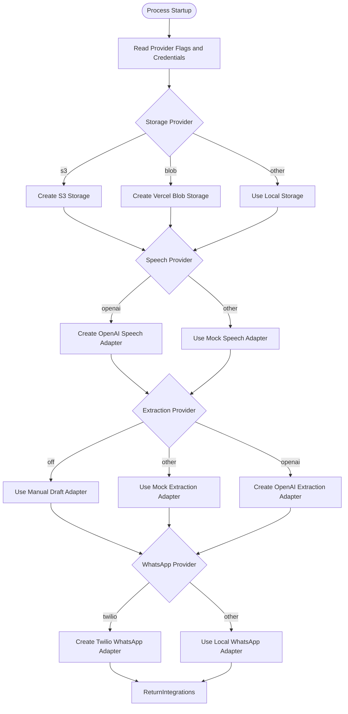

**Diagram sources**
- [index.ts:41-71](file://src/server/integrations/index.ts#L41-L71)

Configuration management notes:
- Provider names are strings selected from environment configuration.
- Third-party configurations such as OpenAI, Twilio, S3, and Vercel Blob identifiers are passed explicitly to adapter constructors.
- The factory caches the resulting `Integrations` object and exposes an override function for tests.

**Section sources**
- [index.ts:1-93](file://src/server/integrations/index.ts#L1-L93)

## Dependency Analysis
The adapter layer is intentionally decoupled from business services. Dependencies flow inward toward ports and outward toward external providers.

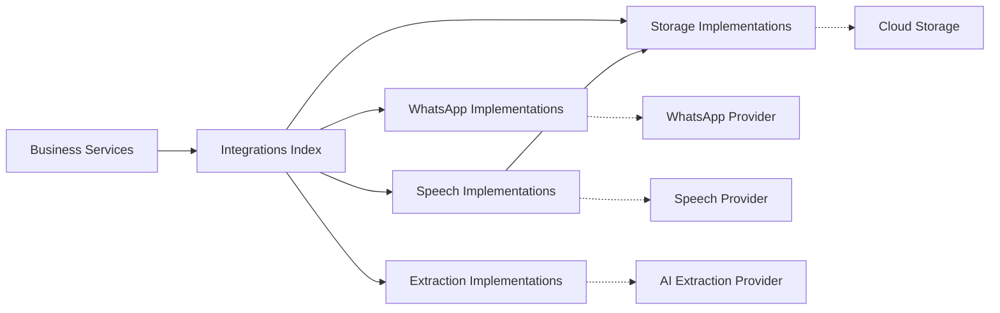

**Diagram sources**
- [index.ts:34-71](file://src/server/integrations/index.ts#L34-L71)
- [openai-speech-adapter.ts:9-12](file://src/server/integrations/speech/openai-speech-adapter.ts#L9-L12)
- [twilio-whatsapp-adapter.ts:10-19](file://src/server/integrations/whatsapp/twilio-whatsapp-adapter.ts#L10-L19)
- [openai-extraction-adapter.ts:14-24](file://src/server/integrations/extraction/openai-extraction-adapter.ts#L14-L24)
- [s3-storage-adapter.ts:13-17](file://src/server/integrations/storage/s3-storage-adapter.ts#L13-L17)

Coupling and cohesion observations:
- High cohesion within each adapter family: ports define contracts, and implementations share related logic.
- Low coupling to consumers: services depend on `Integrations`, not on provider names.
- Controlled external coupling: only adapters call external networks, and they translate responses into domain-friendly types and errors.

**Section sources**
- [index.ts:34-93](file://src/server/integrations/index.ts#L34-L93)

## Performance Considerations
- Lazy loading: S3 and Vercel Blob SDKs are imported inside functions so processes that do not use those backends avoid unnecessary startup cost and dependency weight.
- Caching: the integrations factory caches the composed adapter set, avoiding repeated construction.
- I/O boundaries: storage adapters keep object keys opaque and compute checksums consistently, which helps downstream deduplication and integrity checks.
- Network retries: transient provider errors are marked retryable through `ProviderError`, allowing job runners to apply backoff without duplicating retry logic.

[No sources needed since this section provides general guidance]

## Troubleshooting Guide
Common issues and how the adapter layer surfaces them:

- Invalid webhook signature:
  - WhatsApp local adapter rejects missing or mismatched signatures.
  - Twilio adapter rejects malformed bodies and invalid URL-based signatures.
- Missing required webhook fields:
  - Twilio adapter throws when essential identifiers are absent.
- Media download failures:
  - Twilio adapter wraps network and non-success responses in `ProviderError`, marking some statuses as retryable.
- Speech transcription failures:
  - Mock adapter throws typed errors for unsupported media, no speech, too-long audio, empty transcripts, and simulated outages.
  - OpenAI adapter maps authentication, rejection, and transient HTTP statuses to `ProviderError`.
- Extraction failures:
  - OpenAI adapter maps network errors, authentication failures, empty content, malformed JSON, and schema validation failures to `ProviderError`.

Recommended debugging steps:
- Inspect the `code` and `retryable` properties of `ProviderError`.
- For WhatsApp webhooks, verify signature computation and payload format.
- For speech, confirm that the storage backend contains readable audio and that the correct object key is passed.
- For extraction, validate the transcript length, language hint, and candidate lists before calling the model.

**Section sources**
- [provider-error.ts:1-19](file://src/server/integrations/provider-error.ts#L1-L19)
- [local-whatsapp-adapter.ts:27-34](file://src/server/integrations/whatsapp/local-whatsapp-adapter.ts#L27-L34)
- [twilio-whatsapp-adapter.ts:56-78](file://src/server/integrations/whatsapp/twilio-whatsapp-adapter.ts#L56-L78)
- [twilio-whatsapp-adapter.ts:98-111](file://src/server/integrations/whatsapp/twilio-whatsapp-adapter.ts#L98-L111)
- [mock-speech-adapter.ts:21-44](file://src/server/integrations/speech/mock-speech-adapter.ts#L21-L44)
- [openai-speech-adapter.ts:63-83](file://src/server/integrations/speech/openai-speech-adapter.ts#L63-L83)
- [openai-extraction-adapter.ts:153-219](file://src/server/integrations/extraction/openai-extraction-adapter.ts#L153-L219)

## Conclusion
The integration adapter system cleanly separates external dependencies from application logic. Ports define stable contracts, implementations encapsulate provider-specific behavior, and the integrations index centralizes configuration-driven selection. With mock and manual adapters, the system supports fully offline development while remaining ready for production providers like Twilio, OpenAI, S3, and Vercel Blob. The shared `ProviderError` abstraction ensures consistent error handling and retry decisions across all adapters.

[No sources needed since this section summarizes without analyzing specific files]

## Appendices

### Creating a Custom Adapter
Steps to add a new provider:
1. Define or extend the relevant port if the contract needs new capabilities.
2. Implement the adapter interface, including a stable `name` property.
3. Wrap external failures in `ProviderError`, setting `retryable` appropriately.
4. Add the provider selection branch in the integrations index.
5. Provide a mock or local adapter for development and testing.
6. Update configuration readers if new environment variables are required.

Guidelines:
- Keep provider-specific parsing and networking inside the adapter.
- Normalize inputs and outputs to the port’s types.
- Avoid branching on environment flags outside the integrations index.
- Prefer deterministic behavior in mock adapters to make tests predictable.

**Section sources**
- [index.ts:41-71](file://src/server/integrations/index.ts#L41-L71)
- [provider-error.ts:8-18](file://src/server/integrations/provider-error.ts#L8-L18)

### Testing Strategies with Mock Adapters
- Use the existing mock speech and mock extraction adapters to exercise end-to-end flows without external calls.
- Override specific adapters through the integrations override function to simulate failures, timeouts, and provider-specific error codes.
- Assert on `ProviderError.code` and `ProviderError.retryable` to validate retry behavior.
- For WhatsApp, use the local adapter and the provided signing helper to generate valid webhook payloads.

**Section sources**
- [index.ts:80-93](file://src/server/integrations/index.ts#L80-L93)
- [mock-speech-adapter.ts:16-69](file://src/server/integrations/speech/mock-speech-adapter.ts#L16-L69)
- [mock-extraction-adapter.ts:361-515](file://src/server/integrations/extraction/mock-extraction-adapter.ts#L361-L515)
- [local-whatsapp-adapter.ts:17-22](file://src/server/integrations/whatsapp/local-whatsapp-adapter.ts#L17-L22)

### Adapter Composition Examples
- Voice capture pipeline:
  - WhatsApp adapter normalizes incoming voice messages.
  - Storage adapter persists audio privately.
  - Speech adapter transcribes audio using either mock or OpenAI.
  - Extraction adapter converts the transcript into a proposal.
- Export workflow:
  - Storage adapter creates signed links for authorized downloads.
  - Business services generate exports and write temporary private files.

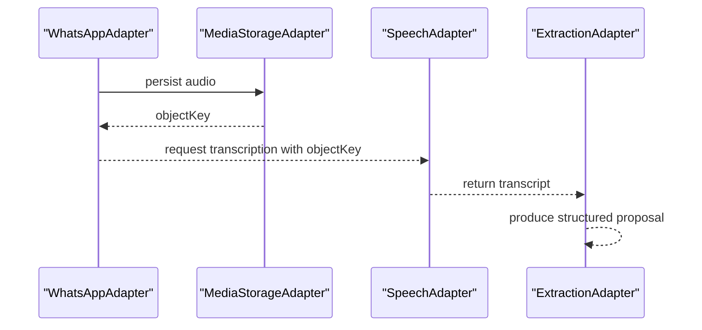

**Diagram sources**
- [index.ts:41-71](file://src/server/integrations/index.ts#L41-L71)
- [openai-speech-adapter.ts:52-99](file://src/server/integrations/speech/openai-speech-adapter.ts#L52-L99)
- [openai-extraction-adapter.ts:141-220](file://src/server/integrations/extraction/openai-extraction-adapter.ts#L141-L220)