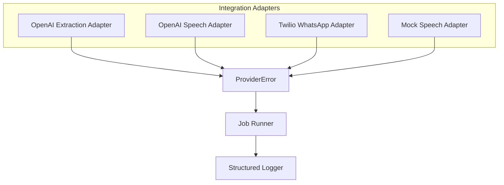
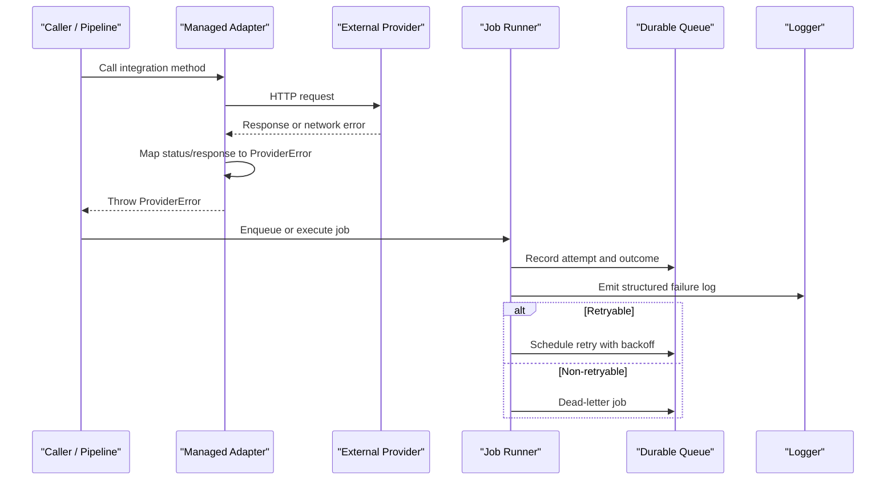
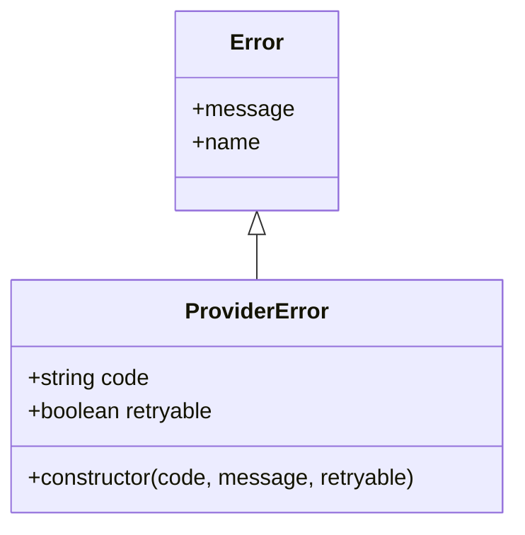
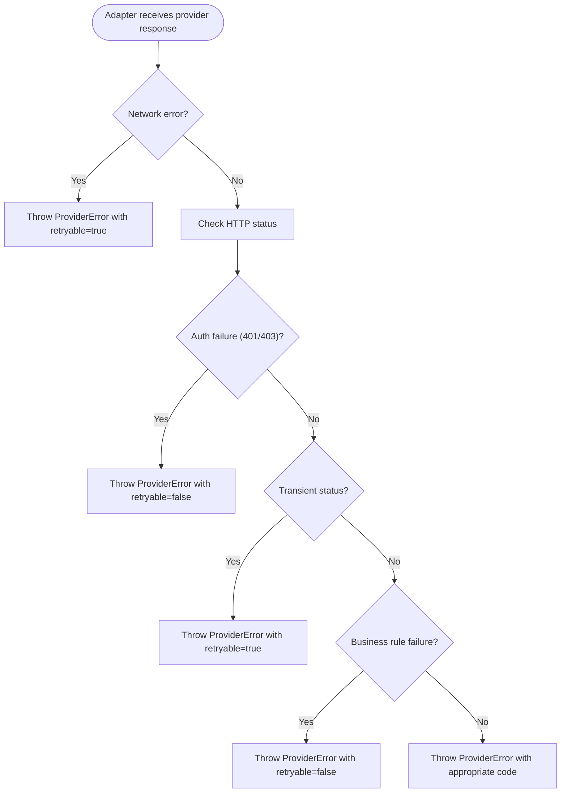
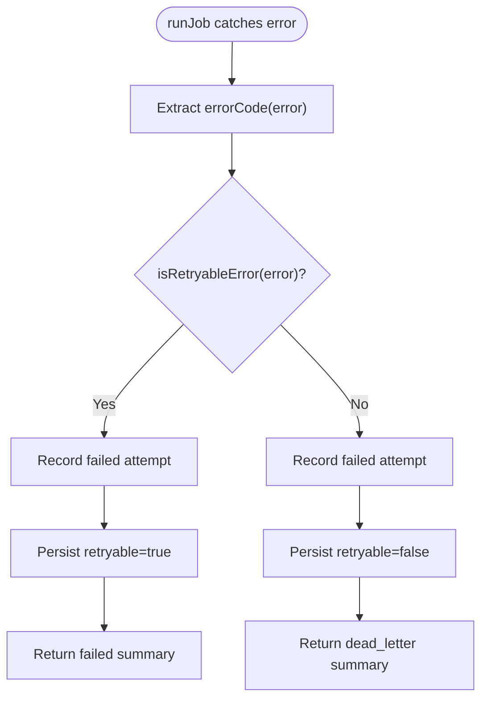
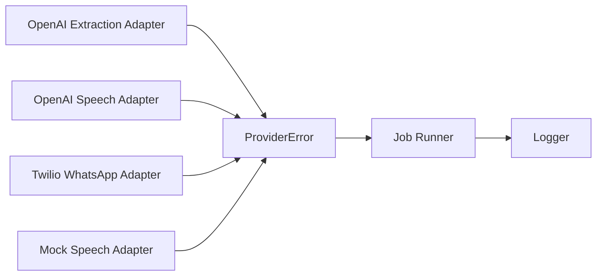

# Provider Error Handling

<cite>
**Referenced Files in This Document**
- [provider-error.ts](file://src/server/integrations/provider-error.ts)
- [jobs.ts](file://src/server/services/jobs.ts)
- [openai-extraction-adapter.ts](file://src/server/integrations/extraction/openai-extraction-adapter.ts)
- [openai-speech-adapter.ts](file://src/server/integrations/speech/openai-speech-adapter.ts)
- [twilio-whatsapp-adapter.ts](file://src/server/integrations/whatsapp/twilio-whatsapp-adapter.ts)
- [mock-speech-adapter.ts](file://src/server/integrations/speech/mock-speech-adapter.ts)
- [index.ts](file://src/server/integrations/index.ts)
- [logger.ts](file://src/server/observability/logger.ts)
</cite>

## Table of Contents
1. [Introduction](#introduction)
2. [Project Structure](#project-structure)
3. [Core Components](#core-components)
4. [Architecture Overview](#architecture-overview)
5. [Detailed Component Analysis](#detailed-component-analysis)
6. [Dependency Analysis](#dependency-analysis)
7. [Performance Considerations](#performance-considerations)
8. [Troubleshooting Guide](#troubleshooting-guide)
9. [Conclusion](#conclusion)

## Introduction
This document explains the provider error handling system that standardizes how integration adapters report failures, how those failures are categorized, and how the job runner decides whether to retry or give up. It also documents how errors propagate from external providers through adapters into durable jobs, and how they are transformed into safe, user-friendly signals without leaking sensitive details.

The system is built around a single error type used by all managed providers: `ProviderError`. Adapters throw this error with a stable machine-readable code and a boolean flag indicating whether the failure is transient. The job runner reads these two properties to apply exponential backoff for retryable failures and dead-letter non-retryable ones.

## Project Structure
The provider error handling system spans three layers:

- Adapter layer: Each integration adapter throws `ProviderError` with domain-specific codes and retry flags.
- Job layer: The durable job runner inspects thrown errors to decide retry behavior and persist outcomes.
- Observability layer: Centralized structured logging redacts sensitive data while preserving diagnostic context.

**Diagram sources**
- [openai-extraction-adapter.ts:153-200](file://src/server/integrations/extraction/openai-extraction-adapter.ts#L153-L200)
- [openai-speech-adapter.ts:63-83](file://src/server/integrations/speech/openai-speech-adapter.ts#L63-L83)
- [twilio-whatsapp-adapter.ts:98-111](file://src/server/integrations/whatsapp/twilio-whatsapp-adapter.ts#L98-L111)
- [mock-speech-adapter.ts:19-44](file://src/server/integrations/speech/mock-speech-adapter.ts#L19-L44)
- [provider-error.ts:8-17](file://src/server/integrations/provider-error.ts#L8-L17)
- [jobs.ts:35-49](file://src/server/services/jobs.ts#L35-L49)
- [logger.ts:56-76](file://src/server/observability/logger.ts#L56-L76)

**Section sources**
- [provider-error.ts:1-19](file://src/server/integrations/provider-error.ts#L1-L19)
- [jobs.ts:1-49](file://src/server/services/jobs.ts#L1-L49)
- [logger.ts:1-38](file://src/server/observability/logger.ts#L1-L38)

## Core Components
- `ProviderError`: A standardized error class carrying a stable error code and a retry flag. It replaces raw network or provider exceptions so callers can make uniform decisions.
- Adapter error emission: Managed adapters wrap HTTP/network failures and malformed responses in `ProviderError`, choosing retryable versus permanent failures based on status codes and response content.
- Job runner retry policy: The job runner detects `ProviderError` via duck typing, extracts its code, and applies retry logic with exponential backoff when `retryable` is true.
- Logging and monitoring: All job failures are emitted as structured logs with redacted context and an enumerated error code suitable for dashboards and alerts.

Key responsibilities:
- Adapters translate provider-specific failures into consistent codes.
- The job runner translates error objects into durable outcomes.
- The logger ensures no sensitive payload leaks while retaining actionable metadata.

**Section sources**
- [provider-error.ts:1-19](file://src/server/integrations/provider-error.ts#L1-L19)
- [jobs.ts:35-49](file://src/server/services/jobs.ts#L35-L49)
- [logger.ts:1-38](file://src/server/observability/logger.ts#L1-L38)

## Architecture Overview
The error flow connects adapters, the job runner, and observability.

**Diagram sources**
- [openai-extraction-adapter.ts:153-200](file://src/server/integrations/extraction/openai-extraction-adapter.ts#L153-L200)
- [openai-speech-adapter.ts:63-83](file://src/server/integrations/speech/openai-speech-adapter.ts#L63-L83)
- [twilio-whatsapp-adapter.ts:98-111](file://src/server/integrations/whatsapp/twilio-whatsapp-adapter.ts#L98-L111)
- [jobs.ts:142-193](file://src/server/services/jobs.ts#L142-L193)
- [logger.ts:56-76](file://src/server/observability/logger.ts#L56-L76)

## Detailed Component Analysis

### ProviderError Class Hierarchy
`ProviderError` extends the base JavaScript `Error` and adds:
- `code`: A stable, machine-readable classification string.
- `retryable`: A boolean indicating whether the job runner should retry with backoff.

There are no subclasses in this repository; instead, each adapter chooses a distinct code string to represent different failure categories.

**Diagram sources**
- [provider-error.ts:8-17](file://src/server/integrations/provider-error.ts#L8-L17)

**Section sources**
- [provider-error.ts:1-19](file://src/server/integrations/provider-error.ts#L1-L19)

### Error Categorization Across Adapters
Adapters map provider responses to specific error codes and retry flags:

- OpenAI extraction adapter:
  - Authentication failures: non-retryable.
  - Malformed JSON output: non-retryable.
  - Empty model content: retryable.
  - Network errors and transient HTTP statuses: retryable.
  - Other HTTP errors: mapped according to status set membership.

- OpenAI speech adapter:
  - Authentication failures: non-retryable.
  - Rejected audio payloads: non-retryable.
  - Empty transcription text: non-retryable.
  - Network errors and transient HTTP statuses: retryable.

- Twilio WhatsApp adapter:
  - Media download failures: retryable for rate limits and server errors.
  - Other HTTP responses: classified by status range.

- Mock speech adapter:
  - Simulates several failure scenarios such as unsupported media, no speech detected, temporary outage, too-long audio, and empty transcripts. These are useful for testing retry paths and UI triage messages.

**Diagram sources**
- [openai-extraction-adapter.ts:153-200](file://src/server/integrations/extraction/openai-extraction-adapter.ts#L153-L200)
- [openai-speech-adapter.ts:16-24](file://src/server/integrations/speech/openai-speech-adapter.ts#L16-L24)
- [twilio-whatsapp-adapter.ts:98-111](file://src/server/integrations/whatsapp/twilio-whatsapp-adapter.ts#L98-L111)

**Section sources**
- [openai-extraction-adapter.ts:26-27](file://src/server/integrations/extraction/openai-extraction-adapter.ts#L26-L27)
- [openai-extraction-adapter.ts:171-219](file://src/server/integrations/extraction/openai-extraction-adapter.ts#L171-L219)
- [openai-speech-adapter.ts:14-24](file://src/server/integrations/speech/openai-speech-adapter.ts#L14-L24)
- [openai-speech-adapter.ts:63-83](file://src/server/integrations/speech/openai-speech-adapter.ts#L63-L83)
- [twilio-whatsapp-adapter.ts:98-111](file://src/server/integrations/whatsapp/twilio-whatsapp-adapter.ts#L98-L111)
- [mock-speech-adapter.ts:19-44](file://src/server/integrations/speech/mock-speech-adapter.ts#L19-L44)

### Retry Strategies and Propagation
The job runner uses two helper functions:
- `isRetryableError`: Detects `ProviderError` by checking for a `retryable` property.
- `errorCode`: Extracts the stable `code` field if present; otherwise falls back to a truncated message.

When a job handler throws `ProviderError`, the runner records the attempt, persists the error code, and either schedules a retry with exponential backoff or dead-letters the job.

**Diagram sources**
- [jobs.ts:35-49](file://src/server/services/jobs.ts#L35-L49)
- [jobs.ts:142-193](file://src/server/services/jobs.ts#L142-L193)

**Section sources**
- [jobs.ts:35-49](file://src/server/services/jobs.ts#L35-L49)
- [jobs.ts:142-193](file://src/server/services/jobs.ts#L142-L193)

### Transforming Errors into User-Friendly Messages
Adapters intentionally keep detailed provider diagnostics in the error message but rely on the job runner and logging layer to avoid exposing sensitive data:
- The job runner stores only the stable `code` and a short representation of the error.
- The logger redacts keys that commonly contain sensitive values, truncates long strings, and emits structured lines with levels and context.

For user-facing surfaces, recommend mapping stable codes to localized messages rather than displaying raw provider messages. Examples:
- Authentication failures: prompt users to verify credentials or contact support.
- Rate-limited or unavailable providers: show a temporary-unavailable notice and allow retries.
- Invalid provider output: ask users to re-record or provide clearer input.

**Section sources**
- [jobs.ts:42-49](file://src/server/services/jobs.ts#L42-L49)
- [logger.ts:26-38](file://src/server/observability/logger.ts#L26-L38)
- [logger.ts:56-76](file://src/server/observability/logger.ts#L56-L76)

### Implementing Custom Error Handlers
To add a new managed provider:
1. Create an adapter implementing the relevant port.
2. Wrap all network calls and response validations in `ProviderError`.
3. Choose a stable `code` that describes the failure category.
4. Set `retryable` to true only for transient conditions such as timeouts, rate limits, and server errors.
5. Avoid including secrets, tokens, full webhook bodies, or large payloads in the message.
6. Add tests using `overrideIntegrations` to simulate provider failures and assert retry behavior.

Example patterns already present:
- OpenAI extraction and speech adapters map HTTP status sets to retryable vs non-retryable.
- Twilio WhatsApp adapter distinguishes between network errors and HTTP status ranges.
- Mock speech adapter provides deterministic scripted failures for test coverage.

**Section sources**
- [index.ts:80-93](file://src/server/integrations/index.ts#L80-L93)
- [openai-extraction-adapter.ts:153-219](file://src/server/integrations/extraction/openai-extraction-adapter.ts#L153-L219)
- [openai-speech-adapter.ts:63-83](file://src/server/integrations/speech/openai-speech-adapter.ts#L63-L83)
- [twilio-whatsapp-adapter.ts:98-111](file://src/server/integrations/whatsapp/twilio-whatsapp-adapter.ts#L98-L111)
- [mock-speech-adapter.ts:19-44](file://src/server/integrations/speech/mock-speech-adapter.ts#L19-L44)

### Debugging Integration Issues
Recommended debugging workflow:
- Inspect the structured log entry produced by the job runner. Look for `errorCode`, `retryable`, `jobId`, `jobType`, and `attempts`.
- Confirm the adapter’s error code matches the expected category.
- Validate retry behavior by checking whether transient failures were retried and eventually succeeded or dead-lettered.
- Use mock adapters to reproduce failures deterministically without relying on external provider outages.
- If authentication fails, verify configuration selection and credential presence before blaming the provider.

Logging best practices:
- Always include `errorCode` and `operation` where possible.
- Never log raw transcripts, audio references, tokens, signatures, or webhook bodies.
- Keep messages concise; prefer stable codes over verbose diagnostics in logs.

**Section sources**
- [jobs.ts:159-193](file://src/server/services/jobs.ts#L159-L193)
- [logger.ts:1-38](file://src/server/observability/logger.ts#L1-L38)
- [logger.ts:56-76](file://src/server/observability/logger.ts#L56-L76)
- [mock-speech-adapter.ts:19-44](file://src/server/integrations/speech/mock-speech-adapter.ts#L19-L44)

### Monitoring Provider Health
- Track `errorCode` distributions across time to detect spikes in transient failures.
- Alert on increasing rates of non-retryable authentication or validation failures.
- Monitor job dead-letter counts per provider to identify persistent issues.
- Consider adding a health-check job that exercises provider endpoints and reports success/failure metrics.
- Use structured logs to correlate provider failures with business impact by including opaque tenant identifiers such as `businessId`.

**Section sources**
- [jobs.ts:179-193](file://src/server/services/jobs.ts#L179-L193)
- [logger.ts:12-24](file://src/server/observability/logger.ts#L12-L24)

## Dependency Analysis
The following diagram shows how adapters depend on `ProviderError` and how the job runner consumes it.

**Diagram sources**
- [provider-error.ts:8-17](file://src/server/integrations/provider-error.ts#L8-L17)
- [openai-extraction-adapter.ts:23-24](file://src/server/integrations/extraction/openai-extraction-adapter.ts#L23-L24)
- [openai-speech-adapter.ts:9-12](file://src/server/integrations/speech/openai-speech-adapter.ts#L9-L12)
- [twilio-whatsapp-adapter.ts:12-19](file://src/server/integrations/whatsapp/twilio-whatsapp-adapter.ts#L12-L19)
- [mock-speech-adapter.ts:12-14](file://src/server/integrations/speech/mock-speech-adapter.ts#L12-L14)
- [jobs.ts:35-49](file://src/server/services/jobs.ts#L35-L49)
- [logger.ts:56-76](file://src/server/observability/logger.ts#L56-L76)

**Section sources**
- [index.ts:1-39](file://src/server/integrations/index.ts#L1-L39)
- [jobs.ts:35-49](file://src/server/services/jobs.ts#L35-L49)

## Performance Considerations
- Prefer retryable flags only for truly transient failures to avoid excessive retries.
- Keep error messages concise to reduce storage and log volume.
- Avoid logging large payloads; use stable codes and minimal context.
- Batch retries at the job level rather than repeatedly calling providers inline.
- Use mock adapters in tests to validate retry boundaries without network overhead.

[No sources needed since this section provides general guidance]

## Troubleshooting Guide
Common issues and resolutions:
- Authentication failures:
  - Symptom: Non-retryable authentication error codes from OpenAI or other providers.
  - Action: Verify provider credentials and configuration selection. Do not retry automatically.
- Rate limiting or temporary outages:
  - Symptom: Retryable transient errors from HTTP status codes or network errors.
  - Action: Allow the job runner to retry with backoff; monitor retry counts and eventual success.
- Invalid provider output:
  - Symptom: Non-retryable validation or parsing errors.
  - Action: Improve input quality or adjust prompts; do not retry blindly.
- Missing or malformed webhook data:
  - Symptom: Parsing or signature verification failures.
  - Action: Validate webhook delivery format and secret configuration.

Logging checks:
- Confirm the structured log contains `errorCode`, `retryable`, `jobId`, and `jobType`.
- Ensure no sensitive fields leaked due to unexpected key names.

**Section sources**
- [openai-extraction-adapter.ts:171-219](file://src/server/integrations/extraction/openai-extraction-adapter.ts#L171-L219)
- [openai-speech-adapter.ts:63-83](file://src/server/integrations/speech/openai-speech-adapter.ts#L63-L83)
- [twilio-whatsapp-adapter.ts:98-111](file://src/server/integrations/whatsapp/twilio-whatsapp-adapter.ts#L98-L111)
- [jobs.ts:159-193](file://src/server/services/jobs.ts#L159-L193)
- [logger.ts:26-38](file://src/server/observability/logger.ts#L26-L38)

## Conclusion
The provider error handling system centralizes failure reporting through `ProviderError`, enabling consistent categorization, safe propagation, and reliable retry behavior. Adapters focus on translating provider-specific failures into stable codes, while the job runner enforces durable retry policies and the logger preserves privacy. Following the guidelines in this document helps maintain predictable integrations, clear diagnostics, and resilient workflows even when external providers fail.

[No sources needed since this section summarizes without analyzing specific files]