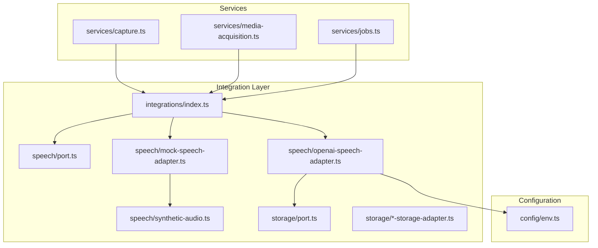
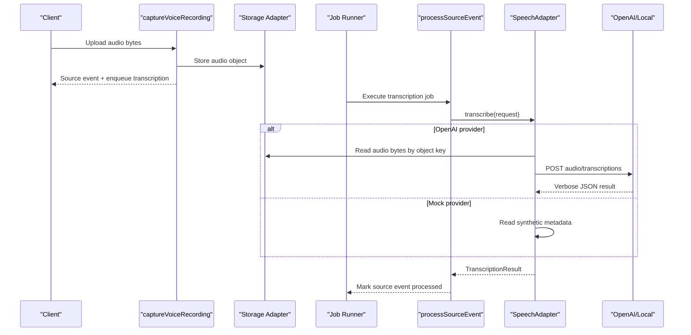
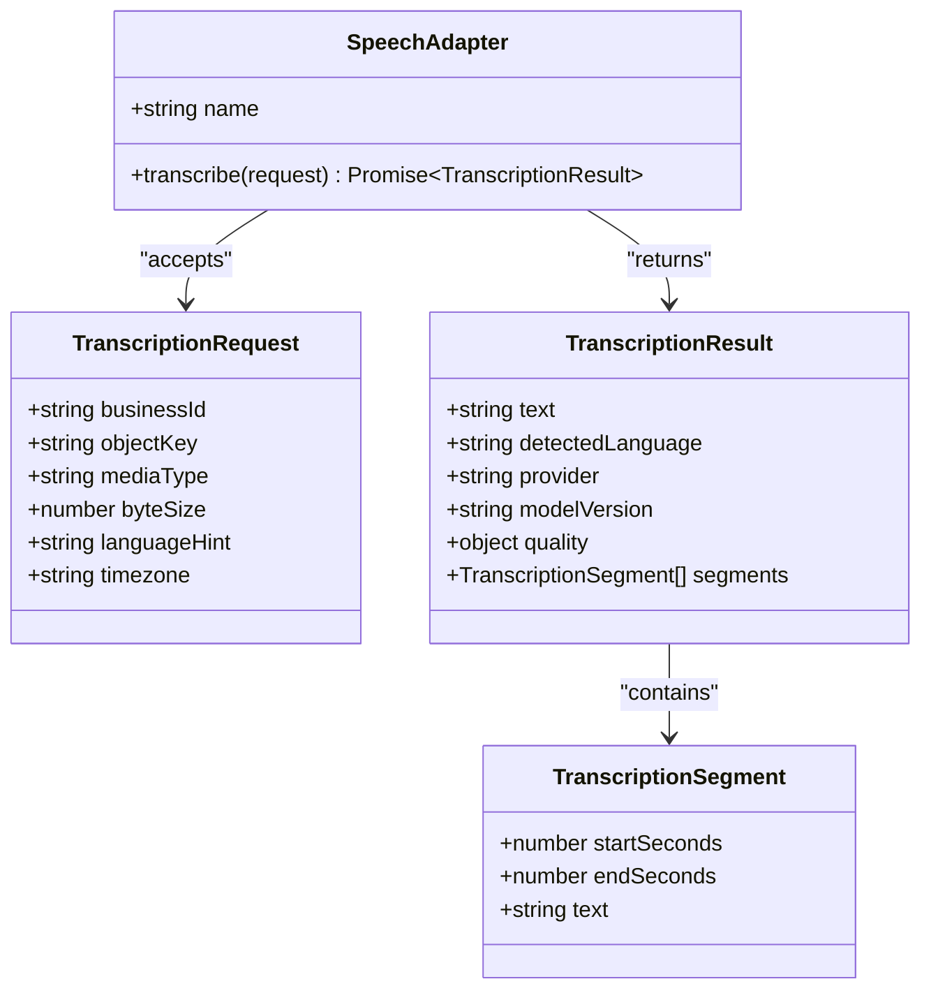
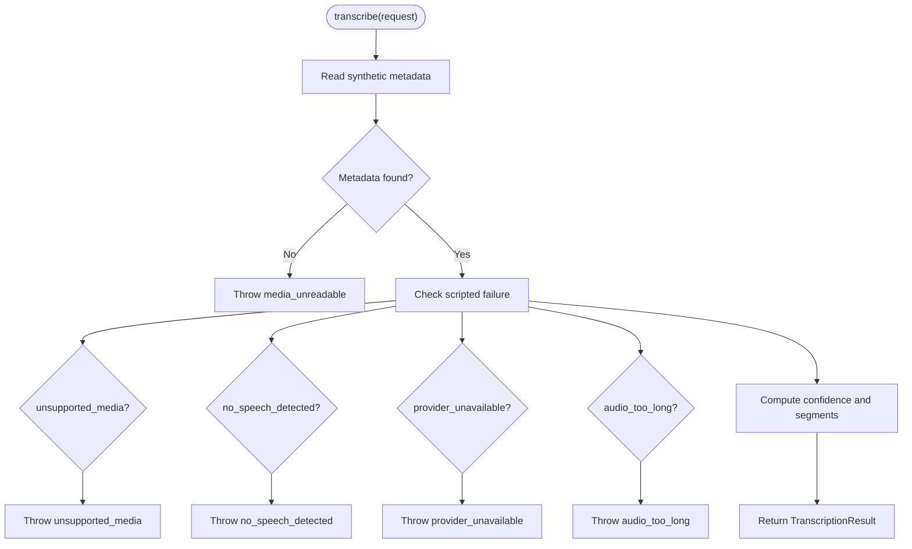
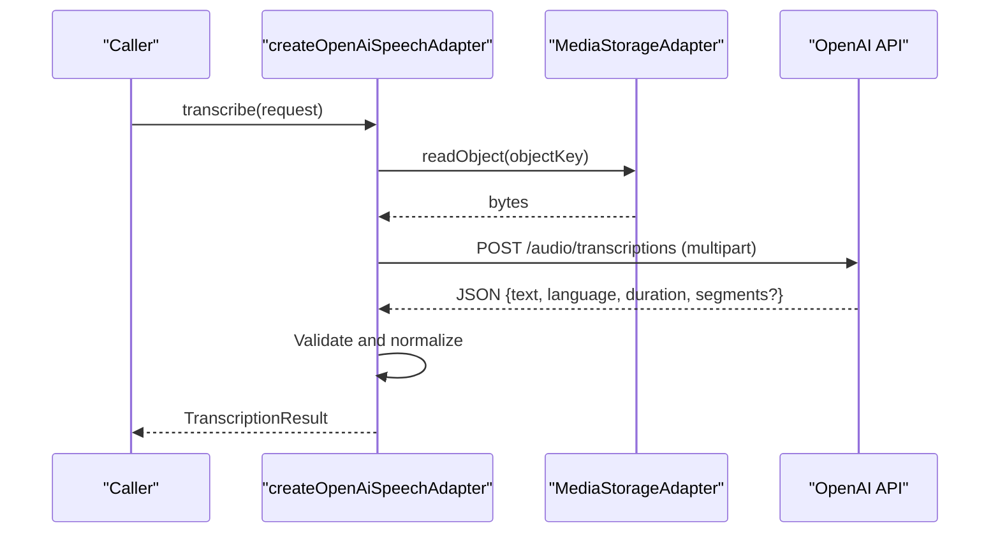
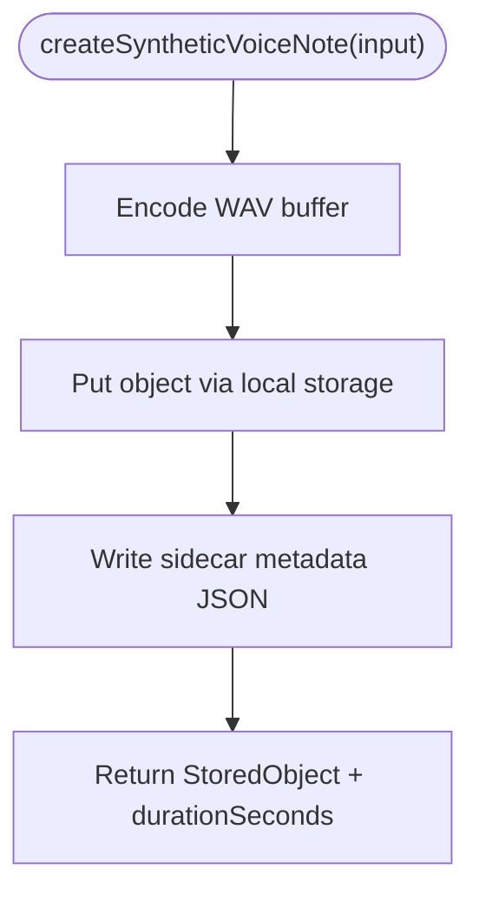
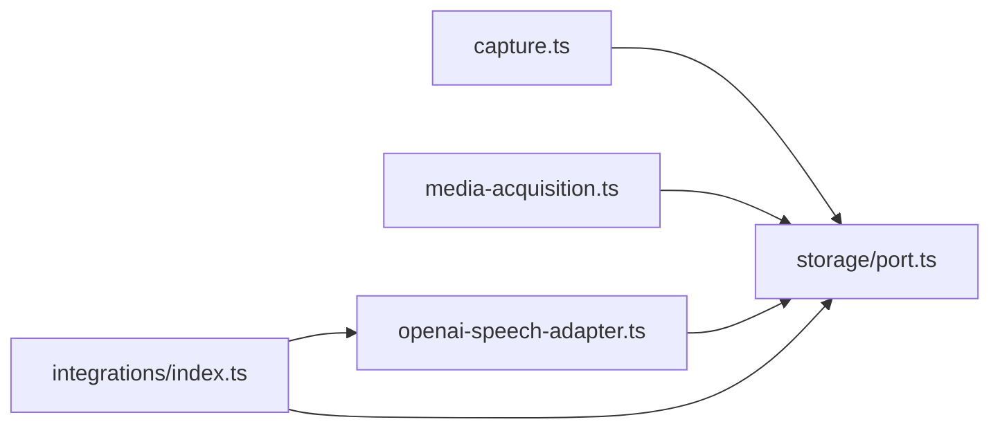
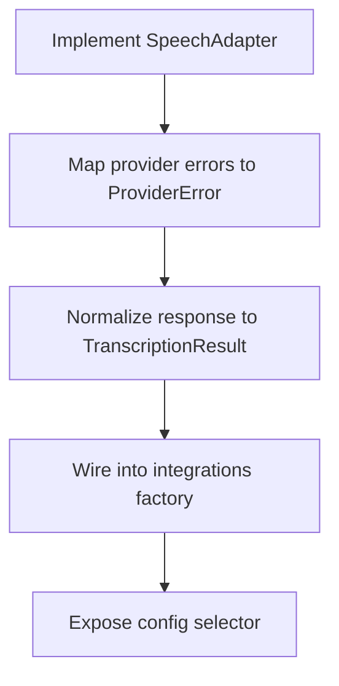
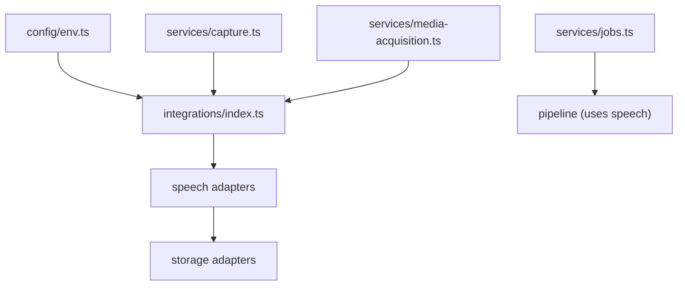

# Speech-to-Text Adapters

<cite>
**Referenced Files in This Document**
- [port.ts](file://src/server/integrations/speech/port.ts)
- [mock-speech-adapter.ts](file://src/server/integrations/speech/mock-speech-adapter.ts)
- [openai-speech-adapter.ts](file://src/server/integrations/speech/openai-speech-adapter.ts)
- [synthetic-audio.ts](file://src/server/integrations/speech/synthetic-audio.ts)
- [index.ts](file://src/server/integrations/index.ts)
- [env.ts](file://src/server/config/env.ts)
- [capture.ts](file://src/server/services/capture.ts)
- [media-acquisition.ts](file://src/server/services/media-acquisition.ts)
- [jobs.ts](file://src/server/services/jobs.ts)
</cite>

## Table of Contents
1. [Introduction](#introduction)
2. [Project Structure](#project-structure)
3. [Core Components](#core-components)
4. [Architecture Overview](#architecture-overview)
5. [Detailed Component Analysis](#detailed-component-analysis)
6. [Dependency Analysis](#dependency-analysis)
7. [Performance Considerations](#performance-considerations)
8. [Troubleshooting Guide](#troubleshooting-guide)
9. [Conclusion](#conclusion)
10. [Appendices](#appendices)

## Introduction
This document explains the speech-to-text adapter layer that converts stored audio files into text transcripts. It covers:
- The `SpeechAdapter` interface and its transcription request/result types.
- The mock speech adapter used for development and testing.
- The OpenAI Whisper-based production adapter.
- The synthetic audio generator for deterministic local testing.
- Audio format support, language detection, accuracy signals, and performance considerations.
- Integration with storage adapters and the job pipeline.
- Guidance for implementing custom speech adapters.

The design keeps transcription out of the HTTP capture path by storing audio first and enqueuing a durable job to transcribe it later.

## Project Structure
The speech-to-text feature lives under the server integration layer and is wired through a central integrations factory.

**Diagram sources**
- [index.ts:41-70](file://src/server/integrations/index.ts#L41-L70)
- [port.ts:42-45](file://src/server/integrations/speech/port.ts#L42-L45)
- [mock-speech-adapter.ts:16-69](file://src/server/integrations/speech/mock-speech-adapter.ts#L16-L69)
- [openai-speech-adapter.ts:42-101](file://src/server/integrations/speech/openai-speech-adapter.ts#L42-L101)
- [synthetic-audio.ts:62-87](file://src/server/integrations/speech/synthetic-audio.ts#L62-L87)
- [capture.ts:67-145](file://src/server/services/capture.ts#L67-L145)
- [media-acquisition.ts:42-100](file://src/server/services/media-acquisition.ts#L42-L100)
- [jobs.ts:209-219](file://src/server/services/jobs.ts#L209-L219)

**Section sources**
- [index.ts:1-93](file://src/server/integrations/index.ts#L1-L93)
- [env.ts:146-169](file://src/server/config/env.ts#L146-L169)

## Core Components
- `SpeechAdapter`: Defines the contract for speech providers.
- `TranscriptionRequest`: Describes the audio object and optional language hint.
- `TranscriptionResult`: Returns transcript text, detected language, provider metadata, quality metrics, and optional time-segmented segments.
- Mock adapter: Deterministic offline transcription using synthetic media metadata.
- OpenAI adapter: Production transcription via Whisper with storage-backed audio retrieval.
- Synthetic audio: Generates valid WAV files and sidecar metadata for local testing.

Key responsibilities:
- Capture service validates and stores audio, then enqueues transcription.
- Job runner executes transcription after media acquisition or direct capture.
- Storage adapters provide private access to audio bytes.
- Configuration selects mock or OpenAI speech provider.

**Section sources**
- [port.ts:9-45](file://src/server/integrations/speech/port.ts#L9-L45)
- [mock-speech-adapter.ts:1-69](file://src/server/integrations/speech/mock-speech-adapter.ts#L1-L69)
- [openai-speech-adapter.ts:1-102](file://src/server/integrations/speech/openai-speech-adapter.ts#L1-L102)
- [synthetic-audio.ts:1-101](file://src/server/integrations/speech/synthetic-audio.ts#L1-L101)
- [capture.ts:27-49](file://src/server/services/capture.ts#L27-L49)
- [jobs.ts:209-219](file://src/server/services/jobs.ts#L209-L219)

## Architecture Overview
The transcription flow separates ingestion from processing:

**Diagram sources**
- [capture.ts:67-145](file://src/server/services/capture.ts#L67-L145)
- [jobs.ts:76-94](file://src/server/services/jobs.ts#L76-L94)
- [openai-speech-adapter.ts:52-99](file://src/server/integrations/speech/openai-speech-adapter.ts#L52-L99)
- [mock-speech-adapter.ts:19-67](file://src/server/integrations/speech/mock-speech-adapter.ts#L19-L67)

## Detailed Component Analysis

### SpeechAdapter Interface and Types
The port defines:
- `TranscriptionSegment`: Time-bounded text segment.
- `TranscriptionRequest`: Business context, storage object key, media type, size, optional language hint, and timezone.
- `TranscriptionResult`: Transcript text, detected language, provider name, model version, quality metrics, and optional segments.
- `SpeechAdapter`: A read-only `name` and an async `transcribe` method returning a promise.

Design notes:
- Language hints are advisory; adapters still report detected language.
- Quality fields are triage signals, not guarantees.
- Errors use a shared `ProviderError` type exported from the port.

**Diagram sources**
- [port.ts:9-45](file://src/server/integrations/speech/port.ts#L9-L45)

**Section sources**
- [port.ts:1-45](file://src/server/integrations/speech/port.ts#L1-L45)

### Mock Speech Adapter
Purpose:
- Offline transcription for development.
- Reads synthetic voice note metadata written by the local WhatsApp simulator.
- Produces deterministic confidence and segment data without sending audio externally.

Behavior highlights:
- Rejects non-synthetic media with a specific error code.
- Supports scripted failures for unsupported media, no speech, provider outage, and too-long audio.
- Computes a simple confidence score based on noise level and word count.
- Always returns at least one segment spanning the full duration.

**Diagram sources**
- [mock-speech-adapter.ts:19-67](file://src/server/integrations/speech/mock-speech-adapter.ts#L19-L67)

**Section sources**
- [mock-speech-adapter.ts:1-69](file://src/server/integrations/speech/mock-speech-adapter.ts#L1-L69)
- [synthetic-audio.ts:89-97](file://src/server/integrations/speech/synthetic-audio.ts#L89-L97)

### OpenAI Speech Adapter
Purpose:
- Production transcription using OpenAI Whisper.
- Reads audio from private storage and uploads it as multipart form data.
- Normalizes verbose JSON responses into typed results.

Key behaviors:
- Uses `MediaStorageAdapter` to read audio bytes by object key.
- Sends `response_format=verbose_json` and optional language hint.
- Maps HTTP status codes to domain-specific `ProviderError` codes.
- Validates response payload and rejects empty transcripts.
- Extracts duration and segments when present.

**Diagram sources**
- [openai-speech-adapter.ts:42-99](file://src/server/integrations/speech/openai-speech-adapter.ts#L42-L99)

**Section sources**
- [openai-speech-adapter.ts:1-102](file://src/server/integrations/speech/openai-speech-adapter.ts#L1-L102)

### Synthetic Audio Generator
Purpose:
- Generate short, playable WAV files for local review screens.
- Persist a sidecar metadata file containing transcript, language, duration, noise level, and optional scripted failures.

Highlights:
- Writes a minimal PCM WAV buffer with two-tone samples.
- Stores audio via the local storage adapter.
- Creates a sidecar `.meta.json` next to the media path.
- Provides checksum utility for generated audio.

**Diagram sources**
- [synthetic-audio.ts:36-87](file://src/server/integrations/speech/synthetic-audio.ts#L36-L87)

**Section sources**
- [synthetic-audio.ts:1-101](file://src/server/integrations/speech/synthetic-audio.ts#L1-L101)

### Integration with Storage Adapters
- The OpenAI adapter depends on `MediaStorageAdapter` to read audio bytes by object key.
- The integrations factory constructs the OpenAI adapter with the selected storage implementation.
- Capture and media acquisition services store audio via the same storage abstraction before transcription.

**Diagram sources**
- [openai-speech-adapter.ts:9-12](file://src/server/integrations/speech/openai-speech-adapter.ts#L9-L12)
- [index.ts:41-55](file://src/server/integrations/index.ts#L41-L55)
- [capture.ts:91-96](file://src/server/services/capture.ts#L91-L96)
- [media-acquisition.ts:82-87](file://src/server/services/media-acquisition.ts#L82-L87)

**Section sources**
- [index.ts:41-55](file://src/server/integrations/index.ts#L41-L55)
- [capture.ts:91-96](file://src/server/services/capture.ts#L91-L96)
- [media-acquisition.ts:82-87](file://src/server/services/media-acquisition.ts#L82-L87)

### Audio File Format Support
Supported capture formats include:
- WebM, OGG, MP4, MPEG, WAV, X-WAV, AAC, M4A, X-M4A.
- Maximum capture size is 25 MB to align with provider constraints.

Notes:
- Media types are normalized by stripping codec parameters.
- The OpenAI adapter sends audio as multipart form data with the provided media type.

**Section sources**
- [capture.ts:27-49](file://src/server/services/capture.ts#L27-L49)
- [openai-speech-adapter.ts:55-58](file://src/server/integrations/speech/openai-speech-adapter.ts#L55-L58)

### Language Detection
- The port treats language as per-message rather than dashboard-wide.
- `TranscriptionRequest.languageHint` is advisory; adapters still report detected language.
- OpenAI adapter forwards a two-letter lowercase language hint when provided.
- Mock adapter uses synthetic metadata language, defaulting to Swahili when absent.

Best practices:
- Provide a language hint only when you have strong confidence.
- Always inspect `detectedLanguage` and quality metrics before downstream processing.

**Section sources**
- [port.ts:15-23](file://src/server/integrations/speech/port.ts#L15-L23)
- [openai-speech-adapter.ts:59-61](file://src/server/integrations/speech/openai-speech-adapter.ts#L59-L61)
- [mock-speech-adapter.ts:53-56](file://src/server/integrations/speech/mock-speech-adapter.ts#L53-L56)

### Transcription Accuracy Considerations
- Quality fields are informational and must not be treated as guarantees.
- Mock adapter computes a deterministic confidence based on noise and word count.
- OpenAI adapter exposes duration and segment count; it does not expose model confidence directly.
- Empty transcripts are rejected by both adapters with distinct error codes.

Operational guidance:
- Use `quality.confidence`, `averageLogprob`, and `noSpeechProbability` for triage.
- Review long audio or low-confidence transcripts manually.
- Monitor `segmentCount` and `durationSeconds` for anomalies.

**Section sources**
- [mock-speech-adapter.ts:46-67](file://src/server/integrations/speech/mock-speech-adapter.ts#L46-L67)
- [openai-speech-adapter.ts:85-98](file://src/server/integrations/speech/openai-speech-adapter.ts#L85-L98)

### Performance Optimization Techniques
- Keep transcription asynchronous: capture stores audio and enqueues a job immediately.
- Separate media acquisition from transcription so provider-hosted references can be downloaded first.
- Use idempotency keys for jobs to avoid duplicate work.
- Prefer streaming-friendly formats supported by the capture layer.
- Limit audio size to provider limits to reduce retries and costs.
- Cache provider configuration and reuse fetch implementations where appropriate.

**Section sources**
- [capture.ts:67-145](file://src/server/services/capture.ts#L67-L145)
- [media-acquisition.ts:42-100](file://src/server/services/media-acquisition.ts#L42-L100)
- [jobs.ts:209-219](file://src/server/services/jobs.ts#L209-L219)

### Implementing a Custom Speech Adapter
Steps:
1. Implement the `SpeechAdapter` interface from the port.
2. Decide whether your provider needs storage access to read audio bytes.
3. Map provider errors to `ProviderError` with stable codes and retry flags.
4. Normalize provider responses into `TranscriptionResult`.
5. Register your adapter in the integrations factory.
6. Add environment selection logic if needed.

Example outline:
- Create `custom-speech-adapter.ts` exporting a `createCustomSpeechAdapter(deps)` function returning `SpeechAdapter`.
- In `integrations/index.ts`, add a branch selecting your adapter based on configuration.
- Expose configuration values in `config/env.ts` if required.

[No sources needed since this section provides general guidance]

## Dependency Analysis
The speech subsystem depends on:
- Storage adapters for reading audio bytes.
- Environment configuration for provider selection and OpenAI settings.
- Job runner for durable transcription execution.
- Capture and media acquisition services for orchestration.

**Diagram sources**
- [index.ts:41-70](file://src/server/integrations/index.ts#L41-L70)
- [env.ts:146-169](file://src/server/config/env.ts#L146-L169)
- [capture.ts:91-96](file://src/server/services/capture.ts#L91-L96)
- [media-acquisition.ts:82-87](file://src/server/services/media-acquisition.ts#L82-L87)
- [jobs.ts:76-94](file://src/server/services/jobs.ts#L76-L94)

**Section sources**
- [index.ts:1-93](file://src/server/integrations/index.ts#L1-L93)
- [env.ts:146-169](file://src/server/config/env.ts#L146-L169)

## Performance Considerations
- Asynchronous processing prevents slow providers from blocking user interactions.
- Idempotent jobs prevent duplicate transcription and storage operations.
- Separating media acquisition avoids transient provider links expiring during ingestion.
- Using private storage ensures secure access to audio bytes for transcription.
- Avoid logging sensitive payloads such as audio content or object keys.

[No sources needed since this section provides general guidance]

## Troubleshooting Guide
Common issues and resolutions:
- Media unreadable in mock adapter: Ensure synthetic media was created and the sidecar metadata exists.
- Unsupported media type: Verify capture allowed media types and provider constraints.
- No speech detected: Check audio length, background noise, and language hint.
- Provider unavailable: Inspect network connectivity and provider health; check retryable error flag.
- Audio too long: Reduce recording length or split long audio before upload.
- Empty transcript: Confirm audio contains speech and provider returned non-empty text.

Error handling patterns:
- Both adapters throw `ProviderError` with stable codes and retry flags.
- The job runner records attempts and marks exhausted retries as dead letters.

**Section sources**
- [mock-speech-adapter.ts:21-44](file://src/server/integrations/speech/mock-speech-adapter.ts#L21-L44)
- [openai-speech-adapter.ts:16-24](file://src/server/integrations/speech/openai-speech-adapter.ts#L16-L24)
- [openai-speech-adapter.ts:74-83](file://src/server/integrations/speech/openai-speech-adapter.ts#L74-L83)
- [jobs.ts:35-49](file://src/server/services/jobs.ts#L35-L49)
- [jobs.ts:159-191](file://src/server/services/jobs.ts#L159-L191)

## Conclusion
The speech-to-text adapter layer provides a clean, testable abstraction over transcription providers. The mock adapter enables deterministic local development, while the OpenAI adapter supports production transcription with robust error mapping and storage integration. By separating capture, storage, and transcription, the system remains fast, resilient, and scalable. Quality metrics and language detection are surfaced for triage, and the job pipeline ensures durability and idempotency.

[No sources needed since this section summarizes without analyzing specific files]

## Appendices

### Configuration Keys
- `DAFTARI_SPEECH_PROVIDER`: Selects `mock` or `openai`.
- `OPENAI_API_KEY`: Required for OpenAI speech/extraction.
- `OPENAI_BASE_URL`: Base URL for OpenAI-compatible endpoints.
- `OPENAI_TRANSCRIBE_MODEL`: Model used for transcription, defaulting to Whisper.

**Section sources**
- [env.ts:146-169](file://src/server/config/env.ts#L146-L169)