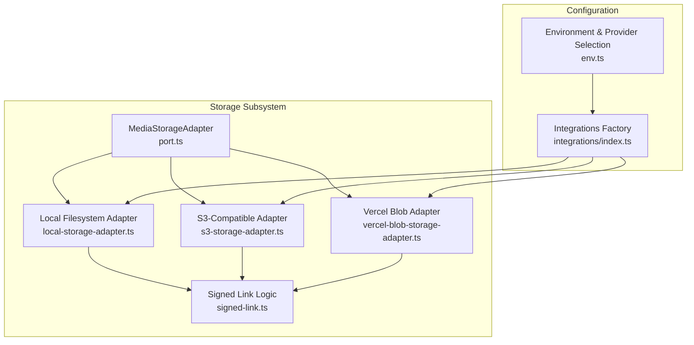
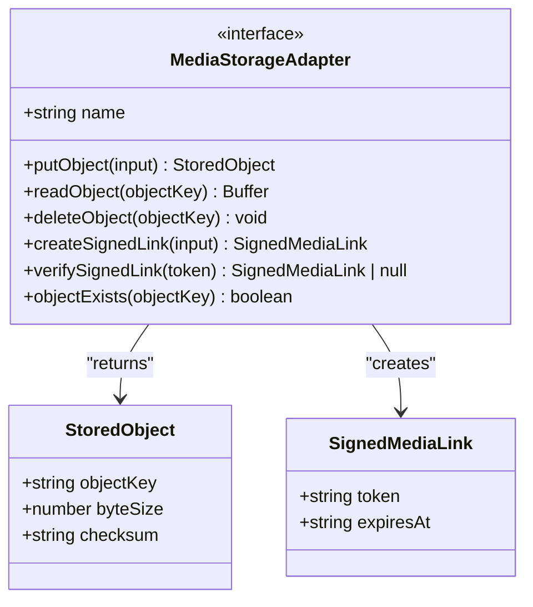
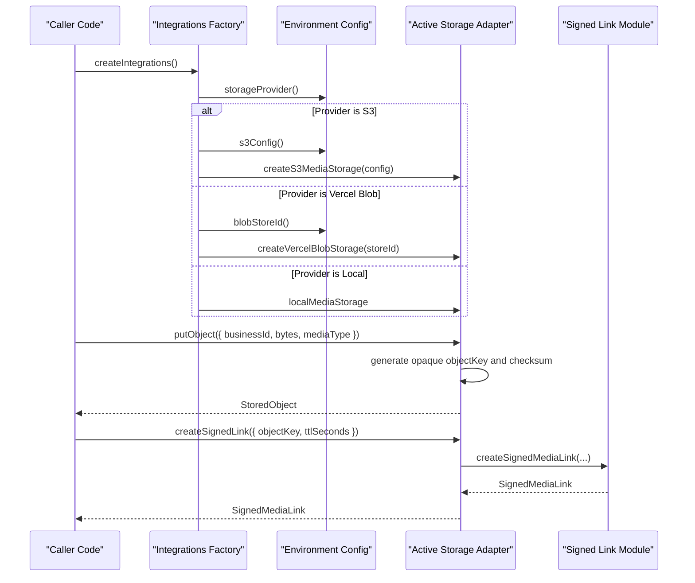
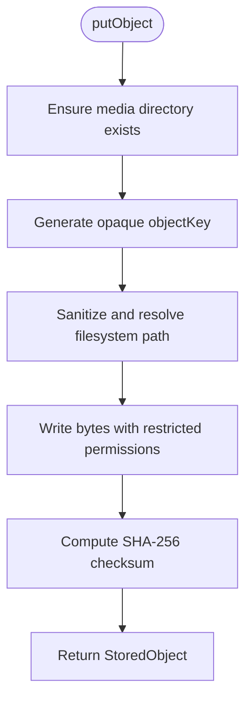
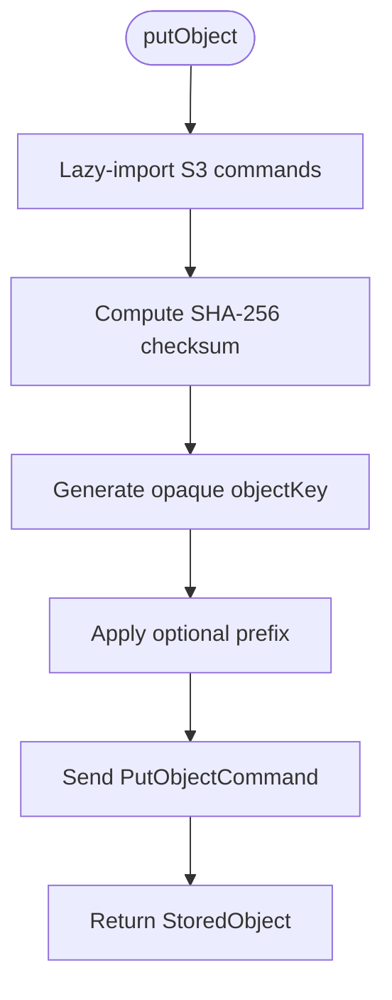
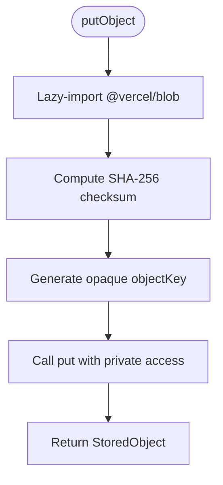
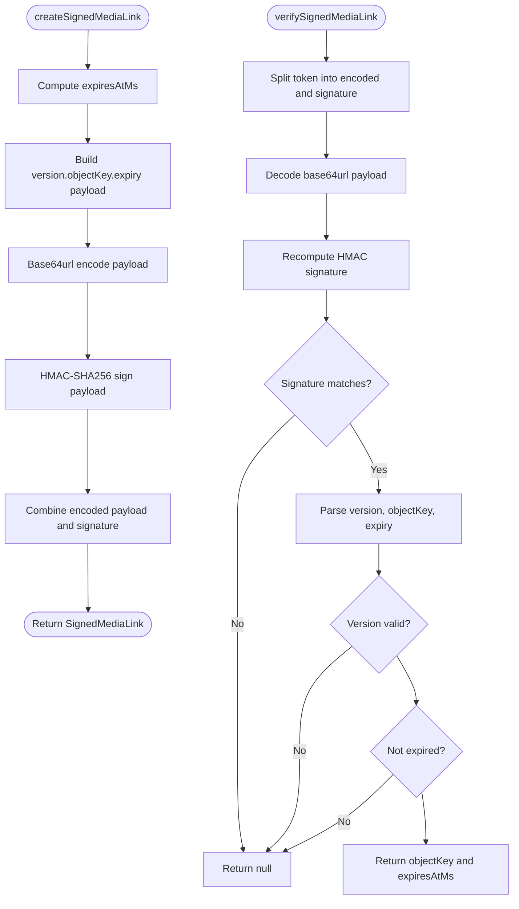
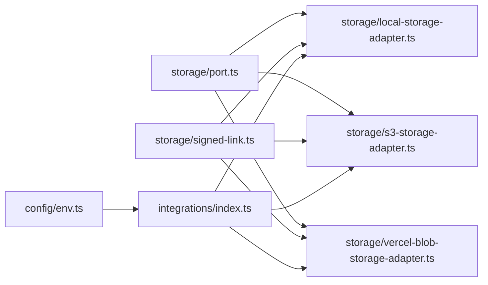
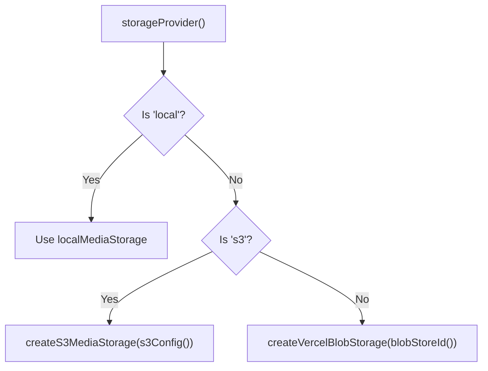

# Storage Adapters

<cite>
**Referenced Files in This Document**
- [port.ts](file://src/server/integrations/storage/port.ts)
- [local-storage-adapter.ts](file://src/server/integrations/storage/local-storage-adapter.ts)
- [s3-storage-adapter.ts](file://src/server/integrations/storage/s3-storage-adapter.ts)
- [vercel-blob-storage-adapter.ts](file://src/server/integrations/storage/vercel-blob-storage-adapter.ts)
- [signed-link.ts](file://src/server/integrations/storage/signed-link.ts)
- [index.ts](file://src/server/integrations/index.ts)
- [env.ts](file://src/server/config/env.ts)
</cite>

## Table of Contents
1. [Introduction](#introduction)
2. [Project Structure](#project-structure)
3. [Core Components](#core-components)
4. [Architecture Overview](#architecture-overview)
5. [Detailed Component Analysis](#detailed-component-analysis)
6. [Dependency Analysis](#dependency-analysis)
7. [Performance Considerations](#performance-considerations)
8. [Security and Access Control](#security-and-access-control)
9. [File Size Limits and Validation](#file-size-limits-and-validation)
10. [Integration Patterns](#integration-patterns)
11. [Implementing a Custom Storage Backend](#implementing-a-custom-storage-backend)
12. [Troubleshooting Guide](#troubleshooting-guide)
13. [Conclusion](#conclusion)

## Introduction
This document explains the storage adapter layer used for private media operations across multiple backends. The system stores sensitive audio and export files behind an opaque key scheme, never exposes public object URLs, and authorizes access through short-lived signed links. Three adapters are provided:

- Local filesystem adapter for development and local testing.
- S3-compatible adapter for AWS S3, Cloudflare R2, MinIO, or any S3 API endpoint.
- Vercel Blob adapter for cloud deployments on Vercel.

The design keeps the download contract stable regardless of backend: callers always receive a signed link containing an HMAC-bound token and expiry, and the same verification logic is shared by all adapters.

## Project Structure
The storage subsystem lives under `src/server/integrations/storage`. It defines a small port interface, three adapter implementations, and a storage-independent signed-link module. Adapter selection is centralized in the integrations factory, which reads environment configuration to choose the active backend.

**Diagram sources**
- [port.ts:9-34](file://src/server/integrations/storage/port.ts#L9-L34)
- [local-storage-adapter.ts:26-66](file://src/server/integrations/storage/local-storage-adapter.ts#L26-L66)
- [s3-storage-adapter.ts:19-99](file://src/server/integrations/storage/s3-storage-adapter.ts#L19-L99)
- [vercel-blob-storage-adapter.ts:21-70](file://src/server/integrations/storage/vercel-blob-storage-adapter.ts#L21-L70)
- [signed-link.ts:16-61](file://src/server/integrations/storage/signed-link.ts#L16-L61)
- [env.ts:87-132](file://src/server/config/env.ts#L87-L132)
- [index.ts:41-48](file://src/server/integrations/index.ts#L41-L48)

**Section sources**
- [port.ts:1-34](file://src/server/integrations/storage/port.ts#L1-L34)
- [index.ts:1-48](file://src/server/integrations/index.ts#L1-L48)
- [env.ts:87-132](file://src/server/config/env.ts#L87-L132)

## Core Components
The storage layer is built around a single interface that abstracts upload, read, delete, existence checks, and signed link creation/verification.

### MediaStorageAdapter Interface
The interface defines:

| Capability | Purpose | Key Contract |
|---|---|---|
| `name` | Stable adapter identifier | Used for diagnostics and provider selection |
| `putObject` | Uploads bytes with business context | Returns opaque `objectKey`, byte size, and checksum |
| `readObject` | Reads stored bytes by key | Throws when the object is missing |
| `deleteObject` | Removes an object by key | Idempotent deletion behavior |
| `createSignedLink` | Issues a short-lived signed link | Returns token and expiry |
| `verifySignedLink` | Validates a signed link token | Returns object key and expiry time, or null |
| `objectExists` | Checks presence without network round-trip where possible | Best-effort; not used as authorization |

The interface also defines two data types:

| Type | Fields | Meaning |
|---|---|---|
| `StoredObject` | `objectKey`, `byteSize`, `checksum` | Result of a successful upload |
| `SignedMediaLink` | `token`, `expiresAt` | Short-lived signed download credential |

**Section sources**
- [port.ts:9-34](file://src/server/integrations/storage/port.ts#L9-L34)

### Stored Object Model

**Diagram sources**
- [port.ts:9-34](file://src/server/integrations/storage/port.ts#L9-L34)

## Architecture Overview
The architecture separates concerns between:

1. **Interface definition**: `MediaStorageAdapter` describes capabilities without binding them to a backend.
2. **Adapter implementations**: Each backend implements the same interface.
3. **Signed link module**: A storage-independent HMAC-based signing and verification mechanism.
4. **Configuration and selection**: Environment variables select the active provider, and the integrations factory constructs it once per process.

**Diagram sources**
- [index.ts:41-48](file://src/server/integrations/index.ts#L41-L48)
- [env.ts:91-132](file://src/server/config/env.ts#L91-L132)
- [s3-storage-adapter.ts:19-66](file://src/server/integrations/storage/s3-storage-adapter.ts#L19-L66)
- [vercel-blob-storage-adapter.ts:21-39](file://src/server/integrations/storage/vercel-blob-storage-adapter.ts#L21-L39)
- [local-storage-adapter.ts:26-42](file://src/server/integrations/storage/local-storage-adapter.ts#L26-L42)
- [signed-link.ts:31-36](file://src/server/integrations/storage/signed-link.ts#L31-L36)

## Detailed Component Analysis

### Local Storage Adapter
The local adapter stores objects under a private media directory inside the application data directory. It uses deterministic file permissions and sanitizes object keys before writing to the filesystem.

Key behaviors:

- **Opaque keys**: Keys start with `obj_` and are derived from business ID, timestamp, randomness, and checksum.
- **File permissions**: Files are written with restrictive mode bits so only the process owner can read them.
- **Checksums**: SHA-256 checksums are computed over uploaded bytes.
- **Export helper functions**: Additional helpers exist for private export files under an exports directory.
- **Signed links**: Delegates to the shared signed-link module.

**Diagram sources**
- [local-storage-adapter.ts:29-42](file://src/server/integrations/storage/local-storage-adapter.ts#L29-L42)

**Section sources**
- [local-storage-adapter.ts:1-88](file://src/server/integrations/storage/local-storage-adapter.ts#L1-L88)

### S3 Storage Adapter
The S3 adapter works with AWS S3 and compatible services such as Cloudflare R2 and MinIO. It lazily imports the AWS SDK so non-S3 processes avoid loading heavy dependencies.

Key behaviors:

- **Lazy client initialization**: The S3 client is created on first use and cached.
- **Prefix support**: Objects can be namespaced under a configurable prefix.
- **Server-side encryption**: SSE can be configured via environment settings.
- **Metadata handling**: Adapter-specific metadata is converted to string metadata entries.
- **Best-effort existence check**: `objectExists` returns true because synchronous existence checks would require network calls; actual authorization still depends on signed links and read failures.

**Diagram sources**
- [s3-storage-adapter.ts:19-66](file://src/server/integrations/storage/s3-storage-adapter.ts#L19-L66)

**Section sources**
- [s3-storage-adapter.ts:1-101](file://src/server/integrations/storage/s3-storage-adapter.ts#L1-L101)
- [env.ts:105-132](file://src/server/config/env.ts#L105-L132)

### Vercel Blob Storage Adapter
The Vercel Blob adapter stores objects in a private Vercel Blob store. Authentication uses OIDC through the Vercel SDK, requiring only the store ID at runtime.

Key behaviors:

- **OIDC authentication**: No static access key is required; the SDK uses `BLOB_STORE_ID` and a short-lived token supplied by Vercel.
- **Private access**: Objects are explicitly stored with private access.
- **Lazy SDK import**: The Vercel Blob SDK is imported only when needed.
- **Best-effort existence check**: Like the S3 adapter, existence is best-effort because the port method is synchronous.

**Diagram sources**
- [vercel-blob-storage-adapter.ts:21-39](file://src/server/integrations/storage/vercel-blob-storage-adapter.ts#L21-L39)

**Section sources**
- [vercel-blob-storage-adapter.ts:1-72](file://src/server/integrations/storage/vercel-blob-storage-adapter.ts#L1-L72)
- [env.ts:95-103](file://src/server/config/env.ts#L95-L103)

### Signed Link Module
The signed-link module provides storage-independent token generation and verification. Tokens bind an object key, version, expiry, and HMAC signature.

Token format:

- Base64url-encoded payload: `<version>.<objectKey>.<expiresAtMs>`
- Signature: HMAC-SHA256 of the payload using a signing secret
- Token structure: `<encodedPayload>.<signature>`

Security properties:

- The object key alone does not authorize access.
- Tokens expire after a configured TTL.
- Verification uses constant-time comparison for signatures.
- Development uses a deterministic fallback based on the data directory; production requires an explicit shared secret.

**Diagram sources**
- [signed-link.ts:16-61](file://src/server/integrations/storage/signed-link.ts#L16-L61)

**Section sources**
- [signed-link.ts:1-62](file://src/server/integrations/storage/signed-link.ts#L1-L62)

## Dependency Analysis
The storage subsystem has clear boundaries:

- The port defines the contract.
- Adapters depend on the port and the signed-link module.
- The integrations factory depends on environment configuration and selects one adapter.
- External providers (AWS SDK, Vercel Blob SDK) are loaded lazily by their respective adapters.

**Diagram sources**
- [port.ts:20-34](file://src/server/integrations/storage/port.ts#L20-L34)
- [local-storage-adapter.ts:13-14](file://src/server/integrations/storage/local-storage-adapter.ts#L13-L14)
- [s3-storage-adapter.ts:14-17](file://src/server/integrations/storage/s3-storage-adapter.ts#L14-L17)
- [vercel-blob-storage-adapter.ts:18-19](file://src/server/integrations/storage/vercel-blob-storage-adapter.ts#L18-L19)
- [index.ts:9-29](file://src/server/integrations/index.ts#L9-L29)
- [env.ts:87-132](file://src/server/config/env.ts#L87-L132)

**Section sources**
- [index.ts:1-48](file://src/server/integrations/index.ts#L1-L48)
- [env.ts:87-132](file://src/server/config/env.ts#L87-L132)

## Performance Considerations
- **Lazy dependency loading**: Both S3 and Vercel Blob adapters import their SDKs only when used, reducing startup cost for local and non-targeted processes.
- **Client caching**: The S3 adapter caches the client instance to avoid repeated construction.
- **Synchronous existence checks**: `objectExists` is synchronous and may return best-effort results for remote backends; callers should not rely on it for authorization.
- **Buffer handling**: Read operations return buffers; large media transfers should consider streaming consumers where supported by higher layers.
- **Checksum computation**: Checksums are computed during upload, adding CPU work proportional to file size.

[No sources needed since this section provides general guidance]

## Security and Access Control
The storage layer enforces security through several mechanisms:

| Mechanism | Description |
|---|---|
| Private-only storage | Objects are never given public URLs |
| Opaque object keys | Keys are generated from business context and random values |
| Restrictive filesystem permissions | Local files are written with owner-only permissions |
| Signed links | Downloads require a token bound to an object key and expiry |
| HMAC verification | Tokens are verified with constant-time comparison |
| Shared signing secret | Production requires an explicit secret for cross-instance verification |
| TTL enforcement | Links expire after a bounded lifetime |

Important notes:

- The default TTL is capped at one day.
- In development, the signing secret falls back to a deterministic value derived from the data directory.
- In managed deployments, `DAFTARI_MEDIA_SIGNING_SECRET` is required so tokens verify across instances.

**Section sources**
- [signed-link.ts:1-61](file://src/server/integrations/storage/signed-link.ts#L1-L61)
- [env.ts:117-132](file://src/server/config/env.ts#L117-L132)
- [env.ts:178-183](file://src/server/config/env.ts#L178-L183)
- [local-storage-adapter.ts:29-42](file://src/server/integrations/storage/local-storage-adapter.ts#L29-L42)

## File Size Limits and Validation
The current storage adapters do not enforce a maximum file size at the adapter level. They accept arbitrary `Buffer` inputs and compute checksums over the full payload.

Recommendations for enforcing limits:

- Enforce size limits before calling `putObject`.
- Validate `mediaType` against an allowlist at the API boundary.
- Add validation in the service layer that owns media acquisition.
- Consider rejecting extremely large uploads early to reduce memory pressure.

Current adapter behavior:

- Local adapter writes the entire buffer to disk.
- S3 adapter sends the entire buffer to the S3 API.
- Vercel Blob adapter passes the buffer to its SDK.

**Section sources**
- [port.ts:22-28](file://src/server/integrations/storage/port.ts#L22-L28)
- [local-storage-adapter.ts:29-42](file://src/server/integrations/storage/local-storage-adapter.ts#L29-L42)
- [s3-storage-adapter.ts:44-66](file://src/server/integrations/storage/s3-storage-adapter.ts#L44-L66)
- [vercel-blob-storage-adapter.ts:25-39](file://src/server/integrations/storage/vercel-blob-storage-adapter.ts#L25-L39)

## Integration Patterns
The integrations factory centralizes provider selection:

- `DAFTARI_STORAGE_PROVIDER` selects `local`, `s3`, or `blob`.
- For `s3`, `s3Config()` validates required credentials and optional S3 settings.
- For `blob`, `blobStoreId()` requires the Vercel Blob store ID.
- For `local`, no extra configuration is required beyond the data directory.

**Diagram sources**
- [index.ts:41-48](file://src/server/integrations/index.ts#L41-L48)
- [env.ts:91-103](file://src/server/config/env.ts#L91-L103)
- [env.ts:117-132](file://src/server/config/env.ts#L117-L132)

**Section sources**
- [index.ts:41-48](file://src/server/integrations/index.ts#L41-L48)
- [env.ts:87-132](file://src/server/config/env.ts#L87-L132)

## Implementing a Custom Storage Backend
To implement a custom storage backend:

1. **Implement the interface**: Create a new adapter that satisfies `MediaStorageAdapter`.
2. **Reuse signed links**: Use `createSignedMediaLink` and `verifySignedMediaLink` so your backend shares the same token format and verification logic.
3. **Handle errors consistently**: Throw descriptive errors when objects are missing or unreadable.
4. **Avoid public URLs**: Keep objects private and require signed links for access.
5. **Compute checksums**: Include a SHA-256 checksum in `StoredObject`.
6. **Generate opaque keys**: Avoid exposing business identifiers in object keys.
7. **Register the adapter**: Add your provider selector and constructor call in the integrations factory.
8. **Add configuration**: If your backend needs credentials, add configuration helpers in the environment module.

Recommended error-handling pattern:

- Fail fast on invalid input.
- Distinguish transient network failures from permanent missing-object errors.
- Surface retryable vs non-retryable errors at the caller layer.
- Log enough context for debugging without leaking secrets.

Retry mechanism guidance:

- Do not implement retries inside the storage adapter unless the backend contract requires it.
- Let the caller or orchestration layer decide retry policy.
- Mark retryable errors clearly so upstream code can act on them.

**Section sources**
- [port.ts:20-34](file://src/server/integrations/storage/port.ts#L20-L34)
- [signed-link.ts:31-61](file://src/server/integrations/storage/signed-link.ts#L31-L61)
- [index.ts:41-48](file://src/server/integrations/index.ts#L41-L48)

## Troubleshooting Guide

### Signed Links Do Not Verify Across Instances
**Symptoms**: Links issued by one deployment fail verification on another.
**Cause**: Missing or inconsistent `DAFTARI_MEDIA_SIGNING_SECRET`.
**Resolution**: Set a shared secret in production environments.

**Section sources**
- [signed-link.ts:18-25](file://src/server/integrations/storage/signed-link.ts#L18-L25)
- [env.ts:117-121](file://src/server/config/env.ts#L117-L121)

### Object Not Found Errors
**Symptoms**: Read operations throw “Object not found”.
**Possible causes**:
- Wrong object key.
- Object was deleted.
- Incorrect bucket, prefix, or store ID.
- Insufficient permissions.

**Resolution**:
- Verify the object key returned by `putObject`.
- Check bucket/prefix/store configuration.
- Confirm IAM or provider-level permissions.

**Section sources**
- [local-storage-adapter.ts:44-48](file://src/server/integrations/storage/local-storage-adapter.ts#L44-L48)
- [s3-storage-adapter.ts:68-75](file://src/server/integrations/storage/s3-storage-adapter.ts#L68-L75)
- [vercel-blob-storage-adapter.ts:41-48](file://src/server/integrations/storage/vercel-blob-storage-adapter.ts#L41-L48)

### Local File Permission Issues
**Symptoms**: Process cannot read or write media files locally.
**Cause**: Data directory or file permissions are too restrictive.
**Resolution**: Ensure the process owns the data directory and files, and that the OS allows owner-only access.

**Section sources**
- [local-storage-adapter.ts:29-42](file://src/server/integrations/storage/local-storage-adapter.ts#L29-L42)

### S3 Configuration Errors
**Symptoms**: Startup or first upload fails with missing credentials or invalid region.
**Cause**: Required S3 environment variables are missing or malformed.
**Resolution**: Provide `S3_BUCKET`, `S3_ACCESS_KEY_ID`, `S3_SECRET_ACCESS_KEY`, and optionally `S3_ENDPOINT`, `S3_REGION`, `S3_PREFIX`, and `S3_SSE`.

**Section sources**
- [env.ts:117-132](file://src/server/config/env.ts#L117-L132)

### Vercel Blob Authentication Errors
**Symptoms**: Upload or read fails due to authentication.
**Cause**: Missing `BLOB_STORE_ID` or incorrect Vercel project/store setup.
**Resolution**: Connect the Blob store to the Vercel project and set `BLOB_STORE_ID`.

**Section sources**
- [env.ts:95-103](file://src/server/config/env.ts#L95-L103)
- [vercel-blob-storage-adapter.ts:1-15](file://src/server/integrations/storage/vercel-blob-storage-adapter.ts#L1-L15)

## Conclusion
The storage adapter layer provides a secure, backend-agnostic way to manage private media. By combining opaque object keys, private-only storage, and short-lived signed links, the system ensures that object keys alone cannot grant access. The local, S3, and Vercel Blob adapters share the same interface and signing contract, making it straightforward to switch backends or add new ones while keeping security and behavior consistent.