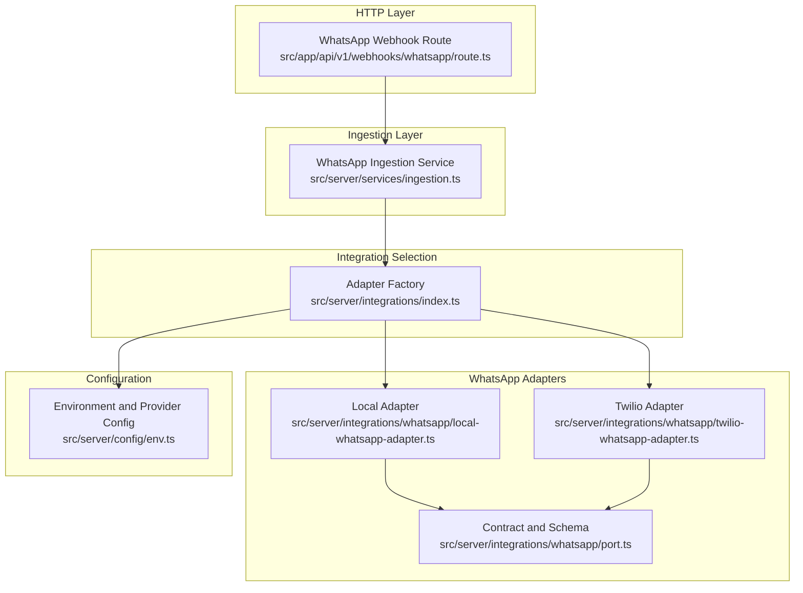
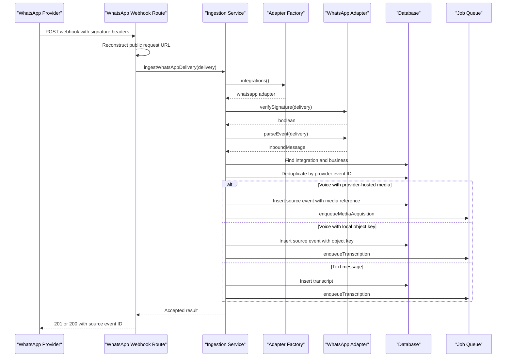
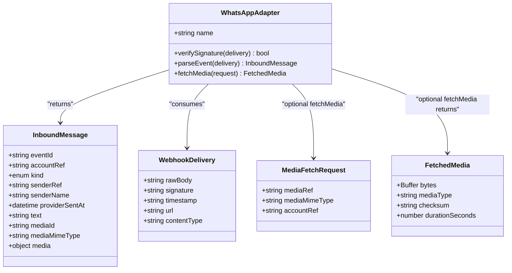
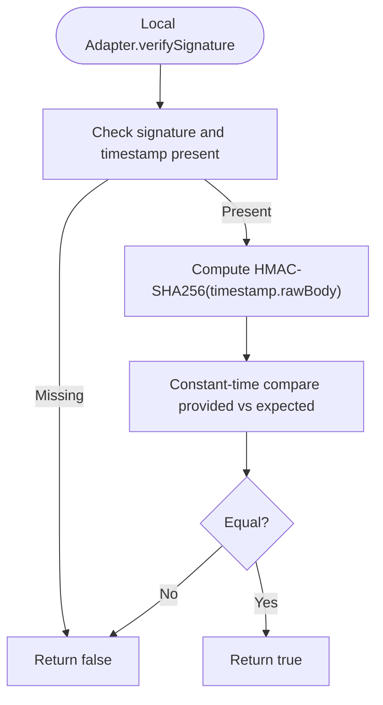
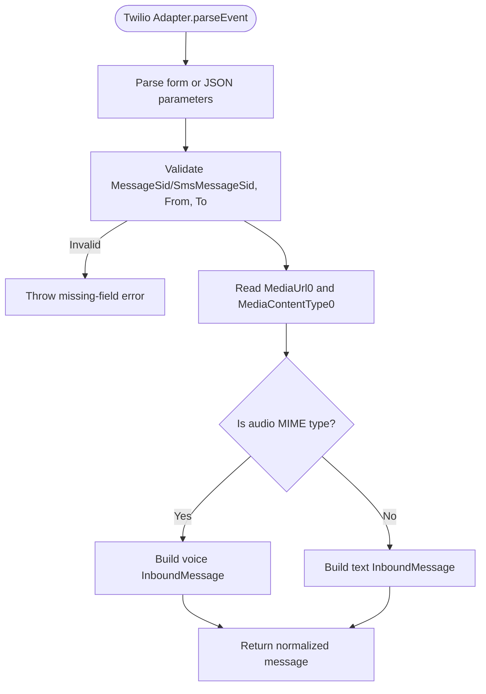
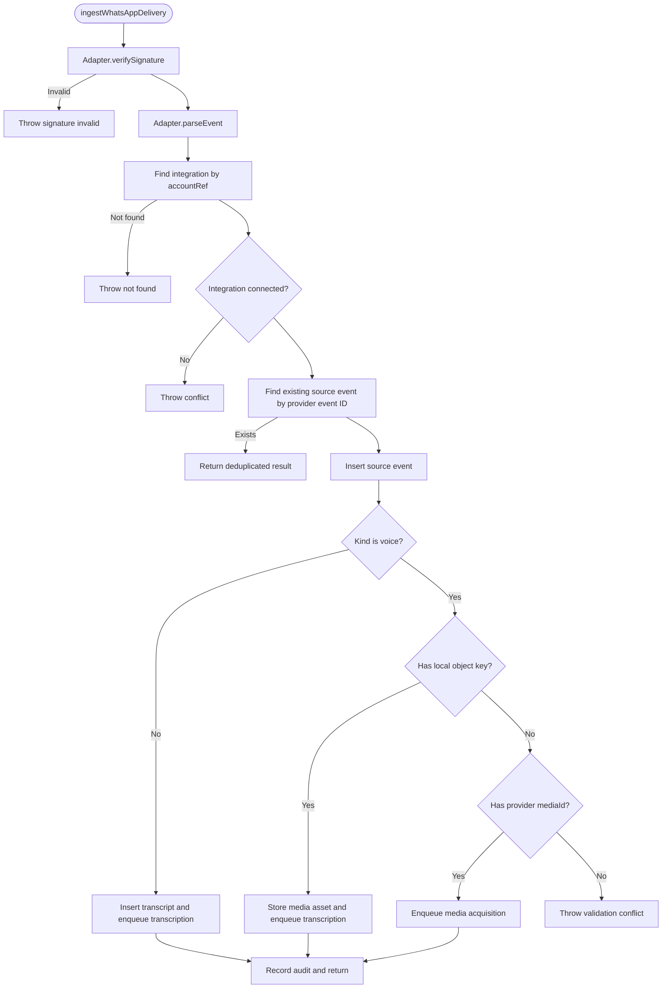
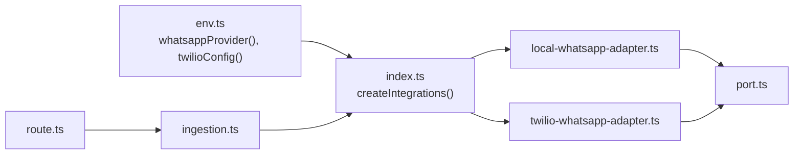
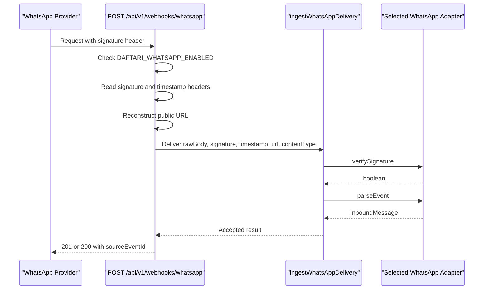

# WhatsApp Adapters

<cite>
**Referenced Files in This Document**
- [port.ts](file://src/server/integrations/whatsapp/port.ts)
- [local-whatsapp-adapter.ts](file://src/server/integrations/whatsapp/local-whatsapp-adapter.ts)
- [twilio-whatsapp-adapter.ts](file://src/server/integrations/whatsapp/twilio-whatsapp-adapter.ts)
- [env.ts](file://src/server/config/env.ts)
- [index.ts](file://src/server/integrations/index.ts)
- [route.ts](file://src/app/api/v1/webhooks/whatsapp/route.ts)
- [ingestion.ts](file://src/server/services/ingestion.ts)
</cite>

## Table of Contents
1. [Introduction](#introduction)
2. [Project Structure](#project-structure)
3. [Core Components](#core-components)
4. [Architecture Overview](#architecture-overview)
5. [Detailed Component Analysis](#detailed-component-analysis)
6. [Dependency Analysis](#dependency-analysis)
7. [Configuration and Authentication](#configuration-and-authentication)
8. [Webhook Handling and Message Processing](#webhook-handling-and-message-processing)
9. [Message Format Conversion](#message-format-conversion)
10. [Error Handling Patterns](#error-handling-patterns)
11. [Implementing a Custom WhatsApp Adapter](#implementing-a-custom-whatsapp-adapter)
12. [Testing Strategies with the Mock and Local Adapters](#testing-strategies-with-the-mock-and-local-adapters)
13. [Performance Considerations](#performance-considerations)
14. [Troubleshooting Guide](#troubleshooting-guide)
15. [Conclusion](#conclusion)

## Introduction
This document explains the WhatsApp adapter layer used to ingest voice messages from WhatsApp. The system separates provider-specific transport details from platform processing: adapters authenticate incoming webhooks, normalize them into a shared inbound message model, and optionally download provider-hosted media. The webhook route is intentionally fast and durable; transcription, extraction, and proposal generation run asynchronously as jobs after the delivery is accepted.

The repository currently provides:
- A shared WhatsApp adapter contract and normalized message schema.
- A local development adapter that simulates signed webhooks without network calls.
- A production Twilio WhatsApp adapter that verifies Twilio signatures and downloads voice media.
- An ingestion service that deduplicates events, persists source events, stores or links media, and enqueues downstream jobs.

## Project Structure
The WhatsApp integration lives under `src/server/integrations/whatsapp`, while the HTTP entry point is under `src/app/api/v1/webhooks/whatsapp`. Configuration is centralized in `src/server/config/env.ts`, and adapter selection is centralized in `src/server/integrations/index.ts`.

**Diagram sources**
- [route.ts:1-69](file://src/app/api/v1/webhooks/whatsapp/route.ts#L1-L69)
- [ingestion.ts:1-217](file://src/server/services/ingestion.ts#L1-L217)
- [index.ts:1-93](file://src/server/integrations/index.ts#L1-L93)
- [port.ts:1-91](file://src/server/integrations/whatsapp/port.ts#L1-L91)
- [local-whatsapp-adapter.ts:1-39](file://src/server/integrations/whatsapp/local-whatsapp-adapter.ts#L1-L39)
- [twilio-whatsapp-adapter.ts:1-122](file://src/server/integrations/whatsapp/twilio-whatsapp-adapter.ts#L1-L122)
- [env.ts:46-85](file://src/server/config/env.ts#L46-L85)

**Section sources**
- [route.ts:1-69](file://src/app/api/v1/webhooks/whatsapp/route.ts#L1-L69)
- [index.ts:1-93](file://src/server/integrations/index.ts#L1-L93)

## Core Components
The WhatsApp integration is built around a small, explicit interface:

| Component | Responsibility |
|---|---|
| `WhatsAppAdapter` | Defines the contract for signature verification, event parsing, and optional media fetching. |
| `InboundMessage` | Normalized representation of a WhatsApp delivery, including text, voice metadata, sender information, and timestamps. |
| `WebhookDelivery` | Raw webhook payload plus transport metadata needed by adapters to verify signatures. |
| `MediaFetchRequest` / `FetchedMedia` | Contract for downloading provider-hosted media bytes and computing checksums. |
| Local adapter | Development-only implementation using HMAC over timestamp and body. |
| Twilio adapter | Production implementation verifying Twilio’s URL-based HMAC-SHA1 signature and downloading audio via Basic auth. |
| Ingestion service | Authenticates, deduplicates, persists, and queues asynchronous processing. |

Key design principles:
- Adapters do not store deliveries or process transcripts; they only authenticate and normalize.
- Voice messages may carry either an already-stored object key or a provider-hosted media reference.
- The webhook endpoint returns quickly once the delivery is durably stored.

**Section sources**
- [port.ts:1-91](file://src/server/integrations/whatsapp/port.ts#L1-L91)
- [ingestion.ts:1-217](file://src/server/services/ingestion.ts#L1-L217)

## Architecture Overview
The WhatsApp ingestion flow is split across HTTP, ingestion, and adapter layers.

**Diagram sources**
- [route.ts:17-68](file://src/app/api/v1/webhooks/whatsapp/route.ts#L17-L68)
- [ingestion.ts:66-207](file://src/server/services/ingestion.ts#L66-L207)
- [index.ts:65-70](file://src/server/integrations/index.ts#L65-L70)

## Detailed Component Analysis

### WhatsApp Adapter Interface and Shared Types
The shared port defines:
- `InboundMessage`: validated through a Zod schema with fields for event identity, account reference, message kind, sender metadata, timestamps, optional text, optional media identifier, optional MIME type, and optional pre-stored media metadata.
- `WebhookDelivery`: raw body, signature, timestamp, optional signed URL, and optional content type.
- `MediaFetchRequest` and `FetchedMedia`: contracts for adapters that must download provider-hosted media.
- `parseInboundMessage`: JSON decoding and schema validation helper.

Complexity characteristics:
- Parsing is linear in the size of the JSON body.
- Validation adds strict shape checks and type safety for downstream services.

**Diagram sources**
- [port.ts:12-81](file://src/server/integrations/whatsapp/port.ts#L12-L81)

**Section sources**
- [port.ts:1-91](file://src/server/integrations/whatsapp/port.ts#L1-L91)

### Local WhatsApp Adapter
The local adapter is intended for development and testing:
- It uses HMAC-SHA256 over a timestamp and raw body.
- It reads a webhook secret from environment variables with a deterministic fallback.
- It does not make network calls.
- It reuses the shared `parseInboundMessage` helper.

Security notes:
- Signature comparison uses constant-time comparison to avoid timing leaks.
- The local secret should be replaced in tests or CI environments rather than relying on the default fallback.

**Diagram sources**
- [local-whatsapp-adapter.ts:13-34](file://src/server/integrations/whatsapp/local-whatsapp-adapter.ts#L13-L34)

**Section sources**
- [local-whatsapp-adapter.ts:1-39](file://src/server/integrations/whatsapp/local-whatsapp-adapter.ts#L1-L39)

### Twilio WhatsApp Adapter
The Twilio adapter handles production behavior:
- Verifies Twilio’s HMAC-SHA1 signature over the full request URL and sorted form parameters.
- Parses both form-encoded and JSON bodies.
- Detects voice messages when `MediaUrl0` is present and its MIME type starts with `audio/`.
- Downloads media using HTTP Basic authentication with the configured Twilio credentials.
- Computes a SHA-256 checksum of downloaded bytes.

Important behaviors:
- If signature or URL is missing, verification fails early.
- If parameter parsing fails, verification fails safely.
- Non-OK responses from media download are wrapped in a provider error, with retryable status codes identified.

**Diagram sources**
- [twilio-whatsapp-adapter.ts:21-96](file://src/server/integrations/whatsapp/twilio-whatsapp-adapter.ts#L21-L96)

**Section sources**
- [twilio-whatsapp-adapter.ts:1-122](file://src/server/integrations/whatsapp/twilio-whatsapp-adapter.ts#L1-L122)

### Ingestion Service
The ingestion service owns the durable webhook lifecycle:
- Uses the selected WhatsApp adapter to verify signatures and parse events.
- Resolves the connected WhatsApp integration and validates its status.
- Deduplicates by provider event ID per integration.
- Persists a redacted source event.
- For voice messages:
  - If the provider already stored the media under an object key, it records the asset and enqueues transcription.
  - If the provider only provides a downloadable media reference, it enqueues media acquisition.
- For text messages, it inserts a transcript and enqueues transcription.
- Records audit events and returns context for downstream jobs.

**Diagram sources**
- [ingestion.ts:66-207](file://src/server/services/ingestion.ts#L66-L207)

**Section sources**
- [ingestion.ts:1-217](file://src/server/services/ingestion.ts#L1-L217)

## Dependency Analysis
The adapter selection is centralized so feature code never branches on environment flags directly.

**Diagram sources**
- [env.ts:46-85](file://src/server/config/env.ts#L46-L85)
- [index.ts:65-70](file://src/server/integrations/index.ts#L65-L70)
- [route.ts:10-15](file://src/app/api/v1/webhooks/whatsapp/route.ts#L10-L15)
- [ingestion.ts:15-20](file://src/server/services/ingestion.ts#L15-L20)

**Section sources**
- [index.ts:1-93](file://src/server/integrations/index.ts#L1-L93)
- [env.ts:46-85](file://src/server/config/env.ts#L46-L85)

## Configuration and Authentication
### Environment Variables
| Variable | Purpose | Notes |
|---|---|---|
| `DAFTARI_WHATSAPP_PROVIDER` | Selects the active WhatsApp provider | Allowed values are `local` and `twilio`; defaults to `local`. |
| `DAFTARI_WHATSAPP_ENABLED` | Enables the WhatsApp ingestion webhook | Disabled by default while the in-app recorder is the supported intake path. |
| `TWILIO_ACCOUNT_SID` | Twilio account identifier | Required when using the Twilio adapter. |
| `TWILIO_AUTH_TOKEN` | Twilio authentication token | Required for signature verification and media download. |
| `TWILIO_WHATSAPP_NUMBER` | Business WhatsApp number used to match inbound deliveries | Stored as a bare E.164 number without the `whatsapp:` prefix. |
| `DAFTARI_WEBHOOK_SECRET` | Secret for local webhook signing | Used by the local adapter; falls back to a deterministic default if unset. |

### Authentication Models
| Adapter | Signature Model | Media Access |
|---|---|---|
| Local | HMAC-SHA256 over `timestamp.rawBody` | No network access; media can be passed as an already-stored object key. |
| Twilio | HMAC-SHA1 over the full request URL plus sorted form parameters | Downloads media using HTTP Basic authentication with account SID and auth token. |

**Section sources**
- [env.ts:46-85](file://src/server/config/env.ts#L46-L85)
- [local-whatsapp-adapter.ts:13-22](file://src/server/integrations/whatsapp/local-whatsapp-adapter.ts#L13-L22)
- [twilio-whatsapp-adapter.ts:34-39](file://src/server/integrations/whatsapp/twilio-whatsapp-adapter.ts#L34-L39)
- [twilio-whatsapp-adapter.ts:98-118](file://src/server/integrations/whatsapp/twilio-whatsapp-adapter.ts#L98-L118)

## Webhook Handling and Message Processing
The webhook route performs these steps:
1. Checks whether WhatsApp ingestion is enabled.
2. Reads the raw body and signature headers.
3. Reconstructs the absolute public URL used by providers like Twilio.
4. Delegates to the ingestion service.
5. Logs acceptance and returns either a duplicate-accepted response or a newly created response.

**Diagram sources**
- [route.ts:17-68](file://src/app/api/v1/webhooks/whatsapp/route.ts#L17-L68)
- [ingestion.ts:66-75](file://src/server/services/ingestion.ts#L66-L75)

**Section sources**
- [route.ts:1-69](file://src/app/api/v1/webhooks/whatsapp/route.ts#L1-L69)
- [ingestion.ts:66-75](file://src/server/services/ingestion.ts#L66-L75)

## Message Format Conversion
Adapters convert provider-specific payloads into `InboundMessage`:

| Field | Local Adapter | Twilio Adapter |
|---|---|---|
| `eventId` | Provided by simulator payload | `MessageSid` or `SmsMessageSid` |
| `accountRef` | Provided by simulator payload | `To` address normalized to bare E.164 |
| `senderRef` | Provided by simulator payload | `From` address normalized to bare E.164 |
| `senderName` | Provided by simulator payload | Optional `ProfileName` |
| `providerSentAt` | Provided by simulator payload | Current receipt time because Twilio does not expose a reliable original timestamp |
| `kind` | Provided by simulator payload | `voice` when audio media is present; otherwise `text` |
| `text` | Provided by simulator payload | Present only for text messages |
| `mediaId` | Usually absent; local adapter prefers `media.objectKey` | Provider-hosted media URL when present |
| `mediaMimeType` | Provided by simulator payload | Audio MIME type when present |
| `media` | Pre-stored object metadata when available | Usually absent; adapter downloads media later |

**Section sources**
- [port.ts:12-38](file://src/server/integrations/whatsapp/port.ts#L12-L38)
- [local-whatsapp-adapter.ts:36-38](file://src/server/integrations/whatsapp/local-whatsapp-adapter.ts#L36-L38)
- [twilio-whatsapp-adapter.ts:71-96](file://src/server/integrations/whatsapp/twilio-whatsapp-adapter.ts#L71-L96)

## Error Handling Patterns
| Scenario | Behavior |
|---|---|
| Invalid signature | Ingestion throws a signature-invalid error; the webhook route surfaces this as a failure. |
| Missing integration | Ingestion throws a not-found error when no connected WhatsApp account matches the delivery. |
| Disconnected integration | Ingestion throws a conflict error indicating the WhatsApp account is not connected. |
| Duplicate event | Ingestion returns a deduplicated result instead of creating a new source event. |
| Missing required Twilio fields | Twilio adapter throws an error during event parsing. |
| Media download failure | Twilio adapter wraps network or non-OK responses in a provider error, marking retryable cases such as rate limits and server errors. |
| Voice message without media | Ingestion throws a validation conflict because voice requires either an object key or a provider media reference. |

**Section sources**
- [ingestion.ts:66-104](file://src/server/services/ingestion.ts#L66-L104)
- [ingestion.ts:139-163](file://src/server/services/ingestion.ts#L139-L163)
- [twilio-whatsapp-adapter.ts:56-69](file://src/server/integrations/whatsapp/twilio-whatsapp-adapter.ts#L56-L69)
- [twilio-whatsapp-adapter.ts:71-78](file://src/server/integrations/whatsapp/twilio-whatsapp-adapter.ts#L71-L78)
- [twilio-whatsapp-adapter.ts:98-118](file://src/server/integrations/whatsapp/twilio-whatsapp-adapter.ts#L98-L118)

## Implementing a Custom WhatsApp Adapter
To implement a custom adapter:

1. Create a new file under `src/server/integrations/whatsapp/`.
2. Implement the `WhatsAppAdapter` interface:
   - Provide a stable `name`.
   - Implement `verifySignature` using the provider’s signature algorithm.
   - Implement `parseEvent` to convert the provider payload into `InboundMessage`.
   - Optionally implement `fetchMedia` if the provider hosts media behind a secure endpoint.
3. Register the adapter in `src/server/integrations/index.ts`:
   - Add a new provider selector value in `src/server/config/env.ts`.
   - Construct the adapter in `createIntegrations`.
   - Export it through `integrations()` so ingestion can use it.
4. Configure environment variables:
   - Set `DAFTARI_WHATSAPP_PROVIDER` to the new provider name.
   - Add any provider-specific configuration variables.
5. Test the adapter:
   - Use `overrideIntegrations` to swap in a test implementation.
   - Simulate signatures and payloads matching your provider’s contract.

Recommended patterns:
- Keep signature computation deterministic and constant-time where applicable.
- Normalize addresses consistently, similar to how Twilio addresses are stripped of the `whatsapp:` prefix.
- Treat media references and pre-stored object keys as separate paths, following the ingestion service’s expectations.
- Wrap external failures in a consistent provider error type when integrating with other parts of the system.

**Section sources**
- [port.ts:71-81](file://src/server/integrations/whatsapp/port.ts#L71-L81)
- [index.ts:65-70](file://src/server/integrations/index.ts#L65-L70)
- [env.ts:46-85](file://src/server/config/env.ts#L46-L85)

## Testing Strategies with the Mock and Local Adapters
The local adapter is designed for deterministic testing:
- It produces and verifies HMAC-SHA256 signatures over timestamp and body.
- It avoids network calls, making it safe for unit and integration tests.
- Tests can simulate payloads that include either text or voice messages.

For provider-specific behavior:
- Use `overrideIntegrations` to replace the WhatsApp adapter with a controlled implementation.
- For Twilio-like behavior, implement `verifySignature`, `parseEvent`, and `fetchMedia` with mockable dependencies.
- Exercise both success and failure paths:
  - Valid and invalid signatures.
  - Text and voice messages.
  - Local object-key media versus provider-hosted media references.
  - Network failures and retryable status codes for media download.

The ingestion service also exposes helpers for tests and dev simulation, such as looking up integrations by account reference.

**Section sources**
- [local-whatsapp-adapter.ts:1-39](file://src/server/integrations/whatsapp/local-whatsapp-adapter.ts#L1-L39)
- [index.ts:80-93](file://src/server/integrations/index.ts#L80-L93)
- [ingestion.ts:210-217](file://src/server/services/ingestion.ts#L210-L217)

## Performance Considerations
- The webhook route responds immediately after durable storage; transcription and extraction are asynchronous.
- Signature verification uses constant-time comparison to reduce timing side channels.
- Media acquisition is queued separately from transcription to avoid blocking the webhook response.
- The adapter factory caches the selected integrations for the process lifetime.
- Large media downloads should be handled carefully; the Twilio adapter computes a checksum but does not impose size limits itself.

[No sources needed since this section provides general guidance]

## Troubleshooting Guide
Common issues and diagnostics:

| Symptom | Likely Cause | Resolution |
|---|---|---|
| Webhook returns not found | WhatsApp ingestion is disabled | Enable `DAFTARI_WHATSAPP_ENABLED`. |
| Signature invalid | Wrong secret, wrong signature algorithm, or malformed headers | Verify local secret or Twilio credentials and ensure the correct signature header is forwarded. |
| No connected WhatsApp account | Integration not configured or mismatched account reference | Ensure the business has a connected WhatsApp integration matching the normalized account reference. |
| Integration not connected | Integration exists but is inactive | Activate or reconnect the WhatsApp integration. |
| Voice message without media | Adapter returned voice kind without object key or media ID | Fix the adapter to include either pre-stored media metadata or a downloadable media reference. |
| Media download failed | Network error or non-OK HTTP response from provider | Check provider credentials, network connectivity, and retry logic for retryable status codes. |
| Duplicate webhook accepted | Provider redelivered the same event | This is expected; the ingestion service deduplicates by provider event ID. |

**Section sources**
- [route.ts:33-39](file://src/app/api/v1/webhooks/whatsapp/route.ts#L33-L39)
- [ingestion.ts:72-87](file://src/server/services/ingestion.ts#L72-L87)
- [ingestion.ts:139-163](file://src/server/services/ingestion.ts#L139-L163)
- [twilio-whatsapp-adapter.ts:98-118](file://src/server/integrations/whatsapp/twilio-whatsapp-adapter.ts#L98-L118)

## Conclusion
The WhatsApp adapter layer cleanly separates provider transport concerns from platform processing. The shared `WhatsAppAdapter` interface enables multiple implementations, while the ingestion service ensures durable, deduplicated, and asynchronous handling of voice and text messages. For development, the local adapter provides deterministic signature verification and payload parsing. For production, the Twilio adapter implements Twilio’s signature scheme and media download workflow. New providers can be added by implementing the interface, registering the adapter, and configuring environment variables, while keeping webhook performance and reliability intact.

[No sources needed since this section summarizes without analyzing specific files]